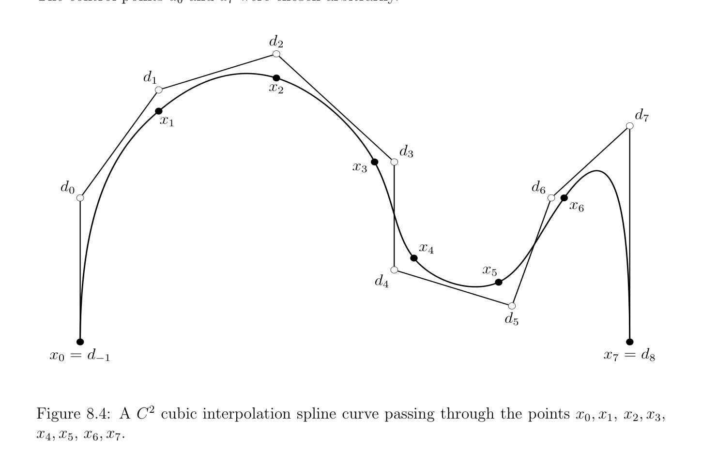

# Motivating Ví dụ: Đường cong Nội suy

<!-- PAGE 257 -->
Chương $8$ Phép khử Gauss (Gaussian elimination), $LU$ -Nhân tử hóa, Nhân tử hóa Cholesky (Cholesky factorization), Dạng bậc thang rút gọn theo hàng (RREF) Trong chương này ta giả sử rằng tất cả các không gian vectơ là trên trường $\mathbb{R}$. Tất cả các kết quả rằng thực hiện không rely trên thứ tự trên $\mathbb{R}$ hoặc trên lấy square các nghiệm đúng cho tùy ý các trường.

## 8.1 Motivating Ví dụ: Đường cong Nội suy

Đường cong nội suy là bài toán rằng phát sinh frequently trong máy tính đồ họa và trong rô-bốt học (đường đi planning). Có nhiều các cách của tackling bài toán này và trong mục này ta sẽ mô tả nghiệm bằng cách sử dụng bậc ba splines. Như vậy splines bao gồm của bậc ba B´ezier các đường cong. Chúng là thường được sử dụng bởi vì chúng là cheap đến cài đặt và cho nhiều hơn/thêm flexibility hơn toàn phương B´ezier các đường cong.
$$\mathbb{R}^{2}  \mathbb{R}^{3}$$
Bậc ba B´ezier đường cong C(t) (trong hoặc) là specified bởi danh sách của bốn control các điểm $(b_{0}, b_{1}, b_{2}, b_{3})$ và là cho trước parametrically bởi phương trình
$$C(t) = (1 -t)^{3}b_{0} + 3(1 -t)^{2}t b_{1} + 3(1 -t)t^{2}b_{2} + t^{3}b_{3}.$$
Rõ ràng, C(0) $= b_{0}$, C(1) $= b_{3}$, và cho $t \in [0, 1]$, điểm C(t) thuộc đến bao lồi (convex hull) của control các điểm $b_{0}, b_{1}, b_{2}, b_{3}$. các đa thức
$$(1 -t)^{3},3(1 -t)^{2}t,3(1 -t)t^{2},t^{3}$$
Là Bernstein các đa thức của bậc $3$. Typically, ta là chỉ interested trong đường cong đoạn thẳng tương ứng với các giá trị của $t$ trong khoảng/đoạn $[0, 1]$. Vẫn, placement của control các điểm drastically affects hình dạng của đường cong đoạn thẳng, mà có thể chẵn/ngay cả có self-intersection; Xem Các hình 8.1, 8.2, 8.3 minh họa khác nhau configurations.
$$257$$

<!-- PAGE 258 -->
$$b$$
$$1$$
$$b$$
$$2$$
$$bb$$
$$03$$
$$Figure 8.1: A “standard” B´ezier curve.$$
$$b$$
$$1$$
$$b$$
$$3$$
$$b$$
$$0$$
$$b$$
$$2$$
$$Figure 8.2: A B´ezier curve with an inflection point.$$

<!-- PAGE 259 -->
$$bb$$
$$21$$
$$bb$$
$$03$$
$$Figure 8.3: A self-intersecting B´ezier curve.$$
Nội suy các bài tập đòi hỏi việc tìm các đường cong chuyển qua một số cho trước dữ liệu các điểm và có thể thỏa mãn một số extra các ràng buộc. B´ezier spline đường cong $F$ là đường cong mà được tạo lên của đường cong các đoạn thẳng mà là B´ezier các đường cong, nói $C_{1}, \dots  , C_{m} (m \ge 2)$. Ta sẽ giả sử rằng $F$ được định nghĩa trên $[0, m]$, sao cho cho $i = 1, \dots  , m$,
$$F(t) = C_{i}(t -i + 1),i -1 \le t \le i.$$
Typically, một số smoothness là cần thiết giữa bất kỳ hai junction các điểm, nghĩa là, giữa bất kỳ hai các điểm $C_{i}(1)$ và $C_{i+1}(0)$, cho $i = 1, \dots  , m$ - $1$. Ta đòi hỏi rằng $C_{i}(1) = C_{i+1}(0) (C^{0}-continuity)$, và typically rằng các đạo hàm của $C_{i}$ tại $1$ và của $C_{i+1}$ tại $0$ agree sai khác thứ hai thứ tự các đạo hàm. Điều này được gọi là $C^{2}-continuity$, và nó các đảm bảo rằng các tiếp tuyến agree cũng như curvatures. Có số của nội suy các bài tập, và ta xét một của hầu hết chung/phổ biến các bài tập mà có thể được được phát biểu như sau: Bài toán: Cho trước $N + 1$ dữ liệu các điểm $x_{0}, \dots  , x_{N}$, tìm $C^{2}$ bậc ba spline đường cong $F$ sao cho F(i) $= x_{i}$ với mọi $i, 0 \le i \le N (N \ge 2)$. cách để giải bài toán này là để tìm $N + 3$ phụ các điểm $d_{-1}, \dots  , d_{N+1}$, được gọi là de Boor control các điểm, từ mà $N$ B´ezier các đường cong có thể được tìm thấy. Thực sự,
$$d_{-1} = x_{0}andd_{N+1} = x_{N}$$

<!-- PAGE 260 -->
Do đó ta chỉ cần để tìm $N + 1$ các điểm $d_{0}, \dots  , d_{N}$. Hóa ra là $C^{2}-continuity$ các ràng buộc trên $N$ B´ezier các đường cong cho chỉ $N$ - $1$ các phương trình, do đó $d_{0}$ và $d_{N}$ có thể được được chọn arbitrarily. Trong thực tế, $d_{0}$ và $d_{N}$ được chọn theo khác nhau kết thúc/cuối các điều kiện, chẳng hạn như prescribed velocities tại $x_{0}$ và $x_{N}$. Cho time đang là, ta sẽ giả sử rằng $d_{0}$ và $d_{N}$ là cho trước. Hình 8.4 minh họa nội suy bài toán liên quan đến $N + 1 = 7 + 1 = 8$ dữ liệu các điểm. control các điểm $d_{0}$ và $d_{7}$ đã được chọn arbitrarily.
$$d_{2}$$
$$d_{1}$$
$$x_{2}$$
$$d_{7}$$
$$x_{1}$$
$$d_{3}$$
$$x_{3}$$
$d_{0} d_{6}$
$$x_{6}$$
$$x_{4}$$
$$x_{5}$$
$$d_{4}$$
$$d_{5}$$
$x_{0} = d_{-1} x_{7} = d_{8}$

**Hình 8.4:** $C^{2}$ bậc ba nội suy spline đường cong chuyển qua các điểm $x_{0}, x_{1}, x_{2}, x_{3}, x_{4}, x_{5}, x_{6}, x_{7}$. Nó có thể được được hiển thị rằng $d_{1}, \dots  , d_{N-1}$ được cho bởi hệ phương trình tuyến tính
$$\begin{pmatrix} 7 & 1 \\ 1\overline{2} & 4 & 1 & 0 \\ \ddots & \ddots & \ddots \\ 0 & 1 & 4 & 1 \\ 1 & 7 \end{pmatrix} \begin{pmatrix} d_{1} \\ d_{2} \\ \vdots \\ d_{N-2} \\ d_{N-1} \end{pmatrix} = \begin{pmatrix} 6x_{1} -^{3}d_{0} \\ 6x_{2}^{2} \\ \vdots \\ 6x_{N-2} \\ 6x_{N-1} & d_{N} \end{pmatrix} .$$
$$-_{2}^{3}$$
$$\overline{2}$$
Ta sẽ chỉ ra sau này rằng ở trên ma trận là khả nghịch bởi vì nó là chặt một cách đường chéo trội.
