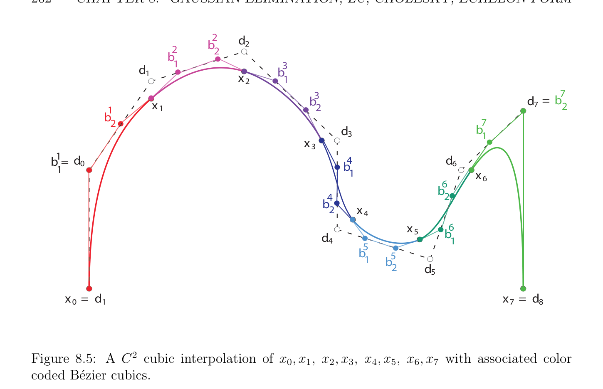

# Phép khử Gauss (Gaussian elimination)

<!-- PAGE 261 -->
Một lần ở trên hệ được giải, B´ezier các bậc ba $C_{1}, \dots , C_{N}$ được xác định như sau (ta giả sử $N \ge 2)$: Cho $2 \le i \le N$ - $1$, control các điểm $(b_{0}^{i}, b_{1}^{i}, b_{2}^{i}, b_{3}^{i})$ của $C_{i}$ được cho bởi
$$b_{0}^{i} = x_{i-1}$$
$$b_{1}^{i} = \frac{2}{3} d_{i-1} + \frac{1}{3} d_{i}$$
$$b_{2}^{i} = \frac{1}{3} d_{i-1} + \frac{2}{3} d_{i}$$
$$b_{3}^{i} = x_{i}.$$
Control các điểm $(b_{0}^{1}, b_{1}^{1}, b_{2}^{1}, b_{3}^{1})$ của $C_{1}$ được cho bởi
$$b_{0}^{1} = x_{0}$$
$$b_{1}^{1} = d_{0}$$
$$b_{2}^{1} = \frac{1}{2} d_{0} + \frac{1}{2} d_{1}$$
$$b_{3}^{1} = x_{1},$$
Và control các điểm $(b_{0}^{N} , b_{1}^{N} , b_{2}^{N} , b_{3}^{N}$) của $C_{N}$ được cho bởi
$$b_{0}^{N} = x_{N-1}$$
$$b_{1}^{N} = \frac{1}{2} d_{N-1} + \frac{1}{2} d_{N}$$
$$b_{2}^{N} = d_{N}$$
$$b_{3}^{N} = x_{N}.$$
Hình 8.5 minh họa điều này process spline nội suy cho $N = 7$. Ta sẽ bây giờ mô tả khác nhau các phương pháp cho việc giải các hệ phương trình tuyến tính. Vì ma trận của ở trên hệ là ba đường chéo, có specialized các phương pháp mà là nhiều hơn/thêm efficient hơn tổng quát các phương pháp. Ta sẽ thảo luận một vài của các phương pháp này.

## 8.2 Phép khử Gauss (Gaussian elimination)

$$\mathbb{R}^{n}$$
Cho $A$ là một ma trận cỡ $n \times  n$, cho $b \in$ là $n$ chiều vectơ và giả sử rằng $A$ là khả nghịch. Của ta mục tiêu là để giải hệ Ax $= b$. Vì $A$ được giả sử là khả nghịch, ta biết rằng hệ này có duy nhất nghiệm $x = A^{-1}b$. Experience chỉ ra rằng hai counter-intuitive các sự kiện là revealed:
$(1)$ Một nên tránh việc tính toán nghịch đảo $A^{-1}$ của $A$ một cách tường minh. Điều này là inefficient vì nó sẽ lượng đến việc giải $n$ các hệ phương trình tuyến tính $Au^{(j)} = e_{j}$ cho $j = 1, \dots  , n$, ở đâu
$$\mathbb{R}^{n}$$
$e_{j} = (0, \dots  , 1, \dots  , 0)$ là vectơ cơ sở chính tắc thứ $j$ của (với $1$ là thứ $j$ slot). Bởi thực hiện do đó, ta sẽ thay thế resolution của đơn lẻ hệ bởi resolution của $n$ các hệ, và ta sẽ vẫn có đến nhân $A^{-1}$ bởi $b$.

<!-- PAGE 262 -->
$$d_{2}$$
$$b_{2}^{2}$$
$$b_{1}^{2}$$
$$d_{1}b_{1}^{3}$$
$$x_{2}$$
$$x_{1}b_{2}^{3}d_{7}=b_{2}^{7}$$
$$1$$
$$b_{2}$$
$$d_{3}b_{1}^{7}$$
$$x_{3}$$
$1 d_{0} d_{6} b = 4 1 b_{1}$
$$x_{6}$$
$$b_{2}^{6}$$
$$b_{2}^{4}$$
$$x_{4}$$
$$x_{5}$$
$$d_{4}b_{1}^{6}$$
$$b_{1}^{5}$$
$$b_{2}^{5}$$
$$d_{5}$$
$x_{0} = d_{1} x_{7} = d_{8}$

**Hình 8.5:** $C^{2}$ bậc ba nội suy của $x_{0}, x_{1}, x_{2}, x_{3}, x_{4}, x_{5}, x_{6}, x_{7}$ với liên kết color coded B´ezier các bậc ba.
$(2)$ Một thực hiện không giải (lớn) các hệ phương trình tuyến tính bởi việc tính toán các định thức (bằng cách sử dụng Cramer’s các công thức) vì phương pháp này đòi hỏi số của các phép cộng (resp. các phép nhân) tỷ lệ đến $(n + 1)$! (resp. $(n + 2)!)$. then chốt ý tưởng trên mà hầu hết trực tiếp các phương pháp (như opposed đến các phương pháp lặp, rằng nhìn cho xấp xỉ của nghiệm) là based là rằng nếu $A$ là tam giác trên (upper-triangular) ma trận, mà có nghĩa là $a_{ij} = 0$ cho $1 \le j < i \le n$ (resp. tam giác dưới (lower-triangular), mà có nghĩa là $a_{ij} = 0$ cho $1 \le i < j \le n)$, thì việc tính toán nghiệm $x$ là tầm thường. Thật vậy, nói $A$ là tam giác trên (upper-triangular) ma trận
$$A = \begin{pmatrix} a_{1 1} & a_{1 2} & \cdots & a_{1n-2} & a_{1n-1} & a_{1n} \\ 0 & a_{2 2} & \cdots & a_{2n-2} & a_{2n-1} & a_{2n} \\ 0 & 0 & \ddots & \vdots & \vdots & \vdots \\ \ddots & \vdots & \vdots \\ 0 & 0 & \cdots & 0 & a_{n-1n-1} & a_{n-1n} \\ 0 & 0 & 0 & 0 & a_{n n} \end{pmatrix} .$$
$$\cdots$$
Thì det() $= a_{1 1}a_{2 2} \cdots  a_{n n} \neq  0$, mà suy ra rằng $a_{i i} \neq  0$ cho $i = 1, \dots  , n$, và ta có thể giải hệ Ax $= b$ từ bottom-up bởi back-substitution. Rằng là, thứ nhất ta tính

<!-- PAGE 263 -->
$x_{n}$ từ phương trình cuối cùng, tiếp theo plug giá trị này của $x_{n}$ vào tiếp theo đến phương trình cuối cùng và tính $x_{n-1}$ từ nó, etc. Điều này cho ta
$$x_{n}=a_{n n}^{-1}b_{n}$$
$$x_{n-1}=a_{n-1n-1}^{-1}(b_{n-1} -a_{n-1n}x_{n})$$
$$\vdots$$
$$x_{1}=a_{1 1}^{-1}(b_{1} -a_{1 2}x_{2} -\cdots  -a_{1n}x_{n}).$$
Lưu ý rằng sử dụng của các định thức có thể được tránh được để chứng minh rằng nếu $A$ là khả nghịch thì $a_{i i} \neq  0$ cho $i = 1, \dots  , n$. Thật vậy, nó có thể được được hiển thị một cách trực tiếp (bởi quy nạp) rằng trên (hoặc thấp hơn) tam giác ma trận là khả nghịch khi và chỉ khi tất cả của nó đường chéo các phần tử (entries) là khác không. Nếu $A$ là tam giác dưới (lower-triangular), ta giải hệ từ top-down bởi forward-substitution. Do đó, những gì ta cần là phương pháp cho biến đổi ma trận đến tương đương một trong uppertriangular tạo thành. Điều này có thể được được thực hiện bởi phép khử. Cho chúng ta minh họa phương pháp này trên sau đây ví dụ:
$$2x+y+z=5$$
$$4x-6y=-2$$
$$-2x+7y+2z=9.$$
Ta có thể khử biến $x$ từ thứ hai và phương trình thứ ba như sau: Trừ hai lần phương trình thứ nhất từ thứ hai và cộng phương trình thứ nhất đến thứ ba. Ta thu được mới hệ
$$2x+y+z=5$$
$$-8y-2z=-12$$
$$8y+3z=14.$$
Điều này time ta có thể khử biến $y$ từ phương trình thứ ba bằng cách cộng phương trình thứ hai đến thứ ba:
$$2x+y+z=5$$
$$-8y-2z=-12$$
$$z=2.$$
Điều này cuối cùng hệ là tam giác trên (upper-triangular). Bằng cách sử dụng back-substitution, ta tìm nghiệm: $z = 2, y = 1, x = 1$. Nhận thấy rằng ta có performed chỉ hàng các phép toán. tổng quát phương pháp là đến một cách lặp khử các biến bằng cách sử dụng đơn giản hàng các phép toán (cụ thể là, cộng hoặc trừ bội của hàng đến một cái khác hàng của ma trận) trong khi simultaneously áp dụng các phần tử này các phép toán đến vectơ $b$, để thu được hệ, MAx $=$ Mb, ở đâu MA là tam giác trên (upper-triangular). Như vậy phương pháp được gọi là Phép khử Gauss (Gaussian elimination). Tuy nhiên, một extra twist là cần thiết cho phương pháp đến hoạt động/công trình trong tất cả các trường hợp: Nó có thể là cần đến hoán vị các hàng, như được minh họa bởi sau đây ví dụ:
$$x+y+z= 1$$
$$x+y+3z= 1$$
$$2x+5y+8z= 1.$$

<!-- PAGE 264 -->
Trong thứ tự đến khử $x$ từ thứ hai và hàng thứ ba, ta trừ hàng thứ nhất từ thứ hai và ta trừ hai lần hàng thứ nhất từ thứ ba:
$$x+y+z= 1$$
$$2z= 0$$
$$3y+6z= -1.$$
Bây giờ trouble là rằng $y$ thực hiện không xảy ra trong hàng thứ hai; do đó, ta có thể’t khử $y$ từ hàng thứ ba bằng cách cộng hoặc trừ bội của hàng thứ hai đến nó. remedy là đơn giản: Hoán vị thứ hai và hàng thứ ba! Ta thu được hệ:
$$x+y+z= 1$$
$$3y+6z= -1$$
$$2z= 0,$$
Mà là đã trong tam giác tạo thành. Một cái khác ví dụ ở đâu một số các hoán vị là cần thiết là:
$$z=1$$
$$-2x+7y+2z=1$$
$$4x-6y=-1.$$
Thứ nhất ta hoán vị thứ nhất và hàng thứ hai, thu được
$$-2x+7y+2z=1$$
$$z=1$$
$$4x-6y=-1,$$
Và thì ta cộng hai lần hàng thứ nhất đến thứ ba, thu được:
$$-2x+7y+2z=1$$
$$z=1$$
$$8y+4z=1.$$
Một lần nữa ta hoán vị thứ hai và hàng thứ ba, thu được
$$-2x+7y+2z=1$$
$$8y+4z=1$$
$$z=1,$$
Tam giác trên (upper-triangular) hệ. Của course, trong ví dụ này, $z$ là đã được giải và ta có thể có được khử nó thứ nhất, nhưng cho tổng quát phương pháp, ta cần đến tiến hành trong systematic cách thức. Ta bây giờ mô tả phương pháp của Phép khử Gauss (Gaussian elimination) ứng dụng đến hệ phương trình tuyến tính Ax $= b$, ở đâu $A$ được giả sử là khả nghịch. Ta sử dụng biến $k$ đến giữ track của các giai đoạn của phép khử. một cách ban đầu, $k = 1$.

<!-- PAGE 265 -->
$(1)$ bước thứ nhất là đến chọn một số khác không phần tử (entry) $a_{i1}$ trong cột thứ nhất của $A$. Như vậy phần tử (entry) phải tồn tại, vì $A$ là khả nghịch (ngược lại, cột thứ nhất của $A$ sẽ là không vectơ, và các cột của $A$ sẽ không là độc lập tuyến tính (linearly independent). Tương đương, ta sẽ có det() $= 0)$. actual lựa chọn của như vậy phần tử có một số impact trên số tính ổn định của phương pháp, nhưng điều này sẽ là examined sau này. Cho time đang là, ta giả sử rằng một số tùy ý lựa chọn được tạo. Điều này được chọn phần tử được gọi là phần tử trụ (pivot) của phép khử bước và được ký hiệu là $\pi_{1}$ (do đó, trong điều này bước thứ nhất, $\pi_{1}  = a_{i1})$.
$(2)$ Tiếp theo ta hoán vị hàng $(i)$ tương ứng với phần tử trụ (pivot) với hàng thứ nhất. Như vậy bước được gọi là chọn phần tử trụ. Do đó sau điều này hoán vị, phần tử thứ nhất của hàng thứ nhất là khác không.
$(3)$ Ta bây giờ khử biến $x_{1}$ từ tất cả các hàng ngoại trừ thứ nhất bằng cách cộng phù hợp các bội của hàng thứ nhất đến các hàng này. Chính xác hơn ta cộng $-a_{i1}/\pi_{1}$ lần hàng thứ nhất đến hàng thứ $i$ cho $i = 2, \dots  , n$. Tại kết thúc/cuối của bước này, tất cả các phần tử (entries) trong cột thứ nhất là không ngoại trừ thứ nhất.
$(4)$ Increment $k$ bởi $1$. Nếu $k = n$, dừng. Ngược lại, $k < n$, và thì một cách lặp repeat Các bước $(1), (2), (3)$ trên $(n$ - $k + 1) \times  (n$ - $k + 1)$ subsystem thu được bởi xóa thứ nhất $k$ - $1$ các hàng và $k$ - $1$ các cột từ current hệ. Nếu ta cho $A_{1} = A$ và $A_{k} = (a_{i j}^{(k)}$) là ma trận thu được sau $k$ - $1$ phép khử các bước $(2 \le k \le n)$, thì thứ $k$ phép khử bước là ứng dụng đến ma trận $A_{k}$ của tạo thành
$$A_{k} = \begin{pmatrix} a_{1 1}^{(k)} & a_{1 2}^{(k)} & \cdots & \cdots & \cdots & a_{1n}^{(k)} \\ 0 & a_{2 2}^{(k)} & \cdots & \cdots & \cdots & a_{2}^{(k)} \\ \vdots & \ddots & \ddots & \vdots & \ddots \\ 0 & 0 & 0 & a_{k k}^{(k)} & \cdots & a_{k n}^{(k)} \\ \vdots & \vdots & \vdots & \vdots & \vdots \\ 0 & 0 & 0 & a_{n k}^{(k)} & a_{n n}^{(k)} \end{pmatrix} .$$
$$\cdots$$
Thực sự, lưu ý rằng
$$a_{i j}^{(k)} = a_{i j}^{(i)}$$
Với mọi $i, j$ với $1 \le i \le k$ - $2$ và $i \le j \le n$, vì thứ nhất $k$ - $1$ các hàng vẫn là unchanged sau $(k$ - 1)th bước. Ta sẽ chứng minh sau này rằng $det(A_{k}) = \pm$ det(). Hệ quả là, $A_{k}$ là khả nghịch. sự kiện rằng $A_{k}$ là khả nghịch khi và chỉ khi $A$ là khả nghịch có thể cũng được hiển thị mà không có các định thức từ sự kiện rằng tồn tại một ma trận khả nghịch (invertible matrix) $M_{k}$ sao cho $A_{k} = M_{k}A$, như ta sẽ xem một cách ngắn. Vì $A_{k}$ là khả nghịch, một số phần tử (entry) $a_{i k}^{(k)}$ với $k \le i \le n$ là khác không. Ngược lại, cuối cùng $n$ - $k + 1$ các phần tử (entries) trong thứ nhất $k$ các cột của $A_{k}$ sẽ là không, và thứ nhất $k$ các cột của $A_{k}$ sẽ cho $k$ các vectơ trong $\mathbb{R}^{k-1}$. Nhưng khi đó thứ nhất $k$ các cột của $A_{k}$ sẽ là một cách tuyến tính
