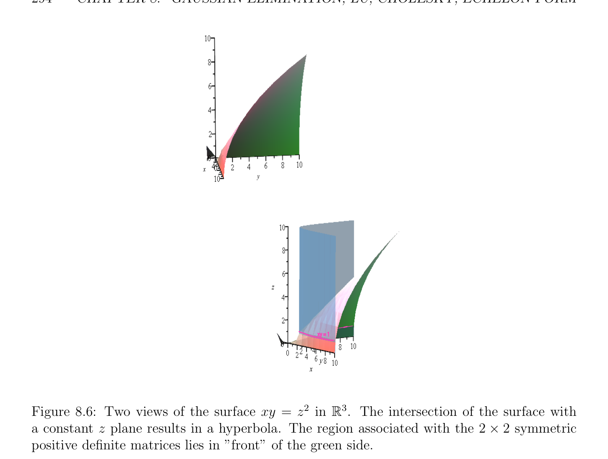

# SPD Các ma trận và Phân rã Cholesky (Cholesky decomposition)

<!-- PAGE 292 -->

## 8.9 SPD Các ma trận và Phân rã Cholesky (Cholesky decomposition)

> **Định nghĩa 8.4.** thực $n \times  n$ ma trận $A$ là đối xứng xác định dương (SPD), cho ngắn SPD, khi và chỉ khi nó là đối xứng và nếu
$$\mathbb{R}^{n}$$
$$x^{\top}Ax > 0for all x \in with x \neq  0.$$
Sau đây các sự kiện về đối xứng xác định dương (SPD) ma trận $A$ là dễ dàng được thiết lập (một số để lại như một bài tập):
$(1)$ ma trận $A$ là khả nghịch. (Thật vậy, nếu Ax $= 0$, thì $x^{\top}Ax = 0$, mà suy ra $x = 0.)$
$(2)$ Ta có $a_{i i} > 0$ cho $i = 1, \dots  , n$. (Chỉ nhận thấy rằng cho $x = e_{i}$, vectơ cơ sở chính tắc thứ $i$ của $\mathbb{R}^{n}$, ta có $e_{i}^{\top} Ae_{i} = a_{i i} > 0.)$
$(3)$ Với mọi $n \times  n$ thực ma trận khả nghịch (invertible matrix) $Z$, ma trận $Z^{\top}AZ$ là thực đối xứng xác định dương (SPD) khi và chỉ khi $A$ là thực đối xứng xác định dương (SPD).
$(4)$ tập hợp của $n \times  n$ thực đối xứng xác định dương (SPD) các ma trận là lồi. Điều này có nghĩa là nếu $A$ và $B$ là hai $n\times n$ đối xứng xác định dương (SPD) các ma trận, thì với mọi $\lambda  \in \mathbb{R}$ sao cho $0 \le \lambda  \le 1$, ma trận $(1$ - $\lambda )A + \lambda B$ là cũng đối xứng xác định dương (SPD). Rõ ràng vì $A$ và $B$ là đối xứng, $(1$ - $\lambda )A + \lambda B$ là cũng đối xứng. Với mọi khác không $x \in \mathbb{R}^{n}$, ta có $x^{\top}Ax > 0$ và $x^{\top}Bx > 0$, do đó
$$x^{\top}((1 -\lambda )A + \lambda B)x = (1 -\lambda )x^{\top}Ax + \lambda x^{\top}Bx > 0,$$
Bởi vì $0 \le \lambda  \le 1$, do đó $1-\lambda  \ge 0$ và $\lambda  \ge 0$, và $1-\lambda$ và $\lambda$ có thể’t là không simultaneously.
$(5)$ tập hợp của $n\times n$ thực đối xứng xác định dương (SPD) các ma trận là nón. Điều này có nghĩa là nếu $A$ là đối xứng xác định dương (SPD) và nếu $\lambda  > 0$ là bất kỳ thực, thì $\lambda A$ là đối xứng xác định dương (SPD). Rõ ràng $\lambda A$ là đối xứng, và cho khác không $x \in \mathbb{R}^{n}$, ta có $x^{\top}Ax > 0$, và vì $\lambda  > 0$, ta có $x^{\top}\lambda$ Ax $= \lambda x^{\top}Ax > 0$.
$$Remark: Given a complex m \times  n matrix A, we define \frac{the}{A} matrix \frac{\overline{A}}{A^{\top}).} as the m \times  n matrix$$
$\overline{A} = (\overline{a}_{ij})$. Thì ta định nghĩa $A^{*}$ như ma trận cỡ $n \times  m$ $A^{*} =$ ($)^{\top} =$ ($n \times  n$ phức ma trận $A$ là Hermite nếu $A^{*} = A$. Điều này là phức tương tự của khái niệm của thực ma trận đối xứng (symmetric matrix).

> **Định nghĩa 8.5.** phức $n \times  n$ ma trận $A$ là Hermite xác định dương (positive definite), cho ngắn HPD, nếu nó là Hermite và nếu
$$\mathbb{C}^{n}$$
$$z^{*}Az > 0for all z \in with z \neq  0.$$
Dễ dàng kiểm chứng được rằng Các tính chất (1)-(5) đúng cho Hermite xác định dương (positive definite) các ma trận; thay thế $\top$ bởi *.

<!-- PAGE 293 -->
Nó là instructive để đặc trưng hóa khi $2\times 2$ thực ma trận $A$ là đối xứng xác định dương (SPD). Viết
$$A = \begin{pmatrix} a & c \\ c & b \end{pmatrix} .$$
Thì ta có
$$\begin{pmatrix} x & y \end{pmatrix} \begin{pmatrix} a & c \\ c & b \end{pmatrix} \begin{pmatrix} x \\ y \end{pmatrix} = ax^{2}+ 2cxy + by^{2}.$$
$$If the above expression is strictly positive for all nonzero vectors^{x} \begin{pmatrix}\end{pmatrix} , then for x = 1, y = 0$$
Ta thu được $> 0$ và cho $x = 0, y = 1$ ta thu được $b > 0$. Thì ta có thể $write^{y}$
$$2c^{2}$$
$$ax^{2}+ 2cxy + by^{2}= \begin{pmatrix} \sqrt & c \\ \overline{ax} +\sqrt ay \end{pmatrix} + by^{2}-a y^{2}$$
$$2$$
$$= \begin{pmatrix} \sqrt & c \\ \overline{ax} +\sqrt ay \end{pmatrix} + \frac{1}{a} \begin{pmatrix} ab -c^{2} \end{pmatrix} y^{2}.(\dagger )$$
Vì $> 0$, nếu ab - $c^{2} \le 0$, thì ta có thể chọn $y > 0$ sao cho số hạng thứ hai là âm hoặc không, và ta có thể tập hợp $x = -(c/a)y$ để tạo số hạng thứ nhất không, trong mà trường hợp $ax^{2}+2cxy+by^{2} \le 0$, do đó ta phải có ab - $c^{2} > 0$. Ngược lại, nếu $> 0, b > 0$ và ab $> c^{2}$, thì với mọi $(x, y) \neq  (0, 0)$, nếu $y = 0$, thì $x \neq  0$ và số hạng thứ nhất của $(\dagger$) là dương, và nếu $y \neq  0$, thì số hạng thứ hai của $(\dagger$) là dương. Vì vậy, ma trận $A$ là đối xứng xác định dương (SPD) khi và chỉ khi
$$a > 0, b > 0, ab > c^{2}.(*)$$
Lưu ý rằng ab - $c^{2} =$ det(), do đó điều kiện thứ ba nói rằng rằng det() $> 0$. Nhận thấy rằng điều kiện $b > 0$ là redundant, vì nếu $> 0$ và ab $> c^{2}$, thì ta phải có $b > 0$ (và tương tự $b > 0$ và ab $> c^{2}$ suy ra rằng $> 0)$. Ta có thể thử đến visualize không gian của $2 \times  2$ thực đối xứng xác định dương (SPD) các ma trận trong $\mathbb{R}^{3}$, bởi quan điểm (, $b, c)$ như các tọa độ dọc theo $x, y, z$ các trục. Thì quỹ tích được xác định bởi chặt các bất đẳng thức trong (*) tương ứng với miền trên vế/cạnh của nón của phương trình xy $= z^{2}$ rằng thực hiện không chứa gốc và cho mà $x > 0$ và $y > 0$. Cho $z = \delta$ cố định, phương trình xy $= \delta^{2}$ định nghĩa hyperbol trong mặt phẳng $z = \delta$. nón của phương trình xy $= z^{2}$ bao gồm của các đường thẳng qua gốc rằng touch hyperbol xy $= 1$ trong mặt phẳng $z = 1$. Ta chỉ xét branch của điều này hyperbol cho mà $x > 0$ và $y > 0$. Xem Hình 8.6. Nó là không khó để chỉ ra rằng nghịch đảo của thực đối xứng xác định dương (SPD) ma trận là cũng thực đối xứng xác định dương (SPD), nhưng tích của hai thực đối xứng xác định dương (SPD) các ma trận có thể không là đối xứng xác định dương (SPD), như sau đây ví dụ chỉ ra:
$$\begin{pmatrix} 1 & 1 \\ 1 & 2 \end{pmatrix} \begin{pmatrix} \sqrt & \sqrt \\ 1/\sqrt{2} & -1\sqrt{2} \\ -1/ & 2 & 3/ & 2 \end{pmatrix} = \begin{pmatrix} \sqrt \\ 0\sqrt & 2/\sqrt{2} \\ -1/ & \overline{2} & 5/ & 2 \end{pmatrix} .$$

<!-- PAGE 294 -->
$$xy = 1$$
$$\mathbb{R}^{3}$$

**Hình 8.6:** Hai các quan điểm của mặt xy $= z^{2}$ trong. giao của mặt với hằng số $z$ mặt phẳng các kết quả trong hyperbol. miền liên kết với $2 \times  2$ đối xứng xác định dương (SPD) các ma trận lies trong ”trước” của xanh lục vế/cạnh. Theo ở trên tiêu chuẩn, hai các ma trận trên vế trái là thực đối xứng xác định dương (SPD), nhưng ma trận trên vế phải là không chẵn/ngay cả đối xứng, và
$$\sqrt$$
$$\begin{pmatrix} -6 & 1 \end{pmatrix} \begin{pmatrix} \sqrt \\ 0\sqrt & 2/\sqrt{2} \\ -1/ & \overline{2} & 5/ & 2 \end{pmatrix} \begin{pmatrix} -6 \\ 1 \end{pmatrix} = \begin{pmatrix} -6 & 1 \end{pmatrix} \begin{pmatrix} \sqrt \\ 2/\sqrt{2} \\ 11/ & 2 \end{pmatrix} = -1/\overline{2},$$
Chẵn/ngay cả dù các trị riêng (các trị riêng (eigenvalues)) của nó là cả hai thực và dương. Tiếp theo ta chỉ ra rằng thực đối xứng xác định dương (SPD) ma trận có đặc biệt Nhân tử hóa LU (LU-factorization) của tạo thành $A = BB^{\top}$, ở đâu $B$ là tam giác dưới (lower-triangular) ma trận có đường chéo các phần tử là chặt dương. Điều này là Nhân tử hóa Cholesky (Cholesky factorization). Thứ nhất ta lưu ý rằng đối xứng xác định dương (SPD) ma trận thỏa mãn điều kiện của Mệnh đề 8.2.

> **Mệnh đề 8.9.** Nếu $A$ là thực đối xứng xác định dương (SPD) ma trận, thì (1: $k, 1$: $k)$ là đối xứng xác định dương (SPD) và do đó khả nghịch cho $k = 1, \dots  , n$.

<!-- PAGE 295 -->

*Chứng minh.* Vì $A$ là đối xứng, mỗi (1: $k, 1$: $k)$ là cũng đối xứng. Nếu $w \in \mathbb{R}^{k}$, với
$$\mathbb{R}^{n}$$
$1 \le k \le n$, ta cho $x \in$ là vectơ với $x_{i} = w_{i}$ cho $i = 1, \dots  , k$ và $x_{i} = 0$ cho $i = k + 1, \dots  , n$. Bây giờ vì $A$ là đối xứng xác định dương (SPD), ta có $x^{\top}Ax > 0$ với mọi $\mathbb{R}^{n} x \in$ với $x \neq  0$. Điều này nghiệm đúng đặc biệt với mọi các vectơ $x$ thu được từ khác không các vectơ $\mathbb{R}^{k} w \in$ như đã định nghĩa trước đó, và rõ ràng
$$x^{\top}Ax = w^{\top}A(1 : k, 1 : k) w,$$
Mà suy ra rằng (1: $k, 1$: $k)$ là đối xứng xác định dương (SPD). Do đó, bởi Sự kiện $1$ ở trên, (1: $k, 1$: $k)$ là cũng khả nghịch. Mệnh đề 8.9 cũng nghiệm đúng cho phức Hermite xác định dương (positive definite) ma trận. Mệnh đề 8.9 có thể được strengthened như sau: $A$ thực (resp. phức) ma trận $A$ là đối xứng (resp. Hermite) xác định dương (positive definite) khi và chỉ khi det((1: $k, 1$: $k)) > 0$ cho $k = 1, \dots  , n$. ở trên sự kiện là đã biết như Sylvester’s tiêu chuẩn. Ta sẽ chứng minh nó sau thiết lập Nhân tử hóa Cholesky (Cholesky factorization). Cho $A$ là $n \times  n$ thực đối xứng xác định dương (SPD) ma trận và viết
$$A = \begin{pmatrix} a_{1 1} & W^{\top} \\ W & C \end{pmatrix} ,$$
Ở đâu $C$ là $(n$ - $1) \times  (n$ - $1)$ ma trận đối xứng (symmetric matrix) và $W$ là $(n$ - $1) \times  1$ ma trận. Vì $A$
$$\sqrt$$
Là đối xứng xác định dương (SPD), $a_{1 1} > 0$, và ta có thể tính $\alpha  = \overline{a}_{1 1}$. mẹo/kỹ thuật là rằng ta có thể nhân tử $A$ một cách duy nhất như
$$A = \begin{pmatrix} a_{1 1} & W^{\top} \\ W & C \end{pmatrix} = \begin{pmatrix} \alpha & 0 \\ W/\alpha & I \end{pmatrix} \begin{pmatrix} 1 & 0 \\ 0 & C -WW^{\top}/a_{1 1} \end{pmatrix} \begin{pmatrix} \alpha & W^{\top}/\alpha \\ 0 & I \end{pmatrix} ,$$
I.e., như $A = B_{1}A_{1}B_{1}^{\top}$, ở đâu $B_{1}$ là tam giác dưới (lower-triangular) với dương đường chéo các phần tử (entries). Do đó, $B_{1}$ là khả nghịch, và bởi Sự kiện $(3)$ ở trên, $A_{1}$ là cũng đối xứng xác định dương (SPD).
Nhận xét: ma trận $C -WW^{\top} /a_{1 1}$ là đã biết như Phần bù Schur (Schur complement) của ma trận cỡ $1\times 1$ $(a_{11})$ trong $A$.

> **Định lý 8.10.** (Nhân tử hóa Cholesky (Cholesky factorization)) Cho $A$ là thực đối xứng xác định dương (SPD) ma trận. Thì tồn tại một thực tam giác dưới (lower-triangular) ma trận $B$ sao cho $A = BB^{\top}$. Hơn nữa, $B$ có thể được được chọn sao cho của nó đường chéo các phần tử là chặt dương, trong mà trường hợp $B$ là duy nhất.

*Chứng minh.* Ta tiến hành bằng quy nạp theo số chiều $n$ của $A$. Cho $n = 1$, ta phải có $a_{1 1} > 0$,
$$\sqrt$$
Và nếu ta cho $\alpha  = \overline{a}_{1 1}$ và $B = (\alpha$), định lý nghiệm đúng một cách tầm thường. Nếu $n \ge 2$, như ta được giải thích ở trên, một lần nữa ta phải có $a_{1 1} > 0$, và ta có thể viết
$$A = \begin{pmatrix} a_{1 1} & W^{\top} \\ W & C \end{pmatrix} = \begin{pmatrix} \alpha & 0 \\ W/\alpha & I \end{pmatrix} \begin{pmatrix} 1 & 0 \\ 0 & C -WW^{\top}/a_{1 1} \end{pmatrix} \begin{pmatrix} \alpha & W^{\top}/\alpha \\ 0 & I \end{pmatrix} = B_{1}A_{1}B_{1}^{\top} ,$$

<!-- PAGE 296 -->
$$\sqrt$$
Ở đâu $\alpha  = \overline{a}_{1 1}$, ma trận $B_{1}$ là khả nghịch và
$$A_{1} = \begin{pmatrix} 1 & 0 \\ 0 & C -WW^{\top}/a_{1 1} \end{pmatrix}$$
Là đối xứng xác định dương (SPD). Tuy nhiên, điều này suy ra rằng $C$ - $WW^{\top} /a_{1 1}$ là cũng đối xứng
$$\mathbb{R}^{n}$$
Xác định dương (positive definite) (xét $x^{\top}A_{1}x$ với mọi $x \in$ với $x \neq  0$ và $x_{1} = 0)$. Do đó, ta có thể áp dụng giả thiết quy nạp (induction hypothesis) đến $C$ - $WW^{\top} /a_{1 1}$ (mà là $(n$ - $1) \times  (n$ - $1)$ ma trận), và ta tìm duy nhất tam giác dưới (lower-triangular) ma trận $L$ với dương đường chéo các phần tử (entries) sao cho
$$C -WW^{\top} /a_{1 1} = LL^{\top}.$$
Nhưng khi đó ta thu được
$$A= \begin{pmatrix} \alpha & 0 \\ W/\alpha & I \end{pmatrix} \begin{pmatrix} 1 & 0 \\ 0 & C -WW^{\top}/a_{1 1} \\  \end{pmatrix} \begin{pmatrix} \alpha & W^{\top}/\alpha \\ 0 & I \end{pmatrix}$$
$$= \begin{pmatrix} \alpha & 0 \\ W/\alpha & I \end{pmatrix} \begin{pmatrix} 1 & 0 \\ 0 & LL^{\top} \\  \end{pmatrix} \begin{pmatrix} \alpha & W^{\top}/\alpha \\ 0 & I \\  \end{pmatrix}$$
$$= \begin{pmatrix} \alpha & 0 \\ W/\alpha & I \end{pmatrix} \begin{pmatrix} 1 & 0 \\ 0 & L \\  \end{pmatrix} \begin{pmatrix} 1 & 0 \\ 0 & L^{\top} \end{pmatrix} \begin{pmatrix} \alpha & W^{\top}/\alpha \\ 0 & I \end{pmatrix}$$
$$= \begin{pmatrix} \alpha & 0 \\ W/\alpha & L \end{pmatrix} \begin{pmatrix} \alpha & W^{\top}/\alpha \\ 0 & L^{\top} \end{pmatrix} .$$
Vì vậy, nếu ta cho
$$B = \begin{pmatrix} \alpha & 0 \\ W/\alpha & L \end{pmatrix} ,$$
Ta có duy nhất tam giác dưới (lower-triangular) ma trận với dương đường chéo các phần tử (entries) và $A = BB^{\top}$.
Nhận xét: tính duy nhất của Phân rã Cholesky (Cholesky decomposition) có thể cũng được thiết lập bằng cách sử dụng tính duy nhất của Phân rã LU (LU-decomposition). Thật vậy, nếu $A = B_{1}B_{1}^{\top} = B_{2}B_{2}^{\top}$ ở đâu $B_{1}$ và $B_{2}$ là tam giác dưới (lower triangular) với dương đường chéo các phần tử (entries), nếu ta cho $\Delta_{1}$ (resp. $\Delta_{2}$) là ma trận đường chéo (diagonal matrix) bao gồm của đường chéo các phần tử (entries) của $B_{1}$ (resp. $B_{2})$ sao cho $(\Delta_{k} )_{ii} = (B_{k})_{ii}$ cho $k = 1, 2$, thì ta có hai LU-decompositions
$$A = (B_{1}\Delta_{1}^{-1}  )(\Delta_{1} B_{1}^{\top} ) = (B_{2}\Delta_{2}^{-1}  )(\Delta_{2} B_{2}^{\top} )$$
Với $B_{1}\Delta_{1}^{-1}  , B_{2}\Delta_{2}^{-1}$ unit tam giác dưới (lower triangular), và $\Delta_{1} B_{1}^{\top} , \Delta_{2} B_{2}^{\top}$ tam giác trên (upper triangular). Bởi uniquenes của Nhân tử hóa LU (LU-factorization) (Định lý 8.5(1)), ta có
$$B_{1}\Delta_{1}^{-1} = B_{2}\Delta_{2}^{-1}  ,\Delta_{1} B_{1}^{\top} = \Delta_{2} B_{2}^{\top} ,$$
Và phương trình thứ hai cho ta
$$B_{1}\Delta_{1}  = B_{2}\Delta_{2} .(*)$$

<!-- PAGE 297 -->
Đường chéo các phần tử (entries) của $B_{1}\Delta_{1}$ là $(B_{1})_{ii}^{2}$ và tương tự đường chéo các phần tử (entries) của $B_{2}\Delta_{2}$ là $(B_{2})_{ii}^{2}$, do đó ở trên phương trình suy ra rằng
$$(B_{1})_{ii}^{2} = (B_{2})_{ii}^{2},i = 1, \dots  , n.$$
Vì đường chéo các phần tử (entries) của cả hai $B_{1}$ và $B_{2}$ được giả sử là dương, ta phải có
$$(B_{1})_{ii} = (B_{2})_{ii},i = 1, \dots  , n;$$
Rằng là, $\Delta_{1}  = \Delta_{2}$, và vì cả hai là khả nghịch, ta kết luận từ (*) rằng $B_{1} = B_{2}$. Định lý 8.10 cũng nghiệm đúng cho phức Hermite xác định dương (positive definite) các ma trận. Trong trường hợp này, ta có $A = BB^{*}$ với một số duy nhất tam giác dưới (lower triangular) ma trận $B$ với dương đường chéo các phần tử (entries). chứng minh của Định lý 8.10 ngay lập tức cho ta thuật toán để tính $B$ từ $A$ bởi việc giải cho tam giác dưới (lower triangular) ma trận $B$ sao cho $A = BB^{\top}$ (ở đâu cả hai $A$ và $B$ là thực các ma trận). Cho $j = 1, \dots  , n$,
$$1/2$$
$$!$$
$$b_{j j} =a_{j j} - \sum_{k=1}^{j-1}  b_{j k}^{2},$$
Và cho $i = j + 1, \dots  , n$ (và $j = 1, \dots  , n$ - $1)$
$$!$$
$$b_{i j} =a_{i j} - \sum_{k=1}^{j-1}  b_{i k}b_{j k}/b_{j j}.$$
Ở trên các công thức được sử dụng để tính cột thứ $j$ của $B$ từ top-down, bằng cách sử dụng thứ nhất $j -1$ các cột của $B$ một cách trước đó được tính, và ma trận $A$. Trong trường hợp của $n = 3, A = BB^{\top}$ cho ta
$$\begin{pmatrix} a_{11} & a_{12} & a_{31} \\ a_{21} & a_{22} & a_{32} \\ a_{31} & a_{32} & a_{33} \end{pmatrix} b_{11}00 \begin{pmatrix} b_{11} & b_{21} & b_{31} \\ 0 & b_{22} & b_{32} \\ 0 & 0 & b_{33} \end{pmatrix}$$
$$=b_{21}b_{22}0$$
$$$$
$$b_{31}b_{32}b_{33}$$
$$b_{11}^{2}b_{11}b_{21}b_{11}b_{31}$$
$$=b_{11}b_{21}b_{21}^{2} + b_{22}^{2}b_{21}b_{31} + b_{22}b_{32}.$$
$$$$
$$b_{11}b_{31}b_{21}b_{31} + b_{22}b_{32}b_{31}^{2} + b_{32}^{2} + b_{33}^{2}$$
Ta hoạt động/công trình xuống cột thứ nhất của $A$, compare các phần tử (entries), và discover rằng
$$\sqrt$$
$$a_{11} = b_{11}^{2}b_{11} =\overline{a}_{11}$$
$$a_{21} = b_{11}b_{21}b_{21} = \frac{a_{21}}{b_{11}}$$
$$a_{31} = b_{11}b_{31}b_{31} = \frac{a_{31}}{b_{11}} .$$

<!-- PAGE 298 -->
Tiếp theo ta hoạt động/công trình xuống cột thứ hai của $A$ bằng cách sử dụng một cách trước đó được tính các biểu thức cho $b_{21}$ và $b_{31}$ để tìm rằng
$$a_{22} = b_{21}^{2} + b_{22}^{2}b_{22} = \begin{pmatrix} a_{22} -\overline{b}_{21}^{212} \\ a_{32} -b_{21} \end{pmatrix}$$
$$a_{32} = b_{21}b_{31} + b_{22}b_{32}b_{32} = \frac{b_{31}}{b_{22}} .$$
Cuối cùng, ta sử dụng cột thứ ba của $A$ và một cách trước đó được tính các biểu thức cho $b_{31}$ và $b_{32}$ để xác định $b_{33}$ như
$$a_{33} = b_{31}^{2} + b_{32}^{2} + b_{33}^{2}b_{33} = \begin{pmatrix} a_{33} -b_{31}^{2}-\overline{b}_{32}^{212} \end{pmatrix} .$$
Cho một cái khác ví dụ, nếu
$$A = \begin{pmatrix} 1 & 1 & 1 & 1 & 1 & 1 \\ 1 & 2 & 2 & 2 & 2 & 2 \\ 1 & 2 & 3 & 3 & 3 & 3 \\ 1 & 2 & 3 & 4 & 4 & 4 \\ 1 & 2 & 3 & 4 & 5 & 5 \\ 1 & 2 & 3 & 4 & 5 & 6 \end{pmatrix} ,$$
Ta tìm rằng
$$B = \begin{pmatrix} 1 & 0 & 0 & 0 & 0 & 0 \\ 1 & 1 & 0 & 0 & 0 & 0 \\ 1 & 1 & 1 & 0 & 0 & 0 \\ 1 & 1 & 1 & 1 & 0 & 0 \\ 1 & 1 & 1 & 1 & 1 & 0 \\ 1 & 1 & 1 & 1 & 1 & 1 \end{pmatrix} .$$
Ta để lại nó như một bài tập để tìm đồng dạng các công thức (liên quan đến liên hợp) đến nhân tử phức Hermite xác định dương (positive definite) ma trận $A$ như $A = BB^{*}$. sau đây Matlab bài toán quy hoạch các cài đặt Nhân tử hóa Cholesky (Cholesky factorization). hàm $B =$ Cholesky() $n =$ kích thước(,1); $B =$ các không điểm(n,n); cho $j =$ 1:n-1; nếu $j == 1$
$$B(1,1) = sqrt(A(1,1));$$
$$for i = 2:n$$
$$B(i,1) = A(i,1)/B(1,1);$$
$$end$$
Khác
$$B(j,j) = sqrt(A(j,j) - B(j,1:j-1)*B(j,1:j-1)’);$$
$$for i = j+1:n$$

<!-- PAGE 299 -->
$$B(i,j) = (A(i,j) - B(i,1:j-1)*B(j,1:j-1)’)/B(j,j);$$
$$end$$
Kết thúc/cuối kết thúc/cuối B(n,n) $=$ sqrt((n,n) - B(n,1:n-1)*B(n,1:n-1)’); kết thúc/cuối Nếu ta chạy ở trên thuật toán trên sau đây ma trận
$$A = \begin{pmatrix} 4 & 1 & 0 & 0 & 0 \\ 1 & 4 & 1 & 0 & 0 \\ 0 & 1 & 4 & 1 & 0 \\ 0 & 0 & 1 & 4 & 1 \\ 0 & 0 & 0 & 1 & 4 \end{pmatrix} ,$$
Ta thu được
$$B = \begin{pmatrix} 2.0000 & 0 & 0 & 0 & 0 \\ 0.5000 & 1.9365 & 0 & 0 & 0 \\ 0 & 0.5164 & 1.9322 & 0 & 0 \\ 0 & 0 & 0.5175 & 1.9319 & 0 \\ 0 & 0 & 0 & 0.5176 & 1.9319 \end{pmatrix} .$$
Nhân tử hóa Cholesky (Cholesky factorization) có thể được được sử dụng để giải các hệ phương trình tuyến tính Ax $= b$ ở đâu $A$ là đối xứng xác định dương (SPD): Giải hai các hệ Bw $= b$ và $B^{\top}x = w$.
Nhận xét: Nó có thể được được hiển thị rằng phương pháp này đòi hỏi $n^{3}/6 + O(n^{2})$ các phép cộng, $n^{3}/6 + O(n^{2})$ các phép nhân, $n^{2}/2+O(n)$ các phép chia, và O(n) square nghiệm (root) extractions. Do đó, Cholesky phương pháp đòi hỏi một nửa của số của các phép toán cần thiết bởi Phép khử Gauss (Gaussian elimination) (vì Phép khử Gauss (Gaussian elimination) đòi hỏi $n^{3}/3 + O(n^{2})$ các phép cộng, $n^{3}/3 + O(n^{2})$ các phép nhân, và $n^{2}/2 +$ O(n) các phép chia). Nó cũng đòi hỏi một nửa của không gian (chỉ $B$ là cần thiết, như opposed đến cả hai $L$ và $U)$. Hơn nữa, nó có thể được được hiển thị rằng Cholesky’s phương pháp là một cách số stable (xem Trefethen và Bau $[182]$, Lecture $23)$. Trong Matlab hàm chol trả về tam giác dưới (lower-triangular) ma trận $B$ sao cho $A = BB^{\top}$ bằng cách sử dụng gọi $B =$ chol(, ‘thấp hơn’).
Nhận xét: Nếu $A = BB^{\top}$, ở đâu $B$ là bất kỳ ma trận khả nghịch (invertible matrix), thì $A$ là đối xứng xác định dương (SPD).

*Chứng minh.* Hiển nhiên, $BB^{\top}$ là đối xứng, và vì $B$ là khả nghịch, $B^{\top}$ là khả nghịch, và từ
$$x^{\top}Ax = x^{\top}BB^{\top}x = (B^{\top}x)^{\top}B^{\top}x,$$
Rõ ràng là $x^{\top}Ax > 0$ nếu $x \neq  0$. Ta bây giờ cho ba nhiều hơn/thêm các tiêu chuẩn cho ma trận đối xứng (symmetric matrix) là xác định dương (positive definite).

<!-- PAGE 300 -->

> **Mệnh đề 8.11.** Cho $A$ là bất kỳ $n\times n$ thực ma trận đối xứng (symmetric matrix). Các điều kiện sau đây là tương đương:
() $A$ là xác định dương (positive definite).
$(b)$ Tất cả chính các định thức con (minor) của $A$ là positive; nghĩa là: det((1: $k, 1$: $k)) > 0$ cho $k = 1, \dots  , n$ (Sylvester’s tiêu chuẩn).
$(c) A$ có Nhân tử hóa LU (LU-factorization) và tất cả các phần tử trụ là dương.
$(d) A$ có $LDL^{\top}-factorization$ và tất cả các phần tử trụ trong $D$ là dương.

*Chứng minh.* Theo Mệnh đề 8.9, nếu $A$ là đối xứng xác định dương (SPD), thì mỗi ma trận (1: $k, 1$: $k)$ là đối xứng xác định dương (SPD) cho $k = 1, \dots  , n$. Bởi Phân rã Cholesky (Cholesky decomposition), (1: $k, 1$: $k) = Q^{\top}Q$ với một số ma trận khả nghịch (invertible matrix) $Q$, do đó det((1: $k, 1$: $k)) = det(Q)^{2} > 0$. Điều này chỉ ra rằng () suy ra $(b)$. Nếu det((1: $k, 1$: $k)) > 0$ cho $k = 1, \dots  , n$, thì mỗi (1: $k, 1$: $k)$ là khả nghịch. Theo Mệnh đề 8.2, ma trận $A$ có Nhân tử hóa LU (LU-factorization), và vì các phần tử trụ $\pi_{k}$ được cho bởi
$$a_{11} = \det(A(1 : 1, 1 : 1))if k = 1$$
$$$$
$$\pi_{k}  = \frac{\det(A(1 : k, 1 : k))}{\det(A(1 : k -1, 1 : k -1))} if k = 2, \dots  , n,$$
$$$$
Ta xem rằng $\pi_{k}  > 0$ cho $k = 1, \dots  , n$. Do đó $(b)$ suy ra $(c)$. Giả sử $A$ có Nhân tử hóa LU (LU-factorization) và rằng các phần tử trụ là tất cả dương. Vì $A$ là đối xứng, điều này suy ra rằng $A$ có nhân tử hóa của tạo thành
$$A = LDL^{\top},$$
Với $L$ tam giác dưới (lower-triangular) với 1s trên của nó đường chéo, và ở đâu $D$ là ma trận đường chéo (diagonal matrix) với dương các phần tử (entries) trên đường chéo (các phần tử trụ). Điều này chỉ ra rằng $(c)$ suy ra $(d)$. Cho trước nhân tử hóa $A = LDL^{\top}$ với tất cả các phần tử trụ trong $D$ dương, nếu ta tạo thành ma trận đường chéo (diagonal matrix)
$$\sqrt\sqrt \sqrt$$
$$\overline{D} = \mathrm{diag}(\overline{\pi}_{1}, \dots  ,\overline{\pi}_{n})$$
$$\sqrt$$
Và nếu ta cho $B = L \overline{D}$, thì ta có
$$A = BB^{\top},$$
Với $B$ tam giác dưới (lower-triangular) và khả nghịch. Bởi nhận xét trước Mệnh đề 8.11, $A$ là xác định dương (positive definite). Do đó, $(d)$ suy ra (). Tiêu chuẩn $(c)$ cho ta đơn giản tính toán test để kiểm tra liệu ma trận đối xứng (symmetric matrix) là xác định dương (positive definite). Ở đó là một nhiều hơn/thêm tiêu chuẩn cho ma trận đối xứng (symmetric matrix) là xác định dương (positive definite):
