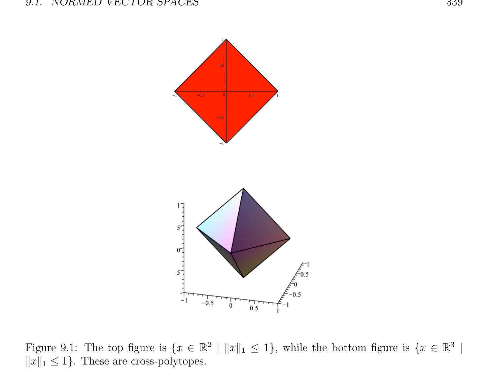
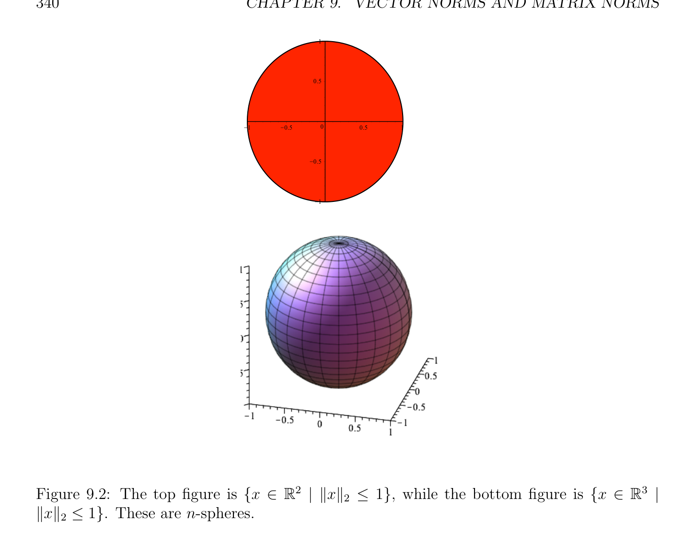
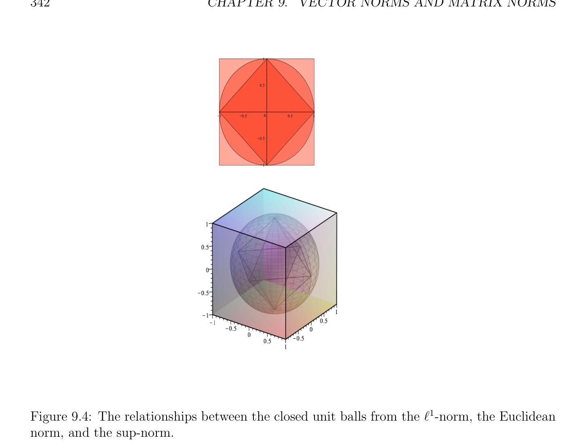
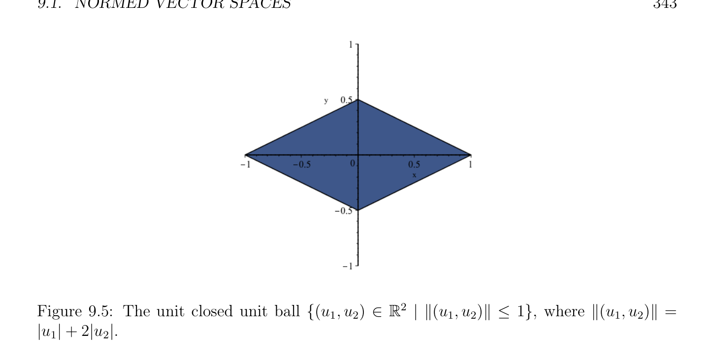

# Các không gian vectơ định chuẩn

<!-- PAGE 337 -->
Chương $9$ Các chuẩn vectơ và Các chuẩn ma trận

## 9.1 Các không gian vectơ định chuẩn

Trong thứ tự để định nghĩa cách mà close hai các vectơ hoặc hai các ma trận là, và trong thứ tự để định nghĩa sự hội tụ của các dãy của các vectơ hoặc các ma trận, ta có thể sử dụng khái niệm của chuẩn (norm). Nhắc lại rằng $\mathbb{R}_{+} = {x \in \mathbb{R}$ | $x \ge 0}$. Cũng rằng $a +$ ib $\in \mathbb{C}$ là phức số, với
$$a, b \in \mathbb{R}, then \overline{z} = a -ib and |z| =\sqrt \frac{recall}{\overline{zz}} =\sqrt \frac{ifz=}{a^{2}+ b^{2}} (|z| is the modulus of z).$$

> **Định nghĩa 9.1.** Cho $E$ là không gian vectơ (vector space) trên trường $K$, ở đâu $K$ là hoặc trường $\mathbb{R}$ của các số thực, hoặc $field\mathbb{C}$ của phức các số. chuẩn (norm) trên $E$ là hàm $\|\|: E \to \mathbb{R}_{+}$, assigning không âm thực số $\|u\|$ đến bất kỳ vectơ $u \in E$, và thỏa mãn sau đây các điều kiện với mọi $x, y \in E$ và $\lambda  \in K$:
(N1) $\|x\|\ge 0$, và $\|x\| = 0$ khi và chỉ khi $x = 0$. (positivity)
(N2) $\|\lambda x\| = |\lambda$ | $\|x\|$. (homogeneity (hoặc scaling))
(N3) $\|x + y\|\le \|x\| + \|y\|$. (tam giác bất đẳng thức) $A$ không gian vectơ (vector space) $E$ cùng với chuẩn (norm) $\|\|$ được gọi là một không gian vectơ định chuẩn (normed vector space). Bởi (N2), đặt $\lambda  = -1$, ta thu được
$$\|-x\|= \|(-1)x\|= | -1| \|x\|= \|x\|;$$
Rằng là, $\|-x\| = \|x\|$. Từ (N3), ta có
$$\|x\|= \|x -y + y\|\le \|x -y\|+ \|y\|,$$
Mà suy ra rằng
$$\|x\|-\|y\|\le \|x -y\|.$$
Bởi exchanging $x$ và $y$ và bằng cách sử dụng sự kiện rằng bởi (N2),
$$\|y -x\|= \|-(x -y)\|= \|x -y\|,$$
$$337$$

<!-- PAGE 338 -->
Ta cũng có
$$\|y\|-\|x\|\le \|x -y\|.$$
Vì vậy,
$$|\|x\|-\|y\|| \le \|x -y\|,for all x, y \in E.(*)$$
Nhận thấy rằng đặt $\lambda  = 0$ trong (N2), ta suy ra rằng $\|0\| = 0$ mà không có giả sử (N1). Thì bằng cách đặt $y = 0$ trong (*), ta thu được
$$|\|x\|| \le \|x\|,for all x \in E.$$
Vì vậy, điều kiện $\|x\|\ge 0$ trong (N1) suy ra từ (N2) và (N3), và (N1) có thể được được thay thế bởi weaker điều kiện (N1’) Với mọi $x \in E$, nếu $\|x\| = 0$, thì $x = 0, A$ hàm $\|\|$: $E \to \mathbb{R}$ thỏa mãn Axioms (N2) và (N3) được gọi là một seminorm. Từ ở trên thảo luận, seminorm cũng có các tính chất $\|x\|\ge 0$ với mọi $x \in E$, và $\|0\| = 0$. Tuy nhiên, ở đó có thể là khác không các vectơ $x \in E$ sao cho $\|x\| = 0$. Cho chúng ta cho một số các ví dụ của các không gian vectơ định chuẩn.

> **Ví dụ 9.1.** $1$. Cho $E =\mathbb{R}$, và $\|x\| =$ |x|, tuyệt đối giá trị của $x. 2$. Cho $E =\mathbb{C}$, và $\|z\| =$ |z|, môđun/độ lớn của $z$.
$$\mathbb{R}^{n} \mathbb{C}^{n}$$
$3$. Cho $E =$ (hoặc $E =$). Có ba tiêu chuẩn các chuẩn. Với mọi $(x_{1}, \dots  , x_{n}) \in E$, ta có chuẩn (norm) $\|x\|_{1}$, được định nghĩa sao cho,
$$\|x\|_{1} = |x_{1}| + \cdots  + |x_{n}|,$$
Ta có Euclidean chuẩn (norm) $\|x\|_{2}$, được định nghĩa sao cho,
$$\|x\|_{2} = \begin{pmatrix} |x_{1}|^{2}+ \cdots  + |x_{n}\overline{|}^{212} \end{pmatrix} ,$$
$$and the \sup-norm \|x\|_{\infty}, defined such that,$$
$$\|x\|_{\infty}= \max{|x_{i}| | 1 \le i \le n}.$$
Tổng quát hơn, ta định nghĩa $\ell^{p}$ -chuẩn (norm) (cho $p \ge 1)$ bởi
$$\|x\|_{p} = (|x_{1}|^{p}+ \cdots  + |x_{n}|^{p})^{1/p}.$$
Xem Các hình 9.1 qua 9.4.

<!-- PAGE 339 -->
$$1$$
$$0.5$$
$$\overline{K}\overline{1}\overline{K}\overline{0.5}\overline{0}\overline{0.5}\overline{1}$$
$$K0.5$$
$$K1$$
$$\mathbb{R}^{2} \mathbb{R}^{3}$$

**Hình 9.1:** đỉnh/trên hình là ${x \in$ | $\|x\|_{1} \le 1}$, trong khi đáy/dưới hình là ${x \in$ | $\|x\|_{1} \le 1}$. Các phần tử này là cross-polytopes. Có khác các chuẩn ngoài ra $\ell^{p}$ -các chuẩn. Ở đây là một số các ví dụ. $1$. Cho $E =\mathbb{R}^{2}$,
$$\|(u_{1}, u_{2})\|= |u_{1}| + 2|u_{2}|.$$
Xem Hình 9.5. $2$. Cho $E =\mathbb{R}^{2}$,
$$\|(u_{1}, u_{2})\|= \begin{pmatrix} (u_{1} + u_{2})^{2}+ \end{pmatrix} u_{1}^{21/2}.$$
Xem Hình 9.6. $3$. Cho $E =\mathbb{C}^{2}$,
$$\|(u_{1}, u_{2})\|= |u_{1} + iu_{2}| + |u_{1} -iu_{2}|.$$
Độc giả nên kiểm tra rằng chúng thỏa mãn tất cả axioms của chuẩn (norm). Một số hoạt động/công trình là cần thiết để chỉ ra tam giác bất đẳng thức cho $\ell^{p}$ -chuẩn (norm).

<!-- PAGE 340 -->
$$1$$
$$0.5$$
$$\overline{K}\overline{1}\overline{K}\overline{0.5}\overline{0}\overline{0.5}\overline{1}$$
$$K0.5$$
$$K1$$
$$\mathbb{R}^{2} \mathbb{R}^{3}$$

**Hình 9.2:** đỉnh/trên hình là ${x \in$ | $\|x\|_{2} \le 1}$, trong khi đáy/dưới hình là ${x \in$ | $\|x\|_{2} \le 1}$. Các phần tử này là n-spheres.
$$\mathbb{C}^{n} \mathbb{R}^{n}$$

> **Mệnh đề 9.1.** Nếu $E =$ hoặc $E =$, với mọi thực số $p \ge 1$, $\ell^{p}$ -chuẩn (norm) là thật vậy chuẩn (norm).

*Chứng minh.* các trường hợp $p = 1$ và $p = \infty$ là dễ và trái đến độc giả. Nếu $p > 1$, thì cho $q > 1$ sao cho
$$\frac{1}{p} + \frac{1}{q} = 1.$$
Ta sẽ tạo sử dụng của sau đây sự kiện: với mọi $\alpha , \beta  \in \mathbb{R}$, nếu $\alpha , \beta  \ge 0$, thì
$$\alpha \beta  \le \frac{\alpha^{p}}{p} + \frac{\beta^{q}}{q} .(*)$$
Để chứng minh ở trên bất đẳng thức, ta sử dụng sự kiện rằng hàm mũ hàm $t \mapsto e^{t}$ thỏa mãn sau đây tính lồi bất đẳng thức:
$$e^{\theta x+(1-\theta)y}\le \theta e^{x}+ (1 -\theta )e^{y},$$
Với mọi $x, y \in \mathbb{R}$ và tất cả $\theta$ với $0 \le \theta  \le 1$.

<!-- PAGE 341 -->
$$1$$
$$0.5$$
$$\overline{K}\overline{1}\overline{K}\overline{0.5}\overline{0}\overline{0.5}\overline{1}$$
$$K0.5$$
$$K1$$
$$\mathbb{R}^{2} \mathbb{R}^{3}$$

**Hình 9.3:** đỉnh/trên hình là ${x \in$ | $\|x\|_{\infty} \le 1}$, trong khi đáy/dưới hình là ${x \in$ | $\|x\|_{\infty} \le 1}$. Các phần tử này là n-cubes. Vì trường hợp $\alpha \beta  = 0$ là tầm thường, ta giả sử rằng $\alpha  > 0$ và $\beta  > 0$. Nếu ta thay thế $\theta$ bởi $1/p, x$ bởi $p$ log $\alpha$ và $y$ bởi $q$ log $\beta$, thì ta thu được
$$+$$
$$\overline{e}^{p1plog\alpha+1qqlog\beta} \le \frac{1}{p} e^{plog\alpha} \frac{1}{q} e^{qlog\beta},$$
Mà simplifies đến
$$\alpha \beta  \le \frac{\alpha^{p}}{p} + \frac{\beta^{q}}{q} ,$$
Như đã khẳng định. Ta sẽ bây giờ chứng minh rằng với mọi hai các vectơ $u, v \in E$, (ở đâu $E$ là có số chiều $n)$, ta có
$$\sum_{i=1}^{n}  |u_{i}v_{i}| \le \|u\|_{p} \|v\|_{q} .(**)$$

<!-- PAGE 342 -->
$$1$$
$$0.5$$
$$\overline{K}\overline{1}\overline{K}\overline{0.5}\overline{0}\overline{0.5}\overline{1}$$
$$K0.5$$
$$K1$$

**Hình 9.4:** relationships giữa đóng unit các hình cầu từ $\ell^{1}$ -chuẩn (norm), Euclidean chuẩn (norm), và sup-norm. Vì ở trên là tầm thường nếu $u = 0$ hoặc $v = 0$, ta giả sử rằng $u \neq  0$ và v̸ $= 0$. Thì Bất đẳng thức (*) với $\alpha  = |u_{i}|/ \|u\|_{p}$ và $\beta  = |v_{i}|/ \|v\|_{q}$ cho ta
$$||||^{p} ||^{q}$$
$$\frac{u_{i}v_{i}}{\|u\|_{p} \|v\|_{q}} \le \frac{u_{i}}{p \|u\|_{p}^{p}} + \frac{v_{i}}{q \|v\|_{q}^{q}} ,$$
Cho $i = 1, \dots  , n$, và bởi summing lên các bất đẳng thức này, ta thu được
$$\sum_{i=1}^{n}  |u_{i}v_{i}| \le \|u\|_{p} \|v\|_{q} ,$$
Như đã khẳng định. Đến hoàn tất chứng minh, ta đơn giản có để chứng minh rằng tính chất (N3) nghiệm đúng, vì
(N1) và (N2) là rõ ràng. Cho $i = 1, \dots  , n$, ta có thể viết
$$(|u_{i}| + |v_{i}|)^{p}= |u_{i}|(|u_{i}| + |v_{i}|)^{p-1}+ |v_{i}|(|u_{i}| + |v_{i}|)^{p-1},$$

<!-- PAGE 343 -->
$$\mathbb{R}^{2}$$

**Hình 9.5:** unit đóng unit hình cầu ${(u_{1}, u_{2}) \in$ | $\|(u_{1}, u_{2})\|\le 1}$, ở đâu $\|(u_{1}, u_{2})\| = |u_{1}| + 2|u_{2}|$. sao cho bởi summing lên các phương trình này ta thu được
$$\sum_{i=1}^{n}  (|u_{i}| + |v_{i}|)^{p}= \sum_{i=1}^{n}  |u_{i}|(|u_{i}| + |v_{i}|)^{p-1}+ \sum_{i=1}^{n}  |v_{i}|(|u_{i}| + |v_{i}|)^{p-1},$$
Và bằng cách sử dụng Bất đẳng thức (**), với $V \in E$ ở đâu $V_{i} = (|u_{i}| + |v_{i}|)^{p-1}$, ta thu được
$$1/q$$
$$\sum_{i=1}^{n}  (|u_{i}| + |v_{i}|)^{p}\le \|u\|_{p} \|V \|_{q} + \|v\|_{p} \|V \|_{q} = (\|u\|_{p} + \|v\|_{p}) \begin{pmatrix} (|u_{i}| + |v_{i}|)^{(p-1)q} \end{pmatrix} \sum_{i=1}^{n}  .$$
Tuy nhiên, $1/p + 1/q = 1$ suy ra pq $= p + q$, nghĩa là, $(p$ - 1)q $= p$, do đó ta có
$$1/q$$
$$\sum_{i=1}^{n}  (|u_{i}| + |v_{i}|)^{p}\le (\|u\|_{p} + \|v\|_{p}) \begin{pmatrix} (|u_{i}| + |v_{i}|)^{p} \end{pmatrix} \sum_{i=1}^{n}  ,$$
Mà cho ta
$$1-1/q1/p$$
$$\begin{pmatrix} (|u_{i}| + |v_{i}|)^{p} \end{pmatrix} \sum_{i=1}^{n}  = \begin{pmatrix} (|u_{i}| + |v_{i}|)^{p} \end{pmatrix} \sum_{i=1}^{n}  \le \|u\|_{p} + \|v\|_{p} .$$
Vì $|u_{i} + v_{i}| \le |u_{i}| + |v_{i}|$, ở trên suy ra tam giác bất đẳng thức $\|u + v\|_{p} \le \|u\|_{p} + \|v\|_{p}$, như đã khẳng định. Cho $p > 1$ và $1/p + 1/q = 1$, bất đẳng thức
$$1/p1/q$$
$$\sum_{i=1}^{n}  |u_{i}v_{i}| \le \begin{pmatrix} |u_{i}|^{p} \end{pmatrix} \sum_{i=1}^{n}  \begin{pmatrix} |v_{i}|^{q} \end{pmatrix} \sum_{i=1}^{n}$$

<!-- PAGE 344 -->
$$\mathbb{R}^{2}$$

**Hình 9.6:** unit đóng unit hình cầu ${(u_{1}, u_{2}) \in$ | $\|(u_{1}, u_{2})\|\le 1}$, ở đâu $\|(u_{1}, u_{2})\| =$
$$\begin{pmatrix} (u_{1} + u_{2})^{2}+ \end{pmatrix} u_{1}^{21/2}.$$
Là đã biết như H¨older’s bất đẳng thức. Cho $p = 2$, nó là Cauchy–Schwarz bất đẳng thức.
$$\mathbb{C}^{n}$$
Thực sự, nếu ta định nghĩa Hermite tích vô hướng (inner product) $\langle$ -, $-\rangle$ trên bởi
$$\langle u, v\rangle = \sum_{i=1}^{n}  u_{i}\overline{v}_{i},$$
Ở đâu $u = (u_{1}, \dots  , u_{n})$ và $v = (v_{1}, \dots  , v_{n})$, thì
$$|\langle u, v\rangle | \le \sum_{i=1}^{n}  |u_{i}\overline{v}_{i}| = \sum_{i=1}^{n}  |u_{i}v_{i}|,$$
Do đó H¨older’s bất đẳng thức suy ra sau đây các bất đẳng thức.

> **Hệ quả 9.2.** (H¨older’s các bất đẳng thức) Với mọi thực các số $p, q$, sao cho $p, q \ge 1$ và
$$\frac{1}{p} + \frac{1}{q} = 1,$$
(với $q = +\infty$ nếu $p = 1$ và $p = +\infty$ nếu $q = 1)$, ta có các bất đẳng thức
$$1/p1/q$$
$$\sum_{i=1}^{n}  |u_{i}v_{i}| \le \begin{pmatrix} |u_{i}|^{p} \end{pmatrix} \sum_{i=1}^{n}  \begin{pmatrix} |v_{i}|^{q} \end{pmatrix} \sum_{i=1}^{n}$$
Và
$$|\langle u, v\rangle | \le \|u\|_{p} \|v\|_{q} ,u, v \in \mathbb{C}^{n}.$$

<!-- PAGE 345 -->
Cho $p = 2$, điều này là tiêu chuẩn Cauchy–Schwarz bất đẳng thức. tam giác bất đẳng thức cho $\ell^{p}$ -chuẩn (norm),
$$1/p1/p1/p$$
$$\begin{pmatrix} (|u_{i} + v_{i}|)^{p} \end{pmatrix} \sum_{i=1}^{n}  \le \begin{pmatrix} |u_{i}|^{p} \end{pmatrix} \sum_{i=1}^{n}  + \begin{pmatrix} |v_{i}|^{p} \end{pmatrix} \sum_{i=1}^{n}  ,$$
Là đã biết như Minkowski’s bất đẳng thức. Khi ta thu hẹp Hermite tích vô hướng (inner product) đến thực các vectơ, $u, v \in \mathbb{R}^{n}$, ta thu được Euclidean tích vô hướng (inner product)
$$\langle u, v\rangle = \sum_{i=1}^{n}  u_{i}v_{i}.$$
Nó là rất hữu ích đến nhận thấy rằng nếu ta biểu diễn (như thông thường) $u = (u_{1}, \dots  , u_{n})$ và $v = (v_{1}, \dots  , v_{n})$ (trong $\mathbb{R}^{n})$ bởi các vectơ cột, thì của chúng Euclidean tích vô hướng (inner product) được cho bởi
$$\langle u, v\rangle = u^{\top}v = v^{\top}u,$$
Và khi $u, v \in \mathbb{C}^{n}$, của chúng Hermite tích vô hướng (inner product) được cho bởi
$$\langle u, v\rangle = v^{*}u =\overline{u}^{*}\overline{v.}$$
Ở đâu $v^{*}$ là vectơ hàng (row vector) có các thành phần là $\overline{v}_{1}\overline{, \dots  , v}_{n}$ (và tương tự cho $u^{*})$. Đặc biệt, khi $u = v$, trong phức trường hợp ta thu được
$$\|u\|_{2}^{2} = u^{*}u,$$
Và trong thực trường hợp điều này trở thành
$$\|u\|_{2}^{2} = u^{\top}u.$$
Như thuận tiện như các phần tử này các ký hiệu là, ta vẫn recommend rằng bạn thực hiện không abuse chúng; ký hiệu $\langle u, v\rangle$ là nhiều hơn/thêm nội tại và vẫn “hoạt động” khi vectơ của chúng ta không gian là vô hạn dimensional.
Nhận xét: Nếu $0 < p < 1$, thì $x \mapsto \|x\|_{p}$ là không chuẩn (norm) bởi vì tam giác bất đẳng thức không thỏa mãn. Ví dụ, xét $x = (2, 0)$ và $y = (0, 2)$. Thì $x + y = (2, 2)$, và ta có $\|x\|_{p} = (2^{p} + 0^{p})^{1/p} = 2, \|y\|_{p} = (0^{p} + 2^{p})^{1/p} = 2$, và $\|x + y\|_{p} = (2^{p} + 2^{p})^{1/p} = 2^{(p+1)/p}$. Do đó
$$\|x + y\|_{p} = 2^{(p+1)/p},\|x\|_{p} + \|y\|_{p} = 4 = 2^{2}.$$
Vì $0 < p < 1$, ta có 2p $< p + 1$, nghĩa là, $(p + 1)/p > 2$, do đó $2^{(p+1)/p} > 2^{2} = 4$, và tam giác bất đẳng thức $\|x + y\|_{p} \le \|x\|_{p} + \|y\|_{p}$ không thỏa mãn. Nhận thấy rằng $\|(1/2)x\|_{p} = (1/2) \|x\|_{p} = \|(1/2)y\|_{p} = (1/2) \|y\|_{p} = 1, \|(1/2)(x + y)\|_{p} = 2^{1/p}$,

<!-- PAGE 346 -->
Và vì $p < 1$, ta có $2^{1/p} > 2$, do đó
$$\|(1/2)(x + y)\|_{p} = 2^{1/p}> 2 = (1/2) \|x\|_{p} + (1/2) \|y\|_{p} ,$$
Và ánh xạ $x \mapsto \|x\|_{p}$ là không lồi. Cho $p = 0$, với mọi $x \in \mathbb{R}^{n}$, ta có
$$\|x\|_{0} = |{i \in {1, \dots  , n} | x_{i} \neq  0}|,$$
Số của khác không các thành phần của $x$. ánh xạ $x \mapsto \|x\|_{0}$ là không chuẩn (norm) điều này time bởi vì Axiom (N2) không thỏa mãn. Ví dụ,
$$\|(1, 0)\|_{0} = \|(10, 0)\|_{0} \neq  1 = 10 = 10 \|(1, 0)\|_{0} .$$
Ánh xạ $x \mapsto \|x\|_{0}$ là cũng không lồi. Ví dụ,
$$\|(1/2)(2, 2)\|_{0} = \|(1, 1)\|_{0} = 2,$$
Và
$$\|(2, 0)\|_{0} = \|(0, 2)\|_{0} = 1,$$
Nhưng
$$\|(1/2)(2, 2)\|_{0} = 2 > 1 = (1/2) \|(2, 0)\|_{0} + (1/2) \|(0, 2)\|_{0} .$$
Tuy nhiên, “zero-norm” $x \mapsto \|x\|_{0}$ được sử dụng trong máy học (learning) như regularizing số hạng mà encourages sparsity, cụ thể là tăng số của không các thành phần của vectơ $x$. sau đây mệnh đề là dễ để chỉ ra.
$$\mathbb{R}^{n} \mathbb{C}^{n}$$

> **Mệnh đề 9.3.** sau đây các bất đẳng thức đúng với mọi $x \in$ (hoặc $x \in$):
$$\|x\|_{\infty}\le \|x\|_{1} \le n\|x\|_{\infty},$$
$$\sqrt$$
$$\|x\|_{\infty}\le \|x\|_{2} \le \overline{n}\|x\|_{\infty},$$
$$\sqrt$$
$$\|x\|_{2} \le \|x\|_{1} \le \overline{n}\|x\|_{2}.$$
Mệnh đề 9.3 là thực sự đặc biệt trường hợp của rất quan trọng kết quả: trong không gian vectơ hữu hạn chiều, bất kỳ hai các chuẩn là tương đương.

> **Định nghĩa 9.2.** Cho trước bất kỳ (thực hoặc phức) không gian vectơ (vector space) $E$, hai các chuẩn $\|\|_{a}$ và $\|\|_{b}$ là tương đương khi và chỉ khi tồn tại một dương các số thực $C_{1}, C_{2} > 0$, sao cho
$$\|u\|_{a} \le C_{1} \|u\|_{b}and\|u\|_{b} \le C_{2} \|u\|_{a} , for all u \in E.$$

<!-- PAGE 347 -->
Có một illuminating interpretation của Định nghĩa 9.2 theo mở các hình cầu. Với mọi bán kính $\rho  > 0$ và bất kỳ $x \in E$, xét mở a-ball của tâm $x$ và bán kính $\rho$ (với đối với chuẩn (norm) $\|\|_{a})$,
$$B_{a}(x, \rho ) = {z \in E | \|z -x\|_{a} < \rho }.$$
Ta khẳng định rằng tồn tại một mở b-ball $B_{b}(x, r)$ của bán kính $r > 0$ và tâm $x$,
$$B_{b}(x, r) = {z \in E | \|z -x\|_{b} < r},$$
Sao cho
$$B_{b}(x, r) \subseteq B_{a}(x, \rho ).$$
Thật vậy, nếu ta chọn $r = \rho /C_{1}$, với mọi $z \in E$, nếu $\|z$ - $x\|_{b} < \rho /C_{1}$, thì
$$\|z -x\|_{a} \le C_{1} \|z -x\|_{b} < C_{1}(\rho /C_{1}) = \rho ,$$
Mà có nghĩa là
$$B_{b}(x, \rho /C_{1}) \subseteq B_{a}(x, \rho ).$$
Tương tự, với mọi bán kính $\rho  > 0$ và bất kỳ $x \in E$, ta có
$$B_{a}(x, \rho /C_{2}) \subseteq B_{b}(x, \rho ).$$

> **Định nghĩa 9.3.** Cho trước không gian vectơ định chuẩn (normed vector space) $(E, \|\|)$, tập con $U$ của $E$ được nói là mở (đối với chuẩn (norm) $\|\|)$ nếu hoặc $U = \emptyset$ hoặc nếu với mọi $x \in U$, tồn tại một hình cầu mở (open ball) B(x, $\rho$) (với một số $\rho  > 0)$ sao cho B(x, $\rho$) $\subseteq U$. $collection\mathcal{U}$ của các tập mở được định nghĩa bởi chuẩn (norm) $\|\|$ được gọi là tôpô trên $E$ được cảm sinh bởi chuẩn (norm) $\|\|$. Những gì ta chỉ đã chỉ ra suy ra kết quả sau đây.

> **Mệnh đề 9.4.** Cho $\|\|_{a}$ và $\|\|_{b}$ là hai các chuẩn trên không gian $E$ với tính chất $\|u\|_{a} \le C_{1} \|u\|_{b}$ với mọi $u \in E (C_{1} > 0)$. Với mọi tập con $U$ của $E$, nếu $U$ là mở cho a-norm, thì $U$ là mở cho b-norm. Hệ quả là, nếu các chuẩn $\|\|_{a}$ và $\|\|_{b}$ trên $E$ là tương đương, thì các họ của các tập mở được cảm sinh bởi hai các chuẩn là đồng nhất.

*Chứng minh.* Theo định nghĩa của mở tập con đối với chuẩn (norm), nó suffices để chứng minh rằng nếu $U$ là bất kỳ khác rỗng tập con của $E$, với mọi $x \in U$, nếu $B_{a}(x, \rho$) là a-ball sao cho $B_{a}(x, \rho$) $\subseteq U$, thì có một b-ball $B_{b}(x, r)$ sao cho $B_{b}(x, r) \subseteq B_{a}(x, \rho$) $\subseteq U$. Tuy nhiên, điều này là sự kiện rằng ta chỉ được thiết lập. Nếu hai các chuẩn là tương đương, mọi tập con mở cho a-norm là mở cho b-norm và ngược lại, do đó các họ của các tập mở được cảm sinh bởi hai các chuẩn là đồng nhất. ở trên mệnh đề suy ra rằng hai tương đương các chuẩn cảm sinh cùng tôpô trên $E$. Điều này là lý do tại sao khái niệm của tương đương các chuẩn là quan trọng.

<!-- PAGE 348 -->
Cho trước bất kỳ chuẩn (norm) $\|\|$ trên không gian vectơ (vector space) có số chiều $n$, với mọi cơ sở (basis) $(e_{1}, \dots  , e_{n})$ của $E$, nhận thấy rằng với mọi vectơ $x = x_{1}e_{1} + \cdots  + x_{n}e_{n}$, ta có $\|x\| = \|x_{1}e_{1} + \cdots  + x_{n}e_{n}\|\le |x_{1}| \|e_{1}\| + \cdots  + |x_{n}| \|e_{n}\|\le C(|x_{1}| + \cdots  + |x_{n}|) = C \|x\|_{1}$, với $C = max_{1\le i\le n} \|e_{i}\|$ và với chuẩn (norm) $\|x\|_{1}$ được định nghĩa như
$$\|x\|_{1} = \|x_{1}e_{1} + \cdots  + x_{n}e_{n}\|= |x_{1}| + \cdots  + |x_{n}|.$$
Ở trên suy ra rằng
$$| \|u\|-\|v\|| \le \|u -v\|\le C \|u -v\|_{1} ,$$
Và điều này suy ra sau đây hệ quả.

> **Hệ quả 9.5.** Với mọi chuẩn (norm) $u \mapsto \|u\|$ trên hữu hạn chiều (phức hoặc thực) không gian vectơ (vector space) $E$, ánh xạ $u \mapsto \|u\|$ là liên tục đối với chuẩn (norm) $\|\|_{1}$. Cho $S_{1}^{n-1}$ là unit mặt cầu đối với chuẩn (norm) $\|\|_{1}$, cụ thể là
$$S_{1}^{n-1}= {x \in E | \|x\|_{1} = 1}.$$
Bây giờ $S_{1}^{n-1}$ là đóng và bị chặn tập con của không gian vectơ hữu hạn chiều, do đó bởi Heine– Borel (hoặc tương đương, bởi Bolzano–Weiertrass), $S_{1}^{n-1}$ là compắc. Mặt khác, nó là tốt đã biết kết quả của giải tích/phân tích rằng bất kỳ liên tục nhận giá trị thực (real-valued) hàm trên khác rỗng tập compắc (compact set) có cực tiểu và cực đại, và rằng chúng là đạt được. Bằng cách sử dụng các phần tử này các sự kiện, ta có thể chứng minh sau đây quan trọng định lý:

> **Định lý 9.6.** Nếu $E$ là bất kỳ thực hoặc phức không gian vectơ (vector space) của hữu hạn số chiều, thì bất kỳ hai các chuẩn trên $E$ là tương đương.

*Chứng minh.* Nó là đủ để chứng minh rằng bất kỳ chuẩn (norm) $\|\|$ là tương đương đến 1-chuẩn (norm). Ta đã được chứng minh rằng hàm $x \mapsto \|x\|$ là liên tục đối với chuẩn (norm) $\|\|_{1}$, và ta được quan sát rằng unit mặt cầu $S_{1}^{n-1}$ là compắc. Bây giờ ta chỉ được nhắc lại rằng bởi vì hàm $f$: $x \mapsto \|x\|$ là liên tục và bởi vì $S_{1}^{n-1}$ là compắc, hàm $f$ có cực tiểu $m$ và cực đại $M$, và bởi vì $\|x\|$ là không bao giờ không trên $S_{1}^{n-1}$, ta phải có $m > 0$. Hệ quả là, ta chỉ được chứng minh rằng nếu $\|x\|_{1} = 1$, thì
$$0 < m \le \|x\|\le M,$$
Do đó với mọi $x \in E$ với $x \neq  0$, ta thu được
$$m \le \|x/ \|x\|_{1}\|\le M,$$
Mà suy ra
$$m \|x\|_{1} \le \|x\|\le M \|x\|_{1} .$$
Vì ở trên bất đẳng thức nghiệm đúng một cách tầm thường nếu $x = 0$, ta chỉ được chứng minh rằng $\|\|$ và $\|\|_{1}$ là tương đương, như đã khẳng định.
