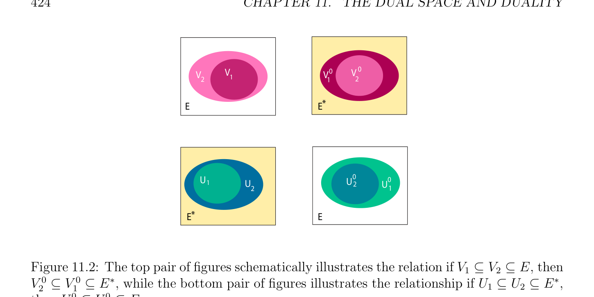

# cặp và Đối ngẫu Giữa E và E*

<!-- PAGE 422 -->
Cho một cái khác ví dụ của sử dụng của Einstein’s ký hiệu, nếu các vectơ $(v_{1}, \dots  , v_{n})$ là các tổ hợp tuyến tính của các vectơ $(u_{1}, \dots  , u_{n})$, với
$$v_{i} = \sum_{j=1}^{n}  a_{ij}u_{j},1 \le i \le n,$$
Thì ở trên các phương trình được viết như
$$v_{i} = a_{i}^{j}u_{j},1 \le i \le n.$$
Do đó, trong Einstein’s ký hiệu, ma trận cỡ $n \times  n$ $(a_{ij})$ được ký hiệu bởi $(a_{i}^{j})$, $(1$, 1)-tenxơ.  Beware rằng một số các tác giả quan điểm ma trận như ánh xạ giữa các tọa độ, trong mà trường hợp ma trận $(a_{ij})$ được ký hiệu bởi $(a_{j}^{i})$.

## 11.2 cặp và Đối ngẫu Giữa E và E*

Cho trước dạng tuyến tính (linear form) $u^{*} \in E^{*}$ và vectơ $v \in E$, kết quả $u^{*}(v)$ của áp dụng $u^{*}$ đến $v$ cũng được ký hiệu bởi $\langle u^{*}, v\rangle$. Điều này định nghĩa nhị phân phép toán $\langle$ -, $-\rangle$: $E^{*} \times  E \to K$ thỏa mãn các tính chất sau đây:
$$\langle u_{1}^{*} + u_{2}^{*}, v\rangle = \langle u_{1}^{*}, v\rangle + \langle u_{2}^{*}, v\rangle$$
$$\langle u^{*}, v_{1} + v_{2}\rangle = \langle u^{*}, v_{1}\rangle + \langle u^{*}, v_{2}\rangle$$
$$\langle \lambda u^{*}, v\rangle = \lambda \langle u^{*}, v\rangle$$
$$\langle u^{*}, \lambda v\rangle = \lambda \langle u^{*}, v\rangle .$$
Ở trên các đồng nhất thức có nghĩa rằng $\langle$ -, $-\rangle$ là ánh xạ song tuyến tính (bilinear map), vì nó là tuyến tính trong mỗi lập luận. Nó là thường được gọi là chính tắc cặp giữa $E^{*}$ và $E$. Xét theo ở trên các đồng nhất thức, cho trước bất kỳ cố định vectơ $v \in E$, ánh xạ $eval_{v}$: $E^{*} \to K$ (việc tính giá trị tại $v)$ được định nghĩa sao cho
$$eval_{v}(u^{*}) = \langle u^{*}, v\rangle = u^{*}(v)for every u^{*}\in E^{*}$$
Là ánh xạ tuyến tính (linear map) từ $E^{*}$ đến $K$, nghĩa là, $eval_{v}$ là dạng tuyến tính (linear form) trong $E^{**}$. Một lần nữa, từ ở trên các đồng nhất thức, ánh xạ $eval_{E}$: $E \to E^{**}$, được định nghĩa sao cho
$$eval_{E}(v) = eval_{v}for every v \in E,$$
Là ánh xạ tuyến tính (linear map). Nhận thấy rằng
$$eval_{E}(v)(u^{*}) = eval_{v}(u^{*}) = \langle u^{*}, v\rangle = u^{*}(v),for all v \in E and all u^{*}\in E^{*}.$$
Ta sẽ xem rằng ánh xạ $eval_{E}$ là đơn ánh (injective), và rằng nó là đẳng cấu khi $E$ có hữu hạn số chiều.

<!-- PAGE 423 -->
Ta bây giờ formalize khái niệm của tập hợp $V^{0}$ của các phương trình tuyến tính triệt tiêu trên tất cả các vectơ trong cho trước không gian con $V \subseteq E$, và khái niệm của tập hợp $U^{0}$ của chung/phổ biến các nghiệm của cho trước tập hợp $U \subseteq E^{*}$ của các phương trình tuyến tính. đối ngẫu định lý (Định lý 11.4) chỉ ra rằng số chiều của $V$ và $V^{0}$, và số chiều của $U$ và $U^{0}$, là related trong then chốt cách. Nó cũng chỉ ra rằng, trong hữu hạn số chiều, các ánh xạ $V \mapsto V^{0}$ và $U \mapsto U^{0}$ là nghịch đảo các song ánh từ các không gian con của $E$ đến các không gian con của $E^{*}$.

> **Định nghĩa 11.3.** Cho trước không gian vectơ (vector space) $E$ và của nó đối ngẫu (dual) $E^{*}$, ta nói rằng vectơ $v \in E$ và dạng tuyến tính (linear form) $u^{*} \in E^{*}$ là trực giao khi và chỉ khi $\langle u^{*}, v\rangle = 0$. Cho trước không gian con $V$ của $E$ và không gian con $U$ của $E^{*}$, ta nói rằng $V$ và $U$ là trực giao khi và chỉ khi $\langle u^{*}, v\rangle = 0$ với mọi $u^{*} \in U$ và mọi $v \in V$. Cho trước tập con $V$ của $E$ (resp. tập con $U$ của $E^{*})$, trực giao $V^{0}$ của $V$ là không gian con $V^{0}$ của $E^{*}$ được định nghĩa sao cho
$$V^{0}= {u^{*}\in E^{*}| \langle u^{*}, v\rangle = 0, for every v \in V }$$
(resp. trực giao $U^{0}$ của $U$ là không gian con $U^{0}$ của $E$ được định nghĩa sao cho
$$U^{0}= {v \in E | \langle u^{*}, v\rangle = 0, for every u^{*}\in U}).$$
Không gian con $V^{0} \subseteq E^{*}$ cũng được gọi là linh hóa tử (annihilator) của $V$. không gian con $U^{0} \subseteq E$ annihilated bởi $U \subseteq E^{*}$ thực hiện không có đặc biệt name. Nó dường như reasonable đến gọi nó không gian con tuyến tính (hoặc tuyến tính variety) được định nghĩa bởi $U$. Một cách trực quan, $V^{0}$ là tập hợp của các phương trình tuyến tính rằng triệt tiêu trên $V$, và $U^{0}$ là tập hợp của chung/phổ biến các không điểm của tất cả các phương trình tuyến tính trong $U$. Ta có thể cũng định nghĩa $V^{0}$ bởi
$$V^{0}= {u^{*}\in E^{*}| V \subseteq \mathrm{Ker} u^{*}}$$
Và $U^{0}$ bởi
$$U^{0}  = \bigcap_{u*\in U}  \mathrm{Ker} u^{*}.$$
Nhận thấy rằng $E^{0} = {0} = (0)$, và ${0}^{0} = E^{*}$.

> **Mệnh đề 11.2.** Nếu $V_{1} \subseteq V_{2} \subseteq E$, thì $V_{2}^{0}  \subseteq V_{1}^{0}  \subseteq E^{*}$, và nếu $U_{1} \subseteq U_{2} \subseteq E^{*}$, thì $U_{2}^{0}  \subseteq U_{1}^{0} \subseteq E$. Xem Hình 11.2.

*Chứng minh.* Thật vậy, nếu $V_{1} \subseteq V_{2} \subseteq E$, thì với mọi $f^{*} \in V_{2}^{0}$ ta có $f^{*}(v) = 0$ với mọi $v \in V_{2}$, và do đó $f^{*} (v) = 0$ với mọi $v \in V_{1}$, do đó $f^{*} \in V_{1}^{0}$. Tương tự, nếu $U_{1} \subseteq U_{2} \subseteq E^{*}$, thì với mọi $v \in U_{2}^{0}$, ta có $f^{*} (v) = 0$ với mọi $f^{*} \in U_{2}$, do đó $f^{*} (v) = 0$ với mọi $f^{*} \in U_{1}$, mà có nghĩa là $v \in U_{1}^{0}$. Ở đây là một số các ví dụ.

<!-- PAGE 424 -->
$$V0VV0$$
$$VVV$$
$$2112$$
$$EE*$$
$$UU00$$
$$1U2U$$
$$21$$
$$E*E$$

**Hình 11.2:** đỉnh/trên cặp của các hình schematically minh họa quan hệ nếu $V_{1} \subseteq V_{2} \subseteq E$, thì $V_{2}^{0}  \subseteq V_{1}^{0}  \subseteq E^{*}$, trong khi đáy/dưới cặp của các hình minh họa relationship nếu $U_{1} \subseteq U_{2} \subseteq E^{*}$, thì $U_{2}^{0}  \subseteq U_{1}^{0} \subseteq E$.

> **Ví dụ 11.2.** Cho $E = M_{2}(\mathbb{R})$, không gian của thực $2\times 2$ các ma trận, và cho $V$ là không gian con của $M_{2}(\mathbb{R})$ được sinh (spanned) bởi các ma trận
$$\begin{pmatrix} 0 & 1 \\ 1 & 0 \end{pmatrix} , \begin{pmatrix} 1 & 0 \\ 0 & 0 \end{pmatrix} , \begin{pmatrix} 0 & 0 \\ 0 & 1 \end{pmatrix} .$$
Ta kiểm tra ngay lập tức rằng không gian con $V$ bao gồm của tất cả các ma trận của tạo thành
$$\begin{pmatrix} b & a \\ a & c \end{pmatrix} ,$$
Rằng là, tất cả các ma trận đối xứng. các ma trận
$$\begin{pmatrix} a_{11} & a_{12} \\ a_{21} & a_{22} \end{pmatrix}$$
Trong $V$ thỏa mãn phương trình
$$a_{12} -a_{21} = 0,$$
Và tất cả vô hướng (scalar) các bội của các phương trình này, do đó $V^{0}$ là không gian con của $E^{*}$ được sinh (spanned) bởi dạng tuyến tính (linear form) cho trước bởi $u^{*}(a_{11}, a_{12}, a_{21}, a_{22}) = a_{12}$ - $a_{21}$. Bởi đối ngẫu định lý (Định lý 11.4) ta có
$$\dim(V^{0} ) = \dim(E) -\dim(V ) = 4 -3 = 1.$$

> **Ví dụ 11.3.** ở trên ví dụ tổng quát hóa đến $E = M_{n}(\mathbb{R})$ với mọi $n \ge 1$, nhưng điều này time, xét không gian $U$ của các dạng tuyến tính asserting rằng ma trận $A$ là đối xứng; các phần tử này là các dạng tuyến tính được sinh (spanned) bởi n(n - $1)/2$ các phương trình
$$a_{ij} -a_{ji} = 0,1 \le i < j \le n;$$

<!-- PAGE 425 -->
Lưu ý có không có các ràng buộc trên đường chéo các phần tử (entries), và một nửa của các phương trình
$$a_{ij} -a_{ji} = 0,1 \le i \neq  j \le n$$
Là redundant. Nó là dễ để kiểm tra rằng các phương trình (các dạng tuyến tính) cho mà $i < j$ là độc lập tuyến tính (linearly independent). là nhiều hơn/thêm precise, cho $U$ là không gian của các dạng tuyến tính trong $E^{*}$ được sinh (spanned) bởi các dạng tuyến tính
$$u_{ij}^{*}(a_{11}, \dots  , a_{1n}, a_{21}, \dots  , a_{2n}, \dots  , a_{n1}, \dots  , a_{nn}) = a_{ij} -a_{ji},1 \le i < j \le n.$$
Số chiều của $U$ là n(n - $1)/2$. Thì tập hợp $U^{0}$ của chung/phổ biến các nghiệm của các phương trình này là không gian S(n) của các ma trận đối xứng. Bởi đối ngẫu định lý (Định lý 11.4), không gian này có số chiều
$$-$$
$$\frac{n(n + 1)}{2} = n^{2}- \frac{n(n1)}{2} .$$
Ta để lại nó như một bài tập để tìm cơ sở (basis) của S(n).

> **Ví dụ 11.4.** Nếu $E = M_{n}(\mathbb{R})$, xét không gian con $U$ của các dạng tuyến tính trong $E^{*}$ được sinh (spanned) bởi các dạng tuyến tính
$$u_{ij}^{*}(a_{11}, \dots  , a_{1n}, a_{21}, \dots  , a_{2n}, \dots  , a_{n1}, \dots  , a_{nn}) = a_{ij} + a_{ji},1 \le i < j \le n$$
$$u_{ii}^{*}(a_{11}, \dots  , a_{1n}, a_{21}, \dots  , a_{2n}, \dots  , a_{n1}, \dots  , a_{nn}) = a_{ii},1 \le i \le n.$$
Nó là dễ để xem rằng các phần tử này các dạng tuyến tính là độc lập tuyến tính (linearly independent), do đó dim(U) $=$ n(n $+ 1)/2$.
$$\mathbb{R}$$
Không gian $U^{0}$ của các ma trận $A \in M_{n}($) satifying tất cả của ở trên các phương trình là rõ ràng không gian Skew(n) của các ma trận phản đối xứng. Bởi đối ngẫu định lý (Định lý 11.4), số chiều của $U^{0}$ là
$$-$$
$$\frac{n(n1)}{2} = n^{2}- \frac{n(n + 1)}{2} .$$
Ta để lại nó như một bài tập để tìm cơ sở (basis) của Skew(n).

> **Ví dụ 11.5.** Cho vẫn chưa một cái khác ví dụ với $E = M_{n}(\mathbb{R})$, với mọi $A \in M_{n}(\mathbb{R})$, xét dạng tuyến tính (linear form) trong $E^{*}$ cho trước bởi
$$\mathrm{tr}(A) = a_{11} + a_{22} + \cdots  + a_{nn},$$
Được gọi là vết (trace) của $A$. không gian con $U^{0}$ của $E$ bao gồm của tất cả các ma trận $A$ sao cho tr() $= 0$ là không gian có số chiều $n^{2}$ - $1$. Ta để lại nó như một bài tập để tìm cơ sở (basis) của không gian này. số chiều các phương trình
$$\dim(V ) + \dim(V^{0} ) = \dim(E)$$
$$\dim(U) + \dim(U^{0} ) = \dim(E)$$
Là luôn luôn đúng (nếu $E$ là hữu hạn chiều). Điều này là phần của đối ngẫu định lý (Định lý 11.4).

<!-- PAGE 426 -->
Nhận xét: Ngược lại với trước đó các ví dụ, cho trước ma trận $A \in M_{n}(\mathbb{R})$, các phương trình asserting rằng $A^{\top}A =$ I là không tuyến tính các ràng buộc. Ví dụ, cho $n = 2$, ta có
$$a_{11}^{2} + a_{21}^{2} = 1$$
$$a_{21}^{2} + a_{22}^{2} = 1$$
$$a_{11}a_{12} + a_{21}a_{22} = 0.$$
Các nhận xét:
$(1)$ ký hiệu $V^{0}$ (resp. $U^{0})$ cho trực giao của không gian con $V$ của $E$ (resp. không gian con $U$ của $E^{*})$ là không phổ dụng. Khác các tác giả sử dụng ký hiệu $V^{\perp}$ (resp. $U^{\perp}$). Tuy nhiên, ký hiệu $V^{\perp}$ cũng được sử dụng đến ký hiệu phần bù trực giao (orthogonal complement) của không gian con $V$ đối với tích vô hướng (inner product) trên không gian $E$, trong mà trường hợp $V^{\perp}$ là không gian con của $E$ và không không gian con của $E^{*}$ (xem Chương $12)$. để tránh confusion, ta ưu tiên bằng cách sử dụng ký hiệu $V^{0}$.
$(2)$ Vì các dạng tuyến tính có thể được được quan điểm như các phương trình tuyến tính (ít nhất trong hữu hạn số chiều), cho trước không gian con (hoặc chẵn/ngay cả tập con) $U$ của $E^{*}$, ta có thể định nghĩa tập hợp $\mathcal{Z}(U)$ của chung/phổ biến các không điểm của các phương trình trong $U$ bởi
$$\mathcal{Z}(U) = {v \in E | u^{*}(v) = 0, for all u^{*}\in U}.$$
Của course $\mathcal{Z}(U) = U^{0}$, nhưng khái niệm $\mathcal{Z}(U)$ có thể được suy rộng/tổng quát hóa đến nhiều hơn/thêm tổng quát các loại của các phương trình, cụ thể là đa thức các phương trình. Trong điều này nhiều hơn/thêm tổng quát đặt, $U$ là tập hợp của các đa thức trong $n$ các biến với các hệ số trong trường $K$ (ở đâu $n =$ dim(E)). Các tập hợp của tạo thành $\mathcal{Z}(U)$ được gọi là đại số varieties. Các dạng tuyến tính tương ứng với đặc biệt trường hợp ở đâu thuần nhất các đa thức của bậc $1$ được xét. Nếu $V$ là tập con của $E$, nó là tự nhiên đến associate với $V$ tập hợp của các đa thức trong $K[X_{1}, \dots  , X_{n}]$ rằng triệt tiêu trên $V$. tập hợp này, thường được ký hiệu $\mathcal{I}(V$), có một số đặc biệt các tính chất rằng tạo nó lý tưởng (ideal). Nếu $V$ là không gian con tuyến tính của $E$, nó là tự nhiên đến thu hẹp của ta attention đến không gian $V^{0}$ của các dạng tuyến tính rằng triệt tiêu trên $V$, và trong trường hợp này ta đồng nhất $\mathcal{I}(V$) và $V^{0}$ (mặc dù technically, $\mathcal{I}(V$) là không có dài hơn lý tưởng (ideal)). Với mọi tùy ý tập hợp của các đa thức $U \subseteq K[X_{1}, \dots  , X_{n}]$ (resp. tập con $V \subseteq E)$, relationship giữa $\mathcal{I}(\mathcal{Z}(U))$ và $U$ (resp. $\mathcal{Z}(\mathcal{I}(V$)) và $V$) là một cách tổng quát không đơn giản, chẵn/ngay cả dù ta luôn luôn có
$$U \subseteq I(\mathcal{Z}(U))(resp.V \subseteq Z(\mathcal{I}(V ))).$$
Tuy nhiên, khi trường $K$ là algebraically đóng, $then\mathcal{I}(\mathcal{Z}(U))$ bằng radical của lý tưởng (ideal) $U$, nổi tiếng kết quả do Hilbert đã biết như Nullstellensatz (xem Lang $[113]$ hoặc Dummit và Foote $[55])$. study của đại số varieties là chính subject
