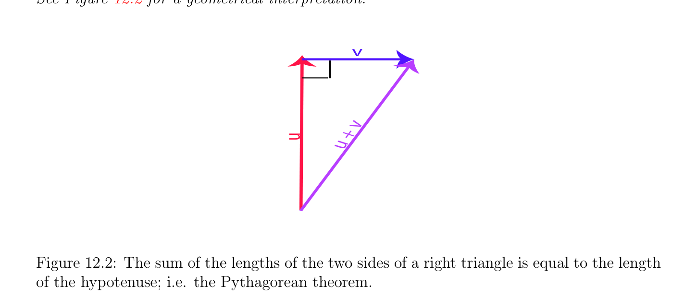
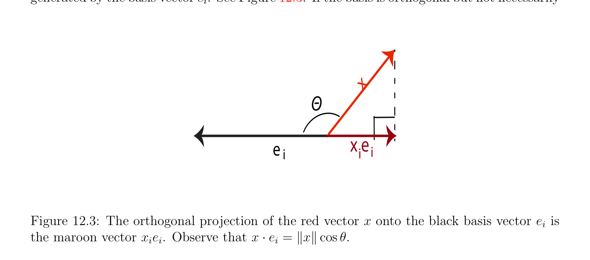

# Tính trực giao và Đối ngẫu trong Các không gian Euclid

<!-- PAGE 462 -->
Là little khó/tinh tế. chiến lược là để chứng minh đồng nhất thức cho $\lambda  \in \mathbb{Z}$, thì đến promote nó đến $\mathbb{Q}$, và thì đến $\mathbb{R}$ bởi tính liên tục. Vì
$$-\|-$$
$$\langle -u, v\rangle = \frac{1}{4} (\|-u + v\|^{2}u -v\|^{2})$$
$$-\|$$
$$= \frac{1}{4} (\|u -v\|^{2}u + v\|^{2})$$
$$= -\langle u, v\rangle ,$$
Tính chất nghiệm đúng cho $\lambda  = -1$. Bởi tính tuyến tính và bởi quy nạp, với mọi $n \in \mathbb{N}$ với $n \ge 1$, viết $n = n$ - $1 + 1$, ta thu được
$$\langle \lambda x, y\rangle = \lambda \langle x, y\rangle for all \lambda  \in \mathbb{N},$$
Và vì ở trên cũng nghiệm đúng cho $\lambda  = -1$, nó nghiệm đúng với mọi $\lambda  \in \mathbb{Z}$. Cho $\lambda  = p/q$ với $p, q \in \mathbb{Z}$ và $q \neq  0$, ta có
$$q\langle (p/q)u, v\rangle = \langle pu, v\rangle = p\langle u, v\rangle ,$$
Mà chỉ ra rằng
$$\langle (p/q)u, v\rangle = (p/q)\langle u, v\rangle ,$$
Và do đó
$$\langle \lambda x, y\rangle = \lambda \langle x, y\rangle for all \lambda  \in \mathbb{Q}.$$
Đến hoàn tất chứng minh, ta sử dụng sự kiện rằng chuẩn (norm) là ánh xạ liên tục (continuous map) $x \mapsto \|x\|$. Thì, hàm liên tục (continuous function) $t \mapsto^{1} \langle$ tu, $v\rangle$ được định nghĩa trên $\mathbb{R} -{0}$ agrees với $\langle u, v\rangle$ trên $\mathbb{Q} -{0}$, do đó nó bằng $\langle u, v\rangle$ trên $\mathbb{R} -{0^{t}}$. trường hợp $\lambda  = 0$ là tầm thường, do đó ta được thực hiện. Ta bây giờ định nghĩa tính trực giao.

## 12.2 Tính trực giao và Đối ngẫu trong Các không gian Euclid

Tích vô hướng (inner product) trên không gian vectơ (vector space) cho ability để định nghĩa khái niệm của tính trực giao. Các họ của khác không đôi một trực giao các vectơ phải là độc lập tuyến tính (linearly independent). Chúng được gọi là trực giao các họ. Trong không gian vectơ (vector space) của hữu hạn số chiều nó là luôn luôn khả dĩ/có thể để tìm trực giao các cơ sở. Điều này là rất hữu ích về mặt lý thuyết và một cách thực tế. Thật vậy, trong cơ sở trực giao (orthogonal basis), việc tìm các tọa độ của vectơ là rất cheap: Nó lấy tích vô hướng (inner product). Fourier chuỗi tạo then chốt sử dụng của sự kiện này. Khi $E$ có hữu hạn số chiều, ta chứng minh rằng tích vô hướng (inner product) trên $E$ cảm sinh tự nhiên đẳng cấu giữa $E$ và đối ngẫu (đối ngẫu (dual)) của nó không gian $E^{*}$. Điều này cho phép chúng ta để định nghĩa liên hợp (adjoint) của ánh xạ tuyến tính (linear map) trong nội tại cách thức (i.e., một cách độc lập của các cơ sở). Nó là cũng khả dĩ/có thể đến orthonormalize bất kỳ cơ sở (basis) (một cách nhất định khi số chiều là hữu hạn). Ta cho hai các chứng minh, một bằng cách sử dụng đối ngẫu, khác nhiều hơn/thêm constructive bằng cách sử dụng Gram–Schmidt trực chuẩn hóa quy trình.

<!-- PAGE 463 -->

> **Định nghĩa 12.2.** Cho trước Không gian Euclid (Euclidean space) $E$, bất kỳ hai các vectơ $u, v \in E$ là trực giao, hoặc vuông góc, nếu $u \cdot  v = 0$. Cho trước họ $(u_{i})_{i\in I}$ của các vectơ trong $E$, ta nói rằng $(u_{i})_{i\in I}$ là trực giao nếu $u_{i} \cdot  u_{j} = 0$ với mọi $i, j \in$ I, ở đâu i̸ $= j$. Ta nói rằng họ $(u_{i})_{i\in I}$ là trực chuẩn nếu $u_{i} \cdot  u_{j} = 0$ với mọi $i, j \in$ I, ở đâu $i \neq  j$, và $\|u_{i}\| = u_{i} \cdot  u_{i} = 1$, với mọi $i \in$ I. Với mọi tập con $F$ của $E$, tập hợp
$$F^{\perp} = {v \in E | u \cdot  v = 0, for all u \in F},$$
Của tất cả các vectơ trực giao đến tất cả các vectơ trong $F$, được gọi là phần bù trực giao (orthogonal complement) của $F$. Vì trong các tích là xác định dương (positive definite), nhận thấy rằng với mọi vectơ $u \in E$, ta có
$$u \cdot  v = 0for all v \in Eiffu = 0.$$
Ta kiểm chứng được ngay rằng phần bù trực giao (orthogonal complement) $F^{\perp}$ của $F$ là không gian con của $E$.

> **Ví dụ 12.5.** Đi quay lại đến Ví dụ 12.3 và đến tích vô hướng (inner product)
$$\langle f, g\rangle = \int_{-}^{}  \pi f(t)g(t)dt$$
$$\pi$$
Trên không gian vectơ (vector space) $\mathcal{C}[-\pi , \pi$ ], nó là dễ dàng đã kiểm tra rằng
$$\pi if p = q, p, q \ge 1,$$
$$\langle \sin px, \sin qx\rangle =$$
$$0if p \neq  q, p, q \ge 1,$$
$$\pi if p = q, p, q \ge 1,$$
$$\langle \cos px, \cos qx\rangle =$$
$$0if p \neq  q, p, q \ge 0,$$
Và
$$\langle \sin px, \cos qx\rangle = 0,$$
$$for all p \ge 1 and q \ge 0, and of course, \langle 1, 1\rangle =_{\pi}^{\pi} \int_{-}  dx = 2\pi .$$
Hệ quả là, họ (sin $px)_{p\ge1}\cup$ (cos $qx)_{q\ge0}$ là trực giao. Nó là không trực chuẩn,
$$\sqrt\sqrt$$
Nhưng trở thành do đó nếu ta chia mọi trigonometric hàm bởi $\overline{\pi}$, và $1$ bởi $\overline{2}\overline{\pi}$.

> **Mệnh đề 12.4.** Cho trước Không gian Euclid (Euclidean space) $E$, với mọi họ $(u_{i})_{i\in I}$ của khác không các vectơ trong $E$, nếu $(u_{i})_{i\in I}$ là trực giao, thì nó là độc lập tuyến tính (linearly independent).

*Chứng minh.* Giả sử có một sự phụ thuộc tuyến tính (linear dependence)
$$\sum_{j\in J}  \lambda_{j} u_{j} = 0$$

<!-- PAGE 464 -->
Với một số $\lambda_{j}  \in \mathbb{R}$ và một số hữu hạn tập con $J$ của I. Bằng cách lấy tích vô hướng (inner product) với $u_{i}$ với mọi $i \in J$, và bằng cách sử dụng tính song tuyến tính của tích vô hướng (inner product) và sự kiện rằng $u_{i} \cdot  u_{j} = 0$ bất cứ khi nào $i \neq  j$, ta thu được
$$0 = u_{i} \cdot  0 = u_{i} \cdot \sum_{j\in J}  \lambda_{j} u_{j}!$$
$$= \sum_{j\in J}  \lambda_{j} (u_{i} \cdot  u_{j}) = \lambda_{i} (u_{i} \cdot  u_{i}),$$
Do đó
$$\lambda_{i} (u_{i} \cdot  u_{i}) = 0,for all i \in J,$$
Và vì $u_{i} \neq  0$ và tích vô hướng (inner product) là xác định dương (positive definite), $u_{i} \cdot  u_{i} \neq  0$, do đó ta thu được
$$\lambda_{i}  = 0,for all i \in J,$$
Mà chỉ ra rằng họ $(u_{i})_{i\in I}$ là độc lập tuyến tính (linearly independent). Ta để lại sau đây đơn giản kết quả như một bài tập.

> **Mệnh đề 12.5.** Cho trước Không gian Euclid (Euclidean space) $E$, bất kỳ hai các vectơ $u, v \in E$ là trực giao khi và chỉ khi
$$\|u + v\|^{2}= \|u\|^{2}+ \|v\|^{2}.$$
Xem Hình 12.2 cho geometrical interpretation.
$$v$$
$$v$$
$$u +$$
$$u$$

**Hình 12.2:** tổng của các độ dài của hai các vế/cạnh của phải tam giác bằng độ dài của hypotenuse; i.e. Pythagorean định lý. Một của hầu hết hữu ích các đặc trưng của các cơ sở trực chuẩn là rằng chúng afford rất đơn giản phương pháp cho việc tính toán các tọa độ của vectơ trên bất kỳ cơ sở (basis) vectơ. Thật vậy, giả sử rằng $(e_{1}, \dots  , e_{m})$ là cơ sở trực chuẩn (orthonormal basis). Với mọi vectơ
$$x = x_{1}e_{1} + \cdots  + x_{m}e_{m},$$

<!-- PAGE 465 -->
Nếu ta tính tích vô hướng (inner product) $x \cdot  e_{i}$, ta thu được
$$x \cdot  e_{i} = x_{1}e_{1} \cdot  e_{i} + \cdots  + x_{i}e_{i} \cdot  e_{i} + \cdots  + x_{m}e_{m} \cdot  e_{i} = x_{i},$$
Vì
$$1if i = j,$$
$$e_{i} \cdot  e_{j} =$$
$$0if i \neq  j$$
Là tính chất đặc trưng hóa họ trực chuẩn (orthonormal family). Do đó,
$$x_{i} = x \cdot  e_{i},$$
Mà có nghĩa là $x_{i}e_{i} = (x \cdot  e_{i})e_{i}$ là phép chiếu trực giao (orthogonal projection) của $x$ lên không gian con được sinh bởi cơ sở (basis) vectơ $e_{i}$. Xem Hình 12.3. Nếu cơ sở (basis) là trực giao nhưng không nhất thiết
$$x$$
$$\Theta$$
$$\overline{x e}$$
$$\overline{e}$$
$$ii i$$

**Hình 12.3:** phép chiếu trực giao (orthogonal projection) của đỏ vectơ $x$ lên black cơ sở (basis) vectơ $e_{i}$ là maroon vectơ $x_{i}e_{i}$. Nhận thấy rằng $x \cdot  e_{i} = \|x\|cos \theta$. trực chuẩn, thì
$$\cdot   \cdot$$
$$x_{i} = \frac{x e_{i}}{e_{i} \cdot  e_{i}} = \frac{x e_{i}}{\|e_{i}\|^{2}} .$$
Tất cả điều này là đúng chẵn/ngay cả cho vô hạn trực chuẩn (hoặc trực giao) cơ sở (basis) $(e_{i})_{i\in I}$.  Tuy nhiên, nhớ rằng mọi vectơ $x$ được biểu diễn như tổ hợp tuyến tính (linear combination)
$$x = \sum_{i\in I}  x_{i}e_{i}$$
Ở đâu họ của các vô hướng $(x_{i})_{i\in I}$ có hữu hạn hỗ trợ/giá (support), mà có nghĩa là $x_{i} = 0$ với mọi $i \in$ I - $J$, ở đâu $J$ là hữu hạn tập hợp. Do đó, chẵn/ngay cả dù họ (sin $px)_{p\ge1} \cup$ (cos $qx)_{q\ge0}$ là trực giao (nó là không trực chuẩn, nhưng trở thành do đó nếu ta chia mọi trigonometric hàm bởi $\sqrt \sqrt \overline{\pi}$, và $1$ bởi $\overline{2}\overline{\pi}$; ta won’t bởi vì nó trông phức tạp!), sự kiện rằng hàm $f \in C^{0}[-\pi , \pi$ ] có thể được viết dưới dạng Fourier chuỗi như
$$f(x) = a_{0} + \sum_{k=1}^{\infty}  (a_{k} \cos kx + b_{k} \sin kx)$$

<!-- PAGE 466 -->
Thực hiện không có nghĩa rằng (sin $px)_{p\ge1} \cup$ (cos $qx)_{q\ge0}$ là cơ sở (basis) của vectơ này không gian của các hàm, bởi vì nói chung, các họ $(a_{k})$ và $(b_{k})$ thực hiện không có hữu hạn hỗ trợ/giá (support)! Trong thứ tự cho điều này vô hạn tổ hợp tuyến tính (linear combination) để tạo nghĩa, nó là cần để chứng minh rằng riêng các tổng
$$a_{0} + \sum_{k=1}^{n}  (a_{k} \cos kx + b_{k} \sin kx)$$
Của chuỗi hội tụ đến giới hạn khi $n$ đi đến vô cực. Điều này đòi hỏi tôpô trên không gian. rất quan trọng tính chất của Các không gian Euclid của hữu hạn số chiều là rằng tích vô hướng (inner product) cảm sinh chính tắc song ánh (i.e., độc lập của lựa chọn của các cơ sở) giữa không gian vectơ (vector space) $E$ và của nó đối ngẫu (dual) $E^{*}$. lý do là rằng tích vô hướng (inner product) $\cdot$: $E \times  E \to \mathbb{R}$ định nghĩa không suy biến cặp, như đã định nghĩa trong Định nghĩa 11.4. Thật vậy, nếu $u \cdot  v = 0$ với mọi $v \in E$ thì $u = 0$, và tương tự nếu $u \cdot  v = 0$ với mọi $u \in E$ thì $v = 0$ (vì tích vô hướng (inner product) là xác định dương (positive definite) và đối xứng). Theo Mệnh đề 11.6, có một chính tắc đẳng cấu giữa $E$ và $E^{*}$. Ta feel rằng độc giả sẽ appreciate nếu ta exhibit điều này ánh xạ một cách tường minh và reprove rằng nó là đẳng cấu. ánh xạ từ $E$ đến $E^{*}$ được định nghĩa như sau.

> **Định nghĩa 12.3.** Với mọi vectơ $u \in E$, cho $\phi_{u}$: $E \to \mathbb{R}$ là ánh xạ được định nghĩa sao cho
$$\phi_{u} (v) = u \cdot  v,for all v \in E.$$
Vì tích vô hướng (inner product) là song tuyến tính, ánh xạ $\phi_{u}$ là dạng tuyến tính (linear form) trong $E^{*}$. Do đó, ta có ánh xạ $\flat$: $E \to E^{*}$, được định nghĩa sao cho
$$\flat (u) = \phi_{u} .$$

> **Định lý 12.6.** Cho trước Không gian Euclid (Euclidean space) $E$, ánh xạ $\flat$: $E \to E^{*}$ được định nghĩa sao cho
$$\flat (u) = \phi_{u}$$
Là tuyến tính và đơn ánh (injective). Khi $E$ là cũng của hữu hạn số chiều, ánh xạ $\flat$: $E \to E^{*}$ là chính tắc đẳng cấu.

*Chứng minh.* Rằng $\flat$: $E \to E^{*}$ là ánh xạ tuyến tính (linear map) suy ra ngay lập tức từ sự kiện rằng tích vô hướng (inner product) là song tuyến tính. Nếu $\phi_{u}  = \phi_{v}$, thì $\phi_{u} (w) = \phi_{v} (w)$ với mọi $w \in E$, mà theo định nghĩa của $\phi_{u}$ có nghĩa là $u \cdot  w = v \cdot  w$ với mọi $w \in E$, mà bởi tính song tuyến tính là tương đương đến
$$(v -u) \cdot  w = 0$$
Với mọi $w \in E$, mà suy ra rằng $u = v$, vì tích vô hướng (inner product) là xác định dương (positive definite). Do đó, $\flat$: $E \to E^{*}$ là đơn ánh (injective). Cuối cùng, khi $E$ là của hữu hạn số chiều $n$, ta biết rằng $E^{*}$ là cũng có số chiều $n$, và thì $\flat$: $E \to E^{*}$ là song ánh (bijective).

<!-- PAGE 467 -->
Nghịch đảo của đẳng cấu $\flat$: $E \to E^{*}$ được ký hiệu bởi $\sharp$: $E^{*} \to E$. Hệ quả là của Định lý 12.6 ta có kết quả sau hệ quả.

> **Hệ quả 12.7.** Nếu $E$ là Không gian Euclid (Euclidean space) của hữu hạn số chiều, mọi dạng tuyến tính (linear form) $f \in E^{*}$ tương ứng với duy nhất $u \in E$ sao cho
$$f(v) = u \cdot  v,for every v \in E.$$
Đặc biệt, nếu $f$ là không không tạo thành, hạt nhân (kernel) của $f$, mà là siêu phẳng (hyperplane) $H$, là một cách chính xác tập hợp của các vectơ rằng là trực giao đến $u$.
Các nhận xét:
$(1)$ “musical ánh xạ” $\flat$: $E \to E^{*}$ là không toàn ánh (surjective) khi $E$ có vô hạn số chiều. kết quả có thể được salvaged bởi thu hẹp của ta attention đến liên tục các ánh xạ tuyến tính (linear maps), và bởi giả sử rằng không gian vectơ (vector space) $E$ là Không gian Hilbert (Hilbert space) (i.e., $E$ là đầy đủ không gian vectơ định chuẩn (normed vector space) w.r.t. Euclidean chuẩn (norm)). Điều này là nổi tiếng “little” Riesz định lý (hoặc Riesz biểu diễn định lý).
$(2)$ Định lý 12.6 vẫn nghiệm đúng nếu tích vô hướng (inner product) trên $E$ được thay thế bởi không suy biến dạng song tuyến tính đối xứng $\phi$. Ta nói rằng dạng song tuyến tính đối xứng $\phi$: $E \times  E \to \mathbb{R}$ là không suy biến nếu với mọi $u \in E$,
$$if\phi (u, v) = 0for all v \in E,thenu = 0.$$
$$\mathbb{R}^{4}$$
Ví dụ, dạng song tuyến tính đối xứng trên (Lorentz tạo thành) được định nghĩa sao cho
$$\phi ((x_{1}, x_{2}, x_{3}, x_{4}), (y_{1}, y_{2}, y_{3}, y_{4})) = x_{1}y_{1} + x_{2}y_{2} + x_{3}y_{3} -x_{4}y_{4}$$
$$\mathbb{R}^{4}$$
Là không suy biến. Tuy nhiên, có khác không các vectơ $u \in$ sao cho $\phi (u, u) = 0$, mà là không thể trong Không gian Euclid (Euclidean space). Như vậy các vectơ được gọi là đẳng hướng.
$$\mathbb{R}^{n}$$

> **Ví dụ 12.6.** Xét với của nó thông thường Euclidean tích vô hướng (inner product). Cho trước bất kỳ khả vi (differentiable) hàm $f$: $U \to \mathbb{R}$, ở đâu $U$ là một số mở tập con của $\mathbb{R}^{n}$, theo Định nghĩa, với mọi $x \in U$, đạo hàm toàn phần (total derivative) $df_{x}$ của $f$ tại $x$ là dạng tuyến tính (linear form) được định nghĩa sao cho với mọi $u = (u_{1}, \dots  , u_{n}) \in \mathbb{R}^{n}$,
$$df_{x}(u) = \begin{pmatrix} \partial f \\ \partial f \\ (x) & \cdots & (x) \\ \partial x_{1} & \partial x_{n} \end{pmatrix} \begin{pmatrix} u_{1} \\ \vdots \\ u_{n} \end{pmatrix} = \sum_{i=1}^{n}  \frac{\partial f}{\partial x_{i}} (x) u_{i}.$$
$$\mathbb{R}^{n}$$
Duy nhất vectơ $v \in$ sao cho
$$v \cdot  u = df_{x}(u)for all u \in \mathbb{R}^{n}$$

<!-- PAGE 468 -->
Là chuyển vị (transpose) của Ma trận Jacobi (Jacobian matrix) của $f$ tại $x$, ma trận cỡ $1 \times  n$
$$\begin{pmatrix} \partial f \\ \partial f \\ (x) & \cdots & (x) \\ \partial x_{1} & \partial x_{n} \end{pmatrix} .$$
Điều này là gradien $grad(f)_{x}$ của $f$ tại $x$, cho trước bởi
$$grad(f)_{x} = \begin{pmatrix} \partial f \\ (x) \\ \partial x_{1} \\ \vdots \\ \partial f \\ (x) \\ \partial x_{n} \end{pmatrix} .$$

> **Ví dụ 12.7.** Cho trước bất kỳ hai các vectơ $u, v \in \mathbb{R}^{3}$, cho c(u, $v)$ là dạng tuyến tính (linear form) cho trước bởi
$$c(u, v)(w) = \det(u, v, w)for all w \in \mathbb{R}^{3}.$$
Vì
$$u_{1}v_{1}w_{1}$$
$$u_{2}v_{2}

$u_{1}v_{1}$

$u_{1}v_{1}$$$
$$\det(u, v, w) =u_{2}v_{2}w_{2}= w_{1} -w_{2} + w_{3}$$
$$u_{3}v_{3}u_{3}v_{3}u_{2}v_{2}$$
$$u_{3}v_{3}w_{3}$$
$$= w_{1}(u_{2}v_{3} -u_{3}v_{2}) + w_{2}(u_{3}v_{1} -u_{1}v_{3}) + w_{3}(u_{1}v_{2} -u_{2}v_{1}),$$
$$\mathbb{R}^{3}$$
Ta xem rằng duy nhất vectơ $z \in$ sao cho
$$z \cdot  w = c(u, v)(w) = \det(u, v, w)for all w \in \mathbb{R}^{3}$$
Là vectơ
$$z = \begin{pmatrix} u_{2}v_{3} -u_{3}v_{2} \\ u_{3}v_{1} -u_{1}v_{3} \\ u_{1}v_{2} & u_{2}v_{1} \end{pmatrix} .$$
$$-$$
Điều này là chỉ cross-product $u \times  v$ của $u$ và $v$. Vì det(u, $v, u) =$ det(u, $v, v) = 0$, ta xem rằng $u\times v$ là trực giao đến cả hai $u$ và $v$. ở trên cho phép chúng ta đến tổng quát hóa cross-product đến $\mathbb{R}^{n}$. Cho trước bất kỳ $n$ - $1$ các vectơ $u_{1}, \dots  , u_{n-1} \in \mathbb{R}^{n}$, cross-product $u_{1} \times  \cdots  \times  u_{n-1}$ là
$$\mathbb{R}^{n}$$
Duy nhất vectơ trong sao cho
$$(u_{1} \times  \cdots  \times  u_{n-1}) \cdot  w = \det(u_{1}, \dots  , u_{n-1}, w)for all w \in \mathbb{R}^{n}.$$

> **Ví dụ 12.8.** Xét không gian vectơ (vector space) $M_{n}(\mathbb{R})$ của thực $n \times  n$ các ma trận với tích vô hướng (inner product)
$$\langle A, B\rangle = \mathrm{tr}(A^{\top}B).$$
Cho $s: M_{n}(\mathbb{R}) \to \mathbb{R}$ là hàm cho trước bởi
$$s(A) = \sum_{i,j=1}^{n}  a_{ij},$$
