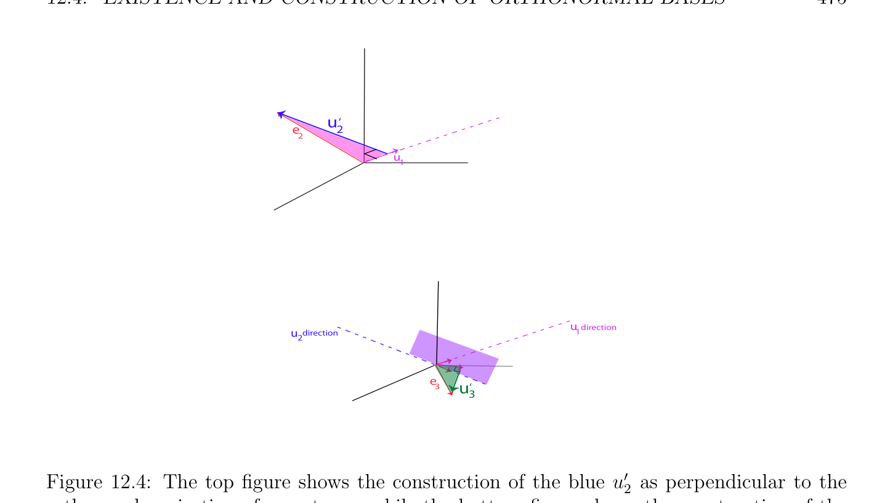
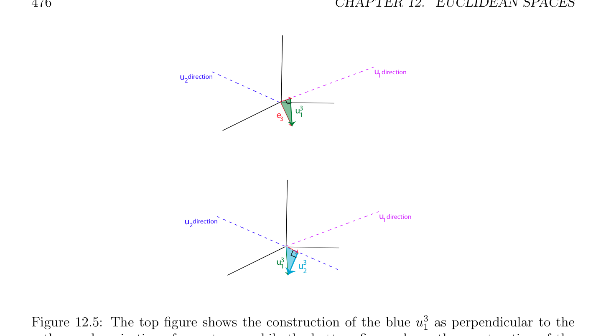

# Sự tồn tại và Cách xây dựng của Các cơ sở trực chuẩn

<!-- PAGE 471 -->
Cho trước hai Các không gian Euclid $E$ và $F$, ở đâu tích vô hướng (inner product) trên $E$ được ký hiệu bởi $\langle$ -, $-\rangle_{1}$ và tích vô hướng (inner product) trên $F$ được ký hiệu bởi $\langle$ -, $-\rangle_{2}$, cho trước bất kỳ ánh xạ tuyến tính (linear map) $f$: $E \to F$, ta kiểm chứng được ngay rằng chứng minh của Mệnh đề 12.8 có thể được được điều chỉnh để chỉ ra rằng tồn tại duy nhất một ánh xạ tuyến tính (linear map) $f^{*}$: $F \to E$ sao cho
$$\langle f(u), v\rangle_{2}  = \langle u, f^{*} (v)\rangle_{1}$$
Với mọi $u \in E$ và tất cả $v \in F$. ánh xạ tuyến tính (linear map) $f^{*}$ cũng được gọi là liên hợp (adjoint) của $f$. Các tính chất sau đây ngay lập tức suy ra từ định nghĩa của liên hợp (adjoint) ánh xạ:
$(1)$ Với mọi ánh xạ tuyến tính (linear map) $f$: $E \to F$, ta có
$$f^{**} = f.$$
$(2)$ Với mọi hai các ánh xạ tuyến tính (linear maps) $f, g: E \to F$ và bất kỳ vô hướng (scalar) $\lambda  \in \mathbb{R}$:
$$(f + g)^{*}= f^{*} + g^{*}$$
$$(\lambda f)^{*}= \lambda f^{*} .$$
$(3)$ Nếu $E, F, G$ là Các không gian Euclid với respective trong các tích $\langle$ -, $-\rangle_{1} , \langle$ -, $-\rangle_{2}$, và $\langle$ -, $-\rangle_{3}$, và nếu $f$: $E \to F$ và $g: F \to G$ là hai các ánh xạ tuyến tính (linear maps), thì
$$(g \circ f)^{*}= f^{*} \circ g^{*}.$$
Nhận xét: Cho trước bất kỳ cơ sở (basis) cho $E$ và bất kỳ cơ sở (basis) cho $F$, nó là khả dĩ/có thể để đặc trưng hóa ma trận của liên hợp (adjoint) $f^{*}$ của $f$ theo ma trận của $f$ và Gram các ma trận định nghĩa trong các tích; xem Bài toán 12.5. Ta sẽ thực hiện do đó đối với các cơ sở trực chuẩn trong Mệnh đề 12.14(2). Cũng, vì trong các tích là đối xứng, liên hợp (adjoint) $f^{*}$ của $f$ cũng được đặc trưng hóa bởi
$$f(u) \cdot  v = u \cdot  f^{*} (v),$$
Với mọi $u, v \in E$.

## 12.4 Sự tồn tại và Cách xây dựng của Trực chuẩn

$$Bases$$
Ta có thể cũng sử dụng Định lý 12.6 để chỉ ra rằng bất kỳ Không gian Euclid (Euclidean space) của hữu hạn số chiều có cơ sở trực chuẩn (orthonormal basis).

> **Mệnh đề 12.9.** Cho trước bất kỳ không tầm thường Không gian Euclid (Euclidean space) $E$ của hữu hạn số chiều $n \ge 1$, có một cơ sở trực chuẩn (orthonormal basis) $(u_{1}, \dots  , u_{n})$ cho $E$.

<!-- PAGE 472 -->

*Chứng minh.* Ta tiến hành bằng quy nạp theo $n$. Khi $n = 1$, lấy bất kỳ khác không vectơ $v \in E$, mà tồn tại vì ta được giả sử $E$ không tầm thường, và cho
$$u = \frac{v}{\|v\|} .$$
Nếu $n \ge 2$, một lần nữa lấy bất kỳ khác không vectơ $v \in E$, và cho
$$u_{1} = \frac{v}{\|v\|} .$$
Xét dạng tuyến tính (linear form) $\phi_{u1}$ liên kết với $u_{1}$. Vì $u_{1} \neq  0$, theo Định lý 12.6, dạng tuyến tính (linear form) $\phi_{u1}$ là khác không, và hạt nhân (hạt nhân (kernel)) của nó là siêu phẳng (hyperplane) $H$. Vì $\phi_{u1} (w) = 0$ khi và chỉ khi $u_{1} \cdot  w = 0$, siêu phẳng (hyperplane) $H$ là phần bù trực giao (orthogonal complement) của ${u_{1}}$. Hơn nữa, vì $u_{1}$ ̸ $= 0$ và tích vô hướng (inner product) là xác định dương (positive definite), $u_{1} \cdot  u_{1}$ ̸ $= 0$, và do đó, $u_{1} \in / H$, mà suy ra rằng $E = H \oplus \mathbb{R} u_{1}$. Tuy nhiên, vì $E$ là của hữu hạn số chiều $n$, siêu phẳng (hyperplane) $H$ có số chiều n-1, và theo giả thiết quy nạp, ta có thể tìm cơ sở trực chuẩn (orthonormal basis) $(u_{2}, \dots  , u_{n})$ cho $H$. Bây giờ bởi vì $H$ và một dimensional không gian $\mathbb{R} u_{1}$ là trực giao và $E = H \oplus \mathbb{R} u_{1}$, rõ ràng là $(u_{1}, \dots  , u_{n})$ là cơ sở trực chuẩn (orthonormal basis) cho $E$. Hệ quả là của Mệnh đề 12.9, cho trước bất kỳ Không gian Euclid (Euclidean space) của hữu hạn số chiều $n$, nếu $(e_{1}, \dots  , e_{n})$ là cơ sở trực chuẩn (orthonormal basis) cho $E$, thì với mọi hai các vectơ $u = u_{1}e_{1} + \cdots  + u_{n}e_{n}$ và $v = v_{1}e_{1} + \cdots  + v_{n}e_{n}$, tích vô hướng (inner product) $u \cdot  v$ được biểu diễn như
$$u \cdot  v = (u_{1}e_{1} + \cdots  + u_{n}e_{n}) \cdot  (v_{1}e_{1} + \cdots  + v_{n}e_{n}) = \sum_{i=1}^{n}  u_{i}v_{i},$$
Và chuẩn (norm) $\|u\|$ như
$$1/2$$
$$\|u\|= \|u_{1}e_{1} + \cdots  + u_{n}e_{n}\|= \begin{pmatrix} u_{i}^{2} \end{pmatrix} \sum_{i=1}^{n}  .$$
Sự kiện rằng Không gian Euclid (Euclidean space) luôn luôn có cơ sở trực chuẩn (orthonormal basis) suy ra rằng bất kỳ Gram ma trận $G$ có thể được viết dưới dạng
$$G = Q^{\top}Q,$$
Với một số ma trận khả nghịch (invertible matrix) $Q$. Thật vậy, ta biết rằng trong ma trận chuyển cơ sở (change of basis matrix), Gram ma trận $G$ trở thành G' $= P^{\top}GP$. Nếu cơ sở (basis) tương ứng với G' là trực chuẩn, thì G' $=$ I, do đó $G = (P^{-1} )^{\top}P^{-1}$. Có một nhiều hơn/thêm constructive cách của chứng minh Mệnh đề 12.9, bằng cách sử dụng quy trình đã biết như Gram–Schmidt trực chuẩn hóa quy trình. Trong số khác things, Gram–Schmidt trực chuẩn hóa quy trình cho ta Phân rã QR (QR-decomposition) cho các ma trận, quan trọng công cụ trong số các phương pháp.

<!-- PAGE 473 -->

> **Mệnh đề 12.10.** Cho trước bất kỳ không tầm thường Không gian Euclid (Euclidean space) $E$ của hữu hạn số chiều $n \ge 1$, từ bất kỳ cơ sở (basis) $(e_{1}, \dots  , e_{n})$ cho $E$ ta có thể xây dựng cơ sở trực chuẩn (orthonormal basis) $(u_{1}, \dots  , u_{n})$ cho $E$, với tính chất rằng với mọi $k, 1 \le k \le n$, các họ $(e_{1}, \dots  , e_{k})$ và $(u_{1}, \dots  , u_{k})$ sinh cùng không gian con.

*Chứng minh.* Ta tiến hành bằng quy nạp theo $n$. Cho $n = 1$, cho
$$u_{1} = \frac{e_{1}}{\|e_{1}\|} .$$
Cho $n \ge 2$, ta cũng cho
$$u_{1} = \frac{e_{1}}{\|e_{1}\|} ,$$
Và giả sử rằng $(u_{1}, \dots  , u_{k})$ là trực chuẩn hệ rằng sinh ra cùng không gian con như $(e_{1}, \dots  , e_{k})$, với mọi $k$ với $1 \le k < n$, ta lưu ý rằng vectơ
$$u_{k+1}' = e_{k+1} - \sum_{i=1}^{k}  (e_{k+1} \cdot  u_{i}) u_{i}$$
Là khác không, vì ngược lại, bởi vì $(u_{1}, \dots  , u_{k})$ và $(e_{1}, \dots  , e_{k})$ sinh cùng không gian con, $(e_{1}, \dots  , e_{k+1})$ sẽ là phụ thuộc tuyến tính (linearly dependent), mà là absurd, vì $(e_{1}, \dots , e_{n})$ là cơ sở (basis). Do đó, chuẩn (norm) của vectơ $u_{k+1}'$ đang là khác không, ta sử dụng sau đây cách xây dựng của các vectơ $u_{k}$ và $u_{k}'$:
$$u_{1}' = e_{1},u_{1} = \frac{u_{1}'}{\|u_{1}'\|} ,$$
Và cho quy nạp bước
$$u_{k+1}' = e_{k+1} - \sum_{i=1}^{k}  (e_{k+1} \cdot  u_{i}) u_{i},u_{k+1} = \frac{u_{k+1}'}{\|u_{k+1}'\|} ,$$
Ở đâu $1 \le k \le n$ - $1$. Rõ ràng là $\|u_{k+1}\| = 1$, và vì $(u_{1}, \dots  , u_{k})$ là trực chuẩn hệ, ta có
$$u_{k+1}' \cdot  u_{i} = e_{k+1} \cdot  u_{i} -(e_{k+1} \cdot  u_{i})u_{i} \cdot  u_{i} = e_{k+1} \cdot  u_{i} -e_{k+1} \cdot  u_{i} = 0,$$
Với mọi $i$ với $1 \le i \le k$. Điều này chỉ ra rằng họ $(u_{1}, \dots  , u_{k+1})$ là trực chuẩn, và vì $(u_{1}, \dots  , u_{k})$ và $(e_{1}, \dots  , e_{k})$ sinh ra cùng không gian con, nó là rõ ràng từ định nghĩa của $u_{k+1}$ rằng $(u_{1}, \dots  , u_{k+1})$ và $(e_{1}, \dots  , e_{k+1})$ sinh cùng không gian con. Điều này các đầy đủ quy nạp bước và chứng minh của mệnh đề. Lưu ý rằng $u_{k+1}'$ là thu được bằng cách trừ từ $e_{k+1}$ phép chiếu của $e_{k+1}$ chính nó lên trực chuẩn các vectơ $u_{1}, \dots  , u_{k}$ rằng có đã đã được được tính. Thì $u_{k+1}'$ được chuẩn hóa.

<!-- PAGE 474 -->
$$\mathbb{R}^{3}$$

> **Ví dụ 12.9.** Cho cụ thể ví dụ của điều này quy trình, cho $E =$ với tiêu chuẩn Euclidean chuẩn (norm). Lấy cơ sở (basis)
$$e_{1} = \begin{pmatrix} 1 \\ 1 \\ 1 \end{pmatrix} e_{2} = \begin{pmatrix} 1 \\ 0 \\ 1 \end{pmatrix} e_{3} = \begin{pmatrix} 1 \\ 1 \\ 0 \end{pmatrix} .$$
Thì
$$u_{1} = 1/\sqrt{3} \begin{pmatrix} 1 \\ 1 \\ 1 \end{pmatrix} ,$$
Và
$$u_{2}' = e_{2} -(e_{2} \cdot  u_{1})u_{1} = \begin{pmatrix} 1 \\ 0 \\ 1 \end{pmatrix} -2/3 \begin{pmatrix} 1 \\ 1 \\ 1 \end{pmatrix} = 1/3 \begin{pmatrix} 1 \\ -2 \\ 1 \end{pmatrix} .$$
Điều này suy ra rằng
$$u_{2} = 1/\sqrt{6} \begin{pmatrix} 1 \\ -2 \\ 1 \end{pmatrix} ,$$
Và rằng
$$u_{3}' = e_{3} -(e_{3} \cdot  u_{1})u_{1} -(e_{3} \cdot  u_{2})u_{2} = \begin{pmatrix} 1 \\ 1 \\ 0 \end{pmatrix} -2/3 \begin{pmatrix} 1 \\ 1 \\ 1 \end{pmatrix} + 1/6 \begin{pmatrix} 1 \\ -2 \\ 1 \end{pmatrix} = 1/2 \begin{pmatrix} 1 \\ 0 \\ 1 \end{pmatrix} .$$
$$-$$
Đến đầy đủ cơ sở trực chuẩn (orthonormal basis), chuẩn hóa $u_{3}'$ để thu được
$$u_{3} = 1/\sqrt{2} \begin{pmatrix} 1 \\ 0 \\ 1 \end{pmatrix} .$$
$$-$$
Illustration của ví dụ này là miễn là/được cung cấp bởi Hình 12.4.
Các nhận xét:
$(1)$ Phân rã QR (QR-decomposition) có thể bây giờ là thu được rất dễ dàng, nhưng ta postpone điều này cho đến khi Mục 12.8.
$(2)$ chứng minh của Mệnh đề 12.10 cũng hoạt động cho countably vô hạn cơ sở (basis) cho $E$, producing countably vô hạn cơ sở trực chuẩn (orthonormal basis).

<!-- PAGE 475 -->
$$u^{‘2}$$
$$e$$
$$2$$
$$u$$
$$\overline{1}$$
$$udirection$$
$$udirection1$$
$$2$$
$$eu_{3}^{‘}$$
$$3$$

**Hình 12.4:** đỉnh/trên hình chỉ ra cách xây dựng của xanh lam $u_{2}'$ như vuông góc đến phép chiếu trực giao (orthogonal projection) của $e_{2}$ lên $u_{1}$, trong khi đáy/dưới hình chỉ ra cách xây dựng của xanh lục $u_{3}'$ như chuẩn tắc/bình thường đến mặt phẳng được xác định bởi $u_{1}$ và $u_{2}$. Nó nên cũng được nói rằng Gram–Schmidt trực chuẩn hóa quy trình rằng ta có được trình bày là không rất stable một cách số, và thay vì, một nên sử dụng được sửa đổi Gram– Schmidt phương pháp. để tính $u_{k+1}'$, thay vì của projecting $e_{k+1}$ lên $u_{1}, \dots  , u_{k}$ trong đơn lẻ bước, nó là tốt hơn đến perform $k$ các phép chiếu. Ta tính $u_{1}^{k+1}, u_{2}^{k+1}, \dots  , u_{k}^{k+1}$ như sau:
$$u_{1}^{k+1}= e_{k+1} -(e_{k+1} \cdot  u_{1}) u_{1},$$
$$u_{i+1}^{k+1} = u_{i}^{k+1}-(u_{i}^{k+1}\cdot  u_{i+1}) u_{i+1},$$
Ở đâu $1 \le i \le k$ - $1$. Dễ dàng chứng minh được rằng $u_{k+1}' = u_{k}^{k+1}$.

> **Ví dụ 12.10.** Cho chúng ta áp dụng được sửa đổi Gram–Schmidt phương pháp đến $(e_{1}, e_{2}, e_{3})$ cơ sở (basis) của Ví dụ 12.9. chỉ thay đổi là phép tính của $u_{3}'$. Cho được sửa đổi Gram–Schmidt quy trình, ta thứ nhất tính toán
$$u_{1}^{3} = e_{3} -(e_{3} \cdot  u_{1})u_{1} = \begin{pmatrix} 1 \\ 1 \\ 0 \end{pmatrix} -2/3 \begin{pmatrix} 1 \\ 1 \\ 1 \end{pmatrix} = 1/3 \begin{pmatrix} 1 \\ 1 \\ 2 \end{pmatrix} .$$
$$-$$
Thì
$$u_{2}^{3} = u_{1}^{3} -(u_{1}^{3} \cdot  u_{2})u_{2} = 1/3 \begin{pmatrix} 1 \\ 1 \\ 2 \end{pmatrix} + 1/6 \begin{pmatrix} 1 \\ -2 \\ 1 \end{pmatrix} = 1/2 \begin{pmatrix} 1 \\ 0 \\ 1 \end{pmatrix} ,$$
$$--$$
Và nhận thấy rằng $u_{2}^{3} = u_{3}'$. Xem Hình 12.5.

<!-- PAGE 476 -->
$$udirection$$
$$udirection1$$
$$2$$
$$\overline{u}\overline{3}$$
$$e1$$
$$3$$
$$udirection$$
$$udirection1$$
$$2$$
$$u33$$
$$1u$$
$$2$$

**Hình 12.5:** đỉnh/trên hình chỉ ra cách xây dựng của xanh lam $u_{1}^{3}$ như vuông góc đến phép chiếu trực giao (orthogonal projection) của $e_{3}$ lên $u_{1}$, trong khi đáy/dưới hình chỉ ra cách xây dựng của sky xanh lam $u_{2}^{3}$ như vuông góc đến phép chiếu trực giao (orthogonal projection) của $u_{1}^{3}$ lên $u_{2}$. sau đây Matlab bài toán quy hoạch các cài đặt được sửa đổi Gram–Schmidt quy trình. hàm $q =$ gramschmidt4(e) $n =$ kích thước(e,1); cho $i =$ 1:n q(:,i) $=$ e(:,i); cho $j =$ 1:i-1
$$r = q(:,j)’*q(:,i);$$
$$q(:,i) = q(:,i) - r*q(:,j);$$
Kết thúc/cuối $r =$ sqrt(q(:,i)’*q(:,i)); q(:,i) $= q(:,i)/r$; kết thúc/cuối kết thúc/cuối Nếu ta áp dụng ở trên hàm đến ma trận
$$\begin{pmatrix} 1 & 1 & 1 \\ 1 & 0 & 1 \\ 1 & 1 & 0 \end{pmatrix} ,$$

<!-- PAGE 477 -->
Ouput là ma trận
$$\begin{pmatrix} 0.5774 & 0.4082 & 0.7071 \\ 0.5774 & -0.8165 & -0.0000 \\ 0.5774 & 0.4082 & 0.7071 \end{pmatrix} ,$$
$$-$$
Mà matches kết quả của Ví dụ 12.9.

> **Ví dụ 12.11.** Nếu ta xét các đa thức và tích vô hướng (inner product)
$$\langle f, g\rangle = \int_{-}^{}  1f(t)g(t)dt,$$
$$1$$
Áp dụng Gram–Schmidt trực chuẩn hóa quy trình đến các đa thức
$$1, x, x^{2}, \dots  , x^{n}, \dots  ,$$
Mà tạo thành cơ sở (basis) của các đa thức trong một biến với thực các hệ số, ta thu được họ của trực chuẩn các đa thức $Q_{n}(x)$ related đến Legendre các đa thức. Legendre các đa thức $P_{n}(x)$ có nhiều đẹp các tính chất. Chúng là trực giao, nhưng chuẩn (chuẩn (norm)) của chúng là không luôn luôn $1$. Legendre các đa thức $P_{n}(x)$ có thể được được định nghĩa như sau. Đặt $f_{n}$ là hàm
$$f_{n}(x) = (x^{2}-1)^{n},$$
Ta định nghĩa $P_{n}(x)$ như sau:
$$P_{0}(x) = 1,andP_{n}(x) = \frac{1}{2^{n}n!} f_{n}^{(n)} (x),$$
Ở đâu $f_{n}^{(n)}$ là đạo hàm thứ $n$ của $f_{n}$. Chúng có thể cũng được định nghĩa một cách quy nạp như sau:
$$P_{0}(x) = 1,$$
$$P_{1}(x) = x,$$
$$P_{n+1}(x) = \frac{2n + 1}{n + 1} xP_{n}(x) - \frac{n}{n + 1} P_{n-1}(x).$$
Ở đây là tường minh phép lấy tổng cho $P_{n}(x)$:
$$P_{n}(x) = \frac{1}{2^{n}} \sum_{k=0}^{⌊n/2⌋}  (-1)^{k} \begin{pmatrix} n \\ k \end{pmatrix} \begin{pmatrix} 2n -2k \\ n \end{pmatrix} x^{n-2k}.$$
Các đa thức $Q_{n}$ là related đến Legendre các đa thức $P_{n}$ như sau:
$$r$$
$$Q_{n}(x) = \frac{\overline{2}\overline{n}\overline{+ 1}}{2} P_{n}(x).$$

<!-- PAGE 478 -->

> **Ví dụ 12.12.** Xét các đa thức trên $[-1, 1]$, với dạng song tuyến tính đối xứng
$$\langle f, g\rangle = \int_{-}^{}  1\sqrt \frac{1}{1 -t^{2}} f(t)g(t)dt.$$
$$1$$
Ta để lại nó như một bài tập để chứng minh rằng ở trên định nghĩa tích vô hướng (inner product). Nó có thể được được hiển thị rằng các đa thức $T_{n}(x)$ cho trước bởi
$$T_{n}(x) = \cos(n arccos x),n \ge 0,$$
(tương đương, với $x =$ cos $\theta$, ta có $T_{n}(cos \theta$) $= cos(n\theta$)) là trực giao đối với ở trên tích vô hướng (inner product). các đa thức này là Chebyshev các đa thức. chuẩn (chuẩn (norm)) của chúng là không bằng $1$. Thay vì, ta có
$$(\pi$$
$$if n > 0,$$
$$\langle T_{n}, T_{n}\rangle =\overline{2}$$
$$\pi if n = 0.$$
Bằng cách sử dụng đồng nhất thức (cos $\theta  + i$ sin $\theta )^{n} =$ cos $n\theta  + i$ sin $n\theta$ và nhị thức công thức, ta thu được kết quả sau biểu thức cho $T_{n}(x)$:
$$T_{n}(x) = \sum_{k=0}^{⌊n/2⌋}  \begin{pmatrix} n \\ 2k \end{pmatrix} (x^{2}-1)^{k}x^{n-2k}.$$
Chebyshev các đa thức được định nghĩa một cách quy nạp như sau:
$$T_{0}(x) = 1$$
$$T_{1}(x) = x$$
$$T_{n+1}(x) = 2xT_{n}(x) -T_{n-1}(x),n \ge 1.$$
Bằng cách sử dụng các phần tử này recurrence các phương trình, ta có thể chỉ ra rằng
$$-\overline{-}\overline{-}$$
$$T_{n}(x) = \frac{(x\sqrt{x}^{2}\overline{1)}^{n}+ (x +\sqrt{x}^{2}\overline{1)}^{n}}{2} .$$
Đa thức $T_{n}$ có $n$ phân biệt các nghiệm trong khoảng/đoạn $[-1, 1]$. Chebyshev các đa thức đóng quan trọng vai trò trong xấp xỉ lý thuyết. Chúng được sử dụng như xấp xỉ đến tốt nhất đa thức xấp xỉ của hàm liên tục (continuous function) dưới sup-norm $(\infty$ -chuẩn (norm)). trong các tích của cuối cùng hai các ví dụ là đặc biệt các trường hợp của tích vô hướng (inner product) của tạo thành
$$\langle f, g\rangle = \int_{-}^{}  1W(t)f(t)g(t)dt,$$
$$1$$
Ở đâu W(t) là trọng số hàm. Nếu $W$ là hàm liên tục (continuous function) sao cho W(x) $> 0$ trên $(-1, 1)$, thì ở trên dạng song tuyến tính (bilinear form) là thật vậy xác định dương (positive definite). Các họ của trực giao
