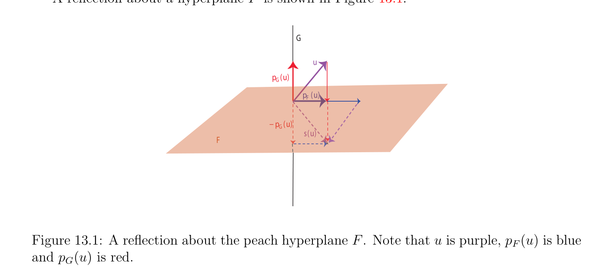

# Trực giao Các phép đối xứng

<!-- PAGE 507 -->
Chương $13$ Phân rã QR (QR-decomposition) cho Tùy ý Các ma trận

## 13.1 Trực giao Các phép đối xứng

Siêu phẳng (hyperplane) các phép đối xứng được biểu diễn bởi các ma trận được gọi là Householder các ma trận. các ma trận này đóng quan trọng vai trò trong số các phương pháp, chẳng hạn cho việc giải các hệ của các phương trình tuyến tính, việc giải bình phương tối thiểu (least squares) các bài tập, cho việc tính toán các trị riêng (eigenvalues), và cho biến đổi ma trận đối xứng (symmetric matrix) vào ma trận ba đường chéo (tridiagonal matrix). Ta chứng minh đơn giản hình học bổ đề rằng ngay lập tức cho ta Phân rã QR (QR-decomposition) của tùy ý các ma trận theo Householder các ma trận. Trực giao các phép đối xứng là rất quan trọng ví dụ của các phép đẳng cự. Thứ nhất cho chúng ta ôn tập/tổng quan định nghĩa của các phép chiếu, đã giới thiệu trong Mục 6.1, chỉ sau Mệnh đề 6.7. Cho trước không gian vectơ (vector space) $E$, cho $F$ và $G$ là các không gian con của $E$ rằng tạo thành tổng trực tiếp (direct sum) $E = F \oplus G$. Vì mọi $u \in E$ có thể được được viết một cách duy nhất như $u = v + w$, ở đâu $v \in F$ và $w \in G$, ta có thể định nghĩa hai các phép chiếu $p_{F}$: $E \to F$ và $p_{G}$: $E \to G$ sao cho $p_{F}(u) = v$ và $p_{G}(u) = w$. Trong Mục 6.1 ta được sử dụng ký hiệu $\pi_{1}$ và $\pi_{2}$, nhưng trong mục này nó là nhiều hơn/thêm thuận tiện để sử dụng $p_{F}$ và $p_{G}$. Ta kiểm chứng được ngay rằng $p_{G}$ và $p_{F}$ là các ánh xạ tuyến tính (linear maps), và rằng
$$p_{F}^{2} = p_{F}, p_{G}^{2} = p_{G}, p_{F} \circ p_{G} = p_{G} \circ p_{F} = 0,andp_{F} + p_{G} = id.$$
.

> **Định nghĩa 13.1.** Cho trước không gian vectơ (vector space) $E$, với mọi hai các không gian con $F$ và $G$ rằng tạo thành tổng trực tiếp (direct sum) $E = F \oplus G$, tính đối xứng (hoặc phép đối xứng (reflection)) đối với $F$ và song song đến $G$ là ánh xạ tuyến tính (linear map) $s: E \to E$ được định nghĩa sao cho
$$s(u) = 2p_{F}(u) -u,$$
Với mọi $u \in E$.
$$507$$

<!-- PAGE 508 -->
Bởi vì $p_{F} + p_{G} =$ id, lưu ý rằng ta cũng có
$$s(u) = p_{F}(u) -p_{G}(u)$$
Và
$$s(u) = u -2p_{G}(u),$$
$s^{2} =$ id, $s$ là đồng nhất thức trên $F$, và $s =$ -id trên $G$. Ta bây giờ giả sử rằng $E$ là Không gian Euclid (Euclidean space) của hữu hạn số chiều.

> **Định nghĩa 13.2.** Cho $E$ là Không gian Euclid (Euclidean space) của hữu hạn số chiều $n$. Với mọi hai các không gian con $F$ và $G$, nếu $F$ và $G$ tạo thành tổng trực tiếp (direct sum) $E = F \oplus G$ và $F$ và $G$ là trực giao, i.e., $F = G^{\perp}$, trực giao tính đối xứng (hoặc phép đối xứng (reflection)) đối với $F$ và song song đến $G$ là ánh xạ tuyến tính (linear map) $s: E \to E$ được định nghĩa sao cho
$$s(u) = 2p_{F}(u) -u = p_{F}(u) -p_{G}(u),$$
Với mọi $u \in E$. Khi $F$ là siêu phẳng (hyperplane), ta gọi $s$ siêu phẳng (hyperplane) tính đối xứng đối với $F$ (hoặc phép đối xứng (reflection) về $F)$, và khi $G$ là mặt phẳng (và do đó dim(F) $= n$ - $2)$, ta gọi $s$ flip về $F$. phép đối xứng (reflection) về siêu phẳng (hyperplane) $F$ được hiển thị trong Hình 13.1.
$$G$$
$$u$$
$$p(u)$$
$$G$$
$$p (u)$$
$$F$$
$$-p (u)$$
$$G$$
$$s(u)$$
$$F$$

**Hình 13.1:** phép đối xứng (reflection) về peach siêu phẳng (hyperplane) $F$. Lưu ý rằng $u$ là tím, $p_{F}(u)$ là xanh lam và $p_{G}(u)$ là đỏ. Với mọi hai các vectơ $u, v \in E$, nó là dễ dàng được kiểm chứng bằng cách sử dụng tính song tuyến tính của tích vô hướng (inner product) rằng
$$\|u + v\|^{2}-\|u -v\|^{2}= 4(u \cdot  v).(*)$$
Đặc biệt, nếu $u \cdot  v = 0$, thì $\|u + v\| = \|u$ - $v\|$. Khi đó vì
$$u = p_{F}(u) + p_{G}(u)$$

<!-- PAGE 509 -->
Và
$$s(u) = p_{F}(u) -p_{G}(u),$$
Và vì $F$ và $G$ là trực giao, suy ra rằng
$$p_{F}(u) \cdot  p_{G}(v) = 0,$$
Và do đó bởi (*)
$$\|s(u)\|= \|p_{F}(u) -p_{G}(u)\|= \|p_{F}(u) + p_{G}(u)\|= \|u\|,$$
Sao cho $s$ là phép đẳng cự (isometry). Bằng cách sử dụng Mệnh đề 12.10, nó là khả dĩ/có thể để tìm cơ sở trực chuẩn (orthonormal basis) $(e_{1}, \dots  , e_{n})$ của $E$ bao gồm của cơ sở trực chuẩn (orthonormal basis) của $F$ và cơ sở trực chuẩn (orthonormal basis) của $G$. Giả sử rằng $F$ có số chiều $p$, sao cho $G$ có số chiều $n$ - $p$. Đối với cơ sở trực chuẩn (orthonormal basis) $(e_{1}, \dots  , e_{n})$, tính đối xứng $s$ có ma trận của tạo thành
$$\begin{pmatrix} I_{p} & 0 \\ 0 & -I_{n-p} \end{pmatrix} .$$
Do đó, det(s) $= (-1)^{n-p}$, và $s$ là phép quay khi và chỉ khi $n$ - $p$ là chẵn/ngay cả. Đặc biệt, khi $F$ là siêu phẳng (hyperplane) $H$, ta có $p = n$ - $1$ và $n$ - $p = 1$, sao cho $s$ là suy rộng/không thực sự trực giao phép biến đổi. Khi $F = {0}$, ta có $s =$ -id, mà được gọi là tính đối xứng đối với gốc. tính đối xứng đối với gốc là phép quay khi và chỉ khi $n$ là chẵn/ngay cả, và suy rộng/không thực sự trực giao phép biến đổi khi và chỉ khi $n$ là lẻ. Khi $n$ là lẻ, vì $s \circ s =$ id và det(s) $= (-1)^{n} = -1$, ta nhận thấy rằng mọi suy rộng/không thực sự trực giao phép biến đổi $f$ là hợp thành $f = (f \circ s) \circ s$ của phép quay $f \circ s$ với $s$, tính đối xứng đối với gốc. Khi $G$ là mặt phẳng, $p = n$ - $2$, và det(s) $= (-1)^{2} = 1$, sao cho flip về $F$ là phép quay. Đặc biệt, khi $n = 3, F$ là đường thẳng, và flip về đường thẳng $F$ là thật vậy phép quay của measure $\pi$ như được minh họa bởi Hình 13.2.
Nhận xét: Cho trước bất kỳ hai trực giao các không gian con $F, G$ tạo thành tổng trực tiếp (direct sum) $E = F \oplus G$, cho $f$ là tính đối xứng đối với $F$ và song song đến $G$, và cho $g$ là tính đối xứng đối với $G$ và song song đến $F$. Ta để lại như một bài tập để chỉ ra rằng
$$f \circ g = g \circ f = -id.$$
Khi $F = H$ là siêu phẳng (hyperplane), ta có thể cho tường minh công thức cho s(u) theo bất kỳ khác không vectơ $w$ trực giao đến $H$. Thật vậy, từ
$$u = p_{H}(u) + p_{G}(u),$$
Vì $p_{G}(u) \in G$ và $G$ được sinh (spanned) bởi $w$, mà là trực giao đến $H$, ta có
$$p_{G}(u) = \lambda w$$

<!-- PAGE 510 -->
$$F$$
$$s(u)p  (u)u$$
$$F$$
$$G$$
$$\mathbb{R}^{3}$$
$$Figure 13.2: A flip inis a rotation of \pi  about the F axis.$$
Với một số $\lambda  \in \mathbb{R}$, và ta thu được
$$u \cdot  w = \lambda \|w\|^{2},$$
Và do đó
$$\cdot$$
$$p_{G}(u) = \frac{(u w)}{\|w\|^{2}} w.$$
Vì
$$s(u) = u -2p_{G}(u),$$
Ta thu được
$$2  \cdot$$
$$s(u) = u - \frac{(u w)}{\|w\|^{2}} w.$$
Vì ở trên công thức là quan trọng, ta record nó trong sau đây mệnh đề.

> **Mệnh đề 13.1.** Cho $E$ là hữu hạn chiều Không gian Euclid (Euclidean space) và cho $H$ là siêu phẳng (hyperplane) trong $E$. Với mọi khác không vectơ $w$ trực giao đến $H$, siêu phẳng (hyperplane) phép đối xứng (reflection) $s$ về $H$ được cho bởi
$$2  \cdot$$
$$s(u) = u - \frac{(u w)}{\|w\|^{2}} w,u \in E.$$
Như vậy các phép đối xứng được biểu diễn bởi các ma trận được gọi là Householder các ma trận, mà đóng quan trọng vai trò trong số ma trận giải tích/phân tích (xem Kincaid và Cheney $[105]$ hoặc Ciarlet $[41])$.

> **Định nghĩa 13.3.** Ma trận Householder là ma trận của tạo thành
$$WW^{\top}$$
$$H = I_{n} -2 \frac{WW^{\top}}{\|W\|^{2}} = I_{n} -2\overline{W}^{\top} W ,$$
$$\mathbb{R}^{n}$$
Ở đâu $W \in$ là khác không vectơ.

<!-- PAGE 511 -->
Householder các ma trận là đối xứng và trực giao. Nó là dễ dàng đã kiểm tra rằng trên cơ sở trực chuẩn (orthonormal basis) $(e_{1}, \dots  , e_{n})$, siêu phẳng (hyperplane) phép đối xứng (reflection) về siêu phẳng (hyperplane) $H$ trực giao đến khác không vectơ $w$ được biểu diễn bởi ma trận
$$H = I_{n} -2 \frac{WW^{\top}}{\|W\|^{2}} ,$$
Ở đâu $W$ là vectơ cột (column vector) của các tọa độ của $w$ trên cơ sở (basis) $(e_{1}, \dots  , e_{n})$. Vì
$$\cdot$$
$$p_{G}(u) = \frac{(u w)}{\|w\|^{2}} w,$$
Ma trận biểu diễn $p_{G}$ là
$$\frac{WW^{\top}}{W^{\top}} W  ,$$
Và vì $p_{H} + p_{G} =$ id, ma trận biểu diễn $p_{H}$ là
$$I_{n} - \frac{WW^{\top}}{W^{\top}} W .$$
Các phần tử này các công thức có thể được sử dụng để derive công thức cho phép quay của $\mathbb{R}^{3}$, cho trước hướng $w$ của của nó trục của phép quay và cho trước góc $\theta$ của phép quay. sau đây sự kiện là then chốt đến chứng minh rằng mọi phép đẳng cự (isometry) có thể được decomposed như tích của các phép đối xứng.

> **Mệnh đề 13.2.** Cho $E$ là bất kỳ không tầm thường Không gian Euclid (Euclidean space). Với mọi hai các vectơ $u, v \in E$, nếu $\|u\| = \|v\|$, thì có một siêu phẳng (hyperplane) $H$ sao cho phép đối xứng (reflection) $s$ về $H$ các ánh xạ $u$ đến $v$, và nếu $u \neq  v$, thì điều này phép đối xứng (reflection) là duy nhất. Xem Hình 13.3.

*Chứng minh.* Nếu $u = v$, thì bất kỳ siêu phẳng (hyperplane) chứa $u$ thực hiện job. Ngược lại, ta phải có $H = {v$ - $u}^{\perp}$, và bởi ở trên công thức,
$$-$$
$$2  \cdot  - \|\|^{2} \cdot$$
$$s(u) = u - \frac{(u (vu))}{\|(v -u)\|^{2}} (v -u) = u + \frac{2u2u v}{\|(v -u)\|^{2}} (v -u),$$
Và vì
$$\|(v -u)\|^{2}= \|u\|^{2}+ \|v\|^{2}-2u \cdot  v$$
Và $\|u\| = \|v\|$, ta có
$$\|(v -u)\|^{2}= 2\|u\|^{2}-2u \cdot  v,$$
Và do đó, s(u) $= v$.  Nếu $E$ là phức không gian vectơ (vector space) và tích vô hướng (inner product) là Hermite, Mệnh đề 13.2
$$is false. The problem is that the vector v -u does not work unless the inner product$$
$u\cdot v$ là thực! mệnh đề có thể được salvaged đủ đến cho Phân rã QR (QR-decomposition) theo Householder các phép biến đổi; xem Mục 14.5. Ta bây giờ chỉ ra rằng siêu phẳng (hyperplane) các phép đối xứng có thể được được sử dụng để thu được một cái khác chứng minh của Phân rã QR (QR-decomposition).
