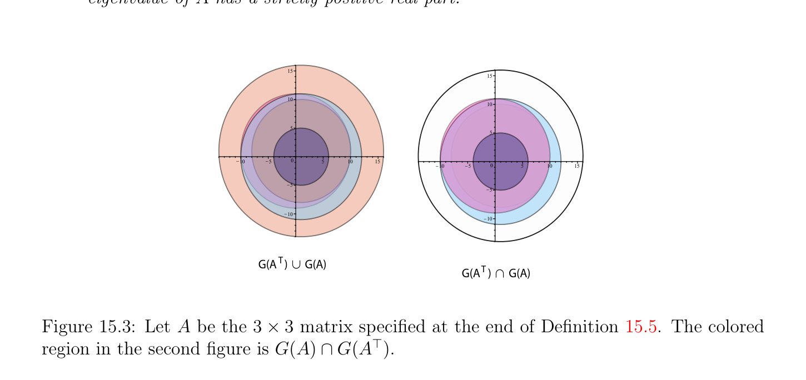

# Location của Các trị riêng (eigenvalues)

<!-- PAGE 581 -->
$t_{ii} = \overline{t}_{ii}$ cho $i = 1, \dots  , n$, mà có nghĩa là $t_{ii}$ là thực, do đó $T$ là thật vậy thực ma trận đường chéo (diagonal matrix), nói $D$. Nếu ta áp dụng kết quả này đến (thực) ma trận đối xứng (symmetric matrix) $A$, ta thu được sự kiện rằng tất cả các trị riêng (eigenvalues) của ma trận đối xứng (symmetric matrix) là thực, và bằng cách áp dụng Định lý 15.6 một lần nữa, ta kết luận rằng $A = QDQ^{\top}$, ở đâu $Q$ là trực giao và $D$ là thực ma trận đường chéo (diagonal matrix). Nhiều hơn/thêm tổng quát các phiên bản của Mệnh đề 15.8 được chứng minh trong Chương $17$. Khi thực ma trận $A$ có phức các trị riêng (eigenvalues), có một phiên bản của Định lý 15.6 liên quan đến chỉ thực các ma trận miễn là/được cung cấp rằng ta cho phép $T$ là khối tam giác trên (upper-triangular) (đường chéo các phần tử (entries) có thể là $2 \times  2$ các ma trận hoặc thực các phần tử (entries)). Định lý 15.6 là không rất thực tế kết quả nhưng nó là hữu ích lý thuyết kết quả đến cope với các ma trận rằng không thể được chéo hóa. Ví dụ, nó có thể được được sử dụng để chứng minh rằng mọi phức ma trận là giới hạn của dãy của chéo hóa được (diagonalizable) các ma trận rằng có phân biệt các trị riêng (eigenvalues)!

## 15.3 Location của Các trị riêng (eigenvalues)

Nếu $A$ là $n \times  n$ phức (hoặc thực) ma trận $A$, nó sẽ là hữu ích đến biết, chẵn/ngay cả xấp xỉ/đại khái, ở đâu các trị riêng (eigenvalues) của $A$ là located trong phức $plane\mathbb{C}$. Gershgorin discs cung cấp một số precise information về điều này.

> **Định nghĩa 15.5.** Với mọi phức $n \times  n$ ma trận $A$, cho $i = 1, \dots  , n$, cho
$$R_{i}'(A) = \sum_{j=1}^{n}  |a_{i j}|$$
$$j\neq i$$
Và cho
$$G(A) = \bigcup_{i=1}^{n}  {z \in \mathbb{C} | |z -a_{i i}| \le R_{i}'(A)}.$$
Mỗi disc ${z \in \mathbb{C}$ | |z - $a_{i i}| \le R_{i}'(A)}$ được gọi là một Gershgorin disc và của chúng hợp G() là
$$called the Gershgorin domain. An example of Gershgorin domain for A = \begin{pmatrix} 1 & 2 & 3 \\ 4 & i & 6 \\ 7 & 8 & 1 + i \end{pmatrix}$$
Được minh họa trong Hình 15.1. Mặc dù dễ để chứng minh, sau đây định lý là rất hữu ích:

> **Định lý 15.9.** (Gershgorin’s disc định lý) Với mọi phức $n\times n$ ma trận $A$, tất cả các trị riêng (eigenvalues) của $A$ thuộc đến Gershgorin miền xác định G(). Hơn nữa các tính chất sau đây đúng:

<!-- PAGE 582 -->
$$15$$
$$10$$
$$5$$
$$\overline{10}\overline{5}\overline{0}\overline{5}\overline{10}\overline{15}$$
$$5$$
$$10$$

**Hình 15.1:** Cho $A$ là ma trận cỡ $3 \times  3$ specified tại kết thúc/cuối của Định nghĩa 15.5. Cho điều này cụ thể $A$, ta tìm rằng $R_{1}'(A) = 5, R_{2}'(A) = 10$, và $R_{3}'(A) = 15$. $blue/purple$ đĩa là |z - 1| $\le 5$, hồng đĩa là |z - i| $\le 10$, peach đĩa là |z - $1$ - i| $\le 15$, và G() là hợp của các phần tử này ba các đĩa.
$(1)$ Nếu $A$ là chặt hàng một cách đường chéo trội, nghĩa là
$$|a_{i i}| > \sum_{=1, j\neq}^{n}  |a_{i j}|,for i = 1, \dots  , n,$$
$$ji$$
Thì $A$ là khả nghịch.
$(2)$ Nếu $A$ là chặt hàng một cách đường chéo trội, và nếu $a_{i i} > 0$ cho $i = 1, \dots  , n$, thì mọi trị riêng (eigenvalue) của $A$ có chặt dương thực phần.

*Chứng minh.* Cho $\lambda$ là bất kỳ trị riêng (eigenvalue) của $A$ và cho $u$ là tương ứng vectơ riêng (eigenvector) (nhắc lại rằng ta phải có $u \neq  0)$. Cho $k$ là chỉ số sao cho
$$|u_{k}| = \max |u_{i}|.$$
$$1\le i\le n$$
Vì Au $= \lambda u$, ta có
$$(\lambda  -a_{k k})u_{k} = \sum_{j=1}^{n}  a_{k j}u_{j},$$
$$j\neq k$$
Mà suy ra rằng
$$|\lambda  -a_{k k}||u_{k}| \le \sum_{j=1}^{n}  |a_{k j}||u_{j}| \le |u_{k}| \sum_{j=1}^{n}  |a_{k j}|.$$
$$j\neq kj\neq k$$
Vì $u \neq  0$ và $|u_{k}| = max_{1\le i\le n} |u_{i}|$, ta phải có $|u_{k}|̸ = 0$, và suy ra rằng
$$|\lambda  -a_{k k}| \le \sum_{j=1}^{n}  |a_{k j}| = R_{k}'(A),$$
$$j\neq k$$

<!-- PAGE 583 -->
Và do đó
$$\lambda  \in {z \in \mathbb{C} | |z -a_{k k}| \le R_{k}'(A)} \subseteq G(A),$$
Như đã khẳng định.
$(1)$ Chặt hàng đường chéo dominance suy ra rằng $0$ thực hiện không thuộc đến bất kỳ của Gershgorin discs, do đó tất cả các trị riêng (eigenvalues) của $A$ là khác không, và $A$ là khả nghịch.
$(2)$ Nếu $A$ là chặt hàng một cách đường chéo trội và $a_{i i} > 0$ cho $i = 1, \dots  , n$, thì mỗi của Gershgorin discs lies chặt trong phải half-plane, do đó mọi trị riêng (eigenvalue) của $A$ có chặt dương thực phần. Đặc biệt, Định lý 15.9 suy ra rằng nếu ma trận đối xứng (symmetric matrix) là chặt hàng một cách đường chéo trội và có chặt dương đường chéo các phần tử (entries), thì nó là xác định dương (positive definite). Định lý 15.9 đôi khi được gọi là Gershgorin–Hadamard định lý. Vì $A$ và $A^{\top}$ có cùng các trị riêng (eigenvalues) (chẵn/ngay cả cho phức các ma trận) ta cũng có phiên bản của Định lý 15.9 cho discs của bán kính
$$C_{j}'(A) = \sum_{i=1}^{n}  |a_{i j}|,$$
$$i\neq j$$
Có miền xác định $G(A^{\top})$ được cho bởi
$$G(A^{\top}) = \bigcup_{i=1}^{n}  {z \in \mathbb{C} | |z -a_{i i}| \le C_{i}'(A)}.$$
$$Figure 15.2 shows G(A^{\top}) for A = \begin{pmatrix} 1 & 2 & 3 \\ 4 & i & 6 \\ 7 & 8 & 1 + i \end{pmatrix} .$$
$$10$$
$$5$$
$$\overline{10}\overline{5}\overline{0}\overline{5}\overline{10}$$
$$5$$
$$10$$

**Hình 15.2:** Cho $A$ là ma trận cỡ $3 \times  3$ specified tại kết thúc/cuối của Định nghĩa 15.5. Cho điều này cụ thể $A$, ta tìm rằng $C_{1}'(A) = 11, C_{2}'(A) = 10$, và $C_{3}'(A) = 9$. pale xanh lam đĩa là |z - 1| $\le 11$, hồng đĩa là |z - i| $\le 10$, ocher đĩa là |z - $1$ - i| $\le 9$, và $G(A^{\top})$ là hợp của các phần tử này ba các đĩa.

<!-- PAGE 584 -->
Do đó ta thu được sau đây:

> **Định lý 15.10.** Với mọi phức $n \times  n$ ma trận $A$, tất cả các trị riêng (eigenvalues) của $A$ thuộc đến giao của Gershgorin các miền G() $\cap G(A^{\top})$. Xem Hình 15.3. Hơn nữa các tính chất sau đây đúng:
$(1)$ Nếu $A$ là chặt cột một cách đường chéo trội, nghĩa là
$$|a_{i i}| > \sum_{=1, i\neq j}^{n}  |a_{i j}|,for j = 1, \dots  , n,$$
$$i$$
Thì $A$ là khả nghịch.
$(2)$ Nếu $A$ là chặt cột một cách đường chéo trội, và nếu $a_{i i} > 0$ cho $i = 1, \dots  , n$, thì mọi trị riêng (eigenvalue) của $A$ có chặt dương thực phần.
$$1515$$
$$1010$$
$$55$$
$$\overline{10}\overline{5}\overline{0}\overline{5}\overline{10}\overline{15}\overline{0}$$
$$\overline{10}\overline{5}\overline{5}\overline{10}\overline{15}$$
$$55$$
$$1010$$
$$G(A   ) Tg G(A)$$
$$G(A   ) Th G(A)$$

**Hình 15.3:** Cho $A$ là ma trận cỡ $3 \times  3$ specified tại kết thúc/cuối của Định nghĩa 15.5. colored miền trong thứ hai hình là G() $\cap G(A^{\top})$. Có refinements của Gershgorin’s định lý và trị riêng (eigenvalue) location các kết quả liên quan đến khác các miền ngoài ra discs; cho nhiều hơn/thêm trên điều này subject, xem Horn và Johnson $[98]$, Các mục 6.1 và 6.2.
Nhận xét: Không chặt hàng đường chéo dominance cũng không chặt cột đường chéo dominance là cần cho tính khả nghịch. Cũng, nếu ta relax tất cả chặt các bất đẳng thức đến các bất đẳng thức, thì hàng đường chéo dominance (hoặc cột đường chéo dominance) là không đủ điều kiện cho tính khả nghịch.
