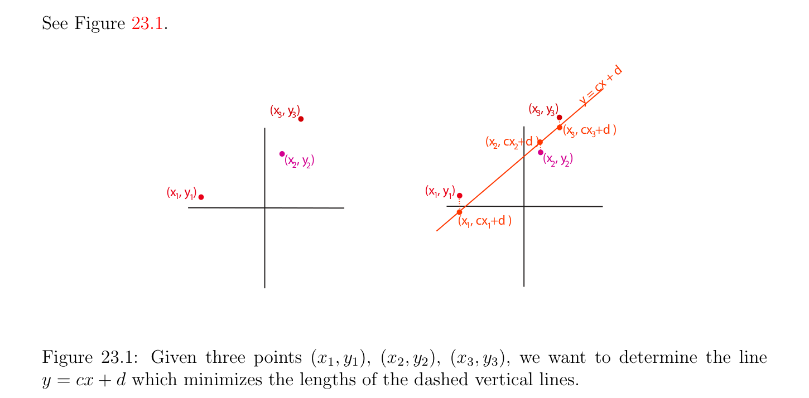
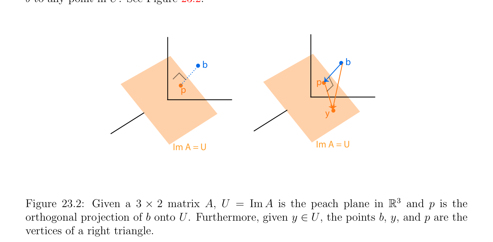

# Bình phương tối thiểu (least squares) Các bài tập và Nghịch đảo giả (pseudo-inverse)

<!-- PAGE 769 -->
Chương $23$ Các ứng dụng của SVD và Pseudo-Inverses De tous les principes qu’trên peut proposer pour cet objet, je pense qu’il n’en est pas de cộng g´en´eral, de cộng chính xác, ni d’une ứng dụng cộng facile, que celui dont nous avons fait usage dans les recherches pr´ec´edentes, et qui consiste `a rendre minimum la somme des carr´es des erreurs. Par ce moyen il s’´etablit entre les erreurs une sorte d’´equilibre qui, empˆechant les extrˆemes de pr´evaloir, est tr`es propre `as faire connaitre l’´etat du syst`eme le cộng proche de la v´erit´e. —Legendre, $1805$, Nouvelles M´ethodes pour la d´etermination des Orbites des Com`etes

## 23.1 Bình phương tối thiểu (least squares) Các bài tập và Nghịch đảo giả (pseudo-inverse)

Điều này chương các trình bày một vài các ứng dụng của SVD. thứ nhất một là nghịch đảo giả (pseudo-inverse), mà đóng then chốt vai trò trong việc giải các hệ phương trình tuyến tính bởi phương pháp của bình phương tối thiểu (least squares). thứ hai ứng dụng là dữ liệu compression. thứ ba ứng dụng là phân tích thành phần chính (PCA) (PCA), có mục đích là để đồng nhất patterns trong dữ liệu và understand phương sai–hiệp phương sai cấu trúc của dữ liệu. thứ tư ứng dụng là tốt nhất afin xấp xỉ của tập hợp của dữ liệu, bài toán closely related đến PCA. phương pháp của bình phương tối thiểu (least squares) là cách của “việc giải” quá xác định hệ của các phương trình tuyến tính
$$Ax = b,$$
I.e., hệ trong mà $A$ là rectangular $m \times  n$ ma trận với nhiều hơn/thêm các phương trình hơn unknowns (khi $m > n)$. Historically, phương pháp của bình phương tối thiểu (least squares) đã được sử dụng bởi Gauss và Legendre để giải các bài tập trong astronomy và geodesy. phương pháp đã là thứ nhất published bởi Legendre trong $1805$ trong paper trên các phương pháp cho xác định orbits của comets. Tuy nhiên, Gauss đã có đã được sử dụng phương pháp của bình phương tối thiểu (least squares) như early như $1801$ để xác định orbit của asteroid
$$769$$

<!-- PAGE 770 -->
Ceres, và he published paper về nó trong $1810$ sau discovery của asteroid Pallas. Incidentally, nó là trong rằng cùng paper rằng Phép khử Gauss (Gaussian elimination) bằng cách sử dụng các phần tử trụ là đã giới thiệu. lý do tại sao nhiều hơn/thêm các phương trình hơn unknowns phát sinh trong như vậy các bài tập là rằng repeated measurements được lấy để cực tiểu hóa các sai số. Điều này produces quá xác định và thường vô nghiệm/không tương thích hệ của các phương trình tuyến tính. Ví dụ, Gauss được giải hệ của eleven các phương trình trong sáu unknowns để xác định orbit của asteroid Pallas.

> **Ví dụ 23.1.** Như concrete illustration, giả sử rằng ta quan sát motion của nhỏ object, assimilated đến điểm, trong mặt phẳng. Từ của ta các nhận xét, ta suspect rằng điều này điểm di chuyển dọc theo straight đường thẳng, nói của phương trình $y =$ cx $+ d$. Giả sử rằng ta được quan sát di chuyển điểm tại ba khác nhau locations $(x_{1}, y_{1}), (x_{2}, y_{2})$, và $(x_{3}, y_{3})$. Thì ta nên có
$$d + cx_{1} = y_{1},$$
$$d + cx_{2} = y_{2},$$
$$d + cx_{3} = y_{3}.$$
Nếu ở đó đã là không có các sai số trong của ta measurements, các phương trình này sẽ là compatible, và $c$ và $d$ sẽ được xác định bởi chỉ hai của các phương trình. Tuy nhiên, trong presence của các sai số, hệ có thể là vô nghiệm/không tương thích. Vẫn chưa ta sẽ like để tìm $c$ và $d$! ý tưởng của phương pháp của bình phương tối thiểu (least squares) là để xác định $(c, d)$ sao cho nó cực tiểu hóa tổng của squares của các sai số, cụ thể là,
$$(d + cx_{1} -y_{1})^{2}+ (d + cx_{2} -y_{2})^{2}+ (d + cx_{3} -y_{3})^{2}.$$
Xem Hình 23.1.
$$+ d$$
$$cx$$
$$=$$
$$y$$
$$(x , y )(x , y )$$
$$3333$$
$$(x , cx +d )$$
$$(x , cx +d )33$$
$$22$$
$$(x , y )(x , y )$$
$$2222$$
$$(x , y )(x , y )$$
$$1111$$
$$\overline{(x , cx +d )}$$
$$11$$

**Hình 23.1:** Cho trước ba các điểm $(x_{1}, y_{1}), (x_{2}, y_{2}), (x_{3}, y_{3})$, ta muốn để xác định đường thẳng $y =$ cx $+ d$ mà cực tiểu hóa các độ dài của dashed đứng các đường thẳng.

<!-- PAGE 771 -->
Nói chung, cho quá xác định $m \times  n$ hệ Ax $= b$, những gì Gauss và Legendre discovered là rằng có các nghiệm $x$ cực tiểu hóa
$$\|Ax -b\|_{2}^{2}$$
(ở đâu $\|u\|_{2}^{2} = u_{1}^{2}+\cdots +u_{n}^{2}$, square của Euclidean chuẩn (norm) của vectơ $u = (u_{1}, \dots  , u_{n}))$, và rằng các nghiệm này được cho bởi square $n \times  n$ hệ
$$A^{\top}Ax = A^{\top}b,$$
Được gọi là chuẩn tắc/bình thường các phương trình. Hơn nữa, khi các cột của $A$ là độc lập tuyến tính (linearly independent), hóa ra là $A^{\top}A$ là khả nghịch, và do đó $x$ là duy nhất và cho trước bởi
$$x = (A^{\top}A)^{-1}A^{\top}b.$$
Lưu ý rằng $A^{\top}A$ là ma trận đối xứng (symmetric matrix), một của đẹp các đặc trưng của chuẩn tắc/bình thường các phương trình của bình phương tối thiểu (least squares) bài toán. Chẳng hạn, vì ở trên bài toán trong ma trận tạo thành được biểu diễn như
$$\begin{pmatrix} 1 & x_{1} \\ 1 & x_{2} \\ 1 & x_{3} \end{pmatrix} \begin{pmatrix} d \\ c \end{pmatrix} = \begin{pmatrix} y_{1} \\ y_{2} \\ y_{3} \end{pmatrix} ,$$
Chuẩn tắc/bình thường các phương trình là
$$\begin{pmatrix} 3 & x_{1} + x_{2} + x_{3} \\ x_{1} + x_{2} + x_{3} & x_{1}^{2}+ x_{2}^{2}+ x_{3}^{2} \end{pmatrix} \begin{pmatrix} d \\ c \end{pmatrix} = \begin{pmatrix} y_{1} + y_{2} + y_{3} \\ x_{1}y_{1} + x_{2}y_{2} + x_{3}y_{3} \end{pmatrix} .$$
Thực ra, cho trước bất kỳ thực $m \times  n$ ma trận $A$, ở đó là luôn luôn duy nhất $x^{+}$ của cực tiểu chuẩn (norm) rằng cực tiểu hóa $\|Ax$ - $b\|_{2}^{2}$, chẵn/ngay cả khi các cột của $A$ là phụ thuộc tuyến tính (linearly dependent). Cách mà thực hiện ta chứng minh điều này, và cách mà thực hiện ta tìm $x^{+}$?

> **Định lý 23.1.** Mọi hệ phương trình tuyến tính Ax $= b$, ở đâu $A$ là một ma trận cỡ $m \times  n$, có duy nhất bình phương tối thiểu (least squares) nghiệm $x^{+}$ của nhỏ nhất chuẩn (norm).

*Chứng minh.* Hình học đưa ra đẹp chứng minh của sự tồn tại và tính duy nhất của $x^{+}$. Thật vậy, ta có thể interpret $b$ như điểm trong Euclidean (afin) không gian $\mathbb{R}^{m}$, và ảnh (image) không gian con của $A$ (cũng
$$\mathbb{R}^{m}$$
Được gọi là cột không gian của $A)$ như không gian con $U$ của (chuyển qua gốc). Thì rõ ràng là
$$\inf \|Ax -b\|_{2}^{2} = \inf \|y -b\|_{2}^{2},$$
$$x\in \mathbb{R} ny\in U$$
Với $U =$ Im $A$, và ta khẳng định rằng $x$ cực tiểu hóa $\|Ax-b\|_{2}^{2}$ khi và chỉ khi Ax $= p$, ở đâu $p$ phép chiếu trực giao (orthogonal projection) của $b$ lên không gian con $U$. Nhắc lại từ Mục 13.1 rằng phép chiếu trực giao (orthogonal projection) $p_{U}$: $U \oplus U^{\perp} \to U$ là ánh xạ tuyến tính (linear map) cho trước bởi
$$p_{U}(u + v) = u,$$

<!-- PAGE 772 -->
Với $u \in U$ và $v \in U^{\perp}$. Nếu ta cho $p = p_{U}(b) \in U$, thì với mọi điểm $y \in U$, các vectơ $\longrightarrow  \longrightarrow$ py $= y$ - $p \in U$ và bp $= p$ - $b \in U^{\perp}$ là trực giao, mà suy ra rằng
$$\longrightarrow  \|\longrightarrow  \|\longrightarrow$$
$$\|by\|_{2}^{2} =bp\|_{2}^{2} +py\|_{2}^{2},$$
$\longrightarrow$ ở đâu bởi $= y -b$. Do đó, $p$ là thật vậy duy nhất điểm trong $U$ rằng cực tiểu hóa khoảng cách từ $b$ đến bất kỳ điểm trong $U$. Xem Hình 23.2.
$$bb$$
$$p$$
$$p$$
$$y$$
$$\mathrm{Im} A = UIm A = U$$
$$\mathbb{R}^{3}$$

**Hình 23.2:** Cho trước một ma trận cỡ $3 \times  2$ $A, U =$ Im $A$ là peach mặt phẳng trong và $p$ là phép chiếu trực giao (orthogonal projection) của $b$ lên $U$. Hơn nữa, cho trước $y \in U$, các điểm $b, y$, và $p$ là các đỉnh của phải tam giác. Do đó bài toán có đã được rút gọn đến chứng minh rằng tồn tại duy nhất một $x^{+}$ của cực tiểu chuẩn (norm) sao cho $Ax^{+} = p$, với $p = p_{U}(b) \in U$, phép chiếu trực giao (orthogonal projection) của $b$ lên $U$. Ta sử dụng sự kiện rằng
$$\mathbb{R}^{n}$$
$$= \mathrm{Ker} A \oplus (\mathrm{Ker} A)^{\perp}.$$
$$\mathbb{R}^{n}$$
Hệ quả là, mọi $x \in$ có thể được được viết một cách duy nhất như $x = u + v$, ở đâu $u \in$ Ker $A$ và $v \in$ (Ker $A)^{\perp}$, và vì $u$ và $v$ là trực giao,
$$\|x\|_{2}^{2} = \|u\|_{2}^{2} + \|v\|_{2}^{2}.$$
Hơn nữa, vì $u \in$ Ker $A$, ta có Au $= 0$, và do đó Ax $= p$ khi và chỉ khi Av $= p$, mà chỉ ra rằng các nghiệm của Ax $= p$ cho mà $x$ có cực tiểu chuẩn (norm) phải thuộc đến (Ker $A)^{\perp}$. Tuy nhiên, thu hẹp của $A$ đến (Ker $A)^{\perp}$ là đơn ánh (injective). Điều này là bởi vì nếu $Av_{1} = Av_{2}$, ở đâu $v_{1}, v_{2} \in$ (Ker $A)^{\perp}$, thì $A(v_{2}$ - $v_{1}) = 0$, mà suy ra $v_{2}$ - $v_{1} \in$ Ker $A$, và vì $v_{1}, v_{2} \in$ (Ker $A)^{\perp}$, ta cũng có $v_{2}$ - $v_{1} \in$ (Ker $A)^{\perp}$, và hệ quả là, $v_{2}$ - $v_{1} = 0$. Điều này chỉ ra rằng tồn tại duy nhất một $x^{+}$ của cực tiểu chuẩn (norm) sao cho $Ax^{+} = p$, và rằng $x^{+}$ phải thuộc đến (Ker $A)^{\perp}$. Bởi của ta trước đó lập luận, $x^{+}$ là duy nhất vectơ của cực tiểu chuẩn (norm) cực tiểu hóa $\|Ax$ - $b\|_{2}^{2}$.

<!-- PAGE 773 -->
$$\longrightarrow$$
Chứng minh cũng chỉ ra rằng $x$ cực tiểu hóa $\|Ax$ - $b\|_{2}^{2}$ khi và chỉ khi pb $= b$ - Ax là trực giao đến $U$, mà có thể được được biểu diễn bởi nói rằng rằng $b$ -Ax là trực giao đến mọi cột của $A$. Tuy nhiên, điều này là tương đương đến
$$A^{\top}(b -Ax) = 0,i.e.,A^{\top}Ax = A^{\top}b.$$
Cuối cùng, hóa ra là cực tiểu chuẩn (norm) bình phương tối thiểu (least squares) nghiệm $x^{+}$ có thể được tìm thấy theo nghịch đảo giả (pseudo-inverse) $A^{+}$ của $A$, mà là chính nó thu được từ bất kỳ SVD của $A$.

> **Định nghĩa 23.1.** Cho trước bất kỳ khác không $m \times  n$ ma trận $A$ của hạng (rank) $r$, nếu $A = V DU^{\top}$ là SVD của $A$ sao cho
$$D = \begin{pmatrix} \Lambda & 0_{r,n-r} \\ 0_{m-r,r} & 0_{m-r,n-r} \end{pmatrix} ,$$
Với
$$\Lambda  = \mathrm{diag}(\lambda_{1} , \dots  , \lambda_{r} )$$
$r \times  r$ ma trận đường chéo (diagonal matrix) bao gồm của khác không các giá trị kỳ dị (singular values) của $A$, thì nếu ta cho $D^{+}$ là ma trận cỡ $n \times  m$
$$D^{+}= \begin{pmatrix} \Lambda^{-1} & 0_{r,m-r} \\ 0_{n-r,r} & 0_{n-r,m-r} \end{pmatrix} ,$$
Với
$$\Lambda^{-1} = \mathrm{diag}(1/\lambda_{1} , \dots  , 1/\lambda_{r} ),$$
Nghịch đảo giả (pseudo-inverse) của $A$ được định nghĩa bởi
$$A^{+}= UD^{+}V^{\top}.$$
Nếu $A = 0_{m,n}$ là không ma trận, ta tập hợp $A^{+} = 0_{n,m}$. Nhận thấy rằng $D^{+}$ là thu được từ $D$ bởi nghịch đảo khác không đường chéo các phần tử (entries) của $D$, để lại tất cả các không điểm trong place, và thì transposing ma trận. Ví dụ, cho trước ma trận
$$D = \begin{pmatrix} 1 & 0 & 0 & 0 & 0 \\ 0 & 2 & 0 & 0 & 0 \\ 0 & 0 & 3 & 0 & 0 \\ 0 & 0 & 0 & 0 & 0 \end{pmatrix} ,$$
Của nó nghịch đảo giả (pseudo-inverse) là
$$D^{+} = \begin{pmatrix} 1 & 0 & 0 & 0 \\ 0_{2}^{1} & 0 & 0 \\ 0 & 0_{3}^{1} & 0 \\ 0 & 0 & 0 & 0 \\ 0 & 0 & 0 & 0 \end{pmatrix} .$$
Nghịch đảo giả (pseudo-inverse) của ma trận là cũng đã biết như Moore–Penrose nghịch đảo giả (pseudo-inverse). Thực sự, nó dường như rằng $A^{+}$ phụ thuộc vào cụ thể lựa chọn của $U$ và $V$ trong SVD $(U, D, V$) cho $A$, nhưng tiếp theo định lý chỉ ra rằng điều này là không do đó.

<!-- PAGE 774 -->

> **Định lý 23.2.** bình phương tối thiểu (least squares) nghiệm của nhỏ nhất chuẩn (norm) của hệ phương trình tuyến tính Ax $= b$, ở đâu $A$ là một ma trận cỡ $m \times  n$, được cho bởi
$$x^{+}= A^{+}b = UD^{+}V^{\top}b.$$

*Chứng minh.* Thứ nhất giả sử rằng $A$ là (rectangular) ma trận đường chéo (diagonal matrix) $D$, như ở trên. Khi đó vì $x$ cực tiểu hóa $\|Dx-b\|_{2}^{2}$ khi và chỉ khi Dx là phép chiếu của $b$ lên ảnh (image) không gian con $F$ của $D$, nó là fairly hiển nhiên rằng $x^{+} = D^{+}b$. Ngược lại, ta có thể viết
$$A = V DU^{\top} ,$$
Ở đâu $U$ và $V$ là trực giao. Tuy nhiên, vì $V$ là phép đẳng cự (isometry),
$$\|Ax -b\|_{2} = \|V DU^{\top} x -b\|_{2} = \|DU^{\top} x -V^{\top} b\|_{2}.$$
Đặt $y = U^{\top} x$, ta có $\|x\|_{2} = \|y\|_{2}$, vì $U$ là phép đẳng cự (isometry), và vì $U$ là toàn ánh (surjective), $\|Ax$ - $b\|_{2}$ được cực tiểu hóa khi và chỉ khi $\|Dy$ - $V^{\top} b\|_{2}$ được cực tiểu hóa, và ta có được hiển thị rằng least nghiệm là
$$y^{+}= D^{+}V^{\top}b.$$
Vì $y = U^{\top} x$, với $\|x\|_{2} = \|y\|_{2}$, ta thu được
$$x^{+}= UD^{+}V^{\top}b = A^{+}b.$$
Do đó, nghịch đảo giả (pseudo-inverse) cung cấp nghiệm tối ưu (optimal solution) đến bình phương tối thiểu (least squares) bài toán. Theo Định lý 23.2 và Định lý 23.1, $A^{+}b$ là một cách duy nhất được định nghĩa bởi mọi $b$, và do đó $A^{+}$ phụ thuộc chỉ trên $A$. Matlab command cho việc tính toán nghịch đảo giả (pseudo-inverse) $B$ của ma trận $A$ là $B =$ pinv().

> **Ví dụ 23.2.** Nếu $A$ là hạng (rank) $2$ ma trận
$$A = \begin{pmatrix} 1 & 2 & 3 & 4 \\ 2 & 3 & 4 & 5 \\ 3 & 4 & 5 & 6 \\ 4 & 5 & 6 & 7 \end{pmatrix}$$
Có các trị riêng (eigenvalues) là -1.1652, $0, 0$, 17.1652, bằng cách sử dụng Matlab ta thu được SVD $A = V DU^{\top}$ với $U =$,
$$\begin{pmatrix} -0.3147 & 0.7752 & 0.2630 & -0.4805 \\ -0.4275 & 0.3424 & 0.0075 & 0.8366 \\ -0.5402 & -0.0903 & -0.8039 & -0.2319 \\ -0.6530 & -0.5231 & 0.5334 & -0.1243 \\ -0.3147 & -0.7752 & 0.5452 & 0.0520 \\ -0.4275 & -0.3424 & -0.7658 & 0.3371 \\ -0.5402 & 0.0903 & -0.1042 & -0.8301 \\ 0.6530 & 0.5231 & 0.3247 & 0.4411 \end{pmatrix}$$
$$V =,D = \begin{pmatrix} 17.1652 & 0 & 0 & 0 \\ 0 & 1.1652 & 0 & 0 \\ 0 & 0 & 0 & 0 \\ 0 & 0 & 0 & 0 \end{pmatrix} .$$
$$-$$

<!-- PAGE 775 -->
Thì
$$D^{+} = \begin{pmatrix} 0.0583 & 0 & 0 & 0 \\ 0 & 0.8583 & 0 & 0 \\ 0 & 0 & 0 & 0 \\ 0 & 0 & 0 & 0 \end{pmatrix} ,$$
Và
$$A^{+} = UD^{+}V^{\top} = \begin{pmatrix} -0.5100 & -0.2200 & 0.0700 & 0.3600 \\ -0.2200 & -0.0900 & 0.0400 & 0.1700 \\ 0.0700 & 0.0400 & 0.0100 & -0.0200 \\ 0.3600 & 0.1700 & 0.0200 & 0.2100 \end{pmatrix} ,$$
$$--$$
Mà là cũng kết quả thu được bởi gọi pinv(). Nếu $A$ là một ma trận cỡ $m \times  n$ của hạng (rank) $n$ (và do đó $m \ge n)$, nó là ngay lập tức được hiển thị rằng Phân rã QR (QR-decomposition) theo Householder các phép biến đổi áp dụng như sau: Có $n m \times  m$ các ma trận $H_{1}, \dots  , H_{n}$, Householder các ma trận hoặc đồng nhất thức, và tam giác trên (upper triangular) $m \times  n$ ma trận $R$ của hạng (rank) $n$ sao cho
$$A = H_{1} \cdots  H_{n}R.$$
Thì bởi vì mỗi $H_{i}$ là phép đẳng cự (isometry),
$$\|Ax -b\|_{2} = \|Rx -H_{n} \cdots  H_{1}b\|_{2},$$
Và bình phương tối thiểu (least squares) bài toán Ax $= b$ là tương đương đến hệ
$$Rx = H_{n} \cdots  H_{1}b.$$
Bây giờ hệ
$$Rx = H_{n} \cdots  H_{1}b$$
Là của tạo thành
$$\begin{pmatrix} R_{1} \\ 0_{m-n} \end{pmatrix} x = \begin{pmatrix} c \\ d \end{pmatrix} ,$$
Ở đâu $R_{1}$ là khả nghịch $n \times  n$ ma trận (vì $A$ có hạng (rank) $n), c \in \mathbb{R}^{n}$, và $d \in \mathbb{R}^{m-n}$, và bình phương tối thiểu (least squares) nghiệm của nhỏ nhất chuẩn (norm) là
$$x^{+}= R_{1}^{-1} c.$$
Vì $R_{1}$ là tam giác ma trận, nó là rất dễ đến nghịch đảo $R_{1}$. phương pháp của bình phương tối thiểu (least squares) là một của hầu hết effective các công cụ của toán học các khoa học. Có toàn bộ các cuốn sách devoted đến nó. Độc giả là advised đến consult Strang $[176]$, Golub và Van Loan $[83]$, Demmel $[48]$, và Trefethen và Bau $[182]$, ở đâu các mở rộng và các ứng dụng của bình phương tối thiểu (least squares) (chẳng hạn như được trọng số bình phương tối thiểu (least squares) và đệ quy bình phương tối thiểu (least squares)) được mô tả. Golub và Van Loan $[83]$ cũng chứa rất extensive bibliography, bao gồm cả danh sách của các cuốn sách trên bình phương tối thiểu (least squares).
