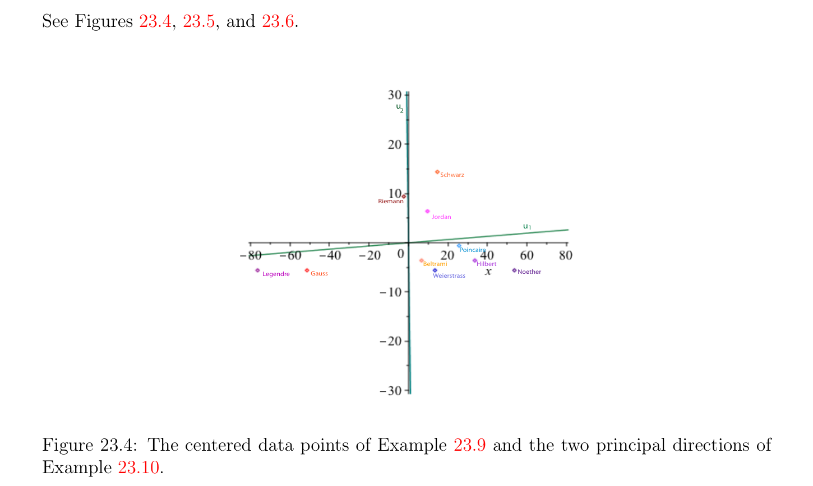

# Chính Các thành phần Giải tích/phân tích (PCA)

<!-- PAGE 783 -->
Với
$$U = \begin{pmatrix} -0.5286 & -0.6149 & 0.3017 & -0.5016 \\ -0.3803 & -0.3963 & -0.0933 & 0.8304 \\ -0.5520 & 0.2716 & -0.7603 & -0.2086 \\ 0.5209 & 0.6254 & 0.5676 & 0.1237 \end{pmatrix} , D = \begin{pmatrix} 30.2887 & 0 & 0 & 0 \\ 0 & 3.8581 & 0 & 0 \\ 0 & 0 & 0.8431 & 0 \\ 0 & 0 & 0 & 0.0102 \end{pmatrix} .$$
$$-$$
Nếu ta tập hợp $\sigma_{3}  = \sigma_{4}  = 0$, ta thu được tốt nhất hạng (rank) $2$ xấp xỉ
$$A_{2} = U(:, 1 : 2) *D(:, 1 : 2) *U(:, 1 : 2)' = \begin{pmatrix} 9.9207 & 7.0280 & 8.1923 & 6.8563 \\ 7.0280 & 4.9857 & 5.9419 & 5.0436 \\ 8.1923 & 5.9419 & 9.5122 & 9.3641 \\ 6.8563 & 5.0436 & 9.3641 & 9.7282 \end{pmatrix} .$$
Đẹp ví dụ của sử dụng của Mệnh đề 23.9 trong ảnh (image) compression là cho trước trong Demmel $[48]$, Chương $3$, Mục 3.2.3, các trang 113–115; xem Matlab demo. Mệnh đề 23.9 cũng nghiệm đúng cho Chuẩn Frobenius (Frobenius norm); xem Bài toán 23.4. thú vị topic rằng ta có không addressed là actual phép tính của SVD. Điều này là rất thú vị nhưng khó/tinh tế subject. Hầu hết các phương pháp rút gọn phép tính của SVD đến sự chéo hóa của well-chosen ma trận đối xứng (symmetric matrix) mà là không $A^{\top}A$; xem
Bài toán 22.1 và Bài toán 22.3. Interested độc giả nên read Mục 5.4 của Demmel’s excellent cuốn sách $[48]$, mà chứa overview của hầu hết đã biết các phương pháp và extensive danh sách của references.

## 23.4 Chính Các thành phần Giải tích/phân tích (PCA)

$$\mathbb{R}^{d}$$
Giả sử ta có tập hợp của dữ liệu bao gồm của $n$ các điểm $X_{1}, \dots  , X_{n}$, với mỗi $X_{i} \in$ được quan điểm như vectơ hàng (row vector). Nghĩ của $X_{i}’s$ như persons, và nếu $X_{i} = (x_{i1}, \dots  , x_{i d})$, mỗi $x_{i j}$ là giá trị của một số đặc trưng (feature) (hoặc attribute) của rằng person.

> **Ví dụ 23.5.** Ví dụ, $X_{i}’s$ có thể là mathematicians, $d = 2$, và thành phần thứ nhất, $x_{i1}$, của $X_{i}$ có thể là year rằng $X_{i}$ đã là born, và thành phần thứ hai, $x_{i2}$, độ dài của beard của $X_{i}$ trong centimeters. Ở đây là nhỏ dữ liệu tập hợp.

<!-- PAGE 784 -->
$$\frac{\overline{Name}\overline{year}\overline{length}}{CarlFriedrichGauss17770}$$
$$\frac{CamilleJordan183812}{Adrien-MarieLegendre17520}$$
$$\frac{BernhardRiemann182615}{DavidHilbert18622}$$
$$\frac{HenriPoincar´e18545}{EmmyNoether18820}$$
$$\frac{KarlWeierstrass18150}{EugenioBeltrami18352}$$
$$Hermann Schwarz184320$$
Ta thường tạo thành ma trận cỡ $n \times  d$ $X$ có hàng thứ $i$ là $X_{i}$, với $1 \le i \le n$. Thì cột thứ $j$ được ký hiệu bởi $C_{j} (1 \le j \le d)$. Nó đôi khi được gọi là một đặc trưng (feature) vectơ, nhưng điều này thuật ngữ là far từ đang là một cách phổ dụng accepted. Thực ra, nhiều people trong máy tính thị giác gọi dữ liệu các điểm $X_{i}$ đặc trưng (feature) các vectơ! mục đích của chính các thành phần giải tích/phân tích, cho ngắn PCA, là để đồng nhất patterns trong dữ liệu và understand phương sai–hiệp phương sai cấu trúc của dữ liệu. Điều này là hữu ích cho sau đây tasks: $1$. Dữ liệu reduction: Thường nhiều của variability của dữ liệu có thể được accounted cho bởi nhỏ hơn số của chính các thành phần. $2$. Interpretation: PCA có thể chỉ ra relationships rằng đã là không một cách trước đó suspected. Cho trước vectơ (sample của measurements) $x = (x_{1}, \dots  , x_{n}) \in \mathbb{R}^{n}$, nhắc lại rằng có nghĩa (hoặc trung bình) $\overline{x}$ của $x$ được cho bởi
$$\overline{x} = \sum_{i}  \frac{x_{i}}{n} n=1 .$$
Ta cho $x$ - $\overline{x}$ ký hiệu được tâm dữ liệu điểm
$$x -\overline{x} = (x_{1} -\overline{x, \dots  , x}_{n} -\overline{x}).$$
Trong thứ tự đến measure spread của $x_{i}’s$ xung quanh có nghĩa, ta định nghĩa sample phương sai (cho ngắn, phương sai) var(x) (hoặc $s^{2})$ của sample $x$ bởi
$$var(x) = \sum_{i}  \frac{(x_{i}\overline{x})^{2}}{n -1} n=1 -.$$

> **Ví dụ 23.6.** Nếu $x = (1, 3, -1), \overline{x} =_{3}^{1+3-1} = 1, x$ - $\overline{x} = (0, 2, -2)$, và var(x) $= 02+22+(-2)2$
$$= 4. If y = (1, 2, 3),\overline{y} =^{1+2+3}= 2, y -\overline{y} = (-1, 0, 1), and var(y) =_{2}^{(-1)2+02+12}=$$
$\overline{2} \overline{3} 2$.

<!-- PAGE 785 -->
Có một lý do cho bằng cách sử dụng $n$ - $1$ thay vì của $n$. ở trên định nghĩa làm cho var(x) unbiased estimator của phương sai của ngẫu nhiên biến đang là sampled. Tuy nhiên, ta không’t cần đến worry về điều này. Curious độc giả sẽ tìm explanation của các phần tử này peculiar các định nghĩa trong Epstein $[58]$ (Chương $14$, Mục 14.5) hoặc trong bất kỳ decent statistics cuốn sách. Cho trước hai các vectơ $x = (x_{1}, \dots  , x_{n})$ và $y = (y_{1}, \dots  , y_{n})$, sample hiệp phương sai (cho ngắn, hiệp phương sai) của $x$ và $y$ được cho bởi
$$cov(x, y) = \sum_{i}  \frac{(x_{i}\overline{x})(y_{i}\overline{y})}{n -1} n=1 - -.$$

> **Ví dụ 23.7.** Nếu ta lấy $x = (1, 3, -1)$ và $y = (1, 2, 3)$, ta biết từ Ví dụ 23.6 rằng $x$ - $\overline{x} = (0, 2, -2)$ và $y$ - $\overline{y} = (-1, 0, 1)$. Do đó, cov(x, $y) =^{0(-1)+2(0)+(-2)(1)} = -1$.
$$\overline{2}$$
Hiệp phương sai của $x$ và $y$ measures cách mà $x$ và $y$ biến thiên từ có nghĩa đối với mỗi khác. Hiển nhiên, cov(x, $y) =$ cov(y, $x)$ và cov(x, $x) =$ var(x). Lưu ý rằng
$$cov(x, y) = \frac{(x\overline{x})^{\top}(y\overline{y})}{n -1} - -.$$
Ta nói rằng $x$ và $y$ là uncorrelated khi và chỉ khi cov(x, $y) = 0$. Cuối cùng, cho trước một ma trận cỡ $n \times  d$ $X$ của $n$ các điểm $X_{i}$, cho PCA là meaningful, nó sẽ là cần đến translate gốc đến trọng tâm (hoặc tâm của gravity) $\mu$ của $X_{i}’s$, được định nghĩa bởi
$$\mu  = \frac{1}{n} (X_{1} + \cdots  + X_{n}).$$
Nhận thấy rằng nếu $\mu  = (\mu_{1} , \dots  , \mu_{d}$), thì $\mu_{j}$ là có nghĩa của vectơ $C_{j}$ (cột thứ $j$ của $X)$. Ta cho $X$ - $\mu$ ký hiệu ma trận có hàng thứ $i$ được tâm dữ liệu điểm $X_{i}$ - $\mu  (1 \le i \le n)$. Thì sample hiệp phương sai ma trận (cho ngắn, hiệp phương sai ma trận) của $X$ là $d \times  d$ ma trận đối xứng (symmetric matrix)
$$\Sigma  = \frac{1}{n -1} (X -\mu )^{\top}(X -\mu ) = (cov(C_{i}, C_{j})).$$
$$Example 23.8. Let X = \begin{pmatrix} 1 & 1 \\ 3 & 2 \\ 1 & 3 \end{pmatrix} , the 3 \times  2 matrix whose columns are the vector x and$$
$$-$$
$y$ của Ví dụ 23.6. Thì
$$1$$
$$\mu  =3 [(1, 1) + (3, 2) + (-1, 3)] = (1, 2),$$
$$X -\mu  = \begin{pmatrix} 0 & -1 \\ 2 & 0 \\ 2 & 1 \end{pmatrix} ,$$
$$-$$

<!-- PAGE 786 -->
Và
$$\Sigma  = \frac{1}{2} \begin{pmatrix} 0 & 2 & -2 \\ -1 & 0 & 1 \end{pmatrix} \begin{pmatrix} 0 & -1 \\ 2 & 0 \\ 2 & 1 \end{pmatrix} = \begin{pmatrix} 4 & -1 \\ -1 & 1 \end{pmatrix} .$$
$$-$$
Nhận xét: $factor_{n-1}^{1}$ là irrelevant cho của ta các mục đích và có thể được ignored.

> **Ví dụ 23.9.** Ở đây là ma trận $X -\mu$ trong trường hợp của của ta bearded mathematicians: vì
$$\mu_{1}  = 1828.4,\mu_{2}  = 5.6,$$
Ta thu được sau đây được tâm dữ liệu tập hợp.
$$\frac{\overline{Name}\overline{year}\overline{length}}{CarlFriedrichGauss-51.4-5.6}$$
$$\frac{CamilleJordan9.66.4}{Adrien-MarieLegendre-76.4-5.6}$$
$$\frac{BernhardRiemann2.49.4}{DavidHilbert33.6-3.6}$$
$$\frac{-}{HenriPoincar´e25.6-0.6}$$
$$\frac{EmmyNoether53.65.6}{KarlWeierstrass13.4-5.6}$$
$$\frac{-}{EugenioBeltrami6.6-3.6}$$
$$Hermann Schwarz14.614.4$$
Xem Hình 23.3. Ta có thể nghĩ của vectơ $C_{j}$ như biểu diễn các đặc trưng của $X$ trong hướng $e_{j}$ (vectơ cơ sở chính tắc thứ $j$ trong $\mathbb{R}^{d}$, cụ thể là $e_{j} = (0, \dots  , 1, \dots  0)$, với $1$ trong thứ $j$ position).
$$\mathbb{R}^{d}$$
Nếu $v \in$ là unit vectơ, ta muốn đến xét phép chiếu của dữ liệu các điểm $X_{1}, \dots  , X_{n}$
$$\mathbb{R}^{d}$$
Lên đường thẳng được sinh (spanned) bởi $v$. Nhắc lại từ Euclidean hình học rằng nếu $x \in$ là bất kỳ vectơ
$$\mathbb{R}^{d}$$
Và $v \in$ là unit vectơ, phép chiếu của $x$ lên đường thẳng được sinh (spanned) bởi $v$ là
$$\langle x, v\rangle v.$$
Do đó, đối với cơ sở (basis) $v$, phép chiếu của $x$ có tọa độ $\langle x, v\rangle$. Nếu $x$ được biểu diễn bởi vectơ hàng (row vector) và $v$ bởi vectơ cột (column vector), thì
$$\langle x, v\rangle = xv.$$
$$\mathbb{R}^{n}$$
Vì vậy, vectơ $Y \in$ bao gồm của các tọa độ của các phép chiếu của $X_{1}, \dots  , X_{n}$ lên đường thẳng được sinh (spanned) bởi $v$ được cho bởi $Y =$ Xv, và điều này là tổ hợp tuyến tính (linear combination)
$$Xv = v_{1}C_{1} + \cdots  + v_{d}C_{d}$$

<!-- PAGE 787 -->
$$Schwarz$$
$$Riemann$$
$$Jordan$$
$$Poincare$$
$$BeltramiHilbert$$
$$LegendreGaussWeierstrass$$
$$Noether$$
$$Figure 23.3: The centered data points of Example 23.9.$$
Của các cột của $X$ (với $v = (v_{1}, \dots  , v_{d}))$. Nhận thấy rằng bởi vì $\mu_{j}$ là có nghĩa của vectơ $C_{j}$ (cột thứ $j$ của $X)$, ta thu được
$$\overline{Y} =\overline{Xv} = v_{1}\mu_{1}  + \cdots  + v_{d}\mu_{d} ,$$
Và do đó được tâm điểm $Y$ - $\overline{Y}$ được cho bởi
$$Y -\overline{Y} = v_{1}(C_{1} -\mu_{1} ) + \cdots  + v_{d}(C_{d} -\mu_{d} ) = (X -\mu )v.$$
Hơn nữa, nếu $Y =$ Xv và $Z =$ Xw, thì
$$- -$$
$$cov(Y, Z)= \frac{((X\mu )v)^{\top}(X\mu )w}{n -1}$$
$$=v^{\top} \frac{1}{n -1} (X -\mu )^{\top}(X -\mu )w$$
$$=v^{\top}\Sigma w,$$
Ở đâu $\Sigma$ là hiệp phương sai ma trận của $X$. Vì $Y$ - $\overline{Y}$ có không có nghĩa, ta có
$$var(Y ) = var(Y -\overline{Y}\overline{) =} v^{\top} \frac{1}{n -1} (X -\mu )^{\top}(X -\mu )v.$$
Ở trên suggests rằng ta nên di chuyển gốc đến trọng tâm $\mu$ của $X_{i}’s$ và xét ma trận $X$ - $\mu$ của được tâm dữ liệu các điểm $X_{i}$ - $\mu$. Từ bây giờ trên beware rằng ta ký hiệu các cột của $X$ - $\mu$ bởi $C_{1}, \dots  , C_{d}$ và rằng $Y$
$$denotes the centered point Y = (X -\mu )v = \sum_{j}  d=1 v_{j}C_{j}, where v is a unit vector.$$

<!-- PAGE 788 -->
Cơ bản ý tưởng của PCA: chính các thành phần của $X$ là uncorrelated các phép chiếu $Y$ của dữ liệu các điểm $X_{1}, \dots , X_{n}$ lên một số các hướng $v$ (ở đâu v’s là unit các vectơ) sao cho var(Y) là cực đại. Điều này suggests sau đây định nghĩa:

> **Định nghĩa 23.2.** Cho trước một ma trận cỡ $n\times  d$ $X$ của dữ liệu các điểm $X_{1}, \dots  , X_{n}$, nếu $\mu$ là trọng tâm của $X_{i}’s$, thì thứ nhất chính thành phần của $X$ (thứ nhất PC) được tâm điểm $Y_{1} = (X -\mu )v_{1}$, phép chiếu của $X_{1}, \dots  , X_{n}$ lên hướng $v_{1}$ sao cho $var(Y_{1})$ là maximized, ở đâu $v_{1}$ là unit vectơ (nhắc lại rằng $Y_{1} = (X$ - $\mu )v_{1}$ là tổ hợp tuyến tính (linear combination) của $C_{j}’s$, các cột của $X$ - $\mu$). Tổng quát hơn, nếu $Y_{1}, \dots  , Y_{k}$ là $k$ chính các thành phần của $X$ dọc theo một số unit các vectơ $v_{1}, \dots  , v_{k}$, ở đâu $1 \le k < d$, $(k+1)th$ chính thành phần của $X ((k+1)th$ PC) được tâm điểm $Y_{k+1} = (X$ - $\mu )v_{k+1}$, phép chiếu của $X_{1}, \dots  , X_{n}$ lên một số hướng $v_{k+1}$ sao cho $var(Y_{k+1})$ là maximized, subject đến $cov(Y_{h}, Y_{k+1}) = 0$ với mọi $h$ với $1 \le h \le k$, và ở đâu $v_{k+1}$ là unit vectơ (nhắc lại rằng $Y_{h} = (X$ - $\mu )v_{h}$ là tổ hợp tuyến tính (linear combination) của $C_{j}’s)$. $v_{h}$ được gọi là chính các hướng. sau đây mệnh đề là then chốt đến chính kết quả về PCA. kết quả này đã là đã được chứng minh trong Mệnh đề 17.23 ngoại trừ rằng các trị riêng (eigenvalues) đã được liệt kê trong tăng thứ tự. Cho độc giả’s convenience ta chứng minh nó một lần nữa.

> **Mệnh đề 23.10.** Nếu $A$ là đối xứng $d \times  d$ ma trận với các trị riêng (eigenvalues) $\lambda_{1}  \ge \lambda_{2}  \ge \cdots  \ge \lambda_{d}$ và nếu $(u_{1}, \dots  , u_{d})$ là bất kỳ cơ sở trực chuẩn (orthonormal basis) của các vectơ riêng (eigenvectors) của $A$, ở đâu $u_{i}$ là unit vectơ riêng (eigenvector) liên kết với $\lambda_{i}$, thì
$$maxx\neq 0 \frac{x^{\top}Ax}{x^{\top}x} = \lambda_{1}$$
(với cực đại đạt được cho $x = u_{1})$ và
$$x\neq 0,x\in {maxu,...,u}\perp \frac{x^{\top}Ax}{x^{\top}x} = \lambda_{k+1}$$
$$1k$$
(với cực đại đạt được cho $x = u_{k+1})$, ở đâu $1 \le k \le d$ - $1$.

*Chứng minh.* Thứ nhất nhận thấy rằng
$$maxx\neq 0 \frac{x^{\top}Ax}{x^{\top}x} = maxx {x^{\top}Ax | x^{\top}x = 1},$$
Và tương tự,
$$x\neq 0,x\in {maxu,...,u}\perp \frac{x^{\top}Ax}{x^{\top}x} = maxxx^{\top}Ax | (x \in {u_{1}, \dots  , u_{k}}^{\perp}) \wedge (x^{\top}x = 1).$$
$$1k$$

<!-- PAGE 789 -->
Vì $A$ là ma trận đối xứng (symmetric matrix), các trị riêng (các trị riêng (eigenvalues)) của nó là thực và nó có thể được được chéo hóa đối với cơ sở trực chuẩn (orthonormal basis) của các vectơ riêng (eigenvectors), do đó cho $(u_{1}, \dots  , u_{d})$ là như vậy cơ sở (basis). Nếu ta viết
$$x = \sum_{i=1}^{d}  x_{i}u_{i},$$
Đơn giản phép tính chỉ ra rằng
$$x^{\top}Ax = \sum_{i=1}^{d}  \lambda_{i} x_{i}^{2} .$$
$$If x^{\top}x = 1, then \sum_{i}  d=1 x_{i}^{2} = 1, and since we assumed that \lambda_{1}  \ge \lambda_{2}  \ge \cdots  \ge \lambda_{d} , we get$$
$$x^{\top}Ax = \sum_{i=1}^{d}  \lambda_{i} x_{i}^{2} \le \lambda_{1} \begin{pmatrix} x_{i}^{2} \end{pmatrix} \sum_{i=1}^{d}  = \lambda_{1} .$$
Do đó,
$$\maxx^{\top}Ax | x^{\top}x = 1\le \lambda_{1} ,$$
$$x$$
Và vì điều này cực đại là đạt được cho $e_{1} = (1, 0, \dots  , 0)$, ta kết luận rằng
$$\maxx^{\top}Ax | x^{\top}x = 1= \lambda_{1} .$$
$$x$$
$$Next observe that x \in {u_{1}, \dots  , u_{k}}^{\perp}and x^{\top}x = 1 iff x_{1} = \cdots  = x_{k} = 0 and \sum_{i}  d=1 x_{i} = 1.$$
Hệ quả là, cho như vậy $x$, ta có
$$x^{\top}Ax = \sum_{i=k+1}^{d}  \lambda_{i} x_{i}^{2} \le \lambda_{k+1} \begin{pmatrix} x_{i}^{2} \end{pmatrix} \sum_{i=k+1}^{d}  = \lambda_{k+1} .$$
Do đó,
$$\maxx^{\top}Ax | (x \in {u_{1}, \dots  , u_{k}}^{\perp}) \wedge (x^{\top}x = 1)\le \lambda_{k+1} ,$$
$$x$$
Và vì điều này cực đại là đạt được cho $e_{k+1} = (0, \dots  , 0, 1, 0, \dots  , 0)$ với $1$ trong position $k+1$, ta kết luận rằng
$$\maxx^{\top}Ax | (x \in {u_{1}, \dots  , u_{k}}^{\perp}) \wedge (x^{\top}x = 1)= \lambda_{k+1} ,$$
$$x$$
Như đã khẳng định. đại lượng
$$\frac{x^{\top}Ax}{x^{\top}x}$$

<!-- PAGE 790 -->
Là đã biết như Rayleigh tỉ số hoặc Rayleigh–Ritz tỉ số (xem Mục 17.6) và Mệnh đề 23.10 là thường đã biết như phần của Rayleigh–Ritz định lý. Mệnh đề 23.10 cũng nghiệm đúng nếu $A$ là Ma trận Hermite (Hermitian matrix) và nếu ta thay thế $x^{\top}Ax$ bởi $x^{*}Ax$ và $x^{\top}x$ bởi $x^{*}x$. chứng minh là unchanged, vì Ma trận Hermite (Hermitian matrix) có thực các trị riêng (eigenvalues) và được chéo hóa đối với cơ sở trực chuẩn (orthonormal basis) của các vectơ riêng (eigenvectors) (đối với Hermite tích vô hướng (inner product)). Ta thì có sau đây cơ bản kết quả chỉ ra cách mà SVD của $X$ cho ta PCs:

> **Định lý 23.11.** (SVD cho ta PCA) Cho $X$ là một ma trận cỡ $n \times  d$ của dữ liệu các điểm $X_{1}, \dots  , X_{n}$, và cho $\mu$ là trọng tâm của $X_{i}’s$. Nếu $X$ - $\mu  = V DU^{\top}$ là SVD phân rã của $X$ - $\mu$ và nếu chính đường chéo của $D$ bao gồm của các giá trị kỳ dị (singular values) $\sigma_{1}  \ge \sigma_{2}  \ge \cdots  \ge \sigma_{d}$, thì được tâm các điểm $Y_{1}, \dots  , Y_{d}$, ở đâu
$$Y_{k} = (X -\mu )u_{k} = kth column of V D$$
Và $u_{k}$ là cột thứ $k$ của $U$, là $d$ chính các thành phần của $X$. Hơn nữa,
$$var(Y_{k}) = \frac{\sigma_{k}^{2}}{n -1}$$
Và $cov(Y_{h}, Y_{k}) = 0$, bất cứ khi nào $h \neq  k$ và $1 \le k, h \le d$.

*Chứng minh.* Nhắc lại rằng với mọi unit vectơ $v$, được tâm phép chiếu của các điểm $X_{1}, \dots  , X_{n}$ lên đường thẳng của hướng $v$ là $Y = (X$ - $\mu )v$ và rằng phương sai của $Y$ được cho bởi
$$var(Y ) = v^{\top} \frac{1}{n -1} (X -\mu )^{\top}(X -\mu )v.$$
Vì $X$ - $\mu  = V DU^{\top}$, ta thu được
$$var(Y )=v^{\top} \frac{1}{(n -1)} (X -\mu )^{\top}(X -\mu )v$$
$$=v^{\top} \frac{1}{(n -1)} UDV^{\top} V DU^{\top}v$$
$$=v^{\top}U \frac{1}{(n -1)} D^{2}U^{\top}v.$$
Tương tự, nếu $Y = (X$ - $\mu )v$ và $Z = (X$ - $\mu )w$, thì hiệp phương sai của $Y$ và $Z$ được cho bởi
$$cov(Y, Z) = v^{\top}U \frac{1}{(n -1)} D^{2}U^{\top}w.$$
Hiển nhiên, $U_{(n-1)}^{1}D^{2}U^{\top}$ là ma trận đối xứng (symmetric matrix) có các trị riêng (eigenvalues) $are_{n-1}^{\sigma12} \ge \cdots  \ge_{n-1}^{\sigma d2}$, và các cột của $U$ tạo thành cơ sở trực chuẩn (orthonormal basis) của unit các vectơ riêng (eigenvectors).

<!-- PAGE 791 -->
Ta tiến hành bằng quy nạp theo $k$. Cho base trường hợp, $k = 1$, cực đại hóa var(Y) là tương đương đến cực đại hóa
$$v^{\top}U \frac{1}{(n -1)} D^{2}U^{\top}v,$$
Ở đâu $v$ là unit vectơ. Theo Mệnh đề 23.10, cực đại của ở trên đại lượng là lớn nhất trị riêng (eigenvalue) của $U_{(n-1)}^{1}D^{2}U^{\top}, namely_{n-1}^{\sigma12}$, và nó là đạt được cho $u_{1}$, thứ nhất columnn của $U$. Bây giờ ta thu được
$$Y_{1} = (X -\mu )u_{1} = V DU^{\top} u_{1},$$
Và vì các cột của $U$ tạo thành cơ sở trực chuẩn (orthonormal basis), $U^{\top} u_{1} = e_{1} = (1, 0, \dots  , 0)$, và do đó $Y_{1}$ là thật vậy cột thứ nhất của $V D$. Theo giả thiết quy nạp, được tâm các điểm $Y_{1}, \dots  , Y_{k}$, ở đâu $Y_{h} = (X$ - $\mu )u_{h}$ và $u_{1}, \dots  , u_{k}$ là thứ nhất $k$ các cột của $U$, là $k$ chính các thành phần của $X$. Bởi vì
$$cov(Y, Z) = v^{\top}U \frac{1}{(n -1)} D^{2}U^{\top}w,$$
Ở đâu $Y = (X$ - $\mu )v$ và $Z = (X$ - $\mu )w$, điều kiện $cov(Y_{h}, Z) = 0$ cho $h = 1, \dots  , k$ là tương đương đến sự kiện rằng $w$ thuộc đến phần bù trực giao (orthogonal complement) của không gian con được sinh (spanned) bởi ${u_{1}, \dots  , u_{k}}$, và cực đại hóa var(Z) subject đến $cov(Y_{h}, Z) = 0$ cho $h = 1, \dots  , k$ là tương đương đến cực đại hóa
$$w^{\top}U \frac{1}{(n -1)} D^{2}U^{\top}w,$$
Ở đâu $w$ là unit vectơ trực giao đến không gian con được sinh (spanned) bởi ${u_{1}, \dots  , u_{k}}$. Theo Mệnh đề 23.10, cực đại của ở trên đại lượng là $(k+1)th$ trị riêng (eigenvalue) của $U_{(n-1)}^{1}D^{2}U^{\top}$, cụ thể là $\sigma 2 k+1$, và nó là đạt được cho $u_{k+1}$, $(k +$ 1)th columnn của $U$. Bây giờ ta thu được $\overline{n}\overline{-}\overline{1}$
$$Y_{k+1} = (X -\mu )u_{k+1} = V DU^{\top} u_{k+1},$$
Và vì các cột của $U$ tạo thành cơ sở trực chuẩn (orthonormal basis), $U^{\top} u_{k+1} = e_{k+1}$, và $Y_{k+1}$ là thật vậy $(k +$ 1)th cột của $V D$, mà các đầy đủ chứng minh của quy nạp bước. $d$ các cột $u_{1}, \dots  , u_{d}$ của $U$ là thường được gọi là chính các hướng của $X$ - $\mu$ (và $X)$. Ta lưu ý rằng không chỉ thực hiện ta có $cov(Y_{h}, Y_{k}) = 0$ bất cứ khi nào $h \neq  k$, nhưng các hướng $u_{1}, \dots  , u_{d}$ dọc theo mà dữ liệu là projected là mutually trực giao.

> **Ví dụ 23.10.** Cho được tâm dữ liệu tập hợp của của ta bearded mathematicians (Ví dụ 23.9) ta có $X$ - $\mu  = V \Sigma U^{\top}$, ở đâu $\Sigma$ có hai khác không các giá trị kỳ dị (singular values), $\sigma_{1}  =$ 116.9803, $\sigma_{2}  =$ 21.7812, và với
$$U = \begin{pmatrix} 0.9995 & 0.0325 \\ 0.0325 & -0.9995 \end{pmatrix} ,$$

<!-- PAGE 792 -->
Do đó chính các hướng là $u_{1} =$ (0.9995, 0.0325) và $u_{2} =$ (0.0325, -0.9995). Nhận thấy rằng $u_{1}$ là hầu như hướng của trục $x$, và $u_{2}$ là hầu như opposite hướng của trục $y$. Ta cũng tìm rằng các phép chiếu $Y_{1}$ và $Y_{2}$ dọc theo chính các hướng là
$$V D = \begin{pmatrix} -51.5550 & 3.9249 \\ 9.8031 & -6.0843 \\ -76.5417 & 3.1116 \\ -2.0929 & -9.4731 \\ 33.4651 & 4.6912 \\ 25.5669 & 1.4325 \\ 53.3894 & 7.3408 \\ 13.2107 & 6.0330 \\ 6.4794 & 3.8128 \\ 15.0607 & 13.9174 \end{pmatrix} ,withX -\mu  = \begin{pmatrix} -51.4000 & -5.6000 \\ 9.6000 & 6.4000 \\ -76.4000 & -5.6000 \\ -2.4000 & 9.4000 \\ 33.6000 & -3.6000 \\ 25.6000 & -0.6000 \\ 53.6000 & -5.6000 \\ 13.4000 & -5.6000 \\ 6.6000 & -3.6000 \\ 14.6000 & 14.4000 \end{pmatrix} .$$
$$-$$
Xem Các hình 23.4, 23.5, và 23.6.
$$u$$
$$2$$
$$Schwarz$$
$$Riemann$$
$$Jordan$$
$$u1$$
$$Poincaire$$
$$BeltramiHilbert$$
$$LegendreGaussWeierstrassNoether$$

**Hình 23.4:** được tâm dữ liệu các điểm của Ví dụ 23.9 và hai chính các hướng của

> **Ví dụ 23.10.** Ta biết từ của ta study của SVD rằng $\sigma_{1}^{2} , \dots  , \sigma_{d}^{2}$ là các trị riêng (eigenvalues) của đối xứng nửa xác định dương (positive semidefinite) ma trận $(X$ - $\mu )^{\top}(X$ - $\mu$) và rằng $u_{1}, \dots  , u_{d}$ là tương ứng các vectơ riêng (eigenvectors). một cách số, nó được ưu tiên hơn để sử dụng SVD trên $X -\mu$ thay vì để tính một cách tường minh $(X$ - $\mu )^{\top}(X$ - $\mu$) và thì diagonalize nó. Thật vậy, tường minh phép tính của $A^{\top}A$ từ ma trận $A$ có thể được một cách số khá unstable, và tốt SVD các thuật toán tránh việc tính toán $A^{\top}A$ một cách tường minh.

<!-- PAGE 793 -->
$$Schwarz$$
$$Riemann$$
$$Jordan$$
$$u1$$
$$Poincaire$$
$$BeltramiHilbert$$
$$LegendreGaussNoether$$
$$Weierstrass$$

**Hình 23.5:** thứ nhất chính các thành phần của Ví dụ 23.10, i.e. phép chiếu của được tâm dữ liệu các điểm lên $u_{1}$ đường thẳng.
$$u2$$
$$Schwarz$$
$$Riemann$$
$$Jordan$$
$$Poincare$$
$$Beltrami$$
$$Hilbert$$
$$LegendreGaussWeierstrassNoether$$

**Hình 23.6:** thứ hai chính các thành phần của Ví dụ 23.10, i.e. phép chiếu của được tâm dữ liệu các điểm lên $u_{2}$ đường thẳng.
