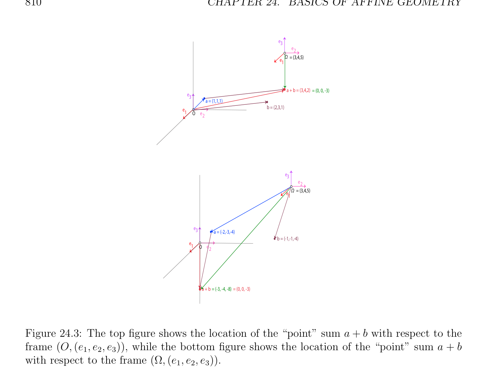

# Các không gian afin

<!-- PAGE 805 -->
Chương $24$ Cơ sở của Afin Hình học L’alg`ebre n’est qu’une g´eom´etrie ´ecrite; la g´eom´etrie n’est qu’une alg`ebre figur´ee. —Sophie Germain

## 24.1 Các không gian afin

Geometrically, các đường cong và các mặt là thường được xét là các tập hợp của các điểm với một số đặc biệt các tính chất, living trong không gian bao gồm của “các điểm.” Typically, một là cũng interested trong hình học các tính chất bất biến dưới nhất định các phép biến đổi, ví dụ, các phép tịnh tiến, các phép quay, các phép chiếu, etc. Một có thể mô hình không gian của các điểm như không gian vectơ (vector space), nhưng điều này là không rất satisfactory cho số của các lý do. Một lý do là rằng điểm tương ứng với không vectơ $(0)$, được gọi là gốc, đóng đặc biệt vai trò, khi ở đó là một cách thực không có lý do gì để có privileged gốc. Một cái khác lý do là rằng nhất định các khái niệm, chẳng hạn như parallelism, là handled trong awkward cách thức. Nhưng deeper lý do là rằng các không gian vectơ và các không gian afin một cách thực có khác nhau geometries. hình học các tính chất của không gian vectơ (vector space) là bất biến dưới nhóm của song ánh (bijective) các ánh xạ tuyến tính (linear maps), trong khi đó hình học các tính chất của không gian afin (affine space) là bất biến dưới nhóm của song ánh (bijective) các ánh xạ afin, và các phần tử này hai các nhóm là không đẳng cấu. Xấp xỉ/đại khái speaking, có nhiều hơn/thêm các ánh xạ afin hơn các ánh xạ tuyến tính (linear maps). Các không gian afin cung cấp tốt hơn khung lý thuyết cho thực hiện hình học. Đặc biệt, nó là khả dĩ/có thể đến deal với các điểm, các đường cong, các mặt, etc., trong nội tại cách thức, nghĩa là, một cách độc lập của bất kỳ cụ thể lựa chọn của tọa độ hệ. Như trong vật lý, điều này là một cách cao desirable đến một cách thực understand những gì là đi trên. Của course, tọa độ các hệ có được chọn đến cuối cùng carry ra các phép tính, nhưng một nên learn đến resist temptation đến resort đến tọa độ các hệ cho đến khi nó là một cách thực cần. Các không gian afin là phải khung lý thuyết cho dealing với motions, trajectories, và vật lý buộc, trong số khác things. Do đó, afin hình học là then chốt đến gọn gàng trình bày của kinematics, dynamics, và khác các phần của vật lý (ví dụ, elasticity). Sau tất cả, cứng motion là ánh xạ afin (affine map), nhưng không ánh xạ tuyến tính (linear map) nói chung. Cũng, cho trước một ma trận cỡ $m \times  n$ $A$
$$805$$

<!-- PAGE 806 -->
$$\mathbb{R}^{m}\mathbb{R}^{n}$$
Và vectơ $b \in$, tập hợp $U = {x \in$ | Ax $= b}$ của các nghiệm của hệ Ax $= b$ là không gian afin (affine space), nhưng không không gian vectơ (vector space) (tuyến tính không gian) nói chung.
$$Use coordinate systems only when needed!$$
Điều này chương tiến hành như sau. Ta lấy advantage của sự kiện rằng hầu như mọi afin khái niệm là counterpart của một số khái niệm trong tuyến tính đại số. Ta bắt đầu bởi định nghĩa các không gian afin, stressing vật lý interpretation của định nghĩa theo các điểm (particles) và các vectơ (buộc). Tương ứng với các tổ hợp tuyến tính của các vectơ, ta định nghĩa các tổ hợp afin của các điểm (các tâm tỉ cự), realizing rằng ta là forced đến thu hẹp của ta attention đến các họ của các vô hướng cộng sai khác $1$. Tương ứng với tuyến tính các không gian con, ta giới thiệu afin các không gian con như các tập con đóng dưới các tổ hợp afin. Thì, ta đặc trưng hóa afin các không gian con theo nhất định các không gian vectơ được gọi là của chúng các hướng. Điều này cho phép chúng ta để định nghĩa gọn gàng khái niệm của parallelism. Tiếp theo, tương ứng với sự độc lập tuyến tính (linear independence) và các cơ sở, ta định nghĩa afin independence và afin các hệ quy chiếu. Ta cũng định nghĩa tính lồi. Tương ứng với các ánh xạ tuyến tính (linear maps), ta định nghĩa các ánh xạ afin như các ánh xạ bảo toàn các tổ hợp afin. Ta chỉ ra rằng mọi ánh xạ afin (affine map) là hoàn toàn được định nghĩa bởi ảnh (image) của một điểm và ánh xạ tuyến tính (linear map). Thì, ta investigate ngắn gọn một số đơn giản các ánh xạ afin, các phép tịnh tiến và trung tâm các phép vị tự. Tại điều này điểm, ta cho glimpse của afin hình học. Ta chứng minh các định lý của Thales, Pappus, và Desargues. Sau điều này, định nghĩa của afin các siêu phẳng theo afin các dạng được ôn tập/tổng quan. mục kết thúc với closer nhìn tại giao của afin các không gian con. Của ta trình bày của afin hình học là far từ đang là toàn diện, và nó là biased toward algorithmic hình học của các đường cong và các mặt. Cho nhiều hơn/thêm chi tiết, độc giả là referred đến Pedoe $[141]$, Snapper và Troyer $[168]$, Berger $[11, 12]$, Coxeter $[44]$, Samuel $[148]$, Tisseron $[181]$, Fresnel $[66]$, Vienne $[191]$, và Hilbert và Cohn-Vossen $[95]$. Giả sử ta có particle di chuyển trong 3D không gian và rằng ta muốn đến mô tả trajectory của điều này particle. Nếu một trông lên tốt textbook trên dynamics, chẳng hạn như Greenwood $[85]$, một tìm ra rằng particle được mô hình như điểm, và rằng position của điều này điểm $x$ là
$$\mathbb{R}^{3}$$
Được xác định đối với “hệ quy chiếu (frame)” trong bởi vectơ. Curiously, khái niệm của hệ quy chiếu (frame) là rarely được định nghĩa một cách chính xác, nhưng nó là dễ đến infer rằng hệ quy chiếu (frame) là cặp $(O, (e_{1}, e_{2}, e_{3}))$ bao gồm của gốc $O$ (mà là điểm) cùng với cơ sở (basis) của ba các vectơ $(e_{1}, e_{2}, e_{3})$. Cho
$$\mathbb{R}^{3}$$
Ví dụ, tiêu chuẩn hệ quy chiếu (frame) trong có gốc $O = (0, 0, 0)$ và cơ sở (basis) của ba các vectơ $e_{1} = (1, 0, 0), e_{2} = (0, 1, 0)$, và $e_{3} = (0, 0, 1)$. position của điểm $x$ là thì được định nghĩa bởi “duy nhất vectơ” từ $O$ đến $x$. Nhưng wait minute, định nghĩa này dường như là định nghĩa các hệ quy chiếu và position của điểm mà không có định nghĩa những gì điểm là! Tốt, cho chúng ta đồng nhất các điểm với các phần tử $of\mathbb{R}^{3}$. Nếu do đó, cho trước bất kỳ hai các điểm $a = (a_{1}, a_{2}, a_{3})$ và $b = (b_{1}, b_{2}, b_{3})$, tồn tại duy nhất một tự do vectơ, được ký hiệu bởi $\longrightarrow  \longrightarrow$ ab, từ đến $b$, vectơ ab $= (b_{1}$ - $a_{1}, b_{2}$ - $a_{2}, b_{3}$ - $a_{3})$. Lưu ý rằng
$$\longrightarrow$$
$$b = a +ab,$$

<!-- PAGE 807 -->
$$b$$
$$\longrightarrow$$
$$ab$$
$$a$$
$$O$$
$$Figure 24.1: Points and free vectors.$$
Phép cộng đang là understood như phép cộng trong $\mathbb{R}^{3}$. Thì, trong tiêu chuẩn hệ quy chiếu (frame), cho trước điểm
$$\longrightarrow$$
$x = (x_{1}, x_{2}, x_{3})$, position của $x$ là vectơ Ox $= (x_{1}, x_{2}, x_{3})$, mà trùng với với điểm chính nó. Trong tiêu chuẩn hệ quy chiếu (frame), các điểm và các vectơ được đồng nhất. Các điểm và tự do các vectơ được minh họa trong Hình 24.1. Những gì nếu ta chọn hệ quy chiếu (frame) với khác nhau gốc, nói $\Omega = (\omega_{1} , \omega_{2} , \omega_{3}$), nhưng cùng cơ sở (basis) các vectơ $(e_{1}, e_{2}, e_{3})$? Điều này time, điểm $x = (x_{1}, x_{2}, x_{3})$ được định nghĩa bởi hai position các vectơ:
$$\longrightarrow$$
$$Ox = (x_{1}, x_{2}, x_{3})$$
Trong hệ quy chiếu (frame) $(O, (e_{1}, e_{2}, e_{3}))$ và
$$\longrightarrow$$
$$\Omega x = (x_{1} -\omega_{1} , x_{2} -\omega_{2} , x_{3} -\omega_{3} )$$
Trong hệ quy chiếu (frame) $(\Omega , (e_{1}, e_{2}, e_{3}))$. Xem Hình 24.2. Điều này là bởi vì
$$\longrightarrow  \longrightarrow  \longrightarrow \longrightarrow$$
$$Ox =O\Omega +\Omega xandO\Omega = (\omega_{1} , \omega_{2} , \omega_{3} ).$$
Ta lưu ý rằng trong thứ hai hệ quy chiếu (frame) $(\Omega , (e_{1}, e_{2}, e_{3}))$, các điểm và position các vectơ là không có dài hơn được đồng nhất. Điều này cho chúng ta evidence rằng các điểm là không các vectơ. Nó có thể là một cách tính toán thuận tiện đến deal với các điểm bằng cách sử dụng position các vectơ, nhưng như vậy treatment là không hệ quy chiếu (frame) bất biến, mà có undesirable effects. Inspired bởi vật lý, ta deem nó quan trọng để định nghĩa các điểm và các tính chất của các điểm rằng là hệ quy chiếu (frame) bất biến. undesirable vế/cạnh effect của trình bày cách tiếp cận chỉ ra lên nếu ta attempt để định nghĩa các tổ hợp tuyến tính của các điểm. Thứ nhất, cho chúng ta ôn tập/tổng quan khái niệm của tổ hợp tuyến tính (linear combination) của các vectơ. Cho trước hai các vectơ $u$ và $v$ của các tọa độ $(u_{1}, u_{2}, u_{3})$ và $(v_{1}, v_{2}, v_{3})$ với đối với

<!-- PAGE 808 -->
$$e3$$
$$e$$
$$2$$
$$x\overline{\Omega}$$
$$\Omega e$$
$$1$$
$$x$$
$$e3x$$
$$O$$
$$e$$
$$1\overline{O}\overline{e}$$
$$2$$
$$Figure 24.2: The two position vectors for the point x.$$
Đến cơ sở (basis) $(e_{1}, e_{2}, e_{3})$, với mọi hai các vô hướng $\lambda , \mu$, ta có thể định nghĩa tổ hợp tuyến tính (linear combination) $\lambda u+\mu v$ như vectơ của các tọa độ
$$(\lambda u_{1} + \mu v_{1}, \lambda u_{2} + \mu v_{2}, \lambda u_{3} + \mu v_{3}).$$
Nếu ta chọn khác nhau cơ sở (basis) $(e_{1}', e_{2}', e_{3}')$ và nếu ma trận $P$ biểu diễn các vectơ $(e_{1}', e_{2}', e_{3}')$ trên cơ sở (basis) $(e_{1}, e_{2}, e_{3})$ là
$$P = \begin{pmatrix} a_{1} & b_{1} & c_{1} \\ a_{2} & b_{2} & c_{2} \\ a_{3} & b_{3} & c_{3} \end{pmatrix} ,$$
Mà có nghĩa là các cột của $P$ là các tọa độ của $e_{j}'$ trên cơ sở (basis) $(e_{1}, e_{2}, e_{3})$, vì
$$u_{1}e_{1} + u_{2}e_{2} + u_{3}e_{3} = u_{1}'e_{1}' + u_{2}'e_{2}' + u_{3}'e_{3}'$$
Và
$$v_{1}e_{1} + v_{2}e_{2} + v_{3}e_{3} = v_{1}'e_{1}' + v_{2}'e_{2}' + v_{3}'e_{3}',$$
Nó là dễ để xem rằng các tọa độ $(u_{1}, u_{2}, u_{3})$ và $(v_{1}, v_{2}, v_{3})$ của $u$ và $v$ đối với cơ sở (basis) $(e_{1}, e_{2}, e_{3})$ là cho trước theo các tọa độ $(u_{1}', u_{2}', u_{3}')$ và $(v_{1}', v_{2}', v_{3}')$ của $u$ và $v$ đối với cơ sở (basis) $(e_{1}', e_{2}', e_{3}')$ bởi ma trận các phương trình
$$\begin{pmatrix} u_{1} \\ u_{2} \\ u_{3} \end{pmatrix} = P \begin{pmatrix} u_{1}' \\ u_{2}' \\ u_{3}' \end{pmatrix} and \begin{pmatrix} v_{1} \\ v_{2} \\ v_{3} \end{pmatrix} = P \begin{pmatrix} v' \\ v^{1'} \\ v_{3}^{2'} \end{pmatrix} .$$
Từ ở trên, ta thu được

<!-- PAGE 809 -->
$$\begin{pmatrix} u_{1}' \\ u_{2}' \\ u_{3}' \end{pmatrix} = P^{-1} \begin{pmatrix} u_{1} \\ u_{2} \\ u_{3} \end{pmatrix} and \begin{pmatrix} v' \\ v^{1'} \\ v_{3}^{2'} \end{pmatrix} = P^{-1} \begin{pmatrix} v_{1} \\ v_{2} \\ v_{3} \end{pmatrix} ,$$
Và bởi tính tuyến tính, các tọa độ
$$(\lambda u_{1}' + \mu v_{1}', \lambda u_{2}' + \mu v_{2}', \lambda u_{3}' + \mu v_{3}')$$
Của $\lambda u + \mu v$ đối với cơ sở (basis) $(e_{1}', e_{2}', e_{3}')$ được cho bởi
$$\begin{pmatrix} \lambda u_{1}'+ \mu v_{1}' \\ \lambda u_{2}'+ \mu v_{2}' \\ \lambda u_{3}'+ \mu v_{3}' \end{pmatrix} \begin{pmatrix} u_{1} \\ u_{2} \\ u_{3} \end{pmatrix} \begin{pmatrix} v_{1} \\ v_{2} \\ v_{3} \end{pmatrix} \begin{pmatrix} \lambda u_{1} + \mu v_{1} \\ \lambda u_{2} + \mu v_{2} \\ \lambda u_{3} + \mu v_{3} \end{pmatrix}$$
$$= \lambda P^{-1}+ \mu P^{-1}= P^{-1}.$$
Everything được hoạt động/công trình ra bởi vì chuyển cơ sở (change of basis) thực hiện không liên quan đến thay đổi của gốc. Mặt khác, nếu ta xét thay đổi của hệ quy chiếu (frame) từ hệ quy chiếu (frame) $(O, (e_{1}, e_{2}, e_{3}))$ đến hệ quy chiếu (frame)
$$\longrightarrow$$
$(\Omega , (e_{1}, e_{2}, e_{3}))$, ở đâu $O\Omega = (\omega_{1} , \omega_{2} , \omega_{3}$), cho trước hai các điểm, $b$ của các tọa độ $(a_{1}, a_{2}, a_{3})$ và $(b_{1}, b_{2}, b_{3})$ đối với hệ quy chiếu (frame) $(O, (e_{1}, e_{2}, e_{3}))$ và của các tọa độ $(a_{1}', a_{2}', a_{3}')$ và $(b_{1}', b_{2}', b_{3}')$ đối với hệ quy chiếu (frame) $(\Omega , (e_{1}, e_{2}, e_{3}))$, vì
$$(a_{1}', a_{2}', a_{3}') = (a_{1} -\omega_{1} , a_{2} -\omega_{2} , a_{3} -\omega_{3} )$$
Và
$$(b_{1}', b_{2}', b_{3}') = (b_{1} -\omega_{1} , b_{2} -\omega_{2} , b_{3} -\omega_{3} ),$$
Các tọa độ của $\lambda a + \mu b$ đối với hệ quy chiếu (frame) $(O, (e_{1}, e_{2}, e_{3}))$ là
$$(\lambda a_{1} + \mu b_{1}, \lambda a_{2} + \mu b_{2}, \lambda a_{3} + \mu b_{3}),$$
Nhưng các tọa độ
$$(\lambda a_{1}' + \mu b_{1}', \lambda a_{2}' + \mu b_{2}', \lambda a_{3}' + \mu b_{3}')$$
Của $\lambda a + \mu b$ đối với hệ quy chiếu (frame) $(\Omega , (e_{1}, e_{2}, e_{3}))$ là
$$(\lambda a_{1} + \mu b_{1} -(\lambda  + \mu )\omega_{1} , \lambda a_{2} + \mu b_{2} -(\lambda  + \mu )\omega_{2} , \lambda a_{3} + \mu b_{3} -(\lambda  + \mu )\omega_{3} ),$$
Mà là khác nhau từ
$$(\lambda a_{1} + \mu b_{1} -\omega_{1} , \lambda a_{2} + \mu b_{2} -\omega_{2} , \lambda a_{3} + \mu b_{3} -\omega_{3} ),$$
Trừ khi $\lambda  + \mu  = 1$. Xem Hình 24.3. Do đó, ta có discovered major difference giữa các vectơ và các điểm: khái niệm của tổ hợp tuyến tính (linear combination) của các vectơ là cơ sở (basis) độc lập, nhưng khái niệm của tổ hợp tuyến tính (linear combination) của các điểm là hệ quy chiếu (frame) phụ thuộc. Trong thứ tự đến salvage khái niệm của tổ hợp tuyến tính (linear combination) của các điểm, một số thu hẹp là cần thiết: vô hướng (scalar) các hệ số phải cộng sai khác $1$.

<!-- PAGE 810 -->
$$e3$$
$$e2$$
$$e\overline{\Omega}\overline{= (3,4,5)}$$
$$1$$
$$a + b = (3,4,2) = (0, 0, -3)$$
$$e3$$
$$a = (1,1,1)$$
$$eb = (2,3,1)$$
$$1\overline{O}\overline{e}\overline{2}$$
$$e3$$
$$e2$$
$$e\overline{\Omega}\overline{= (3,4,5)}$$
$$1$$
$$e3$$
$$a = (-2,-3,-4)$$
$$b = (-1,-1,-4)$$
$$e1$$
$$\overline{O}\overline{e}\overline{2}$$
$$a + b = (-3, -4, -8) = (0, 0, -3)$$

**Hình 24.3:** đỉnh/trên hình chỉ ra location của “điểm” tổng $a + b$ đối với hệ quy chiếu (frame) $(O, (e_{1}, e_{2}, e_{3}))$, trong khi đáy/dưới hình chỉ ra location của “điểm” tổng $a + b$ đối với hệ quy chiếu (frame) $(\Omega , (e_{1}, e_{2}, e_{3}))$. gọn gàng cách đến handle bài toán của hệ quy chiếu (frame) tính bất biến và đến deal với các điểm trong nhiều hơn/thêm nội tại cách thức là để tạo clearer distinction giữa các điểm và các vectơ. Ta duplicate $\mathbb{R}^{3}$ vào hai copies, thứ nhất copy tương ứng với các điểm, ở đâu ta forget không gian vectơ (vector space) cấu trúc, và thứ hai copy tương ứng với tự do các vectơ, ở đâu không gian vectơ (vector space) cấu trúc
$$\mathbb{R}^{3}$$
Là quan trọng. Hơn nữa, ta tạo tường minh quan trọng sự kiện rằng không gian vectơ (vector space) acts
$$\mathbb{R}^{3}$$
Trên tập hợp của các điểm: Cho trước bất kỳ điểm $a = (a_{1}, a_{2}, a_{3})$ và bất kỳ vectơ $v = (v_{1}, v_{2}, v_{3})$, ta thu được điểm
$$a + v = (a_{1} + v_{1}, a_{2} + v_{2}, a_{3} + v_{3}),$$
Mà có thể được thought của như kết quả của translating đến $b$ bằng cách sử dụng vectơ $v$. Ta có thể imagine rằng $v$ là placed sao cho của nó gốc trùng với với và rằng của nó tip trùng với với $b$. Điều này
$$\mathbb{R}^{3} \mathbb{R}^{3} \mathbb{R}^{3}$$
Action $+: \times \to$ thỏa mãn một số then chốt các tính chất. Ví dụ,
$$a + 0=a,$$
$$(a + u) + v=a + (u + v),$$

<!-- PAGE 811 -->
$$\longrightarrow$$
Và với mọi hai các điểm, $b$, tồn tại duy nhất một tự do vectơ ab sao cho
$$\longrightarrow$$
$$b = a +ab.$$
Hóa ra là ở trên các tính chất, mặc dù tầm thường trong trường hợp của $\mathbb{R}^{3}$, là tất cả rằng là cần thiết để định nghĩa abstract khái niệm của không gian afin (affine space) (hoặc afin cấu trúc). cơ bản ý tưởng là
$$\longrightarrow$$
Đến xét hai (phân biệt) các tập hợp $E$ và $E$, ở đâu $E$ là tập hợp của các điểm (với không có cấu trúc) và $\longrightarrow E$ là không gian vectơ (vector space) (của tự do các vectơ) acting trên tập hợp $E$.
$$Did you say “A fine space”?$$
$$\longrightarrow$$
Một cách trực quan, ta có thể nghĩ của các phần tử của $E$ như buộc di chuyển các điểm trong $E$, được xét
$$\longrightarrow$$
Như vật lý particles. effect của áp dụng buộc (tự do vectơ) $u \in E$ đến điểm $a \in E$ là
$$\longrightarrow$$
Phép tịnh tiến. Bởi điều này, ta có nghĩa rằng với mọi buộc $u \in E$, action của buộc $u$ là đến “di chuyển” mọi điểm $a \in E$ đến điểm $a + u \in E$ thu được bởi phép tịnh tiến tương ứng
$$\longrightarrow$$
Đến $u$ được quan điểm như vectơ. Vì các phép tịnh tiến có thể được composed, nó là tự nhiên rằng $E$ là không gian vectơ (vector space). Để đơn giản, nó được giả sử rằng tất cả các không gian vectơ dưới consideration được định nghĩa trên trường $\mathbb{R}$ của thực các số. Hầu hết của các định nghĩa và các kết quả cũng đúng cho tùy ý trường $K$, mặc dù một số care là cần thiết khi dealing với các trường của characteristic khác nhau từ không. Nó cũng được giả sử rằng tất cả các họ $(\lambda_{i} )_{i\in I}$ của các vô hướng có hữu hạn hỗ trợ/giá (support). Nhắc lại rằng họ $(\lambda_{i} )_{i\in I}$ của các vô hướng có hữu hạn hỗ trợ/giá (support) nếu $\lambda_{i}  = 0$ với mọi $i \in$ I $-J$, ở đâu $J$ là hữu hạn tập con của I. Hiển nhiên, hữu hạn các họ của các vô hướng có hữu hạn hỗ trợ/giá (support), và để đơn giản, độc giả có thể giả sử rằng tất cả các họ của các vô hướng là hữu hạn. hình thức định nghĩa của không gian afin (affine space) là như sau.

> **Định nghĩa 24.1.** không gian afin (affine space) là hoặc suy biến không gian rút gọn đến rỗng tập hợp,
$$\longrightarrow  \longrightarrow$$
Hoặc bộ ba $E, E , +$ bao gồm của khác rỗng tập hợp $E$ (của các điểm), không gian vectơ (vector space) $E$ (của trans-
$$\times  \longrightarrow$$
Lations, hoặc tự do các vectơ), và action $+: E E \to E$, thỏa mãn sau đây các điều kiện.
(A1) $a + 0 = a$, với mọi $a \in E$.
$$\longrightarrow$$
(A2) $(a + u) + v = a + (u + v)$, với mọi $a \in E$, và mọi $u, v \in E$.
$$\longrightarrow$$
(A3) Với mọi hai các điểm, $b \in E$, tồn tại duy nhất một $u \in E$ sao cho $a + u = b$.
$$\longrightarrow  \longrightarrow$$
Duy nhất vectơ $u \in E$ sao cho $a + u = b$ được ký hiệu bởi ab, hoặc đôi khi bởi ab, hoặc chẵn/ngay cả bởi $b$ - $a$. Do đó, ta cũng viết
$$\longrightarrow$$
$$b = a +ab$$
(hoặc $b = a +$ ab, hoặc chẵn/ngay cả $b = a + (b$ - $a))$.
$$\longrightarrow \longrightarrow$$
Số chiều của không gian afin (affine space) $E, E , +$ là số chiều dim(E) của không gian vectơ (vector space) $\longrightarrow E$. Để đơn giản, nó được ký hiệu bởi dim(E).

<!-- PAGE 812 -->
$$\longrightarrow$$
$$EE$$
$$b = a + u$$
$$u$$
$$ac = a + ww$$
$$v$$
$$Figure 24.4: Intuitive picture of an affine space.$$
$$\longrightarrow$$
Các điều kiện (A1) và (A2) nói rằng (Abel) nhóm $E$ acts trên $E$, và Điều kiện (A3)
$$\longrightarrow$$
Nói rằng rằng $E$ acts transitively và faithfully trên $E$. Lưu ý rằng
$$----\longrightarrow$$
$$a(a + v) = v$$
$$\longrightarrow  ----\longrightarrow ----\longrightarrow$$
Với mọi $a \in E$ và tất cả $v \in E$, vì ($+ v)$ là duy nhất vectơ sao cho $a+v = a+a(a + v)$.
$$\longrightarrow$$
Do đó, $b = a + v$ là tương đương đến ab $= v$. Hình 24.4 cho trực quan picture của không gian afin (affine space). Nó là tự nhiên đến nghĩ của tất cả các vectơ như có cùng gốc, null vectơ.
$$\longrightarrow$$
Axioms định nghĩa không gian afin (affine space) $E, E , +$ có thể được interpreted một cách trực quan như nói rằng
$$\longrightarrow$$
Rằng $E$ và $E$ là hai khác nhau các cách của nhìn tại cùng object, nhưng wearing khác nhau các tập hợp của glasses, thứ hai tập hợp của glasses tùy thuộc trên lựa chọn của “gốc” trong $E$. Thật vậy, ta có thể chọn đến nhìn tại các điểm trong $E$, forgetting rằng mọi cặp (, $b)$ của các điểm định nghĩa
$$\longrightarrow  \longrightarrow  \longrightarrow$$
Duy nhất vectơ ab trong $E$, hoặc ta có thể chọn đến nhìn tại các vectơ $u$ trong $E$, forgetting các điểm trong $E$. Hơn nữa, nếu ta cũng chọn bất kỳ điểm trong $E$, điểm rằng có thể được được quan điểm như gốc
$$\longrightarrow$$
Trong $E$, thì ta có thể recover tất cả các điểm trong $E$ như translated các điểm $a + u$ với mọi $u \in E$.
$$\longrightarrow$$
Điều này có thể được formalized bởi định nghĩa hai các ánh xạ giữa $E$ và $E$.
$$\longrightarrow$$
Với mọi $a \in E$, xét ánh xạ từ $E$ đến $E$ cho trước bởi
$$u \mapsto a + u,$$
$$\longrightarrow  \longrightarrow$$
Ở đâu $u \in E$, và xét ánh xạ từ $E$ đến $E$ cho trước bởi
$$\longrightarrow$$
$$b \mapsto ab,$$
Ở đâu $b \in E$. hợp thành của thứ nhất ánh xạ với thứ hai là
$$----\longrightarrow$$
$$u \mapsto a + u \mapsto a(a + u),$$

<!-- PAGE 813 -->
Mà, xét theo (A3), cho ta $u$. hợp thành của thứ hai với thứ nhất ánh xạ là
$$\longrightarrow  \longrightarrow$$
$$b \mapsto ab \mapsto a +ab,$$
$$\longrightarrow  \longrightarrow$$
Mà, xét theo (A3), cho ta $b$. Do đó, các phần tử này các hợp thành là đồng nhất thức từ $E$ đến $E$ và đồng nhất thức từ $E$ đến $E$, và các ánh xạ là cả hai các song ánh.
$$\longrightarrow \longrightarrow$$
Khi ta đồng nhất $E$ với $E$ thông qua ánh xạ $b \mapsto$ ab, ta nói rằng ta xét $E$ như không gian vectơ (vector space) thu được bằng cách lấy như gốc trong $E$, và ta ký hiệu nó bởi $E_{a}$. Bởi vì $E_{a}$ là không gian vectơ (vector space), là consistent với của ta notational các quy ước ta nên sử dụng ký hiệu $\longrightarrow E_{a}$ (bằng cách sử dụng arrow), thay vì của $E_{a}$. Tuy nhiên, để đơn giản, ta stick đến ký hiệu $E_{a}$.
$$\longrightarrow$$
Do đó, không gian afin (affine space) $E, E , +$ là cách của định nghĩa không gian vectơ (vector space) cấu trúc trên tập hợp của các điểm $E$, mà không có tạo ra commitment đến cố định gốc trong $E$. Tuy nhiên, như soon như ta commit đến gốc trong $E$, ta có thể quan điểm $E$ như không gian vectơ (vector space) $E_{a}$. Tuy nhiên, ta urge
$$\longrightarrow$$
Độc giả đến nghĩ của $E$ như vật lý tập hợp của các điểm và của $E$ như tập hợp của buộc acting trên $E$, thay vì rút gọn $E$ đến một số đẳng cấu copy của $\mathbb{R}^{n}$. Sau tất cả, các điểm là các điểm, và không
$$\longrightarrow  \longrightarrow$$
Các vectơ! Cho notational simplicity, ta sẽ thường ký hiệu không gian afin (affine space) $E, E , +$ bởi $(E, E$),
$$\longrightarrow$$
Hoặc chẵn/ngay cả bởi $E$. không gian vectơ (vector space) $E$ được gọi là không gian vectơ (vector space) liên kết với $E$.  Một nên là careful về overloading của phép cộng ký hiệu $+$. Phép cộng
$$is well-defined on vectors, as in u + v; the translate a + u of a point a \in E by a$$
$$\longrightarrow$$
Vectơ $u \in E$ là cũng xác định tốt (well-defined), nhưng phép cộng của các điểm $a + b$ thực hiện không tạo nghĩa. Trong điều này đối với, ký hiệu $b$ - $a$ cho duy nhất vectơ $u$ sao cho $b = a + u$ là somewhat confusing, vì nó suggests rằng các điểm có thể được được trừ (nhưng không được cộng!).
$$\longrightarrow  \longrightarrow$$
Bất kỳ không gian vectơ (vector space) $E$ có không gian afin (affine space) cấu trúc specified bằng cách chọn $E = E$, và
$$\longrightarrow \longrightarrow  \longrightarrow$$
Đặt $+$ là phép cộng trong không gian vectơ (vector space) $E$. Ta sẽ refer đến afin cấu trúc $E , E , +$
$$\longrightarrow  \longrightarrow$$
Trên không gian vectơ (vector space) $E$ như chính tắc (hoặc tự nhiên) afin cấu trúc trên $E$. Đặc biệt,
$$\mathbb{R}^{n} \mathbb{R}^{n}\mathbb{R}^{n} \mathbb{A}^{n}$$
Không gian vectơ (vector space) có thể được được quan điểm như không gian afin (affine space),, $+$, được ký hiệu bởi. Nói chung, nếu $K$ là bất kỳ trường, không gian afin (affine space) $K^{n}, K^{n}, +$ được ký hiệu bởi $\mathbb{A}_{K}^{n}$. Trong thứ tự đến distinguish giữa gấp đôi vai trò được đóng bởi members của $\mathbb{R}^{n}$, các điểm và các vectơ, ta sẽ ký hiệu các điểm
$$\mathbb{R}^{n}$$
Bởi các vectơ hàng, và các vectơ bởi các vectơ cột. Do đó, action của không gian vectơ (vector space) trên
$$\mathbb{R}^{n}$$
Tập hợp đơn giản được quan điểm như tập hợp của các điểm được cho bởi
$$(a_{1}, \dots  , a_{n}) + \begin{pmatrix} u_{1} \\ \vdots \\ u_{n} \end{pmatrix} = (a_{1} + u_{1}, \dots  , a_{n} + u_{n}).$$
Ta sẽ cũng sử dụng quy ước rằng nếu $x = (x_{1}, \dots  , x_{n}) \in \mathbb{R}^{n}$, thì vectơ cột (column vector) liên kết với $x$ được ký hiệu bởi $x$ (trong boldface ký hiệu). Abusing ký hiệu slightly, nếu $\mathbb{R}^{n} \mathbb{A}^{n}  \mathbb{A}^{n} a \in$ là điểm, ta cũng viết $a \in$. không gian afin (affine space) được gọi là thực không gian afin (affine space) có số chiều $n$. Trong hầu hết các trường hợp, ta sẽ xét $n = 1, 2, 3$.
