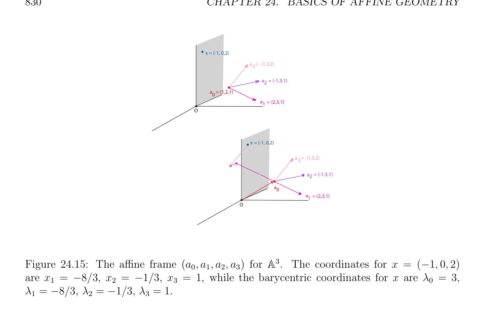
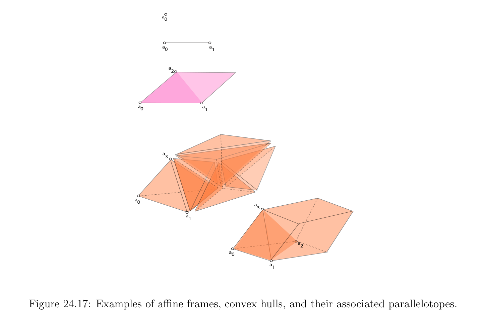

# Afin Independence và Afin Các hệ quy chiếu

<!-- PAGE 827 -->

## 24.6 Afin Independence và Afin Các hệ quy chiếu

Tương ứng với khái niệm của sự độc lập tuyến tính (linear independence) trong các không gian vectơ, ta có khái niệm của afin independence. Cho trước họ $(a_{i})_{i\in I}$ của các điểm trong không gian afin (affine space) $E$, ta sẽ rút gọn khái niệm của (afin) independence của các phần tử này các điểm đến (tuyến tính) independence của các họ $-\longrightarrow (a_{i}a_{j})_{j\in(I-{i})}$ của các vectơ thu được bằng cách chọn bất kỳ $a_{i}$ như gốc. Thứ nhất, sau đây mệnh đề chỉ ra rằng nó là đủ đến xét chỉ một của các phần tử này các họ.
$$\longrightarrow$$

> **Mệnh đề 24.4.** Cho trước không gian afin (affine space) $E, E , +$, cho $(a_{i})_{i\in I}$ là họ của các điểm trong
$$-\longrightarrow -\longrightarrow$$
$E$. Nếu họ $(a_{i}a_{j})_{j\in(I-{i})}$ là độc lập tuyến tính (linearly independent) với một số $i \in$ I, thì $(a_{i}a_{j})_{j\in(I-{i})}$ là độc lập tuyến tính (linearly independent) với mọi $i \in$ I.
$$-\longrightarrow$$

*Chứng minh.* Giả sử rằng họ $(a_{i}a_{j})_{j\in(I-{i})}$ là độc lập tuyến tính (linearly independent) với một số cụ thể $i \in$ I. Cho $k \in$ I với $k \neq  i$, và giả sử rằng có một số các vô hướng $(\lambda_{j} )_{j\in(I-{k})}$ sao cho
$$\sum_{\in(I-{k}  \lambda_{j} -\longrightarrow a_{k}a_{j} = 0.$$
$$j})$$
Vì
$$-\longrightarrow  -\longrightarrow  -\longrightarrow$$
$$a_{k}a_{j} =a_{k}a_{i} +a_{i}a_{j},$$
Ta có
$$\sum_{\in(I-{k}  \lambda_{j} -\longrightarrow a_{k}a_{j}= \sum_{\in(I-{k}  \lambda_{j} -\longrightarrow a_{k}a_{i} + \sum_{\in(I-{k}  \lambda_{j} -\longrightarrow a_{i}a_{j},$$
$$j})j})j})$$
$$= \sum_{\in(I-{k}  \lambda_{j} -\longrightarrow a_{k}a_{i} + \sum_{(I-{i,k}  \lambda_{j} -\longrightarrow a_{i}a_{j},$$
$$j})j\in$$
$$-\longrightarrow -\longrightarrow$$
$$= \sum_{(I-{i,k}  \lambda_{j} a_{i}a_{j} - \begin{pmatrix} \lambda_{j} \\ j & }) \end{pmatrix} \sum_{\in(I-{k}^{})}  a_{i}a_{k},$$
$$j\in })$$
Và do đó
$$-\longrightarrow -\longrightarrow$$
$$\sum_{(I-{i,k}  \lambda_{j} a_{i}a_{j} - \begin{pmatrix} \lambda_{j} \\ j & }) \end{pmatrix} \sum_{\in(I-{k}  a_{i}a_{k} = 0.$$
$$j\in })$$
$$-\longrightarrow$$
Vì họ $(a_{i}a_{j})_{j\in(I-{i})}$ là độc lập tuyến tính (linearly independent), ta phải có $\lambda_{j}  = 0$ với mọi $j \in$
$$(I -{i, k}) and \sum_{j}  \in (I-{k}) \lambda_{j}  = 0, which implies that \lambda_{j}  = 0 for all j \in (I -{k}).$$
Ta định nghĩa afin independence như sau.
$$\longrightarrow$$

> **Định nghĩa 24.4.** Cho trước không gian afin (affine space) $E, E , +$, họ $(a_{i})_{i\in I}$ của các điểm trong $E$ là một cách afin
$$-\longrightarrow$$
Độc lập nếu họ $(a_{i}a_{j})_{j\in(I-{i})}$ là độc lập tuyến tính (linearly independent) với một số $i \in$ I.

<!-- PAGE 828 -->
$$\longrightarrow$$
$$EE$$
$$a_{2}$$
$$-\longrightarrow$$
$$a_{0}a_{2}$$
$$a_{0}a_{1}\overline{-\longrightarrow}$$
$$a_{0}a_{1}$$
$$Figure 24.14: Affine independence and linear independence$$
Định nghĩa 24.4 là reasonable, bởi vì theo Mệnh đề 24.4, independence của họ $-\longrightarrow (a_{i}a_{j})_{j\in(I-{i})}$ không phụ thuộc vào lựa chọn của $a_{i}$. then chốt tính chất của các vectơ độc lập tuyến tính (linearly independent) $(u_{1}, \dots  , u_{m})$ là rằng nếu vectơ $v$ là tổ hợp tuyến tính (linear combination)
$$v = \sum_{i=1}^{m}  \lambda_{i} u_{i}$$
Của $u_{i}$, thì $\lambda_{i}$ là duy nhất. đồng dạng kết quả nghiệm đúng cho độc lập afin (affinely independent) các điểm.
$$\longrightarrow$$

> **Mệnh đề 24.5.** Cho trước không gian afin (affine space) $E, E , +$, cho $(a_{0}, \dots  , a_{m})$ là họ của $m + 1$
$$points in E.Let x \in E, and assume that x = \sum_{i}  m=0 \lambda_{i} a_{i}, where \sum_{i}  m-\longrightarrow  \lambda_{i}  = 1 .-\longrightarrow Then,$$
Họ $(\lambda_{0} , \dots  , \lambda_{m}$) sao cho $x = m  \lambda_{i} a_{i}$ là duy nhất khi và chỉ khi $family^{=0} (a_{0}a_{1}, \dots  ,a_{0}a_{m})$ là
$$linearly independent. \sum_{i}  =0$$

*Chứng minh.* chứng minh là trực tiếp/dễ dàng và được bỏ qua. Nó là cũng cho trước trong Gallier $[71]$. Mệnh đề 24.5 suggests khái niệm của hệ quy chiếu afin (affine frame). Afin các hệ quy chiếu là afin analogues
$$\longrightarrow$$
Của các cơ sở trong các không gian vectơ. Cho $E, E , +$ là khác rỗng không gian afin (affine space), và cho $(a_{0}, \dots  , a_{m})$ là họ của $m + 1$ các điểm trong $E$. họ $(a_{0}, \dots  , a_{m})$ xác định họ của $m$
$$-\longrightarrow  -\longrightarrow  \longrightarrow$$
Các vectơ $(a_{0}a_{1}, \dots  ,a_{0}a_{m})$ trong $E$. Ngược lại, cho trước điểm $a_{0}$ trong $E$ và họ của $m$ các vectơ
$$\longrightarrow$$
$(u_{1}, \dots  , u_{m})$ trong $E$, ta thu được họ của $m+1$ các điểm $(a_{0}, \dots  , a_{m})$ trong $E$, ở đâu $a_{i} = a_{0}+u_{i}, 1 \le i \le m$. Do đó, với mọi $m \ge 1$, nó là tương đương đến xét họ của $m + 1$ các điểm $(a_{0}, \dots  , a_{m})$ trong
$$\longrightarrow$$
$E$, và cặp $(a_{0}, (u_{1}, \dots  , u_{m}))$, ở đâu $u_{i}$ là các vectơ trong $E$. Hình 24.14 minh họa khái niệm của afin independence.

<!-- PAGE 829 -->
Nhận xét: ở trên nhận xét cũng áp dụng đến vô hạn các họ $(a_{i})_{i\in I}$ của các điểm trong $E$ và
$$\longrightarrow$$
Các họ $(u_{i})_{i\in I-{0}}$ của các vectơ trong $E$, miễn là/được cung cấp rằng chỉ số tập hợp $I$ chứa $0$.
$$-\longrightarrow  -\longrightarrow  \longrightarrow  \longrightarrow$$
Khi $(a_{0}a_{1}, \dots  ,a_{0}a_{m})$ là cơ sở (basis) của $E$ thì, với mọi $x \in E$, vì $x = a_{0} + a_{0}x$, tồn tại duy nhất một họ $(x_{1}, \dots  , x_{m})$ của các vô hướng sao cho
$$-\longrightarrow -\longrightarrow$$
$$x = a_{0} + x_{1}a_{0}a_{1} + \cdots  + x_{m}a_{0}a_{m}.$$
Các vô hướng $(x_{1}, \dots  , x_{m})$ có thể được xét như các tọa độ đối với $-\longrightarrow  -\longrightarrow (a_{0}, (a_{0}a_{1}, \dots  ,a_{0}a_{m}))$. Vì
$$!$$
$$-\longrightarrow$$
$$x = a_{0} + \sum_{i=1}^{m}  x_{i}a_{0}a_{i}iff x =1 - \sum_{i=1}^{m}  x_{i}a_{0} + \sum_{i=1}^{m}  x_{i}a_{i},$$
$x \in E$ có thể cũng được biểu diễn một cách duy nhất như
$$x = \sum_{i=0}^{m}  \lambda_{i} a_{i}$$
$$with \sum_{i}  m=0 \lambda_{i}  = 1, and where \lambda_{0}  = 1 - \sum_{i}  m=1 x_{i}, and \lambda_{i}  = x_{i} for 1 \le i \le m. The scalars$$
$(\lambda_{0} , \dots  , \lambda_{m}$) là cũng nhất định các loại của các tọa độ đối với $(a_{0}, \dots  , a_{m})$. Tất cả điều này là summarized trong sau đây định nghĩa.
$$\longrightarrow$$

> **Định nghĩa 24.5.** Cho trước không gian afin (affine space) $E, E , +$, hệ quy chiếu afin (affine frame) với gốc $a_{0}$ là họ
$$-\longrightarrow  -\longrightarrow$$
$(a_{0}, \dots  , a_{m})$ của $m + 1$ các điểm trong $E$ sao cho danh sách của các vectơ $(a_{0}a_{1}, \dots  ,a_{0}a_{m})$ là cơ sở (basis) của $\longrightarrow -\longrightarrow  -\longrightarrow E$. cặp $(a_{0}, (a_{0}a_{1}, \dots  ,a_{0}a_{m}))$ cũng được gọi là một hệ quy chiếu afin (affine frame) với gốc $a_{0}$. Thì, mọi $x \in E$ có thể được biểu diễn dưới dạng
$$-\longrightarrow -\longrightarrow$$
$$x = a_{0} + x_{1}a_{0}a_{1} + \cdots  + x_{m}a_{0}a_{m}$$
Cho duy nhất họ $(x_{1}, \dots  , x_{m})$ của các vô hướng, được gọi là các tọa độ của $x$ w.r.t. hệ quy chiếu afin (affine frame) $-\longrightarrow  -\longrightarrow (a_{0}, (a_{0}a_{1}, \dots , a_{0}a_{m}))$. Hơn nữa, mọi $x \in E$ có thể được viết dưới dạng
$$x = \lambda_{0} a_{0} + \cdots  + \lambda_{m} a_{m}$$
Với một số duy nhất họ $(\lambda_{0} , \dots  , \lambda_{m}$) của các vô hướng sao cho $\lambda_{0} +\cdots +\lambda_{m}  = 1$ được gọi là tọa độ tỉ cự (barycentric coordinates) của $x$ đối với hệ quy chiếu afin (affine frame) $(a_{0}, \dots  , a_{m})$. Xem Hình 24.15. các tọa độ $(x_{1}, \dots  , x_{m})$ và tọa độ tỉ cự (barycentric coordinates) $(\lambda_{0} , \dots , \lambda_{m}$) là related bởi
$$the equations \lambda_{0}  = 1 - \sum_{i}  m=1 x_{i} and \lambda_{i}  = x_{i}, for 1 \le i \le m. An affine frame is called an$$
Afin cơ sở (basis) bởi một số các tác giả. họ $(a_{i})_{i\in I}$ của các điểm trong $E$ là phụ thuộc afin (affinely dependent) nếu nó là không độc lập afin (affinely independent). Ta có thể cũng đặc trưng hóa phụ thuộc afin (affinely dependent) các họ như sau.

<!-- PAGE 830 -->
$$x = (-1, 0,2)$$
$$a3= (1,3,2)$$
$$a2 = (-1,3,1)$$
$$a0 = (1,2,1)$$
$$a1 = (2,3,1)$$
$$\overline{O}$$
$$x = (-1, 0,2)$$
$$a3= (1,3,2)$$
$$a2 = (-1,3,1)$$
$$a0$$
$$a1 = (2,3,1)$$
$$\overline{O}$$

**Hình 24.15:** hệ quy chiếu afin (affine frame) $(a_{0}, a_{1}, a_{2}, a_{3})$ cho $\mathbb{A}^{3}$. các tọa độ cho $x = (-1, 0, 2)$ là $x_{1} = -8/3, x_{2} = -1/3, x_{3} = 1$, trong khi tọa độ tỉ cự (barycentric coordinates) cho $x$ là $\lambda_{0}  = 3, \lambda_{1}  = -8/3, \lambda_{2}  = -1/3, \lambda_{3}  = 1$.
$$\longrightarrow$$

> **Mệnh đề 24.6.** Cho trước không gian afin (affine space) $E, E , +$, cho $(a_{i})_{i\in I}$ là họ của các điểm trong $E$. họ $(a_{i})_{i\in I}$ là phụ thuộc afin (affinely dependent) khi và chỉ khi có một họ $(\lambda_{i} )_{i\in I}$ sao cho $\lambda_{j}  \neq  0$ với một số
$$\longrightarrow$$
$$j \in I, \sum_{i}  \in I \lambda_{i}  = 0, and \sum_{i}  \in I \lambda_{i} xa_{i} = 0 for every x \in E.$$

*Chứng minh.* Theo Mệnh đề 24.5, họ $(a_{i})_{i\in I}$ là phụ thuộc afin (affinely dependent) khi và chỉ khi họ của các vectơ $-\longrightarrow -\longrightarrow (a_{i}a_{j})_{j\in(I-{i})}$ là phụ thuộc tuyến tính (linearly dependent) với một số $i \in$ I. Với mọi $i \in$ I, họ $(a_{i}a_{j})_{j\in(I-{i})}$ là phụ thuộc tuyến tính (linearly dependent) khi và chỉ khi có một họ $(\lambda_{j} )_{j\in(I-{i})}$ sao cho $\lambda_{j}  \neq  0$ với một số $j$, và sao cho
$$\sum_{\in(I-{i}  \lambda_{j} -\longrightarrow a_{i}a_{j} = 0.$$
$$j})$$
Thì, với mọi $x \in E$, ta có
$$-\longrightarrow \longrightarrow \longrightarrow$$
$$\sum_{\in(I-{i}  \lambda_{j} a_{i}a_{j}= \sum_{\in(I-{i}  \lambda_{j} (xa_{j} -xa_{i})$$
$$j})j})$$
$$\longrightarrow \longrightarrow$$
$$= \sum_{\in(I-{i}  \lambda_{j} xa_{j} - \begin{pmatrix} \lambda_{j} \\ j & }) \end{pmatrix} \sum_{\in(I-{i}  xa_{i},$$
$$j)$$
$$and letting \lambda_{i}  = - \sum_{j}  , we get \sum_{i}^{}}  \in I \lambda_{i} \longrightarrow xa_{i} = 0, with \sum_{i}  \in I \lambda_{i}  = 0 and \lambda_{j}  \neq  0 for$$
$$some j \in I. The \begin{pmatrix} \in (I-{i})\lambda_{j} \\ converseis \end{pmatrix} obvious by setting  x = a_{i} for some  i such that \lambda_{i}  \neq  0, since$$
$$\sum_{i}  \in I \lambda_{i}  = 0 implies that \lambda_{j}  \neq  0, for some j \neq  i.$$

<!-- PAGE 831 -->
$$a_{2}$$
$$a_{0}a_{0}a_{1}$$
$$a_{3}$$
$$a_{0}a_{1}a_{0}a_{2}$$
$$a_{1}$$
$$Figure 24.16: Examples of affine frames and their convex hulls.$$
Chẵn/ngay cả dù Mệnh đề 24.6 là khá dull, nó là một của then chốt ingredients trong chứng minh của đẹp và deep các định lý về các tập lồi, chẳng hạn như Carath´eodory’s định lý, Radon’s định lý, và Helly’s định lý.
$$\longrightarrow$$
Họ của hai các điểm (, $b)$ trong $E$ là độc lập afin (affinely independent) khi và chỉ khi ab $\neq  0$, khi và chỉ khi $a \neq  b$. Nếu $a \neq  b$, không gian con afin (affine subspace) được sinh bởi và $b$ là tập hợp tất cả các điểm $(1-\lambda )a+\lambda b$, mà là duy nhất đường thẳng chuyển qua và $b$. họ của ba các điểm (, $b, c)$ trong $E$ là độc lập afin (affinely independent) $\longrightarrow  \longrightarrow$ khi và chỉ khi ab và ac là độc lập tuyến tính (linearly independent), mà có nghĩa là, $b$, và $c$ là không trên cùng đường thẳng (chúng là không thẳng hàng). Trong trường hợp này, không gian con afin (affine subspace) được sinh bởi (, $b, c)$ là tập hợp tất cả các điểm $(1$ - $\lambda$ - $\mu )a + \lambda b + \mu c$, mà là duy nhất mặt phẳng chứa, $b$, và $c$. họ của
$$\longrightarrow  \longrightarrow  \longrightarrow$$
Bốn các điểm (, $b, c, d)$ trong $E$ là độc lập afin (affinely independent) khi và chỉ khi ab, ac, và ad là độc lập tuyến tính (linearly independent), mà có nghĩa là, $b, c$, và $d$ là không trong cùng mặt phẳng (chúng là không đồng phẳng). Trong trường hợp này,, $b, c$, và $d$ là các đỉnh của tứ diện. Hình 24.16 chỉ ra afin các hệ quy chiếu và của chúng lồi các bao cho |I| $= 0, 1, 2, 3$. Cho trước $n+1$ độc lập afin (affinely independent) các điểm $(a_{0}, \dots  , a_{n})$ trong $E$, ta có thể xét tập hợp của các điểm $\lambda_{0} a_{0} +\cdots +\lambda_{n} a_{n}$, ở đâu $\lambda_{0}  +\cdots +\lambda_{n}  = 1$ và $\lambda_{i}  \ge 0 (\lambda_{i}  \in \mathbb{R})$. Như vậy các tổ hợp afin được gọi là lồi các tổ hợp. tập hợp này được gọi là bao lồi (convex hull) của $(a_{0}, \dots  , a_{n})$ (hoặc n-simplex được sinh (spanned) bởi $(a_{0}, \dots  , a_{n}))$. Khi $n = 1$, ta thu được đoạn thẳng giữa $a_{0}$ và $a_{1}$, bao gồm cả $a_{0}$ và $a_{1}$. Khi $n = 2$, ta thu được phần trong (interior) của tam giác có các đỉnh là $a_{0}, a_{1}, a_{2}$, bao gồm cả biên (boundary) các điểm (các cạnh). Khi $n = 3$, ta thu được phần trong (interior) của tứ diện

<!-- PAGE 832 -->
Có các đỉnh là $a_{0}, a_{1}, a_{2}, a_{3}$, bao gồm cả biên (boundary) các điểm (các mặt và các cạnh). tập hợp
$$-\longrightarrow -\longrightarrow \mathbb{R}$$
$${a_{0} + \lambda_{1} a_{0}a_{1} + \cdots  + \lambda_{n} a_{0}a_{n} | where 0 \le \lambda_{i}  \le 1 (\lambda_{i}  \in )}$$
Được gọi là parallelotope được sinh (spanned) bởi $(a_{0}, \dots  , a_{n})$. Khi $E$ có số chiều $2$, parallelotope cũng được gọi là một hình bình hành, và khi $E$ có số chiều $3$, parallelepiped. Hình 24.17 chỉ ra lồi các bao và liên kết parallelotopes cho |I| $= 0, 1, 2, 3$.
$$a0$$
$$\overline{a0} a1$$
$$a2$$
$$a0a1$$
$$a3$$
$$a0$$
$$a3$$
$$a1$$
$$a2$$
$$a0$$
$$a1$$

**Hình 24.17:** Các ví dụ của afin các hệ quy chiếu, lồi các bao, và của chúng liên kết parallelotopes. Tổng quát hơn, ta nói rằng tập con $V$ của $E$ là lồi nếu với mọi hai các điểm, $b \in V$, ta có $c \in V$ với mọi điểm $c = (1$ - $\lambda )a + \lambda b$, với $0 \le \lambda  \le 1 (\lambda  \in \mathbb{R})$.  Các điểm là không các vectơ! sau đây ví dụ minh họa tại sao treating các điểm như
$$vectors may cause problems. Let a, b, c be three affinely independent points in \mathbb{A}^{3}.$$
Bất kỳ điểm $x$ trong mặt phẳng (, $b, c)$ có thể được biểu diễn dưới dạng
$$x = \lambda_{0} a + \lambda_{1} b + \lambda_{2} c,$$
Ở đâu $\lambda_{0}  + \lambda_{1}  + \lambda_{2}  = 1$. Cách mà có thể ta tính $\lambda_{0} , \lambda_{1} , \lambda_{2}$? Đặt $a = (a_{1}, a_{2}, a_{3}), b = (b_{1}, b_{2}, b_{3}), c = (c_{1}, c_{2}, c_{3})$, và $x = (x_{1}, x_{2}, x_{3})$ là các tọa độ của, $b, c, x$ trong tiêu chuẩn hệ quy chiếu (frame) của $\mathbb{A}^{3}$, nó là tempting để giải hệ của các phương trình
