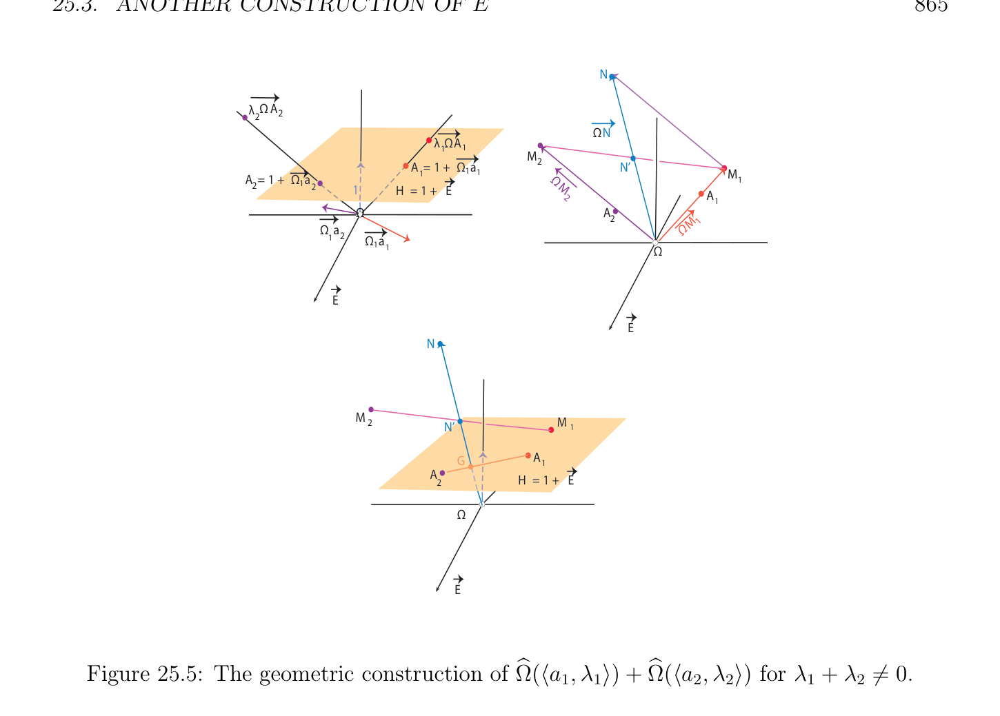

# Một cái khác Cách xây dựng của

<!-- PAGE 863 -->
Bây giờ rằng ta có được định nghĩa $E$ và investigated relationship giữa afin các hệ quy chiếu trong
$$b \longrightarrow$$
$E$ và các cơ sở trong $E$, ta có thể cho một cái khác cách xây dựng của vectơ $space\mathcal{F}$ từ $E$ và $E$ rằng
$$b$$
Sẽ cho phép chúng ta đến “visualize” trong nhiều nhiều hơn/thêm trực quan cách thức cấu trúc của $E$ và của của nó
$$b$$
Các phép toán $+$ và $\cdot$.
$$b$$

## 25.3 Một cái khác Cách xây dựng của E

$$b$$
Một sẽ probably muốn rằng ta có thể bắt đầu với cách xây dựng này của $\mathcal{F}$ thứ nhất, và thì định nghĩa $E$ bằng cách sử dụng đẳng cấu $\Omega$: $E \to F$ được định nghĩa ở dưới. Không may là, ta thứ nhất cần $b  b  b$ không gian vectơ (vector space) cấu trúc trên $E$ để chỉ ra rằng $\Omega$ là tuyến tính!
$$b b$$
$$Definition \longrightarrow  25.1. Given any affine space \begin{pmatrix} \longrightarrow \\ E,E \end{pmatrix} , we define the vector space\mathcal{F} as the direct$$
Tổng $E \oplus \mathbb{R}, where\mathbb{R}$ ký hiệu $field\mathbb{R}$ được xét như không gian vectơ (vector space) (trên chính nó). Ký hiệu
$$\longrightarrow$$
Unit vectơ $in\mathbb{R}$ bởi $1, since\mathcal{F} = E \oplus \mathbb{R}$, mọi vectơ $v \in F$ có thể được viết dưới dạng $v = u+\lambda 1$,
$$\longrightarrow$$
Với một số duy nhất $u \in E$ và một số duy nhất $\lambda  \in \mathbb{R}$. Thì, với mọi lựa chọn của gốc $\Omega_{1}$ trong $E$, ta định nghĩa ánh xạ $\Omega$: $E \to F$, như sau:
$$b b$$
$$-\longrightarrow$$
$$\lambda (1 +\Omega_{1} a)if \theta  = \langle a, \lambda \rangle , where a \in E and \lambda  \neq  0;$$
$$\Omega (\theta ) =\longrightarrow$$
$$b$$
$$uif \theta  = u, where u \in E .$$
Ý tưởng là rằng, một lần một lần nữa, quan điểm $\mathcal{F}$ như không gian afin (affine space) dưới của nó chính tắc cấu trúc,
$$\longrightarrow  \longrightarrow  \longrightarrow$$
$E$ được nhúng trong $\mathcal{F}$ như siêu phẳng (hyperplane) $H = 1 + E$, với hướng $E$, siêu phẳng (hyperplane) $E$ trong
$$-\longrightarrow$$
$\mathcal{F}$. Thì, mọi điểm $a \in E$ là trong song ánh với điểm $A = 1 + \Omega_{1}$, trong siêu phẳng (hyperplane) $H$. Nếu ta ký hiệu gốc $0$ của chính tắc không gian afin (affine space) $\mathcal{F}$ bởi $\Omega$, ánh xạ $\Omega$ các ánh xạ điểm
$$b$$
$\langle a, \lambda \rangle \in E$ đến điểm $in\mathcal{F}$, như sau: $\Omega (\langle a, \lambda \rangle$) là điểm trên đường thẳng chuyển qua cả hai
$$b -\longrightarrow  \longrightarrow$$
Gốc $\Omega$ của $\mathcal{F}$ và điểm $A = 1 + \Omega_{1}$ trong siêu phẳng (hyperplane) $H = 1 + E$, sao cho
$$\longrightarrow  -\longrightarrow$$
$$\Omega (\langle a, \lambda \rangle ) = \lambda \Omega A = \lambda (1 +\Omega_{1} a).$$
$$b$$
Sau đây mệnh đề chỉ ra rằng $\Omega$ là đẳng cấu của các không gian vectơ.
$$b$$
$$\longrightarrow$$

> **Mệnh đề 25.4.** Cho trước bất kỳ không gian afin (affine space) $(E, E$), với mọi lựa chọn $\Omega_{1}$ của gốc trong $E$, ánh xạ $\Omega$: $E \to F$ là tuyến tính đẳng cấu giữa $E$ và không gian vectơ (vector space) $\mathcal{F}$ của Định nghĩa $b  b  b$ 25.1. nghịch đảo của $\Omega$ được cho bởi
$$b$$
$$\langle \Omega_{1}  + \lambda^{-1} u, \lambda \rangle )if \lambda  \neq  0;$$
$$\Omega^{-1} (u + \lambda 1) =$$
$$buif \lambda  = 0.$$

*Chứng minh.* Nó là trực tiếp/dễ dàng verification. Ta kiểm tra rằng $\Omega$ là khả nghịch, để lại verifi-
$$b$$
Cation rằng nó là tuyến tính như một bài tập. Ta có
$$-\longrightarrow  -\longrightarrow$$
$$\langle a, \lambda \rangle \mapsto \lambda 1 + \lambda \Omega_{1} a \mapsto \langle \Omega_{1}  +\Omega_{1} a, \lambda \rangle = \langle a, \lambda \rangle$$

<!-- PAGE 864 -->
Và
$$u + \lambda 1 \mapsto \langle \Omega_{1}  + \lambda^{-1} u, \lambda \rangle \mapsto u + \lambda 1,$$
$$\longrightarrow$$
Và vì $\Omega$ là đồng nhất thức trên $E$, ta có được hiển thị rằng $\Omega \circ \Omega^{-1} =$ id, và $\Omega^{-1} \circ \Omega =$ id. Điều này
$$b bb bb$$
Chỉ ra rằng $\Omega$ là song ánh.
$$b$$
Hình 25.4 minh họa phép nhúng (embedding) của không gian afin (affine space) $E$ vào vectơ $space\mathcal{F}$, khi $E$ là afin mặt phẳng.
$$\overline{\lambda}\overline{\Omega}\overline{A}$$
$$A = 1 + \overline{\Omega}_{1}\overline{a}$$
$$1H = 1 + \overline{E}$$
$$\Omega$$
$$\overline{\Omega}_{1}\overline{a}$$
$$\overline{E}$$
$$Figure 25.4: Embedding an affine space into a vector space \mathcal{F}.$$
Mệnh đề 25.4 cho đẹp interpretation của tổng phép toán $+$ của $E$. Cho trước hai
$$b b$$
Được trọng số các điểm $\langle a_{1}, \lambda_{1} \rangle$ và $\langle a_{2}, \lambda_{2} \rangle$, ta có
$$\langle a_{1}, \lambda_{1} \rangle + \langle a_{2}, \lambda_{2} \rangle =\Omega^{-1} (\Omega (\langle a_{1}, \lambda_{1} \rangle ) +\Omega (\langle a_{2}, \lambda_{2} \rangle )).$$
$$b bb b$$
Phép toán $\Omega (\langle a_{1}, \lambda_{1} \rangle )+\Omega (\langle a_{2}, \lambda_{2} \rangle$) có đơn giản hình học interpretation. Nếu $\lambda_{1}  +\lambda_{2}  \neq  0$,
$$b b$$
Thì tìm các điểm $M_{1}$ và $M_{2}$ trên các đường thẳng chuyển qua gốc $\Omega of\mathcal{F}$ và các điểm
$$-\longrightarrow -\longrightarrow  -\longrightarrow$$
$A_{1} = \Omega (a_{1})$ và $A_{2} = \Omega (a_{2})$ trong siêu phẳng (hyperplane) $H$, sao cho $\Omega M_{1} = \lambda_{1} \Omega A_{1}$ và $\Omega M_{2} = -\longrightarrow  b   b-\longrightarrow  -\longrightarrow  -\longrightarrow  -\longrightarrow  -\longrightarrow \lambda_{2} \Omega A_{2}$, cộng các vectơ $\Omega M_{1}$ và $\Omega M_{2}$, thu được điểm $N$ sao cho $\Omega N = \Omega M_{1} + \Omega M_{2}$, và xét giao $G$ của đường thẳng chuyển qua $\Omega$ và $N$ với siêu phẳng (hyperplane) $H$. Thì, $G$ là tâm tỉ cự (barycenter) của $A_{1}$ và $A_{2}$ assigned các trọng số $\lambda_{1} /(\lambda_{1}  + \lambda_{2}$) và $\lambda_{2} /(\lambda_{1}  + \lambda_{2}$),
$$\longrightarrow -\longrightarrow$$
Và nếu $g = \Omega^{-1} (\Omega G)$, thì $\Omega^{-1} (\Omega N) = \langle g, \lambda_{1}  + \lambda_{2} \rangle$. Xem Hình 25.5.
$$b b$$
$$-\longrightarrow  -\longrightarrow$$
Thay vì của cộng các vectơ $\Omega M_{1}$ và $\Omega M_{2}$, ta có thể lấy giữa N' của đoạn thẳng $M_{1}M_{2}$, và $G$ là giao của đường thẳng chuyển qua $\Omega$ và N' với siêu phẳng (hyperplane) $H$ như được minh họa trong Hình 25.5.

<!-- PAGE 865 -->
$$N$$
$$\overline{\lambda} \overline{\Omega}\overline{A}$$
$$22$$
$$\overline{\Omega}\overline{N}$$
$$\overline{\lambda} \overline{\Omega}\overline{A}$$
$$11M$$
$$A = 1 + \overline{\Omega}\overline{a} 2N’$$
$$A = 1 + \overline{\Omega} a1\overline{1} 1M$$
$$\overline{1}\Omega 1$$
$$221H = 1 + \overline{E} M$$
$$2A$$
$$1$$
$$\Omega A$$
$$2M1$$
$$\overline{\Omega}\overline{a}\Omega$$
$$12\overline{\Omega}\overline{a}$$
$$\overline{1} 1\overline{\Omega}$$
$$\overline{E}$$
$$\overline{E}$$
$$N$$
$$MM$$
$$2N’ 1$$
$$GA$$
$$1$$
$$AH = 1 + \overline{E}$$
$$2$$
$$\overline{\Omega}$$
$$\overline{E}$$

**Hình 25.5:** hình học cách xây dựng của $\Omega (\langle a_{1}, \lambda_{1} \rangle$) $+ \Omega (\langle a_{2}, \lambda_{2} \rangle$) cho $\lambda_{1}  + \lambda_{2}  \neq  0$.
$$b b$$
Nếu $\lambda_{1}  + \lambda_{2}  = 0$, thì $\langle a_{1}, \lambda_{1} \rangle + \langle a_{2}, \lambda_{2} \rangle$ là vectơ được xác định như sau. Một lần nữa, tìm
$$b$$
Các điểm $M_{1}$ và $M_{2}$ trên các đường thẳng chuyển qua gốc $\Omega of\mathcal{F}$ và các điểm $A_{1} = \Omega (a_{1})$
$$-\longrightarrow -\longrightarrow  -\longrightarrow -\longrightarrow  b$$
Và $A_{2} = \Omega (a_{2})$ trong siêu phẳng (hyperplane) $H$, sao cho $\Omega M_{1} = \lambda_{1} \Omega A_{1}$ và $\Omega M_{2} = \lambda_{2} \Omega A_{2}$, và cộng
$$b -\longrightarrow  -\longrightarrow  -\longrightarrow  -\longrightarrow  -\longrightarrow$$
Các vectơ $\Omega M_{1}$ và $\Omega M_{2}$, thu được điểm $N$ sao cho $\Omega N = \Omega M_{1} + \Omega M_{2}$. mong muốn
$$-\longrightarrow$$
Vectơ là $\Omega N$, mà là song song đến đường thẳng $A_{1}A_{2}$. Tương đương, cho N' là giữa của
$$-\longrightarrow$$
Đoạn thẳng $M_{1}M_{2}$, và mong muốn vectơ là $2\Omega$ N'. Xem Hình 25.6. Ta cũng có thể đưa ra hình học interpretation của $\langle a, \lambda \rangle +u$. Cho $A = \Omega$ () trong siêu phẳng (hyperplane)
$$b -\longrightarrow \longrightarrow$$
$H$, cho $D$ là đường thẳng được xác định bởi $A$ và $u$, cho $M_{1}$ là điểm sao cho $\Omega M_{1} = \lambda \Omega A$, và
$$-\longrightarrow$$
Cho $M_{2}$ là điểm sao cho $\Omega M_{2} = u$, nghĩa là, $M_{2} = \Omega + u$. Bởi cách xây dựng, đường thẳng $D$ là
$$-\longrightarrow$$
Trong siêu phẳng (hyperplane) $H$, và nó là song song đến $\Omega M_{2}$, sao cho $D, M_{1}$, và $M_{2}$ là đồng phẳng. Thì,
$$-\longrightarrow  -\longrightarrow  -\longrightarrow  -\longrightarrow  -\longrightarrow$$
Cộng các vectơ $\Omega M_{1}$ và $\Omega M_{2}$, thu được điểm $N$ sao cho $\Omega N = \Omega M_{1} + \Omega M_{2}$, và cho $G$
$$\longrightarrow$$
Là giao của đường thẳng được xác định bởi $\Omega$ và $N$ với đường thẳng $D$. Nếu $g = \Omega^{-1} (\Omega G)$,
$$-\longrightarrow  b$$
Thì, $\Omega^{-1} (\Omega N) = \langle g, \lambda \rangle$. Tương đương, nếu N' là giữa của đoạn thẳng $M_{1}M_{2}$, thì $G$ là $b$ giao của đường thẳng được xác định bởi $\Omega$ và N', với đường thẳng $D$; xem Hình 25.7. Ta bây giờ xét phổ dụng tính chất của $E$ mentioned tại bắt đầu của điều này mục.
$$b$$
