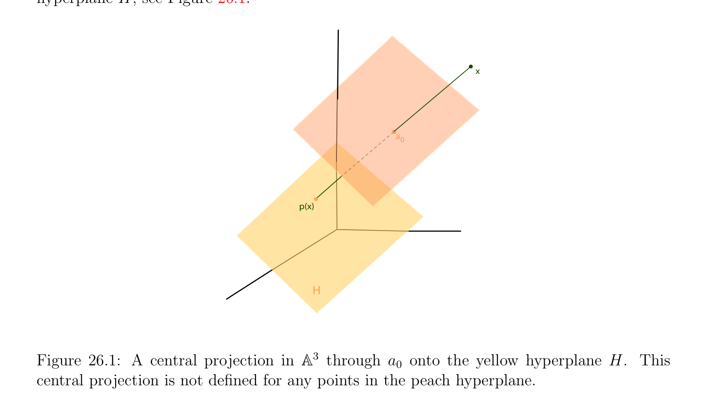

# Tại sao Các không gian xạ ảnh?

<!-- PAGE 871 -->
Chương $26$ Cơ sở của Xạ ảnh Hình học Nghĩ geometrically, chứng minh algebraically. —John Tate

## 26.1 Tại sao Các không gian xạ ảnh?

Cho novice, xạ ảnh hình học thường xuất hiện là bit lẻ, và nó là không hiển nhiên đến motivate tại sao của nó giới thiệu là inevitable và thực ra fruitful. Một của chính motivations phát sinh từ đại số hình học. chính mục tiêu của đại số hình học là đến study các tính chất của hình học objects, chẳng hạn như các đường cong và các mặt, được định nghĩa một cách ẩn theo đại số các phương trình. Chẳng hạn, phương trình
$$x^{2}+ y^{2}-1 = 0$$
Định nghĩa đường tròn $in\mathbb{R}^{2}$. Tổng quát hơn, ta có thể xét các đường cong được định nghĩa bởi tổng quát các phương trình
$$ax^{2}+ by^{2}+ cxy + dx + ey + f = 0$$
Của bậc $2$, đã biết như các đường bậc hai (conics). Nó là thì tự nhiên đến ask liệu nó là khả dĩ/có thể đến phân loại các phần tử này các đường cong theo của chúng generic hình học hình dạng. Điều này là thật vậy khả dĩ/có thể. Ngoại trừ cho so-called suy biến các trường hợp, ta thu được ellipses, các parabol, và các hyperbol. cùng câu hỏi có thể được asked cho các mặt được định nghĩa bởi toàn phương các phương trình, đã biết như các mặt bậc hai, và một lần nữa, phân loại là khả dĩ/có thể. Tuy nhiên, các phần tử này các phân loại là bit artificial. Ví dụ, ellipse và hyperbol khác nhau bởi sự kiện rằng hyperbol có các điểm tại vô cực, và vẫn chưa, của chúng hình học các tính chất là đồng nhất, miễn là/được cung cấp rằng các điểm tại vô cực là handled một cách thực sự/đúng đắn. Một cái khác quan trọng bài toán là study của giao của hình học objects (được định nghĩa algebraically). Ví dụ, cho trước hai các đường cong $C_{1}$ và $C_{2}$ của bậc $m$ và $n$, respectively, những gì là số của giao các điểm của $C_{1}$ và $C_{2}$? (bởi bậc của đường cong ta có nghĩa tổng bậc của định nghĩa đa thức).
$$871$$

<!-- PAGE 872 -->
Tốt, nó phụ thuộc! Chẵn/ngay cả trong trường hợp của các đường thẳng (khi $m = n = 1)$, có ba các khả năng: hoặc các đường thẳng trùng nhau, hoặc chúng là song song, hoặc có một đơn lẻ giao điểm. Nói chung, ta kỳ vọng mn giao các điểm, nhưng một số của các phần tử này các điểm có thể là missing bởi vì chúng là tại vô cực, bởi vì chúng trùng nhau, hoặc bởi vì chúng là imaginary. Những gì các bắt đầu đến transpire là rằng “các điểm tại vô cực” gây ra trouble. Chúng gây ra exceptions rằng invalidate hình học các định lý (ví dụ, xét nhiều hơn/thêm tổng quát các phiên bản của các định lý của Pappus và Desargues), và tạo nó khó đến phân loại hình học objects. Xạ ảnh hình học là designed đến deal với “các điểm tại vô cực” và chính quy các điểm trong uniform cách, mà không có tạo ra distinction. Các điểm tại vô cực là bây giờ chỉ thông thường các điểm, và nhiều things trở thành đơn giản hơn. Ví dụ, phân loại của các đường bậc hai (conics) và các mặt bậc hai trở thành đơn giản hơn, và giao lý thuyết trở thành cleaner (mặc dù, là honest, ta cần đến xét phức các không gian xạ ảnh). Technically, xạ ảnh hình học có thể được được định nghĩa axiomatically, hoặc bởi xây dựng upon tuyến tính đại số. Historically, axiomatic cách tiếp cận came thứ nhất (xem Veblen và Young $[189, 190]$, Emil Artin $[6]$, và Coxeter $[45, 46, 43, 44])$. Mặc dù rất đẹp và thanh lịch, ta tin rằng nó là khó hơn cách tiếp cận hơn tuyến tính đại số cách tiếp cận. Trong tuyến tính đại số cách tiếp cận, tất cả các khái niệm được xét sai khác một vô hướng. Ví dụ, xạ ảnh điểm là một cách thực đường thẳng qua gốc. Theo các tọa độ, điều này tương ứng với “homogenizing.” Ví dụ, thuần nhất phương trình của conic là
$$ax^{2}+ by^{2}+ cxy + dxz + eyz + fz^{2}= 0.$$
Bây giờ, chính quy các điểm là các điểm của các tọa độ $(x, y, z)$ với z̸ $= 0$, và các điểm tại vô cực là các điểm của các tọa độ $(x, y, 0)$ (với $x, y, z$ không tất cả null, và sai khác một vô hướng). Có một hữu ích mô hình (interpretation) của mặt phẳng xạ ảnh hình học theo trung tâm phép chiếu $\mathbb{R}^{3}$ trong từ gốc lên mặt phẳng $z = 1$. Một cái khác hữu ích mô hình là cầu (hoặc half-spherical) mô hình. Trong cầu mô hình, xạ ảnh điểm tương ứng với cặp của antipodal các điểm trên mặt cầu. Như afin hình học là study của các tính chất bất biến dưới afin các song ánh, xạ ảnh hình học là study của các tính chất bất biến dưới song ánh (bijective) xạ ảnh các ánh xạ. Xấp xỉ/đại khái speaking, xạ ảnh các ánh xạ là các ánh xạ tuyến tính (linear maps) sai khác một vô hướng. Trong analogy với của ta trình bày của afin hình học, ta sẽ định nghĩa các không gian xạ ảnh, xạ ảnh các không gian con, xạ ảnh các hệ quy chiếu, và xạ ảnh các ánh xạ. analogy sẽ fade away khi ta định nghĩa bổ sung xạ ảnh (projective completion) của không gian afin (affine space), và khi ta định nghĩa đối ngẫu. Một của virtues của xạ ảnh hình học là rằng nó cho ta rất gọn gàng trình bày của hữu tỷ các đường cong và hữu tỷ các mặt. tổng quát ý tưởng là rằng mặt phẳng hữu tỷ đường cong là phép chiếu của đơn giản hơn đường cong trong lớn hơn không gian, đa thức đường cong trong $\mathbb{R}^{3}$, lên mặt phẳng $z = 1$, như ta bây giờ giải thích. Đa thức các đường cong là các đường cong được định nghĩa parametrically theo các đa thức. Nhiều hơn/thêm specifically, $if\mathcal{E}$ là không gian afin (affine space) của hữu hạn số chiều $n \ge 2$ và $(a_{0}, (e_{1}, \dots  , e_{n}))$ là hệ quy chiếu afin (affine frame)

<!-- PAGE 873 -->
Cho $\mathcal{E}$, đa thức đường cong của bậc $m$ là ánh xạ $F$: $\mathbb{A} \to E$ sao cho
$$F(t) = a_{0} + F_{1}(t)e_{1} + \cdots  + F_{n}(t)e_{n},$$
Với mọi $t \in \mathbb{A}$, ở đâu $F_{1}(t), \dots  , F_{n}(t)$ là các đa thức của bậc nhiều nhất $m$. Mặc dù nhiều các đường cong có thể được được định nghĩa, nó là somewhat embarassing rằng đường tròn không thể được định nghĩa trong như vậy cách. Thực ra, nhiều thú vị các đường cong không thể được định nghĩa điều này cách, ví dụ, ellipses và các hyperbol. khá đơn giản cách để mở rộng lớp của các đường cong được định nghĩa parametrically là đến cho phép hữu tỷ các hàm thay vì của các đa thức. parametric hữu tỷ đường cong của bậc $m$ là hàm $F$: $\mathbb{A} \to E$ sao cho
$$F(t) = a_{0} + \frac{F_{1}(t)}{F_{n+1}(t)} e_{1} + \cdots  + \frac{F_{n}(t)}{F_{n+1}(t)} e_{n},$$
Với mọi $t \in \mathbb{A}$, ở đâu $F_{1}(t), \dots  , F_{n}(t), F_{n+1}(t)$ là các đa thức của bậc nhiều nhất $m$. Cho
$$\mathbb{A}^{2}$$
Ví dụ, đường tròn trong có thể được được định nghĩa bởi hữu tỷ ánh xạ
$$-$$
$$F(t) = a_{0} + \frac{1t^{2}}{1 + t^{2}} e_{1} + \frac{2t}{1 + t^{2}} e_{2}.$$
Theo các tọa độ, ở trên đường cong được cho bởi
$$-$$
$$x = \frac{1t^{2}}{1 + t^{2}}$$
$$y = \frac{2t}{1 + t^{2}} ,$$
Và nó là dễ dàng đã kiểm tra rằng $x^{2} + y^{2} = 1$. Lưu ý rằng điểm $(-1, 0)$ là không đạt được với mọi hữu hạn giá trị của $t$, nhưng nó là cho $t = \infty$. Trong ở trên ví dụ, denominator $F_{3}(t) = 1 + t^{2}$ không bao giờ lấy giá trị $0$ khi $t$ các miền giá trị (range) trên $\mathbb{A}$, nhưng xét sau đây đường cong trong $\mathbb{A}^{2}$:
$$t^{2} 1$$
$$G(t) = a_{0} +t e_{1} +t e_{2}.$$
Nhận thấy rằng G(0) là undefined. Theo các tọa độ, ở trên đường cong được cho bởi
$$x = \frac{t^{2}}{t} = t$$
$$1$$
$$y =t ,$$
Do đó ta có $y = 1/x$. đường cong được định nghĩa ở trên là hyperbol, và cho $t$ close đến $0$, điểm trên đường cong đi toward vô cực trong một của hai asymptotic các hướng.

<!-- PAGE 874 -->
Gọn gàng cách đến handle tình huống trong mà denominator triệt tiêu là đến hoạt động/công trình trong
$$\mathbb{A}^{n}$$
Không gian xạ ảnh (projective space). Một cách trực quan, điều này có nghĩa là quan điểm hữu tỷ đường cong trong như một số thích hợp phép chiếu của đa thức đường cong trong $\mathbb{A}^{n+1}$, quay lại lên $\mathbb{A}^{n}$. Cho trước afin $space\mathcal{E}$, với mọi siêu phẳng (hyperplane) $H in\mathcal{E}$ và bất kỳ điểm $a_{0}$ không trong $H$, trung tâm phép chiếu (hoặc conic phép chiếu, hoặc perspective phép chiếu) của tâm $a_{0}$ lên $H$, là riêng ánh xạ $p$ được định nghĩa như sau: Với mọi điểm $x$ không trong siêu phẳng (hyperplane) chuyển qua $a_{0}$ và song song đến $H$, ta định nghĩa p(x) như giao của đường thẳng được định nghĩa bởi $a_{0}$ và $x$ với siêu phẳng (hyperplane) $H$; xem Hình 26.1.
$$x$$
$$a0$$
$$p(x)$$
$$H$$
$$\mathbb{A}^{3}$$

**Hình 26.1:** trung tâm phép chiếu trong qua $a_{0}$ lên vàng siêu phẳng (hyperplane) $H$. Điều này trung tâm phép chiếu là không được định nghĩa với mọi các điểm trong peach siêu phẳng (hyperplane).
$$\mathbb{A}^{3}$$
Ví dụ, ta có thể quan điểm $G$ như hữu tỷ đường cong trong cho trước bởi
$$G_{1}(t) = a_{0} + t^{2}e_{1} + e_{2} + te_{3}.$$
Nếu ta project điều này đường cong $G_{1}$ (thực ra, parabol $in\mathbb{A}^{3})$ bằng cách sử dụng trung tâm phép chiếu (perspective phép chiếu) của tâm $a_{0}$ lên mặt phẳng của phương trình $x_{3} = 1$, ta thu được trước đó hyperbol;
$$\mathbb{A}^{3}$$
Xem Hình 26.2. Cho $t = 0$, điểm $G_{1}(0) = a_{0} +e_{2}$ trong là trong mặt phẳng của phương trình $x_{3} = 0$,
$$\mathbb{A}^{3}$$
Và của nó phép chiếu là undefined. Ta có thể xét rằng $G_{1}(0) = a_{0} + e_{2}$ trong là projected đến vô cực trong hướng của $e_{2}$ trong mặt phẳng $x_{3} = 0$. Trong đặt của các không gian xạ ảnh, điều này hướng corresponds một cách chặt chẽ đến điểm tại vô cực; xem Hình 26.2. Cho chúng ta kiểm chứng rằng trung tâm phép chiếu được sử dụng trong trước đó ví dụ có mong muốn effect. Ta giả sử rằng $\mathcal{E}$ có số chiều $n + 1$ và rằng $(a_{0}, (e_{1}, \dots  , e_{n+1}))$ là afin

<!-- PAGE 875 -->
$$(1,1,1)$$
$$\overline{a}\overline{0}\overline{(0,1,0)}$$
$$G  (t)1$$
$$\mathbb{A}^{3}$$

**Hình 26.2:** trung tâm phép chiếu trong qua $a_{0}$ của parabol $G_{1}(t)$ lên siêu phẳng (hyperplane) $x_{3} = 1$. hệ quy chiếu (frame) cho $\mathcal{E}$. Ta muốn để xác định các tọa độ của trung tâm phép chiếu p(x) của điểm $x \in E$ lên siêu phẳng (hyperplane) $H$ của phương trình $x_{n+1} = 1$ (tâm của phép chiếu đang là $a_{0})$. Nếu
$$x = a_{0} + x_{1}e_{1} + \cdots  + x_{n}e_{n} + x_{n+1}e_{n+1},$$
Giả sử rằng $x_{n+1}$ ̸ $= 0$; điểm trên đường thẳng chuyển qua $a_{0}$ và $x$ có các tọa độ của tạo thành $(\lambda x_{1}, \dots  , \lambda x_{n+1})$; và p(x), trung tâm phép chiếu của $x$ lên siêu phẳng (hyperplane) $H$ của phương trình $x_{n+1} = 1$, là giao của đường thẳng từ $a_{0}$ đến $x$ và điều này siêu phẳng (hyperplane) $H$. Do đó ta phải có $\lambda x_{n+1} = 1$, và các tọa độ của p(x) là
$$\begin{pmatrix} x_{1} & x_{n} \\ , \dots  , & , 1 \\ x_{n+1} & x_{n+1} \end{pmatrix} .$$
Lưu ý rằng p(x) là undefined khi $x_{n+1} = 0$. Trong các không gian xạ ảnh, ta có thể tạo nghĩa của như vậy các điểm. ở trên phép tính xác nhận rằng G(t) là trung tâm phép chiếu của $G_{1}(t)$. Tương tự, nếu ta
$$\mathbb{A}^{3}$$
Định nghĩa đường cong $F_{1}$ trong bởi
$$F_{1}(t) = a_{0} + (1 -t^{2})e_{1} + 2te_{2} + (1 + t^{2})e_{3},$$
Trung tâm phép chiếu của đa thức đường cong $F_{1}$ (một lần nữa, parabol trong $\mathbb{A}^{3})$ lên mặt phẳng của phương trình $x_{3} = 1$ là đường tròn $F$.
