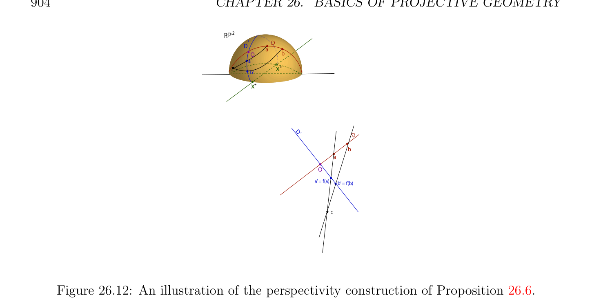

# Việc tìm Phép biến đổi phân tuyến tính (homography) Giữa Hai Xạ ảnh Các hệ quy chiếu

<!-- PAGE 904 -->
$$RP2$$
$$D‘D$$
$$a$$
$$Ob$$
$$a’$$
$$cx*$$
$$\overline{b’}$$
$$x*$$
$$D’D$$
$$b$$
$$a$$
$$O$$
$$a’ = f(a)b’ = f(b)$$
$$c$$

**Hình 26.12:** illustration của perspectivity cách xây dựng của Mệnh đề 26.6. h(d) $= d$. Do đó theo Mệnh đề 26.6, phép xạ ảnh (projectivity) $h: \langle$, $a'\rangle \to \langle c, c'\rangle$ là perspectivity. Vì
$$h(a)=g(f(a)) = g(b) = c,$$
$$h(a')=g(f(a')) = g(b') = c',$$
Giao $q$ của $\langle$, $c\rangle$ và $\langle$ ', $c'\rangle$ là tâm của perspectivity $h$. Cũng lưu ý rằng điểm $m = \langle$, $a'\rangle \cap \langle p, r\rangle$ và ảnh (ảnh (image)) của nó h(m) là cả hai trên đường thẳng $\langle p, r\rangle$, vì $r$ là tâm của $f$ và $p$ là tâm của $g$. Vì $h$ là perspectivity của tâm $q$, đường thẳng $\langle m, h(m)\rangle = \langle p, r\rangle$ các đi qua qua $q$, mà chứng minh mệnh đề. Desargues’s định lý được minh họa trong Hình 26.13. Nó có thể cũng được hiển thị rằng mọi phép xạ ảnh (projectivity) giữa hai phân biệt các đường thẳng là hợp thành của hai perspectivities (không trong duy nhất cách). thanh lịch chứng minh của Pappus’s định lý có thể cũng là cho trước bằng cách sử dụng perspectivities.

## 26.6 Việc tìm Phép biến đổi phân tuyến tính (homography) Giữa Hai Xạ ảnh

$$Frames$$
Trong mục này ta trình bày phương pháp cho việc tìm ma trận (sai khác một vô hướng) của duy nhất phép biến đổi phân tuyến tính (homography) (song ánh (bijective) phép biến đổi xạ ảnh) ánh xạ một xạ ảnh hệ quy chiếu (frame) đến khác xạ ảnh hệ quy chiếu (frame). bài toán này phát sinh notably trong máy tính thị giác trong context của ảnh (image) morphing. Ta bắt đầu với đơn giản trường hợp của hai không suy biến quadrilatrerals $([p_{1}], [p_{2}], [p_{3}], [p_{4}])$ và $[(q_{1}], [q_{2}], [q_{3}], [q_{4}])$ trong $\mathbb{RP}^{2}$, nghĩa là, hai xạ ảnh các hệ quy chiếu, mà có nghĩa là $(p_{1}, p_{2}, p_{3})$

<!-- PAGE 905 -->
$$q$$
$$a'$$
$$ap$$
$$d \frac{bb'}{c}$$
$$c'$$
$$r$$
$$Figure 26.13: Desargues’s theorem (projective version in the plane).$$
Và $(q_{1}, q_{2}, q_{3})$ là độc lập tuyến tính (linearly independent), và rằng nếu ta viết
$$p_{4} = \alpha_{1} p_{1} + \alpha_{2} p_{2} + \alpha_{3} p_{3}$$
Và
$$q_{4} = \lambda_{1} q_{1} + \lambda_{2} q_{2} + \lambda_{3} q_{3},$$
Với một số duy nhất các vô hướng $\alpha_{1} , \alpha_{2} , \alpha_{3}$ và $\lambda_{1} , \lambda_{2} , \lambda_{3}$, thì $\alpha_{i}  \neq  0$ và $\lambda_{i}  \neq  0$ cho $i = 1, 2, 3$. bài toán là để tìm ma trận cỡ $3 \times  3$ (sai khác một vô hướng) biểu diễn duy nhất phép biến đổi phân tuyến tính (homography) $h$ ánh xạ $[p_{i}]$ đến $[q_{i}]$ cho $i = 1, 2, 3, 4$. Ta sẽ sử dụng cơ sở chính tắc (canonical basis) $\mathcal{E} = (e_{1}, e_{2}, e_{3})$ của $\mathbb{R}^{3}$, với $e_{1} = (1, 0, 0), e_{2} = (0, 1, 0), e_{3} = (0, 0, 1)$, và các cơ sở $\mathcal{P} = (p_{1}, p_{2}, p_{3})$ và $\mathcal{Q} = (q_{1}, q_{2}, q_{3})$ của $\mathbb{R}^{3}$. Như bước thứ nhất, nó là thuận tiện đến biểu diễn $(q_{1}, q_{2}, q_{3}, q_{4})$ trên $basis\mathcal{P} = (p_{1}, p_{2}, p_{3})$, với $q_{1} = (x_{1}, y_{1}, z_{1}), q_{2} = (x_{2}, y_{2}, z_{2}), q_{3} = (x_{3}, y_{3}, z_{3}), q_{4} = (x_{4}, y_{4}, z_{4})$. Trên cơ sở chính tắc (canonical basis) $\mathcal{E}$, các điểm $(p_{1}, p_{2}, p_{3}, p_{4})$ được cho bởi các tọa độ $p_{1} = (p_{1}^{x}, p_{1}^{y}, p_{1}^{z}), p_{2} = (p_{2}^{x}, p_{2}^{y}, p_{2}^{z}), p_{3} = (p_{3}^{x}, p_{3}^{y}, p_{3}^{z}), p_{4} = (p_{4}^{x}, p_{4}^{y}, p_{4}^{z})$, và tương tự, các điểm $(q_{1}, q_{2}, q_{3}, q_{4})$ được cho bởi các tọa độ $q_{1} = (q_{1}^{x}, q_{1}^{y}, q_{1}^{z}), q_{2} = (q_{2}^{x}, q_{2}^{y}, q_{2}^{z}), q_{3} = (q_{3}^{x}, q_{3}^{y}, q_{3}^{z}), q_{4} = (q_{4}^{x}, q_{4}^{y}, q_{4}^{z})$.

<!-- PAGE 906 -->

> **Mệnh đề 26.8.** Đối với cơ sở (basis) $\mathcal{P} = (p_{1}, p_{2}, p_{3})$, ma trận $A_{P}$ của duy nhất
$$\mathbb{RP}^{2}$$
Phép biến đổi phân tuyến tính (homography) $h$ của ánh xạ xạ ảnh hệ quy chiếu (frame) $([p_{1}], [p_{2}], [p_{3}], [p_{4}])$ đến xạ ảnh hệ quy chiếu (frame) $[(q_{1}], [q_{2}], [q_{3}], [q_{4}])$ được cho bởi
$$A_{P} = \begin{pmatrix} x_{1} & x_{2} & x_{3} \\ y_{1} & y_{2} & y_{3} \\ z_{1} & z_{2} & z_{3} \end{pmatrix} \begin{pmatrix} \lambda \overline{1} & 0 & 0 \\ \overline{\alpha}\overline{1} \\ 0 & \lambda \overline{2} & 0 \\ \overline{\alpha}\overline{2} \\ 0 & 0 & \lambda \overline{3} \end{pmatrix} .$$
$$\overline{\alpha}\overline{3}$$

*Chứng minh.* Cho $u_{1} = \alpha_{1} p_{1}, u_{2} = \alpha_{2} p_{2}, u_{3} = \alpha_{3} p_{3}$, và cho $v_{1} = \lambda_{1} q_{1}, v_{2} = \lambda_{2} q_{2}, v_{3} = \lambda_{3} q_{3}$, sao cho
$$p_{4} = u_{1} + u_{2} + u_{3}$$
Và
$$q_{4} = v_{1} + v_{2} + v_{3}.$$
Bởi vì $p_{1}, p_{2}, p_{3}$ là độc lập tuyến tính (linearly independent) và vì $\alpha_{i}$ ̸ $= 0$ cho $i = 1, 2, 3$, các vectơ
$$\mathbb{R}^{3} \mathbb{R}^{3}$$
$(u_{1}, u_{2}, u_{2})$ là cũng độc lập tuyến tính (linearly independent), do đó tồn tại duy nhất một ánh xạ tuyến tính (linear map) $f$: $\to$, sao cho
$$f(u_{i}) = v_{i}i = 1, \dots  , 3,$$
Và bởi tính tuyến tính
$$f(p_{4}) = f(u_{1} + u_{2} + u_{3}) = f(u_{1}) + f(u_{2}) + f(u_{3}) = v_{1} + v_{2} + v_{3} = q_{4}.$$
Đối với cơ sở (basis) $\mathcal{P} = (p_{1}, p_{2}, p_{3})$, ta có
$$f(p_{i}) = \frac{1}{\alpha_{i}} v_{i} = \frac{\lambda_{i}}{\alpha_{i}} q_{i},i = 1, \dots  , 3,$$
Do đó đối với cơ sở (basis) $\mathcal{P}$, ma trận của $f$ là
$$A_{P} = \begin{pmatrix} \lambda \overline{1} x_{1\alpha}^{\lambda2}x_{2\alpha}^{\lambda3}x_{3} \\ \overline{\alpha}\overline{1} & \overline{2} & \overline{3} \\ \lambda \overline{1} y_{1} & \lambda \overline{2} y_{2} & \lambda \overline{3} y_{3} \\ \overline{\alpha}\overline{1} & \overline{\alpha}\overline{2} & \overline{\alpha}\overline{3} \\ \lambda \overline{1} z_{1} & \lambda \overline{2} z_{2} & \lambda \overline{3} z_{3} \end{pmatrix} = \begin{pmatrix} x_{1} & x_{2} & x_{3} \\ y_{1} & y_{2} & y_{3} \\ z_{1} & z_{2} & z_{3} \end{pmatrix} \begin{pmatrix} \lambda \overline{1} & 0 & 0 \\ \overline{\alpha}\overline{1} \\ 0 & \lambda \overline{2} & 0 \\ \overline{\alpha}\overline{2} \\ 0 & 0 & \lambda \overline{3} \end{pmatrix} ,$$
$$\overline{\alpha}\overline{1}\overline{\alpha}\overline{2}\overline{\alpha}\overline{3}\overline{\alpha}\overline{3}$$
Như đã khẳng định. Nếu ta giả sử rằng ta chọn các tọa độ của $(p_{1}, p_{2}, p_{3}, p_{4})$ và $(q_{1}, q_{2}, q_{3}, q_{4})$ đối với cơ sở chính tắc (canonical basis) $\mathcal{E}$, thì các tọa độ $\alpha_{1} , \alpha_{2} , \alpha_{3}$ và $\lambda_{1} , \lambda_{2} , \lambda_{3}$ là các nghiệm của các hệ
$$\begin{pmatrix} p_{1}^{x} & p_{2}^{x} & p_{3}^{x} \\ p_{1}^{y} & p_{2}^{y} & p_{3}^{y} \\ p_{1}^{z} & p_{2}^{z} & p_{3}^{z} \end{pmatrix} \begin{pmatrix} \alpha_{1} \\ \alpha_{2} \\ \alpha_{3} \end{pmatrix} = \begin{pmatrix} p_{4}^{x} \\ p_{4}^{y} \\ p_{4}^{z} \end{pmatrix}$$

<!-- PAGE 907 -->
Và
$$\begin{pmatrix} q_{1}^{x} & q_{2}^{x} & q_{3}^{x} \\ q_{1}^{y} & q_{2}^{y} & q_{3}^{y} \\ q_{1}^{z} & q_{2}^{z} & q_{3}^{z} \end{pmatrix} \begin{pmatrix} \lambda_{1} \\ \lambda_{2} \\ \lambda_{3} \end{pmatrix} = \begin{pmatrix} q_{4}^{x} \\ q_{4}^{y} \\ q_{4}^{z} \end{pmatrix} ,$$
Và ma trận $A_{E}$ của của ta ánh xạ tuyến tính (linear map) $f$ đối với cơ sở chính tắc (canonical basis) được xác định như sau.

> **Mệnh đề 26.9.** Đối với cơ sở chính tắc (canonical basis) $\mathcal{E} = (e_{1}, e_{2}, e_{3})$, ma trận $A_{E}$ của
$$\mathbb{RP}^{2}$$
Duy nhất phép biến đổi phân tuyến tính (homography) $h$ của ánh xạ xạ ảnh hệ quy chiếu (frame) $([p_{1}], [p_{2}], [p_{3}], [p_{4}])$ đến xạ ảnh hệ quy chiếu (frame) $[(q_{1}], [q_{2}], [q_{3}], [q_{4}])$ được cho bởi
$$p_{3}^{x-1}$$
$$A_{E} = \begin{pmatrix} q_{1}^{x} & q_{2}^{x} & q_{3}^{x} \\ q_{1}^{y} & q_{2}^{y} & q_{3}^{y} \\ q_{1}^{z} & q_{2}^{z} & q_{3}^{z} \end{pmatrix} \begin{pmatrix} \lambda \overline{1} & 0 & 0 \\ \overline{\alpha}\overline{1} \\ 0 & \lambda \overline{2} & 0 \\ \overline{\alpha}\overline{2} \\ 0 & 0 & \lambda \overline{3} \end{pmatrix} \begin{pmatrix} p_{1}^{x} & p_{2}^{x} \\ p_{1}^{y} & p_{2}^{y} & p_{3}^{y} \\ p_{1}^{z} & p_{2}^{z} & p_{3}^{z} \end{pmatrix} .$$
$$\overline{\alpha}\overline{3}$$
$$\mathbb{R}^{3} \mathbb{R}^{3}$$

*Chứng minh.* Vì $f$: $\to$ là duy nhất ánh xạ tuyến tính (linear map) cho trước bởi
$$f(u_{i}) = v_{i},i = 1, \dots  , 3,$$
$$\mathbb{R}^{3} \mathbb{R}^{3}$$
Ánh xạ $f$: $\to$ bằng hợp thành
$$f = f_{Q} \circ g,$$
$$\mathbb{R}^{3} \mathbb{R}^{3}$$
Ở đâu $g: \to$ là duy nhất ánh xạ tuyến tính (linear map) cho trước bởi
$$g(u_{i}) = e_{i},i = 1, \dots  , 3,$$
$$\mathbb{R}^{3} \mathbb{R}^{3}$$
Và $f_{Q}$: $\to$ là duy nhất ánh xạ tuyến tính (linear map) cho trước bởi
$$f_{Q}(e_{i}) = v_{i},i = 1, \dots  , 3.$$
$$\mathbb{R}^{3} \mathbb{R}^{3}  \mathbb{R}^{3} \mathbb{R}^{3}$$
Tuy nhiên, $g: \to$ là nghịch đảo của duy nhất ánh xạ tuyến tính (linear map) $f_{P}$: $\to$ cho trước bởi
$$f_{P}(e_{i}) = u_{i},i = 1, \dots  , 3,$$
Do đó
$$f = f_{Q} \circ f_{P}^{-1}  .$$
Ma trận $B_{P}$ biểu diễn $f_{P}$ trên cơ sở chính tắc (canonical basis) $\mathcal{E}$ là
$$B_{P} = \begin{pmatrix} \alpha_{1} p_{1}^{x} & \alpha_{2} p_{2}^{x} & \alpha_{3} p_{3}^{x} \\ \alpha_{1} p_{1}^{y} & \alpha_{2} p_{2}^{y} & \alpha_{3} p_{3}^{y} \\ \alpha_{1} p_{1}^{z} & \alpha_{2} p_{2}^{z} & \alpha_{3} p_{3}^{z} \end{pmatrix} = \begin{pmatrix} p_{1}^{x} & p_{2}^{x} & p_{3}^{x} \\ p_{1}^{y} & p_{2}^{y} & p_{3}^{y} \\ p_{1}^{z} & p_{2}^{z} & p_{3}^{z} \end{pmatrix} \begin{pmatrix} \alpha_{1} & 0 & 0 \\ 0 & \alpha_{2} & 0 \\ 0 & 0 & \alpha_{3} \end{pmatrix} ,$$

<!-- PAGE 908 -->
Và tương tự ma trận $B_{Q}$ biểu diễn $f_{Q}$ trên $\mathcal{E}$ là
$$B_{Q} = \begin{pmatrix} \lambda_{1} q_{1}^{x} & \lambda_{2} q_{2}^{x} & \lambda_{3} q_{3}^{x} \\ \lambda_{1} q_{1}^{y} & \lambda_{2} q_{2}^{y} & \lambda_{3} q_{3}^{y} \\ \lambda_{1} q_{1}^{z} & \lambda_{2} q_{2}^{z} & \lambda_{3} q_{3}^{z} \end{pmatrix} = \begin{pmatrix} q_{1}^{x} & q_{2}^{x} & q_{3}^{x} \\ q_{1}^{y} & q_{2}^{y} & q_{3}^{y} \\ q_{1}^{z} & q_{2}^{z} & q_{3}^{z} \end{pmatrix} \begin{pmatrix} \lambda_{1} & 0 & 0 \\ 0 & \lambda_{2} & 0 \\ 0 & 0 & \lambda_{3} \end{pmatrix} ,$$
Và ta có
$$A_{E} = B_{Q}B_{P}^{-1} .$$
Vì vậy, ta có
$$p_{3}^{x-1}$$
$$A_{E} = \begin{pmatrix} q_{1}^{x} & q_{2}^{x} & q_{3}^{x} \\ q_{1}^{y} & q_{2}^{y} & q_{3}^{y} \\ q_{1}^{z} & q_{2}^{z} & q_{3}^{z} \end{pmatrix} \begin{pmatrix} \lambda \overline{1} & 0 & 0 \\ \overline{\alpha}\overline{1} \\ 0 & \lambda \overline{2} & 0 \\ \overline{\alpha}\overline{2} \\ 0 & 0 & \lambda \overline{3} \end{pmatrix} \begin{pmatrix} p_{1}^{x} & p_{2}^{x} \\ p_{1}^{y} & p_{2}^{y} & p_{3}^{y} \\ p_{1}^{z} & p_{2}^{z} & p_{3}^{z} \end{pmatrix} ,$$
$$\overline{\alpha}\overline{3}$$
Như đã khẳng định ở trên phương pháp tổng quát hóa ngay lập tức đến bất kỳ số chiều (và bất kỳ trường $K)$. Nếu $([p_{1}], \dots  , [p_{n+1}], [p_{n+2}])$ và $[(q_{1}], \dots  , [q_{n+1}], [q_{n+2}])$ là bất kỳ hai xạ ảnh các hệ quy chiếu trong không gian xạ ảnh (projective space) $\mathbb{P}(E)$ ở đâu $E$ là vectơ $K$ không gian có số chiều $n + 1$, thì $(p_{1}, \dots  , p_{n+1})$ là cơ sở (basis) của $E$ được ký hiệu bởi $\mathcal{P}$ và $(q_{1}, \dots  , q_{n+1})$ là cơ sở (basis) của $E$ được ký hiệu $\mathcal{Q}$, và ta có thể viết
$$p_{n+2} = \alpha_{1} p_{1} + \cdots  + \alpha_{n+1} p_{n+1}$$
$$q_{n+2} = \lambda_{1} q_{1} + \cdots  + \lambda_{n+1} q_{n+1}$$
Với một số duy nhất $\alpha_{i} , \lambda_{i}  \in K$ sao cho $\alpha_{i}  \neq  0$ và $\lambda_{i}  \neq  0$ cho $i = 1, \dots  , n + 1$. Nếu ta giả sử rằng $E = K^{n+1}$, thì cơ sở chính tắc (canonical basis) là $\mathcal{E} = (e_{1}, \dots  , e_{n+1})$. Nếu ta biểu diễn các tọa độ của $q_{j}$ trên cơ sở (basis) $\mathcal{P}$ bởi
$$q_{j} = (x_{j}^{1}, \dots  , x_{j}^{n} , x_{j}^{n+1}),j = 1, \dots  , n + 2,$$
Thì ta có kết quả sau mệnh đề.

> **Mệnh đề 26.10.** Đối với cơ sở (basis) $\mathcal{P} = (p_{1}, \dots  , p_{n+1})$, ma trận $A_{P}$ của duy nhất phép biến đổi phân tuyến tính (homography) $h$ của $\mathbb{P}(E)$ ở đâu $E$ là vectơ $K$ không gian có số chiều $n + 1$, ánh xạ xạ ảnh hệ quy chiếu (frame) $([p_{1}], \dots  , [p_{n+1}], [p_{n+2}])$ đến xạ ảnh hệ quy chiếu (frame) $[(q_{1}], \dots  , [q_{n+1}], [q_{n+2}])$ được cho bởi
$$A_{P} = \begin{pmatrix} x_{1}^{1} & \dots & x_{n}^{1} & x_{n+1}^{1} \\ \vdots & \ddots & \vdots & \vdots \\ x_{1}^{n} & \dots & x_{n}^{n} & x_{+1}^{n} \\ x_{1}^{n+1} & \dots & x_{n}^{n+1} & x_{n+1}^{nn+1} \end{pmatrix} \begin{pmatrix} \lambda \overline{1} & \dots & 0 & 0 \\ \overline{\alpha}\vdots & \ddots & \vdots & \vdots \\ 0 & \dots_{\alpha}^{\lambda n} & 0 \\ 0 & \dots & 0^{n} & \lambda n+1 \end{pmatrix} .$$
$$\overline{\alpha}\overline{n}\overline{+1}$$

<!-- PAGE 909 -->
Nếu ta biểu diễn các tọa độ của các vectơ $p_{i}$ và $q_{i}$ trên cơ sở chính tắc (canonical basis) như
$$p_{i} = (p_{i}^{1} , \dots  , p_{i}^{n} , p_{i}^{n+1}),q_{i} = (q_{i}^{1} , \dots  , q_{i}^{n} , q_{i}^{n+1}),i = 1, \dots  , n + 2,$$
Thì ta có kết quả sau kết quả.

> **Mệnh đề 26.11.** Đối với chính tắc $basis\mathcal{E} = (e_{1}, \dots  , e_{n+1})$, ma trận $A_{E}$ của duy nhất phép biến đổi phân tuyến tính (homography) $h$ của $\mathbb{P}(E)$ ở đâu $E$ là vectơ $K$ không gian có số chiều $n + 1$, ánh xạ xạ ảnh hệ quy chiếu (frame) $([p_{1}], \dots  , [p_{n+1}], [p_{n+2}])$ đến xạ ảnh hệ quy chiếu (frame) $[(q_{1}], \dots  , [q_{n+1}], [q_{n+2}])$ được cho bởi
$$A_{E} = \begin{pmatrix} q_{1}^{1} & \dots & q_{n}^{1} & q_{n+1}^{1} \\ \vdots & \ddots & \vdots & \vdots \\ q_{1}^{n} & \dots & q_{n}^{n} & q_{n+1}^{n} \\ q_{1}^{n+1} & \dots & q_{n}^{n+1} & q_{n+1}^{n+1} \end{pmatrix} \begin{pmatrix} \lambda \overline{1} & \dots & 0 & 0 \\ \overline{\alpha}\vdots & \ddots & \vdots & \vdots \\ 0 & \dots_{\alpha}^{\lambda n} & 0 \\ 0 & \dots & 0^{n} & \lambda n+1 \end{pmatrix} \begin{pmatrix} p_{1}^{1} & \dots & p_{n}^{1} & p_{n+1}^{1-1} \\ \vdots & \ddots & \vdots & \vdots \\ p_{1}^{n} & \dots & p_{n}^{n} & p_{n+1}^{n} \\ p_{1}^{n+1} & \dots & p_{n}^{n+1} & p_{n+1}^{n+1} \end{pmatrix} ,$$
$$\overline{\alpha}\overline{n}\overline{+1}$$
Ở đâu $(\alpha_{1} , \dots  , \alpha_{n+1}$) và $(\lambda_{1} , \dots  , \lambda_{n+1}$) là các nghiệm của các hệ
$$\begin{pmatrix} p_{1}^{1} & \dots & p_{n}^{1} & p_{n+1}^{1} \\ \vdots & \ddots & \vdots & \vdots \\ p_{1}^{n} & \dots & p_{n}^{n} & p_{n+1}^{n} \\ p_{1}^{n+1} & \dots & p_{n}^{n+1} & p_{n+1}^{n+1} \end{pmatrix} \begin{pmatrix} \alpha_{1} \\ \vdots \\ \alpha_{n} \\ \alpha_{n+1} \end{pmatrix} = \begin{pmatrix} p_{n+2}^{1} \\ \vdots \\ p_{n+2}^{n} \\ p_{n+2}^{n+1} \end{pmatrix}$$
Và
$$\begin{pmatrix} q_{1}^{1} & \dots & q_{n}^{1} & q_{n+1}^{1} \\ \vdots & \ddots & \vdots & \vdots \\ q_{1}^{n} & \dots & q_{n}^{n} & q_{n+1}^{n} \\ q_{1}^{n+1} & \dots & q_{n}^{n+1} & q_{n+1}^{n+1} \end{pmatrix} \begin{pmatrix} \lambda_{1} \\ \vdots \\ \lambda_{n} \\ \lambda_{n+1} \end{pmatrix} = \begin{pmatrix} q_{n+2}^{1} \\ \vdots \\ q_{n+2}^{n} \\ q_{n+2}^{n+1} \end{pmatrix} .$$
Ta bây giờ xét đặc biệt trường hợp ở đâu các điểm $([p_{1}], [p_{2}], [p_{3}], [p_{4}])$ thuộc đến afin
$$\mathbb{RP}^{2}$$
Patch của tương ứng với mặt phẳng $H$ của phương trình $z = 1$. Trong trường hợp này, ta có thể đồng nhất $[p_{i}]$ với $p_{i}$, mà có các tọa độ $(p^{i}, p_{i}^{y} , 1)$ đối với cơ sở chính tắc (canonical basis) ($p_{i}s$ là không các điểm tại vô cực; các điểm tại vô cực là của của tạo thành $(x, y, 0))$. Thì, tọa độ tỉ cự (barycentric coordinates) $\alpha_{1} , \alpha_{2} , \alpha_{3}$ của $p_{4}$ là các nghiệm của các hệ
$$\begin{pmatrix} p_{1}^{x} & p_{2}^{x} & p_{3}^{x} \\ p_{1}^{y} & p_{2}^{y} & p_{3}^{y} \\ 1 & 1 & 1 \end{pmatrix} \begin{pmatrix} \alpha_{1} \\ \alpha_{2} \\ \alpha_{3} \end{pmatrix} = \begin{pmatrix} p_{4}^{x} \\ p_{4}^{y} \\ 1 \end{pmatrix} .$$
Theo Mệnh đề 26.9, ta thu được kết quả sau kết quả.

> **Mệnh đề 26.12.** Đối với cơ sở chính tắc (canonical basis) $\mathcal{E} = (e_{1}, e_{2}, e_{3})$, ma trận $A_{E}$ của
$$\mathbb{RP}^{2}$$
Duy nhất phép biến đổi phân tuyến tính (homography) $h$ của ánh xạ $(p_{1}, p_{2}, p_{4}, p_{4})$, các điểm của afin mặt phẳng $z = 1$, đến $[(q_{1}], [q_{2}], [q_{3}], [q_{4}])$ được cho bởi
$$p_{3}^{x-1}$$
$$A_{E} = \begin{pmatrix} q_{1}^{x} & q_{2}^{x} & q_{3}^{x} \\ q_{1}^{y} & q_{2}^{y} & q_{3}^{y} \\ q_{1}^{z} & q_{2}^{z} & q_{3}^{z} \end{pmatrix} \begin{pmatrix} \lambda \overline{1} & 0 & 0 \\ \overline{\alpha}\overline{1} \\ 0 & \lambda \overline{2} & 0 \\ \overline{\alpha}\overline{2} \\ 0 & 0 & \lambda \overline{3} \end{pmatrix} \begin{pmatrix} p_{1}^{x} & p_{2}^{x} \\ p_{1}^{y} & p_{2}^{y} & p_{3}^{y} \\ 1 & 1 & 1 \end{pmatrix} .$$
$$\overline{\alpha}\overline{3}$$

<!-- PAGE 910 -->
Nhận thấy rằng ở trên phép biến đổi phân tuyến tính (homography) có thể ánh xạ một số của afin các điểm $p_{1}, p_{2}, p_{3}, p_{4}$ (mà là không “các điểm tại vô cực”) đến tùy ý các điểm trong $\mathbb{RP}^{2}$, mà có thể là các điểm tại vô cực (trong mà trường hợp $q_{i}^{z} = 0)$. tổng quát hóa đến bất kỳ số chiều $n \ge 2$ là immediate. Ta định nghĩa cơ sở (basis) $\mathcal{E}^{a} = (e_{1}^{a}, e_{2}^{a}, e_{3}^{a})$, với $e_{1}^{a} = (1, 0, 1), e_{2}^{a} = (0, 1, 1), e_{3}^{a} = (0, 0, 1)$, và gọi nó afin cơ sở chính tắc (canonical basis) (của $\mathbb{R}^{2})$. Ta cũng định nghĩa $e_{4}^{a}$ như $e_{4}^{a} = (1, 1, 1)$. Trong trường hợp đặc biệt khi $(p_{1}, p_{2}, p_{3}, p_{4})$ là chính tắc square $(e_{1}^{a}, e_{2}^{a}, e_{3}^{a}, e_{4}^{a})$, vì
$$e_{4}^{a} = e_{1}^{a} + e_{2}^{a} -e_{3}^{a},$$
Ta có $\alpha_{1}  = 1, \alpha_{2}  = 1$, và $\alpha_{3}  = -1$, do đó
$$\mathcal{B}_{P} =\mathcal{B}_{Ea} = P \begin{pmatrix} 1 & 0 & 0 \\ 0 & 1 & 0 \\ 0 & 0 & 1 \end{pmatrix}$$
$$-$$
Ở đâu $P$ là ma trận chuyển cơ sở (change of basis matrix) từ cơ sở chính tắc (canonical basis) $\mathcal{E} = (e_{1}, e_{2}, e_{3})$ đến afin cơ sở (basis) $\mathcal{E}^{a} = (e_{1}^{a}, e_{2}^{a}, e_{3}^{a})$. Ta có
$$P = \begin{pmatrix} 1 & 0 & 0 \\ 0 & 1 & 0 \\ 1 & 1 & 1 \end{pmatrix} ,$$
Và nghịch đảo của nó là
$$P^{-1}  = \begin{pmatrix} 1 & 0 & 0 \\ 0 & 1 & 0 \\ 1 & 1 & 1 \end{pmatrix} .$$
$$--$$
Trong trường hợp này,
$$\mathcal{B}_{Ea} = \begin{pmatrix} \alpha_{1} p_{1}^{x} & \alpha_{2} p_{2}^{x} & \alpha_{3} p_{3}^{x} \\ \alpha_{1} p_{1}^{y} & \alpha_{2} p_{2}^{y} & \alpha_{3} p_{3}^{y} \\ \alpha_{1} & \alpha_{2} & \alpha_{3} \end{pmatrix} = \begin{pmatrix} 1 & 0 & 0 \\ 0 & 1 & 0 \\ 1 & 1 & 1 \end{pmatrix} \begin{pmatrix} 1 & 0 & 0 \\ 0 & 1 & 0 \\ 0 & 0 & 1 \end{pmatrix} = \begin{pmatrix} 1 & 0 & 0 \\ 0 & 1 & 0 \\ 1 & 1 & 1 \end{pmatrix} ,$$
$$--$$
Và vì
$$-1$$
$$\mathcal{B}_{Ea}^{-1} = \begin{pmatrix} 1 & 0 & 0 \\ 0 & 1 & 0 \\ 1 & 1 & 1 \end{pmatrix} = \begin{pmatrix} 1 & 0 & 0 \\ 0 & 1 & 0 \\ 1 & 1 & 1 \end{pmatrix} =\mathcal{B}_{Ea},$$
$$--$$
Ta thu được
$$A_{E} = \begin{pmatrix} q_{1}^{x} & q_{2}^{x} & q_{3}^{x} \\ q_{1}^{y} & q_{2}^{y} & q_{3}^{y} \\ q_{1}^{z} & q_{2}^{z} & q_{3}^{z} \end{pmatrix} \begin{pmatrix} \lambda_{1} & 0 & 0 \\ 0 & \lambda_{2} & 0 \\ 0 & 0 & \lambda_{3} \end{pmatrix} \begin{pmatrix} 1 & 0 & 0 \\ 0 & 1 & 0 \\ 1 & 1 & 1 \end{pmatrix} ,$$
$$--$$
Rằng là,
$$A_{E} = \begin{pmatrix} q_{1}^{x} & q_{2}^{x} & q_{3}^{x} \\ q_{1}^{y} & q_{2}^{y} & q_{3}^{y} \\ q_{1}^{z} & q_{2}^{z} & q_{3}^{z} \end{pmatrix} \begin{pmatrix} \lambda_{1} & 0 & 0 \\ 0 & \lambda_{2} & 0 \\ 0 & 0 & \lambda_{3} \end{pmatrix} .$$

<!-- PAGE 911 -->
Tổng quát hóa đến bất kỳ số chiều $n \ge 2$ là immediate. Cuối cùng, ta xét đặc biệt trường hợp ở đâu các điểm $([p_{1}], [p_{2}], [p_{3}], [p_{4}])$ và các điểm
$$\mathbb{RP}^{2}$$
$[(q_{1}], [q_{2}], [q_{3}], [q_{4}])$ thuộc đến afin patch của tương ứng với mặt phẳng $H$ của phương trình $z = 1$. Trong trường hợp này, ta có thể cũng đồng nhất $[q_{i}]$ với $q_{i}$, mà có các tọa độ $(q_{i}^{x} , q_{i}^{y} , 1)$ đối với cơ sở chính tắc (canonical basis). Thì, tọa độ tỉ cự (barycentric coordinates) $\lambda_{1} , \lambda_{2} , \lambda_{3}$ của $q_{4}$ là các nghiệm của các hệ
$$\begin{pmatrix} q_{1}^{x} & q_{2}^{x} & q_{3}^{x} \\ q_{1}^{y} & q_{2}^{y} & q_{3}^{y} \\ 1 & 1 & 1 \end{pmatrix} \begin{pmatrix} \lambda_{1} \\ \lambda_{2} \\ \lambda_{3} \end{pmatrix} = \begin{pmatrix} q_{4}^{x} \\ q_{4}^{y} \\ 1 \end{pmatrix} .$$
Theo Mệnh đề 26.12 ta thu được kết quả sau kết quả.

> **Mệnh đề 26.13.** Đối với cơ sở chính tắc (canonical basis) $\mathcal{E} = (e_{1}, e_{2}, e_{3})$, ma trận $A_{E}$ của
$$\mathbb{RP}^{2}$$
Duy nhất phép biến đổi phân tuyến tính (homography) $h$ của ánh xạ $(p_{1}, p_{2}, p_{4}, p_{4})$ đến $(q_{1}, q_{2}, q_{3}, q_{4})$, tất cả các điểm của afin mặt phẳng $z = 1$, được cho bởi
$$p_{3}^{x-1}$$
$$A_{E} = \begin{pmatrix} q_{1}^{x} & q_{2}^{x} & q_{3}^{x} \\ q_{1}^{y} & q_{2}^{y} & q_{3}^{y} \\ 1 & 1 & 1 \end{pmatrix} \begin{pmatrix} \lambda \overline{1} & 0 & 0 \\ \overline{\alpha}\overline{1} \\ 0 & \lambda \overline{2} & 0 \\ \overline{\alpha}\overline{2} \\ 0 & 0 & \lambda \overline{3} \end{pmatrix} \begin{pmatrix} p_{1}^{x} & p_{2}^{x} \\ p_{1}^{y} & p_{2}^{y} & p_{3}^{y} \\ 1 & 1 & 1 \end{pmatrix} .$$
$$\overline{\alpha}\overline{3}$$
Nếu
$$A_{E} = \begin{pmatrix} a_{11} & a_{12} & a_{13} \\ a_{21} & a_{22} & a_{23} \\ a_{31} & a_{32} & a_{33} \end{pmatrix} ,$$
Được biến đổi điểm của điểm $(x, y, 1)$ trong afin mặt phẳng $z = 1$,
$$\begin{pmatrix} x' \\ y' \\ z' \end{pmatrix} = \begin{pmatrix} a_{11} & a_{12} & a_{13} \\ a_{21} & a_{22} & a_{23} \\ a_{31} & a_{32} & a_{33} \end{pmatrix} \begin{pmatrix} x \\ y \\ 1 \end{pmatrix} = \begin{pmatrix} a_{11}x + a_{12}y + a_{13} \\ a_{21}x + a_{22}y + a_{23} \\ a_{31}x + a_{32}y + a_{33} \end{pmatrix} ,$$
Là không điểm tại vô cực khi và chỉ khi $a_{31}x + a_{32}y + a_{33} \neq  0$, trong mà trường hợp nó tương ứng với điểm trong afin mặt phẳng $z = 1$ của các tọa độ
$$\begin{pmatrix} x' \\ z' \\ y' \\ z' \\ 1 \end{pmatrix} = \begin{pmatrix} a_{11}x + a_{12}y + a_{13} \\ a_{31}x + a_{32}y + a_{33} \\ a_{21}x + a_{22}y + a_{23} \\ a_{31}x + a_{32}y + a_{33} \\ 1 \end{pmatrix} .$$
Tổng quát hóa đến bất kỳ số chiều $n \ge 2$ là immediate. Cho chúng ta đi quay lại đến tình huống ở đâu các điểm $(p_{1}, p_{2}, p_{3}, p_{4})$ và $(q_{1}, q_{2}, q_{3}, q_{4})$ là trong afin patch $z = 1$, và ở đâu ma trận của của ta ánh xạ tuyến tính (linear map) được biểu diễn với

<!-- PAGE 912 -->
Đối với đến cơ sở (basis) $\mathcal{P} = (p_{1}, p_{2}, p_{3})$ và các tọa độ của $(q_{1}, q_{2}, q_{3}, q_{4})$ cũng được biểu diễn đối với cơ sở (basis) $\mathcal{P} = (p_{1}, p_{2}, p_{3})$. Trong thực tế các tình huống, ví dụ trong máy tính thị giác, nó là quan trọng để tìm cần và đủ các điều kiện cho duy nhất phép biến đổi xạ ảnh ánh xạ $(p_{1}, p_{2}, p_{3}, p_{4})$ đến $(q_{1}, q_{2}, q_{3}, q_{4})$ được định nghĩa trên bao lồi (convex hull) của các điểm $p_{1}, p_{2}, p_{3}, p_{4}$.

> **Mệnh đề 26.14.** duy nhất phép biến đổi xạ ảnh ánh xạ $(p_{1}, p_{2}, p_{3}, p_{4})$ đến $(q_{1}, q_{2}, q_{3}, q_{4})$ (tất cả các điểm trong afin mặt phẳng $H$ của phương trình $z = 1)$ được định nghĩa trên bao lồi (convex hull) của các điểm $p_{1}, p_{2}, p_{3}, p_{4}$ khi và chỉ khi các vô hướng trong mỗi của các cặp $(\alpha_{1} , \lambda_{1}$), $(\alpha_{2} , \lambda_{2}$) và $(\alpha_{3} , \lambda_{3}$), có cùng dấu.

*Chứng minh.* Đối với cơ sở (basis) $\mathcal{P}$, phương trình của mặt phẳng $H$ là
$$x + y + z = 1,$$
Do đó ảnh (image) của $p = (x, y, 1$ - $x$ - $y)$ dưới của ta ánh xạ tuyến tính (linear map) là
$$\begin{pmatrix} \lambda \overline{1} x_{1\alpha}^{\lambda2}x_{2\alpha}^{\lambda3}x_{3} \\ \overline{\alpha}\overline{1} & \overline{2} & \overline{3} \\ \lambda \overline{1} y_{1} & \lambda \overline{2} y_{2} & \lambda \overline{3} y_{3} \\ \overline{\alpha}\overline{1} & \overline{\alpha}\overline{2} & \overline{\alpha}\overline{3} \\ \lambda \overline{1} & \lambda \overline{2} & \lambda \overline{3} \end{pmatrix} \begin{pmatrix} x \\ y \\ 1 -x -y \end{pmatrix} .$$
$$\overline{\alpha}\overline{1}\overline{\alpha}\overline{2}\overline{\alpha}\overline{3}$$
Ở trên điểm là điểm tại vô cực khi và chỉ khi
$$\begin{pmatrix} \lambda_{1} -\lambda_{3} \\ \alpha_{1} & \alpha_{3} \end{pmatrix} x + \begin{pmatrix} \lambda_{2} -\lambda_{3} \\ \alpha_{2} & \alpha_{3} \end{pmatrix} y + \frac{\lambda_{3}}{\alpha_{3}} = 0.(*)$$
Duy nhất phép biến đổi xạ ảnh ánh xạ $(p_{1}, p_{2}, p_{3}, p_{4})$ đến $(q_{1}, q_{2}, q_{3}, q_{4})$ được định nghĩa trên bao lồi (convex hull) của các điểm $p_{1}, p_{2}, p_{3}, p_{4}$ khi và chỉ khi tất cả bốn các điểm $p_{1}, p_{2}, p_{3}, p_{4}$ là chặt được chứa trong một của hai mở một nửa các không gian được xác định bởi đường thẳng của phương trình (*), mà có nghĩa là afin tạo thành trong (*) phải có cùng dấu trên các phần tử này bốn các điểm. Khi ta tính giá trị afin tạo thành trong (*) trên bốn các điểm $p_{1}, p_{2}, p_{3}, p_{4}$ bằng cách sử dụng các tọa độ $(x, y, 1$ - $x$ - $y)$, w.r.t. cơ sở (basis) $\mathcal{P} = (p_{1}, p_{2}, p_{3}), 1$. cho $p_{1} = (1, 0, 0)$ ta thu được $\lambda_{1} /\alpha_{1} , 2$. cho $p_{2} = (0, 1, 0)$ ta thu được $\lambda_{2} /\alpha_{2} , 3$. cho $p_{3} = (0, 0, 1)$ ta thu được $\lambda_{3} /\alpha_{3} , 4$. và cho $p_{4} = (\alpha_{1} , \alpha_{2} , \alpha_{3}$) ta thu được
$$\begin{pmatrix} \lambda_{1} -\lambda_{3} \\ \alpha_{1} & \alpha_{3} \end{pmatrix} \alpha_{1}  + \begin{pmatrix} \lambda_{2} -\lambda_{3} \\ \alpha_{2} & \alpha_{3} \end{pmatrix} \alpha_{2}  + \frac{\lambda_{3}}{\alpha_{3}} = \lambda_{1}  + \lambda_{2}  + \frac{\lambda_{3}}{\alpha_{3}} (1 -\alpha_{1}  -\alpha_{2} )$$
$$= \lambda_{1}  + \lambda_{2}  + \lambda_{3}  = 1.$$

<!-- PAGE 913 -->
Thứ tư trường hợp chỉ ra rằng dấu của afin tạo thành trong (*) là dương, và do đó $\lambda_{1} /\alpha_{1} , \lambda_{2} /\alpha_{2} , \lambda_{3} /\alpha_{3}  > 0$, mà suy ra rằng các vô hướng trong mỗi của các cặp $(\alpha_{1} , \lambda_{1}$), $(\alpha_{2} , \lambda_{2}$) và $(\alpha_{3} , \lambda_{3}$), phải có cùng dấu. tổng quát hóa đến bất kỳ số chiều $n \ge 2$ là immediate: các vô hướng trong mỗi cặp $(\alpha_{i} , \lambda_{i}$) phải có cùng dấu cho $i = 1, \dots  , n + 2$. Trong số chiều $2$, vì $\alpha_{3}  = 1$ - $\alpha_{1}$ - $\alpha_{2}$ và $\lambda_{3}  = 1$ - $\lambda_{1}$ - $\lambda_{2}$, có bốn các trường hợp đến xét:
$(1) \alpha_{1} , \lambda_{1} , \alpha_{2} , \lambda_{2}  < 0$. Trong trường hợp này, $\alpha_{3} , \lambda_{3}  > 1$ do đó $\alpha_{3} , \lambda_{3}$ cũng có cùng dấu.
$(2) \alpha_{1} , \lambda_{1}  < 0$ và $\alpha_{2} , \lambda_{2}  > 0$. Trong trường hợp này, vì $\alpha_{3}  = 1$ - $\alpha_{1}$ - $\alpha_{2}$ và $\lambda_{3}  = 1$ - $\lambda_{1}$ - $\lambda_{2}$, ta phải có hoặc cả hai $\alpha_{1}  + \alpha_{2}  < 1$ và $\lambda_{1}  + \lambda_{2}  < 1$, hoặc cả hai $\alpha_{1}  + \alpha_{2}  > 1$ và $\lambda_{1}  + \lambda_{2}  > 1$, trong thứ tự cho $\alpha_{3}$ và $\lambda_{3}$ đến có cùng dấu.
$(3) \alpha_{1} , \lambda_{1}  > 0$ và $\alpha_{2} , \lambda_{2}  < 0$. Như trong trước đó trường hợp, vì $\alpha_{3}  = 1$ - $\alpha_{1}$ - $\alpha_{2}$ và $\lambda_{3}  = 1$ - $\lambda_{1}$ - $\lambda_{2}$, ta phải có hoặc cả hai $\alpha_{1}  + \alpha_{2}  < 1$ và $\lambda_{1}  + \lambda_{2}  < 1$, hoặc cả hai $\alpha_{1}  + \alpha_{2}  > 1$ và $\lambda_{1}  + \lambda_{2}  > 1$, trong thứ tự cho $\alpha_{3}$ và $\lambda_{3}$ đến có cùng dấu.
$(4) \alpha_{1} , \lambda_{1} , \alpha_{2} , \lambda_{2}  > 0$. Như trong trước đó trường hợp, vì $\alpha_{3}  = 1-\alpha_{1}  -\alpha_{2}$ và $\lambda_{3}  = 1-\lambda_{1}  -\lambda_{2}$, ta phải có hoặc cả hai $\alpha_{1}  + \alpha_{2}  < 1$ và $\lambda_{1}  + \lambda_{2}  < 1$, hoặc cả hai $\alpha_{1}  + \alpha_{2}  > 1$ và $\lambda_{1}  + \lambda_{2}  > 1$, trong thứ tự cho $\alpha_{3}$ và $\lambda_{3}$ đến có cùng dấu. Vì $\alpha_{3}  = 1$ - $\alpha_{1}$ - $\alpha_{2}$ và $\lambda_{3}  = 1$ - $\lambda_{1}$ - $\lambda_{2}$, ta có thể viết
$$p_{4} = \alpha_{1} p_{1} + \alpha_{2} p_{2} + \alpha_{3} p_{3} = p_{3} + \alpha_{1} (p_{1} -p_{3}) + \alpha_{2} (p_{2} -p_{3})$$
$$q_{4} = \lambda_{1} q_{1} + \lambda_{2} q_{2} + \lambda_{3} q_{3} = q_{3} + \lambda_{1} (q_{1} -q_{3}) + \lambda_{2} (q_{2} -q_{3}).$$
Trong hệ quy chiếu afin (affine frame) $(p_{3}, (p_{1}$ - $p_{3}, p_{2}$ - $p_{3}))$, các điểm có các tọa độ $(\alpha_{1} , \alpha_{2}$), và trong hệ quy chiếu afin (affine frame) $(q_{3}, (q_{1}$ - $q_{3}, q_{2}$ - $q_{3}))$, các điểm có các tọa độ $(\lambda_{1} , \lambda_{2}$). Trong thứ nhất hệ quy chiếu afin (affine frame), đường thẳng $\langle p_{1}, p_{2}\rangle$ được cho bởi phương trình $\alpha_{1}  + \alpha_{2}  = 1$, và trong thứ hai hệ quy chiếu afin (affine frame), đường thẳng $\langle q_{1}, q_{2}\rangle$ được cho bởi phương trình $\lambda_{1}  +\lambda_{2}  = 1$. mở một nửa mặt phẳng chứa $p_{3}$ và bị chặn bởi đường thẳng $\langle p_{1}, p_{2}\rangle$ tương ứng với các điểm của các tọa độ $(\alpha_{1} , \alpha_{2}$) thỏa mãn $\alpha_{1}  + \alpha_{2}  < 1$, và khác mở một nửa mặt phẳng không chứa $p_{3}$ tương ứng với các điểm của các tọa độ $(\alpha_{1} , \alpha_{2}$) thỏa mãn $\alpha_{1}  + \alpha_{2}  > 1$. Tương tự, mở một nửa mặt phẳng chứa $q_{3}$ và bị chặn bởi đường thẳng $\langle q_{1}, q_{2}\rangle$ tương ứng với các điểm của các tọa độ $(\lambda_{1} , \lambda_{2}$) thỏa mãn $\lambda_{1}  + \lambda_{2}  < 1$, và khác mở một nửa mặt phẳng không chứa $q_{3}$ tương ứng với các điểm của các tọa độ $(\lambda_{1} , \lambda_{2}$) thỏa mãn $\lambda_{1}  + \lambda_{2}  > 1$. Thì, ở trên các điều kiện có sau đây interpretation theo các miền trong afin mặt phẳng $z = 1$:
$(1)$ Khi $\alpha_{1}  < 0$ và $\alpha_{2}  < 0$, điểm $p_{4}$ lies trong góc phần tư III (đối với afin các hệ quy chiếu $(p_{3}, (p_{1}$ - $p_{3}, p_{2}$ - $p_{3})))$. Dưới ánh xạ $f$, điểm $q_{4}$ là cũng mapped đến góc phần tư III (đối với hệ quy chiếu afin (affine frame) $(q_{3}, (q_{1} -q_{3}, q_{2} -q_{3})))$; xem Hình 26.14.

<!-- PAGE 914 -->
$$IIIz= 1$$
$$IIIIV$$
$$f$$
$$III$$
$$z= 1$$
$$ppIIIIV$$
$$2p$$
$$31$$
$$q2q1$$
$$q3$$
$$f$$
$$p2$$
$$- p3q$$
$$p 22$$
$$p1  -   p$$
$$p33q3$$
$$-$$
$$p4p1q  2$$
$$q  - q$$
$$qq13$$
$$43q$$
$$1$$
$$Figure 26.14: Case (1)$$
$(2)$ Khi $\alpha_{1} , \lambda_{1}  < 0$ và $\alpha_{2} , \lambda_{2}  > 0$, các điểm $p_{4}$ và $q_{4}$ thuộc đến góc phần tư II (đối với afin các hệ quy chiếu $(p_{3}, (p_{1}$ - $p_{3}, p_{2}$ - $p_{3}))$ và $(q_{3}, (q_{1}$ - $q_{3}, q_{2}$ - $q_{3})))$. Hai các khả năng xảy ra. Hoặc $p_{4}$ thuộc đến mở một nửa không gian chứa $p_{3}$ và bị chặn bởi đường thẳng $\langle p_{1}, p_{2}\rangle$ và $q_{4}$ thuộc đến mở một nửa không gian chứa $q_{3}$ và bị chặn bởi đường thẳng $\langle q_{1}, q_{2}\rangle$, hoặc $p_{4}$ thuộc đến mở một nửa không gian không chứa $p_{3}$ và bị chặn bởi đường thẳng $\langle p_{1}, p_{2}\rangle$ và $q_{4}$ thuộc đến mở một nửa không gian không chứa $q_{3}$ và bị chặn bởi đường thẳng $\langle q_{1}, q_{2}\rangle$. thứ nhất khả năng được minh họa bởi đỉnh/trên của Hình 26.15, trong khi thứ hai được minh họa bởi đáy/dưới của Hình 26.15.
$(3)$ Khi $\alpha_{1} , \lambda_{1}  > 0$ và $\alpha_{2} , \lambda_{2}  < 0$, các điểm $p_{4}$ và $q_{4}$ thuộc đến góc phần tư IV (đối với afin các hệ quy chiếu $(p_{3}, (p_{1}$ - $p_{3}, p_{2}$ - $p_{3}))$ và $(q_{3}, (q_{1}$ - $q_{3}, q_{2}$ - $q_{3})))$. Hai các khả năng xảy ra exactlty như trong Trường hợp $(2)$ tùy thuộc trên position của $p_{4}$ đối với đường thẳng $\langle p_{1}, p_{2}\rangle$ và trên position của $q_{4}$ đối với đường thẳng $\langle q_{1}, q_{2}\rangle$. thứ nhất khả năng được minh họa bởi đỉnh/trên của Hình 26.16, trong khi thứ hai được minh họa bởi đáy/dưới của Hình 26.16.
$(4)$ Khi $\alpha_{1} , \lambda_{1} , \alpha_{2} , \lambda  > 0$ và $\alpha_{2} , \lambda_{2}  < 0$, các điểm $p_{4}$ và $q_{4}$ thuộc đến góc phần tư I

<!-- PAGE 915 -->
$$f$$
$$p4p$$
$$2\alpha$$
$$1   +$$
$$- p3 \alpha  2q$$
$$p 2=q2$$
$$p  -   p 14\lambda$$
$$p313q31  +-$$
$$-$$
$$q  22\lambda$$
$$pq  - q=$$
$$1q13 1$$
$$3q$$
$$1$$
$$p4$$
$$p$$
$$2\alpha f$$
$$1   +$$
$$- p3 \alpha  2$$
$$p 2=$$
$$p  -   p 1$$
$$p313q$$
$$4$$
$$p$$
$$1$$
$$q$$
$$2$$
$$q3\lambda$$
$$-  1+-$$
$$q  2 \lambda$$
$$q  -2$$
$$1 q=$$
$$q3 1$$
$$3q$$
$$1$$
$$Figure 26.15: Case (2)$$
(đối với afin các hệ quy chiếu $(p_{3}, (p_{1}$ - $p_{3}, p_{2}$ - $p_{3}))$ và $(q_{3}, (q_{1}$ - $q_{3}, q_{2}$ - $q_{3})))$. Hai các khả năng xảy ra exactlty như trong Các trường hợp $(2)$ và $(3)$ tùy thuộc trên position của $p_{4}$ đối với đường thẳng $\langle p_{1}, p_{2}\rangle$ và trên position của $q_{4}$ đối với đường thẳng $\langle q_{1}, q_{2}\rangle$. thứ nhất khả năng được minh họa bởi đỉnh/trên của Hình 26.17, trong khi thứ hai được minh họa bởi đáy/dưới của Hình 26.17. Do đó, nếu cả hai $(p_{1}, p_{2}, p_{3}, p_{4})$ và $(q_{1}, q_{2}, q_{3}, q_{4})$ thỏa mãn các điều kiện được liệt kê ở trên, không có điểm tại vô cực bên trong của bao lồi (convex hull) của quadrangle $(p_{1}, p_{2}, p_{3}, p_{4})$. Nó vẫn còn để chứng minh rằng ảnh (image) của bao lồi (convex hull) của $(p_{1}, p_{2}, p_{3}, p_{4})$ là bao lồi (convex hull) của $(q_{1}, q_{2}, q_{3}, q_{4})$.

> **Mệnh đề 26.15.** Nếu cả hai $(p_{1}, p_{2}, p_{3}, p_{4})$ và $(q_{1}, q_{2}, q_{3}, q_{4})$ thỏa mãn các điều kiện của Mệnh đề 26.14, thì ảnh (image) của bao lồi (convex hull) của $(p_{1}, p_{2}, p_{3}, p_{4})$ dưới duy nhất ánh xạ xạ ảnh (projective map) ánh xạ $(p_{1}, p_{2}, p_{3}, p_{4})$ đến $(q_{1}, q_{2}, q_{3}, q_{4})$ là bao lồi (convex hull) của $(q_{1}, q_{2}, q_{3}, q_{4})$

*Chứng minh.* Nó suffices để chỉ ra rằng thu hẹp của của ta phép biến đổi xạ ảnh các ánh xạ đường thẳng đoạn thẳng đến bao lồi (convex hull) của các ảnh của endpoints của điều này đoạn thẳng. Do đó, bài toán rút gọn đến chứng minh rằng nếu phép biến đổi xạ ảnh cho trước bởi ma trận khả nghịch (invertible matrix)
$$\begin{pmatrix} a & b \\ c & d \end{pmatrix}$$

<!-- PAGE 916 -->
$$pf$$
$$2\alpha$$
$$1  + -$$
$$- p3 \alpha  2q$$
$$p 2= 12$$
$$p  -   p\lambda$$
$$p313q31  +$$
$$-  -$$
$$q  2 \lambda$$
$$pq  -2$$
$$11 q=$$
$$q3 1$$
$$3q$$
$$p41$$
$$q$$
$$4$$
$$p$$
$$2\alpha f$$
$$1  + -$$
$$- p3  \alpha$$
$$p 2 2$$
$$p  - =$$
$$1  p1$$
$$p33$$
$$p$$
$$1p4$$
$$q$$
$$2$$
$$q3\lambda$$
$$-  1+-$$
$$q  2 \lambda$$
$$q  -2$$
$$1 q=$$
$$q3 1$$
$$3q$$
$$1$$
$$q$$
$$4$$
$$Figure 26.16: Case (3)$$
$$\mathbb{R}^{2}$$
Thực hiện không có các điểm tại vô cực trên đường thẳng đoạn thẳng trong tương ứng với các điểm của các tọa độ $(x, 1)$ với $0 \le x \le 1$, thì ảnh (image) của đường thẳng đoạn thẳng $[(0, 1), (1, 1)]$ là đường thẳng đoạn thẳng $[(b/d, 1), ((a + b)/(c + d), 1)]$ (hoặc $[((a + b)/(c + d), 1), (b/d, 1)])$. Ta có
$$- -$$
$$\frac{ax + b}{cx + d} - \frac{b}{d} = \frac{adx + bdbcxbd}{d(cx + d)}$$
$$-$$
$$= \frac{(adbc)x}{d(cx + d)}$$
Và
$$- - - -$$
$$\frac{ax + b}{cx + d} - \frac{a + b}{c + d} = \frac{acx + bc + adx + bdacxadbcxbd}{(c + d)(cx + d)}$$
$$- -$$
$$= \frac{(adbc)(x1)}{(c + d)(cx + d)}$$
Trong thứ tự cho ánh xạ của chúng ta được định nghĩa cho $0 \le x \le 1$, cx $+ d$ phải có hằng số dấu cho $0 \le x \le 1$, mà có nghĩa là $d$ và $c + d$ có cùng dấu. Thì,
$$\frac{(adbc)x}{d(cx + d)} -$$
