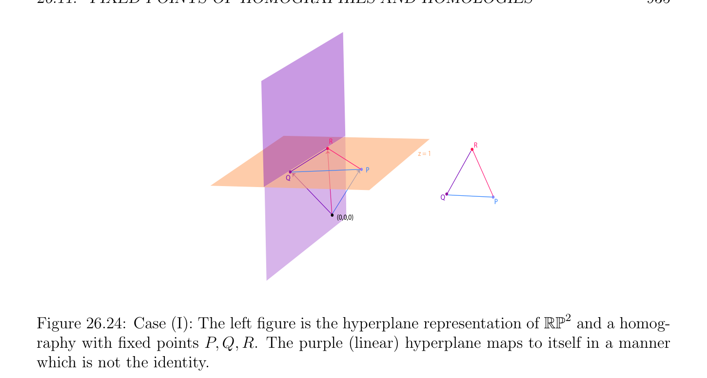
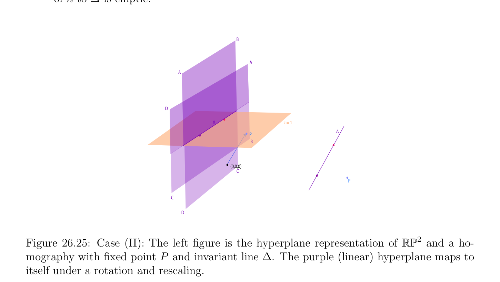
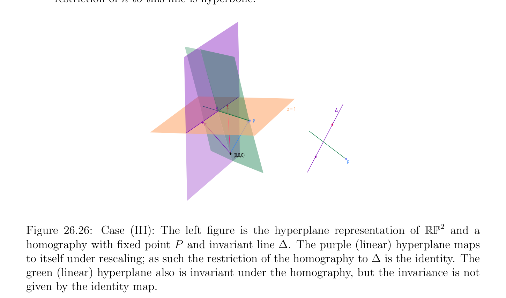
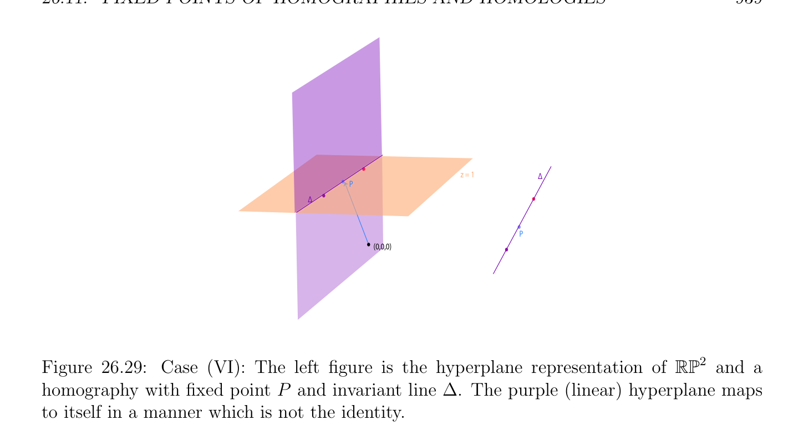
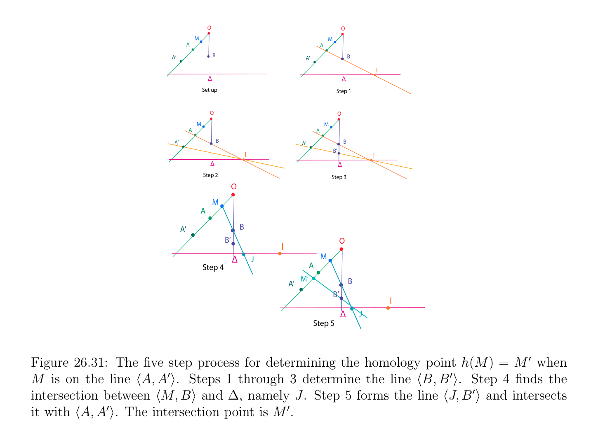
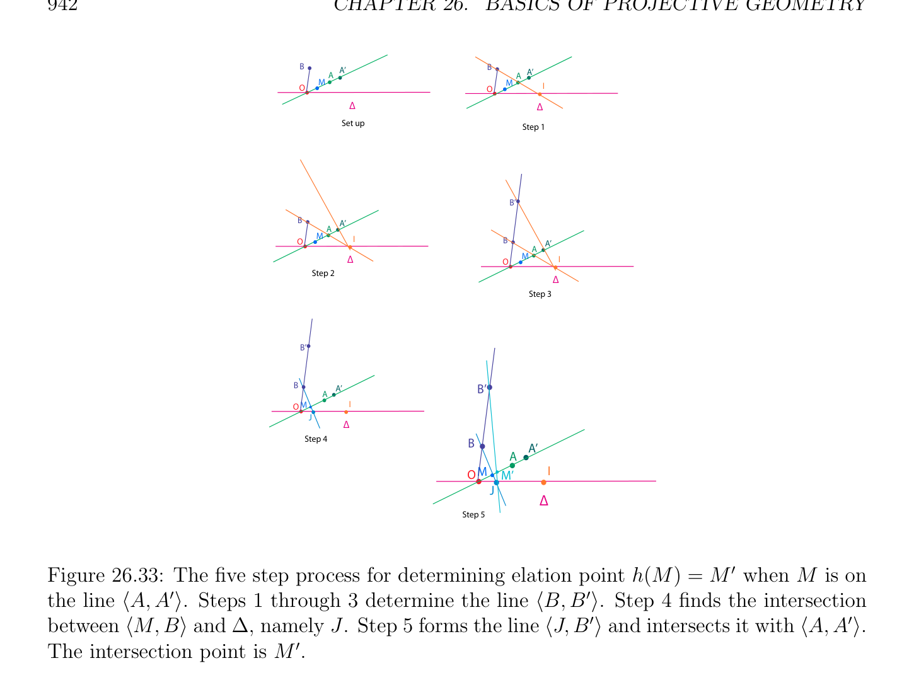

# Cố định Các điểm của Homographies và Homologies

<!-- PAGE 932 -->
$$b'$$
$$c$$
$$d$$
$$a'$$
$$agb$$
$$c'$$
$$Figure 26.23: A quadrangle, and harmonic divisions.$$

## 26.11 Cố định Các điểm của Homographies và Homologies;

$$\mathbb{RP}  \mathbb{RP}$$
$$Homographies of1and2$$
$Let\mathbb{P}(E)$ là không gian xạ ảnh (projective space) ở đâu $E$ là không gian vectơ (vector space) trên một số trường $K$, và cho $h: \mathbb{P}(E) \to \mathbb{P}(E)$ là phép biến đổi phân tuyến tính (homography) (hoặc phép xạ ảnh (projectivity)) của $\mathbb{P}(E)$ ở đâu $h$ được cho bởi tuyến tính đẳng cấu $f$: $E \to E$ sao cho $h =\mathbb{P}(f)$. Nhận thấy rằng nếu $u \in E$ là vectơ riêng (eigenvector) của $f$ với một số trị riêng (eigenvalue) $\lambda  \in K$, thì
$$h([u]) = [f(u)] = [\lambda u] = [u]$$
Vì $\lambda  \neq  0$ bởi vì $f$ là đẳng cấu, mà có nghĩa là điểm $[u] \in$ P(E) là cố định pointh của $h$. Nói cách khác, các vectơ riêng (eigenvectors) của $f$ cảm sinh cố định các điểm của $h =\mathbb{P}(f)$. Hệ quả là, nó làm cho nghĩa đến thử đến phân loại homographies theo của chúng cố định các điểm. Của course điều này phụ thuộc vào trường $K$. Nếu $K$ là algebraically đóng, chẳng hạn $K =\mathbb{C}$, thì tất cả các trị riêng (eigenvalues) của $f$ thuộc đến $K$, và ta có thể sử dụng Dạng Jordan (Jordan form) của ma trận biểu diễn $f$. Nếu $K = \mathbb{R}$, mà là của cụ thể interest đến chúng ta, thì ta có thể sử dụng thực Dạng Jordan (Jordan form),
$$\mathbb{R}^{2}  \mathbb{R}^{3}$$
Và ta có thể thu được compete phân loại cho $E =$ và $E =$. Ta sẽ cũng xem rằng đặc biệt các loại của homographies rằng để lại mọi điểm của một số xạ ảnh siêu phẳng (hyperplane) P(H) cố định, được gọi là homologies, đóng đặc biệt vai trò. Ta bắt đầu với phân loại của homographies của thực xạ ảnh $line\mathbb{RP}^{1}$. Vì
$$\mathbb{RP}^{1}$$
Phép biến đổi phân tuyến tính (homography) $h$ của được biểu diễn bởi thực khả nghịch $2 \times  2$ ma trận
$$A = \begin{pmatrix} a & b \\ c & d \end{pmatrix} ,$$

<!-- PAGE 933 -->
Và vì $A$ hoặc $0, 1$, hoặc $2$, thực các trị riêng (eigenvalues), phép biến đổi phân tuyến tính (homography) $h$ có $0, 1$, hoặc $2$ cố định các điểm.
$$\mathbb{RP}^{1}$$

> **Định nghĩa 26.10.** phép biến đổi phân tuyến tính (homography) của thực xạ ảnh đường thẳng không bằng đồng nhất thức là elliptic nếu là có không có cố định điểm, parabolic nếu nó có đơn lẻ cố định điểm, hoặc hyperbolic nếu nó có hai cố định các điểm.
$(1)$ Elliptic homographies. Trong trường hợp này, $(a + d)^{2}$ - 4(ad - bc) $< 0$, do đó $A$ có hai phân biệt phức liên hợp các trị riêng (eigenvalues) $\alpha  \pm  i\beta$, và trong $\mathbb{C}^{2}$, chúng tương ứng với hai phức các vectơ riêng (eigenvectors) $w_{1} = u +$ iv và $w_{2} = u$ - iv, với $u, v \in \mathbb{R}^{2}$. Vì
$$f(w_{1}) = (\alpha  -i\beta )w_{1}$$
Ta thu được
$$f(u) + if(v) = \alpha u + \beta v + i(-\beta u + \alpha v),$$
Mà chỉ ra rằng trong cơ sở (basis) $(u, v)$, phép biến đổi phân tuyến tính (homography) $h$ được biểu diễn bởi ma trận
$$\Gamma  = \begin{pmatrix} \alpha & -\beta \\ \beta & \alpha \end{pmatrix} .$$
Nếu ta cho $\theta  \in (0, 2\pi$) là góc cho trước bởi
$$\cos \theta  = \frac{\alpha}{p\overline{\alpha}^{2}\overline{+}\overline{\beta}^{2}}$$
$$\sin \theta  = \frac{\beta}{p\overline{\alpha}^{2}\overline{+}\overline{\beta}^{2}}$$
Và viết
$$\rho  =p\overline{\alpha}^{2} \overline{+}\overline{\beta}^{2},$$
Thì
$$\Gamma  = \rho \begin{pmatrix} \cos \theta & -\sin \theta \\ \sin \theta & \cos \theta \end{pmatrix}$$
Mà tương ứng với sự đồng dạng. Nhận thấy rằng $h$ là phép đối hợp (involution), nghĩa là, $h^{2} =$ id khi và chỉ khi $\theta  = \pi /2$.
$(2)$ Parabolic homographies. Trong trường hợp này, ta phải có $(a + d)^{2}$ - 4(ad - bc) $= 0$. ma trận $A$ là không chéo hóa được (diagonalizable) và nó có Dạng Jordan (Jordan form) của tạo thành
$$\Gamma  = \begin{pmatrix} \lambda & 1 \\ 0 & \lambda \end{pmatrix} .$$
Trong afin đường thẳng $y = 1$, parabolic phép biến đổi phân tuyến tính (homography) behaves like phép tịnh tiến bởi $1/\lambda$.

<!-- PAGE 934 -->
$(3)$ Hyperbolic homographies. Trong trường hợp này, $(a + d)^{2}$ -4(ad -bc) $> 0$, do đó $A$ có hai phân biệt khác không các số thực các trị riêng (eigenvalues) $\lambda$ và $\mu$, và trong cơ sở (basis) của các vectơ riêng (eigenvectors) nó được biểu diễn bởi ma trận đường chéo (diagonal matrix)
$$\Gamma  = \begin{pmatrix} \lambda & 0 \\ 0 & \mu \end{pmatrix} .$$
Nếu $P$ và $Q$ là phân biệt cố định các điểm của phép biến đổi phân tuyến tính (homography) $h$, nó là không khó đến
$$\mathbb{RP}^{1}$$
Chỉ ra rằng với mọi $M \in$ sao cho $M \neq  P, Q$, ta có
$$[P, Q, M, h(M)] = k$$
Ở đâu $k = \lambda /\mu$. Ví dụ, xem Sidler $[167]$ (Chương $3$, Mệnh đề 3.3.1), và Berger $[11]$ (Bổ đề 6.6.3). Nó có thể cũng được hiển thị rằng $h$ là phép đối hợp (involution) $(h^{2} =$ id) với hai phân biệt cố định các điểm $P$ và $Q$ khi và chỉ khi $a + d = 0$ khi và chỉ khi $k = -1$ trong ở trên phương trình; xem Sidler $[167]$ (Chương $3$, Mệnh đề 3.3.2), và Samuel $[148]$ (Mục 2.4). Ta bây giờ phân loại homographies của $\mathbb{RP}^{2}$. Vì đa thức đặc trưng (characteristic polynomial) của $3 \times  3$ thực ma trận $A$ có bậc $3$ và vì mọi thực đa thức của bậc $3$ có ít nhất một thực không, $A$ có một số thực trị riêng (eigenvalue). Vì $\mathbb{C}$ là algebraically đóng, mọi phức đa thức của bậc $3$ có ba các không điểm (counted với bội (multiplicity)), trong mà trường hợp, tất cả ba các trị riêng (eigenvalues) của $3 \times  3$ phức ma trận $A$ thuộc đến $\mathbb{C}$. Do đó ta có kết quả sau hữu ích sự kiện.
$$\mathbb{RP}^{2}$$

> **Mệnh đề 26.22.** Mọi phép biến đổi phân tuyến tính (homography) của thực xạ ảnh mặt phẳng hoặc của phức
$$\mathbb{CP}^{2}$$
Xạ ảnh mặt phẳng có ít nhất một cố định điểm.
$$\mathbb{RP}^{2}$$
Ở đây là phân loại của homographies của based trên thực Dạng Jordan (Jordan form) của một ma trận cỡ $3\times 3$. Hầu hết chi tiết là trái như các bài tập. Ta ký hiệu bởi $\Gamma$ ma trận cỡ $3\times 3$ biểu diễn thực Dạng Jordan (Jordan form) của ma trận của ánh xạ tuyến tính (linear map) biểu diễn phép biến đổi phân tuyến tính (homography) $h$.
(I) Ba thực các trị riêng (eigenvalues) $\alpha , \beta , \gamma$. ma trận $\Gamma$ có tạo thành
$$\Gamma  = \begin{pmatrix} \alpha & 0 & 0 \\ 0 & \beta & 0 \\ 0 & 0 & \gamma \end{pmatrix} ,$$
Với $\alpha , \beta , \gamma  \in \mathbb{R}$ khác không và tất cả phân biệt. Như được minh họa trong Hình 26.24, phép biến đổi phân tuyến tính (homography) $h$ có ba cố định các điểm $P, Q, R$, tạo thành tam giác. các vế/cạnh (các đường thẳng) của điều này tam giác là bất biến dưới $h$. thu hẹp của $h$ đến mỗi của các phần tử này các vế/cạnh là hyperbolic.
(II) Một thực trị riêng (eigenvalue) $\alpha$ và hai phức liên hợp các trị riêng (eigenvalues). Thì $\Gamma$ có tạo thành
$$\Gamma  = \begin{pmatrix} \alpha & 0 & 0 \\ 0 & \beta & -\gamma \\ 0 & \gamma & \beta \end{pmatrix} ,$$

<!-- PAGE 935 -->
$$RR$$
$$z = 1$$
$$P$$
$$Q$$
$$QP$$
$$(0,0,0)$$
$$\mathbb{RP}^{2}$$

**Hình 26.24:** Trường hợp (I): trái hình là siêu phẳng (hyperplane) biểu diễn của và phép biến đổi phân tuyến tính (homography) với cố định các điểm $P, Q, R$. tím (tuyến tính) siêu phẳng (hyperplane) các ánh xạ đến chính nó trong cách thức mà là không đồng nhất thức. với $\alpha , \gamma  \in \mathbb{R}$ khác không. phép biến đổi phân tuyến tính (homography) $h$, mà được minh họa trong Hình 26.25, có một cố định điểm $P$, và đường thẳng $\Delta$ bất biến dưới $h$ và không chứa $P$. thu hẹp của $h$ đến $\Delta$ là elliptic.
$$B$$
$$A$$
$$A$$
$$D$$
$$\Delta z = 1$$
$$P\Delta$$
$$B$$
$$(0,0,0)$$
$$C$$
$$P$$
$$C$$
$$D$$
$$\mathbb{RP}^{2}$$

**Hình 26.25:** Trường hợp (II): trái hình là siêu phẳng (hyperplane) biểu diễn của và phép biến đổi phân tuyến tính (homography) với cố định điểm $P$ và bất biến đường thẳng $\Delta$. tím (tuyến tính) siêu phẳng (hyperplane) các ánh xạ đến chính nó dưới phép quay và rescaling.

<!-- PAGE 936 -->
(III) Hai thực các trị riêng (eigenvalues) $\alpha , \beta$. ma trận $\Gamma$ có tạo thành
$$\Gamma  = \begin{pmatrix} \alpha & 0 & 0 \\ 0 & \beta & 0 \\ 0 & 0 & \beta \end{pmatrix} ,$$
Với $\alpha , \beta  \in \mathbb{R}$ khác không và phân biệt. phép biến đổi phân tuyến tính (homography) $h$, như được minh họa trong Hình 26.26, có một cố định điểm $P$, và đường thẳng $\Delta$ bất biến dưới $h$ và không chứa $P$. thu hẹp của $h$ đến $\Delta$ là đồng nhất thức. Mọi đường thẳng qua $P$ là bất biến dưới $h$ và thu hẹp của $h$ đến điều này đường thẳng là hyperbolic.
$$\Delta z = 1\Delta$$
$$P$$
$$(0,0,0)$$
$$P$$
$$\mathbb{RP}^{2}$$

**Hình 26.26:** Trường hợp (III): trái hình là siêu phẳng (hyperplane) biểu diễn của và phép biến đổi phân tuyến tính (homography) với cố định điểm $P$ và bất biến đường thẳng $\Delta$. tím (tuyến tính) siêu phẳng (hyperplane) các ánh xạ đến chính nó dưới rescaling; vì vậy thu hẹp của phép biến đổi phân tuyến tính (homography) đến $\Delta$ là đồng nhất thức. xanh lục (tuyến tính) siêu phẳng (hyperplane) cũng là bất biến dưới phép biến đổi phân tuyến tính (homography), nhưng tính bất biến là không cho trước bởi đồng nhất thức ánh xạ.
(IV) Một thực trị riêng (eigenvalue) $\alpha$. ma trận $\Gamma$ có tạo thành
$$\Gamma  = \begin{pmatrix} \alpha & 0 & 0 \\ 0 & \alpha & 1 \\ 0 & 0 & \alpha \end{pmatrix} ,$$
Với $\alpha  \in \mathbb{R}$ khác không. Như được minh họa bởi Hình 26.27, phép biến đổi phân tuyến tính (homography) $h$ có một cố định điểm $P$, và đường thẳng $\Delta$ bất biến dưới $h$ chứa $P$. thu hẹp của $h$ đến $\Delta$ là đồng nhất thức. Mọi đường thẳng qua $P$ là bất biến dưới $h$ và thu hẹp của $h$ đến điều này đường thẳng là parabolic.

<!-- PAGE 937 -->
$$z = 1\Delta$$
$$P$$
$$\Delta$$
$$P$$
$$(0,0,0)$$
$$\mathbb{RP}^{2}$$

**Hình 26.27:** Trường hợp (IV): trái hình là siêu phẳng (hyperplane) biểu diễn của và phép biến đổi phân tuyến tính (homography) với cố định điểm $P$ và bất biến đường thẳng $\Delta$ chứa $P$. tím (tuyến tính) siêu phẳng (hyperplane) các ánh xạ đến chính nó dưới rescaling; vì vậy thu hẹp của phép biến đổi phân tuyến tính (homography) đến $\Delta$ là đồng nhất thức. xanh lục (tuyến tính) siêu phẳng (hyperplane) cũng là bất biến dưới phép biến đổi phân tuyến tính (homography), nhưng tính bất biến là không cho trước bởi đồng nhất thức ánh xạ.
$(V)$ Hai thực các trị riêng (eigenvalues) $\alpha , \beta$. ma trận $\Gamma$ có tạo thành
$$\Gamma  = \begin{pmatrix} \alpha & 0 & 0 \\ 0 & \beta & 1 \\ 0 & 0 & \beta \end{pmatrix} ,$$
Với $\alpha , \beta  \in \mathbb{R}$ khác không và phân biệt. phép biến đổi phân tuyến tính (homography) $h$, mà được minh họa trong Hình 26.28, có hai cố định các điểm $P$ và $Q$. đường thẳng $\langle P, Q\rangle$ là bất biến dưới $h$, và ở đó là là một cái khác đường thẳng $\Delta$ qua $Q$ bất biến dưới $h$. thu hẹp của $h$ đến $\Delta$ là parabolic, và thu hẹp của $h$ đến $\langle P, Q\rangle$ là hyperbolic.
(VI) Một thực trị riêng (eigenvalue) $\alpha$. ma trận $\Gamma$ có tạo thành
$$\Gamma  = \begin{pmatrix} \alpha & 1 & 0 \\ 0 & \alpha & 1 \\ 0 & 0 & \alpha \end{pmatrix} ,$$
Với $\alpha  \in \mathbb{R}$ khác không. phép biến đổi phân tuyến tính (homography) $h$, mà được minh họa trong Hình 26.29, có một cố định điểm $P$, và đường thẳng $\Delta$ bất biến dưới $h$ chứa $P$. thu hẹp của $h$ đến $\Delta$ là parabolic. Cho phân loại của homographies của $\mathbb{CP}^{2}$, Trường hợp (II) trở thành Trường hợp (I).

<!-- PAGE 938 -->
$$z = 1$$
$$Q$$
$$P$$
$$\Delta$$
$$Q$$
$$(0,0,0)$$
$$P$$
$$\Delta$$
$$\mathbb{RP}^{2}$$

**Hình 26.28:** Trường hợp $(V)$: trái hình là siêu phẳng (hyperplane) biểu diễn của và phép biến đổi phân tuyến tính (homography) với cố định các điểm $P, Q$ và bất biến đường thẳng $\Delta$. Cả hai tím và xanh lục (tuyến tính) các siêu phẳng là bất biến dưới phép biến đổi phân tuyến tính (homography), nhưng tính bất biến là không cho trước bởi đồng nhất thức ánh xạ. Nhận thấy rằng trong Các trường hợp (III) và (IV), phép biến đổi phân tuyến tính (homography) $h$ có đường thẳng $\Delta$ của cố định các điểm, cũng như cố định điểm $P$. Trong Trường hợp (III), $P \in / \Delta$, và trong Trường hợp (IV), $P \in \Delta$. Điều này loại của phép biến đổi phân tuyến tính (homography) được gọi là một homology. điểm $P$ được gọi là tâm và đường thẳng $\Delta$ được gọi là trục (hoặc base). Một số các tác giả chỉ sử dụng số hạng homology khi $P \in / \Delta$, và khi $P \in \Delta$, chúng sử dụng số hạng elation. Khi $P \in \Delta$, khác các tác giả sử dụng số hạng xạ ảnh phép trượt (transvection), mà ta ưu tiên. tâm thường được ký hiệu bởi $O$ (thay vì của $P)$. Một của đẹp các đặc trưng của homologies (và xạ ảnh các phép trượt) là rằng có một đẹp hình học cách xây dựng của ảnh (image) h(M) của điểm $M$ theo tâm $O$, trục $\Delta$, và bất kỳ cặp $(A$, ') ở đâu ' $=$ h(), $A \neq  O$, và $A \in / \Delta$. cách xây dựng này là khả dĩ/có thể bởi vì với mọi điểm M̸ $= O$, đường thẳng $\langle M, h(M)\rangle$ các đi qua qua $O$. Điều này có thể được được chứng minh bằng cách sử dụng Desargues’ Định lý; ví dụ, xem Silder $[167]$ (Chương $4$, Mục 4.2). Ta sẽ chứng minh tính chất này cho tổng quát hóa của homologies đến bất kỳ không gian xạ ảnh (projective space) $\mathbb{P}(E)$, ở đâu $E$ là không gian vectơ (vector space) của bất kỳ hữu hạn số chiều. Cho cách xây dựng, thứ nhất giả sử rằng $M \neq  O$ là không trên đường thẳng $\langle A, A'\rangle$. Trong trường hợp này, đường thẳng $\langle A, M\rangle$ cắt $\Delta$ trong một số điểm I. Vì $I \in \Delta$, nó là cố định bởi $h$, do đó ảnh (image) của đường thẳng $\langle A, I\rangle$ là đường thẳng $\langle$ ', $I\rangle$, và vì $M$ là trên đường thẳng $\langle A, I\rangle$, ảnh (ảnh (image)) của nó M' $=$ h(M) là trên đường thẳng $\langle$ ', $I\rangle$. Nhưng M' $=$ h(M) là cũng trên đường thẳng $\langle O, M\rangle$, mà suy ra rằng M' $=$ h(M) là giao điểm của các đường thẳng $\langle$ ', $I\rangle$ và $\langle O, M\rangle$; xem Hình 26.30. Nếu M̸ $= O$ là trên đường thẳng $\langle A, A'\rangle$, thì ta sử dụng cách xây dựng của ảnh (image) B' của một số điểm $B \neq  O$ và không trên $\langle A, A'\rangle$ như trước, và thì repeat cách xây dựng bởi việc tìm giao $J$ của $\langle M, B\rangle$ và $\Delta$, và thì M' $=$ h(M) là giao điểm của $\langle$ B', $J\rangle$ và

<!-- PAGE 939 -->
$$z = 1\Delta$$
$$P$$
$$\Delta$$
$$P$$
$$(0,0,0)$$
$$\mathbb{RP}^{2}$$

**Hình 26.29:** Trường hợp (VI): trái hình là siêu phẳng (hyperplane) biểu diễn của và phép biến đổi phân tuyến tính (homography) với cố định điểm $P$ và bất biến đường thẳng $\Delta$. tím (tuyến tính) siêu phẳng (hyperplane) các ánh xạ đến chính nó trong cách thức mà là không đồng nhất thức. $\langle A, A'\rangle$; xem Hình 26.31.

<!-- PAGE 940 -->
$$OO$$
$$AA$$
$$A’MA’M$$
$$I$$
$$\overline{\Delta}\overline{\Delta}$$
$$Set upStep 1$$
$$OO$$
$$AA$$
$$A’MA’M$$
$$IM’$$
$$I$$
$$\overline{\Delta}\overline{\Delta}$$
$$Step 2Step 3$$

**Hình 26.30:** ba bước process cho xác định homology điểm h(M) $=$ M' khi $M$ là không trên đường thẳng $\langle A, A'\rangle$. Bước $1$ tìm giao giữa mở rộng của $\langle A, M\rangle$ và $\Delta$. Bước $2$ các dạng đường thẳng $\langle$ ', $I\rangle$. Bước $3$ mở rộng $\langle O$, M' $\rangle$ và xác định của nó giao với $\langle$ ', $I\rangle$. giao điểm là M'.
$$OO$$
$$MM$$
$$AA$$
$$A’BA’B$$
$$I$$
$$\overline{\Delta}\overline{\Delta}$$
$$Set upStep 1$$
$$OO$$
$$MM$$
$$AA$$
$$A’BA’B$$
$$IB’$$
$$I$$
$$\overline{\Delta}\overline{\Delta}$$
$$Step 2Step 3$$
$$O$$
$$M$$
$$A$$
$$A’B$$
$$B’O$$
$$I$$
$$\overline{\Delta}\overline{J} M$$
$$Step 4A$$
$$M’B$$
$$A’$$
$$B’$$
$$I$$
$$\overline{\Delta}\overline{J}$$
$$Step 5$$

**Hình 26.31:** năm bước process cho xác định homology điểm h(M) $=$ M' khi $M$ là trên đường thẳng $\langle A, A'\rangle$. Các bước $1$ qua $3$ xác định đường thẳng $\langle B, B'\rangle$. Bước $4$ tìm giao giữa $\langle M, B\rangle$ và $\Delta$, cụ thể là $J$. Bước $5$ các dạng đường thẳng $\langle J, B'\rangle$ và cắt nó với $\langle A, A'\rangle$. giao điểm là M'.

<!-- PAGE 941 -->
Ở trên cách xây dựng cũng hoạt động nếu $O \in \Delta$; xem Các hình 26.32 và 26.33.
$$MAM$$
$$A$$
$$A’A’$$
$$\overline{O}\overline{O} I$$
$$\overline{\Delta}\overline{\Delta}$$
$$Set upStep 1$$
$$M$$
$$A$$
$$A’$$
$$I$$
$$O$$
$$\overline{\Delta}$$
$$Step 2$$
$$M$$
$$A$$
$$A’$$
$$M’$$
$$I$$
$$O$$
$$\overline{\Delta}$$
$$Step 3$$

**Hình 26.32:** ba bước process cho xác định elation điểm h(M) $=$ M' khi $M$ là không trên đường thẳng $\langle A, A'\rangle$. Bước $1$ tìm giao giữa mở rộng của $\langle A, M\rangle$ và $\Delta$. Bước $2$ các dạng đường thẳng $\langle$ ', $I\rangle$. Bước $3$ mở rộng $\langle A'I\rangle$ và xác định của nó giao với $\langle O, M\rangle$. giao điểm là M'. Một cái khác hữu ích tính chất của homologies (ở đây, $O \in / \Delta$) là rằng với mọi đường thẳng $d$ chuyển qua tâm $O$, nếu I là giao điểm của đường thẳng $d$ và $\Delta$, thì với mọi $M \in d$ phân biệt từ $O$ và không trên $\Delta$ và ảnh (ảnh (image)) của nó M', tỉ số kép (cross-ratio) $[O$, I, $M$, M' ] là độc lập của $d$. Nếu $[O$, I, $M$, M' ] $= -1$ với mọi M̸ $= O$, ta nói rằng $h$ là harmonic homology. Nó có thể được được hiển thị rằng phép biến đổi phân tuyến tính (homography) $h$ là harmonic homology khi và chỉ khi $h$ là phép đối hợp (involution) $(h^{2} =$ id); xem
$$\mathbb{RP}^{2}$$
Silder $[167]$ (Chương $4$, Mục 4.4). Nó có thể cũng được hiển thị rằng bất kỳ phép biến đổi phân tuyến tính (homography) của có thể được biểu diễn dưới dạng hợp thành của hai homologies; xem Silder $[167]$ (Chương $4$, Mục 4.5). Ta bây giờ xét tổng quát hóa của khái niệm của homology (và xạ ảnh phép trượt (transvection)) đến bất kỳ không gian xạ ảnh (projective space) $\mathbb{P}(E)$, ở đâu $E$ là không gian vectơ (vector space) của bất kỳ hữu hạn số chiều trên trường $K$. Ta cần đến ôn tập/tổng quan một vài các khái niệm từ Mục 8.15. Cho $E$ là không gian vectơ (vector space) và cho $H$ là siêu phẳng (hyperplane) trong $E$. Nhắc lại từ Định nghĩa 8.8 rằng với mọi khác không vectơ $u \in E$ sao cho $u \notin H$, và bất kỳ vô hướng (scalar) $\alpha  \neq  0, 1$, ánh xạ tuyến tính (linear map) $f$: $E \to E$ sao cho f(x) $= x$ với mọi $x \in H$ và f(x) $= \alpha x$ với mọi $x \in D =$ Ku được gọi là một phép vị tự (dilatation) của siêu phẳng (hyperplane) $H$, hướng $D$, và scale nhân tử $\alpha$. Xem Hình 26.34. Từ Định nghĩa 8.9, với mọi khác không phi tuyến tạo thành $\phi  \in E^{*}$ định nghĩa $H$ (mà có nghĩa là $H =$ Ker $(\phi$)) và bất kỳ khác không vectơ $u \in H$, ánh xạ tuyến tính (linear map) $\tau_{\phi ,u}$ cho trước bởi
$$\tau_{\phi ,u} (x) = x + \phi (x)u,\phi (u) = 0,$$
Với mọi $x \in E$ được gọi là một phép trượt (transvection) của siêu phẳng (hyperplane) $H$ và hướng $u$. Xem Hình 26.35.

<!-- PAGE 942 -->
$$B A’B A’$$
$$AA$$
$$\overline{O} MMI$$
$$\overline{O}$$
$$\overline{\Delta}\overline{\Delta}$$
$$Set upStep 1$$
$$B’$$
$$BA’$$
$$A$$
$$\overline{O} MIB$$
$$AA’$$
$$\overline{\Delta}\overline{O} MI$$
$$Step 2\overline{\Delta}$$
$$Step 3$$
$$B’$$
$$BA’B’$$
$$A$$
$$\overline{O} MI$$
$$\overline{J}\overline{\Delta}$$
$$Step 4B$$
$$A’$$
$$A$$
$$OMM’I$$
$$\overline{J}$$
$$\Delta$$
$$Step 5$$

**Hình 26.33:** năm bước process cho xác định elation điểm h(M) $=$ M' khi $M$ là trên đường thẳng $\langle A, A'\rangle$. Các bước $1$ qua $3$ xác định đường thẳng $\langle B, B'\rangle$. Bước $4$ tìm giao giữa $\langle M, B\rangle$ và $\Delta$, cụ thể là $J$. Bước $5$ các dạng đường thẳng $\langle J, B'\rangle$ và cắt nó với $\langle A, A'\rangle$. giao điểm là M'.
$$u$$
$$v$$
$$(0,0,0)$$
$$H$$
$$f(v)$$
$$\alpha u$$
$$u$$
$$h$$
$$(0,0,0)$$
$$H$$

**Hình 26.34:** dilation $f$ của mặt phẳng $xy$ trong hướng $u = (1, 1, 1)$. Mọi vectơ $v$ không trong mặt phẳng $xy$ xác định rose-colored mặt phẳng qua $u$, và ảnh (image) f(v) là phần tử của điều này rose siêu phẳng (hyperplane) vì nó là stretched trong $u$ hướng.

<!-- PAGE 943 -->
$$x$$
$$u$$
$$\overline{(0,0,0)} H$$
$$x$$
$$\overline{f}\overline{(}\overline{x)}$$
$$u$$
$$\overline{(0,0,0)} H$$

**Hình 26.35:** phép trượt (transvection) $\tau_{\phi ,u}$ của mặt phẳng $xy$ trong hướng $u = (0, 1, 0)$, ở đâu $\phi (x, y, z) = z$. Mọi vectơ $x$ không trong mặt phẳng $xy$ xác định light-blue mặt phẳng qua $x$ và $u$. ảnh (image) f(x) stays trong light-blue siêu phẳng (hyperplane) vì nó là ”stretched“ trong $u$ hướng bởi nhân tử của $\phi (x, y, z)$. Mệnh đề 26.23, mà ta repeat ở đây cho convenience của độc giả, các đặc trưng hóa tuyến tính các đẳng cấu $f \neq$ id rằng để lại mọi điểm trong siêu phẳng (hyperplane) $H$ cố định.

> **Mệnh đề 26.23.** Cho $f$: $E \to E$ là song ánh (bijective) ánh xạ tuyến tính (linear map) của không gian vectơ hữu hạn chiều $E$ và giả sử rằng $f \neq$ id và rằng f(x) $= x$ với mọi $x \in H$, ở đâu $H$ là một số siêu phẳng (hyperplane) trong $E$. Nếu det(f) $= 1$, thì $f$ là phép trượt (transvection) của siêu phẳng (hyperplane) $H$; ngược lại, $f$ là phép vị tự (dilatation) của siêu phẳng (hyperplane) $H$. Trong hoặc trường hợp, vectơ $u$ là một cách duy nhất được định nghĩa sai khác khác không vô hướng (scalar).

*Chứng minh.* Chỉ phần cuối cùng đã là không được chứng minh trong Mệnh đề 8.23, Vì $f$ là song ánh (bijective) và đồng nhất thức trên $H$, ánh xạ tuyến tính (linear map) $f$ - id có hạt nhân (kernel) chính xác $H$. Vì $H$ là siêu phẳng (hyperplane) trong $E$, ảnh (image) của $f$ -id có số chiều $1$, và vì $u$ thuộc đến ảnh (ảnh (image)) này, nó là một cách duy nhất được định nghĩa sai khác khác không vô hướng (scalar). chứng minh của Mệnh đề 8.23 chỉ ra rằng nếu dim(E) $= n + 1$ và nếu $f$ là phép vị tự (dilatation) của siêu phẳng (hyperplane) $H$, hướng $D =$ Ku, và scale $\alpha$, thì $1$ là trị riêng (eigenvalue) của $f$ với bội (multiplicity) $n$ và $\alpha  \neq  0, 1$ là trị riêng (eigenvalue) của $f$ với bội (multiplicity) $1$; vectơ $u$ là vectơ riêng (eigenvector) cho $\alpha$, và $f$ là chéo hóa được (diagonalizable). Nếu $f$ là phép trượt (transvection) của siêu phẳng (hyperplane) $H$ và hướng $u$, thì $1$ là chỉ trị riêng (eigenvalue) của $f$, và nó có bội (multiplicity) $n$; vectơ $u$ là vectơ riêng (eigenvector) cho $1$, và $f$ là không chéo hóa được (diagonalizable). homology là xạ ảnh phiên bản của loại/kiểu của các ánh xạ liên quan trong Mệnh đề 26.23.

> **Định nghĩa 26.11.** Với mọi không gian vectơ (vector space) $E$ và bất kỳ siêu phẳng (hyperplane) $H$ trong $E$, phép biến đổi phân tuyến tính (homography) $h: \mathbb{P}(E) \to \mathbb{P}(E)$ là homology của trục (hoặc base) $\mathbb{P}(H)$ nếu h(P) $= P$ với mọi $P \in \mathbb{P}(H)$. Nói cách khác, thu hẹp của $h$ đến $\mathbb{P}(H)$ là đồng nhất thức. Nhiều hơn/thêm một cách tường minh, nếu $h = \mathbb{P}(f)$ với một số tuyến tính đẳng cấu $f$: $E \to E$, ta có $\mathbb{P}(f)(P) = P$ với mọi các điểm $P = [u] \in \mathbb{P}(H)$.

<!-- PAGE 944 -->
Bằng cách sử dụng Mệnh đề 26.23 ta thu được kết quả sau đặc trưng của homologies. Viết dim(E) $= n + 1$.

> **Mệnh đề 26.24.** Nếu $h: \mathbb{P}(E) \to \mathbb{P}(E)$ là homology của trục $\mathbb{P}(H)$ và nếu $h \neq$ id, thì với mọi tuyến tính đẳng cấu $f$: $E \to E$ sao cho $h =\mathbb{P}(f)$, các tính chất sau đây đúng:
$(1)$ Hoặc $f$ là phép vị tự (dilatation) của siêu phẳng (hyperplane) $H$ và của hướng $u$ với một số khác không $u \in$ E-H một cách duy nhất được định nghĩa sai khác một vô hướng;
$(2)$ Hoặc $f$ là phép trượt (transvection) của siêu phẳng (hyperplane) $H$ và hướng $u$ với một số khác không $u \in H$ một cách duy nhất được định nghĩa sai khác một vô hướng. Trong cả hai các trường hợp, $O = [u] \in \mathbb{P}(E)$ là cố định điểm của $h$, và $h$ có không có khác cố định các điểm ngoài ra $O$ và các điểm trong $\mathbb{P}(H)$. Trong Trường hợp $(1), O \in / \mathbb{P}(H)$, trong khi đó trong Trường hợp $(2), O \in \mathbb{P}(H)$. Hơn nữa, với mọi điểm $M \in \mathbb{P}(E)$, nếu M̸ $= O$ và nếu $M \in / \mathbb{P}(H)$, thì đường thẳng $\langle M, h(M)\rangle$ các đi qua qua $O$. Nếu dim(E) $\ge 3$, điểm $O$ là chỉ điểm thỏa mãn ở trên tính chất.

*Chứng minh.* Vì thu hẹp của $h = \mathbb{P}(f)$ đến $\mathbb{P}(H)$ là đồng nhất thức, và vì $\mathbb{P}(f) = \mathbb{P}(id_{H})$, theo Mệnh đề 26.4 ta có $f = \lambda id_{H}$ trên $H$ với một số khác không vô hướng (scalar) $\lambda  \in K$. Thì $g = \lambda^{-1} f$ là đồng nhất thức trên $H$, do đó theo Mệnh đề 26.23 ta thu được $(1)$ và $(2)$. Trong Trường hợp $(1)$, ta có g(u) $= \alpha u$, do đó $\mathbb{P}(g)([u]) =\mathbb{P}(f)([u]) = [u]$. Trong Trường hợp $(2)$, g(u) $= u$, do đó một lần nữa $\mathbb{P}(g)([u]) = \mathbb{P}(f)([u]) = [u]$. Vì vậy, $O = [u]$ là cố định điểm của $\mathbb{P}(f)$. Trong Trường hợp $(1)$, các trị riêng (eigenvalues) của $f$ là $1$ với bội (multiplicity) $n$ và $\alpha$ với bội (multiplicity) $1$. Nếu $Q = [v] \neq  O$ đã là cố định điểm của $h$ không trong $\mathbb{P}(H)$, thì $v$ sẽ là vectơ riêng (eigenvector) tương ứng với khác không trị riêng (eigenvalue) $\lambda$ của $f$ với $\lambda  \neq  1, \alpha$, và thì $f$ sẽ có $n + 2$ các trị riêng (eigenvalues) (counted với multiplicty), mà là absurd. Trong Trường hợp $(2)$, chỉ trị riêng (eigenvalue) của $f$ là $1$, với bội (multiplicity) $n$, do đó $f$ không chéo hóa được (diagonalizable), và như ở trên, vectơ $v$ sao cho $Q = [v]$ là cố định điểm của $h$ không trong $\mathbb{P}(H)$ sẽ là vectơ riêng (eigenvector) tương ứng với khác không trị riêng (eigenvalue) $\lambda  \neq  1$ của $f$, do đó $f$ sẽ là chéo hóa được (diagonalizable), một mâu thuẫn. Vì trong Trường hợp $(1)$, với mọi $x \neq  u$ và $x \in / H$ ta có $x = \lambda u + h$ với một số duy nhất $h \in H$ và một số duy nhất $\lambda  \neq  0$, do đó
$$g(x) = g(\lambda u) + g(h) = \lambda \alpha u + h = \lambda u + h + (\lambda \alpha  -\lambda )u = x + \lambda (\alpha  -1)u,$$
Mà chỉ ra rằng $O, [x]$ và $\mathbb{P}(g)([x]) = \mathbb{P}(f)([x])$ là thẳng hàng. Trong Trường hợp $(2)$, với mọi $x \neq  u$ và $x \in / H$ ta có
$$g(x) = x + \phi (x)u,$$
Mà cũng chỉ ra rằng $O, [x] and\mathbb{P}(g)([x]) =\mathbb{P}(f)([x])$ là thẳng hàng. cuối cùng tính chất là để lại như một bài tập (xem Vienne $[191]$, Chương $4$, Mệnh đề $7)$. Mệnh đề 26.24 suggests sau đây định nghĩa.

<!-- PAGE 945 -->

> **Định nghĩa 26.12.** Cho $h: \mathbb{P}(E) \to \mathbb{P}(E)$ là homology của trục $\mathbb{P}(H)$ với $h \neq$ id, ở đâu $h = \mathbb{P}(f)$ với một số tuyến tính đẳng cấu $f$: $E \to E$. cố định điểm $O = [u]$ liên kết với vectơ $u$ liên quan trong định nghĩa của $f$, mà là duy nhất sai khác một vô hướng, được gọi là tâm của $h$. Nếu $O \in \mathbb{P}(H)$, thì $h$ được gọi là một xạ ảnh phép trượt (transvection) (hoặc elation). cùng hình học cách xây dựng rằng ta được sử dụng trong trường hợp của xạ ảnh mặt phẳng chỉ ra rằng homology được xác định bởi của nó tâm $O$, của nó trục $\mathbb{P}(H)$, và cặp của các điểm $A$ và $\mathbb{P}$ ' $=$ h(), với ̸ $= O$ và $A \in / (H)$. Như loại của điều ngược lại, ta có kết quả sau mệnh đề mà là dễ dàng được hiển thị; xem Vienne $[191]$ (Chương IV, Mệnh đề $8)$.

> **Mệnh đề 26.25.** $Let\mathbb{P}(H)$ là siêu phẳng (hyperplane) $of\mathbb{P}(E)$ và cho $O \in \mathbb{P}(E)$ là điểm. Với mọi
$$\mathbb{P}$$
Cặp của phân biệt các điểm $(A$, ') sao cho $O, A$, ' là thẳng hàng và $A$, ' $\in / (H) \cup {O}$, tồn tại duy nhất một homology $h: \mathbb{P}(E) \to \mathbb{P}(E)$ của centrer $O$ và trục $\mathbb{P}(H)$ sao cho h() $=$ '.
Nhận xét: Từ chứng minh của Mệnh đề 8.23, vì mọi phép vị tự (dilatation) có thể được biểu diễn bởi ma trận của tạo thành
$$\begin{pmatrix} \alpha & 0 & \cdots & 0 \\ 0 & 1 & 0 \\ \vdots & \ddots & \vdots \\ 0 & 0 & \cdots & 1 \end{pmatrix} ,$$
Ta xem rằng bằng cách chọn siêu phẳng (hyperplane) tại vô cực là $x_{1} = 0$, trên afin siêu phẳng (hyperplane) $x_{1} = 1$, homology trở thành trung tâm magnification bởi $\alpha^{-1}$. Tương tự, vì mọi phép trượt (transvection) có thể được biểu diễn bởi ma trận của tạo thành
$$\begin{pmatrix} 1 & 0 & \cdots & 0 \\ \alpha & 1 & 0 \\ \vdots & \ddots & \vdots \\ 0 & 0 & \cdots & 1 \end{pmatrix} ,$$
Ta xem rằng bằng cách chọn siêu phẳng (hyperplane) tại vô cực là $x_{1} = 0$, trên afin siêu phẳng (hyperplane) $x_{1} = 1$, elation trở thành phép tịnh tiến. Định lý 8.26 ngay lập tức cho ta kết quả sau đây chỉ ra rằng nhóm của homographies PGL(E) được sinh bởi homologies.

> **Định lý 26.26.** Cho $E$ là bất kỳ không gian vectơ hữu hạn chiều trên trường $K$ của characteristic không bằng $2$. Thì, nhóm của homographies PGL(E) được sinh bởi homologies.
$$\mathbb{R}^{3} \mathbb{RP}^{2}$$
Khi $E =$, ta đã thấy trước đó rằng các phép đối hợp của có đẹp cấu trúc. Đặc biệt, nếu phép đối hợp (involution) có hai cố định các điểm, thì nó là harmonic homology. Nếu dim(E) $\ge 4$, nó là khó hơn để đặc trưng hóa các phép đối hợp $of\mathbb{P}(E)$, nhưng nó là khả dĩ/có thể. trường hợp ở đâu tuyến tính đẳng cấu $f$: $E \to E$ định nghĩa involutive phép biến đổi phân tuyến tính (homography) $h =\mathbb{P}(f)$
