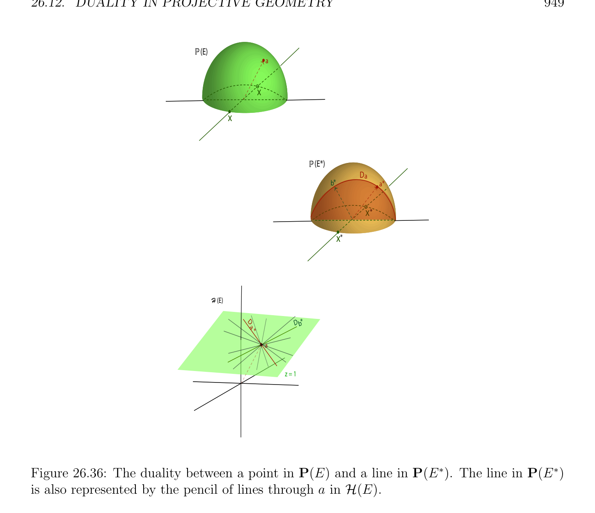

# Đối ngẫu trong Xạ ảnh Hình học

<!-- PAGE 946 -->
Có không có trị riêng (eigenvalue) trong trường $K$ là khá khác nhau từ trường hợp ở đâu $f$ có một số trị riêng (eigenvalue) trong $K$. Trong trường hợp thứ nhất, $h$ có không có cố định điểm. Hóa ra là điều này suy ra rằng dim(E) là chẵn/ngay cả và có một đơn giản description của các ma trận biểu diễn phép đối hợp (involution). Nếu $h$ có một số cố định điểm, thì $f$ là phép đối hợp (involution) của $E$, do đó nó có các trị riêng (eigenvalues) $+1$ và $-1$, và $E$ là tổng trực tiếp (direct sum) của tương ứng các không gian riêng (eigenspace) $E_{1}$ và $E_{-1}$. Thì $h$ có thể được được mô tả theo $\mathbb{P}(E_{1})$ và $\mathbb{P}(E_{-1})$. Cho chi tiết, ta refer độc giả đến Vienne $[191]$ (Chương IV, Các mệnh đề $11$ và $12)$.

## 26.12 Đối ngẫu trong Xạ ảnh Hình học

Ta bây giờ xét đối ngẫu trong xạ ảnh hình học. Cho trước không gian vectơ (vector space) $E$ của hữu hạn số chiều $n+1$, nhắc lại rằng đối ngẫu (đối ngẫu (dual)) của nó không gian $E^{*}$ là không gian vectơ (vector space) của tất cả các dạng tuyến tính $f$: $E \to K$ và rằng $E^{*}$ là đẳng cấu đến $E$. Ta cũng có chính tắc đẳng cấu giữa $E$ và của nó bidual $E^{**}$, mà cho phép chúng ta để đồng nhất $E$ và $E^{**}$. Cho $\mathcal{H}(E)$ ký hiệu tập hợp của các siêu phẳng trong P(E). Trong Mục 26.3 ta được quan sát rằng ánh xạ
$$p(f) \mapsto P(\mathrm{Ker} f)$$
Là song ánh giữa $P(E^{*})$ và $\mathcal{H}(E)$, trong mà lớp tương đương (equivalence class) p(f) $= {\lambda f$ | $\lambda  \neq  0}$ của khác không dạng tuyến tính (linear form) $f \in E^{*}$ là mapped đến siêu phẳng (hyperplane) P(Ker $f)$. Bằng cách sử dụng ở trên song ánh giữa $P(E^{*})$ và $\mathcal{H}(E)$, xạ ảnh không gian con P(U) của $P(E^{*})$ (ở đâu $U$ là không gian con của $E^{*})$ có thể được đồng nhất với tập con của $\mathcal{H}(E)$, cụ thể là họ
$${P(H) | H = \mathrm{Ker} f, f \in U -{0}}$$
Bao gồm của xạ ảnh các siêu phẳng trong $\mathcal{H}(E)$ tương ứng với khác không các dạng tuyến tính trong $U$. Như vậy các tập con của $\mathcal{H}(E)$ được gọi là các hệ phương trình tuyến tính (của các siêu phẳng). song ánh giữa $P(E^{*})$ và $\mathcal{H}(E)$ cho phép chúng ta đến quan điểm $\mathcal{H}(E)$ như không gian xạ ảnh (projective space), và các hệ phương trình tuyến tính như xạ ảnh các không gian con $of\mathcal{H}(E)$. Trong xạ ảnh $space\mathcal{H}(E)$, điểm là siêu phẳng (hyperplane) trong P(E)! đối ngẫu giữa các không gian con của $E$ và các không gian con của $E^{*}$ (được ôn tập/tổng quan ở dưới) và sự kiện rằng có một song ánh giữa $P(E^{*})$ và $\mathcal{H}(E)$ cho ta powerful đối ngẫu giữa tập hợp của xạ ảnh các không gian con của P(E) và tập hợp của các hệ phương trình tuyến tính trong $\mathcal{H}(E)$ (hoặc tương đương, tập hợp của xạ ảnh các không gian con của $P(E^{*}))$. ý tưởng của đối ngẫu trong xạ ảnh hình học đi quay lại đến Gergonne và Poncelet, trong early nineteenth century. Tuy nhiên, Poncelet đã có nhiều hơn/thêm bị thu hẹp loại/kiểu của đối ngẫu trong mind (polarity đối với conic hoặc mặt bậc hai (quadric)), trong khi đó Gergonne đã có nhiều hơn/thêm tổng quát ý tưởng của đối ngẫu giữa các điểm và các đường thẳng (hoặc các điểm và các mặt phẳng). Điều này nhiều hơn/thêm tổng quát đối ngẫu phát sinh từ cụ thể cặp giữa $E$ và $E^{*}$ (không suy biến dạng song tuyến tính (bilinear form)). Ở đây ta xét cặp $\langle$ -, $-\rangle$: $E^{*} \times  E \to K$, được định nghĩa sao cho
$$\langle f, v\rangle = f(v),$$

<!-- PAGE 947 -->
Với mọi $f \in E^{*}$ và tất cả $v \in E$. Nhắc lại rằng cho trước tập con $V$ của $E$ (respectively tập con $U$ của $E^{*})$, trực giao $V^{0}$ của $V$ là không gian con của $E^{*}$ được định nghĩa sao cho
$$V^{0}= {f \in E^{*}| \langle f, v\rangle = 0, for every v \in V },$$
Và rằng trực giao $U^{0}$ của $U$ là không gian con của $E$ được định nghĩa sao cho
$$U^{0}= {v \in E | \langle f, v\rangle = 0, for every f \in U} = \bigcap_{f\in U}  \mathrm{Ker} f.$$
Thì, theo Định lý 11.4 (vì $E$ và $E^{*}$ có cùng hữu hạn số chiều $n + 1), U = U^{00} , V = V^{00}$, và các ánh xạ
$$V \mapsto V^{0} andU \mapsto U^{0}$$
Là nghịch đảo các song ánh, ở đâu $V$ là không gian con của $E$, và $U$ là không gian con của $E^{*}$. các ánh xạ này tập hợp lên đối ngẫu giữa các không gian con của $E$ và các không gian con của $E^{*}$. Hơn nữa, ta biết rằng $U$ có số chiều $k$ khi và chỉ khi $U^{0}$ có số chiều $n +$ 1-k, và tương tự cho $V$ và $V^{0}$. Vì hệ phương trình tuyến tính $P =$ P(U) của các siêu phẳng trong $\mathcal{H}(E)$ tương ứng với không gian con $U$ của $E^{*}$, và vì
$$U^{0}  = \bigcap_{f\in U}  \mathrm{Ker} f$$
Là giao của tất cả các siêu phẳng được định nghĩa bởi khác không các dạng tuyến tính trong $U$, ta có thể quan điểm hệ phương trình tuyến tính $P =$ P(U) $= P(U^{00}$) $in\mathcal{H}(E)$ như họ của các siêu phẳng trong P(E) chứa $P(U^{0}$). Xét theo identification của $P(E^{*})$ với tập hợp $\mathcal{H}(E)$ của các siêu phẳng trong P(E), bởi chuyển đến các không gian xạ ảnh, ở trên song ánh giữa tập hợp của các không gian con của $E$ và tập hợp của các không gian con của $E^{*}$ cho ta song ánh giữa tập hợp của xạ ảnh các không gian con của P(E) và tập hợp của các hệ phương trình tuyến tính trong $\mathcal{H}(E)$ (hoặc tương đương, tập hợp của xạ ảnh các không gian con của $P(E^{*}))$ được gọi là đối ngẫu. Nhắc lại rằng điểm của $\mathcal{H}(E)$ là siêu phẳng (hyperplane) trong P(E). Nhiều hơn/thêm specifically, giả sử rằng $E$ có số chiều $n + 1$, sao cho P(E) có số chiều $n$, nếu $Q =$ P(V) là bất kỳ xạ ảnh không gian con của P(E) (ở đâu $V$ là bất kỳ không gian con của $E)$ và nếu $P =$ P(U) là bất kỳ hệ phương trình tuyến tính trong $\mathcal{H}(E)$ (ở đâu $U$ là bất kỳ không gian con của $E^{*})$, ta thu được không gian con $Q^{0}$ của $\mathcal{H}(E)$ được định nghĩa bởi
$$Q^{0}= {P(H) | Q \subseteq P(H), P(H) a hyperplane in \mathcal{H}(E)},$$
Và không gian con $P^{0}$ của P(E) được định nghĩa bởi
$$P^{0}= \bigcap  {P(H) | P(H) \in P, P(H) a hyperplane in \mathcal{H}(E)}.$$
Ta có $P = P^{00}$ và $Q = Q^{00}$. Vì $Q^{0}$ được xác định bởi $P(V^{0})$, nếu $Q =$ P(V) có số chiều $k$ (i.e., nếu $V$ có số chiều $k + 1)$, thì $Q^{0}$ có số chiều $n$ - $k$ - $1$ (vì $V$ có số chiều $k + 1$ và dim(E) $= n + 1$, thì $V^{0}$ có số chiều $n + 1$ -(k $+ 1) = n -k)$. Do đó,
$$\dim(Q) + \dim(Q^{0}) = n -1,$$

<!-- PAGE 948 -->
Và tương tự, dim(P) $+ dim(P^{0}$) $= n$ - $1$. hệ phương trình tuyến tính $P =$ P(U) của các siêu phẳng trong $\mathcal{H}(E)$ được gọi là một chùm (pencil) của các siêu phẳng nếu nó tương ứng với xạ ảnh đường thẳng trong $P(E^{*})$, mà có nghĩa là $U$ là không gian con có số chiều $2$ của $E^{*}$. Từ dim(P) $+ dim(P^{0}$) $= n$ - $1$, chùm (pencil) của các siêu phẳng $P$ là họ của các siêu phẳng trong $\mathcal{H}(E)$ chứa một số xạ ảnh không gian con P(V) có số chiều $n$ - $2$ (ở đâu P(V) là xạ ảnh không gian con của P(E), và P(E) có số chiều $n)$. Khi $n = 2$, chùm (pencil) của các siêu phẳng trong $\mathcal{H}(E)$, cũng được gọi là chùm (pencil) của các đường thẳng, là họ của các đường thẳng chuyển qua cho trước điểm. Khi $n = 3$, chùm (pencil) của các siêu phẳng trong $\mathcal{H}(E)$, cũng được gọi là chùm (pencil) của các mặt phẳng, là họ của các mặt phẳng chuyển qua cho trước đường thẳng. Khi $n = 2$, ở trên đối ngẫu lấy khá đơn giản tạo thành. Trong trường hợp này (của xạ ảnh mặt phẳng P(E)), đối ngẫu là song ánh giữa các điểm trong P(E) và các đường thẳng trong $P(E^{*})$, được biểu diễn bởi các chùm của các đường thẳng trong $\mathcal{H}(E)$, với các tính chất sau đây: $\bullet  A$ điểm trong P(E) các ánh xạ đến đường thẳng $D_{a}$ trong $P(E^{*})$ được biểu diễn bởi chùm (pencil) của các đường thẳng trong $\mathcal{H}(E)$ chứa, cũng được ký hiệu bởi $a^{*}$. Xem Hình 26.36. $\bullet  A$ đường thẳng $D$ trong P(E) các ánh xạ đến điểm $p_{D}$ trong $P(E^{*})$ được biểu diễn bởi đường thẳng $D$ trong $\mathcal{H}(E)$. Xem Hình 26.37. $\bullet$ Hai các điểm, $b$ trong P(E) ánh xạ đến các đường thẳng $D_{a}, D_{b}$ trong $P(E^{*})$ được biểu diễn bởi các chùm của các đường thẳng qua và $b$, và giao của $D_{a}$ và $D_{b}$ là điểm $p_{\langle a,b\rangle}$ trong $P(E^{*})$ tương ứng với đường thẳng $\langle$, $b\rangle$ thuộc đến cả hai các chùm. điểm $p_{\langle a,b\rangle}$ là ảnh (image) của đường thẳng $\langle$, $b\rangle$ thông qua đối ngẫu. Xem Hình 26.38 $\bullet  A$ đường thẳng $D$ trong P(E) chứa hai các điểm, $b$ các ánh xạ đến giao $p_{D}$ của các đường thẳng $D_{a}$ và $D_{b}$ trong $P(E^{*})$ mà là các ảnh của và $b$ dưới đối ngẫu. Điều này là bởi vì, $b$ ánh xạ đến các đường thẳng $D_{a}, D_{b}$ trong $P(E^{*})$ được biểu diễn bởi các chùm của các đường thẳng qua và $b$, và giao của $D_{a}$ và $D_{b}$ là điểm $p_{D}$ trong $P(E^{*})$ tương ứng với đường thẳng $D = \langle$, $b\rangle$ thuộc đến cả hai các chùm. điểm $p_{D}$ là ảnh (image) của đường thẳng $D = \langle$, $b\rangle$ dưới đối ngẫu. Một lần một lần nữa, xem Hình 26.38. $\bullet$ Nếu $a \in D$, ở đâu là điểm và $D$ là đường thẳng trong P(E), thì $p_{D} \in D_{a}$ trong $P(E^{*})$. Điều này là bởi vì dưới đối ngẫu, là mapped đến đường thẳng $D_{a}$ trong $P(E^{*})$ được biểu diễn bởi chùm (pencil) của các đường thẳng chứa, và $D$ là mapped đến điểm $p_{D} \in P(E^{*})$ được biểu diễn bởi đường thẳng $D$ qua trong điều này chùm (pencil), do đó $p_{D} \in D_{a}$. độc giả sẽ discover rằng đối ngẫu (dual) của Desargues’s định lý là của nó điều ngược lại. Điều này là đẹp cách của thu được điều ngược lại cho tự do! Ta sẽ không spoil độc giả’s fun và cho him discover đối ngẫu (dual) của Pappus’s định lý. Nói chung, khi $n \ge 2$, ở trên đối ngẫu là song ánh giữa các điểm trong P(E) và các siêu phẳng trong $P(E^{*})$, mà được biểu diễn bởi các hệ phương trình tuyến tính có số chiều $n$ - $1$ trong $\mathcal{H}(E)$, với các tính chất sau đây:

<!-- PAGE 949 -->
$$P(E)$$
$$a$$
$$x$$
$$x$$
$$P(E*)$$
$$Da$$
$$b*a*$$
$$x*$$
$$x*$$
$$H (E)$$
$$DDb*$$
$$a*$$
$$a$$
$$z = 1$$

**Hình 26.36:** đối ngẫu giữa điểm trong P(E) và đường thẳng trong $P(E^{*})$. đường thẳng trong $P(E^{*})$ cũng được biểu diễn bởi chùm (pencil) của các đường thẳng qua trong $\mathcal{H}(E). \bullet  A$ điểm trong P(E) các ánh xạ đến siêu phẳng (hyperplane) $H_{a}$ trong $P(E^{*})$ (hệ phương trình tuyến tính của các siêu phẳng trong $\mathcal{H}(E)$ chứa, cũng được ký hiệu bởi $a^{*}). \bullet  A$ siêu phẳng (hyperplane) $H$ trong P(E) các ánh xạ đến điểm $p_{H}$ trong $P(E^{*})$ (được biểu diễn bởi siêu phẳng (hyperplane) $H$ trong $\mathcal{H}(E))$. để kết luận của ta quick tour của xạ ảnh hình học, ta thiết lập connection giữa tỉ số kép (cross-ratio) của các siêu phẳng trong chùm (pencil) của các siêu phẳng với tỉ số kép (cross-ratio) của giao các điểm của bất kỳ đường thẳng không được chứa trong bất kỳ siêu phẳng (hyperplane) trong điều này chùm (pencil) với bốn các siêu phẳng trong điều này chùm (pencil).
