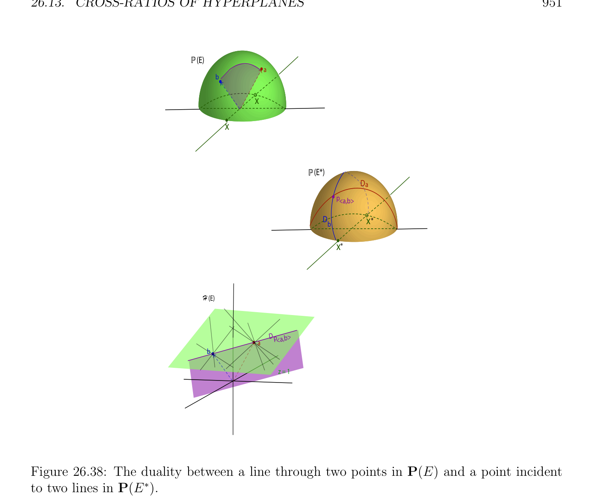

# Cross-Ratios của Các siêu phẳng

<!-- PAGE 950 -->
$$P(E)D$$
$$x$$
$$x$$
$$P(E*)$$
$$PD$$
$$x*$$
$$x*$$
$$H (E)$$
$$D$$
$$z = 1$$

**Hình 26.37:** đối ngẫu giữa đường thẳng trong P(E) và điểm trong $P(E^{*})$. điểm trong $P(E^{*})$ cũng được biểu diễn bởi Đường thẳng $D$ trong $\mathcal{H}(E)$.

## 26.13 Cross-Ratios của Các siêu phẳng

Cho trước chùm (pencil) $P =$ P(U) của các siêu phẳng trong $\mathcal{H}(E)$, với mọi dãy $(H_{1}, H_{2}, H_{3}, H_{4})$ của các siêu phẳng trong điều này chùm (pencil), nếu $H_{1}, H_{2}, H_{3}$ là phân biệt, ta định nghĩa tỉ số kép (cross-ratio) $[H_{1}, H_{2}, H_{3}, H_{4}]$ như tỉ số kép (cross-ratio) của các siêu phẳng $H_{i}$ được xét như các điểm trên xạ ảnh đường thẳng $P$ trong $P(E^{*})$. Đặc biệt, trong xạ ảnh mặt phẳng P(E), cho trước bất kỳ bốn concurrent các đường thẳng $D_{1}, D_{2}, D_{3}, D_{4}$, ở đâu $D_{1}, D_{2}, D_{3}$ là phân biệt, với mọi hai phân biệt các đường thẳng $\Delta$ và $\Delta'$ không chuyển qua
$$\cap$$
Chung/phổ biến giao $c$ của các đường thẳng $D_{i}$, đặt $d_{i} = \Delta \cap D_{i}$, và $d_{i}' = \Delta' D_{i}$, lưu ý rằng phép chiếu của tâm $c$ từ $\Delta$ đến $\Delta'$ các ánh xạ mỗi $d_{i}$ đến $d_{i}'$. Vì như vậy phép chiếu là phép xạ ảnh (projectivity), và vì projectivities giữa các đường thẳng bảo toàn cross-ratios, ta có
$$[d_{1}, d_{2}, d_{3}, d_{4}] = [d_{1}', d_{2}', d_{3}', d_{4}'],$$

<!-- PAGE 951 -->
$$P(E)$$
$$a$$
$$b$$
$$x$$
$$x$$
$$P(E*)$$
$$Da$$
$$p<a,b>$$
$$Dx*$$
$$b$$
$$x*$$
$$H (E)$$
$$Dp<a,b>$$
$$a$$
$$b$$
$$z = 1$$

**Hình 26.38:** đối ngẫu giữa đường thẳng qua hai các điểm trong P(E) và điểm incident đến hai các đường thẳng trong $P(E^{*})$. mà có nghĩa là tỉ số kép (cross-ratio) của $d_{i}$ là độc lập của đường thẳng $\Delta$ (xem Hình 26.39). Thực ra, điều này tỉ số kép (cross-ratio) bằng $[D_{1}, D_{2}, D_{3}, D_{4}]$, như được hiển thị trong tiếp theo mệnh đề.

> **Mệnh đề 26.27.** Cho $P =$ P(U) là chùm (pencil) của các siêu phẳng trong $\mathcal{H}(E)$, và cho $\Delta =$ P(D) là bất kỳ xạ ảnh đường thẳng sao cho $\Delta \in / H$ với mọi $H \in P$. ánh xạ $h: P \to \Delta$ được định nghĩa sao cho h(H) $= H \cap \Delta$ với mọi siêu phẳng (hyperplane) $H \in P$ là phép xạ ảnh (projectivity). Hơn nữa, với mọi dãy $(H_{1}, H_{2}, H_{3}, H_{4})$ của các siêu phẳng trong chùm (pencil) $P$, nếu $H_{1}, H_{2}, H_{3}$ là phân biệt và $d_{i} = \Delta \cap H_{i}$, thì $[d_{1}, d_{2}, d_{3}, d_{4}] = [H_{1}, H_{2}, H_{3}, H_{4}]$.

*Chứng minh.* Thứ nhất, ánh xạ $h: P \to \Delta$ là tốt–được định nghĩa, vì trong không gian xạ ảnh (projective space), mọi đường thẳng $\Delta =$ P(D) không được chứa trong siêu phẳng (hyperplane) cắt điều này siêu phẳng (hyperplane) trong chính xác một điểm. Vì $P =$ P(U) là chùm (pencil) của các siêu phẳng trong $\mathcal{H}(E), U$ có số chiều $2$, và cho $\phi$ và $\psi$ là hai khác không các dạng tuyến tính trong $E^{*}$ rằng constitute cơ sở (basis) của $U$, và cho $F = \phi^{-1} (0)$ và
