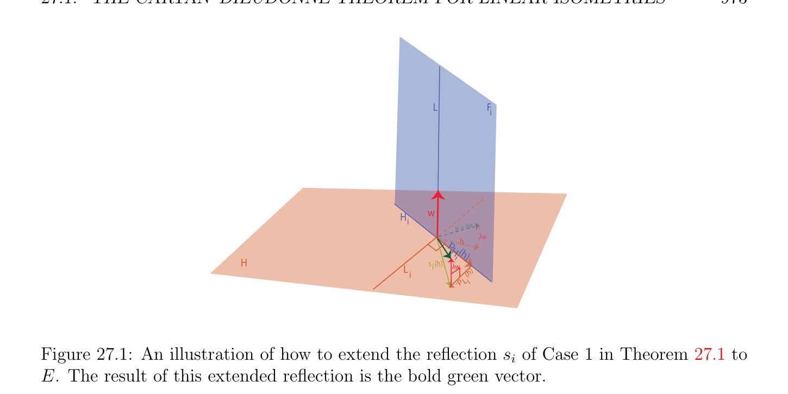
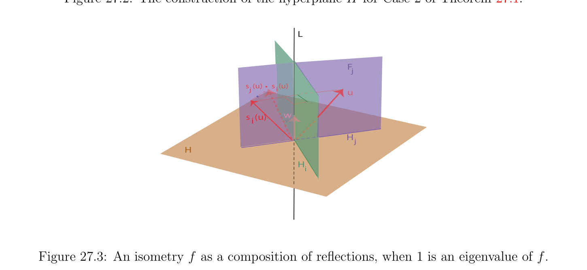
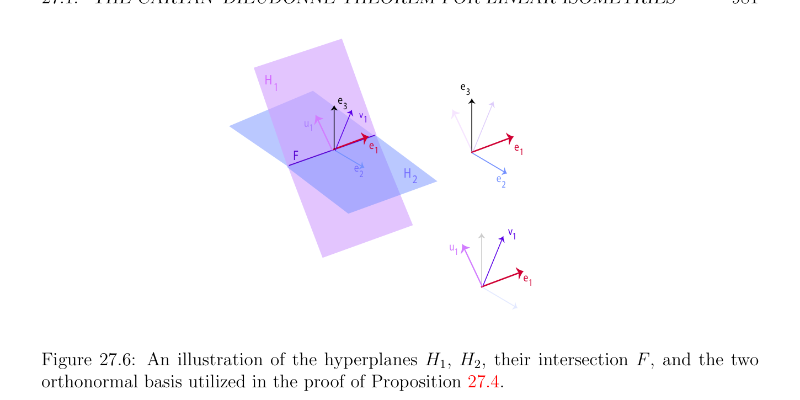
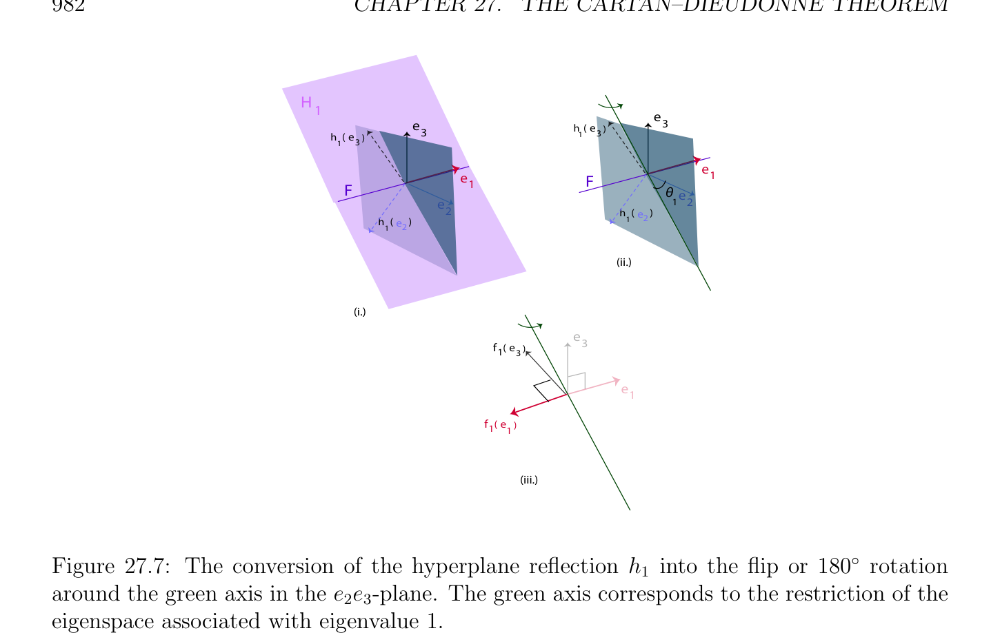

# Cartan–Dieudonné Định lý cho Tuyến tính Các phép đẳng cự

<!-- PAGE 971 -->
Chương $27$ Cartan–Dieudonn´e Định lý Trong chương này cấu trúc của trực giao nhóm là studied trong nhiều hơn/thêm depth. Đặc biệt, ta chứng minh rằng mọi phép đẳng cự (isometry) trong O(n) là hợp thành của nhiều nhất $n$ các phép đối xứng về các siêu phẳng (cho $n \ge 2$, xem Định lý 27.1). Điều này quan trọng kết quả là đặc biệt trường hợp của “Cartan–Dieudonn´e định lý” (Cartan $[33]$, Dieudonn´e $[50])$. Ta cũng chứng minh rằng mọi phép quay trong Do đó(n) là hợp thành của nhiều nhất $n$ flips (cho $n \ge 3)$. Afin các phép đẳng cự được định nghĩa, và của chúng cố định các điểm là investigated. Thứ nhất, ta đặc trưng hóa tập hợp của cố định các điểm của ánh xạ afin (affine map). Thì ta chỉ ra rằng Cartan–Dieudonn´e định lý có thể được suy rộng/tổng quát hóa đến afin các phép đẳng cự: Mọi cứng motion trong Là(n) là hợp thành của nhiều nhất $n$ afin các phép đối xứng nếu nó có cố định điểm, hoặc khác của nhiều nhất $n + 2$ afin các phép đối xứng. Ta chứng minh rằng mọi cứng motion trong SE(n) là hợp thành của nhiều nhất $n$ afin flips (cho $n \ge 3)$.

## 27.1 Cartan–Dieudonn´e Định lý cho Tuyến tính

$$Isometries$$
Sự kiện rằng nhóm O(n) của tuyến tính các phép đẳng cự được sinh bởi các phép đối xứng là đặc biệt trường hợp của định lý đã biết như Cartan–Dieudonn´e định lý. Elie Cartan được chứng minh phiên bản của định lý này early trong twentieth century. chứng minh có thể được tìm thấy trong his cuốn sách trên spinors $[33]$, mà được xuất hiện trong $1937$ (Chương I, Mục $10$, các trang 10–12). Cartan’s phiên bản áp dụng đến không suy biến các dạng toàn phương trên $\mathbb{R}$ hoặc $\mathbb{C}$. định lý đã là suy rộng/tổng quát hóa đến các dạng toàn phương trên tùy ý các trường bởi Dieudonn´e $[50]$. Một nên cũng consult Emil Artin’s cuốn sách $[6]$, mà chứa in-depth study của trực giao nhóm và một cái khác chứng minh của Cartan–Dieudonn´e định lý.

> **Định lý 27.1.** Cho $E$ là Không gian Euclid (Euclidean space) có số chiều $n \ge 1$. Mọi phép đẳng cự (isometry) $f \in$ O(E) rằng là không đồng nhất thức là hợp thành của nhiều nhất $n$ các phép đối xứng. Khi $n \ge 2$, đồng nhất thức là hợp thành của bất kỳ phép đối xứng (reflection) với chính nó.
$$971$$

<!-- PAGE 972 -->

*Chứng minh.* Ta tiến hành bằng quy nạp theo $n$. Khi $n = 1$, mọi phép đẳng cự (isometry) $f \in$ O(E) là hoặc đồng nhất thức hoặc -id, nhưng -id là phép đối xứng (reflection) về $H = {0}$. Khi $n \ge 2$, ta có id $= s \circ s$ với mọi phép đối xứng (reflection) $s$. Cho chúng ta bây giờ xét trường hợp ở đâu $n \ge 2$ và $f$ là không đồng nhất thức. Có hai subcases. Trường hợp $1$. ánh xạ $f$ admits $1$ như trị riêng (eigenvalue), i.e., tồn tại một khác không vectơ $w$ sao cho f(w) $= w$. Trong trường hợp này, cho $H$ là siêu phẳng (hyperplane) trực giao đến $w$, sao cho $E = H \oplus \mathbb{R} w$. Ta khẳng định rằng f(H) $\subseteq H$. Thật vậy, nếu
$$v \cdot  w = 0$$
Với mọi $v \in H$, vì $f$ là phép đẳng cự (isometry), ta thu được
$$f(v) \cdot  f(w) = v \cdot  w = 0,$$
Và vì f(w) $= w$, ta thu được
$$f(v) \cdot  w = f(v) \cdot  f(w) = 0,$$
Và do đó f(v) $\in H$. Hơn nữa, vì $f$ là không đồng nhất thức, $f$ là không đồng nhất thức của $H$. Vì $H$ có số chiều $n$ - $1$, theo giả thiết quy nạp ứng dụng đến $H$, có nhiều nhất $k \le n$ - $1$ các phép đối xứng $s_{1}, \dots  , s_{k}$ về một số các siêu phẳng $H_{1}, \dots  , H_{k}$ trong $H$, sao cho thu hẹp của $f$ đến $H$ là hợp thành $s_{k} \circ \cdots  \circ s_{1}$. Mỗi $s_{i}$ có thể được được mở rộng đến phép đối xứng (reflection) trong $E$ như sau: Nếu $H = H_{i} \oplus L_{i}$ (ở đâu $L_{i} = H_{i}^{\perp}$, phần bù trực giao (orthogonal complement) của $H_{i}$ trong $H), L = \mathbb{R} w$, và $F_{i} = H_{i} \oplus L$, vì $H$ và $L$ là trực giao, $F_{i}$ là thật vậy siêu phẳng (hyperplane), $E = F_{i} \oplus L_{i} = H_{i} \oplus L \oplus L_{i}$, và với mọi $u = h + \lambda w \in H \oplus L = E$, vì
$$s_{i}(h) = p_{Hi}(h) -p_{Li}(h),$$
Ta có thể định nghĩa $s_{i}$ trên $E$ sao cho
$$s_{i}(h + \lambda w) = p_{Hi}(h) + \lambda w -p_{Li}(h),$$
Và vì $h \in H, w \in L, F_{i} = H_{i} \oplus L$, và $H = H_{i} \oplus L_{i}$, ta có
$$s_{i}(h + \lambda w) = p_{Fi}(h + \lambda w) -p_{Li}(h + \lambda w),$$
Mà định nghĩa phép đối xứng (reflection) về $F_{i} = H_{i} \oplus L$. Bây giờ, vì $f$ là đồng nhất thức trên $L =\mathbb{R} w$, ta kiểm chứng được ngay rằng $f = s_{k} \circ \cdots  \circ s_{1}$, với $k \le n$ - $1$. Xem Hình 27.1. Trường hợp $2$. ánh xạ $f$ thực hiện không admit $1$ như trị riêng (eigenvalue), i.e., f(u) $\neq  u$ với mọi $u \neq  0$. Chọn bất kỳ $w \neq  0$ trong $E$, và cho $H$ là siêu phẳng (hyperplane) trực giao đến f(w) - $w$. Vì $f$ là phép đẳng cự (isometry), ta có $\|f(w)\| = \|w\|$, và theo Bổ đề 13.2, ta biết rằng s(w) $=$ f(w), ở đâu $s$ là phép đối xứng (reflection) về $H$, và ta khẳng định rằng $s \circ f$ để lại $w$ bất biến. Thật vậy, vì $s^{2} =$ id, ta có
$$s(f(w)) = s(s(w)) = w.$$
Xem Hình 27.2.

<!-- PAGE 973 -->
$$LF$$
$$i$$
$$Hw$$
$$iw$$
$$h + \lambda$$
$$h\lambda w$$
$$p$$
$$H (h$$
$$Hi)$$
$$Ls  (h)i\lambda w$$
$$i  (h)$$
$$-p  Li$$

**Hình 27.1:** illustration của cách mà để mở rộng phép đối xứng (reflection) $s_{i}$ của Trường hợp $1$ trong Định lý 27.1 đến $E$. kết quả của điều này được mở rộng phép đối xứng (reflection) là bold xanh lục vectơ. Vì $s^{2} =$ id, ta không thể có $s\circ f =$ id, vì điều này sẽ suy ra rằng $f = s$, ở đâu $s$ là đồng nhất thức trên $H$, contradicting sự kiện rằng $f$ là không đồng nhất thức trên bất kỳ vectơ. Do đó, ta là quay lại đến Trường hợp $1$. Do đó, có $k \le$ n-1 siêu phẳng (hyperplane) các phép đối xứng sao cho $s\circ f = s_{k} \circ \cdots \circ s_{1}$, từ mà ta thu được
$$f = s \circ s_{k} \circ \cdots  \circ s_{1},$$
Với nhiều nhất $k + 1 \le n$ các phép đối xứng.
Các nhận xét:
$(1) A$ slightly khác nhau chứng minh có thể được cho trước. Hoặc $f$ là đồng nhất thức, hoặc tồn tại một khác không vectơ $u$ sao cho f(u) $\neq  u$. Trong trường hợp thứ hai, tiến hành như trong phần thứ hai của chứng minh, để thu được quay lại đến trường hợp ở đâu $f$ admits $1$ như trị riêng (eigenvalue).
$(2)$ Định lý 27.1 vẫn nghiệm đúng nếu tích vô hướng (inner product) trên $E$ được thay thế bởi không suy biến dạng song tuyến tính đối xứng $\phi$, nhưng chứng minh là nhiều khó hơn; xem Mục 29.9.
$(3)$ chứng minh của Định lý 27.1 chỉ ra nhiều hơn được phát biểu. Nếu $1$ là trị riêng (eigenvalue) của $f$, với mọi vectơ riêng (eigenvector) $w$ liên kết với $1$ (i.e., f(w) $= w$, w̸ $= 0)$, thì $f$ là hợp thành của $k \le n$ - $1$ các phép đối xứng về các siêu phẳng $F_{i}$ sao cho $F_{i} = H_{i} \oplus L$, ở đâu $L$ là đường thẳng $\mathbb{R} w$ và $H_{i}$ là các không gian con có số chiều $n$ - $2$ tất cả trực giao đến $L$ ($H_{i}$ là các siêu phẳng trong $H)$. tình huống này được minh họa trong Hình 27.3. Nếu $1$ là không trị riêng (eigenvalue) của $f$, thì $f$ là hợp thành của $k \le n$ các phép đối xứng về các siêu phẳng $H, F_{1}, \dots  , F_{k-1}$, sao cho $F_{i} = H_{i} \oplus L$, ở đâu $L$ là đường thẳng giao nhau $H$, và $H_{i}$ là các không gian con có số chiều n-2 tất cả trực giao đến $L$ ($H_{i}$ là các siêu phẳng trong $L^{\perp})$. tình huống này được minh họa trong Hình 27.4.

<!-- PAGE 974 -->
$$w) - w$$
$$f($$
$$w)$$
$$wf($$
$$H$$

**Hình 27.2:** cách xây dựng của siêu phẳng (hyperplane) $H$ cho Trường hợp $2$ của Định lý 27.1.
$$L$$
$$F$$
$$j$$
$$s  (u)     s  (u)ji$$
$$u$$
$$s  (u)w$$
$$iw$$
$$H$$
$$j$$
$$H$$
$$H$$
$$i$$

**Hình 27.3:** phép đẳng cự (isometry) $f$ như hợp thành của các phép đối xứng, khi $1$ là trị riêng (eigenvalue) của $f$.
$(4)$ Nó là tự nhiên đến ask những gì là tối tiểu số của siêu phẳng (hyperplane) các phép đối xứng cần thiết để thu được phép đẳng cự (isometry) $f$. Điều này có đến thực hiện với số chiều của không gian riêng (eigenspace) Ker $(f$ - id) liên kết với trị riêng (eigenvalue) $1$. Ta sẽ chứng minh sau này rằng mọi phép đẳng cự (isometry) là hợp thành của $k$ siêu phẳng (hyperplane) các phép đối xứng, ở đâu
$$k = n -\dim(\mathrm{Ker} (f -id)),$$
Và rằng điều này số là tối tiểu (ở đâu $n =$ dim(E)). Khi $n = 2$, phép đối xứng (reflection) là phép đối xứng (reflection) về đường thẳng, và Định lý 27.1 chỉ ra rằng mọi phép đẳng cự (isometry) trong O(2) là hoặc phép đối xứng (reflection) về đường thẳng hoặc phép quay, và rằng mọi phép quay là tích của hai các phép đối xứng về một số các đường thẳng. Nói chung, vì det(s) $= -1$ cho phép đối xứng (reflection) $s$, khi $n \ge 3$ là lẻ, mọi phép quay là tích của chẵn/ngay cả số ít hơn hoặc bằng nhau

<!-- PAGE 975 -->
$$L$$
$$F$$
$$j$$
$$w$$
$$H$$
$$Hf(w)$$
$$\overline{L} j$$

**Hình 27.4:** phép đẳng cự (isometry) $f$ như hợp thành của các phép đối xứng khi $1$ là không trị riêng (eigenvalue) của $f$. Lưu ý rằng hồng mặt phẳng $H$ là vuông góc đến f(w) - $w$. đến $n$ - $1$ của các phép đối xứng, và khi $n$ là chẵn/ngay cả, mọi suy rộng/không thực sự trực giao phép biến đổi là tích của lẻ số ít hơn hoặc bằng $n$ - $1$ của các phép đối xứng. Đặc biệt, cho $n = 3$, mọi phép quay là tích của hai các phép đối xứng về các mặt phẳng. Khi $n$ là lẻ, ta có thể nói nhiều hơn/thêm về suy rộng/không thực sự các phép đẳng cự. Thật vậy, khi $n$ là lẻ, mọi suy rộng/không thực sự phép đẳng cự (isometry) admits trị riêng (eigenvalue) $-1$. Điều này là bởi vì nếu $E$ là Không gian Euclid (Euclidean space) của hữu hạn số chiều và $f$: $E \to E$ là phép đẳng cự (isometry), bởi vì $\|f(u)\| = \|u\|$ với mọi $u \in E$, nếu $\lambda$ là bất kỳ trị riêng (eigenvalue) của $f$ và $u$ là vectơ riêng (eigenvector) liên kết với $\lambda$, thì
$$\|f(u)\|= \|\lambda u\|= |\lambda |\|u\|= \|u\|,$$
Mà suy ra $|\lambda$ | $= 1$, vì u̸ $= 0$. Do đó, thực các trị riêng (eigenvalues) của phép đẳng cự (isometry) là hoặc $+1$ hoặc $-1$. Tuy nhiên, ta đã biết rõ rằng các đa thức của lẻ bậc luôn luôn có một số thực nghiệm (root). Hệ quả là, đa thức đặc trưng (characteristic polynomial) det(f - $\lambda$ id) của $f$ có một số thực nghiệm (root), mà là hoặc $+1$ hoặc $-1$. Vì $f$ là suy rộng/không thực sự phép đẳng cự (isometry), det(f) $= -1$, và vì det(f) là tích của các trị riêng (eigenvalues), thực các nghiệm không thể tất cả là $+1$, và do đó $-1$ là trị riêng (eigenvalue) của $f$. Đi quay lại đến chứng minh của Định lý 27.1, vì $-1$ là trị riêng (eigenvalue) của $f$, tồn tại một khác không vectơ riêng (eigenvector) $w$ sao cho f(w) $= -w$. Bằng cách sử dụng phần thứ hai của chứng minh, ta xem rằng siêu phẳng (hyperplane) $H$ trực giao đến f(w) - $w =$ -2w là thực ra trực giao đến $w$, và do đó $f$ là tích của $k \le n$ các phép đối xứng về các siêu phẳng $H, F_{1}, \dots  , F_{k-1}$ sao cho $F_{i} = H_{i} \oplus L$, ở đâu $L$ là đường thẳng trực giao đến $H$, và $H_{i}$ là các siêu phẳng trong $H = L^{\perp}$ trực giao đến $L$. Tuy nhiên, $k$ phải là lẻ, và do đó $k$ - $1$ là chẵn/ngay cả, và do đó hợp thành của các phép đối xứng về $F_{1}, \dots  , F_{k-1}$ là phép quay. Do đó, khi $n$ là lẻ, suy rộng/không thực sự phép đẳng cự (isometry) là hợp thành của phép đối xứng (reflection) về siêu phẳng (hyperplane) $H$ với phép quay bao gồm của các phép đối xứng về các siêu phẳng $F_{1}, \dots  , F_{k-1}$ chứa đường thẳng, $L$, trực giao đến

<!-- PAGE 976 -->
$H$. Đặc biệt, khi $n = 3$, mọi suy rộng/không thực sự trực giao phép biến đổi là tích của phép quay với phép đối xứng (reflection) về mặt phẳng trực giao đến trục của phép quay. Bằng cách sử dụng Định lý 27.1, ta cũng có thể đưa ra khá đơn giản chứng minh của cổ điển sự kiện rằng trong Không gian Euclid (Euclidean space) của lẻ số chiều, mọi phép quay để lại một số khác không vectơ bất biến, và do đó đường thẳng bất biến. Nếu $\lambda$ là trị riêng (eigenvalue) của $f$, thì sau đây bổ đề chỉ ra rằng phần bù trực giao (orthogonal complement) $E_{\lambda}(f)^{\perp}$ của không gian riêng (eigenspace) liên kết với $\lambda$ là đóng dưới $f$.

> **Mệnh đề 27.2.** Cho $E$ là Không gian Euclid (Euclidean space) của hữu hạn số chiều $n$, và cho $f$: $E \to E$ là phép đẳng cự (isometry). Với mọi không gian con $F$ của $E$, nếu f(F) $= F$, thì $f(F^{\perp}$) $\subseteq F^{\perp}$ và $E = F \oplus F^{\perp}$.

*Chứng minh.* Ta chỉ có để chứng minh rằng nếu $w \in E$ là trực giao đến mọi $u \in F$, thì f(w) là cũng trực giao đến mọi $u \in F$. Tuy nhiên, vì f(F) $= F$, với mọi $v \in F$, tồn tại một $u \in F$ sao cho f(u) $= v$, và ta có
$$f(w) \cdot  v = f(w) \cdot  f(u) = w \cdot  u,$$
Vì $f$ là phép đẳng cự (isometry). Vì ta được giả sử rằng $w \in E$ là trực giao đến mọi $u \in F$, ta có
$$w \cdot  u = 0,$$
Và do đó
$$f(w) \cdot  v = 0,$$
Và điều này với mọi $v \in F$. Do đó, $f(F^{\perp}$) $\subseteq F^{\perp}$. sự kiện rằng $E = F \oplus F^{\perp}$ suy ra từ

> **Bổ đề 12.11.** Bổ đề 27.2 là bắt đầu điểm của chứng minh rằng mọi ma trận trực giao (orthogonal matrix) có thể được được chéo hóa trên trường của phức các số. Thật vậy, nếu $\lambda$ là bất kỳ trị riêng (eigenvalue) của $f$, thì $f(E_{\lambda}(f)) = E_{\lambda}(f)$, ở đâu $E_{\lambda}(f)$ là không gian riêng (eigenspace) liên kết với $\lambda$, và do đó trực giao $E_{\lambda}(f)^{\perp}$ là đóng dưới $f$, và $E = E_{\lambda}(f) \oplus E_{\lambda}(f)^{\perp}$. bài toán trên $\mathbb{R}$ là rằng ở đó có thể không là bất kỳ thực các trị riêng (eigenvalues). Tuy nhiên, khi $n$ là lẻ, sau đây bổ đề chỉ ra rằng mọi phép quay admits $1$ như trị riêng (eigenvalue) (và tương tự, khi $n$ là chẵn/ngay cả, mọi suy rộng/không thực sự trực giao phép biến đổi admits $1$ như trị riêng (eigenvalue)).

> **Mệnh đề 27.3.** Cho $E$ là Không gian Euclid (Euclidean space).
$(1)$ Nếu $E$ có lẻ số chiều $n =$ 2m $+ 1$, thì mọi phép quay $f$ admits $1$ như trị riêng (eigenvalue) và không gian riêng (eigenspace) $F$ của tất cả các vectơ riêng (eigenvectors) trái bất biến dưới $f$ có lẻ số chiều 2p $+ 1$. Hơn nữa, có một cơ sở trực chuẩn (orthonormal basis) của $E$, trong mà $f$ được biểu diễn bởi ma trận của tạo thành
$$\begin{pmatrix} R_{2(m-p)} & 0 \\ 0 & I_{2p+1} \end{pmatrix} ,$$
Ở đâu $R_{2(m-p)}$ là ma trận quay (rotation matrix) rằng thực hiện không có $1$ như trị riêng (eigenvalue).

<!-- PAGE 977 -->
$(2)$ Nếu $E$ có chẵn/ngay cả số chiều $n =$ 2m, thì mọi suy rộng/không thực sự trực giao phép biến đổi $f$ admits $1$ như trị riêng (eigenvalue) và không gian riêng (eigenspace) $F$ của tất cả các vectơ riêng (eigenvectors) trái bất biến dưới $f$ có lẻ số chiều 2p $+ 1$. Hơn nữa, có một cơ sở trực chuẩn (orthonormal basis) của $E$, trong mà $f$ được biểu diễn bởi ma trận của tạo thành
$$\begin{pmatrix} S_{2(m-p)-1} & 0 \\ 0 & I_{2p+1} \end{pmatrix} ,$$
Ở đâu $S_{2(m-p)-1}$ là suy rộng/không thực sự ma trận trực giao (orthogonal matrix) rằng thực hiện không có $1$ như trị riêng (eigenvalue).

*Chứng minh.* Ta chứng minh chỉ $(1)$, chứng minh của $(2)$ đang là đồng dạng. Vì $f$ là phép quay và $n = 2m+1$ là lẻ, theo Định lý 27.1, $f$ là hợp thành của chẵn/ngay cả số ít hơn hoặc bằng 2m của các phép đối xứng. Từ Bổ đề 24.15, nhắc lại Grassmann quan hệ
$$\dim(M) + \dim(N) = \dim(M + N) + \dim (M \cap N),$$
Ở đâu $M$ và $N$ là các không gian con của $E$. Bây giờ, nếu $M$ và $N$ là các siêu phẳng, số chiều của chúng là $n$ - $1$, và do đó dim $(M \cap N) \ge n$ - $2$. Do đó, nếu ta giao nhau $k \le n$ các siêu phẳng, ta xem rằng số chiều của của chúng giao là ít nhất $n$ - $k$. Vì mỗi của các phép đối xứng là đồng nhất thức trên siêu phẳng (hyperplane) định nghĩa nó, và vì có nhiều nhất 2m $= n$ - $1$ các phép đối xứng, của chúng hợp thành là đồng nhất thức trên không gian con có số chiều ít nhất $1$. Điều này chứng tỏ rằng $1$ là trị riêng (eigenvalue) của $f$. Cho $F$ là không gian riêng (eigenspace) liên kết với $1$, và giả sử rằng số chiều của nó là $q$. Cho $G = F^{\perp}$ là trực giao của $F$. Theo Bổ đề 27.2, $G$ là stable dưới $f$, và $E = F \oplus G$. Bằng cách sử dụng Bổ đề 12.10, ta có thể tìm cơ sở trực chuẩn (orthonormal basis) của $E$ bao gồm của cơ sở trực chuẩn (orthonormal basis) cho $G$ và cơ sở trực chuẩn (orthonormal basis) cho $F$. Trong cơ sở (cơ sở (basis)) này, ma trận của $f$ là của tạo thành
$$\begin{pmatrix} R_{2m+1-q} & 0 \\ 0 & I_{q} \end{pmatrix} .$$
Do đó, det(f) $=$ det(R), và $R$ phải là phép quay, vì $f$ là phép quay và det(f) $= 1$. Bây giờ, nếu $f$ trái một số vectơ $u \neq  0$ trong $G$ bất biến, vectơ này sẽ là vectơ riêng (eigenvector) cho $1$, và ta sẽ có $u \in F$, không gian riêng (eigenspace) liên kết với $1$, mà contradicts $E = F \oplus G$. Do đó, bởi phần thứ nhất của chứng minh, số chiều của $G$ phải là chẵn/ngay cả, vì ngược lại, thu hẹp của $f$ đến $G$ sẽ admit $1$ như trị riêng (eigenvalue). Hệ quả là, $q$ phải là lẻ, và $R$ thực hiện không admit $1$ như trị riêng (eigenvalue). Đặt $q =$ 2p $+ 1$, bổ đề được thiết lập. ví dụ chỉ ra rằng Bổ đề 27.3 không thỏa mãn cho $n$ chẵn/ngay cả là sau đây ma trận quay (rotation matrix) (khi $n = 2)$:
$$R = \begin{pmatrix} \cos \theta & -\sin \theta \\ \sin \theta & \cos \theta \\ eigenvaluesfor\theta \end{pmatrix} .$$
Ở trên ma trận thực hiện không có thực $\neq  k\pi$. Dễ dàng chứng minh được rằng cho $n = 2$, đối với bất kỳ được chọn cơ sở trực chuẩn (orthonormal basis) $(e_{1}, e_{2})$, mọi phép quay được biểu diễn bởi ma trận của tạo thành
$$R = \begin{pmatrix} \cos \theta & -\sin \theta \\ \sin \theta & \cos \theta \end{pmatrix}$$

<!-- PAGE 978 -->
Ở đâu $\theta  \in [0, 2\pi$ [, và rằng mọi suy rộng/không thực sự trực giao phép biến đổi được biểu diễn bởi ma trận của tạo thành
$$S = \begin{pmatrix} \cos \theta & \sin \theta \\ \sin \theta & -\cos \theta \end{pmatrix} .$$
Trong trường hợp thứ nhất, ta gọi $\theta  \in [0, 2\pi$ [ measure của góc của phép quay của $R$ w.r.t. cơ sở trực chuẩn (orthonormal basis) $(e_{1}, e_{2})$. Trong trường hợp thứ hai, ta có phép đối xứng (reflection) về đường thẳng, và nó là dễ để xác định những gì điều này đường thẳng là. Nó là cũng dễ để xem rằng $S$ là hợp thành của phép đối xứng (reflection) về trục $x$ với phép quay (của ma trận $R)$.  Ta refrained từ gọi $\theta$ “ góc của phép quay,” bởi vì có một số subtleties
$$involved in defining rigorously the notion of angle of two vectors (or two lines). For$$
Ví dụ, lưu ý rằng đối với “opposite cơ sở (basis)” $(e_{2}, e_{1})$, measure $\theta$ phải là đã thay đổi đến $2\pi$ - $\theta$ (hoặc $-\theta$ nếu ta xét thương tập hợp $\mathbb{R}/2\pi$ của thực các số modulo $2\pi$). Dễ dàng chứng minh được rằng nhóm Do đó(2) của các phép quay trong mặt phẳng là Abel. Thứ nhất, nhắc lại rằng mọi mặt phẳng phép quay là tích của hai các phép đối xứng (về các đường thẳng), và rằng mọi phép đẳng cự (isometry) trong O(2) là hoặc phép đối xứng (reflection) hoặc phép quay. Đến alleviate ký hiệu, ta sẽ bỏ qua hợp thành toán tử $\circ$, và viết rs thay vì của $r \circ s$. Bây giờ, nếu $r$ là phép quay và $s$ là phép đối xứng (reflection), rs đang là trong O(2) phải là phép đối xứng (reflection) (vì det(rs) $=$ det(r) det(s) $= -1)$, và do đó $(rs)^{2} =$ id, vì phép đối xứng (reflection) là phép đối hợp (involution), mà suy ra rằng
$$srs = r^{-1}.$$
Thì, cho trước hai các phép quay $r_{1}$ và $r_{2}$, viết $r_{1}$ như $r_{1} = s_{2}s_{1}$ cho hai các phép đối xứng $s_{1}, s_{2}$, ta có
$$r_{1}r_{2}r_{1}^{-1}= s_{2}s_{1}r_{2}(s_{2}s_{1})^{-1}= s_{2}s_{1}r_{2}s_{1}^{-1} s_{2}^{-1}= s_{2}s_{1}r_{2}s_{1}s_{2} = s_{2}r_{2}^{-1} s_{2} = r_{2},$$
Vì srs $= r^{-1}$ với mọi các phép đối xứng $s$ và các phép quay $r$, và do đó $r_{1}r_{2} = r_{2}r_{1}$. Ta có thể cũng perform sau đây phép tính, bằng cách sử dụng một số sơ cấp trigonometry:
$$\begin{pmatrix} \cos \phi & \sin \phi \\ \sin \phi & -\cos \phi \end{pmatrix} \begin{pmatrix} \cos \psi & \sin \psi \\ \sin \psi & -\cos \psi \end{pmatrix} = \begin{pmatrix} \cos(\phi  + \psi ) & \sin(\phi  + \psi ) \\ \sin(\phi  + \psi ) & -\cos(\phi  + \psi ) \end{pmatrix} .$$
Ở trên cũng chỉ ra rằng nghịch đảo của ma trận quay (rotation matrix)
$$R = \begin{pmatrix} \cos \theta & -\sin \theta \\ \sin \theta & \cos \theta \end{pmatrix}$$
Là thu được bởi thay đổi $\theta$ đến $-\theta$ (hoặc $2\pi$ - $\theta$). Incidentally, lưu ý rằng trong viết phép quay $r$ như tích của hai các phép đối xứng $r = s_{2}s_{1}$, thứ nhất phép đối xứng (reflection) $s_{1}$ có thể được được chọn arbitrarily, vì $s_{1}^{2} =$ id, $r = (rs_{1})s_{1}$, và $rs_{1}$ là phép đối xứng (reflection). Cho $n = 3$, chỉ hai các lựa chọn cho $p$ là $p = 1$, mà tương ứng với đồng nhất thức, hoặc $p = 0$, trong mà trường hợp $f$ là phép quay để lại đường thẳng bất biến. Điều này đường thẳng $D$ được gọi là trục của

<!-- PAGE 979 -->
$$D$$
$$\theta  / 2$$
$$R (u)$$
$$u$$
$$Figure 27.5: 3D rotation as the composition of two reflections.$$
Phép quay. phép quay $R$ behaves like hai chiều phép quay xung quanh trục của phép quay. Do đó, phép quay $R$ là hợp thành của hai các phép đối xứng về các mặt phẳng chứa trục của phép quay $D$ và tạo thành góc $\theta /2$. Điều này được minh họa trong Hình 27.5. measure của góc của phép quay $\theta$ có thể được được xác định qua của nó cosine thông qua công thức
$$\cos \theta  = u \cdot  R(u),$$
Ở đâu $u$ là bất kỳ unit vectơ trực giao đến hướng của trục của phép quay. Tuy nhiên, điều này thực hiện không xác định $\theta  \in [0, 2\pi$ [ một cách duy nhất, vì cả hai $\theta$ và $2\pi$ - $\theta$ là khả dĩ/có thể candidates. Những gì là missing là định hướng của mặt phẳng (qua gốc) trực giao đến trục của phép quay. Trong cơ sở trực chuẩn (orthonormal basis) của bổ đề, phép quay được biểu diễn bởi ma trận của tạo thành
$$R = \begin{pmatrix} \cos \theta & -\sin \theta & 0 \\ \sin \theta & \cos \theta & 0 \\ 0 & 0 & 1 \end{pmatrix} .$$
Nhận xét: Cho tùy ý ma trận quay (rotation matrix) $A$, vì $a_{1 1} + a_{2 2} + a_{3 3}$ (vết (trace) của $A)$ là tổng của các trị riêng (eigenvalues) của $A$, và vì các trị riêng (các trị riêng (eigenvalues)) này là cos $\theta  + i$ sin $\theta$, cos $\theta  -i$ sin $\theta$, và $1$, với một số $\theta  \in [0, 2\pi$ [, ta có thể tính cos $\theta$ từ
$$1 + 2 \cos \theta  = a_{1 1} + a_{2 2} + a_{3 3}.$$
Nó là cũng khả dĩ/có thể để xác định trục của phép quay (xem các bài tập).

<!-- PAGE 980 -->
Suy rộng/không thực sự phép biến đổi là hoặc phép đối xứng (reflection) về mặt phẳng hoặc tích của ba các phép đối xứng, hoặc tương đương tích của phép đối xứng (reflection) về mặt phẳng với phép quay, và ta được lưu ý trong thảo luận sau đây Định lý 27.1 rằng trục của phép quay là trực giao đến mặt phẳng của phép đối xứng (reflection). Do đó, suy rộng/không thực sự phép biến đổi được biểu diễn bởi ma trận của tạo thành
$$S = \begin{pmatrix} \cos \theta & -\sin \theta & 0 \\ \sin \theta & \cos \theta & 0 \\ 0 & 0 & 1 \end{pmatrix} .$$
$$-$$
Khi $n \ge 3$, nhóm của các phép quay Do đó(n) là không chỉ được sinh bởi siêu phẳng (hyperplane) các phép đối xứng, nhưng cũng bởi flips (về các không gian con có số chiều $n$ - $2)$. Ta sẽ cũng xem, trong Mục 27.2, rằng mọi thực sự/đúng đắn afin cứng motion có thể được biểu diễn dưới dạng hợp thành của nhiều nhất $n$ flips, mà là perhaps chẵn/ngay cả nhiều hơn/thêm đáng ngạc nhiên! chứng minh của các kết quả này sử dụng sau đây then chốt bổ đề.

> **Mệnh đề 27.4.** Cho trước bất kỳ Không gian Euclid (Euclidean space) $E$ có số chiều $n \ge 3$, với mọi hai các phép đối xứng $h_{1}$ và $h_{2}$ về một số các siêu phẳng $H_{1}$ và $H_{2}$, ở đó tồn tại hai flips $f_{1}$ và $f_{2}$ sao cho $h_{2} \circ h_{1} = f_{2} \circ f_{1}$.

*Chứng minh.* Nếu $h_{1} = h_{2}$, hiển nhiên là
$$h_{1} \circ h_{2} = h_{1} \circ h_{1} = id = f_{1} \circ f_{1}$$
Với mọi flip $f_{1}$. Nếu $h_{1} \neq  h_{2}$, thì $H_{1} \cap H_{2} = F$, ở đâu dim(F) $= n$ - $2$ (bởi Grassmann quan hệ). Ta có thể chọn cơ sở trực chuẩn (orthonormal basis) $(e_{1}, \dots  , e_{n})$ của $E$ sao cho $(e_{1}, \dots  , e_{n-2})$ là cơ sở trực chuẩn (orthonormal basis) của $F$. Ta có thể cũng mở rộng $(e_{1}, \dots  , e_{n-2})$ đến cơ sở trực chuẩn (orthonormal basis) $(e_{1}, \dots  , e_{n-2}, u_{1}, v_{1})$ của $E$, ở đâu $(e_{1}, \dots  , e_{n-2}, u_{1})$ là cơ sở trực chuẩn (orthonormal basis) của $H_{1}$, trong mà trường hợp
$$e_{n-1}=\cos \theta_{1}  u_{1} + \sin \theta_{1}  v_{1},$$
$$e_{n}=\sin \theta_{1}  u_{1} -\cos \theta_{1}  v_{1},$$
Với một số $\theta_{1}  \in [0, 2\pi$ ]. Xem Hình 27.6 Vì $h_{1}$ là đồng nhất thức trên $H_{1}$ và $v_{1}$ là trực giao đến $H_{1}$, suy ra rằng $h_{1}(u_{1}) = u_{1}, h_{1}(v_{1}) = -v_{1}$, và ta thu được
$$h_{1}(e_{n-1})=\cos \theta_{1}  u_{1} -\sin \theta_{1}  v_{1},$$
$$h_{1}(e_{n})=\sin \theta_{1}  u_{1} + \cos \theta_{1}  v_{1}.$$
Sau một số đơn giản các phép tính, ta thu được
$$h_{1}(e_{n-1})=\cos 2\theta_{1}  e_{n-1} + \sin 2\theta_{1}  e_{n},$$
$$h_{1}(e_{n})=\sin 2\theta_{1}  e_{n-1} -\cos 2\theta_{1}  e_{n}.$$

<!-- PAGE 981 -->
$$H$$
$$1e$$
$$3$$
$$e$$
$$3$$
$$v1$$
$$u$$
$$1$$
$$ee$$
$$F11$$
$$eH$$
$$22e$$
$$2$$
$$v$$
$$1$$
$$u$$
$$1$$
$$e$$
$$1$$

**Hình 27.6:** illustration của các siêu phẳng $H_{1}, H_{2}$, của chúng giao $F$, và hai cơ sở trực chuẩn (orthonormal basis) utilized trong chứng minh của Mệnh đề 27.4. Hệ quả là, ma trận $A_{1}$ của $h_{1}$ trên cơ sở (basis) $(e_{1}, \dots  , e_{n})$ là của tạo thành
$$A_{1} = \begin{pmatrix} I_{n-2} & 0 & 0 \\ 0 & \cos 2\theta_{1} & \sin 2\theta_{1} \\ 0 & \sin 2\theta_{1} & \cos 2\theta_{1} \end{pmatrix} .$$
$$-$$
Tương tự, ma trận $A_{2}$ của $h_{2}$ trên cơ sở (basis) $(e_{1}, \dots  , e_{n})$ là của tạo thành
$$A_{2} = \begin{pmatrix} I_{n-2} & 0 & 0 \\ 0 & \cos 2\theta_{2} & \sin 2\theta_{2} \\ 0 & \sin 2\theta_{2} & \cos 2\theta_{2} \end{pmatrix} .$$
$$-$$
Nhận thấy rằng cả hai $A_{1}$ và $A_{2}$ có các trị riêng (eigenvalues) $-1$ và $+1$ với bội (multiplicity) $n$ - $1$. mẹo/kỹ thuật là đến nhận thấy rằng nếu ta thay đổi phần tử cuối cùng trong $I_{n-2}$ từ $+1$ đến $-1$ (mà là khả dĩ/có thể vì $n \ge 3)$, ta có kết quả sau tích $A_{2}A_{1}$:
$$\begin{pmatrix} I_{n-3} & 0 & 0 & 0 \\ 0 & -1 & 0 & 0 \\ 0 & 0 & \cos 2\theta_{2} & \sin 2\theta_{2} \\ 0 & 0 & \sin 2\theta_{2} & \cos 2\theta_{2} \end{pmatrix} \begin{pmatrix} I_{n-3} & 0 & 0 & 0 \\ 0 & -1 & 0 & 0 \\ 0 & 0 & \cos 2\theta_{1} & \sin 2\theta_{1} \\ 0 & 0 & \sin 2\theta_{1} & \cos 2\theta_{1} \end{pmatrix} .$$
$$--$$
Bây giờ, hai các ma trận ở trên là rõ ràng trực giao, và chúng có các trị riêng (eigenvalues) $-1, -1$, và $+1$ với bội (multiplicity) n-2, mà suy ra rằng tương ứng các phép đẳng cự để lại bất biến không gian con có số chiều $n$ - $2$ và act như -id trên của nó phần bù trực giao (orthogonal complement) (mà có số chiều $2)$. Điều này có nghĩa là ở trên hai các ma trận biểu diễn hai flips $f_{1}$ và $f_{2}$ sao cho $h_{2} \circ h_{1} = f_{2} \circ f_{1}$. Xem Hình 27.7.

<!-- PAGE 982 -->
$$H 1$$
$$e$$
$$eh (e)3$$
$$h (e)313$$
$$13$$
$$e$$
$$eF1$$
$$F1$$
$$\theta e$$
$$e12$$
$$2h (e)$$
$$h (e)12$$
$$12$$
$$(ii.)$$
$$(i.)$$
$$e$$
$$f(e)3$$
$$13$$
$$e$$
$$1$$
$$f1(e)$$
$$1$$
$$(iii.)$$

**Hình 27.7:** conversion của siêu phẳng (hyperplane) phép đối xứng (reflection) $h_{1}$ vào flip hoặc $180^{\circ}$ phép quay xung quanh xanh lục trục trong $e_{2}e_{3}-plane$. xanh lục trục tương ứng với thu hẹp của không gian riêng (eigenspace) liên kết với trị riêng (eigenvalue) $1$. Bằng cách sử dụng Bổ đề 27.4 và Cartan–Dieudonn´e định lý, ta thu được kết quả sau đặc trưng của các phép quay khi $n \ge 3$.

> **Định lý 27.5.** Cho $E$ là Không gian Euclid (Euclidean space) có số chiều $n \ge 3$. Mọi phép quay $f \in$ Do đó(E) là hợp thành của chẵn/ngay cả số của flips $f = f_{2k} \circ \cdots  \circ f_{1}$, ở đâu 2k $\le n$. Hơn nữa, nếu $u \neq  0$ là bất biến dưới $f$ (i.e., $u \in$ Ker $(f$ - id)), ta có thể chọn cuối cùng flip $f_{2k}$ sao cho $u \in F_{2k}^{\perp}$, ở đâu $F_{2k}$ là không gian con có số chiều $n$ - $2$ xác định $f_{2k}$.

*Chứng minh.* Theo Định lý 27.1, phép quay $f$ có thể được biểu diễn dưới dạng chẵn/ngay cả số của siêu phẳng (hyperplane) các phép đối xứng $f = s_{2k}\circ s_{2k-1}\circ \cdots \circ s_{2}\circ s_{1}$, với 2k $\le n$. Theo Bổ đề 27.4, mọi hợp thành của hai các phép đối xứng $s_{2i} \circ s_{2i-1}$ có thể được được thay thế bởi hợp thành của hai flips $f_{2i} \circ f_{2i-1} (1 \le i \le k)$, mà cho ta $f = f_{2k} \circ \cdots  \circ f_{1}$, ở đâu 2k $\le n$. Giả sử rằng f(u) $= u$, với $u \neq  0$. Ta có đã được tạo nhận xét rằng trong trường hợp ở đâu $1$ là trị riêng (eigenvalue) của $f$, chứng minh của Định lý 27.1 chỉ ra rằng các phép đối xứng $s_{i}$ có thể được được chọn sao cho $s_{i}(u) = u$. Đặc biệt, nếu mỗi phép đối xứng (reflection) $s_{i}$ là phép đối xứng (reflection) về siêu phẳng (hyperplane) $H_{i}$, ta có $u \in H_{2k-1} \cap H_{2k}$. Đặt $F = H_{2k-1} \cap H_{2k}$, chọn cơ sở trực chuẩn (orthonormal basis) $(e_{1}, \dots  , e_{n-3}, e_{n-2})$ của $F$, ở đâu
$$e_{n-2} = \frac{u}{\|u\|} .$$
