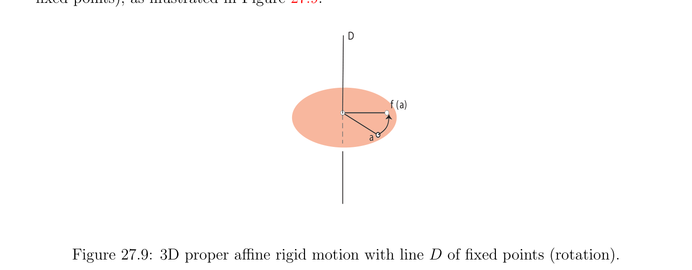

# Afin Các phép đẳng cự và Cố định Các điểm

<!-- PAGE 987 -->
$$\longrightarrow$$
Và nó là duy nhất, vì $f$ - id là đơn ánh (injective). Ngược lại, nếu $f$ có duy nhất cố định điểm, nói, từ
$$\longrightarrow ---\longrightarrow$$
$$\begin{pmatrix} \longrightarrow \\ f-id \\ (\Omega ) = \Omega , \end{pmatrix} (\Omega a) = -\Omega f(\Omega ),$$
$$\longrightarrow$$
$$we have \begin{pmatrix} \longrightarrow \\ f-id \\ which \end{pmatrix} (\Omega a) = 0 iff f\longrightarrow  and since a is the unique fixed point of f, we must$$
Có $a = \Omega$, chỉ ra rằng $f$ - id là đơn ánh (injective).
Nhận xét: sự kiện rằng $E$ có hữu hạn số chiều được sử dụng chỉ để chứng minh $(2)$, và $(1)$ nghiệm đúng nói chung. Nếu afin phép đẳng cự (isometry) $f$ để lại một số điểm cố định, ta có thể lấy như vậy điểm $\Omega$ như gốc, và thì $f(\Omega$) $= \Omega$ và ta có thể quan điểm $f$ như phép quay hoặc suy rộng/không thực sự trực giao
$$\longrightarrow$$
Phép biến đổi, tùy thuộc trên nature của $f$. Lưu ý rằng nó là khá khả dĩ/có thể rằng Fix(f) $= \emptyset$. Ví dụ, không tầm thường các phép tịnh tiến có không có cố định các điểm. nhiều hơn/thêm thú vị ví dụ là miễn là/được cung cấp bởi hợp thành của mặt phẳng phép đối xứng (reflection) về đường thẳng composed với không tầm thường phép tịnh tiến song song đến điều này đường thẳng. Ngược lại, ta sẽ xem trong Định lý 27.10 rằng mọi afin phép đẳng cự (isometry) là (giao hoán) hợp thành của phép tịnh tiến với afin phép đẳng cự (isometry) rằng luôn luôn có cố định điểm.

## 27.4 Afin Các phép đẳng cự và Cố định Các điểm

Cho $E$ là không gian afin (affine space). Cho trước bất kỳ hai afin các không gian con $F, G$, nếu $F$ và $G$ là trực giao
$$\longrightarrow  \longrightarrow  \longrightarrow$$
Các phần bù trong $E$, mà có nghĩa là $F$ và $G$ là trực giao các không gian con của $E$ sao cho $\longrightarrow  \longrightarrow \longrightarrow \longrightarrow E = F \oplus G$, với mọi điểm $\Omega \in F$, ta định nghĩa $q: E \to G$ sao cho
$$\longrightarrow$$
$$q(a) = p_{G}\longrightarrow  (\Omega a).$$
Lưu ý rằng q() là độc lập của lựa chọn của $\Omega \in F$, vì ta có
$$\longrightarrow \longrightarrow \longrightarrow$$
$$\Omega a = p_{F}\longrightarrow  (\Omega a) + p_{G}\longrightarrow  (\Omega a),$$
Và với mọi $\Omega_{1}  \in F$, ta có
$$-\longrightarrow  -\longrightarrow \longrightarrow \longrightarrow$$
$$\Omega_{1} a =\Omega_{1} \Omega + p_{F}\longrightarrow  (\Omega a) + p_{G}\longrightarrow  (\Omega a),$$
$$-\longrightarrow \longrightarrow$$
Và vì $\Omega_{1} \Omega \in F$, điều này chỉ ra rằng
$$-\longrightarrow \longrightarrow$$
$$p_{G}\longrightarrow  (\Omega_{1} a) = p_{G}\longrightarrow  (\Omega a).$$
Thì ánh xạ $g: E \to E$ sao cho g() $= a$ - 2q(), hoặc tương đương
$$--\longrightarrow \longrightarrow$$
$$ag(a) = -2q(a) = -2p_{G}\longrightarrow  (\Omega a),$$

<!-- PAGE 988 -->
$$\longrightarrow$$
Không phụ thuộc vào lựa chọn của $\Omega \in F$. Nếu ta đồng nhất $E$ đến $E$ bằng cách chọn bất kỳ gốc $\Omega$
$$\longrightarrow  \longrightarrow$$
Trong $F$, ta lưu ý rằng $g$ được đồng nhất với tính đối xứng đối với $F$ và song song đến $G$. Do đó, ánh xạ $g$ là afin phép đẳng cự (isometry), và nó được gọi là afin trực giao tính đối xứng về $F$. Vì
$$\longrightarrow \longrightarrow$$
$$g(a) = \Omega +\Omega a -2p_{G}\longrightarrow  (\Omega a)$$
$$\longrightarrow$$
Với mọi $\Omega \in F$ và với mọi $a \in E$, ta lưu ý rằng ánh xạ tuyến tính (linear map) $g$ liên kết với $g$ là
$$\longrightarrow  \longrightarrow$$
(tuyến tính) tính đối xứng về không gian con $F$ (hướng của $F)$, và song song đến $G$ (hướng của $G)$.
Nhận xét: ánh xạ $p: E \to F$ sao cho p() $= a$ - q(), hoặc tương đương
$$-\longrightarrow \longrightarrow$$
$$ap(a) = -q(a) = -p_{G}\longrightarrow  (\Omega a),$$
Là cũng độc lập của $\Omega \in F$, và nó được gọi là afin phép chiếu trực giao (orthogonal projection) lên $F$. sau đây amusing bổ đề chỉ ra extra lũy thừa afforded bởi afin trực giao các phép đối xứng: Các phép tịnh tiến là subsumed! Cho trước hai song song afin các không gian con $F_{1}$ và $F_{2}$ trong $E$,
$$\longrightarrow  \longrightarrow  \longrightarrow_{\perp}$$
Đặt $F$ là chung/phổ biến hướng của $F_{1}$ và $F_{2}$ và $G = F$ là của nó trực giao comple-
$$\longrightarrow$$
Ment, với mọi $a \in F_{1}$, không gian con afin (affine subspace) $a + G$ cắt $F_{2}$ trong đơn lẻ điểm $b$ (xem Bổ đề
$$\longrightarrow$$
24.16). Ta định nghĩa khoảng cách giữa $F_{1}$ và $F_{2}$ như $\|ab\|$. Nó là dễ dàng được thấy rằng khoảng cách giữa $F_{1}$ và $F_{2}$ là độc lập của lựa chọn của trong $F_{1}$, và rằng nó là cực tiểu của $\longrightarrow \|xy\|$ với mọi $x \in F_{1}$ và tất cả $y \in F_{2}$.

> **Mệnh đề 27.9.** Cho trước bất kỳ không gian afin (affine space) $E$, nếu $f$: $E \to E$ và $g: E \to E$ là afin trực giao các phép đối xứng về song song afin các không gian con $F_{1}$ và $F_{2}$, thì $g \circ f$ là phép tịnh tiến
$$\longrightarrow  \longrightarrow  \longrightarrow$$
Được định nghĩa bởi vectơ 2ab, ở đâu ab là bất kỳ vectơ vuông góc đến chung/phổ biến hướng $F$
$$\longrightarrow$$
Của $F_{1}$ và $F_{2}$ sao cho $\|ab\|$ là khoảng cách giữa $F_{1}$ và $F_{2}$, với $a \in F_{1}$ và $b \in F_{2}$. Ngược lại, mọi phép tịnh tiến bởi vectơ $\tau$ là thu được như hợp thành của hai afin trực giao các phép đối xứng về song song afin các không gian con $F_{1}$ và $F_{2}$ có chung/phổ biến hướng là
$$\longrightarrow$$
Trực giao đến $\tau  =$ ab, với một số $a \in F_{1}$ và một số $b \in F_{2}$ sao cho khoảng cách giữa $F_{1}$
$$\longrightarrow$$
Và $F_{2}$ là $\|ab\|/2$.
$$\longrightarrow  \longrightarrow$$

*Chứng minh.* Ta được quan sát trước đó rằng các ánh xạ tuyến tính (linear maps) $f$ và $g$ liên kết với $f$ và $g$ là tuyến tính các phép đối xứng về các hướng của $F_{1}$ và $F_{2}$. Tuy nhiên, $F_{1}$ và $F_{2}$ có cùng
$$\longrightarrow  \longrightarrow  -\longrightarrow  \longrightarrow \longrightarrow  \longrightarrow \longrightarrow  \longrightarrow \longrightarrow$$
Hướng, và do đó $f = g$. Vì $g \circ f = g \circ f$ và vì $f \circ g = f \circ f =$ id, bởi vì
$$-\longrightarrow$$
Mọi phép đối xứng (reflection) là phép đối hợp (involution), ta có $g \circ f =$ id, chứng minh rằng $g \circ f$ là phép tịnh tiến. Nếu ta chọn $a \in F_{1}$, thì $g \circ$ f() $=$ g(), afin phép đối xứng (reflection) của $a \in F_{1}$ về $F_{2}$, và nó là
$$--\longrightarrow$$
Dễ dàng đã kiểm tra rằng $g \circ f$ là phép tịnh tiến bởi vectơ $\tau  =$ ag() có chuẩn (norm) là hai lần khoảng cách giữa $F_{1}$ và $F_{2}$. phần thứ hai của bổ đề là trái như dễ bài tập.

<!-- PAGE 989 -->
Ta kết luận của ta quick study của afin các phép đẳng cự bởi chứng minh kết quả rằng đóng major vai trò trong đặc trưng hóa afin các phép đẳng cự. kết quả này có thể được quan điểm như tổng quát hóa của Chasles’s định lý về trực tiếp cứng motions trong $\mathbb{E}^{3}$.

> **Định lý 27.10.** Cho $E$ là Euclidean không gian afin (affine space) của hữu hạn số chiều $n$. Với mọi afin phép đẳng cự (isometry) $f$: $E \to E$, tồn tại duy nhất một afin phép đẳng cự (isometry) $g: E \to E$ và duy nhất phép tịnh tiến
$$\longrightarrow$$
$$t = t_{\tau}, withf (\tau ) = \tau  (i.e., \tau  \in \mathrm{Ker} \begin{pmatrix} \longrightarrow \\ f-id \\ affine \end{pmatrix} ), such that the set Fix(g) = {a \in E | g(a) =$$
$a}$ của cố định các điểm của $g$ là khác rỗng không gian con của $E$ của hướng
$$\longrightarrow$$
$$G = \mathrm{Ker} \begin{pmatrix} \longrightarrow \\ f-id \end{pmatrix} = E \begin{pmatrix} \longrightarrow \\ 1,f \end{pmatrix} ,$$
Và sao cho
$$f = t \circ gandt \circ g = g \circ t.$$
Hơn nữa, ta có kết quả sau additional các tính chất:
() $f = g$ và $\tau  = 0$ khi và chỉ khi $f$ có một số cố định điểm, i.e., khi và chỉ khi Fix(f) $\neq  \emptyset$.
$$(b) If f has no fixed points, i.e., Fix(f) = \emptyset , then \dim \begin{pmatrix} \longrightarrow \\ \mathrm{Ker}f-id \end{pmatrix} \begin{pmatrix}\end{pmatrix} \ge 1.$$

*Chứng minh.* chứng minh rests trên sau đây hai then chốt các sự kiện:
$$--\longrightarrow$$
$$(1) If we can find some x \in E such thatxf(x) = \tau  belongs to \mathrm{Ker} \begin{pmatrix} \longrightarrow \\ f-id \end{pmatrix} , we get the$$
Sự tồn tại của $g$ và $\tau$. $\longrightarrow$
$$(2)E = \mathrm{Ker} \begin{pmatrix} \longrightarrow \\ f-id \\ are \end{pmatrix} \oplus \mathrm{Im} \begin{pmatrix} \longrightarrow \\ f-id \\ This \end{pmatrix} , and the spaces \mathrm{Ker} \begin{pmatrix} \longrightarrow \\ f-id \\ ofg \end{pmatrix} and$$
$$\mathrm{Im} \begin{pmatrix} \longrightarrow \\ f-id \end{pmatrix} orthogonal.  implies the uniqueness   and \tau .$$
$$\longrightarrow \longrightarrow$$
Thứ nhất, ta chứng minh rằng với mọi phép đẳng cự (isometry) $h: E \to E$, Ker $(h$ - id) và Im $(h$ - id) là trực giao và rằng
$$\longrightarrow$$
$$E = \mathrm{Ker} (h -id) \oplus \mathrm{Im} (h -id).$$
Nhắc lại rằng
$$\dim \begin{pmatrix} \longrightarrow \\ E \\ see \end{pmatrix} = \dim(\mathrm{Ker} \phi ) + \dim(\mathrm{Im} \phi ),$$
$$\longrightarrow \longrightarrow$$
Với mọi ánh xạ tuyến tính (linear map) $\phi$: $E \to E$; Định lý 6.16. để chỉ ra rằng ta có tổng trực tiếp (direct sum), ta
$$\longrightarrow$$
Chứng minh tính trực giao. Cho $u \in$ Ker $(h$ - id), sao cho h(u) $= u$, cho $v \in E$, và tính
$$u \cdot  (h(v) -v) = u \cdot  h(v) -u \cdot  v = h(u) \cdot  h(v) -u \cdot  v = 0,$$
Vì h(u) $= u$ và $h$ là phép đẳng cự (isometry).
$$--\longrightarrow$$
Tiếp theo, giả sử rằng tồn tại một $x \in E$ sao cho xf(x) $= \tau$ thuộc đến không gian
$$\mathrm{Ker} \begin{pmatrix} \longrightarrow \\ f-id \end{pmatrix} . If we define g: E \to E such that$$
$$g = t_{(-\tau)} \circ f,$$

<!-- PAGE 990 -->
Ta có
$$g(x) = f(x) -\tau  = x,$$
$--\longrightarrow$ vì xf(x) $= \tau$ là tương đương đến $x =$ f(x) - $\tau$. Như hợp thành của afin các phép đẳng cự, $g$ là
$$affine isometry, x is a fixed point of g, and since \tau  \in \mathrm{Ker} \begin{pmatrix} \longrightarrow \\ f-id \end{pmatrix} , we have$$
$$\longrightarrow$$
$$f (\tau ) = \tau ,$$
Và vì
$$g(b) = f(b) -\tau$$
$$\longrightarrow  \longrightarrow$$
Với mọi $b \in E$, ta có $g = f$. Vì $g$ có một số cố định điểm $x$, theo Bổ đề 27.8, Fix(g)
$$is an affine subspace of E with direction \mathrm{Ker} \begin{pmatrix} \longrightarrow g-id \end{pmatrix} = \mathrm{Ker} \begin{pmatrix} \longrightarrow \\ f-id \end{pmatrix} .We also have$$
F(b) $=$ g(b) $+ \tau$ với mọi $b \in E$, và do đó
$$\longrightarrow  \longrightarrow$$
$$(g \circ t_{\tau})(b) = g(b + \tau ) = g(b) +g (\tau ) = g(b) +f (\tau ) = g(b) + \tau  = f(b),$$
Và
$$(t_{\tau} \circ g)(b) = g(b) + \tau  = f(b),$$
Mà chứng tỏ rằng $t \circ g = g \circ t$. để chứng minh sự tồn tại của $x$ như ở trên, chọn bất kỳ tùy ý điểm $a \in E$. Vì
$$\longrightarrow$$
$$E = \mathrm{Ker} \begin{pmatrix} \longrightarrow \\ f-id \end{pmatrix} \oplus \mathrm{Im} \begin{pmatrix} \longrightarrow \\ f-id \end{pmatrix} ,$$
$$\longrightarrow$$
$$there is a unique vector \tau  \in \mathrm{Ker} \begin{pmatrix} \longrightarrow \\ f-id \end{pmatrix} and some v \in E such that$$
$$--\longrightarrow  \longrightarrow$$
$$af(a) = \tau  +f (v) -v.$$
Với mọi $x \in E$, vì ta cũng có
$$--\longrightarrow  --\longrightarrow  ----\longrightarrow  --\longrightarrow  \longrightarrow$$
$$\longrightarrow  \longrightarrow \longrightarrow$$
$$xf(x) =xa +af(a) +f(a)f(x) =xa +af(a) +f (ax),$$
Ta thu được
$$--\longrightarrow  \longrightarrow  \longrightarrow$$
$$\longrightarrow \longrightarrow$$
$$xf(x) =xa + \tau  +f (v) -v +f (ax),$$
Mà có thể được được viết lại như
$$--\longrightarrow$$
$$\longrightarrow$$
$$xf(x) = \tau  + \begin{pmatrix} \longrightarrow \\ f-id \end{pmatrix} (v +ax).$$
$$\longrightarrow$$
Nếu ta cho ax $= -v$, nghĩa là, $x = a$ - $v$, ta thu được
$$--\longrightarrow$$
$$xf(x) = \tau ,$$
$$with \tau  \in \mathrm{Ker} \begin{pmatrix} \longrightarrow \\ f-id \end{pmatrix} .$$

<!-- PAGE 991 -->
Cuối cùng, ta chỉ ra rằng $\tau$ là duy nhất. Giả sử hai các phân rã $(g_{1}, \tau_{1}$) và $(g_{2}, \tau_{2}$). Vì $\longrightarrow  \longrightarrow \longrightarrow$
$$f =g_{1}, we have \mathrm{Ker} (g_{1} -id) = \mathrm{Ker} \begin{pmatrix} \longrightarrow \\ f-id \end{pmatrix} . Since g_{1} has some fixed point b, we get$$
$$f(b) = g_{1}(b) + \tau_{1}  = b + \tau_{1} ,$$
$$--\longrightarrow  --\longrightarrow$$
$$that is,bf(b) = \tau_{1} , andbf --\longrightarrow (b) \in \mathrm{Ker} \begin{pmatrix} \longrightarrow \\ f-id \\ --\longrightarrow \\ andcf( \end{pmatrix} , since \tau_{1}  \in \mathrm{Ker} \begin{pmatrix} \longrightarrow \\ f-id \\ .Then \end{pmatrix} . Similarly, for some$$
$$fixed point c of g_{2}, we getcf(c) = \tau_{2}  c) \in \mathrm{Ker} \begin{pmatrix} \longrightarrow \\ f-id \end{pmatrix} we have$$
$$--\longrightarrow --\longrightarrow  \longrightarrow ----\longrightarrow  \longrightarrow \longrightarrow \longrightarrow$$
$$\tau_{2}  -\tau_{1}  =cf(c) -bf(b) =cb -f(c)f(b) =cb -f (cb),$$
Mà chỉ ra rằng
$$\tau_{2}  -\tau_{1}  \in \mathrm{Ker} \begin{pmatrix} \longrightarrow \\ f-id \\ that \end{pmatrix} \cap \mathrm{Im} \begin{pmatrix} \longrightarrow \\ f-id \end{pmatrix} ,$$
Và do đó rằng $\tau_{2}  = \tau_{1}$, vì ta có được hiển thị
$$\longrightarrow$$
$$E = \mathrm{Ker} \begin{pmatrix} \longrightarrow \\ f-id \end{pmatrix} \oplus \mathrm{Im} \begin{pmatrix} \longrightarrow \\ f-id \end{pmatrix} .$$
Sự kiện rằng () nghiệm đúng là hệ quả của tính duy nhất của $g$ và $\tau$, vì $f$ và $0$ rõ ràng thỏa mãn cần thiết các điều kiện. Rằng $(b)$ nghiệm đúng suy ra từ Bổ đề 27.8 $(2)$, vì
$$the affine map f has a unique fixed point iff E \begin{pmatrix} \longrightarrow \\ 1,f \end{pmatrix} = \mathrm{Ker} \begin{pmatrix} \longrightarrow \\ f-id \end{pmatrix} = {0}.$$
Determination của $x$ được minh họa trong Hình 27.8.
$$f (a) + \mathrm{Ker}\overline{f} -id$$
$$f (x)f (a)$$
$$f(a$$
$$)f($$
$$x)$$
$$\tau$$
$$f(a)\tau$$
$$a$$
$$x$$
$$-v$$
$$f(v$$
$$)$$
$$aa+$$
$$\overline{f}\overline{(} v) -v$$
$$\overline{f(v) - v}$$
$$a + \mathrm{Im}\overline{f} -id$$
$$Figure 27.8: Affine rigid motion as f = t \circ g, where g has some fixed point x.$$
Các nhận xét:

<!-- PAGE 992 -->
$$(1) Note that \mathrm{Ker} \begin{pmatrix} \longrightarrow \\ f-id \\ off. \end{pmatrix} = {0} iff Fix(g) consists of a single element, which is the$$
Duy nhất cố định điểm Tuy nhiên, chẵn/ngay cả nếu $f$ là không phép tịnh tiến, $f$ có thể không có bất kỳ cố định các điểm. Ví dụ, điều này xảy ra khi $E$ là afin Euclidean mặt phẳng và $f$ là hợp thành của phép đối xứng (reflection) về đường thẳng composed với không tầm thường phép tịnh tiến song song đến điều này đường thẳng.
$(2)$ sự kiện rằng $E$ có hữu hạn số chiều được sử dụng chỉ để chứng minh $(b)$.
$$--\longrightarrow$$
$(3)$ Nó là dễ dàng đã kiểm tra rằng Fix(g) bao gồm của tập hợp của các điểm $x$ sao cho $\|xf(x)\|$ là tối tiểu. Trong afin Euclidean mặt phẳng nó là dễ để xem rằng afin các phép đẳng cự (ngoài ra đồng nhất thức) được phân loại như sau. afin phép đẳng cự (isometry) $f$ rằng có cố định điểm là phép quay nếu nó là trực tiếp phép đẳng cự (isometry); ngược lại, nó là afin phép đối xứng (reflection) về đường thẳng. Nếu $f$ có không có cố định điểm, thì nó là hoặc không tầm thường phép tịnh tiến hoặc hợp thành của afin phép đối xứng (reflection) về đường thẳng với không tầm thường phép tịnh tiến song song đến điều này đường thẳng. Trong không gian afin (affine space) có số chiều $3$ nó là dễ để xem rằng afin các phép đẳng cự (ngoài ra đồng nhất thức) được phân loại như sau. Có ba các loại của afin các phép đẳng cự rằng có cố định điểm. thực sự/đúng đắn afin phép đẳng cự (isometry) với cố định điểm là phép quay xung quanh đường thẳng $D$ (tập hợp của nó của cố định các điểm), như được minh họa trong Hình 27.9.
$$D$$
$$f (a)$$
$$a$$

**Hình 27.9:** 3D thực sự/đúng đắn afin cứng motion với đường thẳng $D$ của cố định các điểm (phép quay). suy rộng/không thực sự afin phép đẳng cự (isometry) với cố định điểm là hoặc afin phép đối xứng (reflection) về mặt phẳng $H$ (tập hợp của cố định các điểm) hoặc hợp thành của phép quay theo sau bởi afin phép đối xứng (reflection) về mặt phẳng $H$ trực giao đến trục của phép quay $D$, như được minh họa trong Các hình 27.10 và 27.11. Trong trường hợp thứ hai, có một đơn lẻ cố định điểm $O = D \cap H$. Có ba các loại của afin các phép đẳng cự với không có cố định điểm. thứ nhất loại là không tầm thường phép tịnh tiến. thứ hai loại là hợp thành của phép quay theo sau bởi không tầm thường phép tịnh tiến song song đến trục của phép quay $D$. Như vậy afin cứng motion là thực sự/đúng đắn, và được gọi là một screw motion. screw motion được minh họa trong Hình 27.12.
