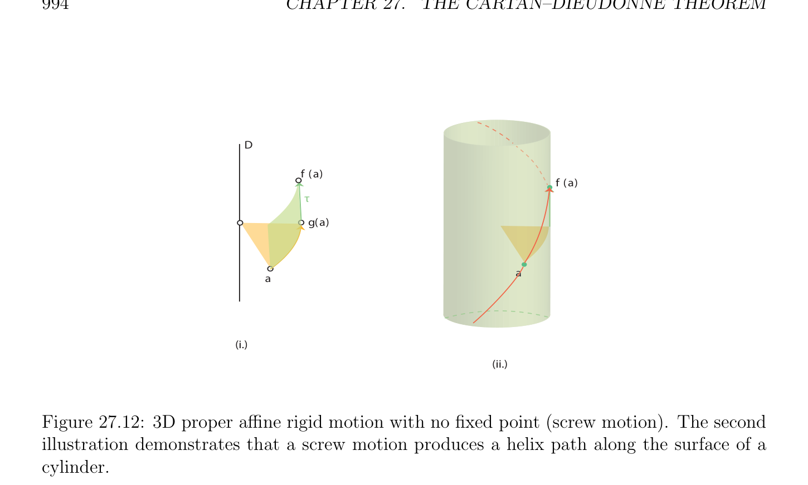

# Cartan–Dieudonné Định lý cho Afin Các phép đẳng cự

<!-- PAGE 993 -->
$$a$$
$$H$$
$$f (a)$$

**Hình 27.10:** 3D suy rộng/không thực sự afin cứng motion với mặt phẳng $H$ của cố định các điểm (phép đối xứng (reflection)).
$$D$$
$$a$$
$$O$$
$$H$$
$$f(a)$$
$$Figure 27.11: 3D improper affine rigid motion with a unique fixed point.$$
Thứ ba loại là hợp thành của afin phép đối xứng (reflection) về mặt phẳng theo sau bởi không tầm thường phép tịnh tiến bởi vectơ song song đến hướng của mặt phẳng của phép đối xứng (reflection), như được minh họa trong Hình 27.13. Điều này cuối cùng phép biến đổi là suy rộng/không thực sự afin phép đẳng cự (isometry).

## 27.5 Cartan–Dieudonn´e Định lý cho Afin

$$Isometries$$
Cartan–Dieudonn´e định lý cũng nghiệm đúng cho afin các phép đẳng cự, với nhỏ twist do các phép tịnh tiến. độc giả là referred đến Berger $[11]$, Snapper và Troyer $[168]$, hoặc Tisseron $[181]$ cho chi tiết treatment của Cartan–Dieudonn´e định lý và của nó các biến thể.

> **Định lý 27.11.** Cho $E$ là afin Không gian Euclid (Euclidean space) có số chiều $n \ge 1$. Mọi afin phép đẳng cự (isometry) $f \in$ Là(E) rằng có cố định điểm và là không đồng nhất thức là hợp thành của nhiều nhất $n$ afin các phép đối xứng. Mọi afin phép đẳng cự (isometry) $f \in$ Là(E) rằng có không có cố định điểm là

<!-- PAGE 994 -->
$$D$$
$$f (a)$$
$$f (a)$$
$$\tau$$
$$g(a)$$
$$a$$
$$a$$
$$(i.)$$
$$(ii.)$$

**Hình 27.12:** 3D thực sự/đúng đắn afin cứng motion với không có cố định điểm (screw motion). thứ hai illustration demonstrates rằng screw motion produces helix đường đi dọc theo mặt của hình trụ.
$$a$$
$$H$$
$$g(a)\overline{\tau} f (a)$$
$$Figure 27.13: 3D improper affine rigid motion with no fixed points.$$

<!-- PAGE 995 -->
Hợp thành của nhiều nhất $n + 2$ afin các phép đối xứng. Khi $n \ge 2$, đồng nhất thức là hợp thành của bất kỳ phép đối xứng (reflection) với chính nó.

*Chứng minh.* Thứ nhất, ta sử dụng Định lý 27.10. Nếu $f$ có cố định điểm $\Omega$, ta chọn $\Omega$ như gốc và hoạt động/công trình trong không gian vectơ (vector space) $E_{\Omega}$. Vì $f$ behaves như tuyến tính phép đẳng cự (isometry), kết quả suy ra
$$\longrightarrow  \longrightarrow \longrightarrow$$
Từ Định lý 27.1. Nhiều hơn/thêm specifically, ta có thể viết $f = s_{k} \circ \cdots  \circ s_{1}$ cho $k \le n$ siêu phẳng (hyperplane)
$$\longrightarrow$$
Các phép đối xứng $s_{i}$. Ta định nghĩa afin các phép đối xứng $s_{i}$ sao cho
$$\longrightarrow \longrightarrow$$
$$s_{i}(a) = \Omega +s_{i} (\Omega a)$$
Với mọi $a \in E$, và ta lưu ý rằng $f = s_{k} \circ \cdots  \circ s_{1}$, vì
$$\longrightarrow \longrightarrow \longrightarrow$$
$$f(a) = \Omega +s_{k} \circ \cdots  \circ s_{1}(\Omega a)$$
Với mọi $a \in E$. Nếu $f$ có không có cố định điểm, thì $f = t \circ g$ với một số afin phép đẳng cự (isometry) $g$ rằng có
$$\longrightarrow$$
Cố định điểm $\Omega$ và một số phép tịnh tiến $t = t_{\tau}$, với $f (\tau$) $= \tau$. Bởi lập luận chỉ cho trước, ta có thể viết $g = s_{k} \circ \cdots  \circ s_{1}$ với một số afin các phép đối xứng (nhiều nhất $n)$. Tuy nhiên, theo Bổ đề 27.9, phép tịnh tiến $t = t_{\tau}$ có thể được đạt được bởi hai afin các phép đối xứng về song song các siêu phẳng, và do đó $f = s_{k+2} \circ \cdots  \circ s_{1}$, với một số afin các phép đối xứng (nhiều nhất $n + 2)$. Khi $n \ge 3$, ta có thể cũng đặc trưng hóa afin các phép đẳng cự trong SE(n) theo afin flips. Đáng chú ý, không chỉ ta có thể thực hiện mà không có các phép tịnh tiến, nhưng ta có thể chẵn/ngay cả cận số của afin flips bởi $n$.

> **Định lý 27.12.** Cho $E$ là Euclidean không gian afin (affine space) có số chiều $n \ge 3$. Mọi afin cứng motion $f \in$ SE(E) là hợp thành của chẵn/ngay cả số của afin flips $f = f_{2k} \circ \cdots  \circ f_{1}$, ở đâu 2k $\le n$.

*Chứng minh.* Như trong chứng minh của Định lý 27.11, ta distinguish giữa hai các trường hợp ở đâu $f$ có một số cố định điểm hoặc không. Nếu $f$ có cố định điểm $\Omega$, ta áp dụng Định lý 27.5. Nhiều hơn/thêm specifically,
$$\longrightarrow  \longrightarrow \longrightarrow  \longrightarrow$$
Ta có thể viết $f = f_{2k} \circ \cdots  \circ f_{1}$ với một số flips $f_{i}$. Ta định nghĩa afin flips $f_{i}$ sao cho
$$\longrightarrow \longrightarrow$$
$$f_{i}(a) = \Omega +f_{i} (\Omega a)$$
Với mọi $a \in E$, và ta lưu ý rằng $f = f_{2k} \circ \cdots  \circ f_{1}$, vì
$$\longrightarrow \longrightarrow \longrightarrow$$
$$f(a) = \Omega +f_{2k} \circ \cdots  \circ f_{1}(\Omega a)$$
Với mọi $a \in E$. Nếu $f$ thực hiện không có cố định điểm, như trong chứng minh của Định lý 27.11, ta thu được
$$f = t_{\tau} \circ f_{2k} \circ \cdots  \circ f_{1},$$
$$\longrightarrow$$
Với một số afin flips $f_{i}$. Ta cần để thu được rid của phép tịnh tiến. Tuy nhiên, $f (\tau$) $= \tau$, và bởi
$$\longrightarrow_{\perp}  \longrightarrow$$
Phần thứ hai của Định lý 27.5, ta có thể giả sử rằng $\tau  \in F_{2k}$, ở đâu $F_{2k}$ là hướng

<!-- PAGE 996 -->
Của không gian con afin (affine subspace) định nghĩa afin flip $f_{2k}$. Cuối cùng, appealing đến Bổ đề 27.9, vì $\longrightarrow_{\perp} \tau  \in F_{2k}$, phép tịnh tiến $t_{\tau}$ có thể được biểu diễn dưới dạng hợp thành $f_{2k}'  \circ f_{2k-1}'$ của hai afin flips
$$\longrightarrow  \longrightarrow$$
$f_{2k-1}'$ và $f_{2k}'$ về hai song song các không gian con $\Omega + F_{2k}$ và $\Omega + \tau /2 + F_{2k}$, có khoảng cách
$$\longrightarrow$$
Là $\|\tau \|/2$. Tuy nhiên, vì $f_{2k-1}'$ và $f_{2k}$ là cả hai đồng nhất thức trên $\Omega + F_{2k}$, ta phải có $f_{2k-1}'  = f_{2k}$, và do đó
$$f=t_{\tau} \circ f_{2k} \circ f_{2k-1} \circ \cdots  \circ f_{1}$$
$$=f_{2k}'  \circ f_{2k-1}' \circ f_{2k} \circ f_{2k-1} \circ \cdots  \circ f_{1}$$
$$=f_{2k}'  \circ f_{2k-1} \circ \cdots  \circ f_{1},$$
Vì $f_{2k-1}'  = f_{2k}$ và $f_{2k-1}' \circ f_{2k} = f_{2k} \circ f_{2k} =$ id, vì $f_{2k}$ là afin tính đối xứng.
Nhận xét: Nó là dễ để chứng minh rằng nếu $f$ là screw motion trong SE(3), $D$ của nó trục, $\theta$ là của nó góc của phép quay, và $\tau$ phép tịnh tiến dọc theo hướng của $D$, thì $f$ là hợp thành của hai afin flips về các đường thẳng $D_{1}$ và $D_{2}$ trực giao đến $D$, tại khoảng cách $\|\tau \|/2$ và tạo ra góc $\theta /2$.
