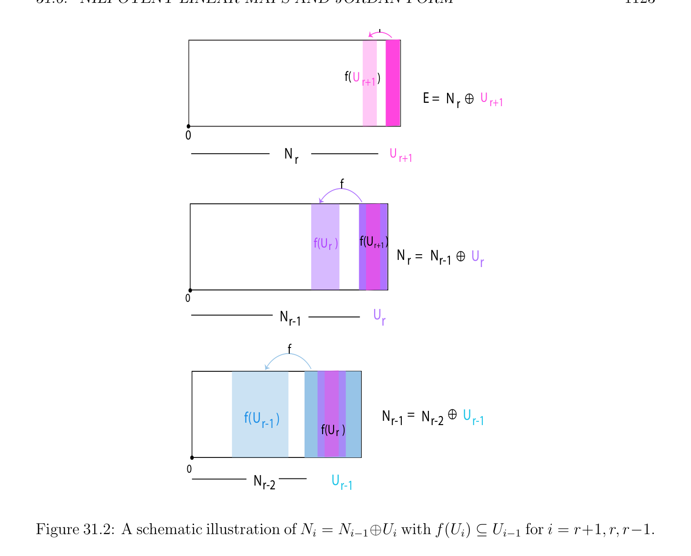

# Lũy linh (nilpotent) Các ánh xạ tuyến tính (linear maps) và Dạng Jordan (Jordan form)

<!-- PAGE 1122 -->

## 31.6 Lũy linh (nilpotent) Các ánh xạ tuyến tính (linear maps) và Dạng Jordan (Jordan form)

Điều này mục là devoted đến chuẩn tắc/bình thường tạo thành cho lũy linh (nilpotent) các ánh xạ. Ta suy ra Godement’s trình bày $[79]$. Cho $f$: $E \to E$ là lũy linh (nilpotent) ánh xạ tuyến tính (linear map) trên không gian vectơ hữu hạn chiều trên trường $K$, và giả sử rằng $f$ là không không ánh xạ. Có một nhỏ nhất dương số nguyên $r \ge 1$ như vậy $f^{r} \neq  0$ và $f^{r+1} = 0$. Rõ ràng, đa thức $X^{r+1}$ annihilates $f$, và nó là đa thức tối tiểu (minimal polynomial) của $f$ vì $f^{r} \neq  0$. Suy ra rằng $r + 1 \le n =$ dim(E). Cho chúng ta định nghĩa các không gian con $N_{i}$ bởi
$$N_{i} = \mathrm{Ker} (f^{i} ),i \ge 0.$$
Lưu ý rằng $N_{0} = (0), N_{1} =$ Ker $(f)$, và $N_{r+1} = E$. Cũng, hiển nhiên là
$$N_{i} \subseteq N_{i+1},i \ge 0.$$

> **Mệnh đề 31.13.** Cho trước lũy linh (nilpotent) ánh xạ tuyến tính (linear map) $f$ với $f^{r} \neq  0$ và $f^{r+1} = 0$ như ở trên, inclusions trong sau đây dãy là chặt:
$$(0) = N_{0} \subset N_{1} \subset \cdots  \subset N_{r} \subset N_{r+1} = E.$$

*Chứng minh.* Ta tiến hành bởi mâu thuẫn. Giả sử rằng $N_{i} = N_{i+1}$ với một số $i$ với $0 \le i \le r$. Vì $f^{r+1} = 0$, với mọi $u \in E$, ta có
$$0 = f^{r+1} (u) = f^{i+1} (f^{r-i} (u)),$$
Mà chỉ ra rằng $f^{r-i} (u) \in N_{i+1}$. Vì $N_{i} = N_{i+1}$, ta thu được $f^{r-i} (u) \in N_{i}$, và do đó $f^{r} (u) = 0$. Vì điều này nghiệm đúng với mọi $u \in E$, ta xem rằng $f^{r} = 0$, một mâu thuẫn.
$$̸$$

> **Mệnh đề 31.14.** Cho trước lũy linh (nilpotent) ánh xạ tuyến tính (linear map) $f$ với $f^{r} = 0$ và $f^{r+1} = 0$, với mọi số nguyên $i$ với $1 \le i \le r$, với mọi không gian con $U$ của $E$, nếu $U \cap N_{i} = (0)$, thì f(U) $\cap N_{i-1} = (0)$, và thu hẹp của $f$ đến $U$ là đẳng cấu lên f(U).

*Chứng minh.* Chọn $v \in$ f(U) $\cap N_{i-1}$. Ta có $v =$ f(u) với một số $u \in U$ và $f^{i-1} (v) = 0$, mà có nghĩa là $f^{i} (u) = 0$. Thì $u \in U \cap N_{i}$, do đó $u = 0$ vì $U \cap N_{i} = (0)$, và $v =$ f(u) $= 0$. Vì vậy, f(U) $\cap N_{i-1} = (0)$. thu hẹp của $f$ đến $U$ là hiển nhiên toàn ánh (surjective) trên f(U). Giả sử rằng f(u) $= 0$ với một số $u \in U$. Thì $u \in U \cap N_{1} \subseteq U \cap N_{i} = (0)$ (vì $i \ge 1)$, do đó $u = 0$, mà chứng tỏ rằng $f$ là cũng đơn ánh (injective) trên $U$.

> **Mệnh đề 31.15.** Cho trước lũy linh (nilpotent) ánh xạ tuyến tính (linear map) $f$ với $f^{r} \neq  0$ và $f^{r+1} = 0$, tồn tại một dãy của không gian con $U_{1}, \dots  , U_{r+1}$ của $E$ với các tính chất sau đây:
$(1) N_{i} = N_{i-1} \oplus U_{i}$, cho $i = 1, \dots  , r + 1$.
$(2)$ Ta có $f(U_{i}) \subseteq U_{i-1}$, và thu hẹp của $f$ đến $U_{i}$ là đơn ánh, cho $i = 2, \dots  , r+1$. Xem Hình 31.2.

<!-- PAGE 1123 -->
$$f$$
$$f(U r+1)$$
$$E = N^{r}4^{Ur+1}$$
$$0$$
$$N^{r}U r+1$$
$$f$$
$$f(U   )f(U     )$$
$$rr+1$$
$$N^{r}=N_{r-1}4Ur$$
$$0$$
$$N_{r-1}Ur$$
$$f$$
$$f(U_{r-1})N_{r-1}=N_{r-2}4U_{r-1}$$
$$f(U   )r$$
$$0$$
$$N_{r-2}U_{r-1}$$

**Hình 31.2:** schematic illustration của $N_{i} = N_{i-1}\oplus U_{i}$ với $f(U_{i}) \subseteq U_{i-1}$ cho $i = r+1, r$, r-1.

*Chứng minh.* Ta tiến hành một cách quy nạp, bởi định nghĩa dãy $U_{r+1}, U_{r}, \dots  , U_{1}$. Ta chọn $U_{r+1}$ là bất kỳ supplement của $N_{r}$ trong $N_{r+1} = E$, sao cho
$$E = N_{r+1} = N_{r} \oplus U_{r+1}.$$
Vì $f^{r+1} = 0$ và $N_{r} =$ Ker $(f^{r})$, ta có $f(U_{r+1}) \subseteq N_{r}$, và theo Mệnh đề 31.14, như $U_{r+1} \cap N_{r} = (0)$, ta có $f(U_{r+1})\cap N_{r-1} = (0)$. Hệ quả là, ta có thể chọn supplement $U_{r}$ của $N_{r-1}$ trong $N_{r}$ sao cho $f(U_{r+1}) \subseteq U_{r}$. Ta có
$$N_{r} = N_{r-1} \oplus U_{r}andf(U_{r+1}) \subseteq U_{r}.$$
Theo Mệnh đề 31.14, $f$ là đơn ánh từ $U_{r+1}$ đến $U_{r}$. Giả sử một cách quy nạp rằng $U_{r+1}, \dots  , U_{i}$ có đã được được định nghĩa cho $i \ge 2$ và rằng chúng thỏa mãn $(1)$ và $(2)$. Vì
$$N_{i} = N_{i-1} \oplus U_{i},$$

<!-- PAGE 1124 -->
Ta có $U_{i} \subseteq N_{i}$, do đó $f^{i-1} (f(U_{i})) = f^{i} (U_{i}) = (0)$, mà suy ra rằng $f(U_{i}) \subseteq N_{i-1}$. Cũng, vì $U_{i} \cap N_{i-1} = (0)$, theo Mệnh đề 31.14, ta có $f(U_{i})\cap N_{i-2} = (0)$. Suy ra rằng có một supplement $U_{i-1}$ của $N_{i-2}$ trong $N_{i-1}$ rằng chứa $f(U_{i})$. Ta có
$$N_{i-1} = N_{i-2} \oplus U_{i-1}andf(U_{i}) \subseteq U_{i-1}.$$
Sự kiện rằng $f$ là đơn ánh từ $U_{i}$ vào $U_{i-1}$ suy ra từ Mệnh đề 31.14. Vì vậy, quy nạp bước được chứng minh. cách xây dựng các dừng khi $i = 1$. Bởi vì $N_{0} = (0)$ và $N_{r+1} = E$, ta xem rằng $E$ là tổng trực tiếp (direct sum) của $U_{i}$:
$$E = U_{1} \oplus \cdots  \oplus U_{r+1},$$
Với $f(U_{i}) \subseteq U_{i-1}$, và $f$ đơn ánh từ $U_{i}$ đến $U_{i-1}$, cho $i = r + 1, \dots  , 2$. Bởi clever lựa chọn của các cơ sở trong $U_{i}$, ta thu được kết quả sau đẹp định lý.

> **Định lý 31.16.** Với mọi lũy linh (nilpotent) ánh xạ tuyến tính (linear map) $f$: $E \to E$ trên không gian vectơ hữu hạn chiều $E$ có số chiều $n$ trên trường $K$, có một cơ sở (basis) của $E$ sao cho ma trận $N$ của $f$ là của tạo thành
$$N = \begin{pmatrix} 0 & \nu_{1} & 0 & \cdots & 0 & 0 \\ 0 & 0 & \nu_{2} & \cdots & 0 & 0 \\ \vdots & \vdots & \vdots & \vdots & \vdots & \vdots \\ 0 & 0 & 0 & \cdots & 0 & \nu_{n} \\ 0 & 0 & 0 & \cdots & 0 & 0 \end{pmatrix} ,$$
Ở đâu $\nu_{i}  = 1$ hoặc $\nu_{i}  = 0$.
$$Proof. First apply Proposition 31.15 to obtain a direct sum E = \bigoplus_{i}  r=1+1 U_{i}. Then we define$$
Cơ sở (basis) của $E$ một cách quy nạp như sau. Thứ nhất ta chọn cơ sở (basis)
$$e_{1}^{r+1}, \dots  , e_{nr+1}^{r+1}$$
Của $U_{r+1}$. Tiếp theo, cho $i = r + 1, \dots  , 2$, cho trước cơ sở (basis)
$$e_{1}^{i}, \dots  , e_{ni}^{i}$$
Của $U_{i}$, vì $f$ là đơn ánh (injective) trên $U_{i}$ và $f(U_{i}) \subseteq U_{i-1}$, các vectơ $f(e_{1}^{i}), \dots  , f(e_{ni}^{i})$ là độc lập tuyến tính (linearly independent), do đó ta định nghĩa cơ sở (basis) của $U_{i-1}$ bởi completing $f(e_{1}^{i}), \dots  , f(e_{ni}^{i})$ đến cơ sở (basis) trong $U_{i-1}$:
$$e_{1}^{i-1}, \dots  , e_{ni}^{i-1} , e_{ni+1}^{i-1}, \dots  , e_{ni-1}^{i-1}$$
Với
$$e_{j}^{i-1}= f(e_{j}^{i}),j = 1 \dots  , n_{i}.$$
Vì $U_{1} = N_{1} =$ Ker $(f)$, ta có
$$f(e_{j}^{1}) = 0,j = 1, \dots  , n_{1}.$$

<!-- PAGE 1125 -->
Cơ sở (cơ sở (basis)) này các vectơ có thể được arranged như các hàng của sau đây ma trận:
$$\begin{pmatrix} e_{1}^{r+1} & \cdots & e_{nr}^{r+1} \\ \vdots & \ddots \\ e_{1}^{r} & \cdots & e_{nr+1}^{r} & e_{nr+1+1}^{r} & \cdots & e_{nr}^{r} \\ \vdots & \vdots & \vdots & \vdots \\ e_{1}^{r-1} & \cdots & e_{nr}^{r-1} & e_{nr+1+1}^{r-1} & \cdots & e_{n}^{r-1} & e_{nr}^{r-1} & \cdots & e_{nr}^{r-1} \\ \vdots & \ddots & \vdots & \vdots & \ddots & \ddots \\ \vdots & \vdots & \vdots & \vdots & \vdots & \vdots \\ e_{1}^{1} & e_{nr+1}^{1} & e_{nr+1+1}^{1} & e_{nr}^{1} & e_{nr+1}^{1} & e_{nr-1}^{1} & e_{n1}^{1} \end{pmatrix}$$
$$\cdots \cdots \cdots \cdots \cdots$$
Cuối cùng, ta định nghĩa cơ sở (basis) $(e_{1}, \dots  , e_{n})$ bởi danh sách mỗi cột của ở trên ma trận từ bottom-up, bắt đầu với cột một, thì cột hai, etc. Điều này có nghĩa là ta danh sách các vectơ $e_{j}^{i}$ trong sau đây thứ tự: Cho $j = 1, \dots  , n_{r+1}$, danh sách $e_{j}^{1}, \dots  , e_{j}^{r+1}$; Nói chung, cho $i = r, \dots  , 1$,
$$for j = n_{i+1} + 1, \dots  , n_{i}, list e_{j}^{1}, \dots  , e_{j}^{i}.$$
Thì bởi vì $f(e_{j}^{1}) = 0$ và $e_{j}^{i-1} = f(e_{j}^{i})$ cho $i \ge 2$, hoặc
$$f(e_{i}) = 0orf(e_{i}) = e_{i-1},$$
Mà chứng minh định lý. Như ứng dụng của Định lý 31.16, ta thu được Dạng Jordan (Jordan form) của ánh xạ tuyến tính (linear map).

> **Định nghĩa 31.7.** Khối Jordan (Jordan block) là một ma trận cỡ $r \times  r$ $J_{r}(\lambda$), của tạo thành
$$J_{r}(\lambda ) = \begin{pmatrix} \lambda & 1 & 0 & \cdots & 0 \\ 0 & \lambda & 1 & \cdots & 0 \\ \vdots & \vdots & \ddots & \ddots & \vdots \\ 0 & 0 & 0 & \ddots & 1 \\ 0 & 0 & 0 & \lambda \end{pmatrix} ,$$
$$\cdots$$
Ở đâu $\lambda  \in K$, với $J_{1}(\lambda$) $= (\lambda$) nếu $r = 1$. Jordan ma trận, $J$, là $n \times  n$ khối ma trận đường chéo (diagonal matrix) của tạo thành
$$J = \begin{pmatrix} J_{r1}(\lambda_{1} ) & \cdots & 0 \\ \vdots & \ddots & \vdots \\ 0 & \cdots & J_{rm}(\lambda_{m} ) \end{pmatrix} ,$$
Ở đâu mỗi $J_{rk}(\lambda_{k}$) là Khối Jordan (Jordan block) liên kết với một số $\lambda_{k}  \in K$, và với $r_{1}+\cdots +r_{m} = n$.

<!-- PAGE 1126 -->
Để đơn giản hóa ký hiệu, ta thường viết $J(\lambda$) cho $J_{r}(\lambda$). Đây là một ví dụ của Jordan ma trận với bốn các khối:
$$J = \begin{pmatrix} \lambda & 1 & 0 & 0 & 0 & 0 & 0 & 0 \\ 0 & \lambda & 1 & 0 & 0 & 0 & 0 & 0 \\ 0 & 0 & \lambda & 0 & 0 & 0 & 0 & 0 \\ 0 & 0 & 0 & \lambda & 1 & 0 & 0 & 0 \\ 0 & 0 & 0 & 0 & \lambda & 0 & 0 & 0 \\ 0 & 0 & 0 & 0 & 0 & \lambda & 0 & 0 \\ 0 & 0 & 0 & 0 & 0 & 0 & \mu & 1 \\ 0 & 0 & 0 & 0 & 0 & 0 & 0 & \mu \end{pmatrix} .$$

> **Định lý 31.17.** (Dạng Jordan (Jordan form)) Cho $E$ là không gian vectơ (vector space) có số chiều $n$ trên trường $K$ và cho $f$: $E \to E$ là ánh xạ tuyến tính (linear map). Các tính chất sau đây là tương đương:
$(1)$ các trị riêng (eigenvalues) của $f$ tất cả thuộc đến $K$ (i.e. các nghiệm của đa thức đặc trưng (characteristic polynomial) $\chi_{f}$ tất cả thuộc đến $K)$.
$(2)$ Có một cơ sở (basis) của $E$ trong mà ma trận của $f$ là Jordan ma trận.
$$Proof. Assume (1). First we apply Theorem 31.11, and we get a direct sum E = \bigoplus_{j}  k=1 W_{k},$$
Sao cho thu hẹp của $g_{i} = f$ - $\lambda_{j}$ id đến $W_{i}$ là lũy linh (nilpotent). Theo Định lý 31.16, có một cơ sở (basis) của $W_{i}$ sao cho ma trận của thu hẹp của $g_{i}$ là của tạo thành
$$G_{i} = \begin{pmatrix} 0 & \nu_{1} & 0 & \cdots & 0 & 0 \\ 0 & 0 & \nu_{2} & \cdots & 0 & 0 \\ \vdots & \vdots & \vdots & \vdots & \vdots & \vdots \\ 0 & 0 & 0 & \cdots & 0 & \nu_{ni} \\ 0 & 0 & 0 & \cdots & 0 & 0 \end{pmatrix} ,$$
Ở đâu $\nu_{i}  = 1$ hoặc $\nu_{i}  = 0$. Hơn nữa, trên bất kỳ cơ sở (basis), $\lambda_{i}$ id được biểu diễn bởi ma trận đường chéo (diagonal matrix) $D_{i}$ với $\lambda_{i}$ trên đường chéo. Thì rõ ràng là ta có thể split $D_{i} + G_{i}$ vào Các khối Jordan bởi tạo thành Khối Jordan (Jordan block) với mọi uninterrupted dây chuyền/xích của 1s. Bởi đặt các cơ sở của $W_{i}$ cùng nhau, ta thu được ma trận trong Dạng Jordan (Jordan form) cho $f$. Bây giờ giả sử $(2)$. Nếu $f$ có thể được biểu diễn bởi Jordan ma trận, hiển nhiên là đường chéo các phần tử (entries) là các trị riêng (eigenvalues) của $f$, do đó chúng tất cả thuộc đến $K$. Nhận thấy rằng Định lý 31.17 áp dụng nếu $K = \mathbb{C}$. Hóa ra là có tính duy nhất các tính chất của Các khối Jordan. Có cũng khác cơ bản chuẩn tắc/bình thường các dạng cho các ánh xạ tuyến tính (linear maps), chẳng hạn như dạng chính tắc hữu tỷ (rational canonical form), nhưng để chứng minh các kết quả này, nó là tốt hơn đến develop nhiều hơn/thêm powerful machinery về sinh hữu hạn (finitely generated) các môđun trên PID. Đến accomplish điều này hầu hết effectively, ta cần một số cơ bản knowledge về các tích tenxơ.

<!-- PAGE 1127 -->
Nếu phức $n \times  n$ ma trận $A$ được biểu diễn theo của nó Jordan phân rã như $A = D + N$, vì $D$ và $N$ giao hoán, theo Mệnh đề 9.22, hàm mũ của $A$ được cho bởi
$$e^{A}= e^{D}e^{N},$$
Và vì $N$ là $n \times  n$ lũy linh (nilpotent) ma trận, $N^{n-1} = 0$, do đó ta thu được
$$e^{A}= e^{D} \begin{pmatrix} N & N^{2} & N^{n-1} \\ I+ & + & + \cdots  + \\ 1! & 2! & (n -1)! \end{pmatrix} .$$
Đặc biệt, ở trên áp dụng nếu $A$ là Jordan ma trận. sự kiện này có thể được được sử dụng để giải (ít nhất trong lý thuyết) các hệ của bậc nhất tuyến tính vi phân các phương trình. Như vậy các hệ là của tạo thành
$$\frac{dX}{dt} = AX,(*)$$
Ở đâu $A$ là một ma trận cỡ $n \times  n$ và $X$ là $n$ chiều vectơ của các hàm của tham số $t$. Nó có thể được được hiển thị rằng các cột của ma trận $e^{tA}$ tạo thành cơ sở (basis) của không gian vectơ (vector space) của các nghiệm của hệ của tuyến tính vi phân các phương trình (*); xem Artin $[7]$ (Chương $4)$. Hơn nữa, với mọi ma trận $B$ và bất kỳ ma trận khả nghịch (invertible matrix) $P$, nếu $A = PBP^{-1}$, thì hệ (*) là tương đương đến
$$P^{-1} \frac{dX}{dt} = BP^{-1}X,$$
Do đó nếu ta tạo thay đổi của biến $Y = P^{-1} X$, ta thu được hệ
$$\frac{dY}{dt} = BY.(**)$$
Hệ quả là, nếu $B$ là sao cho hàm mũ $e^{tB}$ có thể được dễ dàng được tính, ta thu được tường minh nghiệm $Y$ của (**), và $X = PY$ là tường minh nghiệm của (*). Điều này là trường hợp khi $B$ là Dạng Jordan (Jordan form) của $A$. Trong trường hợp này, nó suffices đến xét Các khối Jordan của $B$. Thì ta có
$$J_{r}(\lambda ) = \lambda I_{r} + \begin{pmatrix} 0 & 1 & 0 & \cdots & 0 \\ 0 & 0 & 1 & \cdots & 0 \\ \vdots & \vdots & \ddots & \ddots & \vdots \\ 0 & 0 & 0 & \ddots & 1 \\ 0 & 0 & 0 & 0 \end{pmatrix} = \lambda I_{r} + N,$$
$$\cdots$$
Và các lũy thừa $N^{k}$ là dễ dàng được tính. Ví dụ, nếu
$$B = \begin{pmatrix} 3 & 1 & 0 \\ 0 & 3 & 1 \\ 0 & 0 & 3 \end{pmatrix} = 3I_{3} + \begin{pmatrix} 0 & 1 & 0 \\ 0 & 0 & 1 \\ 0 & 0 & 0 \end{pmatrix}$$
