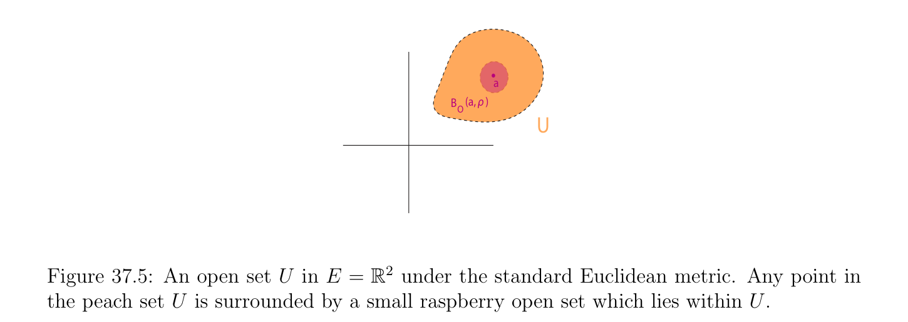

# Các không gian mêtric và Các không gian vectơ định chuẩn

<!-- PAGE 1353 -->
Chương $37$ Tôpô

## 37.1 Các không gian mêtric và Các không gian vectơ định chuẩn

Điều này chương chứa ôn tập/tổng quan của cơ bản tôpô các khái niệm. Thứ nhất các không gian mêtric được định nghĩa. Tiếp theo các không gian vectơ định chuẩn được định nghĩa. Đóng và các tập mở được định nghĩa, và của chúng cơ bản các tính chất được phát biểu. tổng quát khái niệm của không gian tôpô (topological space) được định nghĩa. bao đóng (closure) và phần trong (interior) của tập con được định nghĩa. không gian con tôpô và tích tôpô được định nghĩa. Liên tục các ánh xạ và các phép đồng phôi (homeomorphism) được định nghĩa. Các giới hạn của các dãy được định nghĩa. Liên tục các ánh xạ tuyến tính (linear maps) và đa tuyến tính các ánh xạ được định nghĩa và studied ngắn gọn. chương kết thúc với định nghĩa của được chuẩn (norm) không gian afin (affine space). Hầu hết các không gian được xét trong điều này cuốn sách có tôpô cấu trúc cho trước bởi mêtric hoặc chuẩn (norm), và ta thứ nhất ôn tập/tổng quan các phần tử này các khái niệm. Ta bắt đầu với các không gian mêtric. Nhắc lại rằng $\mathbb{R}_{+} = {x \in \mathbb{R}$ | $x \ge 0}$.

> **Định nghĩa 37.1.** không gian mêtric (metric space) là tập hợp $E$ cùng với hàm $d: E \times  E \to \mathbb{R}_{+}$, được gọi là mêtric, hoặc khoảng cách, assigning không âm thực số d(x, $y)$ đến bất kỳ hai các điểm $x, y \in E$, và thỏa mãn sau đây các điều kiện với mọi $x, y, z \in E$:
(D1) d(x, $y) =$ d(y, $x)$. (tính đối xứng)
(D2) d(x, $y) \ge 0$, và d(x, $y) = 0$ khi và chỉ khi $x = y$. (positivity)
(D3) d(x, $z) \le$ d(x, $y) +$ d(y, $z)$. (tam giác bất đẳng thức) Geometrically, Điều kiện (D3) các biểu diễn sự kiện rằng trong tam giác với các đỉnh $x, y, z$, độ dài của bất kỳ vế/cạnh là bị chặn bởi tổng của các độ dài của khác hai các vế/cạnh. Từ (D3), ta ngay lập tức thu được
$$|d(x, y) -d(y, z)| \le d(x, z).$$
Cho chúng ta cho một số các ví dụ của các không gian mêtric. Nhắc lại rằng tuyệt đối giá trị |x| của thực số $x \in \mathbb{R}$ được định nghĩa như vậy | | $= x$ nếu $x \ge 0$, |x| $= -x$ nếu $x < 0$, và cho phức
$$number x = a + ib, by |x| =\sqrt \frac{thatx}{a^{2}+ b^{2}.}$$
$$1353$$

<!-- PAGE 1354 -->

> **Ví dụ 37.1.** $1$. Cho $E = \mathbb{R}$, và d(x, $y) =$ |x - y|, tuyệt đối giá trị của $x$ - $y$. Điều này là so-called tự nhiên mêtric trên $\mathbb{R}$.
$$\mathbb{R}^{n} \mathbb{C}^{n}$$
$2$. Cho $E =$ (hoặc $E =$). Ta có Euclidean mêtric
$$d_{2}(x, y) = \begin{pmatrix} |x_{1} -y_{1}|^{2}+ \cdots  + |x_{n} -y_{n}\overline{|}^{212} \end{pmatrix} ,$$
Khoảng cách giữa các điểm $(x_{1}, \dots  , x_{n})$ và $(y_{1}, \dots  , y_{n}). 3$. Với mọi tập hợp $E$, ta có thể định nghĩa rời rạc mêtric, được định nghĩa sao cho d(x, $y) = 1$ khi và chỉ khi $x \neq  y$, và d(x, $x) = 0. 4$. Với mọi, $b \in \mathbb{R}$ sao cho $< b$, ta định nghĩa sau đây các tập hợp: [, $b] = {x \in \mathbb{R}$ | $a \le x \le b}$, (đóng khoảng/đoạn) (, $b) = {x \in \mathbb{R}$ | $< x < b}$, (mở khoảng/đoạn) [, $b) = {x \in \mathbb{R}$ | $a \le x < b}$, (khoảng/đoạn đóng trên trái, mở trên phải) (, $b] = {x \in \mathbb{R}$ | $< x \le b}$, (khoảng/đoạn mở trên trái, đóng trên phải) Cho $E = [a, b]$, và d(x, $y) =$ |x - y|. Thì, ([, $b], d)$ là không gian mêtric (metric space). Ta sẽ cần để định nghĩa khái niệm của proximity trong thứ tự để định nghĩa sự hội tụ của các giới hạn và tính liên tục của các hàm. Cho điều này ta giới thiệu một số tiêu chuẩn “nhỏ các lân cận (neighborhood).”

> **Định nghĩa 37.2.** Cho trước không gian mêtric (metric space) $E$ với mêtric $d$, với mọi $a \in E$, với mọi $\rho  \in \mathbb{R}$, với $\rho  > 0$, tập hợp
$$B(a, \rho ) = {x \in E | d(a, x) \le \rho }$$
Được gọi là hình cầu đóng (closed ball) của tâm và bán kính $\rho$, tập hợp
$$B_{0}(a, \rho ) = {x \in E | d(a, x) < \rho }$$
Được gọi là hình cầu mở (open ball) của tâm và bán kính $\rho$, và tập hợp
$$S(a, \rho ) = {x \in E | d(a, x) = \rho }$$
Được gọi là mặt cầu của tâm và bán kính $\rho$. Nó nên được lưu ý rằng $\rho$ là hữu hạn (i.e., không $+\infty$). tập con $X$ của không gian mêtric (metric space) $E$ là bị chặn nếu có một hình cầu đóng (closed ball) B(, $\rho$) sao cho $X \subseteq$ B(, $\rho$). Rõ ràng, B(, $\rho$) $= B_{0}(a, \rho$) $\cup$ S(, $\rho$).

> **Ví dụ 37.2.**

<!-- PAGE 1355 -->
$1$. Trong $E =\mathbb{R}$ với khoảng cách |x - y|, hình cầu mở (open ball) của tâm và bán kính $\rho$ là mở khoảng/đoạn $(a$ - $\rho$, $a + \rho$).
$$\mathbb{R}^{2}$$
$2$. Trong $E =$ với Euclidean mêtric, hình cầu mở (open ball) của tâm và bán kính $\rho$ là tập hợp của các điểm bên trong đĩa của tâm và bán kính $\rho$, excluding biên (boundary) các điểm trên đường tròn.
$$\mathbb{R}^{3}$$
$3$. Trong $E =$ với Euclidean mêtric, hình cầu mở (open ball) của tâm và bán kính $\rho$ là tập hợp của các điểm bên trong mặt cầu của tâm và bán kính $\rho$, excluding biên (boundary) các điểm trên mặt cầu. Một nên là biết rằng trực giác có thể được misleading trong tạo thành hình học ảnh (image) của đóng (hoặc mở) hình cầu. Ví dụ, nếu $d$ là rời rạc mêtric, hình cầu đóng (closed ball) của tâm và bán kính $\rho  < 1$ bao gồm chỉ của của nó tâm, và hình cầu đóng (closed ball) của tâm và bán kính $\rho  \ge 1$ bao gồm của toàn bộ không gian!  Nếu $E = [a, b]$, và d(x, $y) =$ |x - y|, như trong Ví dụ 37.1, hình cầu mở (open ball) $B_{0}(a, \rho$), với $\rho  < b$ - $a$, là thực ra khoảng/đoạn [, $a + \rho$), mà là đóng trên trái. Ta bây giờ xét rất quan trọng đặc biệt trường hợp của các không gian mêtric, các không gian vectơ định chuẩn. Các không gian vectơ định chuẩn có đã đã được được định nghĩa trong Chương $9$ (Định nghĩa 9.1) nhưng cho độc giả’s convenience ta repeat định nghĩa.

> **Định nghĩa 37.3.** Cho $E$ là không gian vectơ (vector space) trên trường $K$, ở đâu $K$ là hoặc trường $\mathbb{R}$ của các số thực, hoặc $field\mathbb{C}$ của phức các số. chuẩn (norm) trên $E$ là hàm $\|\|: E \to \mathbb{R}_{+}$, assigning không âm thực số $\|u\|$ đến bất kỳ vectơ $u \in E$, và thỏa mãn sau đây các điều kiện với mọi $x, y, z \in E$:
(N1) $\|x\|\ge 0$, và $\|x\| = 0$ khi và chỉ khi $x = 0$. (positivity)
(N2) $\|\lambda x\| = |\lambda$ | $\|x\|$. (scaling)
(N3) $\|x + y\|\le \|x\| + \|y\|$. (tam giác bất đẳng thức) $A$ không gian vectơ (vector space) $E$ cùng với chuẩn (norm) $\|\|$ được gọi là một không gian vectơ định chuẩn (normed vector space). Từ (N3), ta dễ dàng thu được
$$|\|x\|-\|y\|| \le \|x -y\|.$$
Cho trước không gian vectơ định chuẩn (normed vector space) $E$, nếu ta định nghĩa $d$ sao cho
$$d(x, y) = \|x -y\|,$$
Nó là dễ dàng được thấy rằng $d$ là mêtric. Do đó, mọi không gian vectơ định chuẩn (normed vector space) là ngay lập tức không gian mêtric (metric space). Lưu ý rằng mêtric liên kết với chuẩn (norm) là bất biến dưới phép tịnh tiến, nghĩa là,
$$d(x + u, y + u) = d(x, y).$$

<!-- PAGE 1356 -->
Cho điều này lý do, ta có thể thu hẹp chính chúng ta đến mở hoặc đóng các hình cầu của tâm $0$. Các ví dụ của các không gian vectơ định chuẩn đã là cho trước trong Ví dụ 9.1. Ta repeat hầu hết quan trọng các ví dụ.
$$\mathbb{R}^{n}  \mathbb{C}^{n}$$

> **Ví dụ 37.3.** Cho $E =$ (hoặc $E =$). Có ba tiêu chuẩn các chuẩn. Với mọi $(x_{1}, \dots  , x_{n}) \in E$, ta có chuẩn (norm) $\|x\|_{1}$, được định nghĩa sao cho,
$$\|x\|_{1} = |x_{1}| + \cdots  + |x_{n}|,$$
Ta có Euclidean chuẩn (norm) $\|x\|_{2}$, được định nghĩa sao cho,
$$\|x\|_{2} = \begin{pmatrix} |x_{1}|^{2}+ \cdots  + |x_{n}\overline{|}^{212} \end{pmatrix} ,$$
Và sup-norm $\|x\|_{\infty}$, được định nghĩa sao cho,
$$\|x\|_{\infty}= \max{|x_{i}| | 1 \le i \le n}.$$
Tổng quát hơn, ta định nghĩa $\ell_{p}$ -chuẩn (norm) (cho $p \ge 1)$ bởi
$$\|x\|_{p} = (|x_{1}|^{p}+ \cdots  + |x_{n}|^{p})^{1/p}.$$
Ta được chứng minh trong Mệnh đề 9.1 rằng $\ell_{p}$ -các chuẩn là thật vậy các chuẩn. đóng unit các hình cầu được tâm tại $(0, 0)$ cho $\|\|_{1}, \|\|_{2}$, và $\|\|_{\infty}$, dọc theo với containment relationships, được hiển thị trong Các hình 37.1 và 37.2. Các hình 37.3 và 37.4 minh họa tình huống trong $\mathbb{R}^{3}$.
$$11$$
$$0.50.5$$
$$K\overline{1}\overline{K}\overline{0.5}\overline{0}\overline{0.5}\overline{1} K\overline{1}\overline{K}\overline{0.5}\overline{0}\overline{0.5}\overline{1}$$
$$K0.5K0.5$$
$$K1K1$$
$$ab$$
$$1$$
$$0.5$$
$$K\overline{1}\overline{K}\overline{0.5}\overline{0}\overline{0.5}\overline{1}$$
$$K0.5$$
$$K1$$
$$c$$

**Hình 37.1:** Hình () chỉ ra diamond shaped hình cầu đóng (closed ball) liên kết với $\|\|_{1}$. Hình
$(b)$ chỉ ra đóng unit đĩa liên kết với $\|\|_{2}$, trong khi Hình $(c)$ minh họa đóng unit hình cầu liên kết với $\|\|_{\infty}$.

<!-- PAGE 1357 -->
$$1$$
$$0.5$$
$$\overline{K}\overline{1}\overline{K}\overline{0.5}\overline{0}\overline{0.5}\overline{1}$$
$$K0.5$$
$$K1$$
$$Figure 37.2: The relationship between the closed unit balls centered at (0, 0).$$
$$a$$
$$b$$
$$c$$

**Hình 37.3:** Hình () chỉ ra octahedral shaped hình cầu đóng (closed ball) liên kết với $\|\|_{1}$. Hình
$(b)$ chỉ ra đóng cầu liên kết với $\|\|_{2}$, trong khi Hình $(c)$ minh họa đóng unit hình cầu liên kết với $\|\|_{\infty}$. Trong không gian vectơ định chuẩn (normed vector space) ta định nghĩa hình cầu đóng (closed ball) hoặc hình cầu mở (open ball) của bán kính $\rho$ như hình cầu đóng (closed ball) hoặc hình cầu mở (open ball) của tâm $0$. Ta có thể sử dụng ký hiệu $B(\rho$) và $B_{0}(\rho$). Ta sẽ bây giờ định nghĩa then chốt các khái niệm của các tập mở và các tập đóng, và của không gian tôpô (topological space).

<!-- PAGE 1358 -->

**Hình 37.4:** relationship giữa đóng unit các hình cầu được tâm tại $(0, 0, 0)$.

> **Định nghĩa 37.4.** Cho $(E, d)$ là không gian mêtric (metric space). tập con $U \subseteq E$ là tập mở (open set) trong $E$ nếu hoặc $U = \emptyset$, hoặc với mọi $a \in U$, tồn tại một hình cầu mở (open ball) $B_{0}(a, \rho$) sao cho, $B_{0}(a, \rho$) $\subseteq U.^{1} A$ tập con $F \subseteq E$ là tập đóng (closed set) trong $E$ nếu của nó phần bù $E$ - $F$ là mở trong $E$. Xem Hình 37.5.
$$a$$
$$B(a,    )\rho$$
$$O$$
$$U$$
$$\mathbb{R}^{2}$$

**Hình 37.5:** tập mở (open set) $U$ trong $E =$ dưới tiêu chuẩn Euclidean mêtric. Bất kỳ điểm trong peach tập hợp $U$ là surrounded bởi nhỏ raspberry tập mở (open set) mà lies trong phạm vi $U$. tập hợp $E$ chính nó là mở, vì với mọi $a \in E$, mọi hình cầu mở (open ball) của tâm được chứa trong $E$. Trong $E =\mathbb{R}^{n}$, cho trước $n$ các khoảng $[a_{i}, b_{i}]$, với $a_{i} < b_{i}$, nó là dễ để chỉ ra rằng mở n-cube
$${(x_{1}, \dots  , x_{n}) \in E | a_{i} < x_{i} < b_{i}, 1 \le i \le n}$$
Là tập mở (open set). Thực ra, nó là khả dĩ/có thể để tìm mêtric cho mà như vậy mở n-cubes là mở các hình cầu! Tương tự, ta có thể định nghĩa đóng n-cube
$${(x_{1}, \dots  , x_{n}) \in E | a_{i} \le x_{i} \le b_{i}, 1 \le i \le n},$$
Mà là tập đóng (closed set). các tập mở thỏa mãn một số quan trọng các tính chất rằng dẫn đến đến định nghĩa của không gian tôpô (topological space). $\overline{1}\overline{Recall} \overline{that} \overline{\rho  >}\overline{0.}$

<!-- PAGE 1359 -->

> **Mệnh đề 37.1.** Cho trước không gian mêtric (metric space) $E$ với mêtric $d$, họ $\mathcal{O}$ của tất cả các tập mở được định nghĩa trong Định nghĩa 37.4 thỏa mãn các tính chất sau đây:
(O1) Với mọi hữu hạn họ $(U_{i})_{1\le i\le n}$ của các tập hợp $U_{i} \in O$, ta có $U_{1} \cap \cdots  \cap U_{n} \in O$, i.e., $\mathcal{O}$ là đóng dưới hữu hạn các giao.
$$(O2) For every arbitrary family (U_{i})_{i\in I} of sets U_{i} \in O, we have \bigcup_{i}  \in I U_{i} \in O, i.e.,\mathcal{O} is closed$$
Dưới tùy ý các hợp.
(O3) $\emptyset \in O$, và $E \in O$, i.e., $\emptyset$ và $E$ thuộc đến $\mathcal{O}$. Hơn nữa, với mọi hai phân biệt các điểm $a \neq  b$ trong $E$, ở đó tồn tại hai các tập mở $U_{a}$ và $U_{b}$ sao cho, $a \in U_{a}, b \in U_{b}$, và $U_{a} \cap U_{b} = \emptyset$.

*Chứng minh.* Nó là trực tiếp/dễ dàng. Cho cuối cùng điểm, đặt $\rho  =$ d(, $b)/3$ (thực ra $\rho  =$ d(, $b)/2$ hoạt động cũng), ta có thể chọn $U_{a} = B_{0}(a, \rho$) và $U_{b} = B_{0}(b, \rho$). Bởi tam giác bất đẳng thức, ta phải có $U_{a} \cap U_{b} = \emptyset$. ở trên mệnh đề dẫn đến đến rất tổng quát khái niệm của không gian tôpô (topological space).  Một nên là careful rằng, nói chung, họ của các tập mở là không đóng dưới vô hạn các giao. Ví dụ, trong $\mathbb{R}$ dưới mêtric |x - y|, đặt $U_{n} = (-1/n, +1/n)$,
$$each U_{n} is open, but \bigcap_{n}  U_{n} = {0}, which is not open.$$
Sau này, cho trước bất kỳ khác rỗng tập con $A$ của không gian mêtric (metric space) $(E, d)$, ta sẽ cần đến biết rằng nhất định đặc biệt các tập hợp chứa $A$ là mở.

> **Định nghĩa 37.5.** Cho $(E, d)$ là không gian mêtric (metric space). Với mọi khác rỗng tập con $A$ của $E$ và bất kỳ $x \in E$, cho
$$d(x, A) = \inf d(x, a).$$
$$a\in A$$

> **Mệnh đề 37.2.** Cho $(E, d)$ là không gian mêtric (metric space). Với mọi khác rỗng tập con $A$ của $E$ và với mọi hai các điểm $x, y \in E$, ta có
$$|d(x, A) -d(y, A)| \le d(x, y).$$

*Chứng minh.* Với mọi $a \in A$ ta có
$$d(x, a) \le d(x, y) + d(y, a),$$
Mà suy ra
$$d(x, A) = \inf d(x, a)$$
$$a\in A$$
$$\le \inf(d(x, y) + d(y, a))$$
$$a\in A$$
$$= d(x, y) + \inf d(y, a)$$
$$a\in A$$
$$= d(x, y) + d(y, A).$$
