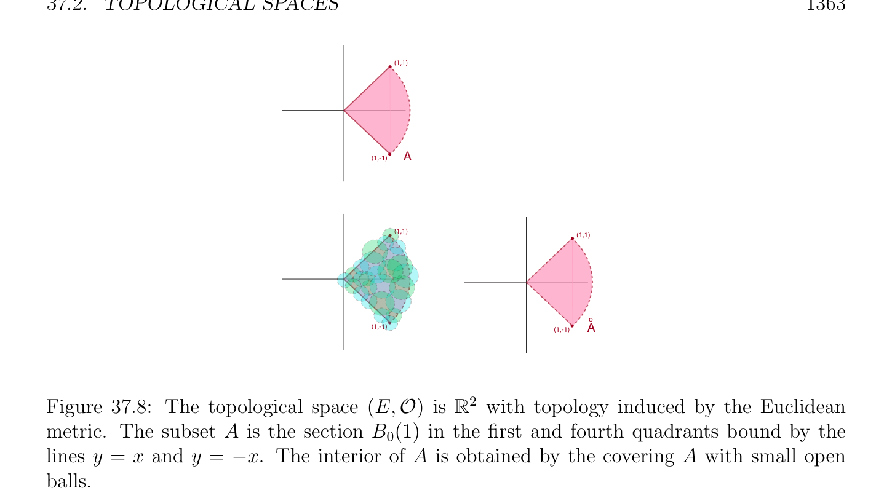
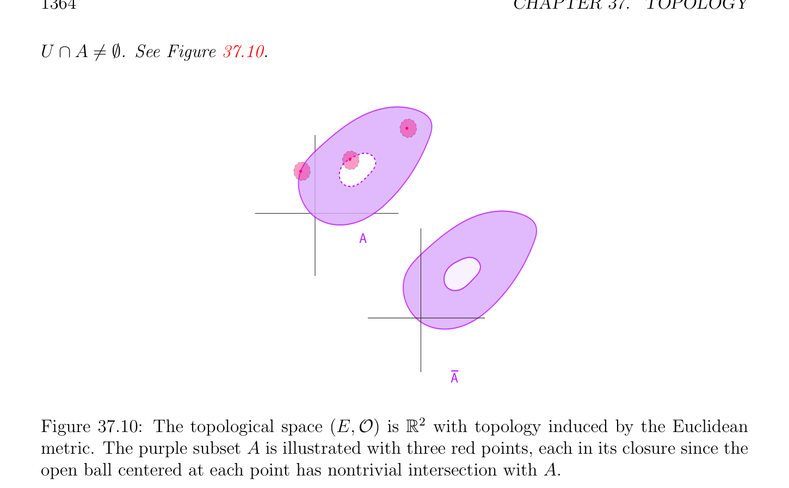
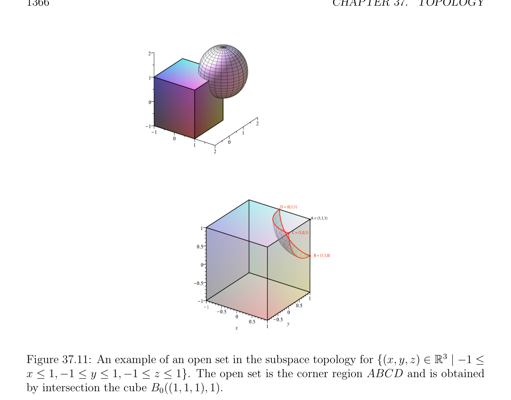

# Các không gian tôpô

<!-- PAGE 1360 -->
Bởi tính đối xứng, ta cũng thu được d(y, $A) \le$ d(x, $y) +$ d(x, $A)$, và do đó
$$|d(x, A) -d(y, A)| \le d(x, y),$$
Như đã khẳng định.

> **Định nghĩa 37.6.** Cho $(E, d)$ là không gian mêtric (metric space). Với mọi khác rỗng tập con $A$ của $E$, và bất kỳ $r > 0$, cho
$$V_{r}(A) = {x \in E | d(x, A) < r}.$$

> **Mệnh đề 37.3.** Cho $(E, d)$ là không gian mêtric (metric space). Với mọi khác rỗng tập con $A$ của $E$, và bất kỳ $r > 0$, tập hợp $V_{r}(A)$ là tập mở (open set) chứa $A$.

*Chứng minh.* Với mọi $y \in E$ sao cho d(x, $y) < r$ - d(x, $A)$, theo Mệnh đề 37.2 ta có
$$d(y, A) \le d(x, A) + d(x, y) \le d(x, A) + r -d(x, A) = r,$$
Do đó $V_{r}(A)$ chứa hình cầu mở (open ball) $B_{0}(x, r$ - d(x, $A))$, mà có nghĩa là nó là mở. Hiển nhiên, $A \subseteq V_{r}(A)$.

## 37.2 Các không gian tôpô

Motivated theo Mệnh đề 37.1, không gian tôpô (topological space) được định nghĩa theo họ của các tập hợp thỏa mãn các tính chất của các tập mở được phát biểu trong rằng mệnh đề.

> **Định nghĩa 37.7.** Cho trước tập hợp $E$, tôpô trên $E$ (hoặc tôpô cấu trúc trên $E)$, được định nghĩa như họ $\mathcal{O}$ của các tập con của $E$ được gọi là các tập mở, và thỏa mãn sau đây ba các tính chất:
$(1)$ Với mọi hữu hạn họ $(U_{i})_{1\le i\le n}$ của các tập hợp $U_{i} \in O$, ta có $U_{1} \cap \cdots  \cap U_{n} \in O$, i.e., $\mathcal{O}$ là đóng dưới hữu hạn các giao.
$$(2) For every arbitrary family (U_{i})_{i\in I} of sets U_{i} \in O, we have \bigcup_{i}  \in I U_{i} \in O, i.e.,\mathcal{O} is closed$$
Dưới tùy ý các hợp.
$(3) \emptyset \in O$, và $E \in O$, i.e., $\emptyset$ và $E$ thuộc đến $\mathcal{O}$. tập hợp $E$ cùng với $topology\mathcal{O}$ trên $E$ được gọi là một không gian tôpô (topological space). Cho trước không gian tôpô (topological space) $(E,\mathcal{O})$, tập con $F$ của $E$ là tập đóng (closed set) nếu $F = E$ - $U$ với một số tập mở (open set) $U \in O$, i.e., $F$ là phần bù của một số tập mở (open set).  Nó là khả dĩ/có thể rằng tập mở (open set) là cũng tập đóng (closed set). Ví dụ, $\emptyset$ và $E$ là cả hai mở và đóng. Khi không gian tôpô (topological space) chứa thực sự/đúng đắn khác rỗng tập con $U$ mà là cả hai mở và đóng, không gian $E$ được nói là disconnected.

<!-- PAGE 1361 -->

> **Định nghĩa 37.8.** không gian tôpô (topological space) $(E,\mathcal{O})$ được nói đến thỏa mãn Hausdorff separation axiom (hoặc $T_{2}-separation$ axiom) nếu với mọi hai phân biệt các điểm $a \neq  b$ trong $E$, ở đó tồn tại hai các tập mở $U_{a}$ và $U_{b}$ sao cho, $a \in U_{a}, b \in U_{b}$, và $U_{a} \cap U_{b} = \emptyset$. Khi $T_{2}-separation$ axiom được thỏa mãn, ta cũng nói rằng $(E,\mathcal{O})$ là Hausdorff không gian. Như được hiển thị theo Mệnh đề 37.1, bất kỳ không gian mêtric (metric space) là tôpô Hausdorff không gian, họ của các tập mở đang là thực ra họ của tùy ý các hợp của mở các hình cầu. Tương tự, bất kỳ không gian vectơ định chuẩn (normed vector space) là tôpô Hausdorff không gian, họ của các tập mở đang là họ của tùy ý các hợp của mở các hình cầu. tôpô $\mathcal{O}$ bao gồm của tất cả các tập con của $E$ được gọi là rời rạc tôpô.
Nhận xét: Hầu hết (nếu không tất cả) các không gian được sử dụng trong giải tích/phân tích là Hausdorffspaces. Một cách trực quan, Hausdorff separation axiom nói rằng rằng có đủ “nhỏ” các tập mở. Mà không có điều này axiom, một số counter-intuitive behaviors có thể phát sinh. Ví dụ, dãy có thể có nhiều hơn một giới hạn điểm (hoặc tập compắc (compact set) có thể không là đóng). Tuy nhiên, non-Hausdorff các không gian tôpô phát sinh một cách tự nhiên trong đại số hình học. Nhưng chẵn/ngay cả ở đó, một số thế cho separation được sử dụng. Một của các lý do tại sao các không gian tôpô là quan trọng là rằng định nghĩa của tôpô chỉ liên quan đến nhất định họ $\mathcal{O}$ của các tập hợp, và không cách mà như vậy họ được sinh từ mêtric hoặc chuẩn (norm). Ví dụ, khác nhau các mêtric hoặc khác nhau các chuẩn có thể định nghĩa cùng họ của các tập mở. Nhiều tôpô các tính chất chỉ phụ thuộc vào họ $\mathcal{O}$ và không trên cụ thể mêtric hoặc chuẩn (norm). Nhưng sự kiện rằng tôpô là definable từ mêtric hoặc chuẩn (norm) là quan trọng, bởi vì nó thường suy ra đẹp các tính chất của không gian. Tất cả của ta các ví dụ sẽ là các không gian có tôpô được định nghĩa bởi mêtric hoặc chuẩn (norm).

> **Định nghĩa 37.9.** không gian tôpô (topological space) $(E,\mathcal{O})$ là mêtric hóa được nếu có một khoảng cách trên $E$ định nghĩa tôpô $\mathcal{O}$. Lưu ý rằng trong không gian mêtric (metric space) $(E, d)$, mêtric $d$ là một cách tường minh cho trước. Tuy nhiên, nói chung, tôpô của mêtric hóa được không gian $(E,\mathcal{O})$ là không specified bởi một cách tường minh cho trước mêtric, nhưng một số mêtric định nghĩa tôpô $\mathcal{O}$ tồn tại. Hiển nhiên, mêtric hóa được không gian tôpô (topological space) phải là Hausdorff. Thực sự, mạnh hơn separation tính chất nghiệm đúng, mêtric hóa được không gian là chuẩn tắc/bình thường; xem Định nghĩa 37.30.
Nhận xét: Bằng cách lấy các phần bù ta có thể phát biểu các tính chất của các tập đóng đối ngẫu (dual) đến những phần tử đó của Định nghĩa 37.7. Do đó, $\emptyset$ và $E$ là các tập đóng, và các tập đóng là đóng dưới hữu hạn các hợp và tùy ý các giao. Nó là cũng worth không rằng Hausdorff separation axiom suy ra rằng với mọi $a \in E$, tập hợp ${a}$ là đóng. Thật vậy, nếu $x \in E -{a}$, thì $x \neq$, và do đó ở đó tồn tại các tập mở $U_{a}$ và $U_{x}$ sao cho $a \in U_{a}, x \in U_{x}$, và $U_{a} \cap U_{x} = \emptyset$. Xem Hình 37.6. Do đó, với mọi $x \in E -{a}$, có một tập mở (open set) $U_{x}$ chứa $x$ và được chứa trong $E -{a}$, chỉ ra bởi (O3) rằng $E -{a}$ là mở, và do đó rằng tập hợp ${a}$ là đóng.

<!-- PAGE 1362 -->
$$Ux$$
$$x$$
$$a$$
$$Ua$$
$$E$$
$$Figure 37.6: A schematic illustration of the Hausdorff separation property$$
Cho trước không gian tôpô (topological space) $(E,\mathcal{O})$, cho trước bất kỳ tập con $A$ của $E$, vì $E \in O$ và $E$ là tập đóng (closed set), họ $\mathcal{C}_{A} = {F$ | $A \subseteq F, F$ đóng $set}$ của các tập đóng chứa $A$ là khác rỗng,
$$and since any arbitrary intersection of closed sets is a closed set, the intersection \bigcap  \mathcal{C}_{A} of$$
Các tập hợp trong họ $\mathcal{C}_{A}$ là nhỏ nhất tập đóng (closed set) chứa $A$. Bởi đồng dạng lập luận, hợp của tất cả mở các tập con được chứa trong $A$ là lớn nhất tập mở (open set) được chứa trong $A$.

> **Định nghĩa 37.10.** Cho trước không gian tôpô (topological space) $(E,\mathcal{O})$, cho trước bất kỳ tập con $A$ của $E$, nhỏ nhất
$$closed set containing A is denoted by \overline{A}, and \frac{is}{A} called the closure, or adherence of A. See$$
Hình 37.7. tập con $A$ của $E$ là trù mật trong $E$ nếu $= E$. lớn nhất tập mở (open set) được chứa trong $A$ được ký hiệu là $by^{\circ}A$, và được gọi là phần trong (interior) của $A$. Xem Hình 37.8. tập hợp Fr $A =\overline{A} \cap \overline{E}\overline{-} \overline{A}$ được gọi là biên (boundary) (hoặc frontier) của $A$. Ta cũng ký hiệu biên (boundary) của $A$ bởi $\partial A$. Xem Hình 37.9.
$$(1,1)$$
$$(1,-1)A$$
$$(1,1)$$
$$_$$
$$(1,-1)A$$
$$\mathbb{R}^{2}$$

**Hình 37.7:** không gian tôpô (topological space) $(E,\mathcal{O})$ là với tôpô được cảm sinh bởi Euclidean mêtric. tập con $A$ là mục $B_{0}(1)$ trong thứ nhất và thứ tư các góc phần tư cận bởi các đường thẳng $y = x$ và $y = -x$. bao đóng (closure) của $A$ là thu được bởi giao của $A$ với đóng unit hình cầu.

<!-- PAGE 1363 -->
$$(1,1)$$
$$(1,-1)A$$
$$(1,1)(1,1)$$
$$Ao$$
$$(1,-1)(1,-1)$$
$$\mathbb{R}^{2}$$

**Hình 37.8:** không gian tôpô (topological space) $(E,\mathcal{O})$ là với tôpô được cảm sinh bởi Euclidean mêtric. tập con $A$ là mục $B_{0}(1)$ trong thứ nhất và thứ tư các góc phần tư cận bởi các đường thẳng $y = x$ và $y = -x$. phần trong (interior) của $A$ là thu được bởi phủ $A$ với nhỏ mở các hình cầu.
$$(1,1)(1,1)$$
$$(1,-1)A дA$$
$$(1,-1)$$
$$\mathbb{R}^{2}$$

**Hình 37.9:** không gian tôpô (topological space) $(E,\mathcal{O})$ là với tôpô được cảm sinh bởi Euclidean mêtric. tập con $A$ là mục $B_{0}(1)$ trong thứ nhất và thứ tư các góc phần tư cận bởi các đường thẳng $y = x$ và $y = -x$. biên (boundary) của $A$ là $\overline{A} -^{\circ}A$.
Nhận xét: ký hiệu $\overline{A}$ cho bao đóng (closure) của tập con $A$ của $E$ là somewhat unfortunate, vì $\overline{A}$ là thường được sử dụng đến ký hiệu tập hợp phần bù của $A$ trong $E$. Vẫn, ta ưu tiên nó đến nhiều hơn/thêm cumbersome các ký hiệu chẳng hạn như clo(), và ta ký hiệu phần bù của $A$ trong $E$ bởi $E$ - $A$ (hoặc đôi khi, $A^{c})$. Theo Định nghĩa, rõ ràng là tập con $A$ của $E$ là đóng khi và chỉ khi $A =\overline{A}$. tập hợp $\mathbb{Q}$ của các hữu tỷ
$$is dense in \mathbb{R}.It \frac{is}{A} easily shown that \overline{A} =^{\circ}A \cup \partial A and^{\circ}A \cap \partial A = \emptyset .Another useful$$
Đặc trưng của được cho bởi sau đây mệnh đề.

> **Mệnh đề 37.4.** Cho trước không gian tôpô (topological space) $(E,\mathcal{O})$, cho trước bất kỳ tập con $A$ của $E$, bao đóng (closure) $\overline{A}$ của $A$ là tập hợp tất cả các điểm $x \in E$ sao cho với mọi tập mở (open set) $U$ chứa $x$, thì

<!-- PAGE 1364 -->
$U \cap A \neq  \emptyset$. Xem Hình 37.10.
$$A$$
$$\overline{A}$$
$$\mathbb{R}^{2}$$

**Hình 37.10:** không gian tôpô (topological space) $(E,\mathcal{O})$ là với tôpô được cảm sinh bởi Euclidean mêtric. tím tập con $A$ được minh họa với ba đỏ các điểm, mỗi trong bao đóng (bao đóng (closure)) của nó vì hình cầu mở (open ball) được tâm tại mỗi điểm có không tầm thường giao với $A$.

*Chứng minh.* Nếu $A = \emptyset$, vì $\emptyset$ là đóng, mệnh đề nghiệm đúng một cách tầm thường. Do đó, giả sử rằng $A \neq  \emptyset$.
$$First assume that x \in \overline{A}. Let U be any open set such that \frac{x}{A} \in U. If U \cap A = \emptyset , since U is$$
Mở, thì $E$ - $U$ là tập đóng (closed set) chứa $A$, và vì là giao của tất cả các tập đóng chứa $A$, ta phải có $x \in E$ - $U$, mà là không thể. Ngược lại, giả sử rằng $x \in E$ là điểm sao cho với mọi tập mở (open set) $U$ chứa $x$, thì $U \cap A \neq  \emptyset$. Cho $F$ là bất kỳ đóng tập con chứa $A$. Nếu $x \in / F$, vì $F$ là đóng, thì $U = E$ - $F$ là tập mở (open set)
$$such that x \in U, and U \cap \frac{A}{A.} = \emptyset , a contradiction. Thus, we have x \in F for every closed set$$
Chứa $A$, nghĩa là, $x \in$ Thường nó là cần đến xét tập con $A$ của không gian tôpô (topological space) $E$, và đến quan điểm tập con $A$ như không gian tôpô (topological space). sau đây mệnh đề chỉ ra cách mà để định nghĩa tôpô trên tập con.

> **Mệnh đề 37.5.** Cho trước không gian tôpô (topological space) $(E,\mathcal{O})$, cho trước bất kỳ tập con $A$ của $E$, cho
$$\mathcal{U} = {U \cap A | U \in O}$$
Là họ của tất cả các tập con của $A$ thu được như giao của bất kỳ tập mở (open set) trong $\mathcal{O}$ với $A$. Các tính chất sau đây đúng.
$(1)$ không gian $(A,\mathcal{U})$ là không gian tôpô (topological space).

<!-- PAGE 1365 -->
$(2)$ Nếu $E$ là không gian mêtric (metric space) với mêtric $d$, thì thu hẹp $d_{A}$: $A \times  A \to \mathbb{R}_{+}$ của mêtric $d$ đến $A$ định nghĩa không gian mêtric (metric space). Hơn nữa, tôpô được cảm sinh bởi mêtric $d_{A}$ agrees với tôpô được định nghĩa bởi $\mathcal{U}$, như ở trên.

*Chứng minh.* Để lại như một bài tập. Mệnh đề 37.5 suggests sau đây định nghĩa.

> **Định nghĩa 37.11.** Cho trước không gian tôpô (topological space) $(E,\mathcal{O})$, cho trước bất kỳ tập con $A$ của $E$, không gian con tôpô trên $A$ được cảm sinh bởi $\mathcal{O}$ là họ $\mathcal{U}$ của các tập mở được định nghĩa sao cho
$$\mathcal{U} = {U \cap A | U \in O}$$
Là họ của tất cả các tập con của $A$ thu được như giao của bất kỳ tập mở (open set) trong $\mathcal{O}$ với $A$. Ta nói rằng $(A,\mathcal{U})$ có không gian con tôpô. Nếu $(E, d)$ là không gian mêtric (metric space), thu hẹp $d_{A}$: $A \times  A \to \mathbb{R}_{+}$ của mêtric $d$ đến $A$ được gọi là không gian con mêtric.
$$\mathbb{R}^{n}$$
Ví dụ, nếu $E =$ và $d$ là Euclidean mêtric, ta thu được không gian con tôpô trên đóng n-cube
$${(x_{1}, \dots  , x_{n}) \in E | a_{i} \le x_{i} \le b_{i}, 1 \le i \le n}.$$
Xem Hình 37.11,  Một nên realize rằng mọi tập mở (open set) $U \in O$ mà là hoàn toàn được chứa trong $A$ là cũng trong họ $\mathcal{U}$, nhưng $\mathcal{U}$ có thể chứa các tập mở rằng là không trong $\mathcal{O}$. Ví dụ, nếu $E = \mathbb{R}$ với |x-y|, và $A = [a, b]$, thì các tập hợp của tạo thành [, $c)$, với $< c < b$ thuộc $to\mathcal{U}$, nhưng chúng là không các tập mở $for\mathbb{R}$ dưới |x-y|. Tuy nhiên, ở đó là agreement trong sau đây tình huống.

> **Mệnh đề 37.6.** Cho trước không gian tôpô (topological space) $(E,\mathcal{O})$, cho trước bất kỳ tập con $A$ của $E$, nếu $\mathcal{U}$ là không gian con tôpô, thì các tính chất sau đây đúng.
$(1)$ Nếu $A$ là tập mở (open set) $A \in O$, thì mọi tập mở (open set) $U \in U$ là tập mở (open set) $U \in O$.
$(2)$ Nếu $A$ là tập đóng (closed set) trong $E$, thì mọi tập đóng (closed set) w.r.t. không gian con tôpô là tập đóng (closed set) w.r.t. $\mathcal{O}$.

*Chứng minh.* Để lại như một bài tập. khái niệm của tích tôpô là cũng hữu ích. Ta có kết quả sau mệnh đề.

> **Mệnh đề 37.7.** Cho trước $n$ các không gian tôpô $(E_{i},\mathcal{O}_{i})$, cho $\mathcal{B}$ là họ của các tập con của $E_{1} \times  \cdots  \times  E_{n}$ được định nghĩa như sau:
$$\mathcal{B} = {U_{1} \times  \cdots  \times  U_{n} | U_{i} \in O_{i}, 1 \le i \le n},$$
Và cho $\mathcal{P}$ là họ bao gồm của tùy ý các hợp của các tập hợp trong $\mathcal{B}$, bao gồm cả $\emptyset$. Thì $\mathcal{P}$ là tôpô trên $E_{1} \times  \cdots  \times  E_{n}$.

<!-- PAGE 1366 -->
$$D = (0,1,1)$$
$$A = (1,1,1)$$
$$C = (1,0,1)$$
$$B = (1,1,0)$$
$$\mathbb{R}^{3}$$

**Hình 37.11:** ví dụ của tập mở (open set) trong không gian con tôpô cho ${(x, y, z) \in$ | $-1 \le x \le 1, -1 \le y \le 1, -1 \le z \le 1}$. tập mở (open set) là góc miền ABCD và là thu được bởi giao hình lập phương $B_{0}((1, 1, 1), 1)$.

*Chứng minh.* Để lại như một bài tập.

> **Định nghĩa 37.12.** Cho trước $n$ các không gian tôpô $(E_{i},\mathcal{O}_{i})$, tích tôpô trên $E_{1}\times \cdots \times E_{n}$ là họ $\mathcal{P}$ của các tập con của $E_{1} \times  \cdots  \times  E_{n}$ được định nghĩa như sau: nếu
$$\mathcal{B} = {U_{1} \times  \cdots  \times  U_{n} | U_{i} \in O_{i}, 1 \le i \le n},$$
$then\mathcal{P}$ là họ bao gồm của tùy ý các hợp của các tập hợp $in\mathcal{B}$, bao gồm cả $\emptyset$. Xem Hình 37.12. Nếu mỗi $(E_{i}, d_{Ei})$ là không gian mêtric (metric space), có ba tự nhiên các mêtric rằng có thể được được định nghĩa trên $E_{1} \times  \cdots  \times  E_{n}$:
$$d_{1}((x_{1}, \dots  , x_{n}), (y_{1}, \dots  , y_{n})) = d_{E1}(x_{1}, y_{1}) + \cdots  + d_{En}(x_{n}, y_{n}),$$
$$d_{2}((x_{1}, \dots  , x_{n}), (y_{1}, \dots  , y_{n})) = \begin{pmatrix} (d_{E1}(x_{1}, y_{1}))^{2}+ \cdots  + (d_{En}(x_{n}, y_{n}\overline{))}^{212} \\ {d_{E1}(x_{1}, y_{1}), \dots  , d_{En}(x_{n}, y_{n})}. \end{pmatrix} ,$$
$$d_{\infty}((x_{1}, \dots  , x_{n}), (y_{1}, \dots  , y_{n})) = \max$$

<!-- PAGE 1367 -->
$$UxU$$
$$U212$$
$$\overline{U} 1$$
$$U3$$
$$UxUxU3$$
$$12$$
$$\overline{U2}$$
$$U1$$
$$\mathbb{R}^{2}  \mathbb{R}^{3}$$

**Hình 37.12:** Các ví dụ của các tập mở trong tích tôpô cho và được cảm sinh bởi Euclidean mêtric. Nó là dễ để chỉ ra rằng $d_{\infty}((x_{1}, \dots  , x_{n}), (y_{1}, \dots  , y_{n})) \le d_{2}((x_{1}, \dots  , x_{n}), (y_{1}, \dots  , y_{n})) \le d_{1}((x_{1}, \dots  , x_{n}), (y_{1}, \dots  , y_{n}))$
$$\le nd_{\infty}((x_{1}, \dots  , x_{n}), (y_{1}, \dots  , y_{n})),$$
Do đó các phần tử này các khoảng cách định nghĩa cùng tôpô, mà là tích tôpô. Nếu mỗi $(E_{i}, \|\|_{Ei})$ là không gian vectơ định chuẩn (normed vector space), có ba tự nhiên các chuẩn rằng có thể được được định nghĩa trên $E_{1} \times  \cdots  \times  E_{n}$:
$$\|(x_{1}, \dots  , x_{n})\|_{1} = \|x_{1}\|_{E1} + \cdots  + \|x_{n}\|_{En},$$
$$\|(x_{1}, \dots  , x_{n})\|_{2} = \begin{pmatrix} \|x_{1}\|_{E1}^{2}+ \cdots  + \|x_{n}\overline{\|}_{En}^{212} \\ x_{1} & , \dots  ,x_{n} \end{pmatrix} ,$$
$$\|(x_{1}, \dots  , x_{n})\|_{\infty}= \max {\|\|_{E1} \|\|_{En}} .$$
Nó là dễ để chỉ ra rằng
$$\|(x_{1}, \dots  , x_{n})\|_{\infty}\le \|(x_{1}, \dots  , x_{n})\|_{2} \le \|(x_{1}, \dots  , x_{n})\|_{1} \le n\|(x_{1}, \dots  , x_{n})\|_{\infty},$$
Do đó các phần tử này các chuẩn định nghĩa cùng tôpô, mà là tích tôpô. Nó có thể cũng được kiểm chứng rằng khi $E_{i} = \mathbb{R}$, với tiêu chuẩn tôpô được cảm sinh bởi |x - y|, tôpô
$$\mathbb{R}^{n}$$
Tích trên là tiêu chuẩn tôpô được cảm sinh bởi Euclidean chuẩn (norm).

> **Định nghĩa 37.13.** Hai các mêtric $d$ và d' trên không gian $E$ là tương đương nếu chúng cảm sinh cùng $topology\mathcal{O}$ trên $E$ (i.e., chúng định nghĩa cùng $family\mathcal{O}$ của các tập mở). Tương tự, hai các chuẩn $\|\|$ và $\|\|'$ trên không gian $E$ là tương đương nếu chúng cảm sinh cùng tôpô $\mathcal{O}$ trên $E$. Cho trước không gian tôpô (topological space) $(E,\mathcal{O})$, nó là thường hữu ích, như trong Mệnh đề 37.7, để định nghĩa tôpô $\mathcal{O}$ theo họ con $\mathcal{B}$ của các tập con của $E$.

<!-- PAGE 1368 -->

> **Định nghĩa 37.14.** Ta nói rằng họ $\mathcal{B}$ của các tập con của $E$ là cơ sở (basis) cho tôpô $\mathcal{O}$, nếu $\mathcal{B}$ là tập con của $\mathcal{O}$, và nếu mọi tập mở (open set) $U$ trong $\mathcal{O}$ có thể được thu được như một số hợp (có thể vô hạn) của các tập hợp trong $\mathcal{B}$ (agreeing rằng rỗng hợp là rỗng tập hợp). Ví dụ, cho trước bất kỳ không gian mêtric (metric space) $(E, d), \mathcal{B} = {B_{0}(a, \rho$) | $a \in E, \rho  > 0}$. Đặc biệt, nếu $d = \|\|_{2}$, mở các khoảng tạo thành cơ sở (basis) cho $\mathbb{R}$, trong khi mở các đĩa tạo thành cơ sở (basis) cho $\mathbb{R}^{2}$.
$$\mathbb{R}^{2}$$
Mở rectangles cũng tạo thành cơ sở (basis) cho với tiêu chuẩn tôpô. Xem Hình 37.13. Ta kiểm chứng được ngay rằng nếu $family\mathcal{B} = (U_{i})_{i\in I}$ là cơ sở (basis) cho tôpô của $(E,\mathcal{O})$,
$$then E = \bigcup_{i}  U_{i}, and the intersection of any two sets U_{i}, U_{j} \in B is the union of some sets in$$
Họ $\mathcal{B}^{\in I}$ (một lần nữa, agreeing rằng rỗng hợp là rỗng tập hợp). Ngược lại, họ $\mathcal{B}$ với các tính chất này là cơ sở (basis) của tôpô thu được bởi tạo thành tùy ý các hợp của các tập hợp trong $\mathcal{B}$.

> **Định nghĩa 37.15.** subbasis cho $\mathcal{O}$ là họ $\mathcal{S}$ của các tập con của $E$, sao cho họ $\mathcal{B}$ của tất cả hữu hạn các giao của các tập hợp trong $\mathcal{S}$ (bao gồm cả $E$ chính nó, trong trường hợp rỗng giao) là cơ sở (basis) của $\mathcal{O}$. Xem Hình 37.13.
$$\overline{a}\overline{b}$$
$$(i.)$$
$$(ii.)$$

**Hình 37.13:** Hình $(i.)$ chỉ ra rằng tập hợp của vô hạn mở các khoảng các dạng subbasis $for\mathbb{R}$. Hình (ii.) chỉ ra rằng vô hạn mở strips tạo thành subbasis cho $\mathbb{R}^{2}$. sau đây mệnh đề cho hữu ích các tiêu chuẩn cho xác định liệu họ của mở các tập con là cơ sở (basis) của không gian tôpô (topological space).

> **Mệnh đề 37.8.** Cho trước không gian tôpô (topological space) $(E,\mathcal{O})$ và họ $\mathcal{B}$ của mở các tập con trong $\mathcal{O}$ các tính chất sau đây đúng:
$(1)$ họ $\mathcal{B}$ là cơ sở (basis) cho tôpô $\mathcal{O}$ khi và chỉ khi với mọi tập mở (open set) $U \in O$ và mọi $x \in U$, tồn tại một $B \in B$ sao cho $x \in B$ và $B \subseteq U$. Xem Hình 37.14.
$(2)$ họ $\mathcal{B}$ là cơ sở (basis) cho tôpô $\mathcal{O}$ khi và chỉ khi
$$(a) For every x \in E, there is some B \in B such that x \in B.$$
