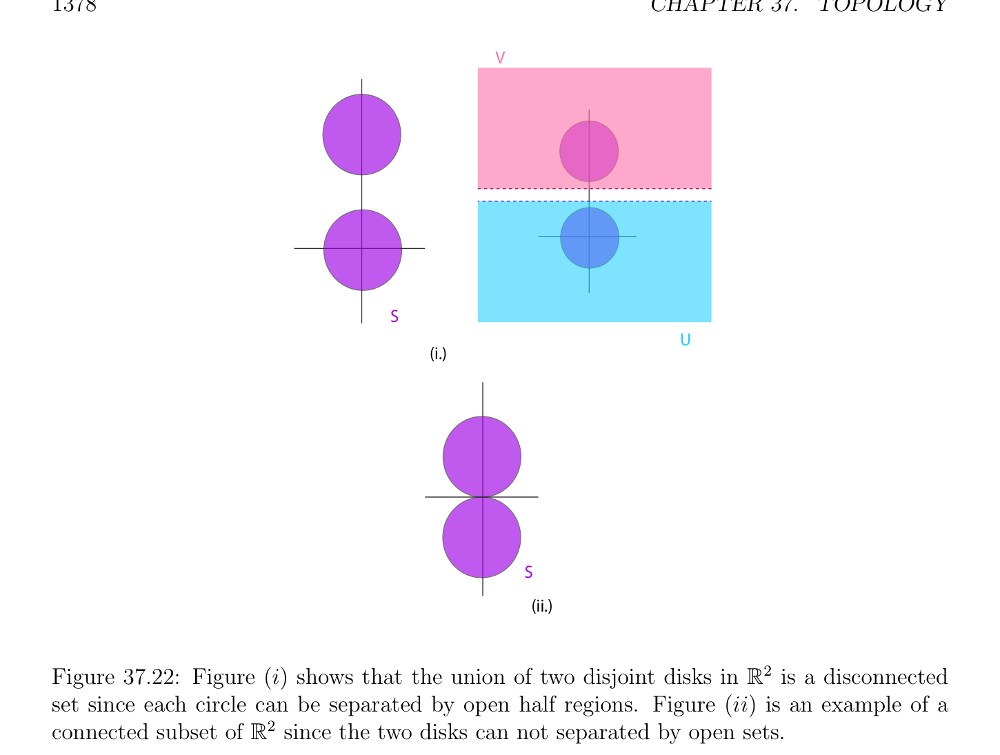
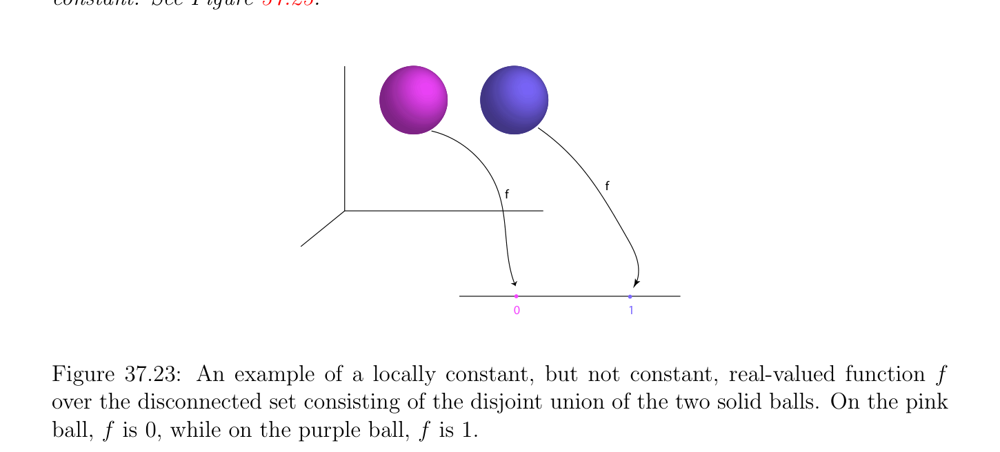

# Liên thông Các tập hợp

<!-- PAGE 1377 -->
Và
$$lim f(x) = f(a_{+})$$
$$x\to a,x\in A\cap (a, +\infty )$$
Cả hai tồn tại, và hoặc $f(a_{-}) \neq$ f(), hoặc $f(a_{+}) \neq$ f(). Lưu ý rằng nó là khả dĩ/có thể rằng $f(a_{-}) = f(a_{+})$, nhưng $f$ là vẫn discontinuous tại nếu điều này chung/phổ biến giá trị các khác nhau từ f(). Các hàm được định nghĩa trên khác rỗng tập con $of\mathbb{R}$, và rằng là liên tục, ngoại trừ với một số các điểm của discontinuity của thứ nhất loại, đóng quan trọng vai trò trong giải tích/phân tích. Ta bây giờ turn đến connectivity các tính chất của các không gian tôpô.

## 37.4 Liên thông Các tập hợp

Connectivity các tính chất của các không gian tôpô đóng rất quan trọng vai trò trong understanding tôpô của các mặt. Điều này mục gathers các sự kiện cần thiết đến có tốt understanding của phân loại định lý cho compắc các mặt (với biên (boundary)). chính references là Ahlfors và Sario $[2]$ và Massey $[125, 126]$. Cho tổng quát kiến thức nền tảng trên tôpô, hình học, và đại số tôpô, ta cũng một cách cao recommend Bredon $[30]$ và Fulton $[68]$.

> **Định nghĩa 37.21.** không gian tôpô (topological space) $(E,\mathcal{O})$ là liên thông nếu chỉ các tập con của $E$ rằng là cả hai mở và đóng là rỗng tập hợp và $E$ chính nó. Tương đương, $(E,\mathcal{O})$ là liên thông nếu $E$ không thể được viết như hợp $E = U \cup V$ của hai rời nhau khác rỗng các tập mở $U, V$, hoặc nếu $E$ không thể được viết như hợp $E = U \cup V$ của hai rời nhau khác rỗng các tập đóng. tập con, $S \subseteq E$, là liên thông nếu nó là liên thông trong không gian con tôpô trên $S$ được cảm sinh bởi $(E,\mathcal{O})$. Xem Hình 37.22. liên thông tập mở (open set) được gọi là một miền và tập đóng (closed set) là đóng miền nếu phần trong (phần trong (interior)) của nó là liên thông (mở) tập hợp. định nghĩa của connectivity là có nghĩa đến capture sự kiện rằng liên thông không gian $S$ là “một piece.” Cho trước không gian mêtric (metric space) $(\mathbb{R}^{n}, \|\|_{2})$, quintessential các ví dụ của liên thông các không gian là $B_{0}(a, \rho$) và B(, $\rho$). Đặc biệt, sau đây tiêu chuẩn mệnh đề đặc trưng hóa liên thông các tập con của $\mathbb{R}$ có thể được tìm thấy trong hầu hết tôpô các văn bản (ví dụ, Munkres $[135]$, Schwartz $[156])$. Cho sake của tính đầy đủ, ta cho chứng minh.

> **Mệnh đề 37.16.** tập con của thực đường thẳng, $\mathbb{R}$, là liên thông khi và chỉ khi nó là khoảng/đoạn, i.e., của tạo thành [, $b]$, (, $b]$, ở đâu $a = -\infty$ là khả dĩ/có thể, [, $b)$, ở đâu $b = +\infty$ là khả dĩ/có thể, hoặc (, $b)$, ở đâu $a = -\infty$ hoặc $b = +\infty$ là khả dĩ/có thể.

*Chứng minh.* Giả sử rằng $A$ là liên thông khác rỗng tập con của $\mathbb{R}$. các trường hợp ở đâu $A = \emptyset$ hoặc $A$ bao gồm của đơn lẻ điểm là tầm thường. Ngược lại, ta chỉ ra rằng bất cứ khi nào, $b \in A$, $< b$, thì toàn bộ khoảng/đoạn [, $b]$ là tập con của $A$. Thật vậy, nếu điều này đã là không trường hợp, ở đó sẽ là một số $c \in$ (, $b)$ sao cho $c \in / A$, và thì ta có thể viết $A = ((-\infty , c)\cap A)\cup ((c, +\infty )\cap A)$, ở đâu $(-\infty , c) \cap A$ và $(c, +\infty$) $\cap A$ là khác rỗng và rời nhau mở các tập con của $A$, contradicting sự kiện rằng $A$ là liên thông. Nó suy ra dễ dàng rằng $A$ phải là khoảng/đoạn.

<!-- PAGE 1378 -->
$$V$$
$$S$$
$$U$$
$$(i.)$$
$$S$$
$$(ii.)$$
$$\mathbb{R}^{2}$$

**Hình 37.22:** Hình $(i)$ chỉ ra rằng hợp của hai rời nhau các đĩa trong là disconnected tập hợp vì mỗi đường tròn có thể được được tách bởi mở một nửa các miền. Hình (ii) là ví dụ của
$$\mathbb{R}^{2}$$
Liên thông tập con của vì hai các đĩa có thể không được tách bởi các tập mở. Ngược lại, ta chỉ ra rằng khoảng/đoạn, I, phải là liên thông. Cho $A$ là bất kỳ khác rỗng tập con của I mà là cả hai mở và đóng trong I. Ta chỉ ra rằng $I = A$. Fix bất kỳ $x \in A$ và xét tập hợp, $R_{x}$, của tất cả $y$ sao cho $[x, y] \subseteq A$. Nếu tập hợp $R_{x}$ là không bị chặn, thì $R_{x} = [x, +\infty$). Ngược lại, nếu tập hợp này là bị chặn, cho $b$ là của nó least trên cận. Ta khẳng định rằng $b$ là phải biên (boundary) của khoảng/đoạn $I$. Bởi vì $A$ là đóng trong I, trừ khi I là mở trên phải và $b$ là của nó phải biên (boundary), ta phải có $b \in A$. Trong trường hợp thứ nhất, $A \cap [x, b) =$ I $\cap [x, b) = [x, b)$. Trong trường hợp thứ hai, bởi vì $A$ là cũng mở trong I, trừ khi $b$ là phải biên (boundary) của khoảng/đoạn $I$ (đóng trên phải), tồn tại một tập mở (open set) $(b$ - $\eta , b + \eta$) được chứa trong $A$, mà suy ra rằng $[x, b + \eta /2] \subseteq A$, contradicting sự kiện rằng $b$ là least trên cận của tập hợp $R_{x}$. Do đó, $b$ phải là phải biên (boundary) của khoảng/đoạn $I$ (đóng trên phải). đồng dạng lập luận áp dụng đến tập hợp, $L_{y}$, của tất cả $x$ sao cho $[x, y] \subseteq A$ và hoặc $L_{y}$ là không bị chặn, hoặc của nó lớn nhất thấp hơn cận là trái biên (boundary) của I (mở hoặc đóng trên trái). Trong tất cả các trường hợp, ta đã chỉ ra rằng $A =$ I, và khoảng/đoạn phải là liên thông. Một cách trực quan, nếu không gian là không liên thông, nó là khả dĩ/có thể để định nghĩa hàm liên tục (continuous function) mà là hằng số trên rời nhau “liên thông các thành phần” và mà lấy có thể phân biệt các giá trị trên

<!-- PAGE 1379 -->
Rời nhau các thành phần. Điều này có thể được được phát biểu theo khái niệm của một cách địa phương hằng số hàm.

> **Định nghĩa 37.22.** Cho trước hai các không gian tôpô $X, Y$, hàm $f$: $X \to Y$ là một cách địa phương hằng số nếu với mọi $x \in X$, có một tập mở (open set) $U \subseteq X$ sao cho $x \in U$ và $f$ là hằng số trên $U$. Ta khẳng định rằng một cách địa phương hằng số hàm là liên tục. Thực ra, ta sẽ chứng minh rằng $f^{-1} (V$) là mở với mọi tập con, $V \subseteq Y$ (không chỉ cho tập mở (open set) $V$). Nó là đủ để chỉ ra rằng $f^{-1} (y)$ là mở với mọi $y \in Y$, vì với mọi tập con $V \subseteq Y$,
$$f^{-1} (V ) = \bigcup_{y\in V}  f^{-1} (y),$$
Và các tập mở là đóng dưới tùy ý các hợp. Tuy nhiên, hoặc $f^{-1} (y) = \emptyset$ nếu $y \in Y$ -f(X) hoặc $f$ là hằng số trên $U = f^{-1} (y)$ nếu $y \in$ f(X) (với giá trị $y)$, và vì $f$ là một cách địa phương hằng số, với mọi $x \in U$, tồn tại một tập mở (open set), $W \subseteq X$, sao cho $x \in W$ và $f$ là hằng số trên $W$, mà suy ra rằng f(w) $= y$ với mọi $w \in W$ và do đó, rằng $W \subseteq U$, chỉ ra rằng $U$ là hợp của các tập mở và do đó, là mở. sau đây mệnh đề chỉ ra rằng không gian là liên thông khi và chỉ khi mọi một cách địa phương hằng số hàm là hằng số:

> **Mệnh đề 37.17.** không gian tôpô (topological space) là liên thông khi và chỉ khi mọi một cách địa phương hằng số hàm là hằng số. Xem Hình 37.23.
$$f$$
$$f$$
$$\overline{0}\overline{1}$$

**Hình 37.23:** ví dụ của một cách địa phương hằng số, nhưng không hằng số, nhận giá trị thực (real-valued) hàm $f$ trên disconnected tập hợp bao gồm của rời nhau hợp của hai solid các hình cầu. Trên hồng hình cầu, $f$ là $0$, trong khi trên tím hình cầu, $f$ là $1$.

*Chứng minh.* Thứ nhất, giả sử rằng $X$ là liên thông. Cho $f$: $X \to Y$ là một cách địa phương hằng số hàm đến một số không gian $Y$ và giả sử rằng $f$ là không hằng số. Chọn bất kỳ $y \in$ f(X). Vì $f$ là không hằng số, $U_{1} = f^{-1}$ (y)̸ $= X$, và của course, $U_{1}$ ̸ $= \emptyset$. Ta được chứng minh chỉ trước Mệnh đề 37.17 rằng $f^{-1} (V$) là mở với mọi tập con $V \subseteq Y$, và do đó $U_{1} = f^{-1} (y) = f^{-1} ({y})$ và

<!-- PAGE 1380 -->
$U_{2} = f^{-1} (Y -{y})$ là cả hai mở, khác rỗng, và rõ ràng $X = U_{1} \cup U_{2}$ và $U_{1}$ và $U_{2}$ là rời nhau. Điều này mâu thuẫn với sự kiện là $X$ là liên thông và $f$ phải là hằng số. Giả sử rằng mọi một cách địa phương hằng số hàm $f$: $X \to Y$ là hằng số. Nếu $X$ là không liên thông, ta có thể viết $X = U_{1} \cup U_{2}$, ở đâu cả hai $U_{1}, U_{2}$ là mở, rời nhau, và khác rỗng. Ta có thể định nghĩa hàm, $f$: $X \to \mathbb{R}$, sao cho f(x) $= 1$ trên $U_{1}$ và f(x) $= 0$ trên $U_{2}$. Vì $U_{1}$ và $U_{2}$ là mở, hàm $f$ là một cách địa phương hằng số, và vẫn chưa không hằng số, một mâu thuẫn.
$$\mathbb{R}^{n}$$
Đặc trưng trên liên thông các tập con của là khó hơn và đòi hỏi khái niệm của arcwise connectedness. Một của hầu hết quan trọng các tính chất của liên thông các tập hợp là rằng chúng được bảo toàn bởi liên tục các ánh xạ.

> **Mệnh đề 37.18.** Cho trước bất kỳ ánh xạ liên tục (continuous map), $f$: $E \to F$, nếu $A \subseteq E$ là liên thông, thì f() là liên thông.

*Chứng minh.* Nếu f() là không liên thông, thì ở đó tồn tại một số khác rỗng các tập mở, $U, V$, trong $F$ sao cho f() $\cap U$ và f() $\cap V$ là khác rỗng và rời nhau, và
$$f(A) = (f(A) \cap U) \cup (f(A) \cap V ).$$
Thì, $f^{-1} (U)$ và $f^{-1} (V$) là khác rỗng và mở vì $f$ là liên tục và
$$A = (A \cap f^{-1} (U)) \cup (A \cap f^{-1} (V )),$$
Với $A \cap f^{-1} (U)$ và $A \cap f^{-1} (V$) khác rỗng, rời nhau, và mở trong $A$, contradicting sự kiện rằng $A$ là liên thông. quan trọng hệ quả của Mệnh đề 37.18 là rằng với mọi hàm liên tục (continuous function), $f$: $E \to \mathbb{R}$, ở đâu $E$ là liên thông không gian, f(E) là khoảng/đoạn. Thật vậy, điều này suy ra từ Mệnh đề 37.16. Do đó, nếu $f$ lấy các giá trị và $b$ ở đâu $< b$, thì $f$ lấy tất cả các giá trị $c \in$ [, $b]$. Điều này là rất quan trọng tính chất đã biết như trung gian giá trị định lý. Chẵn/ngay cả nếu không gian tôpô (topological space) là không liên thông, hóa ra là nó là rời nhau hợp của cực đại liên thông các tập con và các phần tử này liên thông các thành phần là đóng trong $E$. Trong thứ tự để thu được kết quả này, ta cần một vài các bổ đề.

> **Bổ đề 37.19.** Cho trước không gian tôpô (topological space), $E$, với mọi họ, $(A_{i})_{i\in I}$, của (khác rỗng) con-
$$nected subsets of E, if A_{i} \cap A_{j} ̸= \emptyset for all i, j \in I, then the union, A = \bigcup_{i}  \in I A_{i}, of the$$
Họ, $(A_{i})_{i\in I}$, là cũng liên thông.
$$Proof. Assume that \bigcup_{i}  A_{i} is not connected. There exists two nonempty open subsets, U$$
Và $V$, của $E$ như vậy $that^{\in I} A \cap U$ và $A \cap V$ là rời nhau và khác rỗng và sao cho
$$A = (A \cap U) \cup (A \cap V ).$$
Bây giờ, với mọi $i \in$ I, ta có thể viết
$$A_{i} = (A_{i} \cap U) \cup (A_{i} \cap V ),$$

<!-- PAGE 1381 -->
Ở đâu $A_{i} \cap U$ và $A_{i} \cap V$ là rời nhau, vì $A_{i} \subseteq A$ và $A \cap U$ và $A \cap V$ là rời nhau. Vì $A_{i}$ là liên thông, hoặc $A_{i} \cap U = \emptyset$ hoặc $A_{i} \cap V = \emptyset$. Điều này suy ra rằng hoặc $A_{i} \subseteq A \cap U$ hoặc $A_{i} \subseteq A \cap V$. Tuy nhiên, bởi giả định, $A_{i} \cap A_{j}$ ̸ $= \emptyset$, với mọi $i, j \in$ I, và do đó, hoặc cả hai $A_{i} \subseteq A \cap U$ và $A_{j} \subseteq A \cap U$, hoặc cả hai $A_{i} \subseteq A \cap V$ và $A_{j} \subseteq A \cap V$, vì $A \cap U$ và $A \cap V$ là rời nhau. Do đó, ta kết luận rằng hoặc $A_{i} \subseteq A \cap U$ với mọi $i \in$ I, hoặc $A_{i} \subseteq A \cap V$ với mọi $i \in$ I. Nhưng điều này chứng tỏ rằng hoặc
$$A = \bigcup_{i\in I}  A_{i} \subseteq A \cap U,$$
Hoặc
$$A = \bigcup_{i\in I}  A_{i} \subseteq A \cap V,$$
Contradicting sự kiện rằng cả hai $A \cap U$ và $A \cap V$ là rời nhau và khác rỗng. Do đó, $A$ phải là liên thông. Đặc biệt, ở trên bổ đề áp dụng khi liên thông các tập hợp trong họ $(A_{i})_{i\in I}$ có điểm trong chung/phổ biến.

> **Bổ đề 37.20.** Nếu $A$ là liên thông tập con của không gian tôpô (topological space), $E$, thì với mọi tập con, $B$, sao cho $A \subseteq B \subseteq \overline{A}$, ở đâu $\overline{A}$ là bao đóng (closure) của $A$ trong $E$, tập hợp $B$ là liên thông.

*Chứng minh.* Nếu $B$ là không liên thông, thì có hai khác rỗng mở các tập con, $U, V$, của $E$ sao cho $B \cap U$ và $B \cap V$ là rời nhau và khác rỗng, và
$$B = (B \cap U) \cup (B \cap V ).$$
Vì $A \subseteq B$, ở trên suy ra rằng
$$A = (A \cap U) \cup (A \cap V ),$$
Và vì $A$ là liên thông, hoặc $A\cap U = \emptyset$, hoặc $A\cap V = \emptyset$. Không mất tính tổng quát (without loss of generality), giả sử rằng $A \cap V = \emptyset$, mà suy ra rằng $A \subseteq A \cap U \subseteq B \cap U$. Tuy nhiên, $B \cap U$ là đóng trong không gian con tôpô cho $B$ và vì $B \subseteq \overline{A}$ và $\overline{A}$ là đóng trong $E$, bao đóng (closure) của $A$ trong $B$ w.r.t. không gian con tôpô của $B$ là rõ ràng $B \cap \overline{A} = B$, mà suy ra rằng $B \subseteq B \cap U$ (vì bao đóng (closure) là nhỏ nhất tập đóng (closed set) chứa cho trước tập hợp). Do đó, $B \cap V = \emptyset$, một mâu thuẫn. Đặc biệt, Bổ đề 37.20 chỉ ra rằng nếu $A$ là liên thông tập con, thì bao đóng (bao đóng (closure)) của nó, $\overline{A}$, là cũng liên thông. Ta là bây giờ ready đến giới thiệu liên thông các thành phần của không gian.

> **Định nghĩa 37.23.** Cho trước không gian tôpô (topological space), $(E,\mathcal{O})$, ta nói rằng hai các điểm,, $b \in E$, là liên thông nếu tồn tại một liên thông tập con, $A$, của $E$ sao cho $a \in A$ và $b \in A$.

<!-- PAGE 1382 -->
Ta kiểm chứng được ngay rằng quan hệ “ và $b$ là liên thông trong E” là quan hệ tương đương (equivalence relation). Chỉ transitivity là không hiển nhiên, nhưng nó suy ra ngay lập tức như đặc biệt trường hợp của

> **Bổ đề 37.19.** Do đó, ở trên quan hệ tương đương (equivalence relation) định nghĩa phân hoạch của $E$ vào khác rỗng rời nhau liên thông các thành phần. sau đây mệnh đề là dễ dàng được chứng minh bằng cách sử dụng Bổ đề 37.19 và Bổ đề 37.20:

> **Mệnh đề 37.21.** Cho trước bất kỳ không gian tôpô (topological space), $E$, với mọi $a \in E$, liên thông thành phần chứa là lớn nhất tập liên thông (connected set) chứa. liên thông các thành phần của $E$ là đóng. khái niệm của một cách địa phương liên thông không gian là cũng hữu ích.

> **Định nghĩa 37.24.** không gian tôpô (topological space), $(E,\mathcal{O})$, là một cách địa phương liên thông nếu với mọi $a \in E$, với mọi lân cận (neighborhood), $V$, của, có một liên thông lân cận (neighborhood), $U$, của sao cho $U \subseteq V$. Xem Hình 37.24.
$$U$$
$$aV$$
$$E$$

**Hình 37.24:** không gian tôpô (topological space) $E$, mà là đồng phôi đến annulus, là một cách địa phương liên thông vì mỗi điểm là surrounded bởi nhỏ đĩa được chứa trong $E$. Như ta sẽ xem trong moment, nó sẽ là tương đương đến đòi hỏi rằng $E$ có cơ sở (basis) của liên thông các tập mở.  Có liên thông các không gian rằng là không một cách địa phương liên thông và có một cách địa phương liên thông các không gian rằng là không liên thông. hai các tính chất là độc lập. Ví dụ,
$$\mathbb{R}^{2}$$
Không gian con của $S = {(x, sin(1/x))$, | $x > 0} \cup {(0, y)$ | $-1 \le y \le 1}$ là liên thông nhưng không một cách địa phương liên thông. Xem Hình 37.25. không gian con $S$ của $\mathbb{R}$ bao gồm $[0, 1] \cup [2, 3]$ là một cách địa phương liên thông nhưng không liên thông.

> **Mệnh đề 37.22.** không gian tôpô (topological space), $E$, là một cách địa phương liên thông khi và chỉ khi với mọi mở tập con, $A$, của $E$, liên thông các thành phần của $A$ là mở.

<!-- PAGE 1383 -->

**Hình 37.25:** Cho $S$ là đồ thị của f(x) $= sin(1/x)$ hợp trục $y$ giữa $-1$ và $1$. không gian này là liên thông, nhưng không một cách địa phương liên thông.

*Chứng minh.* Giả sử rằng $E$ là một cách địa phương liên thông. Cho $A$ là bất kỳ mở tập con của $E$ và cho $C$ là một của liên thông các thành phần của $A$. Với mọi $a \in C \subseteq A$, tồn tại một liên thông lân cận (neighborhood), $U$, của sao cho $U \subseteq A$ và vì $C$ là liên thông thành phần của $A$ chứa, ta phải có $U \subseteq C$. Điều này chỉ ra rằng với mọi $a \in C$, tồn tại một mở tập con chứa được chứa trong $C$, do đó $C$ là mở. Ngược lại, giả sử rằng với mọi mở tập con, $A$, của $E$, liên thông các thành phần của $A$ là mở. Thì, với mọi $a \in E$ và mọi lân cận (neighborhood), $U$, của, vì $U$ chứa một số tập mở (open set) $A$ chứa, $interior,^{\circ}U$, của $U$ là tập mở (open set) chứa và của nó liên thông các thành phần là mở. Đặc biệt, liên thông thành phần $C$ chứa là liên thông tập mở (open set) chứa và được chứa trong $U$. Mệnh đề 37.22 chỉ ra rằng trong một cách địa phương liên thông không gian, liên thông các tập mở tạo thành
$$\mathbb{R}^{n}$$
Cơ sở (basis) cho tôpô. Nó là dễ dàng được thấy rằng là một cách địa phương liên thông. Một cái khác rất quan trọng tính chất của các mặt và tổng quát hơn, các đa tạp, là là liên thông đường (arcwise connected). trực giác là rằng bất kỳ hai các điểm có thể được joined bởi liên tục cung của đường cong. Điều này là formalized như sau.

> **Định nghĩa 37.25.** Cho trước không gian tôpô (topological space), $(E,\mathcal{O})$, cung (hoặc đường đi) là ánh xạ liên tục (continuous map), $\gamma$: [, $b] \to E$, ở đâu [, $b]$ là đóng khoảng/đoạn của thực đường thẳng, $\mathbb{R}$. điểm $\gamma$ () là ban đầu điểm của cung và điểm $\gamma (b)$ là terminal điểm của cung. Ta nói rằng $\gamma$ là cung

<!-- PAGE 1384 -->
Joining $\gamma$ () và $\gamma (b)$. Xem Hình 37.26. cung là đóng đường cong nếu $\gamma (a) = \gamma (b)$. tập hợp $\gamma$ ([, $b])$ là vết (trace) của cung $\gamma$.
$$\gamma \gamma$$
$$(b)$$
$$E$$
$$\gamma (a)$$
$$ab$$
$$\mathbb{R}^{3}$$

**Hình 37.26:** Cho $E$ là torus với không gian con tôpô được cảm sinh từ với đỏ cung $\gamma$ ([, $b])$. torus là cả hai liên thông đường (arcwise connected) và một cách địa phương liên thông đường (arcwise connected). Typically, $a = 0$ và $b = 1$.  Một nên không confuse cung, $\gamma$: [, $b] \to E$, với vết (vết (trace)) của nó. Ví dụ, $\gamma$ có thể là hằng số, và do đó, vết (vết (trace)) của nó rút gọn đến đơn lẻ điểm. cung là Jordan cung nếu $\gamma$ là phép đồng phôi (homeomorphism) lên vết (vết (trace)) của nó. cung, $\gamma$: [, $b] \to E$, là Jordan đường cong nếu $\gamma (a) = \gamma (b)$ và $\gamma$ là đơn ánh (injective) trên [, $b)$. Vì [, $b]$ là liên thông, theo Mệnh đề 37.18, vết (trace) $\gamma$ ([, $b])$ của cung là liên thông tập con của $E$. Cho trước hai các cung $\gamma$: $[0, 1] \to E$ và $\delta$: $[0, 1] \to E$ sao cho $\gamma (1) = \delta (0)$, ta có thể tạo thành mới cung được định nghĩa như sau:

> **Định nghĩa 37.26.** Cho trước hai các cung, $\gamma$: $[0, 1] \to E$ và $\delta$: $[0, 1] \to E$, sao cho $\gamma (1) = \delta (0)$, ta có thể tạo thành của chúng hợp thành (hoặc tích), $\gamma \delta$,, được định nghĩa sao cho
$$\gamma (2t)if 0 \le t \le 1/2;$$
$$\gamma \delta (t) =$$
$$\delta (2t -1)if 1/2 \le t \le 1.$$
Nghịch đảo, $\gamma^{-1}$, của cung, $\gamma$, là cung được định nghĩa sao cho $\gamma^{-1} (t) = \gamma$ (1-t), với mọi $t \in [0, 1]$. Nó là một cách tầm thường được kiểm chứng rằng Định nghĩa 37.26 cho ta liên tục các cung.

> **Định nghĩa 37.27.** không gian tôpô (topological space), $E$, là liên thông đường (arcwise connected) nếu với mọi hai các điểm,, $b \in E$, có một cung, $\gamma$: $[0, 1] \to E$, joining và $b$, i.e., sao cho $\gamma (0) = a$ và $\gamma (1) = b$. không gian tôpô (topological space), $E$, là một cách địa phương liên thông đường (arcwise connected) nếu với mọi $a \in E$, với mọi lân cận (neighborhood), $V$, của, có một liên thông đường (arcwise connected) lân cận (neighborhood), $U$, của sao cho $U \subseteq V$. Xem Hình 37.26.

<!-- PAGE 1385 -->
$$\mathbb{R}^{n}$$
Không gian là một cách địa phương liên thông đường (arcwise connected), vì với mọi hình cầu mở (open ball), bất kỳ hai các điểm trong điều này hình cầu là joined bởi đường thẳng đoạn thẳng. Các đa tạp và các mặt là cũng một cách địa phương liên thông đường (arcwise connected). Mệnh đề 37.18 cũng áp dụng đến arcwise connectedness (điều này là đơn giản bài tập). sau đây định lý là then chốt đến lý thuyết của các đa tạp và các mặt:

> **Định lý 37.23.** Nếu không gian tôpô (topological space), $E$, là liên thông đường (arcwise connected), thì nó là liên thông. Nếu không gian tôpô (topological space), $E$, là liên thông và một cách địa phương liên thông đường (arcwise connected), thì $E$ là liên thông đường (arcwise connected).

*Chứng minh.* Thứ nhất, giả sử rằng $E$ là liên thông đường (arcwise connected). Chọn bất kỳ điểm,, trong $E$. Vì $E$ là liên thông đường (arcwise connected), với mọi $b \in E$, có một đường đi, $\gamma$: $[0, 1] \to E$, từ đến $b$ và do đó,
$$E = \bigcup_{b\in E}^{b}  \gamma_{b} ([0, 1])$$
Hợp của liên thông các tập con tất cả chứa. Theo Bổ đề 37.19, $E$ là liên thông. Bây giờ giả sử rằng $E$ là liên thông và một cách địa phương liên thông đường (arcwise connected). Với mọi điểm $a \in E$, cho $F_{a}$ là tập hợp tất cả các điểm, $b$, sao cho có một cung, $\gamma_{b}$: $[0, 1] \to E$, từ đến $b$. Rõ ràng, $F_{a}$ chứa. Ta chỉ ra rằng $F_{a}$ là cả hai mở và đóng. Với mọi $b \in F_{a}$, vì $E$ là một cách địa phương liên thông đường (arcwise connected), có một liên thông đường (arcwise connected) lân cận (neighborhood) $U$ chứa $b$ (bởi vì $E$ là lân cận (neighborhood) của $b)$. Do đó, $b$ có thể được joined đến mọi điểm $c \in U$ bởi cung, và vì bởi định nghĩa của $F_{a}$, có một cung từ đến $b$, hợp thành của các phần tử này hai các cung cho ta cung từ đến $c$, mà chỉ ra rằng $c \in F_{a}$. Nhưng khi đó $U \subseteq F_{a}$ và do đó, $F_{a}$ là mở. Xem Hình 37.27 $(i.)$. Bây giờ giả sử rằng $b$ là trong phần bù của $F_{a}$. Như trong trước đó trường hợp, tồn tại một liên thông đường (arcwise connected) lân cận (neighborhood) $U$ chứa $b$. Do đó, mọi điểm $c \in U$ có thể được joined đến $b$ bởi cung. Nếu ở đó đã là cung joining đến $c$, ta sẽ thu được cung từ đến $b$, contradicting sự kiện rằng $b$ là trong phần bù của $F_{a}$. Do đó, mọi điểm $c \in U$ là trong phần bù của $F_{a}$, mà chỉ ra rằng $U$ được chứa trong phần bù của $F_{a}$, và do đó, rằng phần bù của $F_{a}$ là mở. Xem Hình 37.27 (ii.). Hệ quả là, ta có được hiển thị rằng $F_{a}$ là cả hai mở và đóng và vì nó là khác rỗng, ta phải có $E = F_{a}$, mà chỉ ra rằng $E$ là liên thông đường (arcwise connected). Nếu $E$ là một cách địa phương liên thông đường (arcwise connected), ở trên lập luận chỉ ra rằng liên thông các thành phần của $E$ là liên thông đường (arcwise connected).  Nó là không đúng rằng liên thông không gian là liên thông đường (arcwise connected). Ví dụ, không gian bao gồm của đồ thị của hàm
$$f(x) = \sin(1/x),$$
Ở đâu $x > 0$, cùng với portion của trục $y$, cho mà $-1 \le y \le 1$, là liên thông, nhưng không liên thông đường (arcwise connected). Xem Hình 37.25. tầm thường modification của chứng minh của Định lý 37.23 chỉ ra rằng trong không gian vectơ định chuẩn (normed vector space), $E$, liên thông tập mở (open set) là liên thông đường (arcwise connected) bởi polygonal các đường thẳng (i.e., các cung bao gồm của đường thẳng các đoạn thẳng). Điều này là bởi vì trong mọi hình cầu mở (open ball), bất kỳ hai các điểm là liên thông bởi đường thẳng
