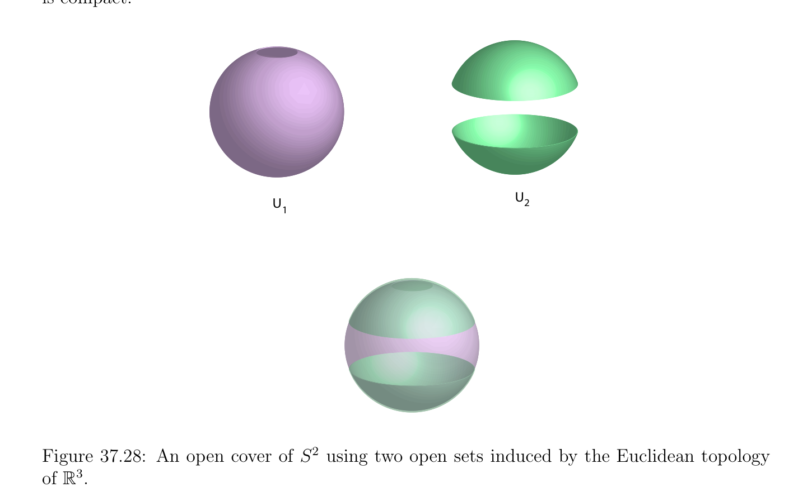
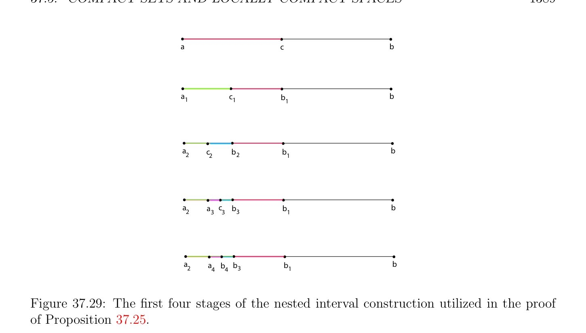
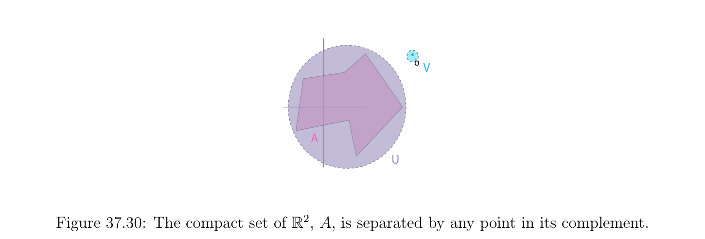
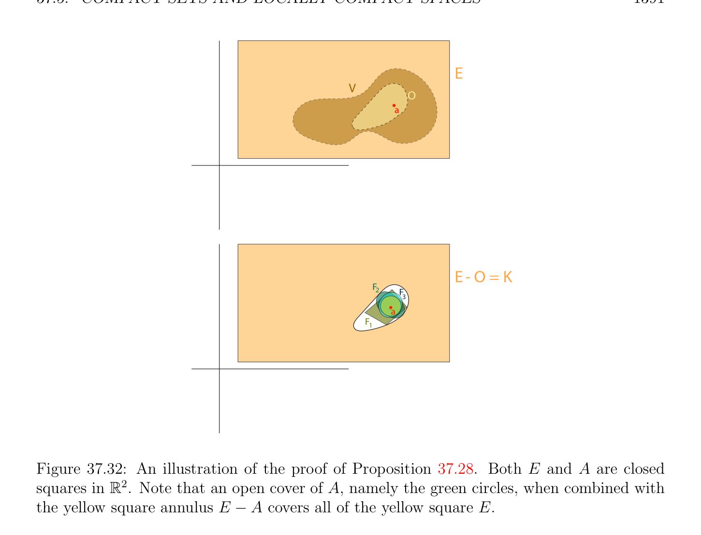
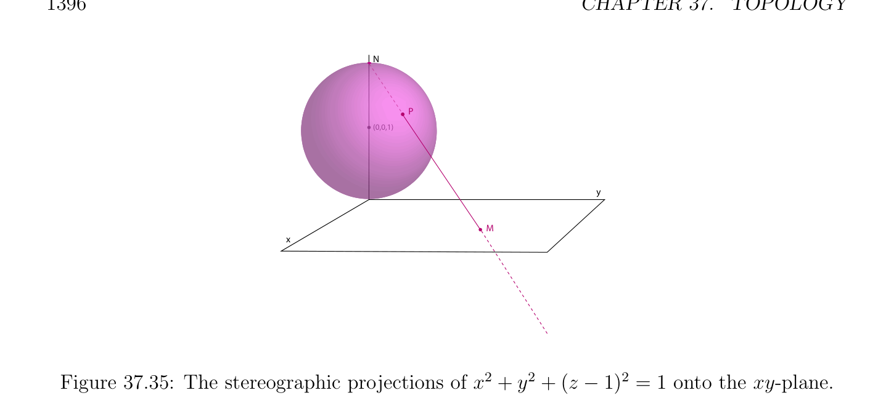

# Các tập compắc và một cách địa phương Compắc Các không gian

<!-- PAGE 1386 -->
$$U$$
$$c$$
$$b$$
$$Faa$$
$$(i.)$$
$$cb$$
$$U$$
$$Faa$$
$$(ii.)$$

**Hình 37.27:** Schematic illustrations của chứng minh các kỹ thuật rằng chỉ ra $F_{a}$ là cả hai mở và đóng. đoạn thẳng. Hơn nữa, nếu $E$ là hữu hạn dimensional, các phần tử này polygonal các đường thẳng có thể được forced là song song đến cơ sở (basis) các vectơ. Ta bây giờ xét tính compắc.

## 37.5 Các tập compắc và một cách địa phương Compắc Các không gian

Tính chất của tính compắc là rất quan trọng trong tôpô và giải tích/phân tích. Ta cung cấp quick ôn tập/tổng quan geared towards study của các đa tạp, và cho chi tiết, ta refer độc giả đến Munkres $[135]$, Schwartz $[156]$. Trong mục này ta sẽ cần giả sử rằng các không gian tôpô là Hausdorffspaces. Điều này là không luxury, như nhiều của các kết quả là sai ngược lại. Ta bắt đầu điều này mục bởi providing định nghĩa của tính compắc và mô tả họ của compắc các không gian trong $\mathbb{R}$. Có khác nhau tương đương các cách của định nghĩa tính compắc. Cho của ta các mục đích, hầu hết thuận tiện cách liên quan đến khái niệm của mở phủ.

> **Định nghĩa 37.28.** Cho trước không gian tôpô (topological space) $E$, với mọi tập con $A$ của $E$, mở phủ $(U_{i})_{i\in I}$
$$of A is a family of open subsets of E such that A \subseteq \bigcup_{i}  U_{i}. An open subcover of an open$$
Phủ $(U_{i})_{i\in I}$ của $A$ là bất kỳ họ con $(U_{j})_{j\in J}$ mà là $an^{\in I}$ mở phủ của $A$, với $J \subseteq$ I.

<!-- PAGE 1387 -->
Mở phủ $(U_{i})_{i\in I}$ của $A$ là hữu hạn nếu I là hữu hạn. Xem Hình 37.28. không gian tôpô (topological space) $E$ là compắc nếu nó là Hausdorffand với mọi mở phủ $(U_{i})_{i\in I}$ của $E$, có một hữu hạn mở phủ con (subcover) $(U_{j})_{j\in J}$ của $E$. Cho trước bất kỳ tập con $A$ của $E$, ta nói rằng $A$ là compắc nếu nó là compắc đối với không gian con tôpô. Ta nói rằng $A$ là một cách tương đối compắc nếu của nó bao đóng (closure) $\overline{A}$ là compắc.
$$U$$
$$U2$$
$$1$$

**Hình 37.28:** mở phủ của $S^{2}$ bằng cách sử dụng hai các tập mở được cảm sinh bởi Euclidean tôpô của $\mathbb{R}^{3}$. Ta kiểm chứng được ngay rằng tập con $A$ của $E$ là compắc trong không gian con tôpô tương đối đến $A$ khi và chỉ khi với mọi mở phủ $(U_{i})_{i\in I}$ của $A$ bởi mở các tập con của $E$, có một hữu hạn mở phủ con (subcover) $(U_{j})_{j\in J}$ của $A$. tính chất rằng mọi mở phủ chứa hữu hạn mở phủ con (subcover) là thường được gọi là Heine-Borel-Lebesgue tính chất. Bởi xét các phần bù, Hausdorff
$$space is compact iff for every family (F_{i})_{i\in I} of closed sets, if \bigcap_{i}  \in I F_{i} = \emptyset , then \bigcap_{j}  \in J F_{j} = \emptyset$$
Với một số hữu hạn tập con $J$ của I.  Định nghĩa 37.28 đòi hỏi rằng compắc không gian là Hausdorff. Có các cuốn sách trong mà compắc không gian là không nhất thiết cần thiết là Hausdorff. Sau đây Schwartz, ta ưu tiên gọi như vậy không gian quasi-compact. Một cái khác tương đương và hữu ích đặc trưng có thể được cho trước theo các họ có hữu hạn giao tính chất.
$$Definition 37.29. A family (F_{i})_{i\in I} of sets has the finite intersection property if \bigcap_{j}  \in J F_{j} \neq  \emptyset$$
Với mọi hữu hạn tập con $J$ của I.

<!-- PAGE 1388 -->

> **Mệnh đề 37.24.** tôpô Hausdorff không gian $E$ là compắc khi và chỉ khi với mọi họ $(F_{i})_{i\in I}$
$$of closed sets having the finite intersection property, then \bigcap_{i}  \in I F_{i} \neq  \emptyset .$$

*Chứng minh.* Nếu $E$ là compắc và $(F_{i})_{i\in I}$ là họ của các tập đóng có hữu hạn giao
$$property, then \bigcap_{i}  F_{i} cannot be empty, since otherwise we would have \bigcap  j\in J F_{j} = \emptyset for some$$
Hữu hạn tập con $J of^{\in I}$ I, một mâu thuẫn. điều ngược lại là một cách bằng nhau hiển nhiên. Một cái khác hữu ích hệ quả của tính compắc là như sau. Với mọi họ $(F_{i})_{i\in I}$ của đóng
$$sets such that F_{i+1} \subseteq F_{i} for all i \in I, if \bigcap_{i}  \in  F_{i} = \emptyset , then F_{i} = \emptyset for some i \in I. Indeed,$$
$$there must be some finite subset J of I such^{I} that \bigcap_{jj}  F_{j} = \emptyset , and since F_{i+1} \subseteq F_{i} for  all\mathbb{R}$$
$i \in$ I, ta phải có $F_{j} = \emptyset$ cho nhỏ nhất $F_{j}$ trong $(F^{\in J})_{j\in J}$. Bằng cách sử dụng sự kiện này, ta lưu ý rằng là không compắc. Thật vậy, họ của các tập đóng, $([n, +\infty ))_{n\ge0}$, là giảm và có rỗng giao. Ta kiểm chứng được ngay rằng mọi hữu hạn hợp của compắc các tập con là compắc. Tương tự,
$$\frac{every}{A \cup B} \frac{finite}{A} \frac{union}{B} of relatively compact subsets is relatively compact (use the fact that$$
$=  \cap$). Cho trước không gian mêtric (metric space), nếu ta định nghĩa bị chặn tập con là tập con rằng có thể được enclosed trong một số hình cầu đóng (closed ball) (của hữu hạn bán kính), thì bất kỳ nonbounded tập con của không gian mêtric (metric space) là không compắc. Tuy nhiên, đóng khoảng/đoạn [, $b]$ của thực đường thẳng là compắc.

> **Mệnh đề 37.25.** Mọi đóng khoảng/đoạn, [, $b]$, của thực đường thẳng là compắc.

*Chứng minh.* Ta tiến hành bởi mâu thuẫn. Cho $(U_{i})_{i\in I}$ là bất kỳ mở phủ của [, $b]$ và giả sử rằng không có hữu hạn mở phủ con (subcover). Cho $c = (a + b)/2$. Nếu cả hai [, $c]$ và $[c, b]$ đã có một số hữu hạn mở phủ con (subcover), do đó sẽ [, $b]$, và do đó, hoặc [, $c]$ thực hiện không có bất kỳ hữu hạn phủ con (subcover), hoặc $[c, b]$ thực hiện không có bất kỳ hữu hạn mở phủ con (subcover). Cho $[a_{1}, b_{1}]$ là như vậy xấu subinterval. cùng lập luận áp dụng và ta split $[a_{1}, b_{1}]$ vào hai bằng nhau subintervals, một của mà phải là xấu. Do đó, có được định nghĩa $[a_{n}, b_{n}]$ của độ dài $(b$ - $a)/2^{n}$ như khoảng/đoạn có không có hữu hạn mở phủ con (subcover), splitting $[a_{n}, b_{n}]$ vào hai bằng nhau các khoảng, ta biết rằng ít nhất một của hai có không có hữu hạn mở phủ con (subcover) và ta ký hiệu như vậy xấu khoảng/đoạn bởi $[a_{n+1}, b_{n+1}]$. Xem Hình 37.29. dãy $(a_{n})$ là nondecreasing và bị chặn từ ở trên bởi $b$, và do đó, bởi cơ bản tính chất của thực đường thẳng, nó hội tụ đến của nó least trên cận, $\alpha$. Tương tự, dãy $(b_{n})$ là nonincreasing và bị chặn từ ở dưới bởi và do đó, nó hội tụ đến của nó lớn nhất lowest cận, $\beta$. Vì $[a_{n}, b_{n}]$ có độ dài $(b-a)/2^{n}$, ta phải có $\alpha  = \beta$. Tuy nhiên, chung/phổ biến giới hạn $\alpha  = \beta$ của các dãy $(a_{n})$ và $(b_{n})$ phải thuộc đến một số tập mở (open set), $U_{i}$, của mở phủ và vì $U_{i}$ là mở, nó phải chứa một số khoảng/đoạn $[c, d]$ chứa $\alpha$. Thì, bởi vì $\alpha$ là chung/phổ biến giới hạn của các dãy $(a_{n})$ và $(b_{n})$, tồn tại một $N$ sao cho các khoảng $[a_{n}, b_{n}]$ là tất cả được chứa trong khoảng/đoạn $[c, d]$ với mọi $n \ge N$, mà mâu thuẫn với sự kiện là không có cái nào của các khoảng $[a_{n}, b_{n}]$ có hữu hạn mở phủ con (subcover). Do đó, [, $b]$ là thật vậy compắc.

<!-- PAGE 1389 -->
$$\overline{a}\overline{c}\overline{b}$$
$$\overline{a}\overline{c}\overline{b}\overline{b}$$
$$111$$
$$\overline{a}\overline{c}\overline{b}\overline{b}\overline{b}$$
$$2221$$
$$\overline{a}\overline{a}\overline{c}\overline{b}\overline{b}\overline{b}$$
$$23331$$
$$\overline{a}\overline{a}\overline{b}\overline{b}\overline{b}\overline{b}$$
$$24431$$

**Hình 37.29:** thứ nhất bốn các giai đoạn của nested khoảng/đoạn cách xây dựng utilized trong chứng minh của Mệnh đề 37.25. lập luận của Mệnh đề 37.25 có thể được được điều chỉnh để chỉ ra rằng $in\mathbb{R}^{m}$, mọi tập đóng (closed set), $[a_{1}, b_{1}] \times  \cdots  \times  [a_{m}, b_{m}]$, là compắc. Tại mọi giai đoạn, ta cần đến chia vào $2^{m}$ subpieces thay vì của $2$. Ta tiếp theo thảo luận một số quan trọng các tính chất của compắc các không gian. Ta bắt đầu với hai separations axioms mà chỉ đúng cho Hausdorffspaces:

> **Mệnh đề 37.26.** Cho trước tôpô Hausdorff không gian, $E$, với mọi compắc tập con, $A$, và mọi điểm, $b$, không trong $A$, ở đó tồn tại rời nhau các tập mở, $U$ và $V$, sao cho $A \subseteq U$ và $b \in V$. Xem Hình 37.30. Hệ quả là, mọi compắc tập con là đóng.
$$b V$$
$$A$$
$$U$$

**Hình 37.30:** tập compắc (compact set) của $\mathbb{R}^{2}, A$, được tách bởi bất kỳ điểm trong phần bù của nó.

<!-- PAGE 1390 -->

*Chứng minh.* Vì $E$ là Hausdorff, với mọi $a \in A$, có một số rời nhau các tập mở, $U_{a}$ và $V_{a}$, chứa và $b$ respectively. Do đó, họ, $(U_{a})_{a\in A}$, các dạng mở phủ của $A$. Vì
$$A is compact there is a finite open subcover, (U_{j})_{j\in J}, of A, where J \subseteq A, and then \bigcup_{j}  \in J U_{j}$$
$$is an open set containing A disjoint from the open set \bigcap_{j}  V_{j} containing b. This shows that$$
Mọi điểm, $b$, trong phần bù của $A$ thuộc đến $some^{\in J}$ tập mở (open set) trong phần bù này và do đó, rằng phần bù là mở, i.e., rằng $A$ là đóng. Xem Hình 37.31.
$$V$$
$$a$$
$$7b$$
$$a3A$$
$$a2$$
$$aa$$
$$\overline{4} 6$$
$$a 1$$
$$a 5$$
$$U$$

**Hình 37.31:** Cho hồng tập compắc (compact set) $A, U$ là hợp của bảy các đĩa mà phủ $A$, trong khi $V$ là giao của bảy các tập mở chứa $b$. Thực sự, chứng minh của Mệnh đề 37.26 có thể được được sử dụng để chỉ ra sau đây hữu ích tính chất:

> **Mệnh đề 37.27.** Cho trước tôpô Hausdorff không gian $E$, với mọi cặp của compắc rời nhau các tập con $A$ và $B$, ở đó tồn tại rời nhau các tập mở $U$ và $V$, sao cho $A \subseteq U$ và $B \subseteq V$.

*Chứng minh.* Ta repeat lập luận của Mệnh đề 37.26 với $B$ đóng vai trò của $b$ và sử dụng Mệnh đề 37.26 để tìm rời nhau các tập mở $U_{a}$ chứa $a \in A$, và $V_{a}$ chứa $B$. sau đây mệnh đề chỉ ra rằng trong compắc không gian tôpô (topological space), mọi tập đóng (closed set) là compắc:

> **Mệnh đề 37.28.** Cho trước compắc không gian tôpô (topological space), $E$, mọi tập đóng (closed set) là compắc.

*Chứng minh.* Vì $A$ là đóng, $E -A$ là mở và từ bất kỳ mở phủ, $(U_{i})_{i\in I}$, của $A$, ta có thể tạo thành mở phủ của $E$ bằng cách cộng $E$ - $A$ đến $(U_{i})_{i\in I}$ và, vì $E$ là compắc, hữu hạn phủ con (subcover), $(U_{j})_{j\in J} \cup {E$ - $A}$, của $E$ có thể được extracted sao cho $(U_{j})_{j\in J}$ là hữu hạn phủ con (subcover) của $A$. Xem Hình 37.32.
Nhận xét: Mệnh đề 37.28 cũng nghiệm đúng cho quasi-compact các không gian, i.e., Hausdorff separation tính chất là không cần thiết. Đặt Mệnh đề 37.27 và Mệnh đề 37.28 cùng nhau, ta lưu ý rằng nếu $X$ là compắc, thì với mọi cặp của rời nhau các tập đóng $A$ và $B$, ở đó tồn tại rời nhau các tập mở $U$ và $V$ sao cho $A \subseteq U$ và $B \subseteq V$.

<!-- PAGE 1391 -->
$$E$$
$$V$$
$$O$$
$$aa$$
$$E- O = K$$
$$F$$
$$2F$$
$$3$$
$$aa$$
$$F1$$

**Hình 37.32:** illustration của chứng minh của Mệnh đề 37.28. Cả hai $E$ và $A$ là đóng squares trong $\mathbb{R}^{2}$. Lưu ý rằng mở phủ của $A$, cụ thể là xanh lục các đường tròn, khi combined với vàng square annulus $E$ - $A$ phủ tất cả của vàng square $E$.

> **Định nghĩa 37.30.** không gian tôpô (topological space) $E$ là chuẩn tắc/bình thường nếu mọi one-point tập hợp là đóng, và với mọi cặp của rời nhau các tập đóng $A$ và $B$, ở đó tồn tại rời nhau các tập mở $U$ và $V$ sao cho $A \subseteq U$ và $B \subseteq V$. không gian tôpô (topological space) $E$ là chính quy nếu mọi one-point tập hợp là đóng, và với mọi điểm $a \in E$ và mọi đóng tập con $B$ của $E$, nếu $a \in / B$, thì ở đó tồn tại rời nhau các tập mở $U$ và $V$ sao cho $a \in U$ và $B \subseteq V$. Rõ ràng là chuẩn tắc/bình thường không gian là chính quy, và chính quy không gian là Hausdorff. Có các ví dụ của Hausdorffspaces rằng là không chính quy, và của chính quy các không gian rằng là không chuẩn tắc/bình thường. Ta chỉ được quan sát rằng compắc không gian là chuẩn tắc/bình thường. quan trọng tính chất của mêtric hóa được các không gian là rằng chúng là chuẩn tắc/bình thường.

> **Mệnh đề 37.29.** Mọi mêtric hóa được không gian $E$ là chuẩn tắc/bình thường.

*Chứng minh.* Giả sử tôpô của $E$ được cho bởi mêtric $d$. Vì $B$ là đóng và $A \cap B = \emptyset$, với mọi $a \in A$ vì $a \in / \overline{B} = B$, tồn tại một hình cầu mở (open ball) $B_{0}(a, \epsilon_{a}$) của bán kính $\epsilon_{a}  > 0$ sao cho $B_{0}(a, \epsilon_{a}$) $\cap B = \emptyset$. Tương tự, vì $A$ là đóng và $A \cap B = \emptyset$, với mọi $b \in B$ ở đó là

<!-- PAGE 1392 -->
Một số hình cầu mở (open ball) $B_{0}(b, \epsilon_{b}$) của bán kính $\epsilon_{b}  > 0$ sao cho $B_{0}(b, \epsilon_{b}$) $\cap A = \emptyset$. Cho
$$U = \bigcup_{a\in A}  B_{0}(a, \epsilon_{a} /2),V = \bigcup_{b\in B}  B_{0}(b, \epsilon_{b} /2).$$
Thì $A$ và $B$ là các tập mở sao cho $A \subseteq U$ và $B \subseteq V$, và ta khẳng định rằng $U \cap V = \emptyset$. Nếu không, thì tồn tại một $z \in U \cap V$, mà suy ra rằng với một số $a \in A$ và một số $b \in B$, ta có
$$z \in B_{0}(a, \epsilon_{a} /2) \cap B_{0}(b, \epsilon_{b} /2).$$
Suy ra rằng
$$d(a, b) \le d(a, z) + d(z, b) < (\epsilon_{a}  + \epsilon_{b} )/2.$$
Nếu $\epsilon_{a}  \le \epsilon_{b}$,thì d(, $b) < \epsilon_{b}$, do đó $a \in B_{0}(b, \epsilon_{b}$), contradicting sự kiện rằng $B_{0}(b, \epsilon_{b}$) $\cap A = \emptyset$. Nếu $\epsilon_{b}  \le \epsilon_{a}$,thì d(, $b) < \epsilon_{a}$, do đó $b \in B_{0}(a, \epsilon_{a}$), contradicting sự kiện rằng $B_{0}(a, \epsilon_{a}$) $\cap B = \emptyset$. Compắc các không gian cũng có sau đây tính chất.

> **Mệnh đề 37.30.** Cho trước compắc không gian tôpô (topological space), $E$, với mọi $a \in E$, với mọi lân cận (neighborhood), $V$, của, tồn tại một compắc lân cận (neighborhood), $U$, của sao cho $U \subseteq V$. Xem Hình 37.33.
$$E$$
$$V$$
$$U$$
$$a$$

**Hình 37.33:** Cho $E$ là peach square của $\mathbb{R}^{2}$. Mỗi điểm của $E$ được chứa trong compắc lân cận (neighborhood) $U$, trong trường hợp này nhỏ đóng vàng đĩa.

*Chứng minh.* Vì $V$ là lân cận (neighborhood) của, tồn tại một mở tập con, $O$, của $V$ chứa. Thì phần bù, $K = E -O$, của $O$ là đóng và vì $E$ là compắc, theo Mệnh đề 37.28, $K$ là compắc. Bây giờ, nếu ta xét họ của tất cả các tập đóng của tạo thành, $K\cap F$, ở đâu $F$ là bất kỳ đóng lân cận (neighborhood) của, vì $a \in / K$, điều này họ có rỗng giao và do đó, có một hữu hạn số của đóng lân cận (neighborhood), $F_{1}, \dots  , F_{n}$, của, sao cho $K \cap F_{1} \cap \cdots  \cap F_{n} = \emptyset$.

<!-- PAGE 1393 -->
Thì, $U = F_{1} \cap \cdots  \cap F_{n}$ là đóng và do đó theo Mệnh đề 37.28, compắc neigborhood của được chứa trong $O \subseteq V$. Xem Hình 37.34.
$$E$$
$$V$$
$$O$$
$$aa$$
$$E- O = K$$
$$F$$
$$2F$$
$$3$$
$$aa$$
$$F1$$

**Hình 37.34:** Cho $E$ là peach square của $\mathbb{R}^{2}$. compắc lân cận (neighborhood) của, $U$, là giao của các tập đóng $F_{1}, F_{2}, F_{3}$, mỗi của mà được chứa trong phần bù của $K$. Nó có thể được được hiển thị rằng trong không gian vectơ định chuẩn (normed vector space) của hữu hạn số chiều, tập con là compắc
$$\mathbb{R}^{n}$$
Khi và chỉ khi nó là đóng và bị chặn. Cho chứng minh là đơn giản.  Trong không gian vectơ định chuẩn (normed vector space) của vô hạn số chiều, có đóng và bị chặn các tập hợp rằng là không compắc! Nhiều hơn/thêm có thể được nói về tính compắc trong các không gian mêtric nhưng ta sẽ chỉ cần khái niệm của Lebesgue số, mà sẽ được thảo luận little sau này. Một cái khác then chốt tính chất của tính compắc là rằng nó được bảo toàn dưới tính liên tục.

> **Mệnh đề 37.31.** Cho $E$ là không gian tôpô (topological space) và cho $F$ là tôpô Hausdorff không gian. Với mọi compắc tập con, $A$, của $E$, với mọi ánh xạ liên tục (continuous map), $f$: $E \to F$, không gian con f() là compắc.

<!-- PAGE 1394 -->

*Chứng minh.* Cho $(U_{i})_{i\in I}$ là mở phủ của f(). Ta khẳng định rằng $(f^{-1} (U_{i}))_{i\in I}$ là mở phủ của $A$, mà là dễ dàng đã kiểm tra. Vì $A$ là compắc, có một hữu hạn mở phủ con (subcover), $(f^{-1} (U_{j}))_{j\in J}$, của $A$, và do đó, $(U_{j})_{j\in J}$ là mở phủ con (subcover) của f(). Như hệ quả của Mệnh đề 37.31, nếu $E$ là compắc, $F$ là Hausdorff, và $f$: $E \to F$ là liên tục và song ánh (bijective), thì $f$ là phép đồng phôi (homeomorphism). Thật vậy, nó là đủ để chỉ ra rằng $f^{-1}$ là liên tục, mà là tương đương đến chỉ ra rằng $f$ các ánh xạ các tập đóng đến các tập đóng. Tuy nhiên, các tập đóng là compắc và Mệnh đề 37.31 chỉ ra rằng các tập compắc là mapped đến các tập compắc, mà, theo Mệnh đề 37.26, là đóng. Một cái khác quan trọng hệ quả của Mệnh đề 37.31 là kết quả sau đây.

> **Mệnh đề 37.32.** Nếu $E$ là compắc khác rỗng không gian tôpô (topological space) và nếu $f$: $E \to \mathbb{R}$ là hàm liên tục (continuous function), thì có các điểm, $b \in E$ sao cho f() là cực tiểu của f(E) và f(b) là cực đại của f(E).

*Chứng minh.* tập hợp f(E) là compắc tập con của $\mathbb{R}$ và do đó, đóng và bị chặn tập hợp mà chứa của nó lớn nhất thấp hơn cận và của nó least trên cận. sau đây tính chất cũng nghiệm đúng.

> **Mệnh đề 37.33.** Cho $(E, d)$ là không gian mêtric (metric space). Với mọi khác rỗng tập con $A$ của $E$, nếu $A$ là compắc, thì với mọi mở tập con $U$ sao cho $A \subseteq U$, tồn tại một $r > 0$ sao cho $V_{r}(A) \subseteq U$.

*Chứng minh.* hàm $x \mapsto$ d(x, $E$ - $U)$ là liên tục và d(x, $E$ - $U) > 0$ cho $x \in A$ (vì $A \subseteq U)$. Theo Mệnh đề 37.32, tồn tại một $a \in A$ sao cho
$$d(a, E -U) = \inf d(x, E -U).$$
$$x\in A$$
Nhưng d(, $E$ - $U) = r > 0$, mà suy ra rằng $V_{r}(A) \subseteq U$. Một cái khác hữu ích khái niệm là rằng của địa phương tính compắc. Thật vậy các đa tạp và các mặt là một cách địa phương compắc.

> **Định nghĩa 37.31.** không gian tôpô (topological space) $E$ là một cách địa phương compắc nếu nó là Hausdorffand với mọi $a \in E$, tồn tại một compắc lân cận (neighborhood) $K$ của. Xem Hình 37.33. Từ Mệnh đề 37.30, mọi compắc không gian là một cách địa phương compắc nhưng điều ngược lại là sai. Ví dụ, $\mathbb{R}$ là một cách địa phương compắc nhưng không compắc. Thực ra nó có thể được được hiển thị rằng không gian vectơ định chuẩn (normed vector space) của hữu hạn số chiều là một cách địa phương compắc.

> **Mệnh đề 37.34.** Cho trước một cách địa phương compắc không gian tôpô (topological space), $E$, với mọi $a \in E$, với mọi lân cận (neighborhood), $N$, của, tồn tại một compắc lân cận (neighborhood), $U$, của, sao cho $U \subseteq N$.

<!-- PAGE 1395 -->

*Chứng minh.* Với mọi $a \in E$, tồn tại một compắc lân cận (neighborhood), $V$, của. Theo Mệnh đề 37.30, mọi neigborhood của tương đối đến $V$ chứa một số compắc lân cận (neighborhood) $U$ của tương đối đến $V$. Nhưng mọi lân cận (neighborhood) của tương đối đến $V$ là lân cận (neighborhood) của tương đối đến $E$ và mọi lân cận (neighborhood) $N$ của trong $E$ cho ta lân cận (neighborhood), $V \cap N$, của trong $V$ và do đó, với mọi lân cận (neighborhood), $N$, của, tồn tại một compắc lân cận (neighborhood), $U$, của sao cho $U \subseteq N$. Khi $E$ là không gian mêtric (metric space), các tập con $V_{r}(A)$ được định nghĩa trong Định nghĩa 37.6 có sau đây tính chất.
$$Proposition 37.35. Let (E, d) be a metric space. If E is \frac{locally}{V_{r}(A)} compact, then for any$$
Khác rỗng compắc tập con $A$ của $E$, tồn tại một $r > 0$ sao cho là compắc.

*Chứng minh.* Vì $E$ là một cách địa phương compắc, với mọi $x \in A$, tồn tại một compắc tập con $V_{x}$ có $interior_{x}^{\circ}V$ chứa $x$. họ của mở $subsets_{x}^{\circ}V$ là mở phủ $A$, và vì $A$ là compắc, nó có hữu hạn phủ con (subcover) ${_{x1}^{\circ}V , \dots  ,_{xn}^{\circ}V$ }. Thì $U = V_{x1} \cup \cdots  \cup V_{xn}$ là compắc (như hữu hạn hợp của compắc các tập con), và nó chứa mở tập con chứa $A$ (
$$\frac{union}{V_{r}(A)} of the_{xi}^{\circ}V ). By Proposition \frac{37.33,}{V_{r}(A)} there is some \frac{r>}{V_{r}(A)} 0 such that V_{r}(A) \subseteq^{\circ} U, and thus$$
$\subseteq U$. Vì $U$ là compắc và là đóng, là compắc. Nó là nhiều khó hơn đến deal với noncompact các đa tạp hơn nó là đến deal với compắc các đa tạp. Tuy nhiên, các đa tạp là một cách địa phương compắc và hóa ra là có khác nhau các cách của phép nhúng (embedding) một cách địa phương compắc Hausdorff không gian vào compắc Hausdorff không gian. hầu hết economical cách xây dựng bao gồm trong cộng chỉ một điểm. cách xây dựng này, đã biết như Alexandroff compactification, là technically hữu ích, và ta bây giờ mô tả nó và phác thảo chứng minh rằng nó đạt được của nó mục tiêu. Đến help độc giả’s trực giác, cho chúng ta xét trường hợp của mặt phẳng, $\mathbb{R}^{2}$. Nếu ta quan điểm $plane,\mathbb{R}^{2}$, như được nhúng trong $3-space,\mathbb{R}^{3}$, nói như xy mặt phẳng của phương trình $z = 0$, ta có thể xét mặt cầu, $\Sigma$, của bán kính $1$ được tâm trên trục $z$ tại điểm $(0, 0, 1)$ và tiếp tuyến đến xOy mặt phẳng tại gốc (mặt cầu của phương trình $x^{2} + y^{2} + (z$ - $1)^{2} = 1)$. Nếu $N$ ký hiệu bắc cực trên mặt cầu, i.e., điểm của các tọa độ $(0, 0, 2)$, thì bất kỳ đường thẳng, $D$, chuyển qua bắc cực và không tiếp tuyến đến mặt cầu (i.e., không song song đến xOy mặt phẳng) cắt xOy mặt phẳng trong duy nhất điểm, $M$, và mặt cầu trong duy nhất điểm, $P$, ngoài bắc cực, $N$. Điều này, cách, ta thu được song ánh giữa xOy mặt phẳng và punctured mặt cầu $\Sigma$, i.e., mặt cầu với bắc cực $N$ deleted. song ánh này được gọi là một stereographic phép chiếu. Xem Hình 37.35. Alexandroff compactification của mặt phẳng các đặt bắc cực quay lại trên mặt cầu, mà tương đương với đến cộng đơn lẻ điểm tại vô cực $\infty$ đến mặt phẳng. Một cách trực quan, như ta travel away từ gốc $O$ towards vô cực (trong bất kỳ hướng!), ta tiến tới towards lý tưởng (ideal) điểm tại vô cực $\infty$. Imagine rằng ta “bend” mặt phẳng sao cho nó thu được wrapped xung quanh mặt cầu, theo stereographic phép chiếu. Xem Hình 37.36. đơn giản hơn ví dụ lấy đường thẳng và thu được đường tròn như của nó compactification. Alexandroff compactification là tổng quát hóa của các phần tử này đơn giản các cách xây dựng.

<!-- PAGE 1396 -->
$$N$$
$$P$$
$$(0,0,1)$$
$$y$$
$$M$$
$$x$$

**Hình 37.35:** stereographic các phép chiếu của $x^{2} + y^{2} + (z$ - $1)^{2} = 1$ lên mặt phẳng $xy$.

> **Định nghĩa 37.32.** Cho $(E,\mathcal{O})$ là một cách địa phương compắc không gian. Cho $\omega$ là bất kỳ điểm không trong $E$, và cho $E_{\omega} = E \cup {\omega$ }. Định nghĩa họ, $\mathcal{O}_{\omega}$, như sau:
$$\mathcal{O}_{\omega} = O \cup {(E -K) \cup {\omega } | K compact in E}.$$
Cặp, $(E_{\omega},\mathcal{O}_{\omega})$, được gọi là Alexandroff compactification (hoặc một điểm compactification) của $(E,\mathcal{O})$. Xem Hình 37.37. sau đây định lý chỉ ra rằng $(E_{\omega},\mathcal{O}_{\omega})$ là thật vậy không gian tôpô (topological space), và rằng nó là compắc.

> **Định lý 37.36.** Cho $E$ là một cách địa phương compắc không gian tôpô (topological space). Alexandroff compactification, $E_{\omega}$, của $E$ là compắc không gian sao cho $E$ là không gian con của $E_{\omega}$ và nếu $E$ là không compắc, thì $\overline{E} = E_{\omega}$.

*Chứng minh.* verification rằng $\mathcal{O}_{\omega}$ là họ của các tập mở là không khó nhưng bit tẻ nhạt/dài dòng. Chi tiết có thể được tìm thấy trong Munkres $[135]$ hoặc Schwartz $[156]$. Cho chúng ta chỉ ra rằng $E_{\omega}$ là compắc. Với mọi mở phủ, $(U_{i})_{i\in I}$, của $E_{\omega}$, vì $\omega$ phải được phủ, tồn tại một $U_{i0}$ của tạo thành
$$U_{i0} = (E -K_{0}) \cup {\omega }$$
Ở đâu $K_{0}$ là compắc trong $E$. Xét họ, $(V_{i})_{i\in I}$, được định nghĩa như sau:
$$V_{i} = U_{i}ifU_{i} \in O,$$
$$V_{i} = E -KifU_{i} = (E -K) \cup {\omega },$$
Ở đâu $K$ là compắc trong $E$. Thì, bởi vì mỗi $K$ là compắc và do đó đóng trong $E$ (vì $E$ là Hausdorff), $E -K$ là mở, và mọi $V_{i}$ là mở tập con của $E$. Hơn nữa, họ,
