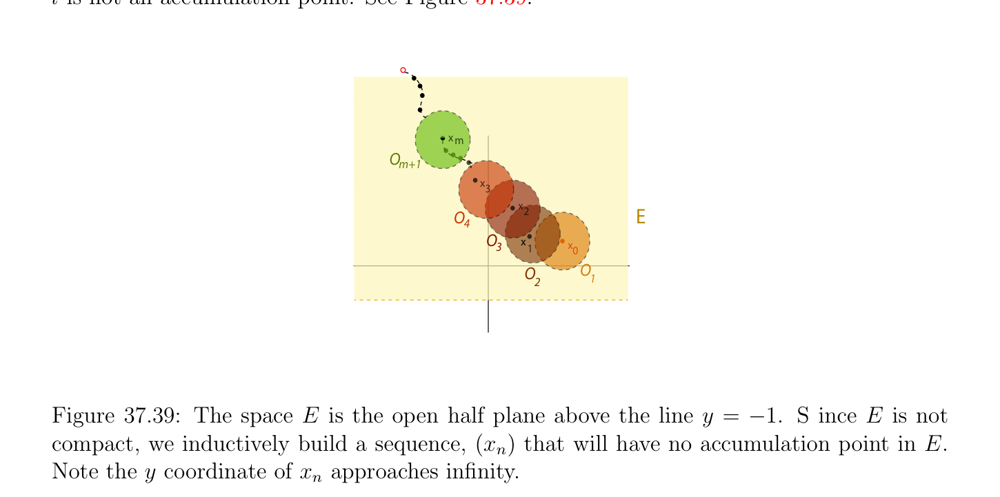
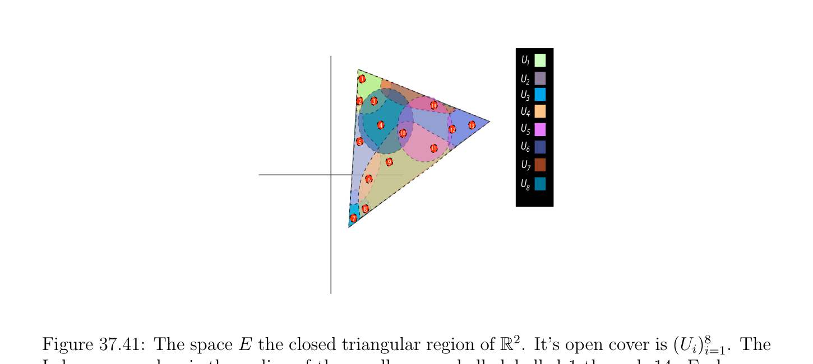

# Sequential Tính compắc

<!-- PAGE 1401 -->

## 37.7 Sequential Tính compắc

Cho tổng quát tôpô Hausdorff không gian $E$, định nghĩa của tính compắc relies trên sự tồn tại của hữu hạn phủ. Tuy nhiên, khi $E$ có đếm được cơ sở (basis) hoặc là không gian mêtric (metric space), ta có thể định nghĩa khái niệm của tính compắc theo các dãy. Đến understand cách mà điều này được thực hiện, ta cần đến thứ nhất định nghĩa accumulation các điểm.

> **Định nghĩa 37.35.** Cho trước tôpô Hausdorff không gian, $E$, cho trước bất kỳ dãy, $(x_{n})$, của các điểm trong $E$, điểm, $l \in E$, là accumulation điểm (hoặc cluster điểm) của dãy $(x_{n})$ nếu mọi tập mở (open set), $U$, chứa $l$ chứa $x_{n}$ cho một cách vô hạn nhiều $n$. Xem Hình 37.38.
$$x1$$
$$xx$$
$$53$$
$$x$$
$$7$$
$$xx$$
$$29$$
$$x$$
$$xlo2n+1$$
$$4$$
$$x6$$
$$x2n$$
$$le$$
$$E$$

**Hình 37.38:** không gian $E$ là đóng, bị chặn hồng tập con của $\mathbb{R}^{2}$. dãy $(x_{n})$ có hai accumulation các điểm, một cho dãy con $(x_{2n+1})$ và một cho $(x_{2n})$. Rõ ràng, nếu $l$ là giới hạn của dãy, $(x_{n})$, thì nó là accumulation điểm, vì mọi tập mở (open set), $U$, chứa chứa tất cả $x_{n}$ ngoại trừ cho một cách hữu hạn nhiều $n$. Cho đếm được thứ hai (second-countable) các không gian ta là able đến cho một cái khác đặc trưng của accumulation các điểm.

> **Mệnh đề 37.42.** Cho trước đếm được thứ hai (second-countable) tôpô Hausdorff không gian, $E$, điểm, $l$, là accumulation điểm của dãy, $(x_{n})$, khi và chỉ khi $l$ là giới hạn của một số dãy con, $(x_{nk})$, của $(x_{n})$.

*Chứng minh.* Rõ ràng, nếu $l$ là giới hạn của một số dãy con $(x_{nk})$ của $(x_{n})$, nó là accumulation điểm của $(x_{n})$. Ngược lại, cho $(U_{k})_{k\ge0}$ là dãy của các tập mở chứa $l$, ở đâu mỗi $U_{k}$ thuộc đến đếm được cơ sở (basis) của $E$, và cho $V_{k} = U_{1} \cap \cdots  \cap U_{k}$. Với mọi $k \ge 1$, ta có thể tìm một số $n_{k} > n_{k-1}$ sao cho $x_{nk} \in V_{k}$, vì $l$ là accumulation điểm của $(x_{n})$. Bây giờ, vì mọi tập mở (open set) chứa $l$ chứa một số $U_{k0}$ và vì $x_{nk} \in U_{k0}$ với mọi $k \ge 0$, dãy $(x_{nk})$ có giới hạn $l$.

<!-- PAGE 1402 -->
Nhận xét: Mệnh đề 37.42 cũng nghiệm đúng cho các không gian mêtric. Như illustration của Mệnh đề 37.42 cho $(x_{n})$ là dãy $(1, -1, 1, -1, \dots$). Điều này dãy có hai accumulation các điểm, cụ thể là $1$ và $-1$ vì $(x_{2n+1}) = (1)$ và $(x_{2n}) = (-1)$. Trong đếm được thứ hai (second-countable) Hausdorffspaces, tính compắc có thể được được đặc trưng hóa theo accumulation các điểm (điều này là cũng đúng cho các không gian mêtric).

> **Mệnh đề 37.43.** đếm được thứ hai (second-countable) tôpô Hausdorff không gian, $E$, là compắc khi và chỉ khi mọi dãy, $(x_{n})$, của $E$ có một số accumulation điểm trong $E$.

*Chứng minh.* Giả sử rằng mọi dãy, $(x_{n})$, có một số accumulation điểm. Cho $(U_{i})_{i\in I}$ là một số mở phủ của $E$. Theo Mệnh đề 37.41, có một đếm được mở phủ con (subcover), $(O_{n})_{n\ge0}$, cho $E$. Bây giờ, nếu $E$ là không được phủ bởi bất kỳ hữu hạn phủ con (subcover) của $(O_{n})_{n\ge0}$, ta có thể định nghĩa dãy, $(x_{m})$, bởi quy nạp như sau: Cho $x_{0}$ là tùy ý và với mọi $m \ge 1$, cho $x_{m}$ là một số điểm trong $E$ không trong $O_{1} \cup \cdots  \cup O_{m}$, mà tồn tại, vì $O_{1} \cup \cdots  \cup O_{m}$ là không mở phủ của $E$. Ta khẳng định rằng dãy, $(x_{m})$, thực hiện không có bất kỳ accumulation điểm. Thật vậy, với mọi $l \in E$, vì $(O_{n})_{n\ge0}$ là mở phủ của $E$, tồn tại một $O_{m}$ sao cho $l \in O_{m}$, và bởi cách xây dựng, mọi $x_{n}$ với $n \ge m + 1$ thực hiện không thuộc đến $O_{m}$, mà có nghĩa là $x_{n} \in O_{m}$ cho chỉ một cách hữu hạn nhiều $n$ và $l$ là không accumulation điểm. Xem Hình 37.39.
$$xm$$
$$O$$
$$m+1$$
$$x3$$
$$x2E$$
$$O$$
$$4$$
$$Ox1$$
$$3x0$$
$$\overline{O}\overline{O}$$
$$2\overline{1}$$

**Hình 37.39:** không gian $E$ là mở một nửa mặt phẳng ở trên đường thẳng $y = -1. S$ ince $E$ là không compắc, ta một cách quy nạp xây dựng dãy, $(x_{n})$ rằng sẽ có không có accumulation điểm trong $E$. Lưu ý $y$ tọa độ của $x_{n}$ các cách tiếp cận vô cực. Ngược lại, giả sử rằng $E$ là compắc, và cho $(x_{n})$ là bất kỳ dãy. Nếu $l \in E$ là không accumulation điểm của dãy, thì tồn tại một tập mở (open set), $U_{l}$, sao cho $l \in U_{l}$

<!-- PAGE 1403 -->
Và $x_{n} \in U_{l}$ cho chỉ một cách hữu hạn nhiều $n$. Do đó, nếu $(x_{n})$ thực hiện không có bất kỳ accumulation điểm, họ, $(U_{l})_{l\in E}$, là mở phủ của $E$ và vì $E$ là compắc, nó có một số hữu hạn mở phủ con (subcover), $(U_{l})_{l\in J}$, ở đâu $J$ là hữu hạn tập con của $E$. Nhưng mọi $U_{l}$ với $l \in J$ là sao cho
$$x_{n} \in U_{l} for only finitely many n, and since J is finite, x_{n} \in \bigcup_{l}  U_{l} for only finitely many n,$$
Mà mâu thuẫn với sự kiện là $(U_{l})_{l\in J}$ là mở phủ của $E,^{\in J}$ và do đó chứa tất cả $x_{n}$. Do đó, $(x_{n})$ có một số accumulation điểm. Xem Hình 37.40.
$$l1l2$$
$$l8l3l4$$
$$( x   )n$$
$$l7$$
$$\overline{l}\overline{5}$$
$$l$$
$$6$$

**Hình 37.40:** không gian $E$ đóng tam giác miền của $\mathbb{R}^{2}$. Cho trước dãy $(x_{n})$ của đỏ các điểm trong $E$, nếu dãy có không có accumulation các điểm, thì mỗi $l_{i}$ cho $1 \le i \le 8$, là không accumulation điểm. Nhưng như được suy ra bởi illustration, $l_{8}$ thực sự là accumulation điểm của $(x_{n})$.
Các nhận xét: $1$. Bởi combining Các mệnh đề 37.42 và 37.43, ta có nhận thấy rằng đếm được thứ hai (second-countable) Hausdorff không gian $E$ là compắc khi và chỉ khi mọi dãy $(x_{n})$ có convergent dãy con $(x_{nk})$. Nói cách khác, ta nói đếm được thứ hai (second-countable) Hausdorff không gian $E$ là compắc khi và chỉ khi nó là sequentially compắc. $2$. Nó nên được lưu ý rằng chứng minh chỉ ra rằng nếu $E$ là compắc, thì mọi dãy có một số accumulation điểm, nghiệm đúng với mọi tùy ý compắc không gian (chứng minh thực hiện không sử dụng đếm được cơ sở (basis) cho tôpô). điều ngược lại cũng nghiệm đúng cho các không gian mêtric. Ta sẽ chứng minh điều này điều ngược lại vì nó là major tính chất của các không gian mêtric. Cho trước không gian mêtric (metric space) trong mà mọi dãy có một số accumulation điểm, ta thứ nhất chứng minh sự tồn tại của Lebesgue số.

<!-- PAGE 1404 -->

> **Bổ đề 37.44.** Cho trước không gian mêtric (metric space), $E$, nếu mọi dãy, $(x_{n})$, có accumulation điểm, với mọi mở phủ, $(U_{i})_{i\in I}$, của $E$, tồn tại một $\delta  > 0$ (Lebesgue số cho $(U_{i})_{i\in I})$ sao cho, với mọi hình cầu mở (open ball), $B_{0}(a, \epsilon$), của bán kính $\epsilon  \le \delta$, tồn tại một mở tập con, $U_{i}$, sao cho $B_{0}(a, \epsilon$) $\subseteq U_{i}$. Xem Hình 37.41
$$U1$$
$$1U2$$
$$U3$$
$$23$$
$$14U$$
$$4$$
$$413U$$
$$10125$$
$$5U$$
$$116$$
$$9U$$
$$7$$
$$\overline{6} U$$
$$8$$
$$8$$
$$7$$

**Hình 37.41:** không gian $E$ đóng tam giác miền $of\mathbb{R}^{2}$. Nó’s mở phủ là $(U_{i})_{i=1}^{8}$. Lebesque số là bán kính của nhỏ cam các hình cầu labelled $1$ qua $14$. Mỗi hình cầu mở (open ball) của điều này bán kính hoàn toàn được chứa trong phạm vi ít nhất một $U_{i}$. Ví dụ, Hình cầu $2$ được chứa trong cả hai $U_{1}$ và $U_{2}$.

*Chứng minh.* Nếu ở đó đã là không có $\delta$ với ở trên tính chất, thì, với mọi tự nhiên số, $n$, ở đó sẽ là một số hình cầu mở (open ball), $B_{0}(a_{n}, 1/n)$, mà là không được chứa trong bất kỳ tập mở (open set), $U_{i}$, của mở phủ, $(U_{i})_{i\in I}$. Tuy nhiên, dãy, $(a_{n})$, có một số accumulation điểm,, và vì $(U_{i})_{i\in I}$ là mở phủ của $E$, tồn tại một $U_{i}$ sao cho $a \in U_{i}$. Vì $U_{i}$ là mở, tồn tại một hình cầu mở (open ball) của tâm và bán kính $\epsilon$ được chứa trong $U_{i}$. Bây giờ, vì là accumulation điểm của dãy, $(a_{n})$, mọi tập mở (open set) chứa chứa $a_{n}$ cho một cách vô hạn nhiều $n$ và do đó, tồn tại một $n$ lớn đủ sao cho
$$1/n \le \epsilon /2anda_{n} \in B_{0}(a, \epsilon /2),$$
Mà suy ra rằng
$$B_{0}(a_{n}, 1/n) \subseteq B_{0}(a, \epsilon ) \subseteq U_{i},$$
Một mâu thuẫn. Bởi trước đó nhận xét, vì chứng minh của Mệnh đề 37.43 suy ra rằng trong compắc không gian tôpô (topological space), mọi dãy có một số accumulation điểm, theo Bổ đề 37.44, trong compắc không gian mêtric (metric space), mọi mở phủ có Lebesgue số. sự kiện này có thể được được sử dụng để chứng minh một cái khác quan trọng tính chất của compắc các không gian mêtric, uniform tính liên tục định lý.

<!-- PAGE 1405 -->

> **Định nghĩa 37.36.** Cho trước hai các không gian mêtric, $(E, d_{E})$ và $(F, d_{F})$, hàm, $f$: $E \to F$, là liên tục đều (uniformly continuous) nếu với mọi $\epsilon  > 0$, tồn tại một $\eta  > 0$, sao cho, với mọi, $b \in E$,
$$ifd_{E}(a, b) \le \eta thend_{F}(f(a), f(b)) \le \epsilon .$$
Xem Các hình 37.42 và 37.43.
$$100$$
$$80$$
$$60$$
$$40$$
$$20\varepsilon$$
$$\varepsilon$$
$$0\overline{a}\overline{b}\overline{a} \overline{b}$$
$$\overline{0}\overline{200}\overline{400}\overline{600}\overline{800}\overline{1000}$$
$$x$$
$$\sqrt$$

**Hình 37.42:** thực valued hàm f(x) $= \overline{x}$ là liên tục đều (uniformly continuous) trên $(0, \infty$). Fix $\epsilon$. Nếu $x$ các giá trị lie trong phạm vi rose colored $\eta$ strip, $y$ các giá trị luôn luôn lie trong phạm vi peach $\epsilon$ strip. Như ta đã thấy trước đó, mêtric trên không gian mêtric (metric space) là liên tục đều (uniformly continuous), và chuẩn (norm) trên được chuẩn (norm) không gian mêtric (metric space) là liên tục đều (uniformly continuous). uniform tính liên tục định lý có thể được được phát biểu như sau:

> **Định lý 37.45.** Cho trước hai các không gian mêtric, $(E, d_{E})$ và $(F, d_{F})$, nếu $E$ là compắc và nếu $f$: $E \to F$ là hàm liên tục (continuous function), thì $f$ là liên tục đều (uniformly continuous).

*Chứng minh.* Xét bất kỳ $\epsilon  > 0$ và cho $(B_{0}(y, \epsilon /2))_{y\in F}$ là mở phủ của $F$ bao gồm của mở các hình cầu của bán kính $\epsilon /2$. Vì $f$ là liên tục, họ,
$$(f^{-1} (B_{0}(y, \epsilon /2)))_{y\in F},$$
Là mở phủ của $E$. Vì, $E$ là compắc, theo Bổ đề 37.44, có một Lebesgue số, $\delta$, sao cho với mọi hình cầu mở (open ball), $B_{0}(a, \eta$), của bán kính $\eta  \le \delta$, thì $B_{0}(a, \eta$) $\subseteq f^{-1} (B_{0}(y, \epsilon /2))$, với một số $y \in F$. Đặc biệt, với mọi, $b \in E$ sao cho $d_{E}(a, b) \le \eta  = \delta /2$, ta có, $b \in B_{0}(a, \delta$) và do đó,, $b \in f^{-1} (B_{0}(y, \epsilon /2))$, mà suy ra rằng f(), f(b) $\in B_{0}(y, \epsilon /2)$. Nhưng khi đó, $d_{F}(f(a)$, f(b)) $\le \epsilon$, như mong muốn. Ta bây giờ chứng minh một cái khác bổ đề cần thiết để thu được đặc trưng của tính compắc trong các không gian mêtric theo accumulation các điểm.

<!-- PAGE 1406 -->
$$\varepsilon$$
$$30$$
$$20$$
$$10$$
$$\varepsilon$$
$$0\overline{ab}\overline{a}\overline{b}$$
$$\overline{0}\overline{0.2}\overline{0.4}\overline{0.6}\overline{0.8}\overline{1}$$
$$x$$

**Hình 37.43:** thực valued hàm f(x) $= 1/x$ là không liên tục đều (uniformly continuous) trên $(0, \infty$). Fix $\epsilon$. Trong thứ tự cho $y$ các giá trị đến lie trong phạm vi peach epsilon strip, các chiều rộng của eta strips giảm như $x \to 0$.

> **Bổ đề 37.46.** Cho trước không gian mêtric (metric space), $E$, nếu mọi dãy, $(x_{n})$, có accumulation điểm, thì với mọi $\epsilon  > 0$, có một hữu hạn mở phủ, $B_{0}(a_{0}, \epsilon$) $\cup \cdots  \cup B_{0}(a_{n}, \epsilon$), của $E$ bởi mở các hình cầu của bán kính $\epsilon$.

*Chứng minh.* Cho $a_{0}$ là bất kỳ điểm trong $E$. Nếu $B_{0}(a_{0}, \epsilon$) $= E$, thì bổ đề được chứng minh. Ngược lại, giả sử rằng dãy, $(a_{0}, a_{1}, \dots  , a_{n})$, có đã được được định nghĩa, sao cho $B_{0}(a_{0}, \epsilon )\cup \cdots \cup B_{0}(a_{n}, \epsilon$) thực hiện không phủ $E$. Thì, tồn tại một $a_{n+1}$ không trong $B_{0}(a_{0}, \epsilon$) $\cup \cdots  \cup B_{0}(a_{n}, \epsilon$) và hoặc
$$B_{0}(a_{0}, \epsilon ) \cup \cdots  \cup B_{0}(a_{n+1}, \epsilon ) = E,$$
Trong mà trường hợp bổ đề được chứng minh, hoặc ta thu được dãy, $(a_{0}, a_{1}, \dots  , a_{n+1})$, sao cho $B_{0}(a_{0}, \epsilon$) $\cup \cdots  \cup B_{0}(a_{n+1}, \epsilon$) thực hiện không phủ $E$. Nếu điều này process đi trên forever, ta thu được vô hạn dãy, $(a_{n})$, sao cho $d(a_{m}, a_{n}) > \epsilon$ với mọi $m \neq  n$. Vì mọi dãy trong $E$ có một số accumulation điểm, dãy, $(a_{n})$, có một số accumulation điểm,. Thì, cho một cách vô hạn nhiều $n$, ta phải có $d(a_{n}, a) \le \epsilon /3$ và do đó, cho ít nhất hai phân biệt tự nhiên các số, $p, q$, ta phải có $d(a_{p}, a) \le \epsilon /3$ và $d(a_{q}, a) \le \epsilon /3$, mà suy ra $d(a_{p}, a_{q}) \le d(a_{p}, a)+d(a_{q}, a) \le 2\epsilon /3$, contradicting sự kiện rằng $d(a_{m}, a_{n}) > \epsilon$ với mọi $m \neq  n$. Xem Hình 37.44. Do đó, ở đó phải là một số $n$ sao cho
$$B_{0}(a_{0}, \epsilon ) \cup \cdots  \cup B_{0}(a_{n}, \epsilon ) = E.$$

> **Định nghĩa 37.37.** không gian mêtric (metric space) $E$ được nói là tiền compắc (hoặc một cách tổng bị chặn) nếu với mọi $\epsilon  > 0$, có một hữu hạn mở phủ, $B_{0}(a_{0}, \epsilon$) $\cup \cdots  \cup B_{0}(a_{n}, \epsilon$), của $E$ bởi mở các hình cầu của bán kính $\epsilon$. Ta bây giờ thu được Weierstrass–Bolzano tính chất.
