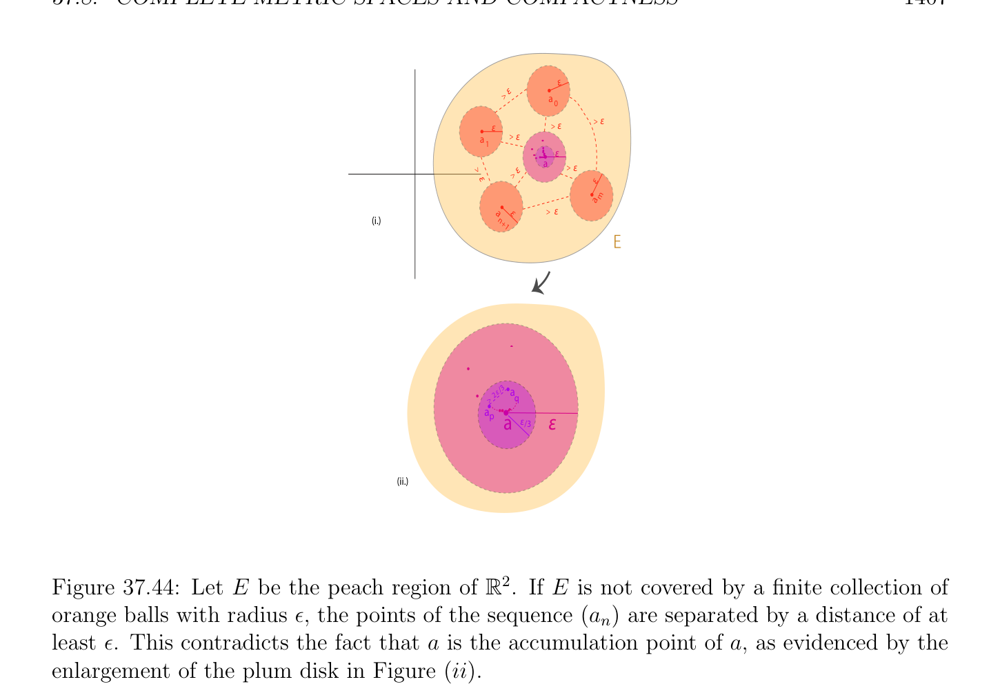
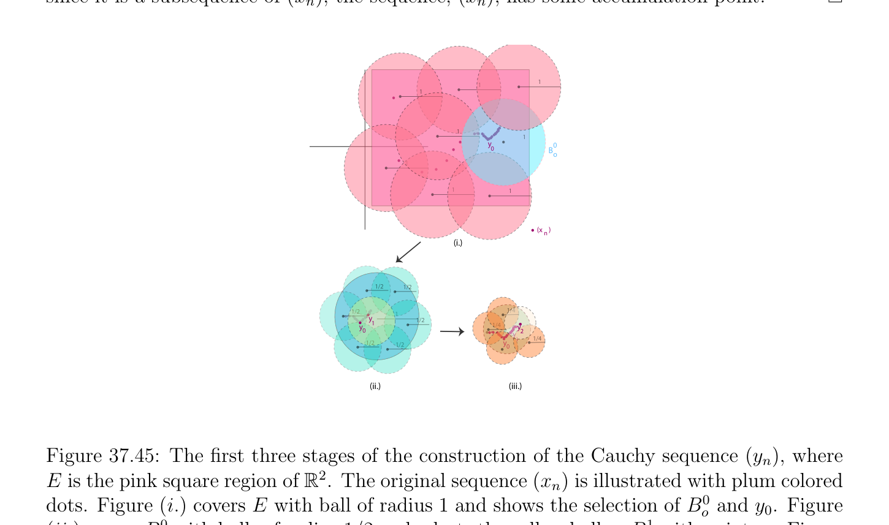

# Đầy đủ Các không gian mêtric và Tính compắc

<!-- PAGE 1407 -->
$$\varepsilon$$
$$> \varepsilon$$
$$a 0$$
$$\varepsilon > \varepsilon$$
$$\overline{\varepsilon}>$$
$$\overline{a}\overline{1}> \varepsilon$$
$$\overline{\varepsilon}$$
$$\overline{a}> \varepsilon$$
$$\overline{>}> \varepsilon$$
$$\overline{\varepsilon}\varepsilon$$
$$am$$
$$a\varepsilon > \varepsilon$$
$$(i.) n$$
$$+1$$
$$E$$
$$\varepsilon /3a$$
$$> 2q$$
$$ap\overline{a}_{\varepsilon/3}\overline{\varepsilon}$$
$$(ii.)$$

**Hình 37.44:** Cho $E$ là peach miền của $\mathbb{R}^{2}$. Nếu $E$ là không được phủ bởi hữu hạn họ của cam các hình cầu với bán kính $\epsilon$, các điểm của dãy $(a_{n})$ được tách bởi khoảng cách của ít nhất $\epsilon$. Điều này mâu thuẫn với sự kiện là là accumulation điểm của, như evidenced bởi enlargement của plum đĩa trong Hình (ii).

> **Định lý 37.47.** không gian mêtric (metric space), $E$, là compắc khi và chỉ khi mọi dãy, $(x_{n})$, có accumulation điểm.

*Chứng minh.* Ta đã được quan sát rằng chứng minh của Mệnh đề 37.43 chỉ ra rằng với mọi compắc không gian (không nhất thiết mêtric), mọi dãy, $(x_{n})$, có accumulation điểm. Ngược lại, cho $E$ là không gian mêtric (metric space), và giả sử rằng mọi dãy, $(x_{n})$, có accumulation điểm. Cho trước bất kỳ mở phủ, $(U_{i})_{i\in I}$ cho $E$, ta phải tìm hữu hạn mở phủ con (subcover) của $E$. Theo Bổ đề 37.44, tồn tại một $\delta  > 0$ (Lebesgue số cho $(U_{i})_{i\in I})$ sao cho, với mọi hình cầu mở (open ball), $B_{0}(a, \epsilon$), của bán kính $\epsilon  \le \delta$, tồn tại một mở tập con, $U_{j}$, sao cho $B_{0}(a, \epsilon$) $\subseteq U_{j}$. Theo Bổ đề 37.46, với mọi $\delta  > 0$, có một hữu hạn mở phủ, $B_{0}(a_{0}, \delta$) $\cup \cdots  \cup B_{0}(a_{n}, \delta$), của $E$ bởi mở các hình cầu của bán kính $\delta$. Nhưng từ trước đó phát biểu, mọi hình cầu mở (open ball), $B_{0}(a_{i}, \delta$), được chứa trong một số tập mở (open set), $U_{ji}$, và do đó, ${U_{j1}, \dots  , U_{jn}}$ là mở phủ của $E$.

## 37.8 Đầy đủ Các không gian mêtric và Tính compắc

Một cái khác rất hữu ích đặc trưng của compắc các không gian mêtric là thu được theo Các dãy Cauchy. Như vậy đặc trưng là khá hữu ích trong fractal hình học (và elsewhere). Thứ nhất

<!-- PAGE 1408 -->
Nhắc lại định nghĩa của Dãy Cauchy (Cauchy sequence) và của không gian mêtric đầy đủ.

> **Định nghĩa 37.38.** Cho trước không gian mêtric (metric space), $(E, d)$, dãy, $(x_{n})_{n\in N}$, trong $E$ là Dãy Cauchy (Cauchy sequence) nếu sau đây điều kiện nghiệm đúng: với mọi $\epsilon  > 0$, tồn tại một $p \ge 0$, sao cho, với mọi $m, n \ge p$, thì $d(x_{m}, x_{n}) \le \epsilon$. Nếu mọi Dãy Cauchy (Cauchy sequence) trong $(E, d)$ hội tụ ta nói rằng $(E, d)$ là không gian mêtric đầy đủ. Thứ nhất cho chúng ta chỉ ra sau đây mệnh đề:

> **Mệnh đề 37.48.** Cho trước không gian mêtric (metric space), $E$, nếu Dãy Cauchy (Cauchy sequence), $(x_{n})$, có một số accumulation điểm,, thì là giới hạn của dãy, $(x_{n})$.

*Chứng minh.* Vì $(x_{n})$ là Dãy Cauchy (Cauchy sequence), với mọi $\epsilon  > 0$, tồn tại một $p \ge 0$, sao cho, với mọi $m, n \ge p$, thì $d(x_{m}, x_{n}) \le \epsilon /2$. Vì là accumulation điểm cho $(x_{n})$, cho một cách vô hạn nhiều $n$, ta có $d(x_{n}, a) \le \epsilon /2$, và do đó, cho ít nhất một số $n \ge p$, ta có $d(x_{n}, a) \le \epsilon /2$. Thì, với mọi $m \ge p$,
$$d(x_{m}, a) \le d(x_{m}, x_{n}) + d(x_{n}, a) \le \epsilon ,$$
Mà chỉ ra rằng là giới hạn của dãy $(x_{n})$. Ta có thể bây giờ chứng minh sau đây định lý.

> **Định lý 37.49.** không gian mêtric (metric space), $E$, là compắc khi và chỉ khi nó là tiền compắc và đầy đủ.

*Chứng minh.* Cho $E$ là compắc. Với mọi $\epsilon  > 0$, họ của tất cả mở các hình cầu của bán kính $\epsilon$ là mở phủ cho $E$ và vì $E$ là compắc, có một hữu hạn phủ con (subcover), $B_{0}(a_{0}, \epsilon$) $\cup \cdots  \cup B_{0}(a_{n}, \epsilon$), của $E$ bởi mở các hình cầu của bán kính $\epsilon$. Do đó $E$ là tiền compắc. Vì $E$ là compắc, theo Định lý 37.47, mọi dãy, $(x_{n})$, có một số accumulation điểm. Do đó mọi Dãy Cauchy (Cauchy sequence), $(x_{n})$, có một số accumulation điểm,, và, theo Mệnh đề 37.48, là giới hạn của $(x_{n})$. Do đó, $E$ là đầy đủ. Bây giờ giả sử rằng $E$ là tiền compắc và đầy đủ. Ta chứng minh rằng mọi dãy, $(x_{n})$, có accumulation điểm. Bởi khác hướng của Định lý 37.47, điều này chỉ ra rằng $E$ là compắc. Cho trước bất kỳ dãy, $(x_{n})$, ta xây dựng Cauchy dãy con, $(y_{n})$, của $(x_{n})$ như sau: Vì $E$ là tiền compắc, đặt $\epsilon  = 1$, tồn tại một hữu hạn phủ, $\mathcal{U}_{1}$, của $E$ bởi mở các hình cầu của bán kính $1$. Do đó một số hình cầu mở (open ball), $B_{o}^{0}$, trong phủ, $\mathcal{U}_{1}$, chứa một cách vô hạn nhiều các phần tử từ dãy $(x_{n})$. Cho $y_{0}$ là bất kỳ phần tử của $(x_{n})$ trong $B_{o}^{0}$. Bởi quy nạp, giả sử rằng dãy của mở các hình cầu, $(B_{o}^{i})_{1\le i\le m}$, có đã được được định nghĩa, sao cho mọi hình cầu, $B_{o}^{i}$, có $radius_{i}^{1}$, chứa một cách vô hạn nhiều các phần tử từ dãy $(x_{n})$ và chứa một số $y_{i}$ từ $(x_{n}^{2})$ sao cho
$$d(y_{i}, y_{i+1}) \le \frac{1}{2^{i}} ,$$
Với mọi $i, 0 \le i \le m$ - $1$. Xem Hình 37.45. Thì đặt $\epsilon  =_{2m+1}^{1}$, bởi vì $E$ là tiền compắc, tồn tại một hữu hạn $cover,\mathcal{U}_{m+1}$, của $E$ bởi mở các hình cầu của bán kính $\epsilon$ và do đó, của hình cầu mở (open ball) $B_{o}^{m}$.

<!-- PAGE 1409 -->
Do đó, một số hình cầu mở (open ball), $B_{o}^{m+1}$, trong phủ, $\mathcal{U}_{m+1}$, chứa một cách vô hạn nhiều các phần tử từ dãy, $(x_{n})$, và ta cho $y_{m+1}$ là bất kỳ phần tử của $(x_{n})$ trong $B_{o}^{m+1}$. Do đó, ta có được định nghĩa bởi quy nạp dãy, $(y_{n})$, mà là dãy con của, $(x_{n})$, và sao cho
$$d(y_{i}, y_{i+1}) \le \frac{1}{2^{i}} ,$$
Với mọi $i$. Tuy nhiên, với mọi $m, n \ge 1$, ta có
$$d(y_{m}, y_{n}) \le d(y_{m}, y_{m+1}) + \cdots  + d(y_{n-1}, y_{n}) \le \sum_{i=m}^{n}  \frac{1}{2^{i}} \le \frac{1}{2^{m-1}} ,$$
Và do đó, $(y_{n})$ là Dãy Cauchy (Cauchy sequence) Vì $E$ là đầy đủ, dãy, $(y_{n})$, có giới hạn, và vì nó là dãy con của $(x_{n})$, dãy, $(x_{n})$, có một số accumulation điểm.
$$\overline{1}\overline{1}$$
$$\overline{1}$$
$$\overline{1} 1$$
$$y00$$
$$Bo$$
$$\overline{1}$$
$$\overline{1}\overline{1}$$
$$(x    )n$$
$$(i.)$$
$$\overline{1/2}\overline{1/2}$$
$$\overline{1/2}\overline{1}\overline{1/4}$$
$$y1\overline{1/2}$$
$$\overline{y} 0\overline{1/4} yy22$$
$$y1\overline{1/4}$$
$$\overline{1/2}\overline{1/2} y0$$
$$(ii.)(iii.)$$

**Hình 37.45:** thứ nhất ba các giai đoạn của cách xây dựng của Dãy Cauchy (Cauchy sequence) $(y_{n})$, ở đâu $E$ là hồng square miền $of\mathbb{R}^{2}$. ban đầu dãy $(x_{n})$ được minh họa với plum colored dots. Hình $(i.)$ phủ $E$ với hình cầu của bán kính $1$ và chỉ ra selection của $B_{o}^{0}$ và $y_{0}$. Hình (ii.) phủ $B_{o}^{0}$ với các hình cầu của bán kính $1/2$ và các chọn vàng hình cầu như $B_{o}^{1}$ với điểm $y_{1}$. Hình (iii.) phủ $B_{o}^{1}$ với các hình cầu của bán kính $1/4$ và các chọn pale peach hình cầu như $B_{o}^{2}$ với điểm $y_{2}$. Một cái khác hữu ích tính chất của không gian mêtric đầy đủ là rằng tập con là đóng khi và chỉ khi nó là đầy đủ. Điều này được hiển thị trong sau đây hai các mệnh đề.

> **Mệnh đề 37.50.** Cho $(E, d)$ là không gian mêtric (metric space), và cho $A$ là tập con của $E$. Nếu $A$ là đầy đủ (mà có nghĩa là mọi Dãy Cauchy (Cauchy sequence) của các phần tử trong $A$ hội tụ đến một số điểm của $A)$, thì $A$ là đóng trong $E$.
