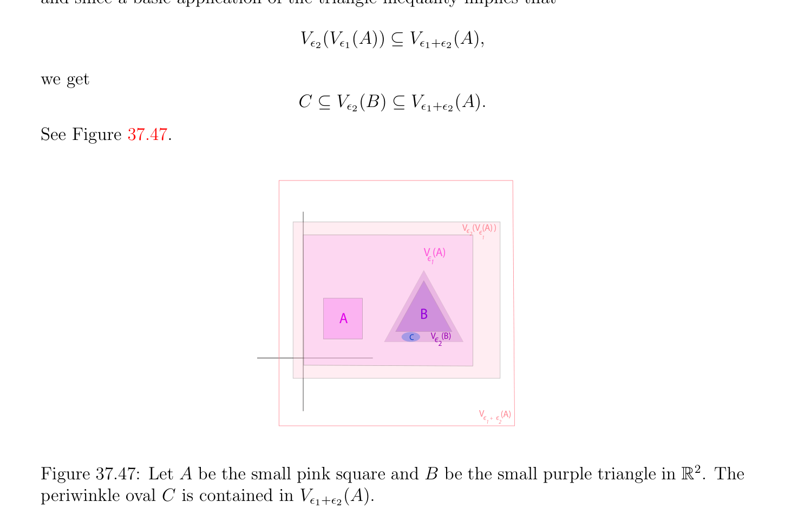
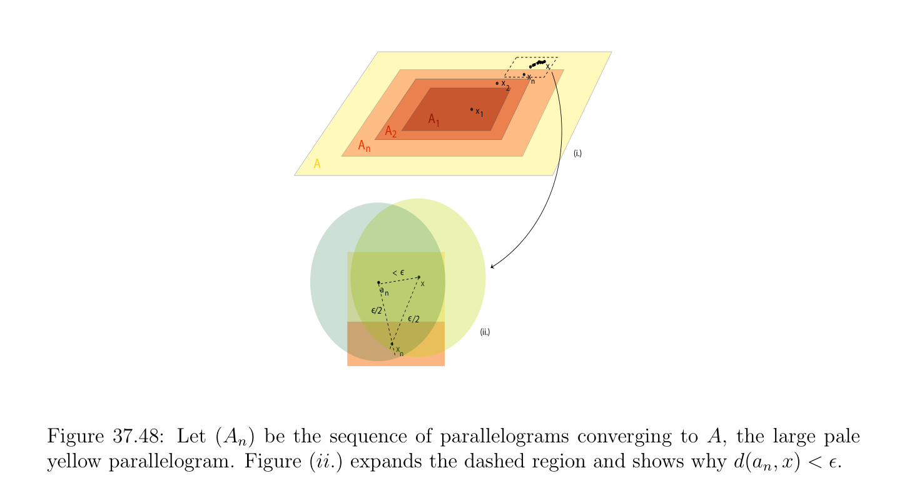

# Ánh xạ co (contraction) Ánh xạ Định lý

<!-- PAGE 1417 -->

## 37.10 Ánh xạ co (contraction) Ánh xạ Định lý

Nếu $(E, d)$ là khác rỗng không gian mêtric đầy đủ, mọi ánh xạ, $f$: $E \to E$, cho mà tồn tại một $k$ sao cho $0 \le k < 1$ và
$$d(f(x), f(y)) \le kd(x, y)$$
Với mọi $x, y \in E$, có rất quan trọng tính chất rằng nó có duy nhất cố định điểm, nghĩa là, tồn tại duy nhất một, $a \in E$, sao cho f() $= a$. ánh xạ như ở trên được gọi là một ánh xạ co (contraction) ánh xạ. Hơn nữa, cố định điểm của ánh xạ co (contraction) ánh xạ có thể được được tính như giới hạn của fast hội tụ dãy. cố định điểm tính chất của ánh xạ co (contraction) các ánh xạ được sử dụng để chỉ ra một số quan trọng các định lý của giải tích/phân tích, chẳng hạn như định lý hàm ẩn (implicit function theorem) và sự tồn tại của các nghiệm đến nhất định vi phân các phương trình. Nó có thể cũng được sử dụng để chỉ ra sự tồn tại của fractal các tập hợp được định nghĩa theo iterated hàm các hệ. Vì chứng minh là khá đơn giản, ta chứng minh cố định điểm tính chất của ánh xạ co (contraction) các ánh xạ. Thứ nhất, nhận thấy rằng ánh xạ co (contraction) ánh xạ là
(uniformly) liên tục.

> **Mệnh đề 37.54.** Nếu $(E, d)$ là khác rỗng không gian mêtric đầy đủ, mọi ánh xạ co (contraction) ánh xạ, $f$: $E \to E$, có duy nhất cố định điểm. Hơn nữa, với mọi $x_{0} \in E$, định nghĩa dãy, $(x_{n})$, sao cho $x_{n+1} = f(x_{n})$, dãy, $(x_{n})$, hội tụ đến duy nhất cố định điểm của $f$.

*Chứng minh.* Thứ nhất ta chứng minh rằng $f$ có nhiều nhất một cố định điểm. Thật vậy, nếu f() $= a$ và f(b) $= b$, vì
$$d(a, b) = d(f(a), f(b)) \le kd(a, b)$$
Và $0 \le k < 1$, ta phải có d(, $b) = 0$, nghĩa là, $a = b$. Tiếp theo, ta chứng minh rằng $(x_{n})$ là Dãy Cauchy (Cauchy sequence). Nhận thấy rằng
$$d(x_{2}, x_{1})\le kd(x_{1}, x_{0}),$$
$$d(x_{3}, x_{2})\le kd(x_{2}, x_{1}) \le k^{2}d(x_{1}, x_{0}),$$
$$\vdots \vdots$$
$$d(x_{n+1}, x_{n})\le kd(x_{n}, x_{n-1}) \le \cdots  \le k^{n}d(x_{1}, x_{0}).$$
Do đó, ta có
$$d(x_{n+p}, x_{n})\le d(x_{n+p}, x_{n+p-1}) + d(x_{n+p-1}, x_{n+p-2}) + \cdots  + d(x_{n+1}, x_{n})$$
$$\le (k^{p-1}+ k^{p-2}+ \cdots  + k + 1)k^{n}d(x_{1}, x_{0})$$
$$\le \frac{k^{n}}{1 -k} d(x_{1}, x_{0}).$$

<!-- PAGE 1418 -->
Ta kết luận rằng $d(x_{n+p}, x_{n})$ hội tụ đến $0$ khi $n$ đi đến vô cực, mà chỉ ra rằng $(x_{n})$ là Dãy Cauchy (Cauchy sequence). Vì $E$ là đầy đủ, dãy $(x_{n})$ có giới hạn,. Vì $f$ là liên tục, dãy $(f(x_{n}))$ hội tụ đến f(). Nhưng $x_{n+1} = f(x_{n})$ hội tụ đến và do đó f() $= a$, duy nhất cố định điểm của $f$. Lưu ý rằng không có matter cách mà bắt đầu điểm $x_{0}$ của dãy $(x_{n})$ được chọn, $(x_{n})$ hội tụ đến duy nhất cố định điểm của $f$. Cũng, sự hội tụ là fast, vì
$$d(x_{n}, a) \le \frac{k^{n}}{1 -k} d(x_{1}, x_{0}).$$
Hausdorffdistance giữa compắc các tập con của không gian mêtric (metric space) cung cấp rất đẹp illustration của một số của các định lý trên đầy đủ và compắc các không gian mêtric chỉ được trình bày.

> **Định nghĩa 37.40.** Cho trước không gian mêtric (metric space), $(X, d)$, với mọi tập con, $A \subseteq X$, với mọi, $\epsilon  \ge 0$, định nghĩa $\epsilon$ -bao (hull) của $A$ như tập hợp
$$V_{\epsilon}(A) = {x \in X, \exists a \in A | d(a, x) \le \epsilon }.$$
Xem Hình 37.46. Cho trước bất kỳ hai khác rỗng bị chặn các tập con, $A, B$ của $X$, định nghĩa D(, $B)$, Hausdorffdistance giữa $A$ và $B$, bởi
$$D(A, B) = \inf{\epsilon  \ge 0 | A \subseteq V_{\epsilon}(B) and B \subseteq V_{\epsilon}(A)}.$$
$$A$$
$$V (A)$$
$$є$$
$$Figure 37.46: The \epsilon -hull of a polygonal region A of \mathbb{R}^{2}$$
Lưu ý rằng vì ta là xét khác rỗng bị chặn các tập con, D(, $B)$ được xác định tốt (well-defined) (i.e., không vô hạn). Tuy nhiên, $D$ là không nhất thiết khoảng cách hàm. Nó là khoảng cách hàm nếu ta thu hẹp của ta attention đến khác rỗng compắc các tập con của $X$ (thực sự, nó là cũng mêtric trên đóng và bị chặn các tập con). Ta cho $\mathcal{K}(X)$ ký hiệu tập hợp tất cả khác rỗng compắc các tập con của $X$. đáng chú ý sự kiện là rằng $D$ là khoảng cách trên $\mathcal{K}(X)$ và rằng nếu $X$ là đầy đủ hoặc compắc, thì do đó là $\mathcal{K}(X)$. sau đây định lý được lấy từ Edgar $[56]$.

<!-- PAGE 1419 -->

> **Định lý 37.55.** Nếu $(X, d)$ là không gian mêtric (metric space), thì Hausdorffdistance, $D$, trên tập hợp, $\mathcal{K}(X)$, của khác rỗng compắc các tập con của $X$ là khoảng cách. Nếu $(X, d)$ là đầy đủ, thì $(\mathcal{K}(X), D)$ là đầy đủ và nếu $(X, d)$ là compắc, thì $(\mathcal{K}(X), D)$ là compắc.

*Chứng minh.* Vì (khác rỗng) các tập compắc là bị chặn, D(, $B)$ được xác định tốt (well-defined). Rõ ràng $D$ là đối xứng. Giả sử rằng D(, $B) = 0$. Thì với mọi $\epsilon  > 0, A \subseteq V_{\epsilon}(B)$, mà có nghĩa là
$$that for every a \in A, there is some b \in B such \frac{that}{B} d(a, b) \le \epsilon , and thus, that A \subseteq \overline{B}.$$
Vì Mệnh đề 37.26 suy ra rằng $B$ là đóng, $= B$, và ta có $A \subseteq B$. Tương tự, $B \subseteq A$, và do đó, $A = B$. Rõ ràng, nếu $A = B$, ta có D(, $B) = 0$. Nó vẫn còn để chứng minh tam giác bất đẳng thức. Giả sử rằng D(, $B) \le \epsilon_{1}$ và rằng D(B, $C) \le \epsilon_{2}$. Ta phải chỉ ra rằng D(, $C) \le \epsilon_{1}  + \epsilon_{2}$. Điều này sẽ là accomplished nếu ta có thể chỉ ra rằng $C \subseteq V_{\epsilon1+\epsilon2}(A)$ và $A \subseteq V_{\epsilon1+\epsilon2}(C)$. Bởi giả định và định nghĩa của $D, B \subseteq V_{\epsilon1}(A)$ và $C \subseteq V_{\epsilon2}(B)$. Thì
$$V_{\epsilon2}(B) \subseteq V_{\epsilon2}(V_{\epsilon1}(A)),$$
Và vì cơ bản ứng dụng của tam giác bất đẳng thức suy ra rằng
$$V_{\epsilon2}(V_{\epsilon1}(A)) \subseteq V_{\epsilon1+\epsilon2}(A),$$
Ta thu được
$$C \subseteq V_{\epsilon2}(B) \subseteq V_{\epsilon1+\epsilon2}(A).$$
Xem Hình 37.47.
$$Vє (V (A))$$
$$2є$$
$$1$$
$$V (A)$$
$$є$$
$$1$$
$$AB$$
$$CV   (B)є$$
$$2$$
$$Vє є(A)$$
$$1 +2$$

**Hình 37.47:** Cho $A$ là nhỏ hồng square và $B$ là nhỏ tím tam giác $in\mathbb{R}^{2}$. periwinkle oval $C$ được chứa trong $V_{\epsilon1+\epsilon2}(A)$. Tương tự, các điều kiện $(A, B) \le \epsilon_{1}$ và D(B, $C) \le \epsilon_{2}$ suy ra rằng
$$A \subseteq V_{\epsilon1}(B),B \subseteq V_{\epsilon2}(C).$$

<!-- PAGE 1420 -->
Do đó
$$A \subseteq V_{\epsilon1}(B) \subseteq V_{\epsilon1}(V_{\epsilon2}(C)) \subseteq V_{\epsilon1+\epsilon2}(C),$$
Và do đó tam giác bất đẳng thức suy ra. Tiếp theo ta cần để chứng minh rằng nếu $(X, d)$ là đầy đủ, thì $(\mathcal{K}(X), D)$ là cũng đầy đủ. Thứ nhất ta chỉ ra rằng nếu $(A_{n})$ là dãy của khác rỗng các tập compắc hội tụ đến khác rỗng tập compắc (compact set) $A$ trong Hausdorffmetric, thì
$$A = {x \in X | there is a sequence, (x_{n}), with x_{n} \in A_{n} converging to x}.$$
Thật vậy, nếu $(x_{n})$ là dãy với $x_{n} \in A_{n}$ hội tụ đến $x$ và $(A_{n})$ hội tụ đến $A$ thì,
$$for every \epsilon  > 0, there is some x_{n} such that d(x_{n}, x) \le \epsilon /2 and \frac{there}{A.} is some a_{n} \in A such$$
Rằng $d(a_{n}, x_{n}) \le \epsilon /2$ và do đó, $d(a_{n}, x) \le \epsilon$, mà chỉ ra rằng $x \in$ Vì $A$ là compắc, nó là đóng, và $x \in A$. Xem Hình 37.48.
$$x$$
$$xn$$
$$x2$$
$$Ax1$$
$$A1$$
$$2$$
$$An$$
$$(i.)$$
$$A$$
$$< є$$
$$x$$
$$an$$
$$є/2$$
$$є/2$$
$$(ii.)$$
$$xn$$

**Hình 37.48:** Cho $(A_{n})$ là dãy của các hình bình hành hội tụ đến $A$, lớn pale vàng hình bình hành. Hình (ii.) expands dashed miền và chỉ ra tại sao $d(a_{n}, x) < \epsilon$. Ngược lại, vì $(A_{n})$ hội tụ đến $A$, với mọi $x \in A$, với mọi $n \ge 1$, tồn tại một $x_{n} \in A_{n}$ sao cho $d(x_{n}, x) \le 1/n$ và dãy $(x_{n})$ hội tụ đến $x$. Bây giờ cho $(A_{n})$ là Dãy Cauchy (Cauchy sequence) trong $\mathcal{K}(X)$. Nó có thể được được chứng minh rằng $(A_{n})$ hội tụ đến tập hợp
$$A = {x \in X | there is a sequence, (x_{n}), with x_{n} \in A_{n} converging to x},$$
Và rằng $A$ là khác rỗng và compắc. để chứng minh rằng $A$ là compắc, một chứng tỏ rằng nó là một cách tổng bị chặn và đầy đủ. Chi tiết là cho trước trong Edgar $[56]$.
