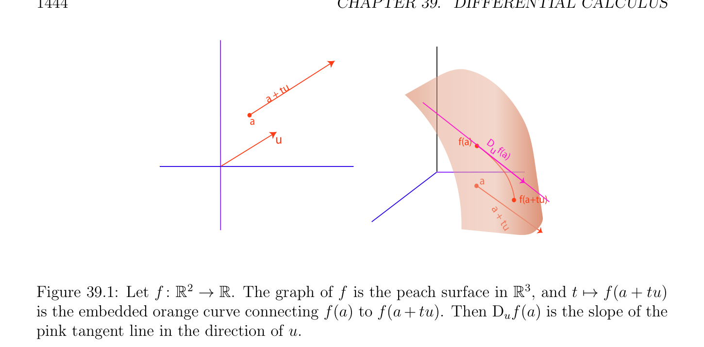
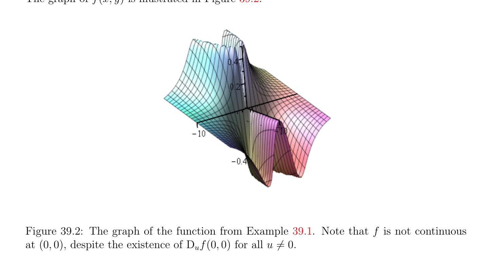

# Directional Các đạo hàm, Tổng Các đạo hàm

<!-- PAGE 1441 -->
Chương $39$ Vi phân Vi tích phân

## 39.1 Directional Các đạo hàm, Tổng Các đạo hàm

Điều này chương chứa ôn tập/tổng quan của cơ bản các khái niệm của vi phân vi tích phân. Thứ nhất, ta ôn tập/tổng quan định nghĩa của đạo hàm của hàm $f$: $\mathbb{R} \to \mathbb{R}$. Tiếp theo, ta định nghĩa directional các đạo hàm và đạo hàm toàn phần (total derivative) của hàm $f$: $E \to F$ giữa được chuẩn (norm) các không gian afin. Cơ bản các tính chất của các đạo hàm được hiển thị, bao gồm cả dây chuyền/xích quy tắc. Ta chỉ ra cách mà các đạo hàm được biểu diễn bởi Jacobian các ma trận. có nghĩa giá trị định lý được phát biểu, cũng như định lý hàm ẩn (implicit function theorem) và định lý hàm ngược (inverse function theorem). các vi phôi (diffeomorphism) và địa phương các vi phôi (diffeomorphism) được định nghĩa. Tiếp tuyến các không gian được định nghĩa. Bậc cao các đạo hàm được định nghĩa, cũng như Hessian. Schwarz’s bổ đề (về tính giao hoán của các riêng) được phát biểu. Một vài các phiên bản của Taylor’s công thức được phát biểu, và nổi tiếng công thức do Fa` di Bruno’s là cho trước. Ta thứ nhất ôn tập/tổng quan khái niệm của đạo hàm của nhận giá trị thực (real-valued) hàm có miền xác định là mở tập con của $\mathbb{R}$. Cho $f$: $A \to \mathbb{R}$, ở đâu $A$ là khác rỗng mở tập con của $\mathbb{R}$, và xét bất kỳ $a \in A$. chính ý tưởng đằng sau khái niệm của đạo hàm của $f$ tại, được ký hiệu bởi f' (), là rằng một cách địa phương xung quanh (rằng là, trong một số nhỏ tập mở (open set) $U \subseteq A$ chứa), hàm $f$ là approximated $linearly^{1}$ bởi ánh xạ
$$x \mapsto f(a) + f' (a)(x -a).$$
Như được điểm ra bởi Dieudonn´e trong early 1960s, nó là “unfortunate accident” rằng nếu $V$ là không gian vectơ (vector space) có số chiều một, thì có một song ánh giữa không gian $V^{*}$ của các dạng tuyến tính được định nghĩa trên $V$ và trường của các vô hướng. Hệ quả là, đạo hàm của nhận giá trị thực (real-valued) hàm $f$ được định nghĩa trên mở tập con $A$ của các số thực có thể được được định nghĩa như vô hướng (scalar) f' () (với mọi $a \in A)$. Nhưng như soon như $f$ là hàm của một vài các đối số/lập luận, vô hướng (scalar) interpretation của đạo hàm breaks xuống. $\overline{1}\overline{Actually,} \overline{the} \overline{approximation} \overline{is} \overline{affine,}$ nhưng everybody commits điều này abuse của language.
$$1441$$

<!-- PAGE 1442 -->
Phần của difficulty trong mở rộng ý tưởng của đạo hàm đến nhiều hơn/thêm phức các không gian là đến cho adequate khái niệm của tuyến tính xấp xỉ. then chốt ý tưởng là để sử dụng các ánh xạ tuyến tính (linear maps). Điều này có thể là carried ra theo các ma trận nhưng hóa ra là điều này không shortens cũng không simplifies các chứng minh. Thực ra, điều này là thường opposite. Ta admit rằng nhiều hơn/thêm nội tại định nghĩa của khái niệm của đạo hàm $f_{a}'$ tại điểm của hàm $f$: $E \to F$ giữa hai được chuẩn (norm) (afin) các không gian $E$ và $F$ như ánh xạ tuyến tính (linear map) đòi hỏi greater effort là grasped, nhưng ta feel rằng advantages của định nghĩa này outweight của nó bậc của abstraction. Đặc biệt, nó cho ta rõ ràng khái niệm của đạo hàm của hàm $f$: $M_{m}(\mathbb{R}) \to M_{n}(\mathbb{R})$ được định nghĩa từ $m \times  m$ các ma trận đến $n \times  n$ các ma trận (nhiều các định nghĩa tạo sử dụng của các đạo hàm riêng đối với các ma trận rằng thực hiện tạo bất kỳ nghĩa). Nhưng nhiều hơn/thêm một cách quan trọng, định nghĩa của đạo hàm như ánh xạ tuyến tính (linear map) làm cho nó rõ ràng rằng liệu không gian $E$ hoặc không gian $F$ là vô hạn dimensional thực hiện không matter. Điều này là quan trọng trong tối ưu hóa lý thuyết ở đâu tự nhiên không gian của các nghiệm của bài toán là thường vô hạn dimensional hàm không gian. Của course, đến carry ra các phép tính một cần đến chọn hữu hạn các cơ sở và để sử dụng Jacobian các ma trận, nhưng điều này là khác nhau matter. Cho chúng ta bây giờ ôn tập/tổng quan hình thức định nghĩa của đạo hàm của nhận giá trị thực (real-valued) hàm.

> **Định nghĩa 39.1.** Cho $A$ là bất kỳ khác rỗng mở tập con $of\mathbb{R}$, và cho $a \in A$. Với mọi hàm $f$: $A \to \mathbb{R}$, đạo hàm của $f$ tại $a \in A$ là giới hạn (nếu nó tồn tại)
$$-$$
$$f' (a) =h\to lim0, h\in U \frac{f(a + h)f(a)}{h} ,$$
Ở đâu $U = {h \in \mathbb{R}$ | $a + h \in A, h \neq  0}$. Điều này giới hạn được ký hiệu bởi f' (), hoặc Df(), $or^{df}$ (). Nếu f' () tồn tại với mọi $a \in A$, ta nói rằng $f$ là khả vi (differentiable) trên $A$. Trong trường hợp này, $the^{dx}$ ánh xạ $a \mapsto$ f' () được ký hiệu bởi f', hoặc Df, $or_{dx}^{df}$. Lưu ý rằng vì $A$ được giả sử là mở, $A -{a}$ là cũng mở, và vì hàm $h \mapsto a + h$ là liên tục và $U$ là nghịch đảo ảnh (image) của $A -{a}$ dưới hàm này, $U$ là thật vậy mở và định nghĩa làm cho nghĩa. Ta có thể cũng định nghĩa f' () như sau: tồn tại một hàm $\epsilon$, sao cho,
$$f(a + h) = f(a) + f' (a) \cdot  h + \epsilon (h)h,$$
Bất cứ khi nào $a + h \in A$, ở đâu $\epsilon (h)$ được định nghĩa với mọi $h$ sao cho $a + h \in A$, và
$$lim \epsilon (h) = 0.$$
$$h\to 0, h\in U$$
Nhận xét: Ta có thể cũng định nghĩa khái niệm của đạo hàm của $f$ tại trên trái, và đạo hàm của $f$ tại trên phải. Ví dụ, ta nói rằng đạo hàm của $f$ tại trên trái là giới hạn f' $(a_{-})$ (nếu nó tồn tại)
$$-$$
$$h\to lim0, h\in U \frac{f(a + h)f(a)}{h} ,$$

<!-- PAGE 1443 -->
Ở đâu $U = {h \in \mathbb{R}$ | $a + h \in A, h < 0}$. Nếu hàm $f$ như trong Định nghĩa 39.1 có đạo hàm f' () tại, thì nó là liên tục tại. Nếu $f$ là khả vi (differentiable) trên $A$, thì $f$ là liên tục trên $A$. hợp thành của khả vi (differentiable) các hàm là khả vi (differentiable).
Nhận xét: $A$ hàm $f$ có đạo hàm f' () tại khi và chỉ khi đạo hàm của $f$ trên trái tại và đạo hàm của $f$ trên phải tại tồn tại, và nếu chúng là bằng nhau. Cũng, nếu đạo hàm của $f$ trên trái tại tồn tại, thì $f$ là liên tục trên trái tại (và tương tự trên phải). Ta sẽ like để mở rộng khái niệm của đạo hàm đến các hàm $f$: $A \to F$, ở đâu $E$ và $F$ được chuẩn (norm) các không gian afin, và $A$ là một số khác rỗng mở tập con của $E$. thứ nhất difficulty là để tạo nghĩa của thương
$$\frac{f(a + h)f(a)}{h} -.$$
Nếu $E$ và $F$ được chuẩn (norm) các không gian afin, nó sẽ là notationally thuận tiện giả sử rằng
$$\longrightarrow$$
Không gian vectơ (vector space) liên kết với $E$ được ký hiệu bởi $E$, và rằng không gian vectơ (vector space) liên kết
$$\longrightarrow$$
Với $F$ được ký hiệu là như $F$. Vì $F$ được chuẩn (norm) không gian afin (affine space), tạo ra nghĩa của $f(a+h)-f(a)$ là dễ: ta có thể định nghĩa điều này $--------\longrightarrow$ như f()f($+ h)$, duy nhất vectơ translating f() đến f($+ h)$. Ta nên lưu ý tuy nhiên, rằng điều này đại lượng là vectơ và không điểm. Tuy nhiên, trong định nghĩa các đạo hàm, nó là
$$--------\longrightarrow$$
Notationally nhiều hơn/thêm pleasant đến ký hiệu f()f($+ h)$ bởi f($+ h)$ - f(). Do đó, trong rest của
$$\longrightarrow$$
Điều này chương, vectơ ab sẽ được ký hiệu bởi b-a. Nhưng bây giờ, cách mà thực hiện ta định nghĩa thương bởi vectơ? Tốt, ta không’t! $A$ thứ nhất khả năng là đến xét đạo hàm theo hướng (directional derivative) đối với vectơ $u \neq  0 \longrightarrow$ trong $E$. Ta có thể xét vectơ f($+$ tu) - f(), ở đâu $t \in \mathbb{R}$ (hoặc $t \in \mathbb{C})$. Bây giờ,
$$\frac{f(a + tu)f(a)}{t} -$$
Làm cho nghĩa. ý tưởng là rằng trong $E$, các điểm của tạo thành $a +$ tu cho $t$ trong một số nhỏ khoảng/đoạn $[-\epsilon , +\epsilon$ ] trong $\mathbb{R}$ (hoặc $\mathbb{C})$ tạo thành đường thẳng đoạn thẳng $[r, s]$ trong $A$ chứa, và rằng ảnh (image) của điều này đường thẳng đoạn thẳng định nghĩa nhỏ đường cong đoạn thẳng trên f(). Điều này đường cong đoạn thẳng được định nghĩa bởi ánh xạ $t \mapsto$ f($+$ tu), từ $[r, s]$ đến $F$, và đạo hàm theo hướng (directional derivative) $D_{u}f(a)$ định nghĩa hướng của tiếp tuyến đường thẳng tại đến điều này đường cong; xem Hình 39.1. Điều này dẫn đến chúng ta đến sau đây định nghĩa.

> **Định nghĩa 39.2.** Cho $E$ và $F$ là hai được chuẩn (norm) các không gian afin, cho $A$ là khác rỗng mở
$$\longrightarrow$$
Tập con của $E$, và cho $f$: $A \to F$ là bất kỳ hàm. Với mọi $a \in A$, với mọi $u \neq  0$ trong $E$, đạo hàm theo hướng (directional derivative) của $f$ tại w.r.t. vectơ $u$, được ký hiệu bởi $D_{u}f(a)$, là giới hạn (nếu nó tồn tại)
$$-$$
$$D_{u}f(a) =t\to lim0, t\in U \frac{f(a + tu)f(a)}{t} ,$$

<!-- PAGE 1444 -->
$$tu$$
$$a +$$
$$a$$
$$uf(a)D$$
$$u   f$$
$$(a$$
$$)$$
$$\overline{a}$$
$$f(a+tu)$$
$$a$$
$$+$$
$$tu$$
$$\mathbb{R}^{2} \mathbb{R} \mathbb{R}^{3}$$

**Hình 39.1:** Cho $f$: $\to$. đồ thị của $f$ là peach mặt trong, và $t \mapsto$ f($+$ tu) được nhúng cam đường cong connecting f() đến f($+$ tu). Thì $D_{u}f(a)$ là hệ số góc của hồng tiếp tuyến đường thẳng trong hướng của $u$. ở đâu $U = {t \in \mathbb{R}$ | $a +$ tu $\in A, t \neq  0}$ (hoặc $U = {t \in \mathbb{C}$ | $a +$ tu $\in A, t \neq  0})$. Lưu ý rằng
$$\longrightarrow$$
$D_{u}f(a)$ là vectơ trong $F$. Vì ánh xạ $t \mapsto a +$ tu là liên tục, và vì $A -{a}$ là mở, nghịch đảo ảnh (image) $U$ của $A -{a}$ dưới ở trên ánh xạ là mở, và định nghĩa của giới hạn trong Định nghĩa 39.2 làm cho nghĩa.
Nhận xét: Vì khái niệm của giới hạn là một cách thuần túy tôpô, sự tồn tại và giá trị của đạo hàm theo hướng (directional derivative) là độc lập của lựa chọn của các chuẩn trong $E$ và $F$, như dài như chúng là tương đương các chuẩn. đạo hàm theo hướng (directional derivative) đôi khi được gọi là Gˆateaux đạo hàm. Trong trường hợp đặc biệt khi $E = \mathbb{R}$ và $F = \mathbb{R}$, và ta cho $u = 1$ (i.e., thực số $1$, được quan điểm như vectơ), ta kiểm chứng được ngay rằng $D_{1}f(a) =$ f' (), trong nghĩa của Định nghĩa 39.1. Khi $E = \mathbb{R}$ (hoặc $E = \mathbb{C})$ và $F$ là bất kỳ không gian vectơ định chuẩn (normed vector space), đạo hàm $D_{1}f(a)$, cũng được ký hiệu bởi f' (), cung cấp phù hợp tổng quát hóa của khái niệm của đạo hàm. Tuy nhiên, khi $E$ có số chiều $\ge 2$, directional các đạo hàm trình bày serious bài toán, mà là rằng định nghĩa của chúng là không một cách đủ uniform. Thật vậy, ở đó là không có lý do gì để tin rằng directional các đạo hàm w.r.t. tất cả khác không các vectơ $u$ share something trong chung/phổ biến. Hệ quả là, hàm có thể có tất cả directional các đạo hàm tại, và vẫn chưa không là liên tục tại. Hai các hàm có thể có tất cả directional các đạo hàm trong một số các tập mở, và vẫn chưa của chúng hợp thành có thể không.
$$\mathbb{R}^{2} \mathbb{R}$$

> **Ví dụ 39.1.** Cho $f$: $\to$ là hàm cho trước bởi
$$(x2y$$
$$if (x, y) \neq  (0, 0)$$
$$f(x, y) =\overline{x}\overline{4}\overline{+}\overline{y}\overline{2}$$
$$0if (x, y) = (0, 0).$$

<!-- PAGE 1445 -->
Đồ thị của f(x, $y)$ được minh họa trong Hình 39.2.

**Hình 39.2:** đồ thị của hàm từ Ví dụ 39.1. Lưu ý rằng $f$ là không liên tục tại $(0, 0)$, despite sự tồn tại của $D_{u}f(0, 0)$ với mọi $u \neq  0$.
$$For any u \neq  0, letting u = \begin{pmatrix} h \\ k \end{pmatrix} , we have$$
$$\frac{f(0 + tu)f(0)}{t} -= \frac{h^{2}k}{t^{2}h^{4}+ k^{2}} ,$$
Sao cho
$$h2$$
$$if k \neq  0$$
$$D_{u}f(0, 0) =$$
$$0^{k}if k = 0.$$
Do đó, $D_{u}f(0, 0)$ tồn tại với mọi $u \neq  0$.
$$\mathbb{R}^{2} \mathbb{R}$$
Mặt khác, nếu Df(0, $0)$ được tồn tại, nó sẽ là ánh xạ tuyến tính (linear map) Df(0, $0): \to$ được biểu diễn bởi ma trận hàng $(\alpha  \beta$), và ta sẽ có $D_{u}f(0, 0) =$ Df(0, 0)(u) $= \alpha h + \beta k$, nhưng tường minh công thức cho $D_{u}f(0, 0)$ là không tuyến tính. Như matter của sự kiện, hàm $f$ là không liên tục tại $(0, 0)$. Ví dụ, trên parabol $y = x^{2}$, f(x, $y) =_{2}^{1}$, và khi ta cách tiếp cận gốc trên điều này parabol, giới hạn $is_{2}^{1}$, nhưng f(0, $0) = 0$. để tránh các bài tập phát sinh với directional các đạo hàm ta giới thiệu nhiều hơn/thêm uniform khái niệm. Cho trước hai được chuẩn (norm) các không gian $E$ và $F$, nhắc lại rằng ánh xạ tuyến tính (linear map) $f$: $E \to F$ là liên tục khi và chỉ khi tồn tại một hằng số $C \ge 0$ sao cho
$$\|f(u)\|\le C \|u\|for all u \in E.$$

<!-- PAGE 1446 -->

> **Định nghĩa 39.3.** Cho $E$ và $F$ là hai được chuẩn (norm) các không gian afin, cho $A$ là khác rỗng mở tập con của $E$, và cho $f$: $A \to F$ là bất kỳ hàm. Với mọi $a \in A$, ta nói rằng $f$ là khả vi (differentiable) tại
$$\longrightarrow \longrightarrow$$
$a \in A$ nếu có một tuyến tính ánh xạ liên tục (continuous map) $L: E \to F$ và hàm $\epsilon$, sao cho
$$f(a + h) = f(a) + L(h) + \epsilon (h)\|h\|$$
Với mọi $a + h \in A$, ở đâu $\epsilon (h)$ được định nghĩa với mọi $h$ sao cho $a + h \in A$ và
$$lim \epsilon (h) = 0,$$
$$h\to 0, h\in U$$
$$\longrightarrow$$
Ở đâu $U = {h \in E$ | $a + h \in A, h \neq  0}$. ánh xạ tuyến tính (linear map) $L$ được ký hiệu bởi Df(), hoặc $Df_{a}$, hoặc df(), hoặc $df_{a}$, hoặc f' (), và nó được gọi là Fr´echet đạo hàm, hoặc đạo hàm, hoặc đạo hàm toàn phần (total derivative), hoặc tổng vi phân, hoặc vi phân, của $f$ tại; xem Hình 39.3.
$$h$$
$$\overline{a}$$
$$f(a)$$
$$f(a+h) -f(a)$$
$$L(h)$$
$$f(a+h)$$
$$h$$
$$\mathbb{R}^{2} \mathbb{R} \mathbb{R}^{3}$$

**Hình 39.3:** Cho $f$: $\to$. đồ thị của $f$ là xanh lục mặt trong. ánh xạ tuyến tính (linear map) $L =$ Df() là hồng tiếp tuyến mặt phẳng. Với mọi vectơ $h \in \mathbb{R}^{2}$, L(h) là một cách xấp xỉ bằng f($+ h)$ - f(). Lưu ý rằng L(h) là cũng hướng tiếp tuyến đến đường cong $t \mapsto$ f($+$ tu).
$$\longrightarrow$$
Vì ánh xạ $h \mapsto a + h$ từ $E$ đến $E$ là liên tục, và vì $A$ là mở trong $E$,
$$\longrightarrow$$
Nghịch đảo ảnh (image) $U$ của $A -{a}$ dưới ở trên ánh xạ là mở trong $E$, và nó làm cho nghĩa đến nói rằng
$$lim \epsilon (h) = 0.$$
$$h\to 0, h\in U$$
Lưu ý rằng với mọi $h \in U$, vì $h \neq  0, \epsilon (h)$ là một cách duy nhất được xác định vì
$$- -$$
$$\epsilon (h) = \frac{f(a + h)f(a)L(h)}{\|h\|} ,$$

<!-- PAGE 1447 -->
Và rằng giá trị $\epsilon (0)$ đóng một cách tuyệt đối không có vai trò trong định nghĩa này. điều kiện cho $f$ là khả vi (differentiable) tại tương đương với đến sự kiện rằng
$$lim\| \frac{f(a + h)f(a)L(h)}{\|h\|} - -\|= 0$$
$$h\mapsto 0$$
Như $h \neq  0$ các cách tiếp cận $0$, khi $a + h \in A$. Tuy nhiên, nó thực hiện không có harm giả sử rằng $\epsilon (0) = 0$, và ta sẽ giả sử điều này từ bây giờ trên. Một lần nữa, ta lưu ý rằng đạo hàm Df() của $f$ tại cung cấp afin xấp xỉ của $f$, một cách địa phương xung quanh. Nếu $E = F =\mathbb{R}$, ánh xạ tuyến tính (linear map) $L: \mathbb{R} \to \mathbb{R}$ là một cách duy nhất được xác định bởi một số cố định thực số $c \in \mathbb{R}$ và ta có
$$L(u) = cu,u \in \mathbb{R}.$$
Vì
$$| - -| -$$
$$|\epsilon (h)| = \frac{f(a + h)f(a)ch}{|h|} = \frac{f(a + h)f(a)}{h} -c ,$$
Nếu $Df_{a}$ tồn tại, $|\epsilon$ (h)| tiến tới đến không nếu |h| tiến tới đến không, và ta suy ra rằng
$$c = f' (a),$$
Do đó của ta mới khái niệm của đạo hàm agrees với old (tiêu chuẩn) khái niệm của đạo hàm, như nó nên.
Các nhận xét:
$(1)$ Vì khái niệm của giới hạn là một cách thuần túy tôpô, sự tồn tại và giá trị của đạo hàm là độc lập của lựa chọn của các chuẩn trong $E$ và $F$, như dài như chúng là tương đương các chuẩn.
$(2)$ Nếu $h: (-a, a) \to \mathbb{R}$ là nhận giá trị thực (real-valued) hàm được định nghĩa trên một số mở khoảng/đoạn chứa $0$, ta nói rằng $h$ là o(t) cho $t \to 0$, và ta viết h(t) $=$ o(t), nếu
$$t\mapsto lim0, t\neq 0 \frac{h(t)}{t} = 0.$$
Với điều này ký hiệu (little $o$ ký hiệu), hàm $f$ là khả vi (differentiable) tại khi và chỉ khi
$$f(a + h) -f(a) -L(h) = o(\|h\|),$$
Mà cũng được viết như
$$f(a + h) = f(a) + L(h) + o(\|h\|).$$
Sau đây mệnh đề chỉ ra rằng của ta mới định nghĩa là consistent với định nghĩa của đạo hàm theo hướng (directional derivative) và rằng liên tục ánh xạ tuyến tính (linear map) $L$ là duy nhất, nếu nó tồn tại.

<!-- PAGE 1448 -->

> **Mệnh đề 39.1.** Cho $E$ và $F$ là hai được chuẩn (norm) các không gian afin, cho $A$ là khác rỗng mở tập con của $E$, và cho $f$: $A \to F$ là bất kỳ hàm. Với mọi $a \in A$, nếu Df() được định nghĩa, thì
$$\longrightarrow$$
$f$ là liên tục tại và $f$ có đạo hàm theo hướng (directional derivative) $D_{u}f(a)$ với mọi $u \neq  0$ trong $E$, và hơn nữa,
$$D_{u}f(a) = Df(a)(u)$$
Mà có thể cũng được viết như
$$D_{u}f(a) = Df_{a}(u),$$
Và do đó, Df() là một cách duy nhất được định nghĩa.
$$\longrightarrow$$

*Chứng minh.* Nếu $L =$ Df() tồn tại, thì với mọi khác không vectơ $u \in E$, bởi vì $A$ là mở, với mọi $t \in \mathbb{R} -{0}$ (hoặc $t \in \mathbb{C} -{0})$ nhỏ đủ, $a +$ tu $\in A$, do đó
$$f(a + tu)=f(a) + L(tu) + \epsilon (tu)\|tu\|$$
$$=f(a) + tL(u) + |t|\epsilon (tu)\|u\|$$
Mà suy ra rằng
$$-||$$
$$L(u) = \frac{f(a + tu)f(a)}{t} - \frac{t}{t} \epsilon (tu)\|u\|,$$
Và vì $lim_{t\mapsto0} \epsilon$ (tu) $= 0$, ta suy ra rằng
$$L(u) = Df(a)(u) = D_{u}f(a).$$
Bởi vì
$$f(a + h) = f(a) + L(h) + \epsilon (h)\|h\|$$
Với mọi $h$ sao cho $\|h\|$ là nhỏ đủ, $L$ là liên tục, và $lim_{h\mapsto0} \epsilon (h)\|h\| = 0$, ta có $lim_{h\mapsto0}$ f($+ h) =$ f(), nghĩa là, $f$ là liên tục tại. Khi $E$ là của hữu hạn số chiều, mọi ánh xạ tuyến tính (linear map) là liên tục (xem Mệnh đề 9.9 hoặc Định lý 37.58), và điều này giả định là thì redundant. Nó là quan trọng đến lưu ý rằng đạo hàm Df() của $f$ tại là liên tục ánh xạ tuyến tính (linear map)
$$\longrightarrow  \longrightarrow$$
Từ không gian vectơ (vector space) $E$ đến không gian vectơ (vector space) $F$, và không hàm từ không gian afin (affine space) $E$ đến không gian afin (affine space) $F$. Nhận thấy rằng trong phương trình
$$D_{u}f(a) = Df_{a}(u),$$
Đạo hàm theo hướng (directional derivative) $D_{u}f(a)$ là vectơ, và $Df_{a}(u)$ là kết quả của evaluating ánh xạ tuyến tính (linear map) $Df_{a}$ trên vectơ $u$. ánh xạ tuyến tính (linear map) $Df_{a}$ “biết” về tất cả directional các đạo hàm, nó là toàn cục object. Do đó sau tất cả, đạo hàm $Df_{a}$ của hàm $f$ tại là không số hoặc vectơ, nó là ánh xạ tuyến tính (linear map).

<!-- PAGE 1449 -->
Mặc dù điều này có thể không là ngay lập tức hiển nhiên, lý do cho đòi hỏi ánh xạ tuyến tính (linear map) $Df_{a}$ là liên tục là để đảm bảo rằng nếu hàm $f$ là khả vi (differentiable) tại, thì nó là liên tục tại. Điều này là một cách nhất định desirable tính chất của khả vi (differentiable) hàm. Trong hữu hạn số chiều điều này nghiệm đúng, nhưng trong vô hạn số chiều điều này là không trường hợp. sau đây mệnh đề chỉ ra rằng nếu $Df_{a}$ tồn tại tại và nếu $f$ là liên tục tại, thì $Df_{a}$ phải là ánh xạ liên tục (continuous map). Do đó nếu hàm là khả vi (differentiable) tại, thì nó là liên tục khi và chỉ khi ánh xạ tuyến tính (linear map) $Df_{a}$ là liên tục. Ta đã chọn đến bao gồm điều kiện thứ hai khá rằng thứ nhất trong định nghĩa của khả vi (differentiable) hàm.

> **Mệnh đề 39.2.** Cho $E$ và $F$ là hai được chuẩn (norm) các không gian afin, cho $A$ là khác rỗng mở tập con của $E$, và cho $f$: $A \to F$ là bất kỳ hàm. Với mọi $a \in A$, nếu $Df_{a}$ được định nghĩa, thì $f$ là liên tục tại khi và chỉ khi $Df_{a}$ là liên tục ánh xạ tuyến tính (linear map).

*Chứng minh.* Mệnh đề 39.1 chỉ ra rằng nếu $Df_{a}$ được định nghĩa và liên tục thì $f$ là liên tục tại. Ngược lại, giả sử rằng $Df_{a}$ tồn tại và rằng $f$ là liên tục tại. Vì $f$ là liên tục tại và vì $Df_{a}$ tồn tại, với mọi $\eta  > 0$ tồn tại một $\rho$ với $0 < \rho  < 1$ sao cho nếu $\|h\|\le \rho$ thì
$$\|f(a + h) -f(a)\|\le \frac{\eta}{2} ,$$
Và
$$\|f(a + h) -f(a) -D_{a}(h)\|\le \frac{\eta}{2} \|h\|\le \frac{\eta}{2} ,$$
Do đó ta có
$$\|D_{a}(h)\|= \|D_{a}(h) -(f(a + h) -f(a)) + f(a + h) -f(a)\|$$
$$\le \|f(a + h) -f(a) -D_{a}(h)\|+ \|f(a + h) -f(a)\|$$
$$\le \frac{\eta}{2} + \frac{\eta}{2} = \eta ,$$
Mà chứng tỏ rằng $Df_{a}$ là liên tục tại $0$. Theo Mệnh đề 37.56, $Df_{a}$ là liên tục ánh xạ tuyến tính (linear map). Trong thực tế, để tìm ánh xạ tuyến tính (linear map) $L = Df_{a} = df_{a}$, ta thử đến expand f($+ h)$ - f() như hàm của $h$ và đến isolate phần của f($+ h)$ - f() mà là tuyến tính trong $h$. Cho các hàm trên các ma trận, điều này là typically không cũng khó. Thì ta cần để chỉ ra rằng sai số số hạng $\epsilon (h)$ tiến tới đến không như $\|h\|$ tiến tới đến không, mà relies trên phù hợp các tính chất của các chuẩn liên quan và có thể là khá challenging.

> **Ví dụ 39.2.** Xét ánh xạ, $f$: $M_{n}(\mathbb{R}) \to M_{n}(\mathbb{R})$, cho trước bởi
$$f(A) = A^{\top}A -I,$$
$$where M_{n}(\mathbb{R}) is equipped with any \frac{matrix}{\mathrm{tr}(A^{\top}A} norm, since they are all equivalent; for example,$$
Chọn Chuẩn Frobenius (Frobenius norm), $\|A\|_{F} = p$). Ta khẳng định rằng
$$Df(A)(H) = A^{\top}H + H^{\top}A,for all A and H in M_{n}(\mathbb{R}).$$
