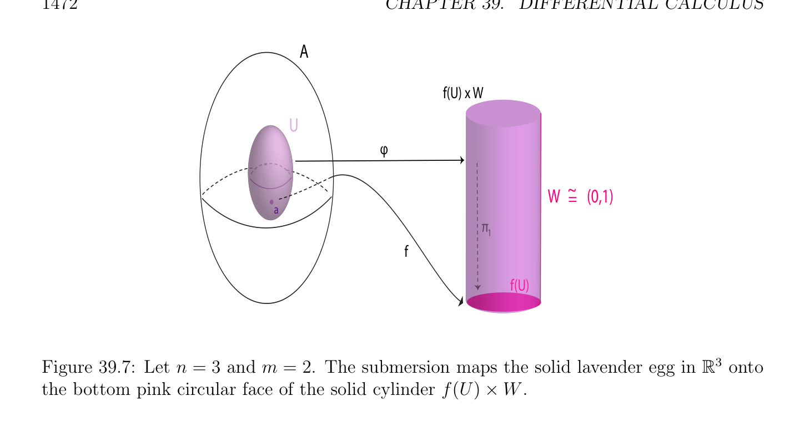

# Tiếp tuyến Các không gian và các vi phân

<!-- PAGE 1472 -->
$$A$$
$$f(U) x W$$
$$U$$
$$\varphi$$
$$~$$
$$W =(0,1)$$
$$a$$
$$\pi$$
$$1$$
$$f$$
$$f(U)$$
$$\mathbb{R}^{3}$$

**Hình 39.7:** Cho $n = 3$ và $m = 2$. phép ngập (submersion) các ánh xạ solid lavender egg trong lên đáy/dưới hồng tròn mặt của solid hình trụ f(U) $\times  W$.

## 39.5 Tiếp tuyến Các không gian và các vi phân

Trong mục này, ta thảo luận ngắn gọn hình học interpretation của khái niệm của đạo hàm. Ta xét các tập hợp của các điểm được định nghĩa bởi khả vi (differentiable) hàm. Điều này là đặc biệt trường hợp của khái niệm của (vi phân) đa tạp (manifold). Cho trước hai được chuẩn (norm) các không gian afin $E$ và $F$, cho $A$ là mở tập con của $E$, và cho $f$: $A \to F$ là hàm.

> **Định nghĩa 39.12.** Cho trước $f$: $A \to F$ như ở trên, của nó đồ thị $\Gamma (f)$ là tập hợp tất cả các điểm
$$\Gamma (f) = {(x, y) \in E \times  F | x \in A, y = f(x)}.$$
Nếu Df được định nghĩa trên $A$, ta nói rằng $\Gamma (f)$ là vi phân submanifold của $E \times  F$ của phương trình $y =$ f(x). Nó nên được lưu ý rằng điều này là rất cụ thể loại của vi phân đa tạp (manifold).

> **Ví dụ 39.13.** Nếu $E =\mathbb{R}$ và $F =\mathbb{R}^{2}$, đặt $f = (g, h)$, ở đâu $g: \mathbb{R} \to \mathbb{R}$ và $h: \mathbb{R} \to \mathbb{R}$,
$$\mathbb{R}^{3}\mathbb{R}^{2} \mathbb{R}$$
$\Gamma (f)$ là đường cong trong, của các phương trình $y =$ g(x), $z =$ h(x). Khi $E =$ và $F = , \Gamma (f)$ là mặt trong $\mathbb{R}^{3}$, của phương trình $z =$ f(x, $y)$. Ta bây giờ định nghĩa khái niệm của afin tiếp tuyến không gian trong rất tổng quát cách. Tiếp theo, ta sẽ xem những gì nó có nghĩa là cho các đa tạp $\Gamma (f)$, như trong Định nghĩa 39.12.

> **Định nghĩa 39.13.** Cho trước được chuẩn (norm) không gian afin (affine space) $E$, cho trước bất kỳ khác rỗng tập con $M$ của $E$,
$$\longrightarrow$$
Cho trước bất kỳ điểm $a \in M$, ta nói rằng vectơ $u \in E$ là tiếp tuyến tại đến $M$ nếu ở đó tồn tại

<!-- PAGE 1473 -->
$$V$$
$$\varphi$$
$$\overline{f(a)}$$
$$f(U)$$
$$U x W$$
$$W =~ (0,1)$$
$$f$$
$$aU$$
$$A$$

**Hình 39.8:** Cho $n = 2$ và $m = 3$. phép dìm (immersion) các ánh xạ tím tròn base của hình trụ $U \times  W$ đến tròn cup trên mặt của solid tím gourd. dãy $(a_{n})_{n\in N}$ của các điểm trong $M$ hội tụ đến, và dãy $(\lambda_{n} )_{n\in N}$, với $\lambda_{i}  \in \mathbb{R}$ và $\lambda_{n}  \ge 0$, sao cho dãy $(\lambda_{n} (a_{n}$ - $a))_{n\in N}$ hội tụ đến $u$. Tập hợp tất cả các vectơ tiếp tuyến tại đến $M$ được gọi là họ của tiếp tuyến các vectơ tại đến $M$ và tập hợp tất cả các điểm của $E$ của tạo thành $a + u$ ở đâu $u$ thuộc đến họ của tiếp tuyến các vectơ tại đến $M$ được gọi là afin tiếp tuyến họ tại đến $M$. Rõ ràng, $0$ là luôn luôn tiếp tuyến, và nếu $u$ là tiếp tuyến, thì do đó là mọi $\lambda u$, cho $\lambda  \in \mathbb{R}, \lambda  \ge 0$. Nếu $u \neq  0$, thì dãy $(\lambda_{n} )_{n\in N}$ phải tiến tới towards $+\infty$. Ta có kết quả sau mệnh đề.

> **Mệnh đề 39.18.** Cho $E$ và $F$ là hai được chuẩn (norm) các không gian afin, cho $A$ là mở tập con của $E$, cho $a \in A$, và cho $f$: $A \to F$ là hàm. Nếu Df() tồn tại, thì họ của tiếp tuyến
$$\longrightarrow \times  \longrightarrow$$
Các vectơ tại (, f()) đến $\Gamma$ là không gian con $T_{a}(\Gamma$) của $E F$, được định nghĩa bởi điều kiện (phương trình)
$$(u, v) \in T_{a}(\Gamma )iff v = Df(a)(u),$$
Và afin tiếp tuyến họ tại (, f()) đến $\Gamma$ là afin variety $T_{a}(\Gamma$) của $E \times  F$, được định nghĩa bởi điều kiện (phương trình)
$$(x, y) \in T_{a}(\Gamma )iff y = f(a) + Df(a)(x -a),$$
Ở đâu $\Gamma$ là đồ thị của $f$.
