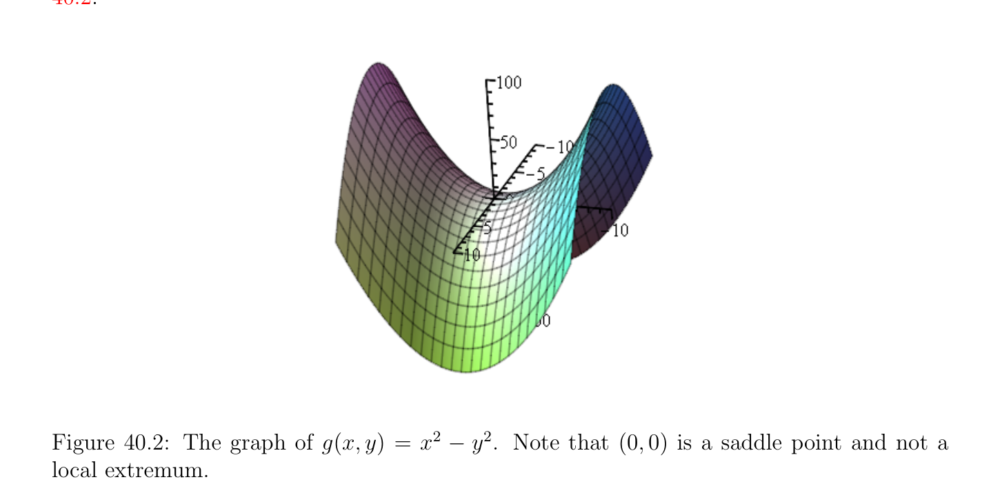

# Địa phương Các cực trị và Các nhân tử Lagrange (Lagrange multipliers)

<!-- PAGE 1494 -->

## 40.1 Địa phương Các cực trị, Có ràng buộc Địa phương Các cực trị, và

$$Lagrange Multipliers$$
Cho $J$: $E \to \mathbb{R}$ là nhận giá trị thực (real-valued) hàm được định nghĩa trên không gian vectơ định chuẩn (normed vector space) $E$ (hoặc tổng quát hơn, bất kỳ không gian tôpô (topological space)). một cách lý tưởng (ideal) ta sẽ like để tìm ở đâu hàm $J$ các đạt tới cực tiểu hoặc cực đại giá trị, ít nhất một cách địa phương. Trong chương này ta sẽ thường sử dụng các ký hiệu dJ(u) hoặc J'(u) (hoặc $dJ_{u}$ hoặc $J_{u}')$ cho đạo hàm của $J$ tại $u$, thay vì của DJ(u). Của ta trình bày suy ra rất closely rằng của Ciarlet $[41]$ (Chương $7)$, mà ta tìm là một của clearest.

> **Định nghĩa 40.1.** Nếu $J$: $E \to \mathbb{R}$ là nhận giá trị thực (real-valued) hàm được định nghĩa trên không gian vectơ định chuẩn (normed vector space) $E$, ta nói rằng $J$ có cực tiểu địa phương (local minimum) (hoặc tương đối cực tiểu) tại điểm $u \in E$ nếu tồn tại một mở tập con $W \subseteq E$ chứa $u$ sao cho
$$J(u) \le J(w)for all w \in W.$$
Tương tự, ta nói rằng $J$ có cực đại địa phương (local maximum) (hoặc tương đối cực đại) tại điểm $u \in E$ nếu tồn tại một mở tập con $W \subseteq E$ chứa $u$ sao cho
$$J(u) \ge J(w)for all w \in W.$$
Trong hoặc trường hợp, ta nói rằng $J$ có cực trị địa phương (local extremum) (hoặc tương đối cực trị) tại $u$. Ta nói rằng $J$ có chặt cực tiểu địa phương (local minimum) (resp. chặt cực đại địa phương (local maximum)) tại điểm $u \in E$ nếu tồn tại một mở tập con $W \subseteq E$ chứa $u$ sao cho
$$J(u) < J(w)for all w \in W -{u}$$
(resp.
$$J(u) > J(w)for all w \in W -{u}).$$
Lạm dụng language, ta thường nói rằng điểm $u$ chính nó “là cực tiểu địa phương (local minimum)” hoặc “cực đại địa phương (local maximum),” chẵn/ngay cả dù, chặt speaking, điều này thực hiện không tạo nghĩa. Ta bắt đầu với well-known cần điều kiện cho cực trị địa phương (local extremum).

> **Mệnh đề 40.1.** Cho $E$ là không gian vectơ định chuẩn (normed vector space) và cho $J$: $\Omega \to \mathbb{R}$ là hàm, với $\Omega$ một số mở tập con của $E$. Nếu hàm $J$ có cực trị địa phương (local extremum) tại một số điểm $u \in \Omega$ và nếu $J$ là khả vi (differentiable) tại $u$, thì
$$dJ_{u} = J'(u) = 0.$$

*Chứng minh.* Chọn bất kỳ $v \in E$. Vì $\Omega$ là mở, cho $t$ nhỏ đủ ta có $u +$ tv $\in \Omega$, do đó có một mở khoảng/đoạn $I \subseteq \mathbb{R}$ sao cho hàm $\phi$ cho trước bởi
$$\phi (t) = J(u + tv)$$

<!-- PAGE 1495 -->
Với mọi $t \in$ I là xác định tốt (well-defined). Bằng cách áp dụng dây chuyền/xích quy tắc, ta xem rằng $\phi$ là khả vi (differentiable) tại $t = 0$, và ta thu được
$$\phi' (0) = dJ_{u}(v).$$
Không mất tính tổng quát (without loss of generality), giả sử rằng $u$ là cực tiểu địa phương (local minimum). Thì ta có
$$-$$
$$\phi' (0) = tlim\mapsto 0- \frac{\phi (t)\phi (0)}{t} \le 0$$
Và
$$-$$
$$\phi' (0) = tlim\mapsto 0+ \frac{\phi (t)\phi (0)}{t} \ge 0,$$
Mà chỉ ra rằng $\phi' (0) = dJ_{u}(v) = 0$. Như $v \in E$ là tùy ý, ta kết luận rằng $dJ_{u} = 0$.

> **Định nghĩa 40.2.** điểm $u \in \Omega$ sao cho J'(u) $= 0$ được gọi là một tới hạn/quan trọng điểm của $J$. Nếu $E =\mathbb{R}^{n}$, thì điều kiện $dJ_{u} = 0$ là tương đương đến hệ
$$\frac{\partial J}{\partial x_{1}} (u_{1}, \dots  , u_{n}) = 0$$
$$\vdots$$
$$\frac{\partial J}{\partial x_{n}} (u_{1}, \dots  , u_{n}) = 0.$$
 điều kiện của Mệnh đề 40.1 là chỉ cần điều kiện cho sự tồn tại của cực trị, nhưng không đủ điều kiện. Ở đây là một số counter-examples. Nếu $f$: $\mathbb{R} \to \mathbb{R}$ là hàm cho trước bởi f(x) $= x^{3}$, vì f' $(x) = 3x^{2}$, ta có f' $(0) = 0$, nhưng $0$ là không cực tiểu cũng không cực đại của $f$ như evidenced bởi đồ thị được hiển thị trong Hình 40.1.

**Hình 40.1:** đồ thị của f(x) $= x^{3}$. Lưu ý rằng $x = 0$ là điểm yên ngựa (saddle point) và không cực trị địa phương (local extremum).

<!-- PAGE 1496 -->
$$\mathbb{R}^{2} \mathbb{R}$$
Nếu $g: \to$ là hàm cho trước bởi g(x, $y) = x^{2}$ - $y^{2}$, thì $g_{(x,y)}' =$ (2x - 2y), do đó $g_{(0,0)}' = (0 0)$, vẫn chưa near $(0, 0)$ hàm $g$ lấy âm và dương các giá trị. Xem Hình 40.2.

**Hình 40.2:** đồ thị của g(x, $y) = x^{2}$ - $y^{2}$. Lưu ý rằng $(0, 0)$ là điểm yên ngựa (saddle point) và không cực trị địa phương (local extremum).  Nó là rất quan trọng đến lưu ý rằng giả thiết rằng $\Omega$ là mở là then chốt cho validity của Mệnh đề 40.1. Ví dụ, nếu $J$ là đồng nhất thức hàm trên $\mathbb{R}$ và $U = [0, 1]$, đóng tập con, thì J'(x) $= 1$ với mọi $x \in [0, 1]$, chẵn/ngay cả dù $J$ có cực tiểu tại $x = 0$ và cực đại tại $x = 1$. Trong nhiều thực tế các tình huống, ta cần đến nhìn cho địa phương các cực trị của hàm $J$ dưới additional các ràng buộc. tình huống này có thể được formalized một cách thuận tiện như sau. Ta có hàm $J$: $\Omega \to \mathbb{R}$ được định nghĩa trên một số mở tập con $\Omega$ của không gian vectơ định chuẩn (normed vector space), nhưng ta cũng có một số tập con $U$ của $\Omega$, và ta là nhìn cho địa phương các cực trị của $J$ đối với tập hợp $U$. các phần tử $u \in U$ là thường được gọi là chấp nhận được (feasible) các nghiệm của tối ưu hóa bài toán bao gồm trong việc tìm địa phương các cực trị của một số hàm mục tiêu (objective function) $J$ đối với một số tập con $U$ của $\Omega$ được định nghĩa bởi tập hợp của các ràng buộc. Lưu ý rằng trong hầu hết các trường hợp, $U$ là không mở. Thực ra, $U$ là thường đóng.

> **Định nghĩa 40.3.** Nếu $J$: $\Omega \to \mathbb{R}$ là nhận giá trị thực (real-valued) hàm được định nghĩa trên một số mở tập con $\Omega$ của không gian vectơ định chuẩn (normed vector space) $E$ và nếu $U$ là một số tập con của $\Omega$, ta nói rằng $J$ có cực tiểu địa phương (local minimum) (hoặc tương đối cực tiểu) tại điểm $u \in U$ đối với $U$ nếu tồn tại một mở tập con $W \subseteq \Omega$ chứa $u$ sao cho
$$J(u) \le J(w)for all w \in U \cap W.$$

<!-- PAGE 1497 -->
Tương tự, ta nói rằng $J$ có cực đại địa phương (local maximum) (hoặc tương đối cực đại) tại điểm $u \in U$ đối với $U$ nếu tồn tại một mở tập con $W \subseteq \Omega$ chứa $u$ sao cho
$$J(u) \ge J(w)for all w \in U \cap W.$$
Trong hoặc trường hợp, ta nói rằng $J$ có cực trị địa phương (local extremum) tại $u$ đối với $U$. Trong thứ tự để tìm cần các điều kiện cho hàm $J$: $\Omega \to \mathbb{R}$ đến có cực trị địa phương (local extremum) đối với tập con $U$ của $\Omega$ (ở đâu $\Omega$ là mở), ta cần đến somehow incorporate định nghĩa của $U$ vào các điều kiện này. Điều này có thể được được thực hiện trong hai các trường hợp:
$(1)$ tập hợp $U$ được định nghĩa bởi tập hợp của các phương trình,
$$U = {x \in \Omega | \phi_{i} (x) = 0, 1 \le i \le m},$$
Ở đâu các hàm $\phi_{i}$: $\Omega \to \mathbb{R}$ là liên tục (và thường khả vi (differentiable)).
$(2)$ tập hợp $U$ được định nghĩa bởi tập hợp của các bất đẳng thức,
$$U = {x \in \Omega | \phi_{i} (x) \le 0, 1 \le i \le m},$$
Ở đâu các hàm $\phi_{i}$: $\Omega \to \mathbb{R}$ là liên tục (và thường khả vi (differentiable)). Trong $(1)$, các phương trình $\phi_{i} (x) = 0$ được gọi là đẳng thức các ràng buộc, và trong $(2)$, các bất đẳng thức $\phi_{i} (x) \le 0$ được gọi là bất đẳng thức các ràng buộc. bất đẳng thức ràng buộc của tạo thành $\phi_{i} (x) \ge 0$ là tương đương đến bất đẳng thức ràng buộc $-\phi_{x} (x) \le 0$. đẳng thức ràng buộc $\phi_{i} (x) = 0$ là tương đương đến conjunction của hai bất đẳng thức các ràng buộc $\phi_{i} (x) \le 0$ và $-\phi_{i} (x) \le 0$, do đó trường hợp của bất đẳng thức các ràng buộc subsumes trường hợp của đẳng thức các ràng buộc. Tuy nhiên, trường hợp của đẳng thức các ràng buộc là dễ hơn đến deal với, và trong chương này ta sẽ thu hẹp của ta attention đến trường hợp này. Nếu các hàm $\phi_{i}$ là lồi và $\Omega$ là lồi, thì $U$ là lồi. Điều này là rất quan trọng trường hợp rằng ta sẽ thảo luận sau này. Đặc biệt, nếu các hàm $\phi_{i}$ là afin, thì đẳng thức các ràng buộc có thể được viết dưới dạng Ax $= b$, và bất đẳng thức các ràng buộc như Ax $\le b$, với một số $m \times  n$ ma trận $A$ và một số vectơ $b \in \mathbb{R}^{m}$. Ta sẽ cũng thảo luận trường hợp của afin các ràng buộc sau này. Trong trường hợp của đẳng thức các ràng buộc, cần điều kiện cho cực trị địa phương (local extremum) đối với $U$ có thể được cho trước theo Các nhân tử Lagrange (Lagrange multipliers). Trong trường hợp của bất đẳng thức các ràng buộc, ở đó là cũng cần điều kiện cho cực trị địa phương (local extremum) đối với $U$ theo suy rộng/tổng quát hóa Các nhân tử Lagrange (Lagrange multipliers) và Karush–Kuhn–Tucker các điều kiện. Điều này sẽ được thảo luận trong Chương $50$. Ta bắt đầu bởi xét trường hợp ở đâu $\Omega \subseteq E_{1} \times  E_{2}$ là mở tập con của tích của các không gian vectơ định chuẩn và ở đâu $U$ là không quỹ tích của một số hàm liên tục (continuous function) $\phi$: $\Omega \to E_{2}$, mà có nghĩa là
$$U = {(u_{1}, u_{2}) \in \Omega | \phi (u_{1}, u_{2}) = 0}.$$

<!-- PAGE 1498 -->
Cho sake của brevity, ta nói rằng $J$ có có ràng buộc cực trị địa phương (local extremum) tại $u$ thay vì của nói rằng rằng $J$ có cực trị địa phương (local extremum) tại điểm $u \in U$ đối với $U$.
$$\mathbb{R}^{n-m} \mathbb{R}^{m}$$
Trong hầu hết các ứng dụng, ta có $E_{1} =$ và $E_{2} =$ với một số các số nguyên $m, n$ sao cho $1 \le m < n, \Omega$ là mở tập con của $\mathbb{R}^{n}, J$: $\Omega \to \mathbb{R}$, và ta có $m$ các hàm $\phi_{i}$: $\Omega \to \mathbb{R}$ định nghĩa tập con
$$U = {v \in \Omega | \phi_{i} (v) = 0, 1 \le i \le m}.$$
May mắn thay, có một cần điều kiện cho có ràng buộc địa phương các cực trị theo Các nhân tử Lagrange (Lagrange multipliers).

> **Định lý 40.2.** (Cần điều kiện cho có ràng buộc cực trị theo Các nhân tử Lagrange (Lagrange multipliers)) Cho $\Omega$ là mở tập con của $\mathbb{R}^{n}$, xét $m C^{1}-functions \phi_{i}$: $\Omega \to \mathbb{R}$ (với $1 \le m < n)$, cho
$$U = {v \in \Omega | \phi_{i} (v) = 0, 1 \le i \le m},$$
Và cho $u \in U$ là điểm sao cho các đạo hàm $d\phi_{i} (u) (\mathbb{R}^{n};\mathbb{R})$ là độc lập tuyến tính (linearly independent);
$$equivalently, assume that the m \times  n matrix \begin{pmatrix} \in L \\ (\partial \phi_{i} /\partial x_{j})(u) \\ ifJhasa \end{pmatrix} has \mathrm{rank} m. If J : \Omega \to \mathbb{R} is a$$
Hàm mà là khả vi (differentiable) tại $u \in U$ và địa phương có ràng buộc cực trị tại $u$, thì ở đó tồn tại $m$ các số $\lambda_{i} (u) \in \mathbb{R}$, một cách duy nhất được định nghĩa, sao cho
$$dJ(u) + \lambda_{1} (u)d\phi_{1} (u) + \cdots  + \lambda_{m} (u)d\phi_{m} (u) = 0;$$
Tương đương,
$$\nabla J(u) + \lambda_{1} (u)\nabla \phi_{1} (u) + \cdots  + \lambda_{m} (u)\nabla \phi_{m} (u) = 0.$$
Định lý 40.2 sẽ được chứng minh như hệ quả của Định lý 40.4, mà cho nhiều hơn/thêm tổng quát formulation rằng áp dụng đến tình huống ở đâu $E_{1}$ là vô hạn chiều Không gian Banach (Banach space). để đơn giản hóa trình bày ta postpone thảo luận của định lý này cho đến khi ta có được trình bày một vài các ví dụ minh họa phương pháp của Các nhân tử Lagrange (Lagrange multipliers).

> **Định nghĩa 40.4.** các số $\lambda_{i} (u)$ liên quan trong Định lý 40.2 được gọi là Các nhân tử Lagrange (Lagrange multipliers) liên kết với có ràng buộc cực trị $u$ (một lần nữa, với một số định thức con (minor) abuse của language). sự độc lập tuyến tính (linear independence) của các dạng tuyến tính $d\phi_{i} (u)$ là tương đương đến sự kiện rằng
$$Jacobian matrix \begin{pmatrix} (\partial \phi_{i} /\partial x_{j})(u) \\ thed\phi_{i} (u) \end{pmatrix} of \phi  = (\phi_{1} , \dots  , \phi_{m} ) at u has \mathrm{rank} m. If m = 1, the linear$$
Independence của rút gọn đến điều kiện $\nabla \phi_{1} (u) \neq  0$. fruitful cách đến reformulate sử dụng của Các nhân tử Lagrange (Lagrange multipliers) là đến giới thiệu khái niệm của Hàm Lagrange (Lagrangian) liên kết với của ta có ràng buộc cực trị bài toán.

> **Định nghĩa 40.5.** Hàm Lagrange (Lagrangian) liên kết với của ta có ràng buộc cực trị bài toán là
$$\mathbb{R}^{m} \mathbb{R}$$
Hàm $L: \Omega \times \to$ cho trước bởi
$$L(v, \lambda ) = J(v) + \lambda_{1} \phi_{1} (v) + \cdots  + \lambda_{m} \phi_{m} (v),$$
Với $\lambda  = (\lambda_{1} , \dots  , \lambda_{m}$).

<!-- PAGE 1499 -->
Ta có kết quả sau đơn giản nhưng quan trọng mệnh đề.

> **Mệnh đề 40.3.** Tồn tại một $\mu  = (\mu_{1} , \dots  , \mu_{m}$) và một số $u \in U$ sao cho
$$dJ(u) + \mu_{1} d\phi_{1} (u) + \cdots  + \mu_{m} d\phi_{m} (u) = 0$$
Khi và chỉ khi
$$dL(u, \mu ) = 0,$$
Hoặc tương đương
$$\nabla L(u, \mu ) = 0;$$
Rằng là, khi và chỉ khi $(u, \mu$) là tới hạn/quan trọng điểm của Hàm Lagrange (Lagrangian) $L$.

*Chứng minh.* Thật vậy dL(u, $\mu$) $= 0$ là tương đương đến
$$\frac{\partial L}{\partial v} (u, \mu ) = 0$$
$$\frac{\partial L}{\partial \lambda_{1}} (u, \mu ) = 0$$
$$\vdots$$
$$\frac{\partial L}{\partial \lambda_{m}} (u, \mu ) = 0,$$
Và vì
$$\frac{\partial L}{\partial v} (u, \mu ) = dJ(u) + \mu_{1} d\phi_{1} (u) + \cdots  + \mu_{m} d\phi_{m} (u)$$
Và
$$\frac{\partial L}{\partial \lambda_{i}} (u, \mu ) = \phi_{i} (u),$$
Ta thu được
$$dJ(u) + \mu_{1} d\phi_{1} (u) + \cdots  + \mu_{m} d\phi_{m} (u) = 0$$
Và
$$\phi_{1} (u) = \cdots  = \phi_{m} (u) = 0,$$
Rằng là, $u \in U$. điều ngược lại được chứng minh trong đồng dạng cách thức (về cơ bản bởi reversing lập luận). Nếu ta viết ra một cách tường minh điều kiện
$$dJ(u) + \lambda_{1} d\phi_{1} (u) + \cdots  + \lambda_{m} d\phi_{m} (u) = 0,$$

<!-- PAGE 1500 -->
Ta thu được $n \times  m$ hệ
$$\frac{\partial J}{\partial x_{1}} (u) + \lambda_{1} \frac{\partial \phi_{1}}{\partial x_{1}} (u) + \cdots  + \lambda_{m} \frac{\partial \phi_{m}}{\partial x_{1}} (u) = 0$$
$$\vdots$$
$$\frac{\partial J}{\partial x_{n}} (u) + \lambda_{1} \frac{\partial \phi_{1}}{\partial x_{n}} (u) + \cdots  + \lambda_{m} \frac{\partial \phi_{m}}{\partial x_{n}} (u) = 0,$$
Và nó là quan trọng đến lưu ý rằng ma trận của hệ này là chuyển vị (transpose) của Jacobian
$$matrix of \phi  at u. If we write Jac(\phi )(u) = \begin{pmatrix} (\partial \phi_{i} /\partial x_{j})(u) \\ formas \end{pmatrix} for the Jacobian matrix of \phi  (at$$
$u)$, thì ở trên hệ được viết trong ma trận
$$\nabla J(u) + (Jac(\phi )(u))^{\top}\lambda  = 0,$$
Ở đâu $\lambda$ được quan điểm như vectơ cột (column vector), và Hàm Lagrange (Lagrangian) bằng
$$L(u, \lambda ) = J(u) + (\phi_{1} (u), \dots  , \phi_{m} (u))\lambda .$$
Beauty của Hàm Lagrange (Lagrangian) là rằng các ràng buộc ${\phi_{i} (v) = 0}$ có đã được incorporated vào hàm L(v, $\lambda$), và rằng cần điều kiện cho sự tồn tại của có ràng buộc cực trị địa phương (local extremum) của $J$ là rút gọn đến cần điều kiện cho sự tồn tại của cực trị địa phương (local extremum) của không ràng buộc $L$. Tuy nhiên, một nên là careful để kiểm tra rằng các giả định của Định lý 40.2 được thỏa mãn (đặc biệt, sự độc lập tuyến tính (linear independence) của các dạng tuyến tính $d\phi_{i}$).
$$\mathbb{R}^{3} \mathbb{R}$$

> **Ví dụ 40.1.** Ví dụ, cho $J$: $\to$ là cho trước bởi
$$J(x, y, z) = x + y + z^{2}$$
$$\mathbb{R}^{3} \mathbb{R}$$
Và $g: \to$ bởi
$$g(x, y, z) = x^{2}+ y^{2}.$$
Vì g(x, $y, z) = 0$ khi và chỉ khi $x = y = 0$, ta có $U = {(0, 0, z)$ | $z \in \mathbb{R}}$ và thu hẹp của $J$ đến $U$ được cho bởi
$$J(0, 0, z) = z^{2},$$
Mà có cực tiểu cho $z = 0$. Tuy nhiên, “blind” sử dụng của Các nhân tử Lagrange (Lagrange multipliers) sẽ đòi hỏi rằng tồn tại một $\lambda$ sao cho
$$\frac{\partial J}{\partial x} (0, 0, z) = \lambda \partial g(0, 0, z), \frac{\partial J}{\partial y} (0, 0, z) = \lambda \partial g(0, 0, z), \frac{\partial J}{\partial z} (0, 0, z) = \lambda \partial g(0, 0, z),$$
$$\overline{\partial x}\overline{\partial y}\overline{\partial z}$$
Và vì
$$\frac{\partial g}{\partial x} (x, y, z) = 2x, \frac{\partial g}{\partial y} (x, y, z) = 2y, \frac{\partial g}{\partial z} (0, 0, z) = 0,$$

<!-- PAGE 1501 -->
Các đạo hàm riêng ở trên tất cả triệt tiêu cho $x = y = 0$, do đó tại cực trị địa phương (local extremum) ta nên cũng có
$$\frac{\partial J}{\partial x} (0, 0, z) = 0, \frac{\partial J}{\partial y} (0, 0, z) = 0, \frac{\partial J}{\partial z} (0, 0, z) = 0,$$
Nhưng điều này là absurd vì
$$\frac{\partial J}{\partial x} (x, y, z) = 1, \frac{\partial J}{\partial y} (x, y, z) = 1, \frac{\partial J}{\partial z} (x, y, z) = 2z.$$
Độc giả nên enjoy việc tìm lý do cho flaw trong lập luận. Một nên cũng giữ trong mind rằng Định lý 40.2 cho chỉ cần điều kiện. $(u, \lambda$) có thể không tương ứng với địa phương các cực trị! Do đó, nó là luôn luôn cần đến analyze địa phương behavior của $J$ near tới hạn/quan trọng điểm $u$. Điều này là một cách tổng quát khó, nhưng trong trường hợp ở đâu $J$ là afin hoặc toàn phương và các ràng buộc là afin hoặc toàn phương, điều này là khả dĩ/có thể (mặc dù không luôn luôn dễ).

> **Ví dụ 40.2.** Cho chúng ta áp dụng ở trên phương pháp đến sau đây ví dụ trong mà $E_{1} =\mathbb{R}, E_{2} =\mathbb{R}, \Omega =\mathbb{R}^{2}$, và
$$J(x_{1}, x_{2}) = -x_{2}$$
$$\phi (x_{1}, x_{2}) = x_{1}^{2} + x_{2}^{2} -1.$$
Nhận thấy rằng
$$\mathbb{R}^{2}$$
$$U = {(x_{1}, x_{2}) \in | x_{1}^{2} + x_{2}^{2} = 1}$$
Là unit đường tròn, và vì
$$\nabla \phi (x_{1}, x_{2}) = \begin{pmatrix} 2x_{1} \\ 2x_{2} \end{pmatrix} ,$$
Rõ ràng là $\nabla \phi (x_{1}, x_{2}) \neq  0$ với mọi điểm $= (x_{1}, x_{2})$ trên unit đường tròn. Nếu ta tạo thành Hàm Lagrange (Lagrangian)
$$L(x_{1}, x_{2}, \lambda ) = -x_{2} + \lambda (x_{1}^{2} + x_{2}^{2} -1),$$
Định lý 40.2 nói rằng rằng cần điều kiện cho $J$ đến có có ràng buộc cực trị địa phương (local extremum) là rằng $\nabla L(x_{1}, x_{2}, \lambda$) $= 0$, do đó sau đây các phương trình phải đúng:
$$2\lambda x_{1} = 0$$
$$-1 + 2\lambda x_{2} = 0$$
$$x_{1}^{2} + x_{2}^{2} = 1.$$
Phương trình thứ hai suy ra rằng $\lambda  \neq  0$, và thì thứ nhất cho ta $x_{1} = 0$, do đó thứ ba cho ta $x_{2} = \pm 1$, và ta thu được hai các nghiệm:
$$\lambda  = \frac{1}{2} ,(x_{1}, x_{2}) = (0, 1)$$
$$\lambda  = - \frac{1}{2} ,(x_{1}', x_{2}') = (0, -1).$$

<!-- PAGE 1502 -->
Ta có thể kiểm tra ngay lập tức rằng thứ nhất nghiệm là cực tiểu và thứ hai là cực đại. độc giả nên nhìn cho hình học interpretation của bài toán này.

> **Ví dụ 40.3.** Cho chúng ta bây giờ xét trường hợp trong mà $J$ là toàn phương hàm của tạo thành
$$J(v) = \frac{1}{2} v^{\top}Av -v^{\top}b,$$
Ở đâu $A$ là $n \times  n$ ma trận đối xứng (symmetric matrix), $b \in \mathbb{R}^{n}$, và các ràng buộc được cho bởi hệ phương trình tuyến tính của tạo thành
$$Cv = d,$$
Ở đâu $C$ là một ma trận cỡ $m \times  n$ với $m < n$ và $d \in \mathbb{R}^{m}$. Ta cũng giả sử rằng $C$ có hạng (rank) $m$. Trong trường hợp này, hàm $\phi$ được cho bởi
$$\phi (v) = (Cv -d)^{\top},$$
Bởi vì ta quan điểm $\phi (v)$ như vectơ hàng (row vector) (và $v$ như vectơ cột (column vector)), và bởi Ví dụ 39.3,
$$d\phi (u)(w) = (Cw)^{\top},$$
Do đó điều kiện rằng Ma trận Jacobi (Jacobian matrix) của $\phi$ tại $u$ có hạng (rank) $m$ được thỏa mãn bởi vì miền giá trị (range) của $d\phi (u)$ được sinh (spanned) bởi các vectơ hàng chuyển vị (transpose) của các cột của $C$, mà tạo thành ma trận của hạng (rank) $m$. Hàm Lagrange (Lagrangian) của bài toán này là
$$L(v, \lambda ) = \frac{1}{2} v^{\top}Av -v^{\top}b + (Cv -d)^{\top}\lambda  = \frac{1}{2} v^{\top}Av -v^{\top}b + v^{\top}C^{\top}\lambda  -d^{\top}\lambda ,$$
Ở đâu $\lambda$ được quan điểm như vectơ cột (column vector). Bây giờ nhắc lại rằng bởi vì $A$ là ma trận đối xứng (symmetric matrix), nó đã được hiển thị trong Ví dụ 39.9 rằng
$$\nabla L_{(v,\lambda)} = \begin{pmatrix} Av -b + C^{\top}\lambda \\ Cv -d \end{pmatrix} .$$
Vì vậy, cần điều kiện cho có ràng buộc địa phương các cực trị là
$$Av + C^{\top}\lambda  = b$$
$$Cv = d,$$
Mà có thể được được biểu diễn trong ma trận tạo thành như
$$\begin{pmatrix} A & C^{\top} \\ C & 0 \end{pmatrix} \begin{pmatrix} v \\ \lambda \end{pmatrix} = \begin{pmatrix} b \\ d \end{pmatrix} ,$$
Ở đâu ma trận của hệ là ma trận đối xứng (symmetric matrix). Ta nên không là surprised để tìm hệ được thảo luận sau này trong Chương $42$, ngoại trừ với một số renaming của các ma trận và các vectơ liên quan. Như ta sẽ chỉ ra trong Mục 42.2, hàm $J$ có cực tiểu khi và chỉ khi $A$ là xác định dương (positive definite), do đó nói chung, nếu $A$ là chỉ ma trận đối xứng (symmetric matrix), tới hạn/quan trọng các điểm của Hàm Lagrange (Lagrangian) thực hiện không tương ứng với các cực trị của $J$.

<!-- PAGE 1503 -->
$$Remark: If the Jacobian matrix Jac(\phi )(v) = \begin{pmatrix} (\partial \phi_{i} /\partial x_{j})(v) \end{pmatrix} has \mathrm{rank} m for all v \in U$$
(mà là tương đương đến sự độc lập tuyến tính (linear independence) của các dạng tuyến tính $d\phi_{i} (v))$, thì ta nói rằng $\mathbb{R}^{m} 0 \in$ là chính quy giá trị của $\phi$. Trong trường hợp này, nó là đã biết rằng
$$U = {v \in \Omega | \phi (v) = 0}$$
Là trơn (smooth) submanifold có số chiều $n$ - $m$ của $\mathbb{R}^{n}$. Hơn nữa, tập hợp
$$\mathbb{R}^{n}$$
$$T_{v}U = {w \in | d\phi_{i} (v)(w) = 0, 1 \le i \le m} = \bigcap_{i=1}^{m}  \mathrm{Ker} d\phi_{i} (v)$$
Là tiếp tuyến không gian đến $U$ tại $v$ (không gian vectơ (vector space) có số chiều $n$ - $m)$. Thì, điều kiện
$$dJ(v) + \mu_{1} d\phi_{1} (v) + \cdots  + \mu_{m} d\phi_{m} (v) = 0$$
Suy ra rằng dJ(v) triệt tiêu trên tiếp tuyến không gian $T_{v}U$. Ngược lại, nếu dJ(v)(w) $= 0$ với mọi $w \in T_{v}U$, điều này có nghĩa là dJ(v) là trực giao (trong nghĩa của Định nghĩa 11.3) đến $T_{v}U$. Vì (theo Định lý 11.4 $(b))$ trực giao của $T_{v}U$ là không gian của các dạng tuyến tính được sinh (spanned) bởi $d\phi_{1} (v), \dots  , d\phi_{m} (v)$, suy ra rằng dJ(v) phải là tổ hợp tuyến tính (linear combination) của $d\phi_{i} (v)$. Vì vậy, khi $0$ là chính quy giá trị của $\phi$, Định lý 40.2 khẳng định rằng nếu $u \in U$ là cực trị địa phương (local extremum) của $J$, thì dJ(u) phải triệt tiêu trên tiếp tuyến không gian $T_{u}U$. Ta có thể nói chẵn/ngay cả nhiều hơn/thêm. tập con Z(J(u)) của $\Omega$ cho trước bởi
$$Z(J(u)) = {v \in \Omega | J(v) = J(u)}$$
(mức tập hợp của mức J(u)) là hypersurface trong $\Omega$, và nếu dJ(u) $\neq  0$, không quỹ tích của dJ(u) là tiếp tuyến không gian $T_{u}Z(J(u))$ đến Z(J(u)) tại $u$ (không gian vectơ (vector space) có số chiều $n$ - $1)$, ở đâu
$$\mathbb{R}^{n}$$
$$T_{u}Z(J(u)) = {w \in | dJ(u)(w) = 0}.$$
Hệ quả là, Định lý 40.2 khẳng định rằng
$$T_{u}U \subseteq T_{u}Z(J(u));$$
Điều này là hình học điều kiện. Ta bây giờ trả về đến tổng quát tình huống ở đâu $E_{1}$ và $E_{2}$ có thể là vô hạn chiều các không gian vectơ định chuẩn (với $E_{1}$ Không gian Banach (Banach space)) và ta phát biểu và chứng minh sau đây tổng quát kết quả về phương pháp của Các nhân tử Lagrange (Lagrange multipliers).

> **Định lý 40.4.** (Cần điều kiện cho có ràng buộc cực trị) Cho $\Omega \subseteq E_{1} \times  E_{2}$ là mở tập con của tích của các không gian vectơ định chuẩn, với $E_{1}$ Không gian Banach (Banach space) $(E_{1}$ là đầy đủ), cho $\phi$: $\Omega \to E_{2}$ là $C^{1}-function$ (mà có nghĩa là $d\phi (\omega$) tồn tại và là liên tục với mọi $\omega  \in \Omega$), và cho
$$U = {(u_{1}, u_{2}) \in \Omega | \phi (u_{1}, u_{2}) = 0}.$$

<!-- PAGE 1504 -->
Hơn thế nữa, cho $u = (u_{1}, u_{2}) \in U$ là điểm sao cho
$$-1$$
$$\frac{\partial \phi}{\partial x_{2}} (u_{1}, u_{2}) \in L(E_{2}; E_{2})and \begin{pmatrix} \partial \phi \\ (u_{1}, u_{2}) \\ \partial x_{2} \end{pmatrix} \in L(E_{2}; E_{2}),$$
Và cho $J$: $\Omega \to \mathbb{R}$ là hàm mà là khả vi (differentiable) tại $u$. Nếu $J$ có có ràng buộc cực trị địa phương (local extremum) tại $u$, thì có một liên tục dạng tuyến tính (linear form) $\Lambda (u) \in L(E_{2};\mathbb{R})$ sao cho
$$dJ(u) + \Lambda (u) \circ d\phi (u) = 0.$$

*Chứng minh.* plan của attack là để sử dụng định lý hàm ẩn (implicit function theorem); Định lý 39.14. Nhận thấy rằng các giả định của Định lý 39.14 là thật vậy met. Vì vậy, ở đó tồn tại một số mở các tập con $U_{1} \subseteq E_{1}, U_{2} \subseteq E_{2}$, và hàm liên tục (continuous function) $g: U_{1} \to U_{2}$ với $(u_{1}, u_{2}) \in U_{1}\times U_{2} \subseteq \Omega$ và sao cho
$$\phi (v_{1}, g(v_{1})) = 0$$
Với mọi $v_{1} \in U_{1}$. Hơn thế nữa, $g$ là khả vi (differentiable) tại $u_{1} \in U_{1}$ và
$$-1$$
$$dg(u_{1}) = - \begin{pmatrix} \partial \phi \\ (u) \\ \partial x_{2} \end{pmatrix} \circ \frac{\partial \phi}{\partial x_{1}} (u).$$
Suy ra rằng thu hẹp của $J$ đến $(U_{1} \times  U_{2}) \cap U$ cho ta hàm $G$ của đơn lẻ biến, với
$$G(v_{1}) = J(v_{1}, g(v_{1}))$$
Với mọi $v_{1} \in U_{1}$. Bây giờ hàm $G$ là khả vi (differentiable) tại $u_{1}$ và nó có cực trị địa phương (local extremum) tại $u_{1}$ trên $U_{1}$, do đó Mệnh đề 40.1 suy ra rằng
$$dG(u_{1}) = 0.$$
Bởi dây chuyền/xích quy tắc,
$$dG(u_{1}) = \frac{\partial J}{\partial x_{1}} (u) + \frac{\partial J}{\partial x_{2}} (u) \circ dg(u_{1})$$
$$-1$$
$$= \frac{\partial J}{\partial x_{1}} (u) - \frac{\partial J}{\partial x_{2}} (u) \circ \begin{pmatrix} \partial \phi \\ (u) \\ \partial x_{2} \end{pmatrix} \circ \frac{\partial \phi}{\partial x_{1}} (u).$$
Từ $dG(u_{1}) = 0$, ta suy ra
$$-1$$
$$\frac{\partial J}{\partial x_{1}} (u) = \frac{\partial J}{\partial x_{2}} (u) \circ \begin{pmatrix} \partial \phi \\ (u) \\ \partial x_{2} \end{pmatrix} \circ \frac{\partial \phi}{\partial x_{1}} (u),$$
Và vì ta cũng có
$$-1$$
$$\frac{\partial J}{\partial x_{2}} (u) = \frac{\partial J}{\partial x_{2}} (u) \circ \begin{pmatrix} \partial \phi \\ (u) \\ \partial x_{2} \end{pmatrix} \circ \frac{\partial \phi}{\partial x_{2}} (u),$$

<!-- PAGE 1505 -->
Nếu ta cho
$$-1$$
$$\Lambda (u) = - \frac{\partial J}{\partial x_{2}} (u) \circ \begin{pmatrix} \partial \phi \\ (u) \\ \partial x_{2} \end{pmatrix} ,$$
Thì ta thu được
$$dJ(u) = \frac{\partial J}{\partial x_{1}} (u) + \frac{\partial J}{\partial x_{2}} (u)$$
$$-1$$
$$= \frac{\partial J}{\partial x_{2}} (u) \circ \begin{pmatrix} \partial \phi \\ (u) \\ \partial x_{2} \end{pmatrix} \circ \begin{pmatrix} \partial \phi \\ \partial \phi \\ (u) + & (u) \\ \partial x_{1} & \partial x_{2} \end{pmatrix}$$
$$= -\Lambda (u) \circ d\phi (u),$$
Mà cho ta dJ(u) $+ \Lambda (u) \circ d\phi (u) = 0$, như đã khẳng định. Cuối cùng, ta chứng minh Định lý 40.2. Chứng minh của Định lý 40.2. sự độc lập tuyến tính (linear independence) của $m$ các dạng tuyến tính $d\phi_{i} (u)$ là tương đương
$$to the fact that the m \times  n matrix A = \begin{pmatrix} (\partial \phi_{i} /\partial x_{j})(u) \\ columnsare \end{pmatrix} has \mathrm{rank} m. By reordering the$$
Các cột, ta có thể giả sử rằng thứ nhất $m$ độc lập tuyến tính (linearly independent). Đến conform đến set-up của Định lý 40.4 ta định nghĩa $E_{1}$ và $E_{2}$ như
$$$$
$$E_{1} = \sum_{i=m+1}^{n}  v_{i}e_{i} | (v_{m+1}, \dots  , v_{n}) \in \mathbb{R}^{n-m},E_{2} = \sum_{i=1}^{m}  v_{i}e_{i} | (v_{1}, \dots  , v_{m}) \in \mathbb{R}^{m}.$$
$$\mathbb{R}^{m}$$
Nếu ta cho $\psi$: $\Omega \to$ là hàm được định nghĩa bởi
$$\psi (v_{m+1}, \dots  , v_{n}, v_{1}, \dots  , v_{m}) = (\phi_{1} (v), \dots  , \phi_{m} (v))$$
Với mọi $(v_{m+1}, \dots  , v_{n}, v_{1}, \dots  , v_{m}) \in \Omega$, với $v = (v_{1}, \dots  , v_{n})$, thì ta xem rằng $\partial \psi /\partial x_{2}(u)$ là khả nghịch và cả hai $\partial \psi /\partial x_{2}(u)$ và nghịch đảo của nó là liên tục, sao cho Định lý 40.4 áp dụng, và tồn tại một (liên tục) dạng tuyến tính (linear form) $\Lambda (u) \in L(\mathbb{R}^{m};\mathbb{R})$ sao cho
$$dJ(u) + \Lambda (u) \circ d\psi (u_{m+1}, \dots  , u_{n}, u_{1}, \dots  , u_{m}) = 0,$$
Cụ thể là
$$dJ(u) + \Lambda (u) \circ d\phi (u) = 0.$$
Tuy nhiên, $\Lambda (u)$ được định nghĩa bởi một số bộ $m$ $(\lambda_{1} (u), \dots  , \lambda_{m} (u)) \in \mathbb{R}^{m}$, và xét theo định nghĩa của $\phi$, ở trên phương trình là tương đương đến
$$dJ(u) + \lambda_{1} (u)d\phi_{1} (u) + \cdots  + \lambda_{m} (u)d\phi_{m} (u) = 0.$$
Tính duy nhất của $\lambda_{i} (u)$ là hệ quả của sự độc lập tuyến tính (linear independence) của $d\phi_{i} (u)$. Ta bây giờ investigate các điều kiện cho sự tồn tại của các cực trị liên quan đến đạo hàm thứ hai của $J$.
