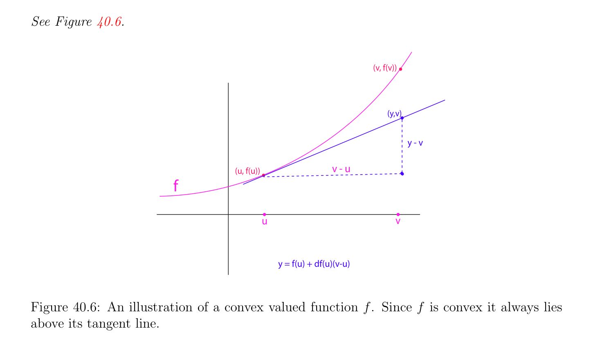

# Bằng cách sử dụng Tính lồi để tìm Các cực trị

<!-- PAGE 1509 -->
Với không gian $E^{*} = Hom(E,\mathbb{R})$ của tất cả các ánh xạ tuyến tính (linear maps) từ $E$ đến $\mathbb{R}$. liên tục ánh xạ song tuyến tính (bilinear map)
$$\mathbb{R}\mathbb{R}$$
$\phi$: $E \times  E \to$ trong $\mathcal{L}_{2}(E, E$;) cho ta ánh xạ $\Phi$ từ $E$ đến E' cho trước bởi
$$\Phi (u) = \phi_{u} ,$$
Ở đâu $\phi_{u}  \in$ E' là dạng tuyến tính (linear form) được định nghĩa bởi
$$\phi_{u} (v) = \phi (u, v).$$
Nó là dễ để kiểm tra rằng $\phi_{u}$ là liên tục và rằng ánh xạ $\Phi$ là liên tục. Thì ta nói rằng $\phi$ là không suy biến $iff\Phi$: $E \to$ E' là đẳng cấu của Các không gian Banach, mà có nghĩa là $\Phi$ là khả nghịch và rằng cả hai $\Phi$ và $\Phi^{-1}$ là liên tục các ánh xạ tuyến tính (linear maps). Cho trước hàm $J$: $\Omega \to \mathbb{R}$ khả vi (differentiable) trên $\Omega$ như trước (ở đâu $\Omega$ là mở tập con của $E)$, nếu $D^{2}J(u)$ tồn tại với một số $u \in \Omega$, ta nói rằng $u$ là không suy biến tới hạn/quan trọng điểm nếu dJ(u) $= 0$ và nếu $D^{2}J(u)$ là không suy biến. Của course, $D^{2}J(u)$ là xác định dương (positive definite) nếu $D^{2}J(u)(w, w) > 0$ với mọi $w \in E-{0}$. Bằng cách sử dụng ở trên định nghĩa, Mệnh đề 40.7 có thể được suy rộng/tổng quát hóa đến không suy biến xác định dương (positive definite) dạng song tuyến tính (bilinear form) (trên Không gian Banach (Banach space)) và Định lý 40.8 có thể cũng là suy rộng/tổng quát hóa đến tình huống ở đâu $J$: $\Omega \to \mathbb{R}$ được định nghĩa trên mở tập con của Không gian Banach (Banach space). Cho chi tiết và các chứng minh, xem Cartan $[34]$ (Phần I Chương $8)$ và Avez $[9]$ (Chương $8$ và Chương $10)$. Trong mục tiếp theo ta tạo sử dụng của tính lồi; cả hai trên miền xác định $\Omega$ và trên hàm $J$ chính nó.

## 40.3 Bằng cách sử dụng Tính lồi để tìm Các cực trị

Ta bắt đầu bởi ôn tập/tổng quan định nghĩa của tập lồi (convex set) và của hàm lồi (convex function).

> **Định nghĩa 40.7.** Cho trước bất kỳ thực không gian vectơ (vector space) $E$, ta nói rằng tập con $C$ của $E$ là lồi nếu hoặc $C = \emptyset$ hoặc nếu với mọi cặp của các điểm $u, v \in C$, đường thẳng đoạn thẳng connecting $u$ và $v$ được chứa trong $C$, i.e.,
$$(1 -\lambda )u + \lambda v \in Cfor all \lambda  \in \mathbb{R} such that 0 \le \lambda  \le 1.$$
Cho trước bất kỳ hai các điểm $u, v \in E$, đường thẳng đoạn thẳng $[u, v]$ là tập hợp
$$[u, v] = {(1 -\lambda )u + \lambda v \in E | \lambda  \in \mathbb{R}, 0 \le \lambda  \le 1}.$$
Rõ ràng, khác rỗng tập hợp $C$ là lồi khi và chỉ khi[u, $v] \subseteq C$ bất cứ khi nào $u, v \in C$. Xem Hình 40.4 cho ví dụ của tập lồi (convex set).

> **Định nghĩa 40.8.** Nếu $C$ là khác rỗng lồi tập con của $E$, hàm $f$: $C \to \mathbb{R}$ là lồi (trên $C)$ nếu với mọi cặp của các điểm $u, v \in C$,
$$f((1 -\lambda )u + \lambda v) \le (1 -\lambda )f(u) + \lambda f(v)for all \lambda  \in \mathbb{R} such that 0 \le \lambda  \le 1;$$

<!-- PAGE 1510 -->
$$u$$
$$v$$
$$u$$
$$(a)$$
$$v$$
$$(b)$$
$$\mathbb{R}^{3}$$

**Hình 40.4:** Hình () chỉ ra rằng mặt cầu là không lồi trong vì dashed xanh lục đường thẳng thực hiện không lie trên của nó mặt. Hình $(b)$ chỉ ra rằng solid hình cầu là lồi trong $\mathbb{R}^{3}$. hàm $f$ là lồi chặt (strictly convex) (trên $C)$ nếu với mọi cặp của phân biệt các điểm $u, v \in C (u \neq  v)$,
$$f((1 -\lambda )u + \lambda v) < (1 -\lambda )f(u) + \lambda f(v)for all \lambda  \in \mathbb{R} such that 0 < \lambda  < 1;$$
$$\mathbb{R}$$
Xem Hình 40.5. $epigraph^{1}$ epi(f) của hàm $f$: $A \to$ được định nghĩa trên một số tập con $A$ của $\mathbb{R}^{n}  \mathbb{R}^{n+1}$ là tập con của được định nghĩa như
$$\mathbb{R}^{n+1}$$
$$epi(f) = {(x, y) \in | f(x) \le y, x \in A}.$$
Hàm $f$: $C \to \mathbb{R}$ được định nghĩa trên lồi tập con $C$ là lõm (resp. lõm chặt (strictly concave)) nếu $(-f)$ là lồi (resp. lồi chặt (strictly convex)). Hiển nhiên là hàm $f$ là lồi khi và chỉ khi của nó trên đồ thị (epigraph) epi(f) là lồi tập con $of\mathbb{R}^{n+1}$.

> **Ví dụ 40.4.** Ở đây là một số chung/phổ biến các ví dụ của các tập lồi. $\bullet$ Các không gian con $V \subseteq E$ của không gian vectơ (vector space) $E$ là lồi. $\bullet$ Afin các không gian con, nghĩa là, các tập hợp của tạo thành $u+V$, ở đâu $V$ là không gian con của $E$ và $u \in E$, là lồi. $\bullet$ Các hình cầu (mở hoặc đóng) là lồi. Cho trước bất kỳ dạng tuyến tính (linear form) $\phi$: $E \to \mathbb{R}$, với mọi vô hướng (scalar) $c \in \mathbb{R}$, đóng một nửa–các không gian
$$H_{\phi ,c}^{+} = {u \in E | \phi (u) \ge c},H_{\phi ,c}^{-} = {u \in E | \phi (u) \le c},$$
$$\frac{areconvex.}{“Epi”meansabove.}$$
$1$

<!-- PAGE 1511 -->
$$l = (1-\lambda )f(u) + \lambda f(v)$$
$$f$$
$$\overline{u}\overline{v}$$
$$(a)$$
$$l = (1-\lambda )f(u) + \lambda f(v)$$
$$f$$
$$\overline{u}\overline{v}$$
$$(b)$$

**Hình 40.5:** Các hình () và $(b)$ là các đồ thị của thực valued các hàm. Hình () là đồ thị của hàm lồi (convex function) vì xanh lam đường thẳng lies ở trên đồ thị của $f$. Hình $(b)$ chỉ ra đồ thị của hàm mà là không lồi. $\bullet$ Bất kỳ giao của một nửa–các không gian là lồi. $\bullet$ Tổng quát hơn, bất kỳ giao của các tập lồi là lồi.

> **Ví dụ 40.5.** Ở đây là một số chung/phổ biến các ví dụ của lồi và lõm các hàm. $\bullet$ Các dạng tuyến tính là các hàm lồi (nhưng không lồi chặt (strictly convex)). $\bullet$ Bất kỳ chuẩn (norm) $\|\|$: $E \to \mathbb{R}_{+}$ là hàm lồi (convex function). $\bullet$ max hàm,
$$\max(x_{1}, \dots  , x_{n}) = \max{x_{1}, \dots  , x_{n}}$$
$$is convex on \mathbb{R}^{n}.$$
$$\mathbb{R}$$
$\bullet$ hàm mũ $x \mapsto e^{cx}$ là lồi chặt (strictly convex) với mọi $c \neq  0 (c \in$). $\bullet$ lôgarit hàm là lõm trên $\mathbb{R}_{+} -{0}. \bullet$ log-determinant hàm log det là lõm trên tập hợp của đối xứng xác định dương (SPD) các ma trận. hàm này đóng quan trọng vai trò trong lồi tối ưu hóa. excellent trình bày của tính lồi và của nó các ứng dụng đến tối ưu hóa có thể được tìm thấy trong Boyd $[29]$. Ở đây là cần điều kiện cho hàm đến có cực tiểu địa phương (local minimum) đối với lồi tập con $U$.

<!-- PAGE 1512 -->

> **Định lý 40.9.** (Cần điều kiện cho cực tiểu địa phương (local minimum) trên lồi tập con) Cho $J$: $\Omega \to \mathbb{R}$ là hàm được định nghĩa trên một số mở tập con $\Omega$ của không gian vectơ định chuẩn (normed vector space) $E$ và cho $U \subseteq \Omega$ là khác rỗng lồi tập con. Cho trước bất kỳ $u \in U$, nếu dJ(u) tồn tại và nếu $J$ có cực tiểu địa phương (local minimum) trong $u$ đối với $U$, thì
$$dJ(u)(v -u) \ge 0for all v \in U.$$

*Chứng minh.* Cho $v = u + w$ là tùy ý điểm trong $U$. Vì $U$ là lồi, ta có $u +$ tw $\in U$ với mọi $t$ sao cho $0 \le t \le 1$. Vì dJ(u) tồn tại, ta có thể viết
$$J(u + tw) -J(u) = dJ(u)(tw) + \|tw\|\epsilon (tw)$$
Với $lim_{t\mapsto0} \epsilon$ (tw) $= 0$. Tuy nhiên, bởi vì $0 \le t$,
$$J(u + tw) -J(u) = t(dJ(u)(w) + \|w\|\epsilon (tw))$$
Và vì $u$ là cực tiểu địa phương (local minimum) đối với $U$, ta có J(u $+$ tw) - J(u) $\ge 0$, do đó ta thu được
$$t(dJ(u)(w) + \|w\|\epsilon (tw)) \ge 0.$$
Ở trên suy ra rằng dJ(u)(w) $\ge 0$, bởi vì ngược lại ta có thể chọn $t > 0$ nhỏ đủ sao cho
$$dJ(u)(w) + \|w\|\epsilon (tw) < 0,$$
Một mâu thuẫn. Vì lập luận nghiệm đúng với mọi $v = u + w \in U$, định lý được chứng minh. Nhận thấy rằng tính lồi của $U$ là thế cho sử dụng của Các nhân tử Lagrange (Lagrange multipliers), nhưng ta bây giờ có đến deal với bất đẳng thức thay vì của đẳng thức. Trong trường hợp đặc biệt khi $U$ là không gian con của $E$ ta có kết quả sau kết quả.

> **Hệ quả 40.10.** Với cùng các giả định như trong Định lý 40.9, nếu $U$ là không gian con của $E$, nếu dJ(u) tồn tại và nếu $J$ có cực tiểu địa phương (local minimum) trong $u$ đối với $U$, thì
$$dJ(u)(w) = 0for all w \in U.$$

*Chứng minh.* Trong trường hợp này vì $u \in U$ ta có 2u $\in U$, và với mọi $u + w \in U$, ta phải có $2u-(u+w) =$ u-w $\in U$. trước đó định lý suy ra rằng dJ(u)(w) $\ge 0$ và dJ(u)(-w) $\ge 0$, nghĩa là, dJ(u)(w) $\le 0$, do đó dJ(u) $= 0$. Vì lập luận nghiệm đúng cho $w \in U$ (bởi vì $U$ là không gian con, nếu $u, w \in U$, thì $u + w \in U)$, ta kết luận rằng
$$dJ(u)(w) = 0for all w \in U.$$
Ta sẽ bây giờ đặc trưng hóa các hàm lồi khi chúng có đạo hàm thứ nhất hoặc đạo hàm thứ hai.

<!-- PAGE 1513 -->

> **Mệnh đề 40.11.** (Tính lồi và đạo hàm thứ nhất) Cho $f$: $\Omega \to \mathbb{R}$ là hàm khả vi (differentiable) trên một số mở tập con $\Omega$ của không gian vectơ định chuẩn (normed vector space) $E$ và cho $U \subseteq \Omega$ là khác rỗng lồi tập con.
$(1)$ hàm $f$ là lồi trên $U$ khi và chỉ khi
$$f(v) \ge f(u) + df(u)(v -u)for all u, v \in U.$$
$(2)$ hàm $f$ là lồi chặt (strictly convex) trên $U$ khi và chỉ khi
$$f(v) > f(u) + df(u)(v -u)for all u, v \in U with u \neq  v.$$
Xem Hình 40.6.
$$(v, f(v))$$
$$(y,v)$$
$$y - v$$
$$(u, f(u))v - u$$
$$f$$
$$uv$$
$$y = f(u) + df(u)(v-u)$$

**Hình 40.6:** illustration của lồi valued hàm $f$. Vì $f$ là lồi nó luôn luôn lies ở trên của nó tiếp tuyến đường thẳng.

*Chứng minh.* Cho $u, v \in U$ là bất kỳ hai phân biệt các điểm và chọn $\lambda  \in \mathbb{R}$ với $0 < \lambda  < 1$. Nếu hàm $f$ là lồi, thì
$$f((1 -\lambda )u + \lambda v) \le (1 -\lambda )f(u) + \lambda f(v),$$
Mà cho ta
$$- -$$
$$\frac{f((1\lambda )u + \lambda v)f(u)}{\lambda} \le f(v) -f(u).$$
Suy ra rằng
$$- -$$
$$df(u)(v -u) = \lambda lim\mapsto 0 \frac{f((1\lambda )u + \lambda v)f(u)}{\lambda} \le f(v) -f(u).$$

<!-- PAGE 1514 -->
Nếu $f$ là lồi chặt (strictly convex), ở trên lập luận thực hiện không hoạt động/công trình, bởi vì chặt bất đẳng thức là không nhất thiết được bảo toàn bởi “chuyển đến giới hạn.” Ta có recourse đến sau đây mẹo/kỹ thuật: với mọi $\omega$ sao cho $0 < \omega  < 1$, nhận thấy rằng
$$-$$
$$(1 -\lambda )u + \lambda v = u + \lambda (v -u) = \frac{\omega \lambda}{\omega} u + \frac{\lambda}{\omega} (u + \omega (v -u)).$$
Nếu ta giả sử rằng $0 < \lambda  \le \omega$, tính lồi của $f$ cho ta
$$-$$
$$f(u + \lambda (v -u)) = f \begin{pmatrix}  & \lambda \\ 1 - \\ \omega \end{pmatrix} \begin{pmatrix} \lambda \\ u + & (u + \omega (v -u)) \\ \omega \end{pmatrix} \le \frac{\omega \lambda}{\omega} f(u) + \frac{\lambda}{\omega} f(u + \omega (v -u)).$$
Nếu ta trừ f(u) đến cả hai các vế/cạnh, ta thu được
$$- - - -$$
$$\frac{f(u + \lambda (vu))f(u)}{\lambda} \le \frac{f(u + \omega (vu))f(u)}{\omega} .$$
Bây giờ vì $0 < \omega  < 1$ và $f$ là lồi chặt (strictly convex),
$$f(u + \omega (v -u)) = f((1 -\omega )u + \omega v) < (1 -\omega )f(u) + \omega f(v),$$
Mà suy ra rằng
$$- -$$
$$\frac{f(u + \omega (vu))f(u)}{\omega} < f(v) -f(u),$$
Và do đó ta thu được
$$- - - -$$
$$\frac{f(u + \lambda (vu))f(u)}{\lambda} \le \frac{f(u + \omega (vu))f(u)}{\omega} < f(v) -f(u).$$
Nếu ta cho $\lambda$ đi đến $0$, bởi chuyển đến giới hạn ta thu được
$$- -$$
$$df(u)(v -u) \le \frac{f(u + \omega (vu))f(u)}{\omega} < f(v) -f(u),$$
Mà cho ta mong muốn chặt bất đẳng thức. Cho chúng ta bây giờ xét điều ngược lại của $(1)$; nghĩa là, giả sử rằng
$$f(v) \ge f(u) + df(u)(v -u)for all u, v \in U.$$
Với mọi hai phân biệt các điểm $u, v \in U$ và với mọi $\lambda$ với $0 < \lambda  < 1$, ta thu được
$$f(v) \ge f(v + \lambda (u -v)) -\lambda df(v + \lambda (u -v))(u -v)$$
$$f(u) \ge f(v + \lambda (u -v)) + (1 -\lambda )df(v + \lambda (u -v))(u -v),$$
Và nếu ta nhân thứ nhất bất đẳng thức bởi $1-\lambda$ và thứ hai bất đẳng thức bởi $\lambda$ và chúng cộng lên thu được các bất đẳng thức, ta thu được
$$(1 -\lambda )f(v) + \lambda f(u) \ge f(v + \lambda (u -v)) = f((1 -\lambda )v + \lambda u),$$
Mà chứng tỏ rằng $f$ là lồi. chứng minh của điều ngược lại của $(2)$ là đồng dạng, ngoại trừ rằng các bất đẳng thức được thay thế bởi chặt các bất đẳng thức.

<!-- PAGE 1515 -->
Ta bây giờ thiết lập tính lồi tiêu chuẩn bằng cách sử dụng đạo hàm thứ hai của $f$. Điều này tiêu chuẩn là thường dễ hơn để kiểm tra hơn trước đó một.

> **Mệnh đề 40.12.** (Tính lồi và đạo hàm thứ hai) Cho $f$: $\Omega \to \mathbb{R}$ là hàm hai lần khả vi (differentiable) trên một số mở tập con $\Omega$ của không gian vectơ định chuẩn (normed vector space) $E$ và cho $U \subseteq \Omega$ là khác rỗng lồi tập con.
$(1)$ hàm $f$ là lồi trên $U$ khi và chỉ khi
$$D^{2}f(u)(v -u, v -u) \ge 0for all u, v \in U.$$
$(2)$ Nếu
$$D^{2}f(u)(v -u, v -u) > 0for all u, v \in U with u \neq  v,$$
Thì $f$ là lồi chặt (strictly convex).

*Chứng minh.* Thứ nhất giả sử rằng bất đẳng thức trong Điều kiện $(1)$ được thỏa mãn. Với mọi hai phân biệt các điểm $u, v \in U$, công thức của Taylor–Maclaurin cho ta
$$f(v) -f(u) -df(u)(v -u) = \frac{1}{2} D^{2}f(w)(v -u, v -u)$$
$$= \frac{\rho^{2}}{2} D^{2}f(w)(v -w, v -w),$$
Với một số $w = (1$ - $\lambda )u + \lambda v = u + \lambda (v$ - $u)$ với $0 < \lambda  < 1$, và với $\rho  = 1/(1$ - $\lambda$) $> 0$, sao cho $v$ - $u = \rho (v$ - $w)$. Vì $D^{2}f(w)(v$ - $w, v$ - $w) \ge 0$ với mọi $u, w \in U$, ta kết luận bằng cách áp dụng Mệnh đề 40.11(1). Tương tự, nếu $(2)$ nghiệm đúng, ở trên lập luận và Mệnh đề 40.11(2) suy ra rằng $f$ là lồi chặt (strictly convex). để chứng minh cần điều kiện trong $(1)$, định nghĩa $g: \Omega \to \mathbb{R}$ bởi
$$g(v) = f(v) -df(u)(v),$$
Ở đâu $u \in U$ là bất kỳ điểm được xét cố định. Nếu $f$ là lồi, vì
$$g(v) -g(u) = f(v) -f(u) -df(u)(v -u),$$
Mệnh đề 40.11 suy ra rằng f(v) - f(u) - df(u)(v - $u) \ge 0$, mà suy ra rằng $g$ có cực tiểu địa phương (local minimum) tại $u$ đối với tất cả $v \in U$. Vì vậy, ta có dg(u) $= 0$. Nhận thấy rằng $g$ là hai lần khả vi (differentiable) trong $\Omega$ và $D^{2}g(u) = D^{2}f(u)$, do đó công thức của Taylor–Young cho ta với mọi $v = u + w \in U$ và tất cả $t$ với $0 \le t \le 1$,
$$t^{2} \epsilon$$
$$0 \le g(u + tw) -g(u) =2 D^{2}f(u)(tw, tw) + \|tw\|^{2}(tw)$$
$$t^{2} \epsilon$$
$$=2 (D^{2}f(u)(w, w) + 2 \|w\|^{2}(wt)),$$
Với $lim_{t\mapsto0} \epsilon$ (wt) $= 0$, và cho $t$ nhỏ đủ, ta phải có $D^{2}f(u)(w, w) \ge 0$, như đã khẳng định.

<!-- PAGE 1516 -->
Điều ngược lại của Mệnh đề 40.12 $(2)$ là sai như ta xem bởi xét chặt hàm lồi (convex function) $f$ cho trước bởi f(x) $= x^{4}$ và của nó đạo hàm thứ hai tại $x = 0$.

> **Ví dụ 40.6.** Mặt khác, nếu $f$ là toàn phương hàm của tạo thành
$$f(u) = \frac{1}{2} u^{\top}Au -u^{\top}b$$
Ở đâu $A$ là ma trận đối xứng (symmetric matrix), ta biết rằng
$$df(u)(v) = v^{\top}(Au -b),$$
Do đó
$$f(v) -f(u) -df(u)(v -u) = \frac{1}{2} v^{\top}Av -v^{\top}b - \frac{1}{2} u^{\top}Au + u^{\top}b -(v -u)^{\top}(Au -b)$$
$$= \frac{1}{2} v^{\top}Av - \frac{1}{2} u^{\top}Au -(v -u)^{\top}Au$$
$$= \frac{1}{2} v^{\top}Av + \frac{1}{2} u^{\top}Au -v^{\top}Au$$
$$= \frac{1}{2} (v -u)^{\top}A(v -u).$$
Vì vậy, Mệnh đề 40.11 suy ra rằng $A$ là nửa xác định dương (positive semidefinite) khi và chỉ khi $f$ là lồi và $A$ là xác định dương (positive definite) khi và chỉ khi $f$ là lồi chặt (strictly convex). Ta kết luận điều này mục bằng cách áp dụng của ta trước đó các định lý đến các hàm lồi được định nghĩa trên lồi các tập con. Trong trường hợp này địa phương các cực tiểu (resp. địa phương các cực đại) là toàn cục các cực tiểu (resp. toàn cục các cực đại). tiếp theo định nghĩa là đặc biệt trường hợp của Định nghĩa 40.1 trong mà $W = E$ nhưng nó thực hiện không hurt đến phát biểu nó một cách tường minh.

> **Định nghĩa 40.9.** Cho $f$: $E \to \mathbb{R}$ là bất kỳ hàm được định nghĩa trên một số không gian vectơ định chuẩn (normed vector space) (hoặc tổng quát hơn, bất kỳ tập hợp). Với mọi $u \in E$, ta nói rằng $f$ có cực tiểu trong $u$ (resp. cực đại trong $u)$ nếu
$$f(u) \le f(v) (resp. f(u) \ge f(v))for all v \in E.$$
Ta nói rằng $f$ có chặt cực tiểu trong $u$ (resp. chặt cực đại trong $u)$ nếu
$$f(u) < f(v) (resp. f(u) > f(v))for all v \in E -{u}.$$
Nếu $U \subseteq E$ là tập con của $E$ và $u \in U$, ta nói rằng $f$ có cực tiểu trong $u$ (resp. chặt cực tiểu trong $u)$ đối với $U$ nếu
$$f(u) \le f(v)for all v \in U(resp. f(u) < f(v)for all v \in U -{u}),$$
Và tương tự cho cực đại trong $u$ (resp. chặt cực đại trong $u)$ đối với $U$ với $\le$ đã thay đổi đến $\ge$ và $<$ đến $>$.

<!-- PAGE 1517 -->
Đôi khi, ta nói cực đại toàn cục (global maximum) (hoặc cực tiểu) đến stress rằng cực đại (hoặc cực tiểu) là không đơn giản cực đại địa phương (local maximum) (hoặc cực tiểu).

> **Định lý 40.13.** Cho trước bất kỳ không gian vectơ định chuẩn (normed vector space) $E$, cho $U$ là bất kỳ khác rỗng lồi tập con của $E$.
$(1)$ Với mọi hàm lồi (convex function) $J$: $U \to \mathbb{R}$, với mọi $u \in U$, nếu $J$ có cực tiểu địa phương (local minimum) tại $u$ trong $U$, thì $J$ có (toàn cục) cực tiểu tại $u$ trong $U$.
$(2)$ Bất kỳ chặt hàm lồi (convex function) $J$: $U \to \mathbb{R}$ có nhiều nhất một cực tiểu (trong $U)$, và nếu nó thực hiện, thì nó là chặt cực tiểu (trong $U)$.
$(3)$ Cho $J$: $\Omega \to \mathbb{R}$ là bất kỳ hàm được định nghĩa trên một số mở tập con $\Omega$ của $E$ với $U \subseteq \Omega$ và giả sử rằng $J$ là lồi trên $U$. Với mọi điểm $u \in U$, nếu dJ(u) tồn tại, thì $J$ có cực tiểu trong $u$ đối với $U$ khi và chỉ khi
$$dJ(u)(v -u) \ge 0for all v \in U.$$
$(4)$ Nếu lồi tập con $U$ trong $(3)$ là mở, thì ở trên điều kiện là tương đương đến
$$dJ(u) = 0.$$

*Chứng minh.* $(1)$ Cho $v = u + w$ là bất kỳ tùy ý điểm trong $U$. Vì $J$ là lồi, với mọi $t$ với $0 \le t \le 1$, ta có
$$J(u + tw) = J(u + t(v -u)) = J((1 -t)u + tv) \le (1 -t)J(u) + tJ(v),$$
Mà cho ta
$$J(u + tw) -J(u) \le t(J(v) -J(u)).$$
Bởi vì $J$ có cực tiểu địa phương (local minimum) tại $u$, tồn tại một $t_{0}$ với $0 < t_{0} < 1$ sao cho
$$0 \le J(u + t_{0}w) -J(u) \le t_{0}(J(v) -J(u)),$$
Mà suy ra rằng J(v) - J(u) $\ge 0$.
$(2)$ Nếu $J$ là lồi chặt (strictly convex), ở trên lập luận với $w \neq  0$ chỉ ra rằng tồn tại một $t_{0}$ với $0 < t_{0} < 1$ sao cho
$$0 \le J(u + t_{0}w) -J(u) < t_{0}(J(v) -J(u)),$$
Mà chỉ ra rằng $u$ là chặt cực tiểu toàn cục (global minimum) (trong $U)$, và do đó rằng nó là duy nhất.
$(3)$ Ta đã biết từ Định lý 40.9 rằng điều kiện dJ(u)(v-u) $\ge 0$ với mọi $v \in U$ là cần (chẵn/ngay cả nếu $J$ là không lồi). Ngược lại, bởi vì $J$ là lồi, careful inspection của chứng minh của Phần $(1)$ của Mệnh đề 40.11 chỉ ra rằng chỉ sự kiện rằng dJ(u) tồn tại là cần thiết để chứng minh rằng
$$J(v) -J(u) \ge dJ(u)(v -u)for all v \in U,$$

<!-- PAGE 1518 -->
Và nếu
$$dJ(u)(v -u) \ge 0for all v \in U,$$
Thì
$$J(v) -J(u) \ge 0for all v \in U,$$
Như đã khẳng định.
$(4)$ Nếu $U$ là mở, thì với mọi $u \in U$ ta có thể tìm hình cầu mở (open ball) $B$ được tâm tại $u$ của bán kính $\epsilon$ nhỏ đủ sao cho $B \subseteq U$. Thì với mọi w̸ $= 0$ sao cho $\|w\| < \epsilon$, ta có cả hai $v = u + w \in B$ và v' $= u$ - $w \in B$, do đó Điều kiện $(3)$ suy ra rằng
$$dJ(u)(w) \ge 0anddJ(u)(-w) \ge 0,$$
Mà cho ta
$$dJ(u)(w) = 0.$$
Vì ở trên nghiệm đúng với mọi $w \neq  0$ như vậy sao cho $\|w\| < \epsilon$ và vì dJ(u) là tuyến tính, ta để lại nó đến độc giả đến fill trong chi tiết của chứng minh rằng dJ(u) $= 0$.

> **Ví dụ 40.7.** Định lý 40.13 có thể được sử dụng để rederive sự kiện rằng bình phương tối thiểu (least squares) các nghiệm của hệ phương trình tuyến tính Ax $= b$ (ở đâu $A$ là một ma trận cỡ $m \times  n$) được cho bởi chuẩn tắc/bình thường phương trình
$$A^{\top}Ax = A^{\top}b.$$
Cho điều này, ta xét toàn phương hàm
$$J(v) = \frac{1}{2} \|Av -b\|_{2}^{2} - \frac{1}{2} \|b\|_{2}^{2} ,$$
Và của ta bình phương tối thiểu (least squares) bài toán là tương đương đến việc tìm các cực tiểu của $J on\mathbb{R}^{n}$. phép tính reveals rằng
$$J(v) = \frac{1}{2} \|Av -b\|_{2}^{2} - \frac{1}{2} \|b\|_{2}^{2}$$
$$= \frac{1}{2} (Av -b)^{\top}(Av -b) - \frac{1}{2} b^{\top}b$$
$$= \frac{1}{2} (v^{\top}A^{\top}-b^{\top})(Av -b) - \frac{1}{2} b^{\top}b$$
$$= \frac{1}{2} v^{\top}A^{\top}Av -v^{\top}A^{\top}b,$$
Và do đó
$$dJ(u) = A^{\top}Au -A^{\top}b.$$
Vì $A^{\top}A$ là nửa xác định dương (positive semidefinite), hàm $J$ là lồi, và Định lý 40.13(4) suy ra rằng các cực tiểu của $J$ là các nghiệm của phương trình
$$A^{\top}Au -A^{\top}b = 0.$$
