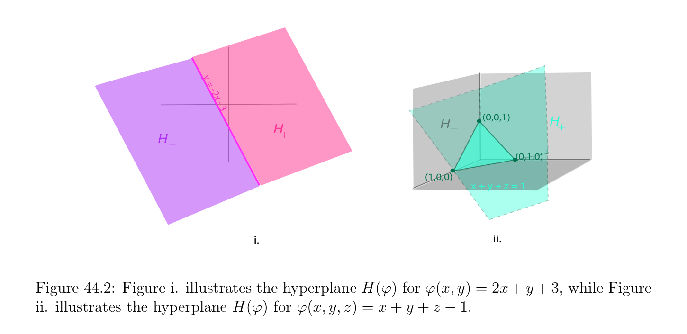
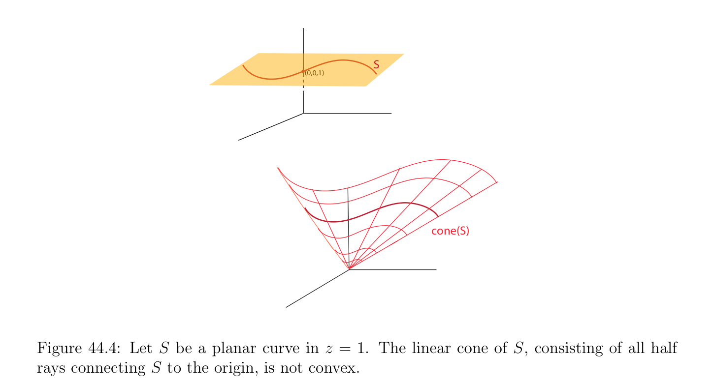

# Các nón, Polyhedral Các nón, và H-Polyhedra

<!-- PAGE 1580 -->
$$y$$
$$=$$
$$-2$$
$$x\overline{-}$$
$$\overline{3}$$
$$(0,0,1)H_{+}$$
$$H^{_}$$
$$H_{+}$$
$$H_{_}$$
$$(0,1,0)$$
$$(1,0,0)$$
$$x + y + z = 1$$
$$i.ii.$$

**Hình 44.2:** Hình $i$. minh họa siêu phẳng (hyperplane) $H(\phi$) cho $\phi (x, y) =$ 2x $+ y + 3$, trong khi Hình ii. minh họa siêu phẳng (hyperplane) $H(\phi$) cho $\phi (x, y, z) = x + y + z$ - $1$. với $\phi (x, y, z) = x + y + z$ - $1$; điều này afin tạo thành định nghĩa mặt phẳng cho trước bởi phương trình $x + y + z = 1$, mà là mặt phẳng qua các điểm $(0, 0, 1), (0, 1, 0)$, và $(1, 0, 0)$. Cả hai của các phần tử này các siêu phẳng được minh họa trong Hình 44.2.
$$\mathbb{R}^{n}$$

> **Định nghĩa 44.8.** Với mọi hai vectơ $x, y \in$ với $x = (x_{1}, \dots  , x_{n})$ và $y = (y_{1}, \dots  , y_{n})$ ta viết $x \le y$ khi và chỉ khi $x_{i} \le y_{i}$ cho $i = 1, \dots  , n$, và $x \ge y$ khi và chỉ khi $y \le x$. Đặc biệt $x \ge 0$ khi và chỉ khi $x_{i} \ge 0$ cho $i = 1, \dots  , n$. Nhất định đặc biệt các loại của các tập lồi được gọi là các nón $and\mathcal{H}-polyhedra$ đóng quan trọng vai trò. tập hợp của chấp nhận được (feasible) các nghiệm của bài toán quy hoạch tuyến tính (linear program) là $an\mathcal{H}-polyhedron$, và các nón đóng then chốt vai trò trong chứng minh của Mệnh đề 45.1 và trong Farkas–Minkowski mệnh đề (Mệnh đề 47.2).

## 44.3 Các nón, Polyhedral Các nón, và \mathcal{H}-Các đa diện

Các nón và polyhedral các nón được định nghĩa như sau.

> **Định nghĩa 44.9.** Cho trước khác rỗng tập con $S \subseteq \mathbb{R}^{n}$, nón $C =$ nón(S) được sinh (spanned) bởi $S$ là tập lồi (convex set)
$$$$
$$cone(S) = \sum_{i=1}^{k}  \lambda_{i} u_{i}, u_{i} \in S, \lambda_{i}  \in \mathbb{R}, \lambda_{i}  \ge 0,$$
Của dương các tổ hợp của các vectơ từ $S$. Nếu $S$ bao gồm của hữu hạn tập hợp của các vectơ, nón $C =$ nón(S) được gọi là một nón đa diện (polyhedral cone). Hình 44.3 minh họa nón đa diện (polyhedral cone). Lưu ý rằng nếu một số khác không vectơ $u$ thuộc đến nón $C$, thì $\lambda u \in C$ với mọi $\lambda  \ge 0$, nghĩa là, tia ${\lambda u$ | $\lambda  \ge 0}$ thuộc đến $C$.

<!-- PAGE 1581 -->
$$S$$
$$(0,0,1)(0,1,1)$$
$$(1,0,1)(1,1,1)$$
$$\overline{(0,0,1)}(0,1,1)$$
$$(1,0,1)(1,1,1)$$
$$cone(S)$$

**Hình 44.3:** Cho $S = {(0, 0, 1), (1, 0, 1), (1, 1, 1), (0, 1, 1)}$. nón đa diện (polyhedral cone), nón(S), là solid “pyramid” với đỉnh tại gốc và square cross các mục.
Nhận xét: các nón (và polyhedral các nón) của Định nghĩa 44.9 là luôn luôn lồi. Cho điều này lý do, ta sử dụng đơn giản hơn thuật ngữ nón thay vì của nón lồi (convex cone). Tuy nhiên, có nhiều hơn/thêm tổng quát các loại của các nón (xem Định nghĩa 50.1) rằng là không lồi (ví dụ, hợp của polyhedral các nón hoặc tuyến tính nón được sinh bởi đường cong trong Hình 44.4), và nếu ta đã là dealing với những phần tử đó ta sẽ refer đến các nón của Định nghĩa 44.9 như các nón lồi.
$$Definition  44.10. An \mathcal{H}-polyhedron, for short a polyhedron, is any subset \mathcal{P} = \bigcap_{i}  s=1 C_{i} of$$
$\mathbb{R}^{n}$ được định nghĩa như giao của hữu hạn số $s$ của đóng các nửa không gian $C_{i}$. ví dụ của $an\mathcal{H}-polyhedron$ được hiển thị trong Hình 44.6. $An\mathcal{H}-polytope$ là $bounded\mathcal{H}-polyhedron$, mà có nghĩa là có một hình cầu đóng (closed ball) $B_{r}(x)$ của tâm $x$ và bán kính $r > 0$ sao cho $\mathcal{P} \subseteq B_{r}(x)$. ví dụ của $a \mathcal{H}-polytope$ được hiển thị trong Hình 44.5.
$$\mathbb{R}^{n}$$
Bởi quy ước, ta agree rằng chính nó là $\mathcal{H}-polyhedron$.
Nhận xét: $The\mathcal{H}-polyhedra$ của Định nghĩa 44.10 là luôn luôn lồi. Cho điều này lý do, như trong trường hợp của các nón ta sử dụng đơn giản hơn $terminology\mathcal{H}-polyhedron$ thay vì của $convex\mathcal{H}-polyhedron$. Trong đại số tôpô, có nhiều hơn/thêm tổng quát các đa diện rằng là không lồi. Nó có thể được được hiển thị rằng $an\mathcal{H}-polytope\mathcal{P}$ bằng bao lồi (convex hull) của một cách hữu hạn nhiều các điểm (extreme các điểm $of\mathcal{P})$. Điều này là không tầm thường kết quả có chứng minh lấy đáng kể lượng của hoạt động/công trình; xem Gallier $[74]$ và Ziegler $[201]$. không bị chặn $\mathcal{H}-polyhedron$ là không bằng bao lồi (convex hull) của hữu hạn tập hợp của các điểm. để thu được tương đương khái niệm ta giới thiệu khái niệm của $a \mathcal{V}-polyhedron$.

<!-- PAGE 1582 -->
$$S$$
$$(0,0,1)$$
$$cone(S)$$

**Hình 44.4:** Cho $S$ là phẳng đường cong trong $z = 1$. tuyến tính nón của $S$, bao gồm của tất cả một nửa các tia connecting $S$ đến gốc, là không lồi.
$$\mathbb{R}^{n}$$

> **Định nghĩa 44.11.** $A \mathcal{V}-polyhedron$ là bất kỳ lồi tập con $A \subseteq$ của tạo thành
$$A = conv(Y ) + cone(V ) = {a + v | a \in conv(Y ), v \in cone(V )},$$
$$\mathbb{R}^{n} \mathbb{R}^{n}$$
Ở đâu $Y \subseteq$ và $V \subseteq$ là hữu hạn (có thể rỗng). Khi $V = \emptyset$ ta đơn giản có đa diện lồi hữu hạn (polytope), và khi $Y = \emptyset$ hoặc $Y = {0}$, ta đơn giản có nón. Nó có thể được được hiển thị rằng mọi $\mathcal{H}-polyhedron$ là $a \mathcal{V}-polyhedron$ và ngược lại. Điều này là một của major các định lý trong lý thuyết của các đa diện, và chứng minh của nó là không tầm thường. Cho đầy đủ chứng minh, xem Gallier $[74]$ và Ziegler $[201]$. Mọi nón đa diện (polyhedral cone) là đóng. Điều này là quan trọng sự kiện rằng được sử dụng trong chứng minh của một vài khác then chốt các kết quả chẳng hạn như Mệnh đề 45.1 và Farkas–Minkowski mệnh đề (Mệnh đề 47.2). Mặc dù nó dường như hiển nhiên rằng nón đa diện (polyhedral cone) nên là đóng, chặt chẽ chứng minh là không hoàn toàn tầm thường. Thật vậy, sự kiện rằng nón đa diện (polyhedral cone) là đóng relies một cách then chốt trên sự kiện rằng $C$ được sinh (spanned) bởi hữu hạn số của các vectơ, bởi vì nón được sinh bởi vô hạn tập hợp có thể
$$\mathbb{R}^{2}$$
Không là đóng. Ví dụ, xét đóng đĩa $D \subseteq$ của tâm $(0, 1)$ và bán kính $1$, mà là tiếp tuyến đến trục $x$ tại gốc. Thì nón(D) bao gồm của mở trên half-plane cộng gốc $(0, 0)$, nhưng tập hợp này là không đóng.

> **Mệnh đề 44.2.** Mọi nón đa diện (polyhedral cone) $C$ là đóng.

<!-- PAGE 1583 -->
$$Figure 44.5: An icosahedron is an example of an \mathcal{H}-polytope.$$

*Chứng minh.* Điều này được chứng minh bởi chỉ ra rằng $1$. Mọi primitive nón là đóng, ở đâu primitive nón là nón đa diện (polyhedral cone) được sinh (spanned) bởi các vectơ độc lập tuyến tính (linearly independent). $2$. nón đa diện (polyhedral cone) $C$ là hợp của một cách hữu hạn nhiều primitive các nón. Giả sử rằng $(a_{1}, \dots  , a_{m})$ là các vectơ độc lập tuyến tính (linearly independent) trong $\mathbb{R}^{n}$, và xét bất kỳ dãy $(x^{(k)})_{k\ge0}$
$$x^{(k)} = \sum_{i=1}^{m}  \lambda_{i}^{(k)}  a_{i}$$
Của các vectơ trong primitive nón $cone({a_{1}, \dots  , a_{m}})$, mà có nghĩa là $\lambda_{j}^{(k)} \ge 0$ cho $i = 1, \dots  , m$ và tất cả $k \ge 0$. các vectơ $x^{(k)}$ thuộc đến không gian con $U$ được sinh (spanned) bởi $(a_{1}, \dots  , a_{m})$, và $U$ là đóng. Giả sử rằng dãy $(x^{(k)})_{k\ge0}$ hội tụ đến giới hạn $x \in \mathbb{R}^{n}$. Vì $U$ là đóng và $x^{(k)} \in U$ với mọi $k \ge 0$, ta có $x \in U$. Nếu ta viết $x = x_{1}a_{1} + \cdots  + x_{m}a_{m}$, ta sẽ like để chứng minh rằng $x_{i} \ge 0$ cho $i = 1, \dots  , m$. dãy $(x^{(k)})_{k\ge0}$ hội tụ đến $x$ khi và chỉ khi
$$-

$=$ 0$$
$$limx^{(k)}x,$$
$$k\mapsto \infty$$
Khi và chỉ khi
$$klim\mapsto \infty \begin{pmatrix} |\lambda_{i}^{(k)} -x_{i} \end{pmatrix} \sum_{i=1}^{m}  |^{21/2}= 0$$
Khi và chỉ khi
$$lim\lambda_{i}^{(k)} = x_{i},i = 1, \dots  , m.$$
$$k\mapsto \infty$$
Vì $\lambda_{i}^{(k)} \ge 0$ cho $i = 1, \dots  , m$ và tất cả $k \ge 0$, ta có $x_{i} \ge 0$ cho $i = 1, \dots  , m$, do đó $x \in cone({a_{1}, \dots  , a_{m}})$. Tiếp theo, giả sử rằng $x$ thuộc đến nón đa diện (polyhedral cone) $C$. Xét dương tổ hợp
$$x = \lambda_{1} a_{1} + \cdots  + \lambda_{k} a_{k},(*_{1})$$

<!-- PAGE 1584 -->
$$(-2,0,0)$$
$$(2,0,0)conv(Y)$$
$$cone(V)$$
$$(0,-1,1)(0,1,1)$$
$$y + z = 0$$
$$y + z = 0$$
$$y - z = 0$$
$$-2$$
$$x2$$
$$y$$
$$conv(Y)+cone(V)$$

**Hình 44.6:** “tam giác trough” được xác định bởi các bất đẳng thức $y$ - $z \le 0, y + z \ge 0$, và $-2 \le x \le 2$ là $\mathcal{H}-polyhedron$ và $\mathcal{V}-polyhedron$, ở đâu $Y = {(2, 0, 0), (-2, 0, 0)}$ và $V = {(0, 1, 1), (0, -1, 1)}$. với một số khác không $a_{1}, \dots  , a_{k} \in C$, với $\lambda_{i}  \ge 0$ và với $k$ tối tiểu. Vì $k$ là tối tiểu, ta phải có $\lambda_{i}  > 0$ cho $i = 1, \dots  , k$. Ta khẳng định rằng $(a_{1}, \dots  , a_{k})$ là độc lập tuyến tính (linearly independent). Nếu không, tồn tại một không tầm thường tổ hợp tuyến tính (linear combination)
$$\mu_{1} a_{1} + \cdots  + \mu_{k} a_{k} = 0,(*_{2})$$
Và vì $a_{i}$ là khác không, $\mu_{j}  \neq  0$ với một số ít nhất một số $j$. Ta có thể giả sử rằng $\mu_{j}  < 0$ với một số $j$ (ngược lại, ta xét họ $(-\mu_{i} )_{1\le i\le k})$, do đó cho
$$J = {j \in {1, \dots  , k} | \mu_{j}  < 0}.$$
Với mọi $t \in \mathbb{R}$, vì $x = \lambda_{1} a_{1} + \cdots  + \lambda_{k} a_{k}$, bằng cách sử dụng $(*_{2})$ ta thu được
$$x = (\lambda_{1}  + t\mu_{1} )a_{1} + \cdots  + (\lambda_{k}  + t\mu_{k} )a_{k},(*_{3})$$
Và nếu ta chọn
$$t = minj\in J \begin{pmatrix} -\lambda_{j} \\ \mu_{j} \end{pmatrix} \ge 0,$$
Ta có $(\lambda_{i}  + t\mu_{i}$) $\ge 0$ cho $i = 1, \dots  , k$, nhưng $\lambda_{j}  + t\mu_{j}  = 0$ với một số $j \in J$, do đó $(*_{3})$ là biểu thức của $x$ với ít hơn rằng $k$ khác không các hệ số, contradicting minimality của $k$ trong $(*_{1})$. Vì vậy, $(a_{1}, \dots  , a_{k})$ là độc lập tuyến tính (linearly independent).
