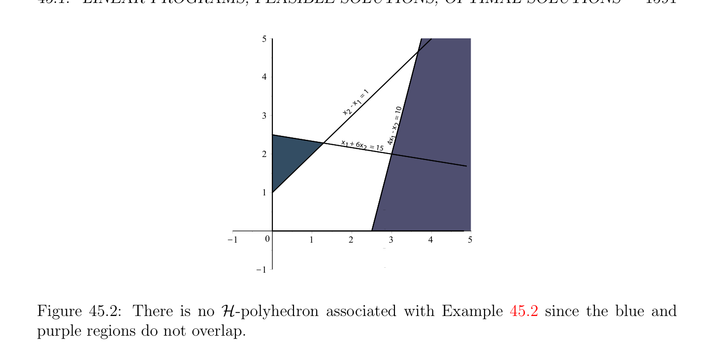

# Các bài toán quy hoạch tuyến tính, Chấp nhận được (feasible) Các nghiệm, Tối ưu Các nghiệm

<!-- PAGE 1587 -->
Chương $45$ Các bài toán quy hoạch tuyến tính Trong chương này ta giới thiệu các bài toán quy hoạch tuyến tính và cơ bản các khái niệm relating đến điều này khái niệm. Ta định nghĩa $\mathcal{H}-polyhedron \mathcal{P}(A, b)$ của chấp nhận được (feasible) các nghiệm. Thì ta định nghĩa bị chặn và không bị chặn các bài toán quy hoạch tuyến tính và khái niệm của nghiệm tối ưu (optimal solution). Ta định nghĩa bù/lỏng các biến và quan trọng khái niệm của bài toán quy hoạch tuyến tính (linear program) trong tiêu chuẩn tạo thành. Ta chỉ ra rằng nếu bài toán quy hoạch tuyến tính (linear program) trong tiêu chuẩn tạo thành có nghiệm chấp nhận được (feasible solution) và là bị chặn ở trên, thì nó có nghiệm tối ưu (optimal solution). Điều này là không hiển nhiên kết quả và chứng minh relies trên sự kiện rằng nón đa diện (polyhedral cone) là đóng (kết quả này đã được hiển thị trong trước đó chương). Tiếp theo ta chỉ ra rằng trong thứ tự để tìm tối ưu các nghiệm nó suffices đến xét các nghiệm của đặc biệt tạo thành được gọi là cơ bản chấp nhận được (feasible) các nghiệm. Ta chứng minh rằng nếu bài toán quy hoạch tuyến tính (linear program) trong tiêu chuẩn tạo thành có nghiệm chấp nhận được (feasible solution) và là bị chặn ở trên, thì một số cơ bản nghiệm chấp nhận được (feasible solution) là nghiệm tối ưu (optimal solution) (Định lý 45.4). Geometrically, cơ bản nghiệm chấp nhận được (feasible solution) tương ứng với đỉnh. Trong Định lý 45.6 ta chứng minh rằng cơ bản nghiệm chấp nhận được (feasible solution) của bài toán quy hoạch tuyến tính (linear program) trong tiêu chuẩn tạo thành là đỉnh của đa diện $\mathcal{P}(A, b)$. Cuối cùng, ta chứng minh rằng nếu bài toán quy hoạch tuyến tính (linear program) trong tiêu chuẩn tạo thành có một số nghiệm chấp nhận được (feasible solution), thì nó có cơ bản nghiệm chấp nhận được (feasible solution) (xem Định lý 45.7). sự kiện này cho phép thuật toán đơn hình (simplex algorithm) được mô tả trong chương tiếp theo để thu được được bắt đầu.

## 45.1 Các bài toán quy hoạch tuyến tính, Chấp nhận được (feasible) Các nghiệm, Tối ưu Do đó-

$$lutions$$
Mục đích của quy hoạch tuyến tính (linear programming) là để giải sau đây loại/kiểu của tối ưu hóa bài toán.
$$1587$$

<!-- PAGE 1588 -->

> **Định nghĩa 45.1.** Bài toán quy hoạch tuyến tính (linear program) $(P)$ là sau đây loại của tối ưu hóa bài toán:
$$maximizecx$$
$$subject to$$
$$a_{1}x \le b_{1}$$
$$\dots$$
$$a_{m}x \le b_{m}$$
$$x \ge 0,$$
Ở đâu $x \in \mathbb{R}^{n}, c, a_{1}, \dots  , a_{m} \in (\mathbb{R}^{n})^{*}, b_{1}, \dots  , b_{m} \in \mathbb{R}$. dạng tuyến tính (linear form) $c$ định nghĩa hàm mục tiêu (objective function) $x \mapsto$ cx của Bài toán quy hoạch tuyến tính (linear program) $(P)$ (từ $\mathbb{R}^{n}  \mathbb{R}$ đến), và các bất đẳng thức $a_{i}x \le b_{i}$ và $x_{j} \ge 0$ được gọi là các ràng buộc của Bài toán quy hoạch tuyến tính (linear program) $(P)$. Nếu ta định nghĩa ma trận cỡ $m \times  n$
$$A = \begin{pmatrix} a_{1} \\ \vdots \\ a_{m} \end{pmatrix}$$
Có các hàng là các vectơ hàng $a_{1}, \dots  , a_{m}$ và $b$ như vectơ cột (column vector)
$$b = \begin{pmatrix} b_{1} \\ \vdots \\ b_{m} \end{pmatrix} ,$$
$m$ bất đẳng thức các ràng buộc $a_{i}x \le b_{i}$ có thể được được viết trong ma trận tạo thành như
$$Ax \le b.$$
Do đó Bài toán quy hoạch tuyến tính (linear program) $(P)$ có thể cũng được phát biểu như Bài toán quy hoạch tuyến tính (linear program) $(P)$:
$$maximizecx$$
$$subject toAx \le b and x \ge 0.$$
Ta nên lưu ý rằng trong nhiều các ứng dụng, tự nhiên gốc (primal) tối ưu hóa bài toán là thực sự cực tiểu hóa của một số hàm mục tiêu (objective function) cx $= c_{1}x_{1} + \cdots  + c_{n}x_{n}$, khá của nó cực đại hóa. Ví dụ, nhiều của tối ưu hóa các bài tập được xét trong Papadimitriou và Steiglitz $[139]$ là cực tiểu hóa các bài tập. Của course, cực tiểu hóa cx là tương đương đến cực đại hóa -cx, do đó của ta trình bày phủ cực tiểu hóa cũng. Ở đây là tường minh ví dụ của bài toán quy hoạch tuyến tính (linear program) của Loại/kiểu $(P)$:

<!-- PAGE 1589 -->

> **Ví dụ 45.1.**
$$maximizex_{1} + x_{2}$$
$$subject to$$
$$x_{2} -x_{1} \le 1$$
$$x_{1} + 6x_{2} \le 15$$
$$4x_{1} -x_{2} \le 10$$
$$x_{1} \ge 0, x_{2} \ge 0,$$
Và trong ma trận tạo thành
$$maximize \begin{pmatrix} 1 & 1 \end{pmatrix} \begin{pmatrix} x_{1} \\ x_{2} \end{pmatrix}$$
$$subject to$$
$$\begin{pmatrix} -1 & 1 \\ 1 & 6 \\ 4 & 1 \end{pmatrix} \begin{pmatrix} x_{1} \\ x_{2} \end{pmatrix} \le \begin{pmatrix} 1 \\ 15 \\ 10 \end{pmatrix}$$
$$-$$
$$x_{1} \ge 0, x_{2} \ge 0.$$
$$4$$
$$= 1 10$$
$$x    1x    =$$
$$3    -2$$
$$x24x   -$$
$$1$$
$$(3,2)$$
$$2x1   + 6x$$
$$2 = 15$$
$$1$$
$$\overline{K}\overline{1}\overline{0}\overline{1}\overline{2}\overline{3}\overline{4}\overline{5}$$
$$K1$$

**Hình 45.1:** $\mathcal{H}-polyhedron$ liên kết với Ví dụ 45.1. xanh lục điểm $(3, 2)$ là duy nhất nghiệm tối ưu (optimal solution). Hóa ra là $x_{1} = 3, x_{2} = 2$ cho ta cực đại của hàm mục tiêu (objective function) $x_{1} + x_{2}$, mà là $5$. Điều này được minh họa trong Hình 45.1. Nhận thấy rằng tập hợp của các điểm rằng thỏa mãn ở trên các ràng buộc là lồi miền cut ra bởi một nửa các mặt phẳng được xác định bởi các đường thẳng của

<!-- PAGE 1590 -->
Các phương trình
$$x_{2} -x_{1} = 1$$
$$x_{1} + 6x_{2} = 15$$
$$4x_{1} -x_{2} = 10$$
$$x_{1} = 0$$
$$x_{2} = 0.$$
Nói chung, mỗi ràng buộc $a_{i}x \le b_{i}$ tương ứng với afin tạo thành $\phi_{i}$ cho trước bởi $\phi_{i} (x) = a_{i}x -b_{i}$ và định nghĩa nửa không gian (half-space) $H_{-}(\phi_{i}$), và mỗi bất đẳng thức $x_{j} \ge 0$ định nghĩa nửa không gian (half-space) $H_{+}(x_{j})$. giao của các phần tử này các nửa không gian là tập hợp của các nghiệm của tất cả các phần tử này các ràng buộc. Nó là (có thể rỗng) $\mathcal{H}-polyhedron$ được ký hiệu $\mathcal{P}(A, b)$.

> **Định nghĩa 45.2.** Nếu $\mathcal{P}(A, b) = \emptyset$, ta nói rằng Bài toán quy hoạch tuyến tính (linear program) $(P)$ có không có nghiệm chấp nhận được (feasible solution), và ngược lại bất kỳ $x \in$ P(, $b)$ được gọi là một nghiệm chấp nhận được (feasible solution) của $(P)$. bài toán quy hoạch tuyến tính (linear program) được hiển thị trong Ví dụ 45.2 thu được bởi reversing hướng của các bất đẳng thức $x_{2}$ - $x_{1} \le 1$ và $4x_{1}$ - $x_{2} \le 10$ trong bài toán quy hoạch tuyến tính (linear program) của Ví dụ 45.1 có không có nghiệm chấp nhận được (feasible solution); xem Hình 45.2.

> **Ví dụ 45.2.**
$$maximizex_{1} + x_{2}$$
$$subject to$$
$$x_{1} -x_{2} \le -1$$
$$x_{1} + 6x_{2} \le 15$$
$$x_{2} -4x_{1} \le -10$$
$$x_{1} \ge 0, x_{2} \ge 0.$$
$Assume\mathcal{P}(A, b) \neq  \emptyset$, sao cho Bài toán quy hoạch tuyến tính (linear program) $(P)$ có nghiệm chấp nhận được (feasible solution). Trong trường hợp này, xét ảnh (image) ${cx \in \mathbb{R}$ | $x \in$ P(, $b)}$ của $\mathcal{P}(A, b)$ dưới hàm mục tiêu (objective function) $x \mapsto$ cx.

> **Định nghĩa 45.3.** Nếu tập hợp ${cx \in \mathbb{R}$ | $x \in$ P(, $b)}$ là không bị chặn ở trên, thì ta nói rằng Bài toán quy hoạch tuyến tính (linear program) $(P)$ là không bị chặn. bài toán quy hoạch tuyến tính (linear program) được hiển thị trong Ví dụ 45.3 thu được từ bài toán quy hoạch tuyến tính (linear program) của Ví dụ 45.1 bởi xóa các ràng buộc $4x_{1}$ - $x_{2} \le 10$ và $x_{1} + 6x_{2} \le 15$ là không bị chặn.

> **Ví dụ 45.3.**
$$maximizex_{1} + x_{2}$$
$$subject to$$
$$x_{2} -x_{1} \le 1$$
$$x_{1} \ge 0, x_{2} \ge 0.$$

<!-- PAGE 1591 -->
$$5$$
$$4$$
$$= 1$$
$$x  1$$
$$-  10$$
$$3x2$$
$$x    =$$
$$2$$
$$4x   -$$
$$x   + 1$$
$$16x   2 = 15$$
$$2$$
$$1$$
$$\overline{K}\overline{1}\overline{0}\overline{1}\overline{2}\overline{3}\overline{4}\overline{5}$$
$$K1$$

**Hình 45.2:** Không có $\mathcal{H}-polyhedron$ liên kết với Ví dụ 45.2 vì xanh lam và tím các miền thực hiện không overlap. Ngược lại, ta sẽ chứng minh một cách ngắn rằng nếu $\mu$ là least trên cận của tập hợp ${cx \in \mathbb{R}$ | $x \in$ P(, $b)}$, thì tồn tại một $p \in$ P(, $b)$ sao cho
$$cp = \mu ,$$
Rằng là, hàm mục tiêu (objective function) $x \mapsto$ cx có cực đại giá trị $\mu$ trên $\mathcal{P}(A, b)$ mà là đạt được bởi một số $p \in$ P(, $b)$.

> **Định nghĩa 45.4.** Nếu tập hợp ${cx \in \mathbb{R}$ | $x \in$ P(, $b)}$ là khác rỗng và bị chặn ở trên, bất kỳ điểm $p \in$ P(, $b)$ sao cho cp $= max{cx \in \mathbb{R}$ | $x \in$ P(, $b)}$ được gọi là một nghiệm tối ưu (optimal solution) (hoặc tối ưu) của $(P)$. Tối ưu các nghiệm là thường được ký hiệu bởi trên *; ví dụ, $p^{*}$. bài toán quy hoạch tuyến tính (linear program) của Ví dụ 45.1 có duy nhất nghiệm tối ưu (optimal solution) $(3, 2)$, nhưng nhận thấy rằng bài toán quy hoạch tuyến tính (linear program) của Ví dụ 45.4 trong mà hàm mục tiêu (objective function) là $(1/6)x_{1} + x_{2}$ có một cách vô hạn nhiều tối ưu các nghiệm; cực đại của hàm mục tiêu (objective function) là $15/6$ mà xảy ra dọc theo các điểm của cam biên (boundary) đường thẳng trong Hình 45.1.

> **Ví dụ 45.4.**
$$maximize \frac{1}{6} x_{1} + x_{2}$$
$$subject to$$
$$x_{2} -x_{1} \le 1$$
$$x_{1} + 6x_{2} \le 15$$
$$4x_{1} -x_{2} \le 10$$
$$x_{1} \ge 0, x_{2} \ge 0.$$

<!-- PAGE 1592 -->
Chứng minh rằng nếu tập hợp ${cx \in \mathbb{R}$ | $x \in$ P(, $b)}$ là khác rỗng và bị chặn ở trên, thì có một nghiệm tối ưu (optimal solution) $p \in$ P(, $b)$, là không như tầm thường như nó có thể dường như. Nó relies trên sự kiện rằng nón đa diện (polyhedral cone) là đóng, sự kiện rằng đã được hiển thị trong Mục 44.3. Ta cũng sử dụng mẹo/kỹ thuật rằng làm cho chứng minh đơn giản hơn, mà là rằng Bài toán quy hoạch tuyến tính (linear program) $(P)$ với bất đẳng thức các ràng buộc Ax $\le b$
$$maximizecx$$
$$subject toAx \le b and x \ge 0,$$
Là tương đương đến Bài toán quy hoạch tuyến tính (linear program) $(P_{2})$ với đẳng thức các ràng buộc
$$maximizecx$$
$$b b$$
$$subject toAx = b andx \ge 0,$$
$$bb b$$
Ở đâu $A$ là một ma trận cỡ $m \times  (n + m)$, $c$ là dạng tuyến tính (linear form) trong $(\mathbb{R}^{n+m})^{*}$, và $x \in \mathbb{R}^{n+m}$, cho trước bởi $b  b  b$
$$Ab = \begin{pmatrix} A & I_{m} \end{pmatrix} ,bc = \begin{pmatrix} c & 0_{m}^{\top} \end{pmatrix} ,andxb = \begin{pmatrix} x \\ z \end{pmatrix} ,$$
$$\mathbb{R}^{n} \mathbb{R}^{m}$$
Với $x \in$ và $z \in$. Thật vậy, Ax $= b$ và $x \ge 0$ khi và chỉ khi
$$bb b$$
$$Ax + z = b,x \ge 0, z \ge 0,$$
Khi và chỉ khi
$$Ax \le b,x \ge 0,$$
Và $c x =$ cx. $b b$

> **Định nghĩa 45.5.** các biến $z$ được gọi là bù/lỏng các biến, và bài toán quy hoạch tuyến tính (linear program) của tạo thành $(P_{2})$ được gọi là một bài toán quy hoạch tuyến tính (linear program) trong tiêu chuẩn tạo thành. kết quả của chuyển đổi bài toán quy hoạch tuyến tính (linear program) của Ví dụ 45.4 đến tiêu chuẩn tạo thành là bài toán quy hoạch được hiển thị trong Ví dụ 45.5.

> **Ví dụ 45.5.**
$$maximize \frac{1}{6} x_{1} + x_{2}$$
$$subject to$$
$$x_{2} -x_{1} + z_{1} = 1$$
$$x_{1} + 6x_{2} + z_{2} = 15$$
$$4x_{1} -x_{2} + z_{3} = 10$$
$$x_{1} \ge 0, x_{2} \ge 0, z_{1} \ge 0, z_{2} \ge 0, z_{3} \ge 0.$$

<!-- PAGE 1593 -->
Ta có thể bây giờ chứng minh rằng nếu bài toán quy hoạch tuyến tính (linear program) có nghiệm chấp nhận được (feasible solution) và là bị chặn, thì nó có nghiệm tối ưu (optimal solution).

> **Mệnh đề 45.1.** Cho $(P_{2})$ là bài toán quy hoạch tuyến tính (linear program) trong tiêu chuẩn tạo thành, với đẳng thức ràng buộc Ax $= b$. Nếu $\mathcal{P}(A, b)$ là khác rỗng và bị chặn ở trên, và nếu $\mu$ là least trên cận của tập hợp ${cx \in \mathbb{R}$ | $x \in$ P(, $b)}$, thì tồn tại một $p \in$ P(, $b)$ sao cho
$$cp = \mu ,$$
Rằng là, hàm mục tiêu (objective function) $x \mapsto$ cx có cực đại giá trị $\mu$ trên $\mathcal{P}(A, b)$ mà là đạt được bởi một số tối ưu nghiệm $p \in$ P(, $b)$.

*Chứng minh.* Vì $\mu  = sup{cx \in \mathbb{R}$ | $x \in$ P(, $b)}$, có một dãy $(x^{(k)})_{k\ge0}$ của các vectơ $x^{(k)} \in$ P(, $b)$ sao cho $lim_{k\mapsto \infty} cx^{(k)} = \mu$. Đặc biệt, nếu ta viết $x^{(k)} = (x_{1}^{(k)} , \dots  , x_{n}^{(k)}$) ta có $x_{j}^{(k)} \ge 0$ cho $j = 1, \dots  , n$ và với mọi $k \ge 0$. Cho $A$ là ma trận cỡ $(m + 1) \times  n$
$$e$$
$$Ae = \begin{pmatrix} c \\ A \end{pmatrix} ,$$
$$\mathbb{R}^{m+1}$$
Và xét dãy $(Ax^{(k)})_{k\ge0}$ của các vectơ $Ax^{(k)} \in$. Ta có
$$e e$$
$$Ax^{(k)}e= \begin{pmatrix} c \\ A \end{pmatrix} x^{(k)}= \begin{pmatrix} cx_{(k)} \\ Ax^{(k)} \end{pmatrix} = \begin{pmatrix} cx^{(k)} \\ b \end{pmatrix} ,$$
Vì bởi giả thiết $x^{(k)} \in$ P(, $b)$, và các ràng buộc là Ax $= b$ và $x \ge 0$. Vì bởi
$$hypothesis lim_{k\mapsto \infty}cx^{(k)}= \mu , the sequence ( Ax^{(k)}e)_{k\ge0} converges to the vector \begin{pmatrix} \mu \\ b \end{pmatrix} . Now,$$
Nhận thấy rằng mỗi vectơ $Ax^{(k)}$ có thể được viết dưới dạng lồi tổ hợp
$$e$$
$$Ax^{(k)}e = \sum_{j=1}^{n}  x_{j}^{(k)}A^{j}e,$$
$$\mathbb{R}^{m+1}$$
Với $x_{j}^{(k)} \ge 0$ và ở đâu $A^{j} \in$ là cột thứ $j$ của $A$. Vì vậy, $Ax^{(k)}$ thuộc đến
$$e e e$$
Polyheral nón
$$C = cone(A^{1}, \dots  ,A^{n}) = {Ax | x \in \mathbb{R}^{n}, x \ge 0},$$
$$e e e$$
Và vì theo Mệnh đề 44.2 điều này nón là đóng, $lim_{k\ge \infty} Ax^{(k)} \in C$, mà có nghĩa là ở đó
$$e$$
$$\mathbb{R}^{n}$$
Là một số $u \in$ với $u \ge 0$ sao cho
$$\begin{pmatrix} \mu \\ b \end{pmatrix} = klim\ge \infty Ax^{(k)}e= Aue = \begin{pmatrix} cu \\ Au \end{pmatrix} ,$$
Rằng là, cu $= \mu$ và Au $= b$. Do đó, $u$ là nghiệm tối ưu (optimal solution) của $(P_{2})$. tiếp theo câu hỏi là, cách mà thực hiện ta tìm như vậy nghiệm tối ưu (optimal solution)? Hóa ra là cho các bài toán quy hoạch tuyến tính trong tiêu chuẩn tạo thành ở đâu các ràng buộc là của tạo thành Ax $= b$ và $x \ge 0$, có luôn luôn tối ưu các nghiệm của đặc biệt loại/kiểu được gọi là cơ bản chấp nhận được (feasible) các nghiệm.
