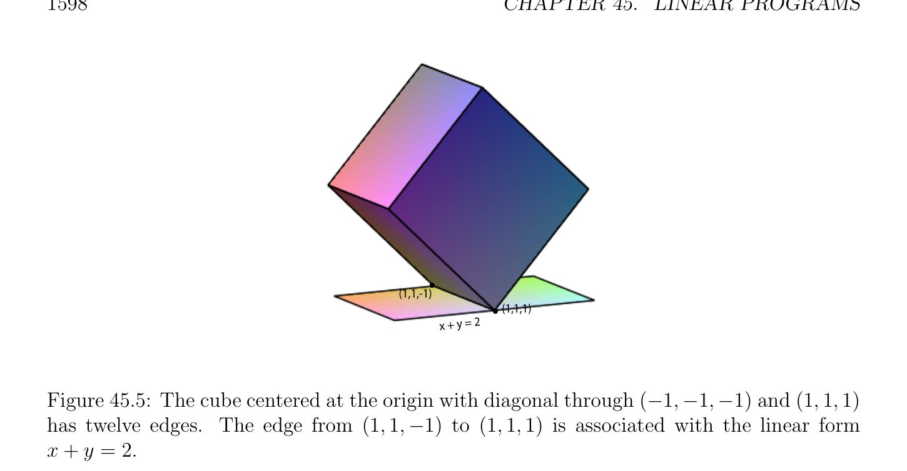

# Cơ bản Chấp nhận được (feasible) Các nghiệm và Các đỉnh

<!-- PAGE 1594 -->

## 45.2 Cơ bản Chấp nhận được (feasible) Các nghiệm và Các đỉnh

Nếu hệ Ax $= b$ có nghiệm và nếu một số hàng của $A$ là tổ hợp tuyến tính (linear combination) của khác các hàng, thì tương ứng phương trình là redundant, do đó ta có thể giả sử rằng các hàng của $A$ là độc lập tuyến tính (linearly independent); nghĩa là, ta có thể giả sử rằng $A$ có hạng (rank) $m$, do đó $m \le n$.

> **Định nghĩa 45.6.** Nếu $A$ là một ma trận cỡ $m \times  n$, với mọi khác rỗng tập con $K$ của ${1, \dots  , n}$, cho $A_{K}$ là ma trận con của $A$ bao gồm của các cột của $A$ có các chỉ số thuộc đến $K$. Ta ký hiệu cột thứ $j$ của ma trận $A$ bởi $A^{j}$.

> **Định nghĩa 45.7.** Cho trước Bài toán quy hoạch tuyến tính (linear program) $(P_{2})$
$$maximizecx$$
$$subject toAx = b and x \ge 0,$$
$$\mathbb{R}^{n}$$
Ở đâu $A$ có hạng (rank) $m$, vectơ $x \in$ là cơ bản nghiệm chấp nhận được (feasible solution) của $(P)$ nếu $x \in$ P(, $b) \neq  \emptyset$, và nếu tồn tại một tập con $K$ của ${1, \dots  , n}$ của kích thước $m$ sao cho
$(1)$ ma trận $A_{K}$ là khả nghịch (rằng là, các cột của $A_{K}$ là độc lập tuyến tính (linearly independent)).
$(2) x_{j} = 0$ với mọi $j \in / K$. tập con $K$ được gọi là một cơ sở (basis) của $x$. Mọi chỉ số $k \in K$ được gọi là cơ bản, và mọi chỉ số $j \in / K$ được gọi là nonbasic. Tương tự, các cột $A^{k}$ tương ứng với các chỉ số $k \in K$ được gọi là cơ bản, và các cột $A^{j}$ tương ứng với các chỉ số $j \in / K$ được gọi là nonbasic. các biến tương ứng với cơ bản các chỉ số $k \in K$ được gọi là cơ bản các biến, và các biến tương ứng với các chỉ số $j \in / K$ được gọi là nonbasic. Ví dụ, bài toán quy hoạch tuyến tính (linear program)
$$maximizex_{1} + x_{2}$$
$$subject tox_{1} + x_{2} + x_{3} = 1 and x_{1} \ge 0, x_{2} \ge 0, x_{3} \ge 0,(*)$$
Có ba cơ bản chấp nhận được (feasible) các nghiệm; cơ bản nghiệm chấp nhận được (feasible solution) $K = {1}$ tương ứng với điểm $(1, 0, 0)$; cơ bản nghiệm chấp nhận được (feasible solution) $K = {2}$ tương ứng với điểm $(0, 1, 0)$; cơ bản nghiệm chấp nhận được (feasible solution) $K = {3}$ tương ứng với điểm $(0, 0, 1)$. Mỗi của các phần tử này các điểm tương ứng với các đỉnh của slanted tím tam giác được minh họa trong Hình 45.3. các đỉnh $(1, 0, 0)$ và $(0, 1, 0)$ optimize hàm mục tiêu (objective function) với giá trị của $1$. Ta bây giờ chỉ ra rằng nếu Tiêu chuẩn Bài toán quy hoạch tuyến tính (linear program) $(P_{2})$ như trong Định nghĩa 45.7 có một số nghiệm chấp nhận được (feasible solution) và là bị chặn ở trên, thì một số cơ bản nghiệm chấp nhận được (feasible solution) là nghiệm tối ưu (optimal solution). Ta suy ra Matousek và Gardner $[127]$ (Chương $4$, Mục $2$, Định lý 4.2.3). Thứ nhất ta thu được nhiều hơn/thêm thuận tiện đặc trưng của cơ bản nghiệm chấp nhận được (feasible solution).

> **Mệnh đề 45.2.** Cho trước bất kỳ Tiêu chuẩn Bài toán quy hoạch tuyến tính (linear program) $(P_{2})$ ở đâu Ax $= b$ và $A$ là một ma trận cỡ $m \times  n$ của hạng (rank) $m$, với mọi nghiệm chấp nhận được (feasible solution) $x$, nếu $J_{>} = {j \in {1, \dots  , n}$ | $x_{j} > 0}$, thì $x$ là cơ bản nghiệm chấp nhận được (feasible solution) khi và chỉ khi các cột của ma trận $A_{J>}$ là độc lập tuyến tính (linearly independent).

<!-- PAGE 1595 -->
$$+ y = 0.7$$
$$x$$
$$+ z = 1$$
$$x + y$$

**Hình 45.3:** $\mathcal{H}-polytope$ liên kết với Bài toán quy hoạch tuyến tính (linear program) (*). hàm mục tiêu (objective function) (với $x_{1} \to x$ và $x_{2} \to y)$ được biểu diễn bởi đứng các mặt phẳng song song đến tím mặt phẳng $x + y =$ 0.7, và các đạt tới nó cực đại giá trị khi $x + y = 1$.

*Chứng minh.* Nếu $x$ là cơ bản nghiệm chấp nhận được (feasible solution), thì tồn tại một tập con $K \subseteq {1, \dots  , n}$ của kích thước $m$ sao cho các cột của $A_{K}$ là độc lập tuyến tính (linearly independent) và $x_{j} = 0$ với mọi $j \in / K$, do đó theo Định nghĩa, $J_{>} \subseteq K$, mà suy ra rằng các cột của ma trận $A_{J>}$ là độc lập tuyến tính (linearly independent). Ngược lại, giả sử rằng $x$ là nghiệm chấp nhận được (feasible solution) sao cho các cột của ma trận $A_{J>}$ là độc lập tuyến tính (linearly independent). Nếu $|J_{>}| = m$, ta được thực hiện vì ta có thể chọn $K = J_{>}$ và thì $x$ là cơ bản nghiệm chấp nhận được (feasible solution). Nếu $|J_{>}| < m$, ta có thể mở rộng $J_{>}$ đến phần tử thứ $m$ tập con $K$ bằng cách cộng $m -|J_{>}|$ cột các chỉ số sao cho các cột của $A_{K}$ là độc lập tuyến tính (linearly independent), mà là khả dĩ/có thể vì $A$ có hạng (rank) $m$. Tiếp theo ta chứng minh rằng nếu bài toán quy hoạch tuyến tính (linear program) trong tiêu chuẩn tạo thành có bất kỳ nghiệm chấp nhận được (feasible solution) $x_{0}$ và là bị chặn ở trên, thì là có một số cơ bản nghiệm chấp nhận được (feasible solution) $x$ mà là như tốt như $x_{0}$, trong
$$e$$
Nghĩa rằng cx $\ge cx_{0}$.
$$e$$

> **Mệnh đề 45.3.** Cho $(P_{2})$ là bất kỳ tiêu chuẩn bài toán quy hoạch tuyến tính (linear program) với hàm mục tiêu (objective function) cx, ở đâu Ax $= b$ và $A$ là một ma trận cỡ $m \times  n$ của hạng (rank) $m$. Nếu $(P_{2})$ là bị chặn ở trên và nếu $x_{0}$ là một số nghiệm chấp nhận được (feasible solution) của $(P_{2})$, thì tồn tại một cơ bản nghiệm chấp nhận được (feasible solution) $x$ sao cho cx $\ge cx_{0}$.
$$ee$$

*Chứng minh.* Trong số chấp nhận được (feasible) các nghiệm $x$ sao cho cx $\ge cx_{0} (x_{0}$ là một của chúng) chọn một với cực đại số của các tọa độ $x_{j}$ bằng $0$, nói $x$. Cho
$$e$$
$$K = J_{>} = {j \in {1, \dots  , n} |x_{j} > 0}$$
$$e$$
Và cho $s =$ |K|. Ta khẳng định rằng $x$ là cơ bản nghiệm chấp nhận được (feasible solution), và bởi cách xây dựng cx $\ge cx_{0}$.
$$ee$$
Nếu các cột của $A_{K}$ là độc lập tuyến tính (linearly independent), thì theo Mệnh đề 45.2 ta biết rằng $x$
$$e$$
Là cơ bản nghiệm chấp nhận được (feasible solution) và ta được thực hiện.

<!-- PAGE 1596 -->
Ngược lại, các cột của $A_{K}$ là phụ thuộc tuyến tính (linearly dependent), do đó tồn tại một khác không vectơ
$$\mathbb{R}^{n}$$
$v = (v_{1}, \dots  , v_{s})$ sao cho $A_{K} v = 0$. Cho $w \in$ là vectơ thu được bởi mở rộng $v$ bằng cách đặt $w_{j} = 0$ với mọi $j \in / K$. Bởi cách xây dựng,
$$Aw = A_{K} v = 0.$$
Ta sẽ derive một mâu thuẫn bởi exhibiting nghiệm chấp nhận được (feasible solution) $x(t_{0})$ sao cho $cx(t_{0}) \ge cx_{0}$ với nhiều hơn/thêm không các tọa độ hơn $x$.
$$e$$
Cho điều này ta khẳng định rằng ta có thể giả sử rằng $w$ thỏa mãn sau đây hai các điều kiện:
$(1)$ cw $\ge 0$.
$(2)$ Tồn tại một $j \in K$ sao cho $w_{j} < 0$. Nếu cw $= 0$ và nếu Điều kiện $(2)$ không thỏa mãn, vì $w \neq  0$, ta có $w_{j} > 0$ với một số $j \in K$, trong mà trường hợp ta có thể sử dụng $-w$, cho mà $w_{j} < 0$. Nếu cw $< 0$, thì c(-w) $> 0$, do đó ta có thể giả sử rằng cw $> 0$. Nếu $w_{j} > 0$ với mọi $j \in K$, vì $x$ là chấp nhận được (feasible), $x \ge 0$, và do đó x(t) $= x +$ tw $\ge 0$ với mọi $t \ge 0$. Hơn nữa, vì Aw $= 0$ và $e  e  e x$ là chấp nhận được (feasible), ta có $e$
$$Ax(t) = Ax + tAw = b,$$
$$e$$
Và do đó x(t) là chấp nhận được (feasible) với mọi $t \ge 0$. Ta cũng có
$$cx(t) = cx + tcw.$$
$$e$$
Vì cw $> 0$, như $t > 0$ đi đến vô cực hàm mục tiêu (objective function) cx(t) cũng tiến tới đến vô cực, contradicting sự kiện rằng là là bị chặn ở trên. Vì vậy, một số $w$ thỏa mãn Các điều kiện $(1)$ và $(2)$ ở trên phải tồn tại. Ta chỉ ra rằng tồn tại một $t_{0} > 0$ sao cho $cx(t_{0}) \ge cx_{0}$ và $x(t_{0}) = x + t_{0}w$ là chấp nhận được (feasible),
$$e$$
Vẫn chưa $x(t_{0})$ có nhiều hơn/thêm không các tọa độ hơn $x$, một mâu thuẫn.
$$e$$
Vì x(t) $= x +$ tw, ta có
$$e$$
$$x(t)_{i} =x_{i} + tw_{i},$$
$$e$$
Do đó nếu ta cho $I = {i \in {1, \dots  , n}$ | $w_{i} < 0} \subseteq K$, mà là khác rỗng vì $w$ thỏa mãn Điều kiện
$(2)$ ở trên, nếu ta chọn
$$t_{0} = \min- \frac{x_{i}}{w_{i}} e,$$
$$i\in I$$
Thì $t_{0} > 0$, bởi vì $w_{i} < 0$ với mọi $i \in$ I, và theo định nghĩa của $K$ ta có $x_{i} > 0$ với mọi $i \in K$.
$$e$$
Bởi định nghĩa của $t_{0} > 0$ và vì $x \ge 0$, ta có
$$e$$
$$x(t_{0})_{j} =x_{j} + t_{0}w_{j} \ge 0for all j \in K,$$
$$e$$
Do đó $x(t_{0}) \ge 0$, và $x(t_{0})_{i} = 0$ với một số $i \in$ I. Vì $Ax(t_{0}) = b$ (với mọi $t), x(t_{0})$ là nghiệm chấp nhận được (feasible solution),
$$cx(t_{0}) = cx + t_{0}cw \ge cx_{0} + t_{0}cw \ge cx_{0},$$
$$e$$
Và $x(t_{0})_{i} = 0$ với một số $i \in$ I, ta xem rằng $x(t_{0})$ có nhiều hơn/thêm không các tọa độ hơn $x$,
$$e$$
Mâu thuẫn.

<!-- PAGE 1597 -->
Mệnh đề 45.3 suy ra sau đây quan trọng kết quả.

> **Định lý 45.4.** Cho $(P_{2})$ là bất kỳ tiêu chuẩn bài toán quy hoạch tuyến tính (linear program) với hàm mục tiêu (objective function) cx, ở đâu Ax $= b$ và $A$ là một ma trận cỡ $m \times  n$ của hạng (rank) $m$. Nếu $(P_{2})$ có một số nghiệm chấp nhận được (feasible solution) và nếu nó là bị chặn ở trên, thì một số cơ bản nghiệm chấp nhận được (feasible solution) $x$ là nghiệm tối ưu (optimal solution) của $(P_{2})$.
$$e$$

*Chứng minh.* Theo Mệnh đề 45.3, với mọi nghiệm chấp nhận được (feasible solution) $x$ tồn tại một cơ bản nghiệm chấp nhận được (feasible solution) $x$
$$e$$
Sao cho cx $\le$ cx. Nhưng có chỉ một cách hữu hạn nhiều cơ bản chấp nhận được (feasible) các nghiệm, do đó một của chúng
$$e$$
Có đến cho cực đại của hàm mục tiêu (objective function). Geometrically, cơ bản các nghiệm là chính xác các đỉnh của $polyhedron\mathcal{P}(A, b)$, khái niệm rằng ta bây giờ định nghĩa.

> **Định nghĩa 45.8.** Cho trước $\mathcal{H}-polyhedron \mathcal{P} \subseteq \mathbb{R}^{n}$, đỉnh của $\mathcal{P}$ là điểm $v \in P$ với tính chất rằng tồn tại một khác không dạng tuyến tính (linear form) $c \in (\mathbb{R}^{n})^{*}$ và một số $\mu  \in \mathbb{R}$, sao cho $v$ là duy nhất điểm của $\mathcal{P}$ cho mà ánh xạ $x \mapsto$ cx có cực đại giá trị $\mu$; rằng là, cy $<$ cv $= \mu$ với mọi $y \in P -{v}$. Geometrically, điều này có nghĩa là siêu phẳng (hyperplane) của phương trình cy $= \mu$ touches $\mathcal{P}$ chính xác tại $v$. Tổng quát hơn, lồi tập con $F$ của $\mathcal{P}$ là $k$ chiều mặt của $\mathcal{P}$ nếu $F$ có số chiều $k$ và nếu tồn tại một afin tạo thành $\phi (x) =$ cx - $\mu$ sao cho cy $= \mu$ với mọi $y \in F$, và cy $< \mu$ với mọi $y \in P$ - $F$. 1-dimensional mặt được gọi là một cạnh. khái niệm của đỉnh được minh họa trong Hình 45.4, trong khi khái niệm của cạnh được minh họa trong Hình 45.5.
$$x + y + z = 3$$
$$(1,1,1)$$

**Hình 45.4:** hình lập phương được tâm tại gốc với đường chéo qua $(-1, -1, -1)$ và $(1, 1, 1)$ có tám các đỉnh. đỉnh $(1, 1, 1)$ là liên kết với dạng tuyến tính (linear form) $x + y + z = 3$. Vì $k$ chiều mặt $F$ của $\mathcal{P}$ bằng giao của siêu phẳng (hyperplane) $H(\phi$) của phương trình cx $= \mu$ với $\mathcal{P}$, nó là thật vậy lồi và khái niệm có số chiều làm cho nghĩa. Nhận thấy rằng 0-dimensional mặt của $\mathcal{P}$ là đỉnh. Nếu $\mathcal{P}$ có số chiều $d$, thì $(d$ - 1)- dimensional các mặt của $\mathcal{P}$ được gọi là của nó facets.

<!-- PAGE 1598 -->
$$(1,1,-1)$$
$$(1,1,1)$$
$$x + y = 2$$

**Hình 45.5:** hình lập phương được tâm tại gốc với đường chéo qua $(-1, -1, -1)$ và $(1, 1, 1)$ có twelve các cạnh. cạnh từ $(1, 1, -1)$ đến $(1, 1, 1)$ là liên kết với dạng tuyến tính (linear form) $x + y = 2$. Nếu $(P)$ là bài toán quy hoạch tuyến tính (linear program) trong tiêu chuẩn tạo thành, thì của nó cơ bản chấp nhận được (feasible) các nghiệm là chính xác các đỉnh của đa diện $\mathcal{P}(A, b)$. để chứng minh sự kiện này ta cần sau đây đơn giản mệnh đề

> **Mệnh đề 45.5.** Cho Ax $= b$ là hệ phương trình tuyến tính ở đâu $A$ là một ma trận cỡ $m \times  n$ của hạng (rank) $m$. Với mọi tập con $K \subseteq {1, \dots  , n}$ của kích thước $m$, nếu $A_{K}$ là khả nghịch, thì ở đó là nhiều nhất một cơ bản
$$\mathbb{R}^{n}$$
Nghiệm chấp nhận được (feasible solution) $x \in$ với $x_{j} = 0$ với mọi $j \in / K$ (của course, $x \ge 0)$

*Chứng minh.* Trong thứ tự cho $x$ là chấp nhận được (feasible) ta phải có Ax $= b$. Viết $N = {1, \dots  , n}$ - $K, x_{K}$ cho vectơ bao gồm của các tọa độ của $x$ với các chỉ số trong $K$, và $x_{N}$ cho vectơ bao gồm của các tọa độ của $x$ với các chỉ số trong $N$. Thì
$$Ax = A_{K}x_{K} + A_{N}x_{N} = b.$$
Trong thứ tự cho $x$ là cơ bản nghiệm chấp nhận được (feasible solution) ta phải có $x_{N} = 0$, do đó
$$A_{K}x_{K} = b.$$
Vì bởi giả thiết $A_{K}$ là khả nghịch, $x_{K} = A_{K}^{-1} b$ là một cách duy nhất được xác định. Nếu $x_{K} \ge 0$ thì $x$ là cơ bản nghiệm chấp nhận được (feasible solution), ngược lại nó là không. Điều này chứng tỏ rằng ở đó là nhiều nhất một cơ bản
$$\mathbb{R}^{n}$$
Nghiệm chấp nhận được (feasible solution) $x \in$ với $x_{j} = 0$ với mọi $j \in / K$.

> **Định lý 45.6.** Cho $(P)$ là bài toán quy hoạch tuyến tính (linear program) trong tiêu chuẩn tạo thành, ở đâu Ax $= b$ và $A$ là một ma trận cỡ $m \times  n$ của hạng (rank) $m$. Với mọi $v \in$ P(, $b)$, các điều kiện sau đây là tương đương:
$(1) v$ là đỉnh của Đa diện $\mathcal{P}(A, b)$.

<!-- PAGE 1599 -->
$(2) v$ là cơ bản nghiệm chấp nhận được (feasible solution) của Bài toán quy hoạch tuyến tính (linear program) $(P)$.

*Chứng minh.* Thứ nhất, giả sử rằng $v$ là đỉnh của $\mathcal{P}(A, b)$, và cho $\phi (x) =$ cx - $\mu$ là dạng tuyến tính (linear form) sao cho cy $< \mu$ với mọi $y \in$ P(, $b)$ và cv $= \mu$. Điều này có nghĩa là $v$ là duy nhất điểm của $\mathcal{P}(A, b)$ cho mà hàm mục tiêu (objective function) $x \mapsto$ cx có cực đại giá trị $\mu  on\mathcal{P}(A, b)$, do đó theo Định lý 45.4, vì điều này cực đại là đạt được bởi một số cơ bản nghiệm chấp nhận được (feasible solution), bởi tính duy nhất $v$ phải là cơ bản nghiệm chấp nhận được (feasible solution). Ngược lại, giả sử $v$ là cơ bản nghiệm chấp nhận được (feasible solution) của $(P)$ tương ứng với tập con $K \subseteq {1, \dots  , n}$ của kích thước $m$. Cho $c \in (\mathbb{R}^{n})^{*}$ là dạng tuyến tính (linear form) được định nghĩa bởi
$$b$$
$$($$
$$0if j \in K$$
$$c_{j} =$$
$$b-1if j \in /K.$$
Bởi cách xây dựng $c v = 0$ và $c x \le 0$ với mọi $x \ge 0$, do đó hàm $x \mapsto c x$ trên $\mathcal{P}(A, b)$
$$b bb$$
Có cực đại tại $v$. Hơn nữa, $c x < 0$ với mọi $x \ge 0$ sao cho $x_{j} > 0$ với một số $j \in / K$.
$$b$$
Tuy nhiên, theo Mệnh đề 45.5, vectơ $v$ là chỉ cơ bản nghiệm chấp nhận được (feasible solution) sao cho $v_{j} = 0$ với mọi $j \in / K$, và vì vậy $v$ là chỉ điểm của $\mathcal{P}(A, b)$ cực đại hóa hàm $x \mapsto c x$,
$$b$$
Do đó nó là đỉnh.
$$In theory, to find an optimal solution we try all_{m}^{n} \begin{pmatrix} solution \end{pmatrix} possible m-elements subsets K of$$
${1, \dots  , n}$ và giải cho tương ứng duy nhất $x_{K}$ của $A_{K}x = b$. Thì ta kiểm tra liệu như vậy nghiệm thỏa mãn $x_{K} \ge 0$, tính $cx_{K}$, và trả về một số chấp nhận được (feasible) $x_{K}$ cho mà hàm mục tiêu (objective function) là cực đại. Điều này là một cách tổng impractical thuật toán. thực tế thuật toán là thuật toán đơn hình (simplex algorithm). Basically, thuật toán đơn hình (simplex algorithm) tries đến “climb” trong polyhderon $\mathcal{P}(A, b)$ từ đỉnh đến đỉnh dọc theo các cạnh (bằng cách sử dụng cơ bản chấp nhận được (feasible) các nghiệm), cố gắng để cực đại hóa hàm mục tiêu (objective function). Ta trình bày thuật toán đơn hình (simplex algorithm) trong chương tiếp theo. độc giả có thể cũng consult các văn bản trên quy hoạch tuyến tính (linear programming). Đặc biệt, ta recommend Matousek và Gardner $[127]$, Chvatal $[40]$, Papadimitriou và Steiglitz $[139]$, Bertsimas và Tsitsiklis $[21]$, Ciarlet $[41]$, Schrijver $[154]$, và Vanderbei $[187]$. Nhận thấy rằng Định lý 45.4 khẳng định rằng nếu Bài toán quy hoạch tuyến tính (linear program) $(P)$ trong tiêu chuẩn tạo thành (ở đâu Ax $= b$ và $A$ là một ma trận cỡ $m\times n$ của hạng (rank) $m)$ có một số nghiệm chấp nhận được (feasible solution) và là bị chặn ở trên, thì một số cơ bản nghiệm chấp nhận được (feasible solution) là nghiệm tối ưu (optimal solution). Theo Định lý 45.6, đa diện $\mathcal{P}(A, b)$ phải có một số đỉnh. Nhưng giả sử ta chỉ biết rằng $\mathcal{P}(A, b)$ là nonempty; nghĩa là, ta không’t biết rằng hàm mục tiêu (objective function) cx là bị chặn ở trên. Thực hiện $\mathcal{P}(A, b)$ có một số đỉnh? câu trả lời đến ở trên câu hỏi là yes, và điều này là quan trọng bởi vì thuật toán đơn hình (simplex algorithm) cần ban đầu cơ bản nghiệm chấp nhận được (feasible solution) để thu được được bắt đầu. Ở đây ta chứng minh rằng $if\mathcal{P}(A, b)$ là khác rỗng, thì nó phải chứa đỉnh. chứng minh này vẫn không’t constructively cho đỉnh, nhưng ta sẽ xem trong chương tiếp theo rằng thuật toán đơn hình (simplex algorithm) luôn luôn tìm đỉnh nếu ở đó là một (miễn là/được cung cấp rằng ta sử dụng phần tử trụ (pivot) quy tắc rằng ngăn cản cycling).

<!-- PAGE 1600 -->

> **Định lý 45.7.** Cho $(P)$ là bài toán quy hoạch tuyến tính (linear program) trong tiêu chuẩn tạo thành, ở đâu Ax $= b$ và $A$ là một ma trận cỡ $m \times  n$ của hạng (rank) $m$. Nếu $\mathcal{P}(A, b)$ là khác rỗng (có một nghiệm chấp nhận được (feasible solution)), thì $\mathcal{P}(A, b)$ có một số đỉnh; tương đương, $(P)$ có một số cơ bản nghiệm chấp nhận được (feasible solution).

*Chứng minh.* chứng minh relies trên mẹo/kỹ thuật, mà là đến cộng bù/lỏng các biến $x_{n+1}, \dots  , x_{n+m}$ và sử dụng mới hàm mục tiêu (objective function) $-(x_{n+1} + \cdots  + x_{n+m})$. Nếu ta cho $A$ là $m \times  (m +$ n)-ma trận, và $x, \overline{x}$, và $x$ là các vectơ cho trước bởi
$$b b$$
$$Ab = \begin{pmatrix} A & I_{m} \end{pmatrix} ,x = \begin{pmatrix} x_{1} \\ \vdots \\ x_{n} \end{pmatrix} \in \mathbb{R}^{n},\overline{x} = \begin{pmatrix} x_{n+1} \\ \vdots \\ x_{n+m} \end{pmatrix} \in \mathbb{R}^{m},xb = \begin{pmatrix} x \\ \overline{x} \end{pmatrix} \in \mathbb{R}^{n+m},$$
Thì xét Bài toán quy hoạch tuyến tính (linear program) $(P)$ trong tiêu chuẩn tạo thành
$$b$$
$$maximize-(x_{n+1} + \cdots  + x_{n+m})$$
$$subject toAx = b andx \ge 0.$$
$$b b b$$
Vì $x_{i} \ge 0$ với mọi $i$, hàm mục tiêu (objective function) $-(x_{n+1} + \cdots  + x_{n+m})$ là bị chặn ở trên bởi $0$. hệ Ax $= b$ là tương đương đến hệ
$$b b$$
$$Ax +\overline{x} = b,$$
Do đó với mọi nghiệm chấp nhận được (feasible solution) $u \in$ P(, $b)$, vì Au $= b$, vectơ $(u, 0_{m})$ là cũng nghiệm chấp nhận được (feasible solution) của $(P)$, thực ra nghiệm tối ưu (optimal solution) vì giá trị của hàm mục tiêu (objective function) $-(x_{n+1}+$
$$b$$
$\cdots +x_{n+m}) for\overline{x} = 0$ là $0$. Theo Mệnh đề 45.3, bài toán quy hoạch tuyến tính (linear program) $(P)$ có một số cơ bản chấp nhận được (feasible)
$$b$$
Nghiệm $(u^{*}, w^{*})$ cho mà giá trị của hàm mục tiêu (objective function) là greater hơn hoặc bằng giá trị của hàm mục tiêu (objective function) cho $(u, 0_{m})$, và vì $(u, 0_{m})$ là nghiệm tối ưu (optimal solution), $(u^{*}, w^{*})$ là cũng nghiệm tối ưu (optimal solution) của $(P)$. Điều này suy ra rằng $w^{*} = 0$, vì ngược lại mục tiêu
$$b$$
Hàm $-(x_{n+1} + \cdots  + x_{n+m})$ sẽ có chặt âm giá trị. Vì vậy, $(u^{*}, 0_{m})$ là cơ bản nghiệm chấp nhận được (feasible solution) của $(P)$, và do đó các cột tương ứng
$$b$$
Đến khác không các thành phần của $u^{*}$ là độc lập tuyến tính (linearly independent). Một số của các tọa độ của $u^{*}$ có thể là bằng $0$, nhưng vì $A$ có hạng (rank) $m$ ta có thể cộng các cột của $A$ để thu được cơ sở (basis) $K$ liên kết với $u^{*}$, và $u^{*}$ là thật vậy cơ bản nghiệm chấp nhận được (feasible solution) của $(P)$. định nghĩa của cơ bản nghiệm chấp nhận được (feasible solution) có thể được được điều chỉnh đến các bài toán quy hoạch tuyến tính ở đâu các ràng buộc là của tạo thành Ax $\le b, x \ge 0$; xem Matousek và Gardner $[127]$ (Chương $4$, Mục $4$, Định nghĩa 4.4.2). hầu hết tổng quát loại/kiểu của bài toán quy hoạch tuyến tính (linear program) cho phép các ràng buộc của tạo thành $a_{i}x \ge b_{i}$ hoặc $a_{i}x = b_{i}$ ngoài ra các ràng buộc của tạo thành $a_{i}x \le b_{i}$. các biến $x_{i}$ có thể cũng lấy âm các giá trị. Nó là luôn luôn khả dĩ/có thể đến chuyển đổi như vậy các bài toán quy hoạch đến loại/kiểu được xét trong Định nghĩa 45.1. Ta tiến hành như sau.
