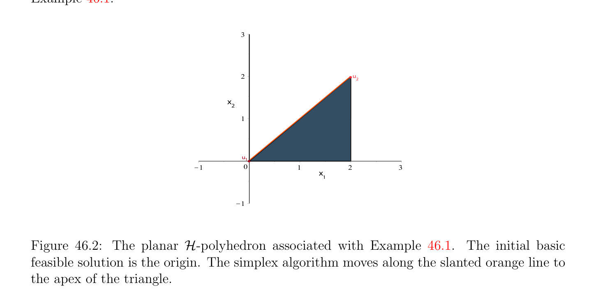
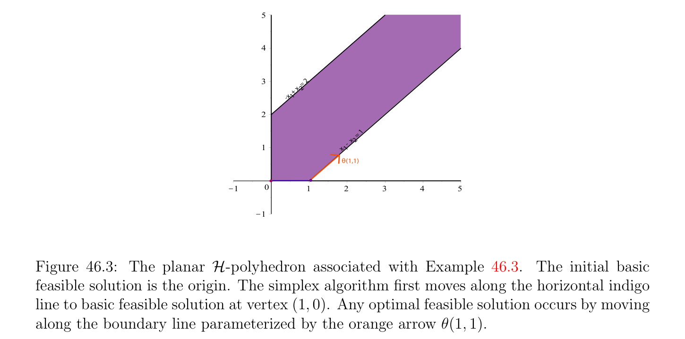

# Ý tưởng Đằng sau Thuật toán đơn hình (simplex algorithm)

<!-- PAGE 1605 -->
Chương $46$ Thuật toán đơn hình (simplex algorithm)

## 46.1 Ý tưởng Đằng sau Thuật toán đơn hình (simplex algorithm)

Thuật toán đơn hình (simplex algorithm), do Dantzig, áp dụng đến bài toán quy hoạch tuyến tính (linear program) $(P)$ trong tiêu chuẩn tạo thành, ở đâu các ràng buộc được cho bởi Ax $= b$ và $x \ge 0$, với $A$ một ma trận cỡ $m \times  n$ của hạng (rank) $m$, và với hàm mục tiêu (objective function) $x \mapsto$ cx. thuật toán này hoặc reports rằng $(P)$ có không có nghiệm chấp nhận được (feasible solution), hoặc rằng $(P)$ là không bị chặn, hoặc cho ta nghiệm tối ưu (optimal solution). Geometrically, thuật toán climbs từ đỉnh đến đỉnh trong đa diện $\mathcal{P}(A, b)$, cố gắng đến cải thiện giá trị của hàm mục tiêu (objective function). Vì các đỉnh tương ứng với cơ bản chấp nhận được (feasible) các nghiệm, thuật toán đơn hình (simplex algorithm) thực sự hoạt động với cơ bản chấp nhận được (feasible) các nghiệm. Nhắc lại rằng cơ bản nghiệm chấp nhận được (feasible solution) $x$ là nghiệm chấp nhận được (feasible solution) cho mà có một tập con $K \subseteq {1, \dots  , n}$ của kích thước $m$ sao cho ma trận $A_{K}$ bao gồm của các cột của $A$ có các chỉ số thuộc đến $K$ là độc lập tuyến tính (linearly independent), và rằng $x_{j} = 0$ với mọi $j \in / K$. Ta cũng cho $J_{>}(x)$ là tập hợp của các chỉ số
$$J_{>}(x) = {j \in {1, \dots  , n} | x_{j} > 0},$$
Do đó cho cơ bản nghiệm chấp nhận được (feasible solution) $x$ liên kết với $K$, ta có $J_{>}(x) \subseteq K$. Thực ra, theo Mệnh đề 45.2, nghiệm chấp nhận được (feasible solution) $x$ là cơ bản nghiệm chấp nhận được (feasible solution) khi và chỉ khi các cột của $A_{J>(x)}$ là độc lập tuyến tính (linearly independent). Nếu $J_{>}(x)$ đã có cardinality $m$ với mọi cơ bản chấp nhận được (feasible) các nghiệm $x$, thì thuật toán đơn hình (simplex algorithm) sẽ tạo progress tại mọi bước, trong nghĩa rằng nó sẽ chặt tăng giá trị của hàm mục tiêu (objective function). Không may là, nó là khả dĩ/có thể rằng $|J_{>}(x)| < m$ cho nhất định cơ bản chấp nhận được (feasible) các nghiệm, và trong trường hợp này bước của thuật toán đơn hình (simplex algorithm) có thể không tăng giá trị của hàm mục tiêu (objective function). Tệ hơn, trong rare các trường hợp, nó là khả dĩ/có thể rằng thuật toán enters vô hạn khuyên. Điều này hiện tượng được gọi là cycling có thể được detected, nhưng trong trường hợp này thuật toán không thỏa mãn đến cho conclusive câu trả lời. May mắn thay, có các cách của ngăn cản thuật toán đơn hình (simplex algorithm) từ cycling (ví dụ, Bland’s quy tắc được thảo luận sau này), mặc dù chứng minh rằng các phần tử này các quy tắc hoạt động/công trình một cách chính xác là khá liên quan.
$$1605$$

<!-- PAGE 1606 -->
Potential “xấu” behavior của cơ bản nghiệm chấp nhận được (feasible solution) là recorded trong sau đây định nghĩa.

> **Định nghĩa 46.1.** Cho trước Bài toán quy hoạch tuyến tính (linear program) $(P)$ trong tiêu chuẩn tạo thành ở đâu các ràng buộc được cho bởi Ax $= b$ và $x \ge 0$, với $A$ một ma trận cỡ $m \times  n$ của hạng (rank) $m$, cơ bản nghiệm chấp nhận được (feasible solution) $x$ là suy biến nếu $|J_{>}(x)| < m$, ngược lại nó là không suy biến. gốc $0_{n}$, nếu nó là cơ bản nghiệm chấp nhận được (feasible solution), là suy biến. Cho ít hơn tầm thường ví dụ, $x = (0, 0, 0, 2)$ là suy biến cơ bản nghiệm chấp nhận được (feasible solution) của sau đây bài toán quy hoạch tuyến tính (linear program) trong mà $m = 2$ và $n = 4$.

> **Ví dụ 46.1.**
$$maximizex_{2}$$
$$subject to$$
$$-x_{1} + x_{2} + x_{3} = 0$$
$$x_{1} + x_{4} = 2$$
$$x_{1} \ge 0, x_{2} \ge 0, x_{3} \ge 0, x_{4} \ge 0.$$
Ma trận $A$ và vectơ $b$ được cho bởi
$$A = \begin{pmatrix} -1 & 1 & 1 & 0 \\ 1 & 0 & 0 & 1 \end{pmatrix} ,b = \begin{pmatrix} 0 \\ 2 \end{pmatrix} ,$$
Và nếu $x = (0, 0, 0, 2)$, thì $J_{>}(x) = {4}$. Có hai các cách của tạo thành tập hợp của hai các cột độc lập tuyến tính của $A$ chứa thứ tư cột. Cho trước cơ bản nghiệm chấp nhận được (feasible solution) $x$ liên kết với tập con $K$ của kích thước $m$, vì các cột của ma trận $A_{K}$ là độc lập tuyến tính (linearly independent), lạm dụng language ta gọi các cột của $A_{K}$ cơ sở (basis) của $x$. Nếu $u$ là đỉnh của $(P)$, nghĩa là, cơ bản nghiệm chấp nhận được (feasible solution) của $(P)$ liên kết với cơ sở (basis) $K$ (của kích thước $m)$, trong “chuẩn tắc/bình thường mode,” thuật toán đơn hình (simplex algorithm) tries đến di chuyển dọc theo cạnh từ đỉnh $u$ đến kề nhau đỉnh $v$ (với $u, v \in$ P(, $b) \subseteq \mathbb{R}^{n})$ tương ứng với cơ bản nghiệm chấp nhận được (feasible solution) có cơ sở (basis) là thu được bằng cách thay thế một của cơ bản các vectơ $A^{k}$ với $k \in K$ bởi một cái khác nonbasic vectơ $A^{j}$ với một số $j \in / K$, trong như vậy cách rằng giá trị của hàm mục tiêu (objective function) là increased. Cho chúng ta demonstrate điều này process trên ví dụ.

<!-- PAGE 1607 -->

> **Ví dụ 46.2.** Cho $(P)$ là sau đây bài toán quy hoạch tuyến tính (linear program) trong tiêu chuẩn tạo thành.
$$maximizex_{1} + x_{2}$$
$$subject to$$
$$-x_{1} + x_{2} + x_{3} = 1$$
$$x_{1} + x_{4} = 3$$
$$x_{2} + x_{5} = 2$$
$$x_{1} \ge 0, x_{2} \ge 0, x_{3} \ge 0, x_{4} \ge 0, x_{5} \ge 0.$$
Ma trận $A$ và vectơ $b$ được cho bởi
$$A = \begin{pmatrix} -1 & 1 & 1 & 0 & 0 \\ 1 & 0 & 0 & 1 & 0 \\ 0 & 1 & 0 & 0 & 1 \end{pmatrix} ,b = \begin{pmatrix} 1 \\ 3 \\ 2 \end{pmatrix} .$$
$$3$$
$$2u2$$
$$= 1$$
$$+ x 2$$
$$-x 1$$
$$1$$
$$u\overline{0} u\overline{1}$$
$$\overline{K}\overline{1}\overline{0}\overline{1}\overline{2}\overline{3}\overline{4}\overline{5}$$
$$K1$$

**Hình 46.1:** phẳng $\mathcal{H}-polyhedron$ liên kết với Ví dụ 46.2. ban đầu cơ bản nghiệm chấp nhận được (feasible solution) là gốc. thuật toán đơn hình (simplex algorithm) thứ nhất di chuyển dọc theo ngang cam đường thẳng đến nghiệm chấp nhận được (feasible solution) tại đỉnh $u_{1}$. Nó thì di chuyển dọc theo đứng đỏ đường thẳng để thu được tối ưu nghiệm chấp nhận được (feasible solution) $u_{2}$. vectơ $u_{0} = (0, 0, 1, 3, 2)$ tương ứng với cơ sở (basis) $K = {3, 4, 5}$ là cơ bản nghiệm chấp nhận được (feasible solution), và tương ứng giá trị của hàm mục tiêu (objective function) là $0 + 0 = 0$. Vì các cột $(A^{3}, A^{4}, A^{5})$ tương ứng với $K = {3, 4, 5}$ là độc lập tuyến tính (linearly independent) ta có thể biểu diễn $A^{1}$ và $A^{2}$ như
$$A^{1}= -A^{3}+ A^{4}$$
$$A^{2}= A^{3}+ A^{5}.$$

<!-- PAGE 1608 -->
Vì
$$1A^{3}+ 3A^{4}+ 2A^{5}= Au_{0} = b,$$
Với mọi $\theta  \in \mathbb{R}$, ta có
$$b = 1A^{3}+ 3A^{4}+ 2A^{5}-\theta A^{1}+ \theta A^{1}$$
$$= 1A^{3}+ 3A^{4}+ 2A^{5}-\theta (-A^{3}+ A^{4}) + \theta A^{1}$$
$$= \theta A^{1}+ (1 + \theta )A^{3}+ (3 -\theta )A^{4}+ 2A^{5},$$
Và
$$b = 1A^{3}+ 3A^{4}+ 2A^{5}-\theta A^{2}+ \theta A^{2}$$
$$= 1A^{3}+ 3A^{4}+ 2A^{5}-\theta (A^{3}+ A^{5}) + \theta A^{2}$$
$$= \theta A^{2}+ (1 -\theta )A^{3}+ 3A^{4}+ (2 -\theta )A^{5}.$$
Trong trường hợp thứ nhất, vectơ $(\theta , 0, 1 + \theta , 3$ - $\theta , 2)$ là nghiệm chấp nhận được (feasible solution) iff0 $\le \theta  \le 3$, và mới giá trị của hàm mục tiêu (objective function) là $\theta$. Trong trường hợp thứ hai, vectơ $(0, \theta , 1$ - $\theta , 3, 2$ - $\theta , 1)$ là nghiệm chấp nhận được (feasible solution) iff0 $\le \theta  \le 1$, và mới giá trị của hàm mục tiêu (objective function) là cũng $\theta$. Xét trường hợp thứ nhất. Nó là tự nhiên đến ask liệu ta có thể thu được một cái khác đỉnh và tăng hàm mục tiêu (objective function) bằng cách đặt đến không một của các tọa độ của $(\theta , 0, 1+\theta , 3-\theta , 2)$, trong trường hợp này fouth một, bởi chọn $\theta  = 3$. Điều này cho ta nghiệm chấp nhận được (feasible solution) $(3, 0, 4, 0, 2)$, mà tương ứng với cơ sở (basis) $(A^{1}, A^{3}, A^{5})$, và do đó là thật vậy cơ bản nghiệm chấp nhận được (feasible solution), với được cải thiện giá trị của hàm mục tiêu (objective function) bằng $3$. Lưu ý rằng $A^{4}$ trái cơ sở (basis) $(A^{3}, A^{4}, A^{5})$ và $A^{1}$ entered mới cơ sở (basis) $(A^{1}, A^{3}, A^{5})$. Ta có thể bây giờ biểu diễn $A^{2}$ và $A^{4}$ theo cơ sở (basis) $(A^{1}, A^{3}, A^{5})$, mà là dễ đến thực hiện vì ta đã có $A^{1}$ và $A^{2}$ trong số hạng của $(A^{3}, A^{4}, A^{5})$, và $A^{1}$ và $A^{4}$ là swapped. Như vậy bước được gọi là một chọn phần tử trụ bước. Ta thu được
$$A^{2}= A^{3}+ A^{5}$$
$$A^{4}= A^{1}+ A^{3}.$$
Thì ta repeat process với $u_{1} = (3, 0, 4, 0, 2)$ và cơ sở (basis) $(A^{1}, A^{3}, A^{5})$. Ta có
$$b = 3A^{1}+ 4A^{3}+ 2A^{5}-\theta A^{2}+ \theta A^{2}$$
$$= 3A^{1}+ 4A^{3}+ 2A^{5}-\theta (A^{3}+ A^{5}) + \theta A^{2}$$
$$= 3A^{1}+ \theta A^{2}+ (4 -\theta )A^{3}+ (2 -\theta )A^{5},$$
Và
$$b = 3A^{1}+ 4A^{3}+ 2A^{5}-\theta A^{4}+ \theta A^{4}$$
$$= 3A^{1}+ 4A^{3}+ 2A^{5}-\theta (A^{1}+ A^{3}) + \theta A^{4}$$
$$= (3 -\theta )A^{1}+ (4 -\theta )A^{3}+ \theta A^{4}+ 2A^{5}.$$

<!-- PAGE 1609 -->
Trong trường hợp thứ nhất, điểm $(3, \theta , 4$ - $\theta , 0, 2$ - $\theta$) là nghiệm chấp nhận được (feasible solution) iff0 $\le \theta  \le 2$, và mới giá trị của hàm mục tiêu (objective function) là $3+\theta$. Trong trường hợp thứ hai, điểm $(3-\theta , 0, 4-\theta , \theta , 2)$ là nghiệm chấp nhận được (feasible solution) iff0 $\le \theta  \le 3$, và mới giá trị của hàm mục tiêu (objective function) là $3$ - $\theta$. Đến tăng hàm mục tiêu (objective function), ta phải chọn trường hợp thứ nhất và ta chọn $\theta  = 2$. Thì ta thu được nghiệm chấp nhận được (feasible solution) $u_{2} = (3, 2, 2, 0, 0)$, mà tương ứng với cơ sở (basis) $(A^{1}, A^{2}, A^{3})$, và do đó là cơ bản nghiệm chấp nhận được (feasible solution). mới giá trị của hàm mục tiêu (objective function) là $5$. Tiếp theo ta biểu diễn $A^{4}$ và $A^{5}$ theo cơ sở (basis) $(A^{1}, A^{2}, A^{3})$. Một lần nữa điều này là dễ đến thực hiện vì ta chỉ swapped $A^{5}$ và $A^{2}$ (chọn phần tử trụ bước), và ta thu được
$$A^{5}= A^{2}-A^{3}$$
$$A^{4}= A^{1}+ A^{3}.$$
Ta repeat process với $u_{2} = (3, 2, 2, 0, 0)$ và cơ sở (basis) $(A^{1}, A^{2}, A^{3})$. Ta có
$$b = 3A^{1}+ 2A^{2}+ 2A^{3}-\theta A^{4}+ \theta A^{4}$$
$$= 3A^{1}+ 2A^{2}+ 2A^{3}-\theta (A^{1}+ A^{3}) + \theta A^{4}$$
$$= (3 -\theta )A^{1}+ 2A^{2}+ (2 -\theta )A^{3}+ \theta A^{4},$$
Và
$$b = 3A^{1}+ 2A^{2}+ 2A^{3}-\theta A^{5}+ \theta A^{5}$$
$$= 3A^{1}+ 2A^{2}+ 2A^{3}-\theta (A^{2}-A^{3}) + \theta A^{5}$$
$$= 3A^{1}+ (2 -\theta )A^{2}+ (2 + \theta )A^{3}+ \theta A^{5}.$$
Trong trường hợp thứ nhất, điểm $(3$ - $\theta , 2, 2$ - $\theta , \theta , 0)$ là nghiệm chấp nhận được (feasible solution) iff0 $\le \theta  \le 2$, và giá trị của hàm mục tiêu (objective function) là $5$ - $\theta$. Trong trường hợp thứ hai, điểm $(3, 2$ - $\theta , 2 + \theta , 0, \theta$) là nghiệm chấp nhận được (feasible solution) iff0 $\le \theta  \le 2$, và giá trị của hàm mục tiêu (objective function) là cũng $5$ - $\theta$. Vì ta phải có $\theta  \ge 0$ đến có nghiệm chấp nhận được (feasible solution), không có cách đến tăng hàm mục tiêu (objective function). Trong tình huống này, hóa ra là ta có đạt tới nghiệm tối ưu (optimal solution), trong của ta trường hợp $u_{2} = (3, 2, 2, 0, 0)$, với cực đại của hàm mục tiêu (objective function) bằng $5$. Ta có thể cũng có ứng dụng thuật toán đơn hình (simplex algorithm) đến đỉnh $u_{0} = (0, 0, 1, 3, 2)$ và đến vectơ $(0, \theta , 1$ - $\theta , 3, 2$ - $\theta , 1)$, mà là nghiệm chấp nhận được (feasible solution) iff0 $\le \theta  \le 1$, với mới giá trị của hàm mục tiêu (objective function) $\theta$. Bởi chọn $\theta  = 1$, ta thu được nghiệm chấp nhận được (feasible solution) $(0, 1, 0, 3, 1)$, tương ứng với cơ sở (basis) $(A^{2}, A^{4}, A^{5})$, mà là thật vậy đỉnh. mới giá trị của hàm mục tiêu (objective function) là $1$. Thì ta biểu diễn $A^{1}$ và $A^{3}$ trong các số hạng cơ sở (basis) $(A^{2}, A^{4}, A^{5})$ thu được
$$A^{1}= A^{4}-A^{3}$$
$$A^{3}= A^{2}-A^{5},$$
Và repeat process với $(0, 1, 0, 3, 1)$ và cơ sở (basis) $(A^{2}, A^{4}, A^{5})$. Sau ba nhiều hơn/thêm các bước ta sẽ đạt tới nghiệm tối ưu (optimal solution) $u_{2} = (3, 2, 2, 0, 0)$.

<!-- PAGE 1610 -->
Cho chúng ta đi quay lại đến bài toán quy hoạch tuyến tính (linear program) của Ví dụ 46.1 với hàm mục tiêu (objective function) $x_{2}$ và ở đâu ma trận $A$ và vectơ $b$ được cho bởi
$$A = \begin{pmatrix} -1 & 1 & 1 & 0 \\ 1 & 0 & 0 & 1 \end{pmatrix} ,b = \begin{pmatrix} 0 \\ 2 \end{pmatrix} .$$
Nhắc lại rằng $u_{0} = (0, 0, 0, 2)$ là suy biến cơ bản nghiệm chấp nhận được (feasible solution), và hàm mục tiêu (objective function) có giá trị $0$. Xem Hình 46.2 cho phẳng picture của $\mathcal{H}-polyhedron$ liên kết với

> **Ví dụ 46.1.**
$$3$$
$$2u$$
$$2$$
$$x$$
$$2$$
$$1$$
$$u\overline{1}$$
$$\overline{K}\overline{1}\overline{0}\overline{1}\overline{2}\overline{3}$$
$$x$$
$$1$$
$$K1$$

**Hình 46.2:** phẳng $\mathcal{H}-polyhedron$ liên kết với Ví dụ 46.1. ban đầu cơ bản nghiệm chấp nhận được (feasible solution) là gốc. thuật toán đơn hình (simplex algorithm) di chuyển dọc theo slanted cam đường thẳng đến đỉnh của tam giác. Chọn cơ sở (basis) $(A^{3}, A^{4})$. Thì ta có
$$A^{1}= -A^{3}+ A^{4}$$
$$A^{2}= A^{3},$$
Và ta thu được
$$b = 2A^{4}-\theta A^{1}+ \theta A^{1}$$
$$= 2A^{4}-\theta (-A^{3}+ A^{4}) + \theta A^{1}$$
$$= \theta A^{1}+ \theta A^{3}+ (2 -\theta )A^{4},$$
Và
$$b = 2A^{4}-\theta A^{2}+ \theta A^{2}$$
$$= 2A^{4}-\theta A^{3}+ \theta A^{2}$$
$$= \theta A^{2}-\theta A^{3}+ 2A^{4}.$$

<!-- PAGE 1611 -->
Trong trường hợp thứ nhất, điểm $(\theta , 0, \theta , 2$ - $\theta$) là nghiệm chấp nhận được (feasible solution) iff0 $\le \theta  \le 2$, và giá trị của hàm mục tiêu (objective function) là $0$, và trong trường hợp thứ hai điểm $(0, \theta , -\theta , 2)$ là nghiệm chấp nhận được (feasible solution) khi và chỉ khi $\theta  = 0$, và giá trị của hàm mục tiêu (objective function) là $\theta$. Tuy nhiên, vì ta phải có $\theta  = 0$ trong trường hợp thứ hai, không có cách đến tăng hàm mục tiêu (objective function) hoặc. Hóa ra là trong thứ tự để tạo các trường hợp được xét bởi thuật toán đơn hình (simplex algorithm) như mutually exclusive như khả dĩ/có thể, vì trong trường hợp thứ hai hệ số của $\theta$ trong giá trị của hàm mục tiêu (objective function) là khác không, cụ thể là $1$, ta nên chọn trường hợp thứ hai. Ta phải chọn $\theta  = 0$, nhưng ta có thể swap các vectơ $A^{3}$ và $A^{2}$ (bởi vì $A^{2}$ là coming trong và $A^{3}$ có hệ số $-\theta$, mà là lý do tại sao $\theta$ phải là không), và ta thu được cơ bản nghiệm chấp nhận được (feasible solution) $u_{1} = (0, 0, 0, 2)$ với mới cơ sở (basis) $(A^{2}, A^{4})$. Lưu ý rằng điều này cơ bản nghiệm chấp nhận được (feasible solution) tương ứng với cùng đỉnh $(0, 0, 0, 2)$ như trước, nhưng cơ sở (basis) có đã thay đổi. các vectơ $A^{1}$ và $A^{3}$ có thể được được biểu diễn theo cơ sở (basis) $(A^{2}, A^{4})$ như
$$A^{1}= -A^{2}+ A^{4}$$
$$A^{3}= A^{2}.$$
Ta bây giờ repeat quy trình với $u_{1} = (0, 0, 0, 2)$ và cơ sở (basis) $(A^{2}, A^{4})$, và ta thu được
$$b = 2A^{4}-\theta A^{1}+ \theta A^{1}$$
$$= 2A^{4}-\theta (-A^{2}+ A^{4}) + \theta A^{1}$$
$$= \theta A^{1}+ \theta A^{2}+ (2 -\theta )A^{4},$$
Và
$$b = 2A^{4}-\theta A^{3}+ \theta A^{3}$$
$$= 2A^{4}-\theta A^{2}+ \theta A^{3}$$
$$= -\theta A^{2}+ \theta A^{3}+ 2A^{4}.$$
Trong trường hợp thứ nhất, điểm $(\theta , \theta , 0, 2-\theta$) là nghiệm chấp nhận được (feasible solution) iff0 $\le \theta  \le 2$ và giá trị của hàm mục tiêu (objective function) là $\theta$, và trong trường hợp thứ hai điểm $(0, -\theta , \theta , 2)$ là nghiệm chấp nhận được (feasible solution) khi và chỉ khi $\theta  = 0$ và giá trị của hàm mục tiêu (objective function) là $\theta$. Trong thứ tự đến tăng hàm mục tiêu (objective function) ta phải chọn trường hợp thứ nhất và chọn $\theta  = 2$. Ta thu được nghiệm chấp nhận được (feasible solution) $u_{2} = (2, 2, 0, 0)$ có tương ứng cơ sở (basis) là $(A^{1}, A^{2})$ và giá trị của hàm mục tiêu (objective function) là $2$. các vectơ $A^{3}$ và $A^{4}$ được biểu diễn theo cơ sở (basis) $(A^{1}, A^{2})$ như
$$A^{3}= A^{2}$$
$$A^{4}= A^{1}+ A^{3},$$
Và ta repeat quy trình với $u_{2} = (2, 2, 0, 0)$ và cơ sở (basis) $(A^{1}, A^{2})$. Ta thu được
$$b = 2A^{1}+ 2A^{2}-\theta A^{3}+ \theta A^{3}$$
$$= 2A^{1}+ 2A^{2}-\theta A^{2}+ \theta A^{3}$$
$$= 2A^{1}+ (2 -\theta )A^{2}+ \theta A^{3},$$

<!-- PAGE 1612 -->
Và
$$b = 2A^{1}+ 2A^{2}-\theta A^{4}+ \theta A^{4}$$
$$= 2A^{1}+ 2A^{2}-\theta (A^{1}+ A^{3}) + \theta A^{4}$$
$$= (2 -\theta )A^{1}+ 2A^{2}-\theta A^{3}+ \theta A^{4}.$$
Trong trường hợp thứ nhất, điểm $(2, 2$ - $\theta , 0, \theta$) là nghiệm chấp nhận được (feasible solution) iff0 $\le \theta  \le 2$ và giá trị của hàm mục tiêu (objective function) là $2 -\theta$, và trong trường hợp thứ hai, điểm $(2 -\theta , 2, -\theta , \theta$) là nghiệm chấp nhận được (feasible solution) khi và chỉ khi $\theta  = 0$ và giá trị của hàm mục tiêu (objective function) là $2$. Điều này time không có cách đến cải thiện hàm mục tiêu (objective function) và ta có đạt tới nghiệm tối ưu (optimal solution) $u_{2} = (2, 2, 0, 0)$ với cực đại của hàm mục tiêu (objective function) bằng $2$. Cho chúng ta bây giờ xét ví dụ của không bị chặn bài toán quy hoạch tuyến tính (linear program).

> **Ví dụ 46.3.** Cho $(P)$ là sau đây bài toán quy hoạch tuyến tính (linear program) trong tiêu chuẩn tạo thành.
$$maximizex_{1}$$
$$subject to$$
$$x_{1} -x_{2} + x_{3} = 1$$
$$-x_{1} + x_{2} + x_{4} = 2$$
$$x_{1} \ge 0, x_{2} \ge 0, x_{3} \ge 0, x_{4} \ge 0.$$
Ma trận $A$ và vectơ $b$ được cho bởi
$$A = \begin{pmatrix} 1 & -1 & 1 & 0 \\ -1 & 1 & 0 & 1 \end{pmatrix} ,b = \begin{pmatrix} 1 \\ 2 \end{pmatrix} .$$
Vectơ $u_{0} = (0, 0, 1, 2)$ tương ứng với cơ sở (basis) $K = {3, 4}$ là cơ bản nghiệm chấp nhận được (feasible solution), và tương ứng giá trị của hàm mục tiêu (objective function) là $0$. các vectơ $A^{1}$ và $A^{2}$ được biểu diễn theo cơ sở (basis) $(A^{3}, A^{4})$ bởi
$$A^{1}= A^{3}-A^{4}$$
$$A^{2}= -A^{3}+ A^{4}.$$
Bắt đầu với $u_{0} = (0, 0, 1, 2)$, ta thu được
$$b = A^{3}+ 2A^{4}-\theta A^{1}+ \theta A^{1}$$
$$= A^{3}+ 2A^{4}-\theta (A^{3}-A^{4}) + \theta A^{1}$$
$$= \theta A^{1}+ (1 -\theta )A^{3}+ (2 + \theta )A^{4},$$
Và
$$b = A^{3}+ 2A^{4}-\theta A^{2}+ \theta A^{2}$$
$$= A^{3}+ 2A^{4}-\theta (-A^{3}+ A^{4}) + \theta A^{2}$$
$$= \theta A^{2}+ (1 + \theta )A^{3}+ (2 -\theta )A^{4}.$$

<!-- PAGE 1613 -->
$$nequal  xy % 1, x C y % 2, x R 0, y R 0 , x = 1 ..5, y = 1 ..5, color = "Nautic$$
$$5$$
$$4$$
$$3 = 2$$
$$+ x 2$$
$$-x 1$$
$$2$$
$$= 1$$
$$x  2$$
$$1  -$$
$$x 1$$
$$\theta (1,1)$$
$$\overline{K}\overline{1}\overline{0}\overline{1}\overline{2}\overline{3}\overline{4}\overline{5}$$
$$K1$$

**Hình 46.3:** phẳng $\mathcal{H}-polyhedron$ liên kết với Ví dụ 46.3. ban đầu cơ bản nghiệm chấp nhận được (feasible solution) là gốc. thuật toán đơn hình (simplex algorithm) thứ nhất di chuyển dọc theo ngang indigo đường thẳng đến cơ bản nghiệm chấp nhận được (feasible solution) tại đỉnh $(1, 0)$. Bất kỳ tối ưu nghiệm chấp nhận được (feasible solution) xảy ra bởi di chuyển dọc theo biên (boundary) đường thẳng parameterized bởi cam arrow $\theta (1, 1)$. Trong trường hợp thứ nhất, điểm $(\theta , 0, 1 -\theta , 2 + \theta$) là nghiệm chấp nhận được (feasible solution) iff0 $\le \theta  \le 1$ và giá trị của hàm mục tiêu (objective function) là $\theta$, và trong trường hợp thứ hai, điểm $(0, \theta , 1+\theta , 2-\theta$) là nghiệm chấp nhận được (feasible solution) iff0 $\le \theta  \le 2$ và giá trị của hàm mục tiêu (objective function) là $0$. Trong thứ tự đến tăng hàm mục tiêu (objective function) ta phải chọn trường hợp thứ nhất, và ta chọn $\theta  = 1$. Ta thu được nghiệm chấp nhận được (feasible solution) $u_{1} = (1, 0, 0, 3)$ tương ứng với cơ sở (basis) $(A^{1}, A^{4})$, do đó nó là cơ bản nghiệm chấp nhận được (feasible solution), và giá trị của hàm mục tiêu (objective function) là $1$. các vectơ $A^{2}$ và $A^{3}$ là cho trước theo cơ sở (basis) $(A^{1}, A^{4})$ bởi
$$A^{2}= -A^{1}$$
$$A^{3}= A^{1}+ A^{4}.$$
Repeating process với $u_{1} = (1, 0, 0, 3)$, ta thu được
$$b = A^{1}+ 3A^{4}-\theta A^{2}+ \theta A^{2}$$
$$= A^{1}+ 3A^{4}-\theta (-A^{1}) + \theta A^{2}$$
$$= (1 + \theta )A^{1}+ \theta A^{2}+ 3A^{4},$$
Và
$$b = A^{1}+ 3A^{4}-\theta A^{3}+ \theta A^{3}$$
$$= A^{1}+ 3A^{4}-\theta (A^{1}+ A^{4}) + \theta A^{3}$$
$$= (1 -\theta )A^{1}+ \theta A^{3}+ (3 -\theta )A^{4}.$$
