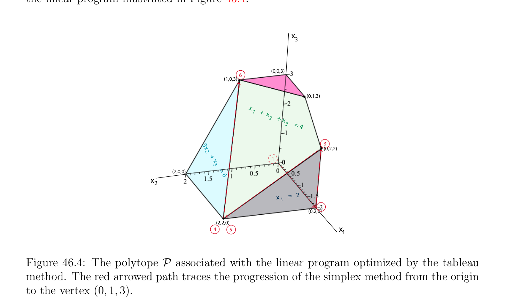

# Thuật toán đơn hình (simplex algorithm) Bằng cách sử dụng Các bảng (tableaux)

<!-- PAGE 1625 -->

## 46.4 Thuật toán đơn hình (simplex algorithm) Bằng cách sử dụng Các bảng (tableaux)

Ta bây giờ mô tả formalism cho trình bày thuật toán đơn hình (simplex algorithm), cụ thể là (đầy đủ) các bảng (tableaux). Điều này là traditional formalism được sử dụng trong tất cả các cuốn sách, modulo định thức con (minor) variations. một cách cụ thể đẹp đặc trưng (feature) của bảng đơn hình (tableau) formalism là rằng update của bảng đơn hình (tableau) có thể được performed bằng cách sử dụng các phép biến đổi sơ cấp trên hàng đồng nhất đến các phép toán được sử dụng during reduction của ma trận đến hàng rút gọn bậc thang tạo thành (rref). Những gì các khác nhau là tiêu chuẩn cho lựa chọn của phần tử trụ (pivot). Vì quantities $c_{j} -c_{K}\gamma_{K}^{j}$ đóng then chốt vai trò trong xác định mà cột $A^{j}$ nên đến vào cơ sở (basis), ký hiệu $\overline{c}_{j}$ được sử dụng đến ký hiệu $c_{j}$ - $c_{K}\gamma_{K}^{j}$, mà được gọi là rút gọn chi phí của biến $x_{j}$. rút gọn chi phí thực sự phụ thuộc vào $K$ do đó là rất precise ta nên ký hiệu chúng bởi $(\overline{c}_{K})_{j}$, nhưng để đơn giản hóa ký hiệu ta viết $\overline{c}_{j}$ thay vì của $(\overline{c}_{K})_{j}$. Ta sẽ xem một cách ngắn cách mà $(\overline{c}_{K+})_{i}$ được tính theo $(\overline{c}_{K})_{i}$. Nhận thấy rằng dữ liệu cần thiết đến execute tiếp theo bước của thuật toán đơn hình (simplex algorithm) là
$(1)$ current cơ bản nghiệm $u_{K}$ và của nó cơ sở (basis) $K = (k_{1}, \dots  , k_{m})$.
$(2)$ rút gọn chi phí $\overline{c}_{j} = c_{j}$ - $c_{K}A_{K}^{-1} A^{j} = c_{j}$ - $c_{K}\gamma_{K}^{j}$, với mọi $j \in / K$.
$(3)$ các vectơ $\gamma_{K}^{j}  = (\gamma_{ki}^{j} )_{i=1}^{m}$ với mọi $j \in / K$, rằng cho phép chúng ta đến biểu diễn mỗi $A^{j}$ như $A_{K}\gamma_{K}^{j}$. Tất cả điều này information có thể được packed vào một ma trận cỡ $(m + 1) \times  (n + 1)$ được gọi là (đầy đủ) bảng đơn hình (tableau) organized như sau:
$$\frac{\overline{c}_{K}\overline{u}_{K}\overline{c}_{1}\overline{c}_{j}\overline{c}_{n}}{u_{k1}\gamma_{1}^{1} \cdots \gamma_{1}^{j} \cdots \gamma_{1}^{n}} \overline{\cdots}\overline{\cdots}$$
$$\vdots \vdots \vdots \vdots$$
$$u_{km}\gamma_{m}^{1} \cdots \gamma_{m}^{j} \cdots \gamma_{m}^{n}$$
Nó là thuận tiện đến nghĩ như hàng thứ nhất như Hàng $0$, và của cột thứ nhất như Cột $0$. Hàng $0$ chứa current giá trị của hàm mục tiêu (objective function) và rút gọn chi phí. Cột $0$, ngoại trừ cho của nó đỉnh/trên phần tử (entry), chứa các thành phần của current cơ bản nghiệm $u_{K}$, và còn lại các cột, ngoại trừ cho của chúng đỉnh/trên phần tử (entry), chứa các vectơ $\gamma_{K}^{j}$. Nhận thấy rằng $\gamma_{K}^{j}$ tương ứng với các chỉ số $j$ trong $K$ constitute hoán vị của ma trận đơn vị (identity matrix) $I_{m}$. phần tử (entry) $\gamma_{k}^{j+}$ được gọi là phần tử trụ (pivot) phần tử. bảng đơn hình (tableau) cùng với mới cơ sở (basis) $K^{+} = (K -{k^{-}})^{-} \cup {j^{+}}$ chứa tất cả dữ liệu cần thiết để tính mới $u_{K+}$, mới $\gamma_{K+}^{j}$, và mới rút gọn chi phí $(\overline{c}_{K+})_{j}$. Nếu ta định nghĩa ma trận cỡ $m \times  n$ $\Gamma$ như ma trận $\Gamma  = [\gamma_{K}^{1}  \cdots  \gamma_{K}^{n}$ ] có cột thứ $j$ là $\gamma_{K}^{j}$, và $\overline{c}$ như vectơ hàng (row vector) $\overline{c} = (\overline{c}_{1} \cdots  \overline{c}_{n})$, thì ở trên bảng đơn hình (tableau) được ký hiệu là ngắn gọn bởi
$$\frac{\overline{c}_{K}\overline{u}_{K}\overline{c}}{u_{K}\Gamma}$$

<!-- PAGE 1626 -->
Ta bây giờ chỉ ra rằng update của bảng đơn hình (tableau) có thể được performed bằng cách sử dụng các phép biến đổi sơ cấp trên hàng đồng nhất đến các phép toán được sử dụng during reduction của ma trận đến hàng rút gọn bậc thang tạo thành (rref). Nếu $K = (k_{1}, \dots  , k_{m}), j^{+}$ là chỉ số của incoming cơ sở (basis) vectơ, $k^{-} = k_{\ell}$ là chỉ số của cột để lại cơ sở (basis), và nếu $K^{+} = (k_{1}, \dots  , k_{\ell-1}, j^{+}, k_{\ell+1}, \dots  , k_{m})$, vì $A_{K+} = A_{K}E(\gamma_{K}^{j+}$), mới các cột $\gamma_{K+}^{j}$ được tính theo old các cột $\gamma_{K}^{j}$ bằng cách sử dụng $(*_{\gamma})$ và các phương trình
$$\gamma_{K+}^{j}  = A_{K+}^{-1}A^{j}= E(\gamma_{K}^{j+}  )^{-1}A_{K}^{-1} A^{j}= E(\gamma_{K}^{j+}  )^{-1}\gamma_{K}^{j} .$$
Hệ quả là, ma trận $\Gamma^{+}$ là cho trước theo $\Gamma$ bởi
$$\Gamma^{+} = E(\gamma_{K}^{j+}  )^{-1}\Gamma .$$
Nhưng ma trận $E(\gamma_{K}^{j+}  )^{-1}$ là của tạo thành
$$E(\gamma_{K}^{j+}  )^{-1} = \begin{pmatrix} 1 & -(\gamma_{k-}^{j+} )^{-1}\gamma_{k1}^{j+} \\ \ddots & \vdots \\ 1 & -(\gamma_{k-}^{j+} )^{-1}\gamma_{k\ell-1}^{j+} \\ (\gamma_{k-}^{j+} )^{-1} \\ -(\gamma_{k-}^{j+} )^{-1}\gamma_{k\ell+1}^{j+} & 1 \\ \vdots & \ddots \\ (\gamma_{k-}^{j+} )^{-1}\gamma_{km}^{j+} & 1 \end{pmatrix} ,$$
$$-$$
Với cột liên quan đến $\gamma s$ trong $\ell$ th cột, và $\Gamma^{+}$ là thu được bằng cách áp dụng sau đây các phép biến đổi sơ cấp trên hàng đến $\Gamma$: $1$. Nhân Hàng $\ell$ bởi $1/\gamma_{k-}^{j+}$ (nghịch đảo của phần tử trụ (pivot)) để tạo phần tử (entry) trên Hàng $\ell$ và Cột $j^{+}$ bằng $1. 2$. Trừ $\gamma_{ki}^{j+}  \times$ (được chuẩn hóa) Hàng $\ell$ từ Hàng $i$, cho $i = 1, \dots  , \ell$ - $1, \ell + 1, \dots  , m$. Các phần tử này là chính xác các phép biến đổi sơ cấp trên hàng rằng rút gọn $\ell$ th cột $\gamma_{K}^{j+}$ của $\Gamma$ đến $\ell$ th cột của ma trận đơn vị (identity matrix) $I_{m}$. Do đó, bước này là đồng nhất đến dãy của các bước rằng quy trình đến chuyển đổi ma trận đến hàng rút gọn bậc thang từ executes trên $\ell$ th cột của ma trận. chỉ difference là tiêu chuẩn cho lựa chọn của phần tử trụ (pivot). Vì mới cơ bản nghiệm $u_{K+}$ được cho bởi $u_{K+} = A_{K+}^{-1}b$, ta có
$$u_{K+} = E(\gamma_{K}^{j+}  )^{-1}A_{K}^{-1} b = E(\gamma_{K}^{j+}  )^{-1}u_{K}.$$
Điều này có nghĩa là $u_{+}$ là thu được từ $u_{K}$ bằng cách áp dụng chính xác cùng các phép biến đổi sơ cấp trên hàng rằng đã là ứng dụng đến $\Gamma$. Hệ quả là, chỉ như trong quy trình cho rút gọn

<!-- PAGE 1627 -->
Ma trận đến rref, ta có thể áp dụng các phép biến đổi sơ cấp trên hàng đến ma trận $[u_{k} \Gamma$ ], mà bao gồm của các hàng $1, \dots  , m$ của bảng đơn hình (tableau). Một lần mới ma trận $\Gamma^{+}$ là thu được, mới rút gọn chi phí được cho bởi sau đây mệnh đề.

> **Mệnh đề 46.2.** Cho trước bất kỳ Bài toán quy hoạch tuyến tính (linear program) (P2) trong tiêu chuẩn tạo thành
$$maximizecx$$
$$subject toAx = b and x \ge 0,$$
Ở đâu $A$ là một ma trận cỡ $m \times  n$ của hạng (rank) $m$, nếu $(u, K)$ là cơ bản (không nhất thiết chấp nhận được (feasible)) nghiệm của (P2) và nếu $K^{+} = (K -{k^{-}}) \cup {j^{+}}$, với $K = (k_{1}, \dots  , k_{m})$ và $k^{-} = k_{\ell}$, thì cho $i = 1, \dots  , n$ ta có
$$c_{i} -c_{K+}\gamma_{K+}^{i}  = c_{i} -c_{K}\gamma_{K}^{i}  - \frac{\gamma_{k-}^{i}}{\gamma_{k-}^{j+}} (c_{j+} -c_{K}\gamma_{K}^{j+}  ).$$
Bằng cách sử dụng rút gọn chi phí ký hiệu, ở trên phương trình là
$$(\overline{c}_{K+})_{i} = (\overline{c}_{K})_{i} - \frac{\gamma_{k-}^{i}}{\gamma_{k-}^{j+}} (\overline{c}_{K})_{j+}.$$

*Chứng minh.* Mà không có bất kỳ mất mát (loss) của generality và để đơn giản hóa ký hiệu giả sử rằng $K = (1, \dots  , m)$ và viết $j$ cho $j^{+}$ và $\ell$ cho $k_{m}$. Vì $\gamma_{K}^{i}  = A_{K}^{-1} A^{i}, \gamma_{K+}^{i}  = A_{K+}^{-1}A^{i}$, và $A_{K+} = A_{K}E(\gamma_{K}^{j}$), ta có $c_{i}$ - $c_{K+}\gamma_{K+}^{i}  = c_{i}$ - $c_{K+}A_{K+}^{-1}A^{i} = c_{i}$ - $c_{K+}E(\gamma_{K}^{j} )^{-1}A_{K}^{-1} A^{i} = c_{i}$ - $c_{K+}E(\gamma_{K}^{j} )^{-1}\gamma_{K}^{i}$, ở đâu
$$E(\gamma_{K}^{j} )^{-1} = \begin{pmatrix} 1 & -(\gamma_{\ell}^{j} )^{-1}\gamma_{1}^{j} \\ \ddots & \vdots \\ 1 & -(\gamma_{\ell}^{j} )^{-1}\gamma_{\ell-1}^{j} \\ (\gamma_{\ell}^{j} )^{-1} \\ -(\gamma_{\ell}^{j} )^{-1}\gamma_{\ell+1}^{j} & 1 \\ \vdots & \ddots \\ (\gamma_{\ell}^{j} )^{-1}\gamma_{m}^{j} & 1 \end{pmatrix}$$
$$-$$
Ở đâu $\ell$ th cột chứa $\gamma s$. Vì $c_{K+} = (c_{1}, \dots  , c_{\ell-1}, c_{j}, c_{\ell+1}, \dots  , c_{m})$, ta có
$$c_{K+}E(\gamma_{K}^{j} )^{-1} = \begin{pmatrix} c_{j} & \gamma_{k}^{j} \\ c_{1}, \dots  , c_{\ell-1}, & - & c_{k} & , c_{\ell+1}, \dots  , c_{m} \\ \gamma_{\ell}^{j} & k & \ell & \gamma_{\ell}^{j} \end{pmatrix} \sum_{=1,k\neq}^{m}  ,$$

<!-- PAGE 1628 -->
Và
$$c_{K+}E(\gamma_{K}^{j} )^{-1}\gamma_{K}^{i}  =c_{1}\dots c_{\ell-1} \frac{c_{j}}{\gamma_{\ell}^{j}} - \sum_{=1,k\neq}^{m}  c_{k} \frac{\gamma_{k}^{j}}{\gamma_{\ell}^{j}} c_{\ell+1}\dots c_{m}! \begin{pmatrix} \gamma_{1}^{i} \\ \vdots \\ \gamma_{\ell-1}^{i} \\ \gamma_{\ell}^{i} \\ \gamma_{\ell+1}^{i} \\ \vdots \\ \gamma_{m}^{i} \end{pmatrix}$$
$$k\ell$$
$$= \sum_{=1,k\neq}^{m}  c_{k}\gamma_{k}^{i}  + \frac{\gamma_{\ell}^{i}}{\gamma_{\ell}^{j}} \begin{pmatrix} c_{j}- & c_{k}\gamma_{k}^{j} \\ k & \ell \end{pmatrix} \sum_{=1,k\neq}^{m}$$
$$k\ell$$
$$= \sum_{=1,k\neq}^{m}  c_{k}\gamma_{k}^{i}  + \frac{\gamma_{\ell}^{i}}{\gamma_{\ell}^{j}} \begin{pmatrix} c_{j}+ c_{\ell}\gamma_{\ell}^{j} - & c_{k}\gamma_{k}^{j} \end{pmatrix} \sum_{k=1}^{m}$$
$$k\ell$$
$$= \sum_{k=1}^{m}  c_{k}\gamma_{k}^{i}  + \frac{\gamma_{\ell}^{i}}{\gamma_{\ell}^{j}} \begin{pmatrix} c_{j}- & c_{k}\gamma_{k}^{j} \end{pmatrix} \sum_{k=1}^{m}$$
$$= c_{K}\gamma_{K}^{i}  + \frac{\gamma_{\ell}^{i}}{\gamma_{\ell}^{j}} (c_{j} -c_{K}\gamma_{K}^{j} ),$$
Và do đó
$$c_{i} -c_{K+}\gamma_{K+}^{i}  = c_{i} -c_{K+}E(\gamma_{K}^{j} )^{-1}\gamma_{K}^{i}  = c_{i} -c_{K}\gamma_{K}^{i}  - \frac{\gamma_{\ell}^{i}}{\gamma_{\ell}^{j}} (c_{j} -c_{K}\gamma_{K}^{j} ),$$
Như đã khẳng định. Vì $(\gamma_{k-}^{1} , \dots  , \gamma_{k-}^{n}$) là $\ell$ th hàng của $\Gamma$, ta xem rằng Mệnh đề 46.2 chỉ ra rằng
$$\overline{c}_{K+} =\overline{c}_{K} - \frac{(\overline{c}_{K})_{j+}}{\gamma_{k-}^{j+}} \Gamma_{\ell} ,(\dagger )$$
Ở đâu $\Gamma_{\ell}$ ký hiệu $\ell$ -th hàng của $\Gamma$ và $\gamma_{k-}^{j+}$ là phần tử trụ (pivot). Điều này có nghĩa là $\overline{c}_{K+}$ là thu được bởi các phép biến đổi sơ cấp trên hàng mà bao gồm của thứ nhất normalizing $\ell$ th hàng bằng cách chia nó bởi phần tử trụ (pivot) $\gamma_{k-}^{j+}$, và thì trừ $(\overline{c}_{K})_{j+}\times$ được chuẩn hóa Hàng $\ell from\overline{c}_{K}$. Các phần tử này là chính xác hàng các phép toán rằng tạo rút gọn chi phí $(\overline{c}_{K})_{j+}$ không.
Nhận xét: Nó dễ dễ để chỉ ra rằng ta cũng có
$$\overline{c}_{K+} = c -c_{K+}\Gamma^{+} .$$

<!-- PAGE 1629 -->
Ta đã thấy trong Mục 46.2 rằng thay đổi trong hàm mục tiêu (objective function) sau chọn phần tử trụ bước during mà cột $j^{+}$ đến trong và cột $k^{-}$ để lại được cho bởi
$$\theta^{j+} \begin{pmatrix} c_{j+}- & \gamma_{k}^{j+} c_{k} \end{pmatrix} \sum_{k\in K}  = \theta^{j+} (\overline{c}_{K})_{j+},$$
Ở đâu
$$\theta^{j+} = \frac{u_{k-}}{\gamma_{k-}^{j+}} .$$
Nếu ta ký hiệu giá trị của hàm mục tiêu (objective function) $c_{K}u_{K}$ bởi $z_{K}$, thì ta xem rằng
$$z_{K+} = z_{K} + \frac{(\overline{c}_{K})_{j+}}{\gamma_{k-}^{j+}} u_{k-}.$$
Điều này có nghĩa là mới giá trị $z_{K+}$ của hàm mục tiêu (objective function) là thu được bởi thứ nhất normalizing $\ell$ th hàng bằng cách chia nó bởi phần tử trụ (pivot) $\gamma_{k-}^{j+}$, và thì cộng $(\overline{c}_{K})_{j+}\times$ zeroth phần tử (entry) của được chuẩn hóa $\ell$ th đường thẳng bởi $(\overline{c}_{K})_{j+}$ đến zeroth phần tử (entry) của đường thẳng $0$. Trong updating rút gọn chi phí, ta trừ thay vì cộng $(\overline{c}_{K})_{j+}\times$ được chuẩn hóa hàng $\ell$ từ hàng $0$. Điều này suggests storing $-z_{K}$ như zeroth phần tử (entry) trên đường thẳng $0$ thay vì $z_{K}$, bởi vì thì tất cả các phần tử (entries) hàng $0$ là updated bởi cùng các phép biến đổi sơ cấp trên hàng. Vì vậy, từ bây giờ trên, ta sử dụng bảng đơn hình (tableau) của tạo thành
$$\frac{\overline{c}_{K}\overline{u}_{K}\overline{c}_{1}\overline{c}_{j}\overline{c}_{n}}{u_{k1}\gamma_{1}^{1} \cdots \gamma_{1}^{j} \cdots \gamma_{1}^{n}} \overline{-}\overline{\cdots}\overline{\cdots}$$
$$\vdots \vdots \vdots \vdots$$
$$\frac{u_{km}\gamma_{m}^{1} \gamma_{m}^{j} \gamma_{m}^{n}}{firstchooses the incoming column j^{+}} \cdots \cdots$$
Thuật toán đơn hình (simplex algorithm) bởi chọn một số cột cho $which\overline{c}_{j} > 0$, và thì chọn outgoing cột $k^{-}$ bởi xét các tỉ số $u_{k}/\gamma_{k}^{j+}$ cho mà $\gamma_{k}^{j+} > 0$ (dọc theo cột $j^{+})$, và chọn $k^{-}$ đến đạt được cực tiểu của các phần tử này các tỉ số. Ở đây là illustration của thuật toán đơn hình (simplex algorithm) bằng cách sử dụng các phép biến đổi sơ cấp trên hàng trên ví dụ từ Papadimitriou và Steiglitz $[139]$ (Mục 2.9).

> **Ví dụ 46.4.** Xét bài toán quy hoạch tuyến tính (linear program)
$$maximize-2x_{2} -x_{4} -5x_{7}$$
$$subject to$$
$$x_{1} + x_{2} + x_{3} + x_{4} = 4$$
$$x_{1} + x_{5} = 2$$
$$x_{3} + x_{6} = 3$$
$$3x_{2} + x_{3} + x_{7} = 6$$
$$x_{1}, x_{2}, x_{3}, x_{4}, x_{5}, x_{6}, x_{7} \ge 0.$$

<!-- PAGE 1630 -->
Ta có cơ bản nghiệm chấp nhận được (feasible solution) $u = (0, 0, 0, 4, 2, 3, 6)$, với $K = (4, 5, 6, 7)$. Vì $c_{K} = (-1, 0, 0, -5)$ và $c = (0, -2, 0, -1, 0, 0$ - $5)$ thứ nhất bảng đơn hình (tableau) là
$$\frac{\overline{34}\overline{1}\overline{14}\overline{6}\overline{0}\overline{0}\overline{0}\overline{0}}{u_{4}= 41111000}$$
$$\frac{u_{5}= 21000100}{u_{6}= 30010010}$$
$$u_{7} = 60310001$$
Vì $\overline{c}_{j} = c_{j}$ - $c_{K}\gamma_{K}^{j}$, Hàng $0$ là thu được bằng cách trừ $-1\times$ Hàng $1$ và $-5\times$ Hàng $4$ từ $c = (0, -2, 0, -1, 0, 0, -5)$. Cho chúng ta chọn Cột $j^{+} = 1$ như incoming cột. Ta có các tỉ số (cho dương các phần tử (entries) trên Cột $1)$
$$4/1, 2/1,$$
Và vì cực tiểu là $2$, ta chọn outgoing cột là Cột $k^{-} = 5$. phần tử trụ (pivot) $1$ là indicated trong đỏ. mới cơ sở (basis) là $K = (4, 1, 6, 7)$. Tiếp theo ta áp dụng hàng các phép toán để rút gọn Cột $1$ đến vectơ thứ hai của ma trận đơn vị (identity matrix) $I_{4}$. Cho điều này, ta trừ Hàng $2$ từ Hàng $1$. Ta thu được bảng đơn hình (tableau)
$$\frac{\overline{34}\overline{1}\overline{14}\overline{6}\overline{0}\overline{0}\overline{0}\overline{0}}{u_{4}= 20111-100}$$
$$\frac{u_{1}= 21000100}{u_{6}= 30010010}$$
$$u_{7} = 60310001$$
Để tính mới rút gọn chi phí, ta muốn đến tập hợp $\overline{c}_{1}$ đến $0$, do đó ta áp dụng đồng nhất hàng các phép toán và trừ Hàng $2$ từ Hàng $0$ để thu được bảng đơn hình (tableau)
$$\frac{\overline{32}\overline{0}\overline{14}\overline{6}\overline{0}\overline{1}\overline{0}\overline{0}}{u_{4}= 20111-100}$$
$$\frac{\overline{-}}{u_{1}= 21000100}$$
$$\frac{u_{6}= 30010010}{u_{7}= 60310001}$$
Tiếp theo, chọn Cột $j^{+} = 3$ như incoming cột. Ta có các tỉ số (cho dương các phần tử (entries) trên Cột $3)$
$$2/1, 3/1, 6/1,$$
Và vì cực tiểu là $2$, ta chọn outgoing cột là Cột $k^{-} = 4$. phần tử trụ (pivot) $1$ là indicated trong đỏ và mới cơ sở (basis) là $K = (3, 1, 6, 7)$. Tiếp theo ta áp dụng hàng các phép toán để rút gọn Cột $3$ đến vectơ thứ nhất của ma trận đơn vị (identity matrix) $I_{4}$. Cho điều này, ta trừ Hàng $1$ từ Hàng $3$ và từ Hàng $4$ và thu được bảng đơn hình (tableau):

<!-- PAGE 1631 -->
$$\frac{\overline{32}\overline{0}\overline{14}\overline{6}\overline{0}\overline{1}\overline{0}\overline{0}}{u_{3}= 20111-100}$$
$$\frac{\overline{-}}{u_{1}= 21000100}$$
$$\frac{u_{6}= 10101110}{u_{7}= 4020-1101} --$$
Để tính mới rút gọn chi phí, ta muốn đến $set\overline{c}_{3}$ đến $0$, do đó ta trừ $6\times$ Hàng $1$ từ Hàng $0$ để thu được bảng đơn hình (tableau)
$$\frac{\overline{20}\overline{0}\overline{8}\overline{0}\overline{6}\overline{5}\overline{0}\overline{0}}{u_{3}= 20111-100}$$
$$\frac{\overline{-}}{u_{1}= 21000100}$$
$$\frac{u_{6}= 10101110}{u_{7}= 4020-1101} --$$
Tiếp theo ta chọn $j^{+} = 2$ như incoming cột. Ta có các tỉ số (cho dương các phần tử (entries) trên Cột $2)$
$$2/1, 4/2,$$
Và vì cực tiểu là $2$, ta chọn outgoing cột là Cột $k^{-} = 3$. phần tử trụ (pivot) $1$ là indicated trong đỏ và mới cơ sở (basis) là $K = (2, 1, 6, 7)$. Tiếp theo ta áp dụng hàng các phép toán để rút gọn Cột $2$ đến vectơ thứ nhất của ma trận đơn vị (identity matrix) $I_{4}$. Cho điều này, ta cộng Hàng $1$ đến Hàng $3$ và trừ $2\times$ Hàng $1$ từ Hàng $4$ để thu được bảng đơn hình (tableau):
$$\frac{\overline{20}\overline{0}\overline{8}\overline{0}\overline{6}\overline{5}\overline{0}\overline{0}}{u_{2}= 20111-100}$$
$$\frac{\overline{-}}{u_{1}= 21000100}$$
$$\frac{u_{6}= 30010010}{u_{7}= 000-2-3301}$$
Để tính mới rút gọn chi phí, ta muốn đến $set\overline{c}_{2}$ đến $0$, do đó ta trừ $8\times$ Hàng $1$ từ Hàng $0$ để thu được bảng đơn hình (tableau)
$$\frac{\overline{4}\overline{0}\overline{0}\overline{8}\overline{14}\overline{13}\overline{0}\overline{0}}{u_{2}= 20111-100}$$
$$\frac{\overline{-}\overline{-}}{u_{1}= 21000100}$$
$$\frac{u_{6}= 30010010}{u_{7}= 000-2-3301}$$
Chỉ khả dĩ/có thể incoming cột tương ứng với $j^{+} = 5$. Ta có các tỉ số (cho dương các phần tử (entries) trên Cột $5)$
$$2/1, 0/3,$$

<!-- PAGE 1632 -->
Và vì cực tiểu là $0$, ta chọn outgoing cột là Cột $k^{-} = 7$. phần tử trụ (pivot) $3$ là indicated trong đỏ và mới cơ sở (basis) là $K = (2, 1, 6, 5)$. Vì cực tiểu là $0$, cơ sở (basis) $K = (2, 1, 6, 5)$ là suy biến (thật vậy, thành phần tương ứng với chỉ số $5$ là $0)$. Tiếp theo ta áp dụng hàng các phép toán để rút gọn Cột $5$ đến thứ tư vectơ của ma trận đơn vị (identity matrix) $I_{4}$. Cho điều này, ta nhân Hàng $4$ bởi $1/3$, và thì cộng được chuẩn hóa Hàng $4$ đến Hàng $1$ và trừ được chuẩn hóa Hàng $4$ từ Hàng $2$ để thu được bảng đơn hình (tableau):
$$400-8-141300$$
$$u_{2} = 2011/30001/3$$
$$u_{1} = 2102/3100-1/3$$
$$u_{6} = 30010010$$
$$u_{5} = 000-2/3-1101/3$$
Để tính mới rút gọn chi phí, ta muốn đến tập hợp $\overline{c}_{5}$ đến $0$, do đó ta trừ $13\times$ Hàng $4$ từ Hàng $0$ để thu được bảng đơn hình (tableau)
$$4002/3-100-13/3$$
$$u_{2} = 2011/30001/3$$
$$u_{1} = 2102/3100-1/3$$
$$u_{6} = 30010010$$
$$u_{5} = 000-2/3-1101/3$$
Chỉ khả dĩ/có thể incoming cột tương ứng với $j^{+} = 3$. Ta có các tỉ số (cho dương các phần tử (entries) trên Cột $3)$
$$2/(1/3) = 6, 2/(2/3) = 3, 3/1 = 3,$$
Và vì cực tiểu là $3$, ta chọn outgoing cột là Cột $k^{-} = 1$. phần tử trụ (pivot) $2/3$ là indicated trong đỏ và mới cơ sở (basis) là $K = (2, 3, 6, 5)$. Tiếp theo ta áp dụng hàng các phép toán để rút gọn Cột $3$ đến vectơ thứ hai của ma trận đơn vị (identity matrix) $I_{4}$. Cho điều này, ta nhân Hàng $2$ bởi $3/2$, trừ $(1/3)\times$ (được chuẩn hóa Hàng $2)$ từ Hàng $1$, và trừ được chuẩn hóa Hàng $2$ từ Hàng $3$, và cộng $(2/3)\times$ (được chuẩn hóa Hàng $2)$ đến Hàng $4$ để thu được bảng đơn hình (tableau):
$$4002/3-100-13/3$$
$$u_{2} = 1-1/210-1/2001/2$$
$$u_{3} = 33/2013/200-1/2$$
$$u_{6} = 0-3/200-3/2011/2$$
$$u_{5} = 21000100$$
Để tính mới rút gọn chi phí, ta muốn đến tập hợp $\overline{c}_{3}$ đến $0$, do đó ta trừ $(2/3)\times$ Hàng $2$ từ Hàng $0$ để thu được bảng đơn hình (tableau)

<!-- PAGE 1633 -->
$$2-100-200-4$$
$$u_{2} = 1-1/210-1/2001/2$$
$$u_{3} = 33/2013/200-1/2$$
$$u_{6} = 0-3/200-3/2011/2$$
$$u_{5} = 21000100$$
Vì tất cả rút gọn chi phí là $\le 0$, ta có đạt tới nghiệm tối ưu (optimal solution), cụ thể là $(0, 1, 3, 0, 2, 0, 0, 0)$, với giá trị tối ưu (optimal value) $-2$. progression của thuật toán đơn hình (simplex algorithm) từ một cơ bản nghiệm chấp nhận được (feasible solution) đến một cái khác tương ứng với visit của các đỉnh của đa diện $\mathcal{P}$ liên kết với các ràng buộc của bài toán quy hoạch tuyến tính (linear program) được minh họa trong Hình 46.4.
$$x$$
$$3$$
$$(0,0,3)$$
$$6$$
$$(1,0,3)$$
$$(0,1,3)$$
$$x$$
$$1 +  x$$
$$+$$
$$2 x$$
$$3     =$$
$$4$$
$$33$$
$$x  (0,2,2)$$
$$2$$
$$+ x 1$$
$$3$$
$$=$$
$$(2,0,0) 6$$
$$x$$
$$2$$
$$x      =   2$$
$$1$$
$$(0,2,0)$$
$$(2,2,0)$$
$$4=5x$$
$$1$$

**Hình 46.4:** đa diện lồi hữu hạn (polytope) $\mathcal{P}$ liên kết với bài toán quy hoạch tuyến tính (linear program) optimized bởi bảng đơn hình (tableau) phương pháp. đỏ arrowed đường đi các vết (trace) progression của đơn hình (simplex) phương pháp từ gốc đến đỉnh $(0, 1, 3)$. Như cuối cùng comment, nếu nó là cần đến chạy Phase I của thuật toán đơn hình (simplex algorithm), trong event rằng thuật toán đơn hình (simplex algorithm) kết thúc với nghiệm tối ưu (optimal solution) $(u^{*}, 0_{m})$ và cơ sở (basis) $K^{*}$ sao cho một số $u_{i} = 0$, thì cơ sở (basis) $K^{*}$ chứa các chỉ số của cơ bản các cột $A^{j}$ tương ứng với bù/lỏng các biến rằng cần là driven ra của cơ sở (basis). Điều này là dễ đến đạt được bởi performing chọn phần tử trụ bước liên quan đến một số khác cột $j^{+}$ tương ứng với một của ban đầu các biến (không bù/lỏng biến) cho mà $(\gamma_{K*} )_{i}^{j+} = 0$. Trong như vậy bước, nó không’t matter liệu $(\gamma_{K*} )_{i}^{j+} < 0$ hoặc $(\overline{c}_{K*})_{j+} \le 0$. Nếu ban đầu ma trận $A$ có không có redundant các phương trình, như vậy bước
