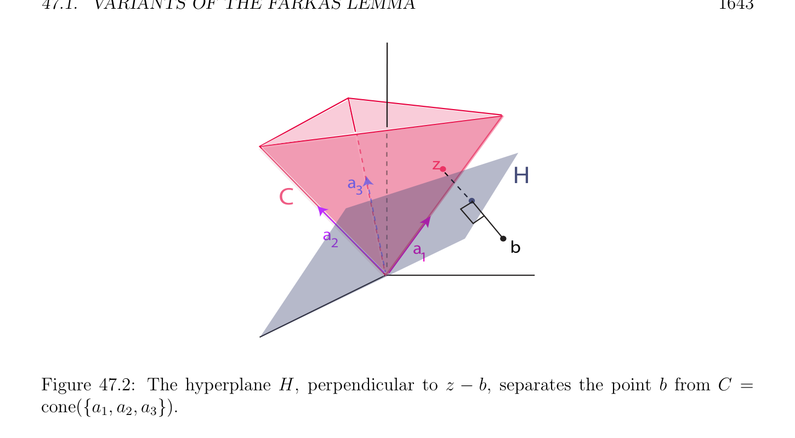

# Các biến thể của Farkas Bổ đề

<!-- PAGE 1639 -->
Chương $47$ Quy hoạch tuyến tính (linear programming) và Đối ngẫu

## 47.1 Các biến thể của Farkas Bổ đề

$$\mathbb{R}^{m}$$
Nếu $A$ là một ma trận cỡ $m \times  n$ và nếu $b \in$ là vectơ, nó là đã biết từ tuyến tính đại số rằng hệ phương trình tuyến tính Ax $= b$ có không có nghiệm khi và chỉ khi tồn tại một dạng tuyến tính (linear form) $y \in (\mathbb{R}^{m})^{*}$ sao cho yA $= 0$ và yb $\neq  0$. Điều này có nghĩa là tuyến tính từ $y$ triệt tiêu trên các cột $A^{1}, \dots  , A^{n}$ của $A$ nhưng thực hiện không triệt tiêu trên $b$. Vì dạng tuyến tính (linear form) $y$ định nghĩa tuyến tính siêu phẳng (hyperplane) $H$ của phương trình yz $= 0$ (với $z \in \mathbb{R}^{m})$, geometrically phương trình Ax $= b$ có không có nghiệm khi và chỉ khi có một tuyến tính siêu phẳng (hyperplane) $H$ chứa $A^{1}, \dots  , A^{n}$ và không chứa $b$. Điều này là loại của separation định lý rằng nói rằng rằng các vectơ $A^{1}, \dots  , A^{n}$ và $b$ có thể được được tách bởi một số tuyến tính siêu phẳng (hyperplane) $H$. Những gì ta sẽ like đến thực hiện là đến tổng quát hóa điều này loại của tiêu chuẩn, thứ nhất đến hệ Ax $= b$ subject đến các ràng buộc $x \ge 0$, và tiếp theo đến các tập hợp của bất đẳng thức các ràng buộc Ax $\le b$ và $x \ge 0$. Có thật vậy như vậy các tiêu chuẩn đi dưới name của Farkas bổ đề. then chốt là separation kết quả liên quan đến polyhedral các nón đã biết như Farkas–Minkowski mệnh đề. Ta có kết quả sau cơ bản separation bổ đề.
$$\mathbb{R}^{n} \mathbb{R}^{n}$$

> **Mệnh đề 47.1.** Cho $C \subseteq$ là đóng khác rỗng (lồi) nón. Với mọi điểm $a \in$, nếu $a \in / C$, thì có một tuyến tính siêu phẳng (hyperplane) $H$ (qua $0)$ sao cho $1. C$ lies trong một của hai các nửa không gian được xác định bởi $H. 2. a \in / H 3$. lies trong khác nửa không gian (half-space) được xác định bởi $H$. Ta nói rằng $H$ chặt tách $C$ và. Mệnh đề 47.1, mà được minh họa trong Hình 47.1, là dễ hệ quả của một cái khác separation định lý rằng khẳng định rằng cho trước bất kỳ hai khác rỗng đóng các tập lồi $A$ và $B \mathbb{R}^{n}$ của với $A$ compắc, có một siêu phẳng (hyperplane) $H$ chặt tách $A$ và $B$ (mà có nghĩa là $A \cap H = \emptyset , B \cap H = \emptyset$, rằng $A$ lies trong một của hai các nửa không gian được xác định bởi $H$,
$$1639$$

<!-- PAGE 1640 -->
Và $B$ lies trong khác nửa không gian (half-space) được xác định bởi $H)$; xem Gallier $[73]$ (Chương $7$, Hệ quả 7.4 và Mệnh đề 7.3). chứng minh này là không tầm thường và liên quan đến hình học phiên bản của Hahn–Banach định lý.
$$C$$
$$a$$
$$H$$

**Hình 47.1:** $In\mathbb{R}^{3}$, olive xanh lục siêu phẳng (hyperplane) $H$ tách nón $C$ từ cam điểm. Farkas–Minkowski mệnh đề là Mệnh đề 47.1 ứng dụng đến nón đa diện (polyhedral cone)
$$C = {\lambda_{1} a_{1} + \cdots  + \lambda_{n} a_{n} | \lambda_{i}  \ge 0, i = 1, \dots  , n}$$
Ở đâu ${a_{1}, \dots  , a_{n}}$ là hữu hạn số của các vectơ $a_{i} \in \mathbb{R}^{n}$. Theo Mệnh đề 44.2, bất kỳ nón đa diện (polyhedral cone) là đóng, do đó Mệnh đề 47.1 áp dụng và ta thu được kết quả sau separation bổ đề.
$$\mathbb{R}^{n}$$

> **Mệnh đề 47.2.** (Farkas–Minkowski) Cho $C \subseteq$ là khác rỗng nón đa diện (polyhedral cone) $C = cone({a_{1}, \dots  , a_{n}})$. Với mọi điểm $b \in \mathbb{R}^{n}$, nếu $b \in / C$, thì có một tuyến tính siêu phẳng (hyperplane) $H$ (qua $0)$ sao cho $1. C$ lies trong một của hai các nửa không gian được xác định bởi $H. 2. b \in / H 3. b$ lies trong khác nửa không gian (half-space) được xác định bởi $H$. Tương đương, có một khác không dạng tuyến tính (linear form) $y \in (\mathbb{R}^{n})^{*}$ sao cho $1. ya_{i} \ge 0$ cho $i = 1, \dots  , n. 2$. yb $< 0$.

<!-- PAGE 1641 -->
Chứng minh trực tiếp của Farkas–Minkowski mệnh đề không liên quan đến Mệnh đề 47.1 là cho trước tại kết thúc/cuối của điều này mục.
Nhận xét: Có một tổng quát hóa của Farkas–Minkowski mệnh đề áp dụng đến vô hạn dimensional thực Các không gian Hilbert; xem Định lý 48.12 (hoặc Ciarlet $[41]$, Chương $9)$. Mệnh đề 47.2 suy ra của ta thứ nhất phiên bản của Farkas’ bổ đề.

> **Mệnh đề 47.3.** (Farkas Bổ đề, Phiên bản I) Cho $A$ là một ma trận cỡ $m \times  n$ và cho $b \in \mathbb{R}^{m}$ là bất kỳ vectơ. hệ phương trình tuyến tính Ax $= b$ có không có nghiệm $x \ge 0$ khi và chỉ khi tồn tại một khác không dạng tuyến tính (linear form) $y \in (\mathbb{R}^{m})^{*}$ sao cho yA $\ge 0_{n}^{\top}$ và yb $< 0$.

*Chứng minh.* Thứ nhất giả sử rằng tồn tại một khác không dạng tuyến tính (linear form) $y \in (\mathbb{R}^{m})^{*}$ sao cho yA $\ge 0$ và yb $< 0$. Nếu $x \ge 0$ là nghiệm của Ax $= b$, thì ta thu được
$$yAx = yb,$$
Nhưng nếu yA $\ge 0$ và $x \ge 0$, thì yAx $\ge 0$, và vẫn chưa bởi giả thiết yb $< 0$, một mâu thuẫn. Tiếp theo giả sử rằng Ax $= b$ có không có nghiệm $x \ge 0$. Điều này có nghĩa là $b$ thực hiện không thuộc đến nón đa diện (polyhedral cone) $C = cone({A^{1}, \dots  , A^{n}})$ được sinh (spanned) bởi các cột của $A$. Theo Mệnh đề 47.2, có một khác không dạng tuyến tính (linear form) $y \in (\mathbb{R}^{m})^{*}$ sao cho $1. yA^{j} \ge 0$ cho $j = 1, \dots  , n. 2$. yb $< 0$, mà nói rằng rằng yA $\ge 0_{n}^{\top}$ và yb $< 0$. Tiếp theo xét solvability của hệ của các bất đẳng thức của tạo thành Ax $\le b$ và $x \ge 0$.

> **Mệnh đề 47.4.** (Farkas Bổ đề, Phiên bản II) Cho $A$ là một ma trận cỡ $m \times  n$ và cho $b \in \mathbb{R}^{m}$ là bất kỳ vectơ. hệ của các bất đẳng thức Ax $\le b$ có không có nghiệm $x \ge 0$ khi và chỉ khi tồn tại một khác không dạng tuyến tính (linear form) $y \in (\mathbb{R}^{m})^{*}$ sao cho $y \ge 0_{m}^{\top}$, yA $\ge 0_{n}^{\top}$ và yb $< 0$.

*Chứng minh.* Ta sử dụng mẹo/kỹ thuật của quy hoạch tuyến tính (linear programming) mà bao gồm của cộng “bù/lỏng các biến” $z_{i}$ đến chuyển đổi các bất đẳng thức $a_{i}x \le b_{i}$ vào các phương trình $a_{i}x + z_{i} = b_{i}$ với $z_{i} \ge 0$ đã được thảo luận chỉ trước Định nghĩa 44.9. Nếu ta cho $z = (z_{1}, \dots  , z_{m})$, hiển nhiên là hệ Ax $\le b$ có nghiệm $x \ge 0$ khi và chỉ khi phương trình
$$\begin{pmatrix} A & I_{m} \end{pmatrix} \begin{pmatrix} x \\ z \end{pmatrix} = b$$
$$has a solution \begin{pmatrix} x \\ z \end{pmatrix} with x \ge 0 and z \ge 0. Now by Farkas I, the above system has no$$
Nghiệm với với $x \ge 0$ và $z \ge 0$ khi và chỉ khi tồn tại một khác không dạng tuyến tính (linear form) $y \in (\mathbb{R}^{m})^{*}$ sao cho
$$y \begin{pmatrix} A & I_{m} \\ andyb < \end{pmatrix} \ge 0_{n+m}^{\top}$$
Và yb $< 0$, nghĩa là, yA $\ge 0_{n}^{\top} , y \ge 0_{m}^{\top}   0$.

<!-- PAGE 1642 -->
Trong mục tiếp theo ta sử dụng Farkas II để chứng minh đối ngẫu định lý trong quy hoạch tuyến tính (linear programming). Nhận thấy rằng bằng cách lấy negation của equivalence trong Farkas II ta thu được tiêu chuẩn của solvability, cụ thể là: hệ của các bất đẳng thức Ax $\le b$ có nghiệm $x \ge 0$ khi và chỉ khi với mọi khác không dạng tuyến tính (linear form) $y \in (\mathbb{R}^{m})^{*}$ sao cho $y \ge 0_{m}^{\top}$, nếu yA $\ge 0_{n}^{\top}$, thì yb $\ge 0$. Ta bây giờ chứng minh Farkas–Minkowski mệnh đề mà không có bằng cách sử dụng Mệnh đề 47.1. Điều này cách tiếp cận sử dụng cơ bản tính chất của khoảng cách hàm từ điểm đến tập đóng (closed set).
$$\mathbb{R}^{n} \mathbb{R}^{n}$$

> **Định nghĩa 47.1.** Cho $X \subseteq$ là bất kỳ khác rỗng tập hợp và cho $a \in$ là bất kỳ điểm. khoảng cách d(, $X)$ từ đến $X$ được định nghĩa như
$$d(a, X) = \inf \|a -x\|.$$
$$x\in X$$
Ở đây, $\|\|$ ký hiệu Euclidean chuẩn (norm).
$$\mathbb{R}^{n} \mathbb{R}^{n}$$

> **Mệnh đề 47.5.** Cho $X \subseteq$ là bất kỳ khác rỗng tập hợp và cho $a \in$ là bất kỳ điểm. Nếu $X$ là đóng, thì tồn tại một $z \in X$ sao cho $\|a$ - $z\| =$ d(, $X)$.

*Chứng minh.* Vì $X$ là khác rỗng, chọn bất kỳ $x_{0} \in X$, và cho $r = \|a$ - $x_{0}\|$. Nếu $B_{r}(a)$ là đóng
$$\mathbb{R}^{n}$$
Hình cầu $B_{r}(a) = {x \in$ | $\|x$ - $a\|\le r}$, thì rõ ràng
$$d(a, X) = \inf \|a -x\|=\inf \|a -x\|.$$
$$x\in Xx\in X\cap Br(a)$$
Vì $B_{r}(a)$ là compắc và $X$ là đóng, $K = X \cap B_{r}(a)$ là cũng compắc. Nhưng hàm $x \mapsto \|a$ - $x\|$ được định nghĩa trên tập compắc (compact set) $K$ là liên tục, và ảnh (image) của tập compắc (compact set) bởi hàm liên tục (continuous function) là compắc, do đó bởi Heine–Borel nó có cực tiểu rằng là đạt được bởi một số $z \in K \subseteq X$.
Nhận xét: Nếu $U$ là khác rỗng, đóng và lồi tập con của Không gian Hilbert (Hilbert space) $V$, tiêu chuẩn kết quả của Không gian Hilbert (Hilbert space) lý thuyết (phép chiếu bổ đề, xem Mệnh đề 48.5) khẳng định rằng với mọi $v \in V$ tồn tại duy nhất một $p \in U$ sao cho
$$\|v -p\|= \inf \|v -u\|= d(v, U),$$
$$u\in U$$
Và
$$\langle p -v, u -p\rangle \ge 0for all u \in U.$$
Ở đây $\|w\| = p\overline{\langle}\overline{w, w}\overline{\rangle}$, ở đâu $\langle$ -, $-\rangle$ là tích vô hướng (inner product) của Không gian Hilbert (Hilbert space) $V$. Ta có thể bây giờ cho chứng minh của Farkas–Minkowski mệnh đề (Mệnh đề 47.2) rằng thực hiện không sử dụng Mệnh đề 47.1. chứng minh này được điều chỉnh từ Matousek và Gardner $[127]$ (Chương $6$, Các mục 6.5).

<!-- PAGE 1643 -->
$$z$$
$$H$$
$$a_{3}$$
$$C$$
$$a_{2}$$
$$a_{1}b$$

**Hình 47.2:** siêu phẳng (hyperplane) $H$, vuông góc đến $z$ - $b$, tách điểm $b$ từ $C = cone({a_{1}, a_{2}, a_{3}})$. Chứng minh của Farkas–Minkowski mệnh đề. Cho $C = cone({a_{1}, \dots  , a_{m}})$ là nón đa diện (polyhedral cone) (khác rỗng) và giả sử rằng $b \in / C$. Theo Mệnh đề 44.2, nón đa diện (polyhedral cone) là đóng, và theo Mệnh đề 47.5 tồn tại một $z \in C$ sao cho d(b, $C) = \|b$ - $z\|$; nghĩa là, $z$ là điểm của $C$ closest đến $b$. Vì $b \in / C$ và $z \in C$ ta có $u = z$ - $b \neq  0$, và ta khẳng định rằng tuyến tính siêu phẳng (hyperplane) $H$ trực giao đến $u$ thực hiện job, như được minh họa trong Hình 47.2. Thứ nhất cho chúng ta chỉ ra rằng
$$\langle u, z\rangle = \langle z -b, z\rangle = 0.(*_{1})$$
Điều này là tầm thường nếu $z = 0$, do đó giả sử $z \neq  0$. Nếu $\langle u, z\rangle$ ̸ $= 0$, thì hoặc $\langle u, z\rangle > 0$ hoặc $\langle u, z\rangle < 0$. Trong hoặc trường hợp ta chỉ ra rằng ta có thể tìm một số điểm z' $\in C$ closer đến $b$ hơn $z$ là, một mâu thuẫn. Trường hợp $1: \langle u, z\rangle > 0$. Cho z' $= (1$ - $\alpha )z$ với mọi $\alpha$ sao cho $0 < \alpha  < 1$. Thì z' $\in C$ và vì $u = z$ - $b$,
$$z'-b = (1 -\alpha )z -(z -u) = u -\alpha z,$$
Do đó
$$\|z'-b\|^{2}= \|u -\alpha z\|^{2}= \|u\|^{2}-2\alpha \langle u, z\rangle + \alpha^{2} \|z\|^{2}.$$
Nếu ta chọn $\alpha  > 0$ sao cho $\alpha  < 2\langle u, z\rangle / \|z\|^{2}$, thì $-2\alpha \langle u, z\rangle + \alpha^{2} \|z\|^{2} < 0$, do đó $\|z'$ - $b\|^{2} < \|u\|^{2} = \|z$ - $b\|^{2}$, contradicting sự kiện rằng $z$ là điểm của $C$ closest đến $b$. Trường hợp $2: \langle u, z\rangle < 0$. Cho z' $= (1 + \alpha )z$ với mọi $\alpha$ sao cho $\alpha  \ge -1$. Thì z' $\in C$ và vì $u = z -b$, ta có z' - $b = (1 + \alpha )z$ - $(z$ - $u) = u + \alpha z$ do đó
$$\|z'-b\|^{2}= \|u + \alpha z\|^{2}= \|u\|^{2}+ 2\alpha \langle u, z\rangle + \alpha^{2} \|z\|^{2},$$

<!-- PAGE 1644 -->
Và nếu
$$0 < \alpha  < -2\langle u, z\rangle / \|z\|^{2},$$
Thì $2\alpha \langle u, z\rangle + \alpha^{2} \|z\|^{2} < 0$, do đó $\|z'$ - $b\|^{2} < \|u\|^{2} = \|z$ - $b\|^{2}$, một mâu thuẫn như ở trên. Vì vậy $\langle u, z\rangle = 0$. Ta có
$$\langle u, u\rangle = \langle u, z -b\rangle = \langle u, z\rangle -\langle u, b\rangle = -\langle u, b\rangle ,$$
Và vì $u \neq  0$, ta có $\langle u, u\rangle > 0$, do đó $\langle u, u\rangle = -\langle u, b\rangle$ suy ra rằng
$$\langle u, b\rangle < 0.(*_{2})$$
Nó vẫn còn để chứng minh rằng $\langle u, a_{i}\rangle \ge 0$ cho $i = 1, \dots  , m$. Chọn bất kỳ $x \in C$ sao cho $x \neq  z$. Ta khẳng định rằng
$$\langle b -z, x -z\rangle \le 0.(*_{3})$$
Ngược lại $\langle b$ - $z, x$ - $z\rangle > 0$, nghĩa là, $\langle z$ - $b, x$ - $z\rangle < 0$, và ta chỉ ra rằng ta có thể tìm một số điểm z' $\in C$ trên đường thẳng đoạn thẳng $[z, x]$ closer đến $b$ hơn $z$ là. Với mọi $\alpha$ sao cho $0 \le \alpha  \le 1$, ta có z' $= (1$ - $\alpha )z + \alpha x = z + \alpha (x$ - $z) \in C$, và vì z' - $b = z$ - $b + \alpha (x$ - $z)$ ta có
$$\|z'-b\|^{2}= \|z -b + \alpha (x -z)\|^{2}= \|z -b\|^{2}+ 2\alpha \langle z -b, x -z\rangle + \alpha^{2} \|x -z\|^{2},$$
Do đó với mọi $\alpha  > 0$ sao cho
$$\alpha  < -2\langle z -b, x -z\rangle / \|x -z\|^{2},$$
Ta có $2\alpha \langle z$ - $b, x$ - $z\rangle + \alpha^{2} \|x$ - $z\|^{2} < 0$, mà suy ra rằng $\|z'$ - $b\|^{2} < \|z$ - $b\|^{2}$, contradicting rằng $z$ là điểm của $C$ closest đến $b$. Vì $\langle b$ - $z, x$ - $z\rangle \le 0, u = z$ - $b$, và bởi $(*_{1}), \langle u, z\rangle = 0$, ta có
$$0 \ge \langle b -z, x -z\rangle = \langle -u, x -z\rangle = -\langle u, x\rangle + \langle u, z\rangle = -\langle u, x\rangle ,$$
Mà có nghĩa là
$$\langle u, x\rangle \ge 0for all x \in C,(*_{3})$$
Như đã khẳng định. Đặc biệt,
$$\langle u, a_{i}\rangle \ge 0for i = 1, \dots  , m.(*_{4})$$
Thì bởi $(*_{2})$ và $(*_{4})$, dạng tuyến tính (linear form) được định nghĩa bởi $y = u^{\top}$ thỏa mãn các tính chất yb $< 0$ và $ya_{i} \ge 0$ cho $i = 1, \dots  , m$, mà chứng minh Farkas–Minkowski mệnh đề. Có khác các cách của chứng minh Farkas–Minkowski mệnh đề, chẳng hạn bằng cách sử dụng một cách tối tiểu infeasible các hệ hoặc Fourier–Motzkin phép khử; xem Matousek và Gardner $[127]$ (Chương $6$, Các mục 6.6 và 6.7).
