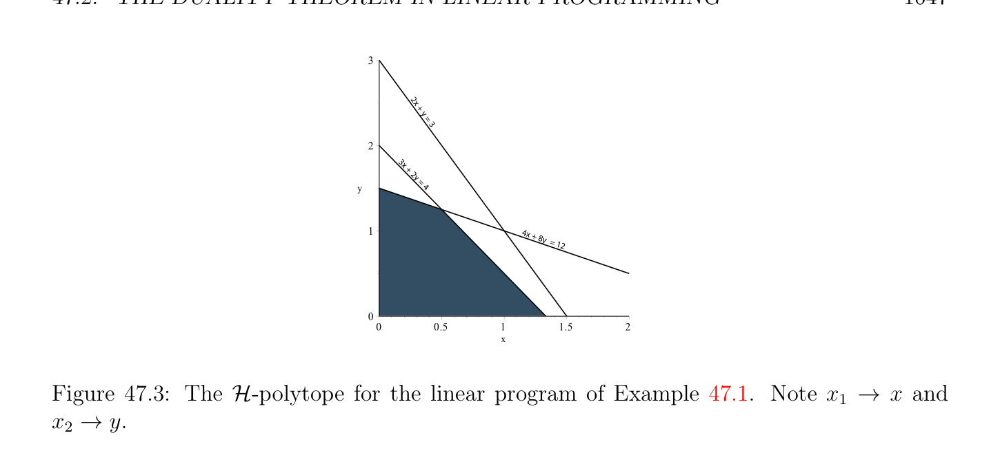
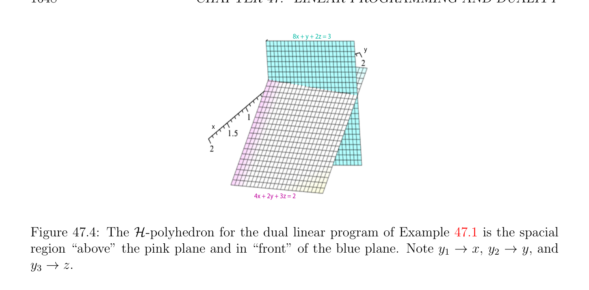

# Đối ngẫu Định lý trong Quy hoạch tuyến tính (linear programming)

<!-- PAGE 1645 -->

## 47.2 Đối ngẫu Định lý trong Quy hoạch tuyến tính (linear programming)

Cho $(P)$ là bài toán quy hoạch tuyến tính (linear program)
$$maximizecx$$
$$subject toAx \le b and x \ge 0,$$
Với $A$ một ma trận cỡ $m \times  n$, và giả sử rằng $(P)$ có nghiệm chấp nhận được (feasible solution) và là bị chặn ở trên. Vì bởi giả thiết hàm mục tiêu (objective function) $x \mapsto$ cx là bị chặn $on\mathcal{P}(A, b)$, nó có thể là hữu ích để suy ra trên cận cho cx từ các bất đẳng thức Ax $\le b$, với mọi $x \in$ P(, $b)$. Ta có thể thực hiện điều này như sau: với mọi bất đẳng thức
$$a_{i}x \le b_{i}1 \le i \le m,$$
Chọn không âm vô hướng (scalar) $y_{i}$, nhân cả hai vế của ở trên bất đẳng thức bởi $y_{i}$ thu được
$$y_{i}a_{i}x \le y_{i}b_{i}1 \le i \le m,$$
(hướng của bất đẳng thức được bảo toàn vì $y_{i} \ge 0)$, và thì cộng lên các phần tử này $m$ các phương trình, mà cho ta
$$(y_{1}a_{1} + \cdots  + y_{m}a_{m})x \le y_{1}b_{1} + \cdots  + y_{m}b_{m}.$$
Nếu ta có thể chọn $y_{i} \ge 0$ sao cho
$$c \le y_{1}a_{1} + \cdots  + y_{m}a_{m},$$
Khi đó vì $x_{j} \ge 0$, ta có
$$cx \le (y_{1}a_{1} + \cdots  + y_{m}a_{m})x \le y_{1}b_{1} + \cdots  + y_{m}b_{m},$$
Cụ thể là ta tìm thấy trên cận của giá trị cx của hàm mục tiêu (objective function) của $(P)$ với mọi nghiệm chấp nhận được (feasible solution) $x \in$ P(, $b)$. Nếu ta cho $y$ là dạng tuyến tính (linear form) $y = (y_{1}, \dots  , y_{m})$, khi đó vì
$$A = \begin{pmatrix} a_{1} \\ \vdots \\ a_{m} \end{pmatrix}$$
$y_{1}a_{1} + \cdots  + y_{m}a_{m} =$ yA, và $y_{1}b_{1} + \cdots  + y_{m}b_{m} =$ yb, những gì ta đã thực hiện đã là đến nhìn với một số $y \in (\mathbb{R}^{m})^{*}$ sao cho
$$c \le yA,y \ge 0,$$
Sao cho ta có
$$cx \le ybfor all x \in P(A, b).(*)$$
Thì nó là tự nhiên đến nhìn cho “tốt nhất” giá trị của yb, cụ thể là cực tiểu giá trị, mà dẫn đến đến định nghĩa của đối ngẫu (dual) của bài toán quy hoạch tuyến tính (linear program) $(P)$, khái niệm do John von Neumann.

<!-- PAGE 1646 -->

> **Định nghĩa 47.2.** Cho trước bất kỳ Bài toán quy hoạch tuyến tính (linear program) $(P)$
$$maximizecx$$
$$subject toAx \le b and x \ge 0,$$
Với $A$ một ma trận cỡ $m \times  n$, đối ngẫu (dual) $(D)$ của $(P)$ là sau đây tối ưu hóa bài toán:
$$minimizeyb$$
$$subject toyA \ge c and y \ge 0,$$
Ở đâu $y \in (\mathbb{R}^{m})^{*}$. các biến $y_{1}, \dots  , y_{m}$ được gọi là đối ngẫu (dual) các biến. ban đầu Bài toán quy hoạch tuyến tính (linear program)
$(P)$ được gọi là gốc (primal) bài toán quy hoạch tuyến tính (linear program) và ban đầu các biến $x_{1}, \dots  , x_{n}$ là gốc (primal) các biến. Ở đây là tường minh ví dụ của bài toán quy hoạch tuyến tính (linear program) và đối ngẫu (đối ngẫu (dual)) của nó.

> **Ví dụ 47.1.** Xét bài toán quy hoạch tuyến tính (linear program) được minh họa bởi Hình 47.3
$$maximize2x_{1} + 3x_{2}$$
$$subject to$$
$$4x_{1} + 8x_{2} \le 12$$
$$2x_{1} + x_{2} \le 3$$
$$3x_{1} + 2x_{2} \le 4$$
$$x_{1} \ge 0, x_{2} \ge 0.$$
Đối ngẫu (đối ngẫu (dual)) của nó bài toán quy hoạch tuyến tính (linear program) được minh họa trong Hình 47.4
$$minimize12y_{1} + 3y_{2} + 4y_{3}$$
$$subject to$$
$$4y_{1} + 2y_{2} + 3y_{3} \ge 2$$
$$8y_{1} + y_{2} + 2y_{3} \ge 3$$
$$y_{1} \ge 0, y_{2} \ge 0, y_{3} \ge 0.$$
Nó có thể được đã kiểm tra rằng $(x_{1}, x_{2}) = (1/2, 5/4)$ là nghiệm tối ưu (optimal solution) của gốc (primal) bài toán quy hoạch tuyến tính (linear program), với cực đại giá trị của hàm mục tiêu (objective function) $2x_{1} + 3x_{2}$ bằng $19/4$, và rằng $(y_{1}, y_{2}, y_{3}) = (5/16, 0, 1/4)$ là nghiệm tối ưu (optimal solution) của đối ngẫu (dual) bài toán quy hoạch tuyến tính (linear program), với cực tiểu giá trị của hàm mục tiêu (objective function) $12y_{1} + 3y_{2} + 4y_{3}$ cũng bằng $19/4$. Nhận thấy rằng trong Gốc (primal) Bài toán quy hoạch tuyến tính (linear program) $(P)$, ta là nhìn cho vectơ $x \in \mathbb{R}^{n}$ cực đại hóa tạo thành cx, và rằng các ràng buộc được xác định bởi action của các hàng của ma trận $A$ trên $x$. Mặt khác, trong Đối ngẫu (dual) Bài toán quy hoạch tuyến tính (linear program) $(D)$, ta là nhìn
$$\mathbb{R}^{*}$$
Cho dạng tuyến tính (linear form) $y \in$ ($)^{m}$ cực tiểu hóa tạo thành yb, và các ràng buộc được xác định bởi

<!-- PAGE 1647 -->
$$3$$
$$2x + y = 3$$
$$2$$
$$3x$$
$$+ 2$$
$$y =$$
$$y 4$$
$$14x + 8y$$
$$= 12$$
$$0$$
$$\overline{0}\overline{0.5}\overline{1}\overline{1.5}\overline{2}$$
$$x$$

**Hình 47.3:** $\mathcal{H}-polytope$ cho bài toán quy hoạch tuyến tính (linear program) của Ví dụ 47.1. Lưu ý $x_{1} \to x$ và $x_{2} \to y$. action của $y$ trên các cột của $A$. Điều này là nghĩa trong mà $(D)$ là đối ngẫu (dual) $(P)$. Trong hầu hết các trình bày, sự kiện rằng $(P)$ và $(D)$ perform search cho nghiệm trong các không gian rằng là đối ngẫu (dual) đến mỗi khác là obscured bởi excessive sử dụng của phép chuyển vị. Đến chuyển đổi Đối ngẫu (dual) Bài toán quy hoạch $(D)$ đến tiêu chuẩn cực đại hóa bài toán ta thay đổi hàm mục tiêu (objective function) yb đến $-b^{\top}y^{\top}$ và bất đẳng thức yA $\ge c$ đến $-A^{\top}y^{\top} \le -c^{\top}$. Đối ngẫu (dual) Bài toán quy hoạch tuyến tính (linear program) $(D)$ là bây giờ được phát biểu như (D')
$$maximize-b^{\top}y^{\top}$$
$$subject to-A^{\top}y^{\top}\le -c^{\top}and y^{\top}\ge 0,$$
Ở đâu $y \in (\mathbb{R}^{m})^{*}$. Nhận thấy rằng đối ngẫu (dual) trong cực đại hóa tạo thành (D'') của Đối ngẫu (dual) Bài toán quy hoạch (D') cho quay lại Gốc (primal) Bài toán quy hoạch $(P)$. ở trên thảo luận được thiết lập sau đây bất đẳng thức đã biết như đối ngẫu yếu (weak duality).

> **Mệnh đề 47.6.** (Đối ngẫu yếu (weak duality)) Cho trước bất kỳ Bài toán quy hoạch tuyến tính (linear program) $(P)$
$$maximizecx$$
$$subject toAx \le b and x \ge 0,$$
$$\mathbb{R}^{n}$$
Với $A$ một ma trận cỡ $m \times  n$, với mọi nghiệm chấp nhận được (feasible solution) $x \in$ của Bài toán gốc (primal problem) $(P)$ và mọi nghiệm chấp nhận được (feasible solution) $y \in (\mathbb{R}^{m})^{*}$ của Bài toán đối ngẫu (dual problem) $(D)$, ta có
$$cx \le yb.$$

> **Định nghĩa 47.3.** Ta nói rằng Đối ngẫu (dual) Bài toán quy hoạch tuyến tính (linear program) $(D)$ là bị chặn ở dưới nếu ${yb$ | $y^{\top} \in P(-A^{\top}, -c^{\top})}$ là bị chặn ở dưới.

<!-- PAGE 1648 -->
$$8x + y + 2z = 3$$
$$y$$
$$x$$
$$4x + 2y + 3z = 2$$

**Hình 47.4:** $\mathcal{H}-polyhedron$ cho đối ngẫu (dual) bài toán quy hoạch tuyến tính (linear program) của Ví dụ 47.1 là spacial miền “ở trên” hồng mặt phẳng và trong “trước” của xanh lam mặt phẳng. Lưu ý $y_{1} \to x, y_{2} \to y$, và $y_{3} \to z$. Những gì xảy ra nếu $x^{*}$ là nghiệm tối ưu (optimal solution) của $(P)$ và nếu $y^{*}$ là nghiệm tối ưu (optimal solution) của $(D)$? Ta có $cx^{*} \le y^{*}b$, nhưng là ở đó “khoảng cách đối ngẫu (duality gap),” rằng là, là nó khả dĩ/có thể rằng $cx^{*} < y^{*}b$? câu trả lời là không có, điều này là đối ngẫu mạnh (strong duality) định lý. Thực sự, đối ngẫu mạnh (strong duality) định lý asserts nhiều hơn điều này.

> **Định lý 47.7.** (Đối ngẫu mạnh (strong duality) cho Quy hoạch tuyến tính (linear programming)) Cho $(P)$ là bất kỳ bài toán quy hoạch tuyến tính (linear program)
$$maximizecx$$
$$subject toAx \le b and x \ge 0,$$
Với $A$ một ma trận cỡ $m \times  n$. Bài toán gốc (primal problem) $(P)$ có nghiệm chấp nhận được (feasible solution) và là bị chặn ở trên khi và chỉ khi Bài toán đối ngẫu (dual problem) $(D)$ có nghiệm chấp nhận được (feasible solution) và là bị chặn ở dưới. Hơn nữa, nếu
$(P)$ có nghiệm chấp nhận được (feasible solution) và là bị chặn ở trên, thì với mọi nghiệm tối ưu (optimal solution) $x^{*}$ của $(P)$ và mọi nghiệm tối ưu (optimal solution) $y^{*}$ của $(D)$, ta có
$$cx^{*}= y^{*}b.$$

*Chứng minh.* Nếu $(P)$ có nghiệm chấp nhận được (feasible solution) và là bị chặn ở trên, thì ta biết từ Mệnh đề 45.1 rằng $(P)$ có một số nghiệm tối ưu (optimal solution). Cho $x^{*}$ là bất kỳ nghiệm tối ưu (optimal solution) của $(P)$. Thứ nhất ta sẽ chỉ ra rằng $(D)$ có nghiệm chấp nhận được (feasible solution) $v$. Cho $\mu  = cx^{*}$ là cực đại của hàm mục tiêu (objective function) $x \mapsto$ cx. Thì với mọi $\epsilon  > 0$, hệ của các bất đẳng thức
$$Ax \le b,x \ge 0,cx \ge \mu  + \epsilon$$
Có không có nghiệm, vì ngược lại $\mu$ sẽ không là cực đại giá trị của hàm mục tiêu (objective function) cx. Ta sẽ like để áp dụng Farkas II, do đó thứ nhất ta biến đổi ở trên hệ của các bất đẳng thức

<!-- PAGE 1649 -->
Vào hệ
$$\begin{pmatrix} A \\ -c \end{pmatrix} x \le \begin{pmatrix} b \\ -(\mu  + \epsilon ) \end{pmatrix} .$$
Theo Mệnh đề 47.4 (Farkas II), tồn tại một dạng tuyến tính (linear form) $(\lambda , z) \in (\mathbb{R}^{m+1})^{*}$ sao cho $\lambda  \ge 0, z \ge 0$,
$$\begin{pmatrix} \lambda & z \end{pmatrix} \begin{pmatrix} A \\ -c \end{pmatrix} \ge 0_{m}^{\top},$$
Và
$$\begin{pmatrix} \lambda & z \end{pmatrix} \begin{pmatrix} b \\ -(\mu  + \epsilon ) \end{pmatrix} < 0,$$
Mà có nghĩa là
$$\lambda A -zc \ge 0_{m}^{\top},\lambda b -z(\mu  + \epsilon ) < 0,$$
Rằng là,
$$\lambda A \ge zc$$
$$\lambda b < z(\mu  + \epsilon )$$
$$\lambda  \ge 0, z \ge 0.$$
Mặt khác, vì $x^{*} \ge 0$ là nghiệm tối ưu (optimal solution) của hệ Ax $\le b$, bởi Farkas II một lần nữa (bằng cách lấy negation của equivalence), vì $\lambda A \ge 0$ (cho cùng $\lambda$ như trước), ta phải có
$$\lambda b \ge 0.(*_{1})$$
Ta khẳng định rằng $z > 0$. Ngược lại, vì $z \ge 0$, ta phải có $z = 0$, nhưng khi đó
$$\lambda b < z(\mu  + \epsilon )$$
Suy ra
$$\lambda b < 0,(*_{2})$$
Và vì $\lambda b \ge 0$ bởi $(*_{1})$, ta có một mâu thuẫn. Hệ quả là, ta có thể chia bởi $z > 0$ mà không có thay đổi hướng của các bất đẳng thức, và ta thu được
$$\lambda$$
$$z A \ge c$$
$$\lambda$$
$$z b < \mu  + \epsilon$$
$$\frac{\lambda}{z} \ge 0,$$
Mà chỉ ra rằng $v = \lambda /z$ là nghiệm chấp nhận được (feasible solution) của Bài toán đối ngẫu (dual problem) $(D)$. Tuy nhiên, đối ngẫu yếu (weak duality) (Mệnh đề 47.6) suy ra rằng $cx^{*} = \mu  \le$ yb với mọi nghiệm chấp nhận được (feasible solution) $y \ge 0$ của Đối ngẫu (dual) Bài toán quy hoạch $(D)$, do đó $(D)$ là bị chặn ở dưới và theo Mệnh đề 45.1 ứng dụng đến phiên bản của $(D)$ được viết như cực đại hóa bài toán, ta kết luận rằng $(D)$ có một số nghiệm tối ưu (optimal solution).

<!-- PAGE 1650 -->
Với mọi nghiệm tối ưu (optimal solution) $y^{*}$ của $(D)$, vì $v$ là nghiệm chấp nhận được (feasible solution) của $(D)$ sao cho vb $< \mu  + \epsilon$, ta phải có
$$\mu  \le y^{*}b < \mu  + \epsilon ,$$
Và vì của ta lập luận là hợp lệ với mọi $\epsilon  > 0$, ta kết luận rằng $cx^{*} = \mu  = y^{*}b$. Nếu ta giả sử rằng đối ngẫu (dual) bài toán quy hoạch $(D)$ có nghiệm chấp nhận được (feasible solution) và là bị chặn ở dưới, vì đối ngẫu (dual) của $(D)$ là $(P)$, ta kết luận rằng $(P)$ là cũng chấp nhận được (feasible) và bị chặn ở trên. đối ngẫu mạnh (strong duality) định lý có thể cũng được chứng minh bởi đơn hình (simplex) phương pháp, bởi vì khi nó kết thúc với nghiệm tối ưu (optimal solution) của $(P)$, cuối cùng bảng đơn hình (tableau) cũng produces nghiệm tối ưu (optimal solution) $y$ của $(D)$ rằng có thể được read offthe rút gọn chi phí của các cột $n + 1, \dots  , n + m$ bởi flipping của chúng các dấu. Ta suy ra chứng minh trong Ciarlet $[41]$ (Chương $10)$.

> **Định lý 47.8.** Xét Bài toán quy hoạch tuyến tính (linear program) $(P)$,
$$maximizecx$$
$$subject toAx \le b and x \ge 0,$$
Của nó tương đương phiên bản (P2) trong tiêu chuẩn tạo thành,
$$maximizecx$$
$$b b$$
$$subject toAx = b andx \ge 0,$$
$$bb b$$
Ở đâu $A$ là một ma trận cỡ $m \times  (n + m)$, $c$ là dạng tuyến tính (linear form) trong $(\mathbb{R}^{n+m})^{*}$, và $x \in \mathbb{R}^{n+m}$, cho trước bởi $b  b  b$
$$Ab = \begin{pmatrix} A & I_{m} \end{pmatrix} ,bc = \begin{pmatrix} c & 0_{m}^{\top} \end{pmatrix} ,x = \begin{pmatrix} x_{1} \\ \vdots \\ x_{n} \end{pmatrix} ,\overline{x} = \begin{pmatrix} x_{n+1} \\ \vdots \\ x_{n+m} \end{pmatrix} ,xb = \begin{pmatrix} x \\ \overline{x} \end{pmatrix} ,$$
Và Đối ngẫu (dual) $(D)$ của $(P)$ cho trước bởi
$$minimizeyb$$
$$subject toyA \ge c and y \ge 0,$$
Ở đâu $y \in (\mathbb{R}^{m})^{*}$. Nếu thuật toán đơn hình (simplex algorithm) ứng dụng đến Bài toán quy hoạch tuyến tính (linear program) (P2) kết thúc với nghiệm tối ưu (optimal solution) $(u^{*}, K^{*})$, ở đâu $u^{*}$ là cơ bản nghiệm chấp nhận được (feasible solution) và $K^{*}$ là cơ sở (basis) cho
$$b b$$
$u^{*}$, thì $y^{*} = c_{K*}A_{K*}^{-1}$ là nghiệm tối ưu (optimal solution) cho $(D)$ sao cho $cu^{*} = y^{*}b$. Hơn nữa, $y^{*} b  b b  b b$ là cho trước theo rút gọn chi phí bởi $y^{*} = -((\overline{c}_{K*})_{n+1} \dots  (\overline{c}_{K*})_{n+m})$.

*Chứng minh.* Ta biết rằng $K^{*}$ là tập con của ${1, \dots  , n + m}$ bao gồm của $m$ các chỉ số sao cho tương ứng các cột của $A$ là độc lập tuyến tính (linearly independent). Cho $N^{*} = {1, \dots  , n + m}$ - $K^{*}$.
$$b$$
Đơn hình (simplex) phương pháp kết thúc với nghiệm tối ưu (optimal solution) trong Trường hợp $(A)$, cụ thể là khi
$$bc_{j} - \sum_{k\in k}  \gamma_{k}^{j} bc_{k} \le 0for all j \in N^{*} ,$$

<!-- PAGE 1651 -->
$$where A^{j}b= \sum_{k}  \in K*\gamma_{k}^{j}  A^{k}b, or using the notations of Section 46.3,$$
$$c_{j} -c_{K*}A_{K*}^{-1}A^{j}\le 0for all j \in N^{*} .$$
$$bbbb$$
Ở trên các bất đẳng thức có thể được viết dưới dạng
$$c_{N*}-c_{K*}A_{K*}^{-1}A_{N*}\le 0_{n}^{\top} ,$$
$$bbbb$$
Hoặc tương đương như
$$c_{K*}A_{K*}^{-1}A_{N*}\ge c_{N*}.(*_{1})$$
$$bbbb$$
Giá trị của hàm mục tiêu (objective function) cho nghiệm tối ưu (optimal solution) $u^{*}$ là $cu^{*} = c_{K*}u_{K*}^{*}$, và vì
$$b b b bb$$
$u_{K*}^{*}$ thỏa mãn phương trình $A_{K*}u_{K*}^{*} = b$, giá trị của hàm mục tiêu (objective function) là $b  b b$
$$c_{K*}u_{K*}^{*}=c_{K*}A_{K*}^{-1}b.(*_{2})$$
$$bb bb$$
Thì nếu ta cho $y^{*} = c_{K*}A_{K*}^{-1}$, hiển nhiên ta có $y^{*}b = c_{K*}u_{K*}$, do đó nếu ta có thể chứng minh rằng $y^{*}$ là
$$bb bb$$
Nghiệm chấp nhận được (feasible solution) của Đối ngẫu (dual) Bài toán quy hoạch tuyến tính (linear program) $(D)$, bởi đối ngẫu yếu (weak duality), $y^{*}$ là nghiệm tối ưu (optimal solution) của $(D)$. Ta có
$$y^{*}A_{K*}=c_{K*}A_{K*}^{-1}A_{K*}=c_{K*},(*_{3})$$
$$b bbb b$$
Và bởi $(*_{1})$ ta thu được
$$y^{*}A_{N*}=c_{K*}A_{K*}^{-1}A_{N*}\ge c_{N*}.(*_{4})$$
$$b bbbb$$
Cho $P$ là $(n + m) \times  (n + m)$ hoán vị ma trận được định nghĩa sao cho
$$A P =P =.$$
$$b \begin{pmatrix} A & I_{m} \end{pmatrix} \begin{pmatrix} A_{K*}b & A_{N*}b \end{pmatrix}$$
Thì ta cũng có
$$bc P = \begin{pmatrix} c & 0_{m}^{\top} \\ obtain \end{pmatrix} P = \begin{pmatrix} c_{K*} & c_{N*} \\ b & b \end{pmatrix} .$$
Bằng cách sử dụng Các phương trình $(*_{3})$ và $(*_{4})$ ta
$$y^{*} \begin{pmatrix} A_{K*}b & A_{N*}b \end{pmatrix} \ge \begin{pmatrix} c_{K*} & c_{N*} \\ b & b \end{pmatrix} ,$$
Rằng là,
$$y^{*} \begin{pmatrix} A & I_{m} \end{pmatrix} P \ge \begin{pmatrix} c & 0_{m}^{\top} \end{pmatrix} P,$$
Mà là tương đương đến
$$y^{*} \begin{pmatrix} A & I_{m} \end{pmatrix} \ge \begin{pmatrix} c & 0_{m}^{\top} \end{pmatrix} ,$$
Rằng là
$$y^{*}A \ge c,y \ge 0,$$
Và các phần tử này là chính xác các điều kiện rằng nói rằng $y^{*}$ là nghiệm chấp nhận được (feasible solution) của Đối ngẫu (dual) Bài toán quy hoạch $(D)$.

<!-- PAGE 1652 -->
Rút gọn chi phí được cho bởi $(c_{K*})_{i} = c_{i}$ - $c_{K*}A_{K*}^{-1}A^{i}$, cho $i = 1, \dots  , n + m$. Nhưng cho
$$b bbbb$$
$i = n + j$ với $j = 1, \dots  , m$ mỗi cột $A^{n+j}$ là vectơ thứ $j$ của ma trận đơn vị (identity matrix) $I_{m}$
$$b$$
Và theo Định nghĩa $c_{n+j} = 0$, do đó
$$b$$
$$(c_{K*})_{n+j} = -(c_{K*}A_{K*}^{-1})_{j} = -y_{j}^{*}j = 1, \dots  , m,$$
$$bbb$$
Như đã khẳng định. sự kiện rằng ở trên chứng minh là fairly ngắn là deceptive bởi vì chứng minh này relies trên sự kiện rằng có các phiên bản của thuật toán đơn hình (simplex algorithm) bằng cách sử dụng phần tử trụ (pivot) các quy tắc rằng ngăn cản cycling, nhưng chứng minh rằng như vậy phần tử trụ (pivot) các quy tắc hoạt động/công trình một cách chính xác là khá lengthy. Khác các chứng minh là cho trước trong Matousek và Gardner $[127]$ (Chương $6$, Các mục 6.3), Chvatal $[40]$ (Chương $5)$, và Papadimitriou và Steiglitz $[139]$ (Mục 2.7). Nhận thấy rằng vì cuối cùng $m$ các hàng của cuối cùng bảng đơn hình (tableau) là thực sự thu được bởi multipling $[u A]$ bởi $A_{K*}^{-1}$, ma trận cỡ $m\times m$ bao gồm của cuối cùng $m$ các cột và cuối cùng $m$ các hàng của cuối cùng $b  b$ bảng đơn hình (tableau) là $A_{K*}^{-1}$ (basically, thuật toán đơn hình (simplex algorithm) có performed các bước của Gauss–Jordan
$$b$$
Reduction). sự kiện này cho phép saving một số các bước trong gốc (primal) đối ngẫu (dual) phương pháp. Bởi combining đối ngẫu yếu (weak duality) và đối ngẫu mạnh (strong duality), ta thu được kết quả sau định lý mà chỉ ra rằng chính xác bốn các trường hợp phát sinh.

> **Định lý 47.9.** (Đối ngẫu Định lý của Quy hoạch tuyến tính (linear programming)) Cho $(P)$ là bất kỳ bài toán quy hoạch tuyến tính (linear program)
$$maximizecx$$
$$subject toAx \le b and x \ge 0,$$
Và cho $(D)$ là đối ngẫu (đối ngẫu (dual)) của nó bài toán quy hoạch
$$minimizeyb$$
$$subject toyA \ge c and y \ge 0,$$
Với $A$ một ma trận cỡ $m \times  n$. Thì chính xác một của sau đây các khả năng xảy ra:
$(1)$ Không $(P)$ cũng không $(D)$ có nghiệm chấp nhận được (feasible solution).
$(2) (P)$ là không bị chặn và $(D)$ có không có nghiệm chấp nhận được (feasible solution).
$(3) (P)$ có không có nghiệm chấp nhận được (feasible solution) và $(D)$ là không bị chặn.
$(4)$ Cả hai $(P)$ và $(D)$ có nghiệm chấp nhận được (feasible solution). Thì cả hai có nghiệm tối ưu (optimal solution), và với mọi nghiệm tối ưu (optimal solution) $x^{*}$ của $(P)$ và mọi nghiệm tối ưu (optimal solution) $y^{*}$ của $(D)$, ta có
$$cx^{*}= y^{*}b.$$
Thú vị hệ quả của Định lý 47.9 là rằng có một test để xác định liệu Bài toán quy hoạch tuyến tính (linear program) $(P)$ có nghiệm tối ưu (optimal solution).
