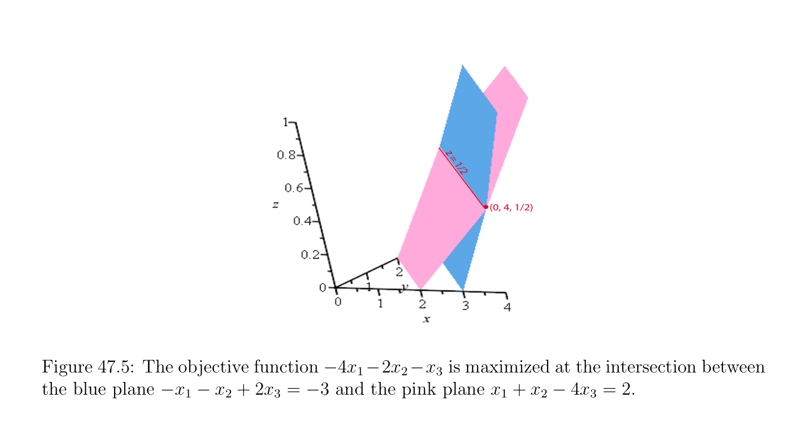

# Đối ngẫu (dual) Thuật toán đơn hình (simplex algorithm)

<!-- PAGE 1657 -->
Và đến phiên bản của $(D)$ cho trước bởi
$$minimizey'b -y''b$$
$$subject to \begin{pmatrix} y' & y'' \end{pmatrix} \begin{pmatrix} A \\ -A \\ Ax \end{pmatrix} \ge c and y', y''\ge 0,$$
$$\mathbb{R}^{m}$$
Ở đâu y', y'' $\in$ ($)^{*}$, vì các bất đẳng thức $\le b$ và -Ax $\le -b$ cùng nhau suy ra rằng Ax $= b$, ta có đẳng thức với mọi bất đẳng thức này các ràng buộc, và do đó Các điều kiện $(*_{D})$ place không có các ràng buộc tại tất cả trên y' và y'', trong khi Các điều kiện $(*_{P})$ assert rằng
$$x_{j} = 0for all j for which \sum_{i}  m=1(y_{i}' -y_{i}'' )a_{ij} > c_{j}.$$
Nếu ta viết $y =$ y' - y'', ở trên các điều kiện là tương đương đến
$$x_{j} = 0for all j for which \sum_{i}  m=1 y_{i}a_{ij} > c_{j}.$$
Do đó ta có kết quả sau phiên bản của Định lý 47.11.

> **Định lý 47.13.** (Equilibrium Định lý, Phiên bản $2)$ Với mọi Bài toán quy hoạch tuyến tính (linear program) (P2) trong tiêu chuẩn tạo thành (với Ax $= b$ ở đâu $A$ là một ma trận cỡ $m \times  n$, $x \ge 0$, và hàm mục tiêu (objective function) $x \mapsto$ cx) và đối ngẫu (đối ngẫu (dual)) của nó Bài toán quy hoạch tuyến tính (linear program) $(D)$, với mọi nghiệm chấp nhận được (feasible solution) $x$ của $(P)$ và bất kỳ nghiệm chấp nhận được (feasible solution) $y$ của $(D), x$ và $y$ là tối ưu các nghiệm khi và chỉ khi
$$x_{j} = 0for all j for which \sum_{i}  m=1 y_{i}a_{ij} > c_{j}.(*_{P})$$
Vì vậy, độ bù lỏng các điều kiện ứng dụng đến Bài toán quy hoạch tuyến tính (linear program) (P2) trong tiêu chuẩn tạo thành và đến của nó Đối ngẫu (dual) $(D)$ chỉ impose độ bù lỏng các điều kiện trên các biến $x_{j}$ của bài toán gốc (primal problem). ở trên sự kiện đóng then chốt vai trò trong gốc-đối ngẫu (primal-dual) phương pháp.

## 47.5 Đối ngẫu (dual) Thuật toán đơn hình (simplex algorithm)

Cho trước Bài toán quy hoạch tuyến tính (linear program) (P2) trong tiêu chuẩn tạo thành
$$maximizecx$$
$$subject toAx = b and x \ge 0,$$
Ở đâu $A$ là một ma trận cỡ $m\times n$ của hạng (rank) $m$, nếu không có hiển nhiên nghiệm chấp nhận được (feasible solution) là available nhưng nếu $c \le 0$, thay vì bằng cách sử dụng phương pháp cho việc tìm nghiệm chấp nhận được (feasible solution) được mô tả trong Mục 46.2 ta có thể sử dụng phương pháp đã biết như đối ngẫu (dual) thuật toán đơn hình (simplex algorithm). phương pháp này sử dụng cơ bản các nghiệm $(u, K)$ ở đâu Au $= b$ và $u_{j} = 0$ với mọi $u_{j} \in / K$, nhưng thực hiện không đòi hỏi $u \ge 0$, do đó $u$ có thể không là chấp nhận được (feasible). Tuy nhiên, $y = c_{K}A_{K}^{-1}$ là cần thiết là chấp nhận được (feasible) cho đối ngẫu (dual) bài toán quy hoạch
$$minimizeyb$$
$$subject toyA \ge c,$$

<!-- PAGE 1658 -->
Ở đâu $y \in (\mathbb{R}^{*})^{m}$. Vì $c \le 0$, nhận thấy rằng $y = 0_{m}^{\top}$ là nghiệm chấp nhận được (feasible solution) của đối ngẫu (dual). Nếu cơ bản nghiệm $u$ của (P2) là tìm thấy sao cho $u \ge 0$, thì cu $=$ yb cho $y = c_{K}A_{K}^{-1}$, và ta có tìm thấy nghiệm tối ưu (optimal solution) $u$ cho (P2) và $y$ cho $(D)$. đối ngẫu (dual) đơn hình (simplex) phương pháp làm cho progress bởi attempting để tạo âm các thành phần của $u$ không và bởi giảm hàm mục tiêu (objective function) của đối ngẫu (dual) bài toán quy hoạch. đối ngẫu (dual) đơn hình (simplex) phương pháp các bắt đầu với cơ bản nghiệm $(u, K)$ của Ax $= b$ mà là không chấp nhận được (feasible) nhưng cho mà $y = c_{K}A_{K}^{-1}$ là đối ngẫu (dual) chấp nhận được (feasible). Trong nhiều các trường hợp ban đầu bài toán quy hoạch tuyến tính (linear program) là specified bởi tập hợp của các bất đẳng thức Ax $\le b$ với một số $b_{i} < 0$, do đó bằng cách cộng bù/lỏng các biến nó là dễ để tìm như vậy cơ bản nghiệm $u$, và nếu ngoài ra $c \le 0$, thì bởi vì chi phí liên kết với bù/lỏng các biến là $0$, ta xem rằng $y = 0$ là nghiệm chấp nhận được (feasible solution) của đối ngẫu (dual). Cho trước cơ bản nghiệm $(u, K)$ của Ax $= b$ (chấp nhận được (feasible) hoặc không), $y = c_{K}A_{K}^{-1}$ là đối ngẫu (dual) chấp nhận được (feasible) khi và chỉ khi $c_{K}A_{K}^{-1} A \ge c$, và vì $c_{K}A_{K}^{-1} A_{K} = c_{K}$, bất đẳng thức $c_{K}A_{K}^{-1} A \ge c$ là tương đương đến $c_{K}A_{K}^{-1} A_{N} \ge c_{N}$, nghĩa là,
$$c_{N} -c_{K}A_{K}^{-1} A_{N} \le 0,(*_{1})$$
Ở đâu $N = {1, \dots  , n}$ - $K$. Phương trình $(*_{1})$ là tương đương đến
$$c_{j} -c_{K}\gamma_{K}^{j}  \le 0for all j \in N,(*_{2})$$
Ở đâu $\gamma_{K}^{j}  = A_{K}^{-1} A^{j}$. Nhắc lại rằng ký hiệu $\overline{c}_{j}$ được sử dụng đến ký hiệu $c_{j}$ - $c_{K}\gamma_{K}^{j}$, mà được gọi là rút gọn chi phí của biến $x_{j}$. Như trong thuật toán đơn hình (simplex algorithm) ta cần đến decide mà cột $A^{k}$ để lại cơ sở (basis) $K$ và mà cột $A^{j}$ enters mới cơ sở (basis) $K^{+}$, trong như vậy cách rằng $y^{+} = c_{K+}A_{K}^{-1}$ là nghiệm chấp nhận được (feasible solution) của $(D)$, nghĩa là, $c_{N+}$ - $c_{K+}A_{K}^{-1} A_{N+} \le 0$, ở đâu $N^{+} = {1, \dots  , n} -^{+}K^{+}$. Ta sử dụng Mệnh đề 46.2 đến decide wich $column^{+} k^{-}$ nên để lại cơ sở (basis). Giả sử $(u, K)$ là nghiệm của Ax $= b$ cho mà $y = c_{K}A_{K}^{-1}$ là đối ngẫu (dual) chấp nhận được (feasible). Trường hợp $(A)$. Nếu $u \ge 0$, thì $u$ là nghiệm tối ưu (optimal solution) của (P2). Trường hợp $(B)$. Tồn tại một $k \in K$ sao cho $u_{k} < 0$. Trong trường hợp này chọn một số $k^{-} \in K$ sao cho $u_{k-} < 0$ (theo một số phần tử trụ (pivot) quy tắc). Trường hợp (B1). Giả sử rằng $\gamma_{k-}^{j} \ge 0$ với mọi $j \in / K$ (thực ra, với mọi $j$, vì $\gamma_{k-}^{j} \in {0, 1}$ với mọi $j \in K)$. Nếu do đó, ta ta khẳng định rằng (P2) là không chấp nhận được (feasible). Thật vậy, cho $v$ là một số cơ bản nghiệm chấp nhận được (feasible solution). Ta có $v \ge 0$ và Av $= b$, nghĩa là,
$$\sum_{j=1}^{n}  v_{j}A^{j} = b,$$
Do đó bằng cách nhân cả hai các vế/cạnh bởi $A_{K}^{-1}$ và bằng cách sử dụng sự kiện rằng theo Định nghĩa $\gamma_{K}^{j}  = A_{K}^{-1} A^{j}$, ta thu được
$$\sum_{j=1}^{n}  v_{j}\gamma_{K}^{j}  = A_{K}^{-1} b = u_{K}.$$

<!-- PAGE 1659 -->
Nhưng nhắc lại rằng bởi giả thiết $u_{k-} < 0$, vẫn chưa $v_{j} \ge 0$ và $\gamma_{k-}^{j} \ge 0$ với mọi $j$, do đó thành phần của chỉ số $k^{-}$ là không hoặc dương trên trái, và âm trên phải, một mâu thuẫn. Vì vậy,
(P2) là thật vậy không chấp nhận được (feasible). Trường hợp (B2). Ta có $\gamma_{k-}^{j} < 0$ với một số $j$. Ta chọn cột $A^{j}$ entering cơ sở (basis) trong số những phần tử đó cho mà $\gamma_{k-}^{j} < 0$. Vì ta được giả sử rằng $c_{j}$ - $c_{K}\gamma_{K}^{j}  \le 0$ với mọi $j \in N$ bởi $(*_{2})$, xét
$$ -



$$
$$\mu^{+} = \max- \frac{c_{j}c_{K}\gamma_{K}^{j}}{\gamma_{k-}^{j}} \gamma_{k-}^{j} < 0, j \in N= \max- \frac{\overline{c}_{j}}{\gamma_{k-}^{j}} \gamma_{k-}^{j} < 0, j \in N\le 0,$$
Và tập hợp
$$

$$
$$N(\mu^{+} ) =j \in N - \frac{\overline{c}_{j}}{\gamma_{k-}^{j}} = \mu^{+} .$$
Ta chọn một số chỉ số $j^{+} \in N(\mu^{+}$) như chỉ số của cột entering cơ sở (basis) (bằng cách sử dụng một số phần tử trụ (pivot) quy tắc). Nhắc lại rằng bởi giả thiết $c_{i}$ - $c_{K}\gamma_{K}^{i}  \le 0$ với mọi $j \in / K$ và $c_{i}$ - $c_{K}\gamma_{K}^{i}  = 0$ với mọi $i \in K$. Vì $\gamma_{k-}^{j+} < 0$, với mọi chỉ số $i$ sao cho $\gamma_{k-}^{i} \ge 0$, ta có $-\gamma_{k-}^{i} /\gamma_{k-}^{j+} \ge 0$, và vì theo Mệnh đề 46.2
$$c_{i} -c_{K+}\gamma_{K+}^{i}  = c_{i} -c_{K}\gamma_{K}^{i}  - \frac{\gamma_{k-}^{i}}{\gamma_{k-}^{j+}} (c_{j+} -c_{K}\gamma_{K}^{j+}  ),$$
Ta có $c_{i}$ - $c_{K+}\gamma_{K+}^{i}  \le 0$. Với mọi chỉ số $i$ sao cho $\gamma_{k-}^{i} < 0$, bởi lựa chọn của $j^{+} \in K^{*}$,
$$- -$$
$$- \frac{c_{i}c_{K}\gamma_{K}^{i}}{\gamma_{k-}^{i}} \le - \frac{c_{j+}c_{K}\gamma_{K}^{j+}}{\gamma_{k-}^{j+}} ,$$
Do đó
$$c_{i} -c_{K}\gamma_{K}^{i}  - \frac{\gamma_{k-}^{i}}{\gamma_{k-}^{j+}} (c_{j+} -c_{K}\gamma_{K}^{j+}  ) \le 0,$$
Và một lần nữa, $c_{i}-c_{K+}\gamma_{K+}^{i}  \le 0$. Vì vậy, nếu ta cho $K^{+} = (K-{k^{-}})\cup {j^{+}}$, thì $y^{+} = c_{K+}A_{K+}^{-1}$ là đối ngẫu (dual) chấp nhận được (feasible). Như trong thuật toán đơn hình (simplex algorithm), $\theta^{+}$ được cho bởi
$$\theta^{+} = u_{k-}/\gamma_{k-}^{j+} \ge 0,$$
Và $u^{+}$ cũng được tính như trong thuật toán đơn hình (simplex algorithm) bởi
$$u_{i} -\theta^{j+} \gamma_{i}^{j+} if i \in K$$
$$$$
$$$$
$$u_{i}^{+} =\theta^{j+} if i = j^{+}.$$
$$0if i \in /K \cup {j^{+}}$$
$$$$

<!-- PAGE 1660 -->
Thay đổi trong hàm mục tiêu (objective function) của gốc (primal) và đối ngẫu (dual) bài toán quy hoạch (mà là cùng, vì $u_{K} = A_{K}^{-1} b$ và $y = c_{K}A_{K}^{-1}$ được chọn sao cho cu $= c_{K}u_{K} =$ yb) là cùng như trong thuật toán đơn hình (simplex algorithm), cụ thể là
$$\theta^{+} \begin{pmatrix} c^{j+}-c_{K}\gamma_{K}^{j+} \end{pmatrix} .$$
Ta có $\theta^{+} > 0$ và $c^{j+}$ - $c_{K}\gamma_{K}^{j+}  \le 0$, do đó nếu $c^{j+}$ - $c_{K}\gamma_{K}^{j+}  < 0$, thì hàm mục tiêu (objective function) của đối ngẫu (dual) bài toán quy hoạch giảm chặt. Trường hợp (B3). $\mu^{+} = 0$. possibity rằng $\mu^{+} = 0$, nghĩa là, $c^{j+} -c_{K}\gamma_{K}^{j+}  = 0$, có thể phát sinh. Trong trường hợp này, hàm mục tiêu (objective function) không’t thay đổi. Điều này là trường hợp của degeneracy đồng dạng đến degeneracy rằng phát sinh trong thuật toán đơn hình (simplex algorithm). Ta vẫn chọn $j^{+} \in N(\mu^{+}$), nhưng ta cần phần tử trụ (pivot) quy tắc rằng ngăn cản cycling. Như vậy các quy tắc tồn tại; xem Bertsimas và Tsitsiklis $[21]$ (Mục 4.5) và Papadimitriou và Steiglitz $[139]$ (Mục 3.6). độc giả surely noticed rằng đối ngẫu (dual) thuật toán đơn hình (simplex algorithm) là rất đồng dạng đến thuật toán đơn hình (simplex algorithm), ngoại trừ rằng thuật toán đơn hình (simplex algorithm) bảo toàn tính chất rằng $(u, K)$ là (gốc (primal)) chấp nhận được (feasible), trong khi đó đối ngẫu (dual) thuật toán đơn hình (simplex algorithm) bảo toàn tính chất rằng $y = c_{K}A_{K}^{-1}$ là đối ngẫu (dual) chấp nhận được (feasible). Một có thể thì tự hỏi liệu đối ngẫu (dual) thuật toán đơn hình (simplex algorithm) là tương đương đến thuật toán đơn hình (simplex algorithm) ứng dụng đến bài toán đối ngẫu (dual problem). Điều này là thật vậy trường hợp, có một tương ứng một-một (bijection) giữa đối ngẫu (dual) thuật toán đơn hình (simplex algorithm) và thuật toán đơn hình (simplex algorithm) ứng dụng đến bài toán đối ngẫu (dual problem) trong cực đại hóa tạo thành. Điều này correspondence được mô tả trong Papadimitriou và Steiglitz $[139]$ (Mục 3.7). comparison giữa thuật toán đơn hình (simplex algorithm) và đối ngẫu (dual) thuật toán đơn hình (simplex algorithm) là tốt nhất được minh họa nếu ta sử dụng description của các phương pháp này theo (đầy đủ) các bảng (tableaux). Nhắc lại rằng (đầy đủ) bảng đơn hình (tableau) organized như sau:
$$\frac{isan(m + 1) \times  (n + 1)matrix}{-c_{K}u_{K}\overline{c}_{1}\cdots \overline{c}_{j}\cdots \overline{c}_{n}}$$
$$u_{k1}\gamma_{1}^{1} \cdots \gamma_{1}^{j} \cdots \gamma_{1}^{n}$$
$$\vdots \vdots \vdots \vdots$$
$$u_{km}\gamma_{m}^{1} \cdots \gamma_{m}^{j} \cdots \gamma_{m}^{n}$$
Đỉnh/trên hàng chứa current giá trị của hàm mục tiêu (objective function) và rút gọn chi phí, cột thứ nhất ngoại trừ cho của nó đỉnh/trên phần tử (entry) chứa các thành phần của current cơ bản nghiệm $u_{K}$, và còn lại các cột ngoại trừ cho của chúng đỉnh/trên phần tử (entry) chứa các vectơ $\gamma_{K}^{j}$. Nhận thấy rằng $\gamma_{K}^{j}$ tương ứng với các chỉ số $j$ trong $K$ constitute hoán vị của ma trận đơn vị (identity matrix) $I_{m}$. bảng đơn hình (tableau) cùng với mới cơ sở (basis) $K^{+} = (K -{k^{-}}) \cup {j^{+}}$ chứa tất cả dữ liệu cần thiết để tính mới $u_{K+}$, mới $\gamma_{K+}^{j}$, và mới rút gọn $costs\overline{c}_{i} -(\gamma_{k-}^{i} /\gamma_{k-}^{j+} )\overline{c}_{j+}$. Khi executing thuật toán đơn hình (simplex algorithm), ta có $u_{k} \ge 0$ với mọi $k \in K$ (và $u_{j} = 0$ với mọi $j \in / K)$, và incoming cột $j^{+}$ được xác định bởi chọn một của cột các chỉ số sao cho $\overline{c}_{j} > 0$. Thì chỉ số $k^{-}$ của để lại cột được xác định bởi nhìn tại cực tiểu của các tỉ số $u_{k}/\gamma_{k}^{j+}$ cho mà $\gamma_{k}^{j+} > 0$ (dọc theo cột $j^{+})$.

<!-- PAGE 1661 -->
Mặt khác, khi executing đối ngẫu (dual) thuật toán đơn hình (simplex algorithm), ta có $\overline{c}_{j} \le 0$ với mọi $j \in / K$ (và $\overline{c}_{k} = 0$ với mọi $k \in K)$, và outgoing cột $k^{-}$ được xác định bởi chọn một của hàng các chỉ số sao cho $u_{k} < 0$. chỉ số $j^{+}$ của incoming cột được xác định bởi nhìn tại cực đại của các tỉ số $-\overline{c}_{j}/\gamma_{k-}^{j}$ cho mà $\gamma_{k-}^{j} < 0$ (dọc theo hàng $k^{-})$. Nhiều hơn/thêm chi tiết về comparison giữa thuật toán đơn hình (simplex algorithm) và đối ngẫu (dual) thuật toán đơn hình (simplex algorithm) có thể được tìm thấy trong Bertsimas và Tsitsiklis $[21]$ và Papadimitriou và Steiglitz $[139]$. Đây là một ví dụ của đối ngẫu (dual) đơn hình (simplex) phương pháp.

> **Ví dụ 47.2.** Xét sau đây bài toán quy hoạch tuyến tính (linear program) trong tiêu chuẩn tạo thành: Cực đại hóa - $4x_{1}$ - $2x_{2}$ - $x_{3}$
$$subject to \begin{pmatrix} -1 & -1 & 2 & 1 & 0 & 0 \\ -4 & -2 & 1 & 0 & 1 & 0 \\ 1 & 1 & 4 & 0 & 0 & 1 \end{pmatrix} \begin{pmatrix} x_{1} \\ x_{2} \\ x_{3} \\ x_{4} \\ x_{5} \\ x_{6} \end{pmatrix} = \begin{pmatrix} -3 \\ -4 \\ 2 \end{pmatrix} and x_{1}, x_{2}, x_{3}, x_{4}, x_{5}, x_{6} \ge 0.$$
$$-$$
$$We initialize the dual simplex procedure with (u, K) where u = \begin{pmatrix} 0 \\ 0 \\ 0 \\ -3 \\ -4 \\ 2 \end{pmatrix} and K = (4, 5, 6).$$
Ban đầu bảng đơn hình (tableau), trước một cách tường minh tính toán rút gọn chi phí, là
$$\frac{\overline{0}\overline{c}_{1}\overline{c}_{2}\overline{c}_{3}\overline{c}_{4}\overline{c}_{5}\overline{c}_{6}}{u_{4}= -3-1-12100}$$
$$.$$
$$u_{5} = -4-4-21010$$
$$u_{6} = 211-4001$$
Vì $u$ có âm các tọa độ, Trường hợp $(B)$ áp dụng, và ta sẽ tập hợp $k^{-} = 4$. Ta phải bây giờ xác định liệu Trường hợp (B1) hoặc Trường hợp (B2) áp dụng. Điều này determination là accomplished bởi scanning thứ nhất ba các cột trong bảng đơn hình (tableau) và observing mỗi cột có âm phần tử (entry). Do đó Trường hợp (B2) là applicable, và ta cần để xác định rút gọn chi phí. Nhận thấy rằng $c = (-4, -2, -1, 0, 0, 0)$, mà trong turn suy ra $c_{(4,5,6)} = (0, 0, 0)$. Phương trình $(*_{2})$ suy ra

<!-- PAGE 1662 -->
Rằng khác không rút gọn chi phí là
$$\overline{c}_{1} = c_{1} -c_{(4,5,6)}= -4$$
$$\overline{c}_{2} = c_{2} -c_{(4,5,6)} \begin{pmatrix} -1 \\ -4 \\ 1 \\ -1 \\ -2 \\ 1 \\ -2 \\ 1 \\ 4 \end{pmatrix} = -2$$
$$\overline{c}_{3} = c_{3} -c_{(4,5,6)}= -1,$$
Và của ta bảng đơn hình (tableau) trở thành
$$\frac{\overline{0}\overline{4}\overline{2}\overline{1}\overline{0}\overline{0}\overline{0}}{u_{4}= -3-1-12100} \overline{-}\overline{-}\overline{-}$$
$$.$$
$$u_{5} =4421010$$
$$\frac{u_{6}= 2 --1-14001}{rowisthefirstrowofthetableau.To} -$$
Vì $k^{-} = 4$, của ta phần tử trụ (pivot) xác định candidates cho $j^{+}$, ta scan điều này hàng, locate âm các phần tử (entries) và tính
$$

- -$$
$$\mu^{+} = \max- \frac{\overline{c}_{j}}{\gamma_{4}^{j}} \gamma_{4}^{j}  < 0, j \in {1, 2, 3}= \max \frac{2}{1} , \frac{4}{1} = -2.$$
Vì $\mu^{+}$ xảy ra khi $j = 2$, ta tập hợp $j^{+} = 2$. Của ta mới cơ sở (basis) là $K^{+} = (2, 5, 6)$. Ta phải chuẩn hóa hàng thứ nhất của bảng đơn hình (tableau), cụ thể là nhân bởi $-1$, thì cộng hai lần điều này được chuẩn hóa hàng đến hàng thứ hai, và trừ được chuẩn hóa hàng từ hàng thứ ba để thu được updated bảng đơn hình (tableau).
$$\frac{\overline{0}\overline{4}\overline{2}\overline{1}\overline{0}\overline{0}\overline{0}}{u_{2}= 311-2-100} \overline{-}\overline{-}\overline{-}$$
$$u_{5} = 2203210$$
$$\frac{u_{6}=1-00-2-101}{reducedcostsandthevalueofthe} --$$
Nó vẫn còn đến update hàm mục tiêu (objective function) bằng cách cộng hai lần được chuẩn hóa hàng đến đỉnh/trên hàng.
$$\frac{\overline{6}\overline{2}\overline{0}\overline{5}\overline{2}\overline{0}\overline{0}}{u_{2}= 311-2-100} \overline{-}\overline{-}\overline{-}$$
$$u_{5} = 2-20-3-210$$
$$u_{6} = -100-2101$$
Ta bây giờ repeat quy trình của Trường hợp (B2) và tập hợp $k^{-} = 6$ (vì điều này là chỉ âm phần tử (entry) của $u^{+})$. Của ta phần tử trụ (pivot) hàng là bây giờ hàng thứ ba của updated bảng đơn hình (tableau), và mới $\mu^{+}$

<!-- PAGE 1663 -->
Trở thành
$$

-$$
$$\mu^{+} = \max- \frac{\overline{c}_{j}}{\gamma_{6}^{j}} \gamma_{6}^{j}  < 0, j \in {1, 3, 4}= \max \frac{5}{2} = - \frac{5}{2} ,$$
Mà suy ra rằng $j^{+} = 3$. Do đó mới cơ sở (basis) là $K^{+} = (2, 5, 3)$, và ta update bảng đơn hình (tableau) bằng cách lấy $-_{2}^{1}$ của Hàng $3$, cộng hai lần được chuẩn hóa Hàng $3$ đến Hàng $1$, và cộng ba lần được chuẩn hóa Hàng $3$ đến Hàng $2$.
$$6-20-5-200$$
$$u_{2} = 4110-20-1$$
$$u_{5} = 7/2-200-7/21-3/2$$
$$u_{3} = 1/2001-1/20-1/2$$
Nó vẫn còn đến update hàm mục tiêu (objective function) và rút gọn chi phí bằng cách cộng năm lần được chuẩn hóa hàng đến đỉnh/trên hàng.
$$17/2-200-9/20-5/2$$
$$u_{2} = 4110-20-1$$
$$u_{5} = 7/2-200-^{7}1-3/2$$
$$u_{3} = 1/2001-1^{2}/20-1/2$$
Vì $u^{+}$ có không có âm các phần tử (entries), đối ngẫu (dual) đơn hình (simplex) phương pháp kết thúc và hàm mục tiêu (objective function) $-4x_{1}$ - $2x_{2}$ - $x_{3}$ là maximized với $-_{2}^{17}$ tại $(0, 4,_{2}^{1}$). Xem Hình 47.5.
$$z =$$
$$1/$$
$$2$$
$$(0, 4, 1/2)$$

**Hình 47.5:** hàm mục tiêu (objective function) $-4x_{1}-2x_{2}-x_{3}$ là maximized tại giao giữa xanh lam mặt phẳng $-x_{1}$ - $x_{2} + 2x_{3} = -3$ và hồng mặt phẳng $x_{1} + x_{2}$ - $4x_{3} = 2$.
