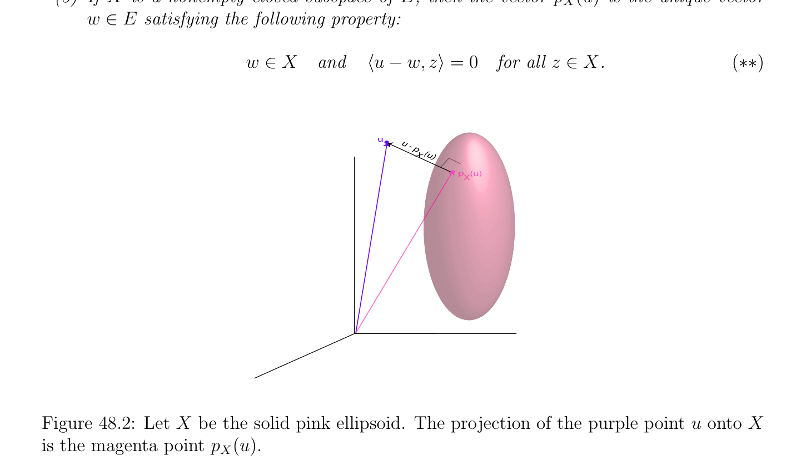

# Phép chiếu Bổ đề

<!-- PAGE 1681 -->
Chương $48$ Cơ sở của Các không gian Hilbert Hầu hết của “deep” các kết quả về sự tồn tại của các cực tiểu của nhận giá trị thực (real-valued) các hàm được chứng minh trong Chương $49$ rely trên hai cơ bản các kết quả của Không gian Hilbert (Hilbert space) lý thuyết:
$(1)$ phép chiếu bổ đề, mà là kết quả về khác rỗng, đóng, lồi các tập con của Không gian Hilbert (Hilbert space) $V$.
$(2)$ Riesz biểu diễn định lý, mà cho phép chúng ta đến biểu diễn liên tục dạng tuyến tính (linear form) trên Không gian Hilbert (Hilbert space) $V$ theo vectơ trong $V$ và tích vô hướng (inner product) trên $V$. tính đúng đắn của Karush–Kuhn–Tucker các điều kiện xuất hiện trong Hàm Lagrange (Lagrangian) đối ngẫu suy ra từ phiên bản của Farkas–Minkowski mệnh đề, mà cũng suy ra từ phép chiếu bổ đề. Do đó, ta feel rằng nó là indispensable đến ôn tập/tổng quan một số cơ bản các kết quả của Không gian Hilbert (Hilbert space) lý thuyết, mặc dù trong hầu hết các ứng dụng được xét ở đây Không gian Hilbert (Hilbert space) trong câu hỏi sẽ là hữu hạn chiều. Tuy nhiên, trong tối ưu hóa lý thuyết, có nhiều các bài tập ở đâu ta seek để tìm hàm cực tiểu hóa một số loại/kiểu của năng lượng phiếm hàm (thường cho trước bởi dạng song tuyến tính (bilinear form)), trong mà trường hợp ta là dealing với vô hạn dimensional Không gian Hilbert (Hilbert space), do đó nó cần đến develop các công cụ đến deal với nhiều hơn/thêm tổng quát tình huống của vô hạn chiều Các không gian Hilbert.

## 48.1 Phép chiếu Bổ đề

$$Given a Hermitian space \langle \frac{E, \phi ,}{\phi (u, u),} \rangle  we showed in Section 14.1 that the function \|\|: E \to \mathbb{R}$$
Được định nghĩa sao cho $\|u\| = p$ là chuẩn (norm) trên $E$. Do đó, $E$ là không gian vectơ định chuẩn (normed vector space). Nếu $E$ là cũng đầy đủ, thì nó là rất thú vị không gian. Nhắc lại rằng tính đầy đủ có đến thực hiện với sự hội tụ của Các dãy Cauchy. không gian vectơ định chuẩn (normed vector space) $\langle E, \|\|\rangle$ là automatically không gian mêtric (metric space) dưới mêtric $d$ được định nghĩa sao cho d(u, $v) = \|v -u\|$ (xem Chương $37$ cho định nghĩa của không gian vectơ định chuẩn (normed vector space) và của không gian mêtric (metric space), hoặc Lang $[115, 116]$, hoặc Dixmier $[52])$. Cho trước không gian mêtric (metric space) $E$ với mêtric $d$, dãy
$$1681$$

<!-- PAGE 1682 -->
$(a_{n})_{n\ge1}$ của các phần tử $a_{n} \in E$ là Dãy Cauchy (Cauchy sequence) khi và chỉ khi với mọi $\epsilon  > 0$, tồn tại một $N \ge 1$ sao cho
$$d(a_{m}, a_{n}) < \epsilon for allm, n \ge N.$$
Ta nói rằng $E$ là đầy đủ khi và chỉ khi mọi Dãy Cauchy (Cauchy sequence) hội tụ đến giới hạn (mà là duy nhất, vì không gian mêtric (metric space) là Hausdorff). Mọi hữu hạn dimensional không gian vectơ (vector space) trên $\mathbb{R}$ hoặc $\mathbb{C}$ là đầy đủ. Ví dụ, một có thể
$$\mathbb{C}^{n}$$
Chỉ ra bởi quy nạp rằng cho trước bất kỳ cơ sở (basis) $(e_{1}, \dots  , e_{n})$ của $E$, ánh xạ tuyến tính (linear map) $h: \to E$ được định nghĩa sao cho
$$h((z_{1}, \dots  , z_{n})) = z_{1}e_{1} + \cdots  + z_{n}e_{n}$$
Là phép đồng phôi (homeomorphism) (bằng cách sử dụng sup-norm trên $\mathbb{C}^{n})$. Một có thể cũng sử dụng sự kiện rằng bất kỳ hai các chuẩn trên hữu hạn dimensional không gian vectơ (vector space) trên $\mathbb{R}$ hoặc $\mathbb{C}$ là tương đương (xem Chương $9$, hoặc Lang $[116]$, Dixmier $[52]$, Schwartz $[156])$. Tuy nhiên, nếu $E$ có vô hạn số chiều, nó có thể không là đầy đủ. Khi Không gian Hermite (Hermitian space) là đầy đủ, số của các tính chất rằng đúng cho hữu hạn dimensional Các không gian Hermite cũng đúng cho vô hạn dimensional các không gian. Ví dụ, bất kỳ đóng không gian con có phần bù trực giao (orthogonal complement), và đặc biệt, hữu hạn dimensional không gian con có phần bù trực giao (orthogonal complement). Các không gian Hermite rằng là cũng đầy đủ đóng quan trọng vai trò trong giải tích/phân tích. Vì chúng đã là thứ nhất studied bởi Hilbert, chúng được gọi là Các không gian Hilbert.

> **Định nghĩa 48.1.** (phức) Không gian Hermite (Hermitian space) $\langle E, \phi \rangle$ mà là đầy đủ không gian vectơ định chuẩn (normed vector space) dưới chuẩn (norm) $\|\|$ được cảm sinh bởi $\phi$ được gọi là một Không gian Hilbert (Hilbert space). thực Không gian Euclid (Euclidean space) $\langle E, \phi \rangle$ mà là đầy đủ dưới chuẩn (norm) $\|\|$ được cảm sinh bởi $\phi$ được gọi là một thực Không gian Hilbert (Hilbert space). Tất cả các kết quả trong mục này đúng cho phức Các không gian Hilbert cũng như cho thực Các không gian Hilbert. Ta phát biểu tất cả các kết quả cho phức trường hợp chỉ, vì chúng cũng áp dụng đến thực trường hợp, và vì các chứng minh trong phức trường hợp cần little nhiều hơn/thêm care.

> **Ví dụ 48.1.** không gian $\ell^{2}$ của tất cả countably vô hạn các dãy $x = (x_{i})_{i\in N}$ của phức
$$\infty$$
$$numbers  such \mathbb{C} that \sum_{i}  |x_{i}|^{2}< \infty is a Hilbert space. It will be shown later that the map$$
$\phi$: $\ell^{2} \times  \ell^{2} \to  defined^{=0}$ sao cho
$$\phi  ((x_{i})_{i\in N}, (y_{i})_{i\in N}) = \sum_{i=0}^{\infty}  x_{i}\overline{y}_{i}$$
Được xác định tốt (well-defined), và rằng $\ell^{2}$ là Không gian Hilbert (Hilbert space) dưới $\phi$. Thực ra, ta sẽ chứng minh nhiều hơn/thêm tổng quát kết quả (Mệnh đề.3).

> **Ví dụ 48.2.** tập hợp $\mathcal{C}^{\infty}[a, b]$ của trơn (smooth) các hàm $f$: [, $b] \to \mathbb{C}$ là Không gian Hermite (Hermitian space) dưới Hermite tạo thành
$$\langle f, g\rangle = \int_{a}^{}  bf(x)\overline{g}\overline{(}\overline{x}\overline{)} dx,$$
Nhưng nó là không Không gian Hilbert (Hilbert space) bởi vì nó là không đầy đủ. Nó là khả dĩ/có thể để xây dựng của nó đầy đủ hóa $L^{2}([a, b])$, mà hóa ra là không gian của Lebesgue integrable các hàm trên [, $b]$.

<!-- PAGE 1683 -->
Định lý 37.63 cho ta quick chứng minh của sự kiện rằng bất kỳ Không gian Hermite (Hermitian space) $E$ (với Hermite tích $\langle$ -, $-\rangle$) có thể được được nhúng trong Không gian Hilbert (Hilbert space) $E_{h}$.

> **Định lý 48.1.** Cho trước Không gian Hermite (Hermitian space) $(E, \langle$ -, $-\rangle$) (resp. Không gian Euclid (Euclidean space)), có một Không gian Hilbert (Hilbert space) $(E_{h}, \langle$ -, $-\rangle_{h}$) và ánh xạ tuyến tính (linear map) $\phi$: $E \to E_{h}$, sao cho
$$\langle u, v\rangle = \langle \phi (u), \phi (v)\rangle_{h}$$
Với mọi $u, v \in E$, và $\phi (E)$ là trù mật trong $E_{h}$. Hơn nữa, $E_{h}$ là duy nhất sai khác một đẳng cấu (up to isomorphism).

*Chứng minh.* Cho $(E, \|\|_{E})$ là Không gian Banach (Banach space), và cho $\phi$: $E \to E$ là tuyến tính phép đẳng cự (isometry), cho trước
$$bb$$
Theo Định lý $37.63.^{b}$ Cho $\|u\| = p\overline{\langle}\overline{u, u}\overline{\rangle}$ (với $u \in E)$ và $E_{h} = E$. Nếu $E$ là thực không gian vectơ (vector space),
$$b$$
Ta biết từ Mục refsec5bis rằng tích vô hướng (inner product) $\langle$ -, $-\rangle$ có thể được được biểu diễn theo chuẩn (norm) $\|u\|$ bởi polarity phương trình
$$-\| -\|$$
$$\langle u, v\rangle = \frac{1}{2} (\|u + v\|^{2}u\|^{2}v\|^{2}),$$
Và nếu $E$ là phức không gian vectơ (vector space), ta biết từ Mục 14.1 rằng ta có polarity phương trình
$$-\| + -$$
$$\langle u, v\rangle = \frac{1}{4} (\|u + v\|^{2}u -v\|^{2} i\|u + iv\|^{2}i\|u -iv\|^{2}).$$
Bởi Cauchy-Schwarz bất đẳng thức, $|\langle u, v\rangle$ | $\le \|u\|\|v\|$, ánh xạ $\langle$ -, $-\rangle$: $E \times  E \to \mathbb{C}$ (resp. $\langle$ -, $-\rangle$: $E \times  E \to \mathbb{R})$ là liên tục. Tuy nhiên, nó là không liên tục đều (uniformly continuous), nhưng ta có thể thu được xung quanh bài toán này bằng cách sử dụng polarity các phương trình để mở rộng nó đến ánh xạ liên tục (continuous map). Bởi tính liên tục, polarity các phương trình cũng đúng trong $E_{h}$, mà chỉ ra rằng $\langle$ -, $-\rangle$ mở rộng đến xác định dương (positive definite) Hermite tích vô hướng (inner product) (resp. Euclidean tích vô hướng (inner product)) $\langle$ -, $-\rangle_{h}$ trên $E_{h}$ được cảm sinh bởi $\|\|_{E}$ mở rộng $\langle$ -, $-\rangle$.
$$b$$
Nhận xét: Ta theo sau cách tiếp cận trong Schwartz $[155]$ (Chương XXIII, Mục $42$. Định lý $2)$. Cho khác các cách tiếp cận, xem Munkres $[135]$ (Chương $7$, Mục $43)$, và Bourbaki $[27]$. Một của hầu hết quan trọng các sự kiện về hữu hạn chiều Hermite (và Euclidean) các không gian là rằng chúng có các cơ sở trực chuẩn. Điều này suy ra rằng, sai khác một đẳng cấu (up to isomorphism), mọi
$$\mathbb{C}^{n} \mathbb{N}$$
Hữu hạn chiều Không gian Hermite (Hermitian space) là đẳng cấu đến (với một số $n \in$) và rằng tích vô hướng (inner product) được cho bởi
$$\langle (x_{1}, \dots  , x_{n}), (y_{1}, \dots  , y_{n})\rangle = \sum_{i=1}^{n}  x_{i}\overline{y}_{i}.$$
$$Furthermore, every subspace W has an orthogonal complement \frac{W^{\perp}}{E} , and the inner product$$
Cảm sinh tự nhiên đối ngẫu giữa $E$ và $E^{*}$ (thực sự, giữa và $E^{*})$ ở đâu $E^{*}$ là không gian của các dạng tuyến tính trên $E$. Khi $E$ là Không gian Hilbert (Hilbert space), $E$ có thể là vô hạn dimensional, thường của uncountable số chiều. Do đó, ta có thể’t kỳ vọng rằng $E$ luôn luôn có cơ sở trực chuẩn (orthonormal basis). Tuy nhiên, nếu ta sửa đổi

<!-- PAGE 1684 -->
Khái niệm của cơ sở (basis) sao cho “Hilbert cơ sở (basis)” là họ trực giao (orthogonal family) rằng là cũng trù mật trong $E$, i.e., mọi $v \in E$ là giới hạn của dãy của hữu hạn các tổ hợp của các vectơ từ Hilbert cơ sở (basis), thì ta có thể recover hầu hết của “đẹp” các tính chất của hữu hạn chiều Các không gian Hermite. Chẳng hạn, nếu $(u_{k})_{k\in K}$ là Hilbert cơ sở (basis), với mọi $v \in E$, ta có thể định nghĩa Fourier
$$coefficients c_{k} = \langle v, u_{k}\rangle /\|u_{k}\|, and then, v is the “sum” of its Fourier series \sum_{k}  c_{k}u_{k}. How-$$
Ever, cardinality của chỉ số tập hợp $K$ có thể được rất lớn, và nó là $necessary^{\in K}$ để định nghĩa những gì nó có nghĩa là cho họ của các vectơ được chỉ số bởi $K$ là khả tổng. Ta sẽ thực hiện điều này trong Mục.1. Hóa ra là mọi Không gian Hilbert (Hilbert space) là đẳng cấu đến không gian của tạo thành $\ell^{2} (K)$, ở đâu $\ell^{2} (K)$ là tổng quát hóa của không gian của Ví dụ 48.1 (xem Định lý.8, thường được gọi là Riesz-Fischer định lý). Của ta thứ nhất mục tiêu là để chứng minh rằng đóng không gian con của Không gian Hilbert (Hilbert space) có phần bù trực giao (orthogonal complement). Ta cũng chỉ ra rằng đối ngẫu nghiệm đúng nếu ta redefine đối ngẫu (dual) E' của $E$ là không gian của liên tục các ánh xạ tuyến tính (linear maps) trên $E$. Của ta trình bày closely suy ra Bourbaki $[27]$. Ta cũng đã là inspired bởi Rudin $[145]$, Lang $[115, 116]$, Schwartz $[156, 155]$, và Dixmier $[52]$. Thực ra, ta một cách cao recommend Dixmier $[52]$ như rõ ràng và đơn giản văn bản trên cơ sở của tôpô và giải tích/phân tích. Đến đạt được điều này mục tiêu, ta phải thứ nhất chứng minh so-called phép chiếu bổ đề. Nhắc lại rằng trong không gian mêtric (metric space) $E$, tập con $X$ của $E$ là đóng khi và chỉ khi với mọi convergent dãy
$$(x_{n}) of points x_{n} \in X, the limit x = lim_{n\to \infty}x_{n} also belongs to X. The closure \overline{X} \frac{of}{X.} X is$$
Tập hợp tất cả các giới hạn của convergent các dãy $(x_{n})$ của các điểm $x_{n} \in X$. Hiển nhiên, $X \subseteq$ Ta nói rằng tập con $X$ của $E$ là trù mật trong $E$ khi và chỉ khi $E = \overline{X}$, bao đóng (closure) của $X$, mà có nghĩa là mọi $a \in E$ là giới hạn của một số dãy $(x_{n})$ của các điểm $x_{n} \in X$. Các tập lồi sẽ một lần nữa đóng then chốt vai trò. Trong phức không gian vectơ (vector space) $E$, tập con $C \subseteq E$ là lồi nếu $(1$ - $\lambda )x + \lambda y \in C$ với mọi $x, y \in C$ và tất cả thực $\lambda  \in [0, 1]$. Nhận thấy rằng không gian con là lồi. Thứ nhất ta phát biểu sau đây dễ “hình bình hành luật,” có chứng minh là để lại như một bài tập.

> **Mệnh đề 48.2.** Nếu $E$ là Không gian Hermite (Hermitian space), với mọi hai các vectơ $u, v \in E$, ta có
$$\|u + v\|^{2}+ \|u -v\|^{2}= 2(\|u\|^{2}+ \|v\|^{2}).$$
Từ ở trên, ta thu được sau đây mệnh đề:

> **Mệnh đề 48.3.** Nếu $E$ là Không gian Hermite (Hermitian space), cho trước bất kỳ $d, \delta  \in \mathbb{R}$ sao cho $0 \le \delta  < d$, cho
$$B = {u \in E | \|u\|< d}andC = {u \in E | \|u\|\le d + \delta }.$$
Với mọi tập lồi (convex set) như vậy $A$ rằng $A \subseteq C$ - $B$, ta có
$$\sqrt$$
$$\|v -u\|\le \overline{12}\overline{d\delta ,}$$
Với mọi $u, v \in A$ (xem Hình 48.1).

<!-- PAGE 1685 -->
$$A u$$
$$CB$$
$$v$$
$$Figure 48.1: Inequality of Proposition 48.3.$$

*Chứng minh.* Vì $A$ là $convex,_{2}^{1}  (u + v) \in A$ nếu $u, v \in A$, và do đó, $\|_{2}^{1} (u + v)\|\ge d$. Từ hình bình hành đẳng thức được viết trong tạo thành
$$\frac{1}{2} (u + v)^{2}+ \frac{1}{2} (u -v)^{2}= \frac{1}{2} \begin{pmatrix} \|u\|^{2}+ \|v\|^{2} \end{pmatrix} ,$$
Vì $\delta  < d$, ta thu được
$$\frac{1}{2} (u -v)^{2}= \frac{1}{2} \begin{pmatrix} \|u\|^{2}+ \|v\|^{2} \end{pmatrix} - \frac{1}{2} (u + v)^{2}\le (d + \delta )^{2}-d^{2}= 2d\delta  + \delta^{2} \le 3d\delta ,$$
Từ mà
$$\sqrt$$
$$\|v -u\|\le \overline{12}\overline{d\delta .}$$

> **Định nghĩa 48.2.** Nếu $X$ là khác rỗng tập con của không gian mêtric (metric space) $(E, d)$, với mọi $a \in E$, nhắc lại rằng ta định nghĩa khoảng cách d(, $X)$ của đến $X$ như
$$d(a, X) = \inf d(a, b).$$
$$b\in X$$
Cũng, diameter $\delta (X)$ của $X$ được định nghĩa bởi
$$\delta (X) = \sup{d(a, b) | a, b \in X}.$$
Nó là khả dĩ/có thể rằng $\delta (X) = \infty$. Ta để lại sau đây tiêu chuẩn hai các sự kiện như một bài tập (xem Dixmier $[52])$:

> **Mệnh đề 48.4.** Cho $E$ là không gian mêtric (metric space).
$(1)$ Với mọi tập con $X \subseteq E, \delta (X) = \delta (\overline{X})$.
$(2)$ Nếu $E$ là không gian mêtric đầy đủ, với mọi dãy $(F_{n})$ của đóng khác rỗng các tập con của $E$ sao cho $F_{n+1} \subseteq F_{n}$, nếu $lim_{n\to \infty} \delta (F_{n}) = 0$, thì $\infty  F_{n}$ bao gồm của đơn lẻ điểm.
$$\bigcap_{n}  =1$$
Ta là bây giờ ready để chứng minh then chốt phép chiếu bổ đề.

<!-- PAGE 1686 -->

> **Mệnh đề 48.5.** (Phép chiếu bổ đề) Cho $E$ là Không gian Hilbert (Hilbert space) và cho $X \subseteq E$ là bất kỳ khác rỗng lồi và đóng tập con.
$(1)$ Với mọi $u \in E$, tồn tại duy nhất một vectơ $p_{X}(u) \in X$ sao cho
$$\|u -p_{X}(u)\|= \inf \|u -v\|= d(u, X).$$
$$v\in X$$
Xem Hình 48.2.
$(2)$ vectơ $p_{X}(u)$ là duy nhất vectơ $w \in E$ thỏa mãn sau đây tính chất (xem Hình 48.3):
$$w \in Xand\mathfrak{R}\langle u -w, z -w\rangle \le 0for all z \in X.(*)$$
$(3)$ Nếu $X$ là khác rỗng đóng không gian con của $E$, thì vectơ $p_{X}(u)$ là duy nhất vectơ $w \in E$ thỏa mãn sau đây tính chất:
$$w \in Xand\langle u -w, z\rangle = 0for all z \in X.(**)$$
$$uu$$
$$- p$$
$$X   (u)$$
$$pX(u)$$

**Hình 48.2:** Cho $X$ là solid hồng ellipsoid. phép chiếu của tím điểm $u$ lên $X$ là magenta điểm $p_{X}(u)$.

*Chứng minh.* $(1)$ Cho $d = inf_{v\in X} \|u$ - $v\| =$ d(u, $X)$. Ta định nghĩa dãy $X_{n}$ của các tập con của $X$ như sau: với mọi $n \ge 1$,
$$ $$
$$X_{n} =v \in X | \|u -v\|\le d + \frac{1}{n} .$$

<!-- PAGE 1687 -->
$$z$$
$$w$$
$$uX$$
$$Figure 48.3: Inequality of Proposition 48.5.$$
Ta kiểm chứng được ngay rằng mỗi $X_{n}$ là khác rỗng (theo định nghĩa của $d)$, lồi, và rằng $X_{n+1} \subseteq X_{n}$. Cũng, theo Mệnh đề 48.3, (ở đâu $B = {v \in E$ | $\|u$ - $v\|\le d}, C =$ v $\in E$ | $\|u$ - $v\|\le d +_{n}^{1}$, và $A = X_{n})$, ta có
$$\sup{\|z -v\|| v, z \in X_{n}} \le p\overline{12}\overline{d/n,}$$
$$and thus, \bigcap_{n}  \ge 1 X_{n} contains at most one point; see Proposition 48.4(2). We will prove that$$
$$\bigcap_{n}  \ge 1 X_{n} contains exactly one point, namely, p_{X}(u). For this, define a sequence (w_{n})_{n\ge1} by$$
Chọn một số $w_{n} \in X_{n}$ với mọi $n \ge 1$. Ta khẳng định rằng $(w_{n})_{n\ge1}$ là Dãy Cauchy (Cauchy sequence). Cho trước bất kỳ $\epsilon  > 0$, nếu ta chọn $N$ sao cho
$$N > \frac{12d}{\epsilon^{2}} ,$$
Vì $(X_{n})_{n\ge1}$ là monotonic giảm dãy, mà có nghĩa là $X_{n+1} \subseteq X_{n}$ với mọi $n \ge 1$, với mọi $m, n \ge N$, ta có
$$\|w_{m} -w_{n}\|\le p\overline{12}\overline{d/N} < \epsilon ,$$
Như mong muốn. Vì $E$ là đầy đủ, dãy $(w_{n})_{n\ge1}$ có giới hạn $w$, và vì $w_{n} \in X$ và $X$ là đóng, ta phải có $w \in X$. Cũng nhận thấy rằng
$$\|u -w\|\le \|u -w_{n}\|+ \|w_{n} -w\|,$$
Và vì $w$ là giới hạn của $(w_{n})_{n\ge1}$ và
$$\|u -w_{n}\|\le d + \frac{1}{n} ,$$
Cho trước bất kỳ $\epsilon  > 0$, tồn tại một $n$ lớn đủ sao cho
$$\frac{1}{n} < \frac{\epsilon}{2} and\|w_{n} -w\|\le \frac{\epsilon}{2} ,$$

<!-- PAGE 1688 -->
Và do đó
$$\|u -w\|\le d + \epsilon .$$
Vì ở trên nghiệm đúng với mọi $\epsilon  > 0$, ta có $\|u$ - $w\| = d$. Do đó, $w \in X_{n}$ với mọi $n \ge 1$,
$$which proves that \bigcap_{nn}  X_{n} = {w}. Now any z \in X such that \|u -z\|= d(u, X) = d also$$
Thuộc đến mọi $X ,^{\ge1}$ và do đó $z = w$, chứng minh tính duy nhất của $w$, mà ta ký hiệu như $p_{X}(u)$. Xem Hình 48.4.
$$\overline{d + 1/n}$$
$$u$$
$$\overline{d + 1/n-1}\overline{u}\overline{d + 1/n+1}$$
$$\overline{d}$$
$$w$$
$$vXn+1$$
$$\overline{w}\overline{n+1}$$
$$Xw$$
$$nn$$
$$Xn-1$$
$$wn-1$$
$$X$$
$$i.$$
$$ii.$$

**Hình 48.4:** Cho $X$ là solid hồng ellipsoid với $p_{X}(u) = w$ tại của nó đỉnh. Mỗi $X_{n}$ là giao của $X$ và solid mặt cầu được tâm tại $u$ với bán kính $d + 1/n$. Các phần tử này các giao là colored “caps” của Hình ii. Dãy Cauchy (Cauchy sequence) $(w_{n})_{n\ge1}$ là thu được bởi chọn điểm trong mỗi colored $X_{n}$.
$(2)$ Cho $z \in X$. Vì $X$ là lồi, $v = (1$ - $\lambda )p_{X}(u) + \lambda z \in X$ với mọi $\lambda , 0 \le \lambda  \le 1$. Thì bởi định nghĩa của $u$, ta có
$$\|u -v\|\ge \|u -p_{X}(u)\|$$
Với mọi $\lambda , 0 \le \lambda  \le 1$, và vì
$$\|u -v\|^{2}= \|u -p_{X}(u) -\lambda (z -p_{X}(u))\|^{2}$$
$$= \|u -p_{X}(u)\|^{2}+ \lambda^{2} \|z -p_{X}(u)\|^{2}-2\lambda \mathfrak{R}\langle u -p_{X}(u), z -p_{X}(u)\rangle ,$$
Với mọi $\lambda , 0 < \lambda  \le 1$, ta thu được
$$\mathfrak{R}\langle u -p_{X}(u), z -p_{X}(u)\rangle = \frac{1}{2\lambda} \begin{pmatrix} \|u -p_{X}(u)\|^{2}-\|u -v\|^{2} \end{pmatrix} + \frac{\lambda}{2} \|z -p_{X}(u)\|^{2}.(\dagger )$$
Vì
$$\|u -v\|\ge \|u -p_{X}(u)\|,$$

<!-- PAGE 1689 -->
Ta có $\|u$ - $p_{X}(u)\|^{2} -\|u$ - $v\|^{2} = (\|u$ - $p_{X}(u)\|-\|u$ - $v\|)(\|u$ - $p_{X}(u)\| + \|u$ - $v\|) \le 0$, và vì Phương trình $(\dagger$) nghiệm đúng với mọi $\lambda$ sao cho $0 < \lambda  \le 1$, nếu $\|u$ - $p_{X}(u)\|^{2} -\|u$ - $v\|^{2} < 0$, thì cho $\lambda  > 0$ nhỏ đủ ta có
$$\frac{1}{2\lambda} \begin{pmatrix} \|u -p_{X}(u)\|^{2}-\|u -v\|^{2} \end{pmatrix} + \frac{\lambda}{2} \|z -p_{X}(u)\|^{2}< 0,$$
Và nếu $\|u$ - $p_{X}(u)\|^{2} -\|u$ - $v\|^{2} = 0$, thì giới hạn $of_{2}^{\lambda}\|z$ - $p_{X}(u)\|^{2}$ như $\lambda  > 0$ đi đến không là không, do đó trong tất cả các trường hợp, bởi $(\dagger$), ta có
$$\mathfrak{R}\langle u -p_{X}(u), z -p_{X}(u)\rangle \le 0.$$
Ngược lại, giả sử rằng $w \in X$ thỏa mãn điều kiện
$$\mathfrak{R}\langle u -w, z -w\rangle \le 0$$
Với mọi $z \in X$. Với mọi $z \in X$, ta có
$$\|u -z\|^{2}= \|u -w\|^{2}+ \|z -w\|^{2}-2\mathfrak{R}\langle u -w, z -w\rangle \ge \|u -w\|^{2},$$
Mà suy ra rằng $\|u$ - $w\| =$ d(u, $X) = d$, và từ $(1)$, rằng $w = p_{X}(u)$.
$(3)$ Nếu $X$ là không gian con của $E$ và $w \in X$, khi $z$ các miền giá trị (range) trên $X$ vectơ $z$ - $w$ cũng các miền giá trị (range) trên toàn bộ của $X$ do đó Điều kiện (*) là tương đương đến
$$w \in Xand\mathfrak{R}\langle u -w, z\rangle \le 0for all z \in X.(*_{1})$$
Vì $X$ là không gian con, nếu $z \in X$, thì $-z \in X$, mà suy ra rằng $(*_{1})$ là tương đương đến
$$w \in Xand\mathfrak{R}\langle u -w, z\rangle = 0for all z \in X.(*_{2})$$
Cuối cùng, vì $X$ là không gian con, nếu $z \in X$,thì iz $\in X$, và điều này suy ra rằng
$$0 = \mathfrak{R}\langle u -w, iz\rangle = -i\mathfrak{I}\langle u -w, z\rangle ,$$
Do đó $\mathfrak{I}\langle u$ - $w, z\rangle = 0$, nhưng vì ta cũng có $\mathfrak{R}\langle u$ - $w, z\rangle = 0$, ta xem rằng $(*_{2})$ là tương đương đến
$$w \in Xand\langle u -w, z\rangle = 0for all z \in X,(**)$$
Như đã khẳng định.

> **Định nghĩa 48.3.** vectơ $p_{X}(u)$ được gọi là phép chiếu của $u$ lên $X$, và ánh xạ $p_{X}$: $E \to X$ được gọi là phép chiếu của $E$ lên $X$.

<!-- PAGE 1690 -->
Trong trường hợp của thực Không gian Hilbert (Hilbert space), có một trực quan hình học interpretation của điều kiện
$$\langle u -p_{X}(u), z -p_{X}(u)\rangle \le 0$$
Với mọi $z \in X$. Nếu ta restate điều kiện như
$$\langle u -p_{X}(u), p_{X}(u) -z\rangle \ge 0$$
Với mọi $z \in X$, điều này nói rằng rằng tuyệt đối giá trị của measure của góc giữa các vectơ $u$ - $p_{X}(u)$ và $p_{X}(u)$ - $z$ là nhiều nhất $\pi /2$. Xem Hình 48.5. Điều này làm cho nghĩa, vì $X$ là lồi, và các điểm trong $X$ phải là trên vế/cạnh opposite đến “tiếp tuyến không gian” đến $X$ tại $p_{X}(u)$, mà là trực giao đến $u$ - $p_{X}(u)$. Của course, điều này là chỉ trực quan description, vì khái niệm của tiếp tuyến không gian có không đã được được định nghĩa!
$$z$$
$$u - p  (u)X$$
$$Xp   (u)$$
$$up  (u)- zX$$
$$X$$
$$X$$

**Hình 48.5:** Cho $X$ là solid xanh lam ice cream nón. acute góc giữa black vectơ $u$ - $p_{X}(u)$ và tím vectơ $p_{X}(u)$ - $z$ là ít hơn $\pi /2$. Nếu $X$ là đóng không gian con của $E$, thì Điều kiện (**) nói rằng rằng vectơ $u$ - $p_{X}(u)$ là trực giao đến $X$, trong nghĩa rằng $u$ - $p_{X}(u)$ là trực giao đến mọi vectơ $z \in X$. ánh xạ $p_{X}$: $E \to X$ là liên tục như được hiển thị dưới đây.

> **Mệnh đề 48.6.** Cho $E$ là Không gian Hilbert (Hilbert space). Với mọi khác rỗng lồi và đóng tập con $X \subseteq E$, ánh xạ $p_{X}$: $E \to X$ là liên tục. Thực ra, $p_{X}$ thỏa mãn Lipschitz điều kiện
$$\|p_{X}(v) -p_{X}(u)\|\le \|v -u\|for all u, v \in E.$$

*Chứng minh.* Với mọi hai các vectơ $u, v \in E$, cho $x = p_{X}(u)-u, y = p_{X}(v)-p_{X}(u)$, và $z = v-p_{X}(v)$. Rõ ràng, (như được minh họa trong Hình 48.6),
$$v -u = x + y + z,$$
Và từ Mệnh đề 48.5(2), ta cũng có
$$\mathfrak{R}\langle x, y\rangle \ge 0and\mathfrak{R}\langle z, y\rangle \ge 0,$$

<!-- PAGE 1691 -->
Từ mà ta thu được
$$\|v -u\|^{2}= \|x + y + z\|^{2}= \|x + z + y\|^{2}$$
$$= \|x + z\|^{2}+ \|y\|^{2}+ 2\mathfrak{R}\langle x, y\rangle + 2\mathfrak{R}\langle z, y\rangle$$
$$\ge \|y\|^{2}= \|p_{X}(v) -p_{X}(u)\|^{2}.$$
Tuy nhiên, $\|p_{X}(v)$ - $p_{X}(u)\|\le \|v$ - $u\|$ hiển nhiên suy ra rằng $p_{X}$ là liên tục.
$$X$$
$$P  (u)X$$
$$y$$
$$u$$
$$v - uX$$
$$p  (v)$$
$$X$$
$$Z$$
$$v$$

**Hình 48.6:** Cho $X$ là solid gold ellipsoid. vectơ $v -u$ là tổng của ba xanh lục các vectơ, mỗi của mà được xác định bởi thích hợp các phép chiếu. Ta có thể bây giờ chứng minh sau đây quan trọng mệnh đề.

> **Mệnh đề 48.7.** Cho $E$ là Không gian Hilbert (Hilbert space).
$(1)$ Với mọi đóng không gian con $V \subseteq E$, ta có $E = V \oplus V^{\perp}$, và ánh xạ $p_{V}$: $E \to V$ là tuyến tính và liên tục.
$(2)$ Với mọi $u \in E$, phép chiếu $p_{V} (u)$ là duy nhất vectơ $w \in E$ sao cho
$$w \in Vand\langle u -w, z\rangle = 0for all z \in V .$$

*Chứng minh.* $(1)$ Thứ nhất, ta chứng minh rằng $u$ - $p_{V} (u) \in V^{\perp}$ với mọi $u \in E$. Với mọi $v \in V$, vì $V$ là không gian con, $z = p_{V} (u) + \lambda v \in V$ với mọi $\lambda  \in \mathbb{C}$, và vì $V$ là lồi và khác rỗng (vì nó là không gian con), và đóng bởi giả thiết, theo Mệnh đề 48.5(2), ta có
$$\mathcal{ℜ}(\overline{\lambda} \langle u -p_{V} (u), v\rangle ) =\mathcal{ℜ}(\langle u -p_{V} (u), \lambda v\rangle = \mathfrak{R}\langle u -p_{V} (u), z -p_{V} (u)\rangle \le 0$$

<!-- PAGE 1692 -->
Với mọi $\lambda  \in \mathbb{C}$. Đặc biệt, ở trên nghiệm đúng cho $\lambda  = \langle u$ - $p_{V} (u), v\rangle$, mà cho ta
$$| \langle u -p_{V} (u), v\rangle | \le 0,$$
Và do đó, $\langle u$ - $p_{V} (u), v\rangle = 0$. Xem Hình 48.7. Hệ quả là, $u$ - $p_{V} (u) \in V^{\perp}$ với mọi $u \in E$. Vì $u = p_{V} (u) + u$ - $p_{V} (u)$ với mọi $u \in E$, ta có $E = V + V^{\perp}$. Mặt khác, vì $\langle$ -, $-\rangle$ là xác định dương (positive definite), $V \cap V^{\perp} = {0}$, và do đó $E = V \oplus V^{\perp}$. Ta đã được chứng minh trong Mệnh đề 48.6 rằng $p_{V}$: $E \to V$ là liên tục. Cũng, vì $p_{V} (\lambda u + \mu v) -(\lambda p_{V} (u) + \mu p_{V} (v)) = p_{V} (\lambda u + \mu v) -(\lambda u + \mu v) + \lambda (u -p_{V} (u)) + \mu (v -p_{V} (v))$, với mọi $u, v \in E$, và vì vế trái số hạng thuộc đến $V$, và từ những gì ta chỉ đã chỉ ra, vế phải số hạng thuộc đến $V^{\perp}$, ta có
$$p_{V} (\lambda u + \mu v) -(\lambda p_{V} (u) + \mu p_{V} (v)) = 0,$$
Chỉ ra rằng $p_{V}$ là tuyến tính.
$(2)$ Điều này là basically hiển nhiên từ $(1)$. Ta được chứng minh trong $(1)$ rằng $u$ - $p_{V} (u) \in V^{\perp}$, mà là chính xác điều kiện
$$\langle u -p_{V} (u), z\rangle = 0$$
Với mọi $z \in V$. Ngược lại, nếu $w \in V$ thỏa mãn điều kiện
$$\langle u -w, z\rangle = 0$$
Với mọi $z \in V$, vì $w \in V$, mọi vectơ $z \in V$ là của tạo thành $y$ - $w$, với $y = z + w \in V$, và do đó, ta có
$$\langle u -w, y -w\rangle = 0$$
Với mọi $y \in V$, mà suy ra điều kiện của Mệnh đề 48.5(2):
$$\mathfrak{R}\langle u -w, y -w\rangle \le 0$$
Với mọi $y \in V$. Theo Mệnh đề 48.5, $w = p_{V} (u)$ là phép chiếu của $u$ lên $V$.
Nhận xét: Nếu $p_{V}$: $E \to V$ là tuyến tính, thì $V$ là không gian con của $E$. Suy ra rằng nếu $V$ là đóng lồi tập con của $E$, thì $p_{V}$: $E \to V$ là tuyến tính khi và chỉ khi $V$ là không gian con của $E$.

> **Ví dụ 48.3.** Cho chúng ta minh họa lũy thừa của Mệnh đề 48.7 trên sau đây “bình phương tối thiểu (least squares)” bài toán. Cho trước thực ma trận cỡ $m \times n$ $A$ và một số vectơ $b \in \mathbb{R}^{m}$, ta sẽ like để giải hệ phương trình tuyến tính
$$Ax = b$$
$$\mathbb{R}^{n}$$
Trong bình phương tối thiểu (least-squares) nghĩa, mà có nghĩa là ta sẽ like để tìm một số nghiệm $x \in$ rằng cực tiểu hóa Euclidean chuẩn (norm) $\|Ax -b\|$ của sai số Ax $-b$. Nó là thực sự không rõ ràng rằng

<!-- PAGE 1693 -->
$$u$$
$$p   (u)$$
$$V$$
$$u -$$
$$p  (u)$$
$$V$$
$$V$$

**Hình 48.7:** Cho $V$ là hồng mặt phẳng. vectơ $u$ - $p_{V} (u)$ là vuông góc đến bất kỳ $v \in V$. bài toán có nghiệm, nhưng nó thực hiện! bài toán có thể được restated như sau: Là ở đó một số $\mathbb{R}^{n} x \in$ sao cho
$$\|Ax -b\|= \inf \|Ay -b\|,$$
$$y\in \mathbb{R} n$$
Hoặc tương đương, là ở đó một số $z \in$ Im $(A)$ sao cho
$$\|z -b\|= d(b, \mathrm{Im} (A)),$$
$$\mathbb{R}^{m} \mathbb{R}^{n}$$
Ở đâu Im $(A) = {Ay \in$ | $y \in$ }, ảnh (image) của ánh xạ tuyến tính (linear map) được cảm sinh bởi $A$. Vì Im $(A)$ là đóng không gian con của $\mathbb{R}^{m}$, bởi vì ta là trong hữu hạn số chiều, Mệnh đề 48.7 cho ta biết chúng ta rằng tồn tại duy nhất một $z \in$ Im $(A)$ sao cho
$$\|z -b\|= \inf \|Ay -b\|,$$
$$y\in \mathbb{R} n$$
Và do đó bài toán luôn luôn có nghiệm vì $z \in$ Im $(A)$, và vì ở đó là ít nhất một số $\mathbb{R}^{n} x \in$ sao cho Ax $= z$ (theo định nghĩa của Im $(A))$. Lưu ý rằng như vậy $x$ là không nhất thiết duy nhất. Hơn nữa, Mệnh đề 48.7 cũng cho ta biết chúng ta rằng $z \in$ Im $(A)$ là nghiệm của phương trình
$$\langle z -b, w\rangle = 0for all w \in \mathrm{Im} (A),$$
$$\mathbb{R}^{n}$$
Hoặc tương đương, rằng $x \in$ là nghiệm của
$$\langle Ax -b, Ay\rangle = 0for all y \in \mathbb{R}^{n},$$
Mà là tương đương đến
$$\langle A^{\top}(Ax -b), y\rangle = 0for all y \in \mathbb{R}^{n},$$
Và do đó, vì tích vô hướng (inner product) là xác định dương (positive definite), đến $A^{\top}(Ax$ - $b) = 0$, i.e.,
$$A^{\top}Ax = A^{\top}b.$$
