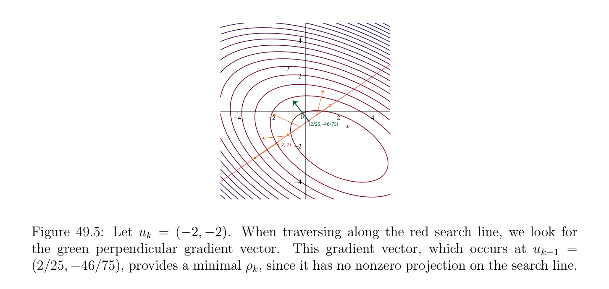

# Hạ gradien (gradient descent) Các phương pháp cho Không ràng buộc Các bài tập

<!-- PAGE 1724 -->
Ở đâu $e_{i}$ ký hiệu vectơ cơ sở chính tắc thứ $i$ trong $\mathbb{R}^{n}$. Nếu $J$ là khả vi (differentiable), cần các điều kiện cho cực tiểu, mà là cũng đủ nếu $J$ là lồi, là rằng directional các đạo hàm $dJ_{v}(e_{i})$ là tất cả không, nghĩa là,
$$\langle \nabla J_{v}, e_{i}\rangle = 0i = 0, \dots  , n.$$
Kết quả sau đây regarding sự hội tụ của mehod của relaxation được chứng minh trong Ciarlet $[41]$ (Chương $8$, Định lý 8.4.2).
$$\mathbb{R}^{n} \mathbb{R}$$

> **Mệnh đề 49.12.** Nếu phiếm hàm $J$: $\to$ là elliptic, thì phương pháp nới lỏng (relaxation method) hội tụ.
Các nhận xét: chứng minh của Mệnh đề 49.12 sử dụng Định lý 49.8. hữu hạn dimensionality của $\mathbb{R}^{n}$ cũng đóng then chốt vai trò. differentiability của hàm $J$ là cũng then chốt. Các ví dụ ở đâu phương pháp các khuyên forever nếu $J$ là không khả vi (differentiable) có thể được cho trước; xem Ciarlet $[41]$ (Chương $8$, Mục 8.4). chứng minh của Mệnh đề 49.12 cho ta tiên nghiệm (a priori) cận trên sai số $\|u$ - $u_{k}\|$. Nếu $J$ là toàn phương phiếm hàm
$$J(v) = \frac{1}{2} v^{\top}Av -b^{\top}v,$$
Ở đâu $A$ là đối xứng xác định dương (SPD) ma trận, thì $\nabla J_{v} =$ Av - $b$, do đó ở trên phương pháp cho việc giải cho $u_{k+1}$ theo $u_{k}$ trở thành Gauss–Seidel phương pháp cho việc giải hệ phương trình tuyến tính; xem Mục 10.3. Ta bây giờ thảo luận gradien các phương pháp.

## 49.6 Hạ gradien (gradient descent) Các phương pháp cho Không ràng buộc

$$Problems$$
Trực giác đằng sau các phương pháp này là rằng sự hội tụ của phương pháp lặp (iterative method) ought là tốt hơn nếu difference $J(u_{k})$ - $J(u_{k+1})$ là như lớn như khả dĩ/có thể during mọi vòng lặp bước. Đến đạt được điều này, nó là tự nhiên đến chọn descent hướng là một trong opposite hướng của gradien vectơ $\nabla J_{uk}$. Điều này lựa chọn là justified bởi sự kiện rằng ta có thể viết
$$J(u_{k} + w) = J(u_{k}) + \langle \nabla J_{uk}, w\rangle + \epsilon (w) \|w\|,with lim_{w\mapsto0} \epsilon (w) = 0.$$
Nếu $\nabla J_{uk}$ ̸ $= 0$, bậc nhất phần của variation của hàm $J$ là bị chặn trong tuyệt đối giá trị bởi $\|\nabla J_{uk}\|\|w\|$ (bởi Cauchy–Schwarz bất đẳng thức), với đẳng thức nếu $\nabla J_{uk}$ và $w$ là thẳng hàng. Hạ gradien (gradient descent) các phương pháp chọn hướng của descent là $d_{k} = -\nabla J_{uk}$, sao cho ta có
$$u_{k+1} = u_{k} -\rho_{k} \nabla J_{uk},$$

<!-- PAGE 1725 -->
Ở đâu ta đặt âm dấu trong trước của của biến $\rho_{k}$ như reminder rằng descent hướng là opposite đến rằng của gradien; dương giá trị được kỳ vọng cho vô hướng (scalar) $\rho_{k}$. Có bốn tiêu chuẩn các phương pháp đến chọn $\rho_{k}$:
$(1)$ Gradien phương pháp với cố định bước nhảy (stepsize) tham số. Điều này là đơn giản nhất và cheapest phương pháp mà bao gồm của bằng cách sử dụng cùng hằng số $\rho_{k}  = \rho$ với mọi các vòng lặp.
$(2)$ Gradien phương pháp với biến bước nhảy (stepsize) tham số. Trong phương pháp này, tham số $\rho_{k}$ là adjusted trong course của các vòng lặp theo khác nhau các tiêu chuẩn.
$(3)$ Gradien phương pháp với tối ưu bước nhảy (stepsize) tham số, cũng được gọi là hạ nhanh nhất (steepest descent) phương pháp cho Euclidean chuẩn (norm). Điều này là phiên bản của Phương pháp $2$ trong mà $\rho_{k}$ được xác định bởi sau đây đường thẳng search:
$$J(u_{k} -\rho_{k} \nabla J_{uk}) = \inf J(u_{k} -\rho \nabla J_{uk}).$$
$$\rho \in \mathbb{R}$$
Điều này tối ưu hóa bài toán chỉ thành công nếu ở trên cực tiểu hóa bài toán có duy nhất nghiệm.
$(4)$ Hạ gradien (gradient descent) phương pháp với backtracking đường thẳng search. Trong phương pháp này, bước tham số là thu được bởi performing backtracking đường thẳng search. Ta có kết quả sau hữu ích kết quả về sự hội tụ của gradien phương pháp với tối ưu tham số.
$$\mathbb{R}^{n} \mathbb{R}$$

> **Mệnh đề 49.13.** Cho $J$: $\to$ là elliptic phiếm hàm. Thì gradien phương pháp với tối ưu bước nhảy (stepsize) tham số hội tụ.

*Chứng minh.* Vì $J$ là elliptic, theo Định lý 49.8(3), phiếm hàm $J$ có duy nhất cực tiểu $u$ được đặc trưng hóa bởi $\nabla J_{u} = 0$. Của ta mục tiêu là để chứng minh rằng dãy $(u_{k})_{k\ge0}$ được xây dựng bằng cách sử dụng gradien phương pháp với tối ưu tham số hội tụ đến $u$, bắt đầu từ bất kỳ ban đầu vectơ $u_{0}$. Không mất tính tổng quát (without loss of generality) ta có thể giả sử rằng $u_{k+1} \neq  u_{k}$ và $\nabla J_{uk}$ ̸ $= 0$ với mọi $k$, vì ngược lại phương pháp hội tụ trong hữu hạn số của các bước. Bước $1$. Chỉ ra rằng bất kỳ hai liên tiếp descent các hướng là trực giao và
$$.$$
$$J(u_{k}) -J(u_{k+1}) \ge \frac{\alpha}{2} \|u_{k} -u_{k+1}\|^{2}$$
Cho $\phi_{k}$: $\mathbb{R} \to \mathbb{R}$ là hàm cho trước bởi
$$\phi_{k} (\rho ) = J(u_{k} -\rho \nabla J_{uk}).$$
Vì hàm $\phi_{k}$ là lồi chặt (strictly convex) và bức (coercive), theo Định lý 49.8(2), nó có duy nhất cực tiểu $\rho_{k}$ mà là duy nhất nghiệm của phương trình $\phi_{k}' (\rho$) $= 0$. Bởi dây chuyền/xích quy tắc
$$\phi_{k}' (\rho ) = dJ_{uk-\rho\nabla Juk}(-\nabla J_{uk})$$
$$= -\langle \nabla J_{uk-\rho\nabla Juk}, \nabla J_{uk}\rangle ,$$

<!-- PAGE 1726 -->
Và vì $u_{k+1} = u_{k}$ - $\rho_{k} \nabla J_{uk}$ ta thu được
$$\langle \nabla J_{uk+1}, \nabla J_{uk}\rangle = 0,$$
Mà chỉ ra rằng hai liên tiếp descent các hướng là trực giao. Vì $u_{k+1} = u_{k}$ - $\rho_{k} \nabla J_{uk}$ và ta được giả sử rằng rằng $u_{k+1} \neq  u_{k}$, ta có $\rho_{k}  \neq  0$, và ta cũng thu được
$$\langle \nabla J_{uk+1}, u_{k+1} -u_{k}\rangle = 0.$$
Bởi bất đẳng thức của Định lý 49.8(1) ta có
$$.$$
$$J(u_{k}) -J(u_{k+1}) \ge \frac{\alpha}{2} \|u_{k} -u_{k+1}\|^{2}$$
Bước $2$. Chỉ ra rằng $lim_{k\mapsto \infty} \|u_{k}$ - $u_{k+1}\| = 0$. Suy ra từ bất đẳng thức được chứng minh trong Bước $1$ rằng dãy $(J(u_{k}))_{k\ge0}$ là giảm và bị chặn ở dưới (bởi J(u), ở đâu $u$ là cực tiểu của $J)$, do đó nó hội tụ và ta kết luận rằng
$$lim(J(u_{k}) -J(u_{k+1})) = 0,$$
$$k\mapsto \infty$$
Mà combined với trước đó bất đẳng thức chỉ ra rằng
$$lim\|u_{k} -u_{k+1}\|= 0.$$
$$k\mapsto \infty$$
Bước $3$. Chỉ ra rằng $\|\nabla J_{uk}\|\le$

$\nabla J_{uk} -\nabla J_{uk+1}$

. Bằng cách sử dụng tính trực giao của liên tiếp descent các hướng, bởi Cauchy–Schwarz ta có
$$\|\nabla J_{uk}\|^{2}= \langle \nabla J_{uk}, \nabla J_{uk} -\nabla J_{uk+1}\rangle$$
$$\le \|\nabla J_{uk}\|

$\nabla J_{uk} -\nabla J_{uk+1}$

,$$ sao cho
$$\|\nabla J_{uk}\|\le

$\nabla J_{uk} -\nabla J_{uk+1}$

.$$ Step $4$. Show that $lim_{k\mapsto \infty} \|\nabla J_{uk}\| = 0$. Since the sequence $(J(u_{k}))_{k\ge0}$ is decreasing and the functional $J$ is coercive, the sequence $(u_{k})_{k\ge0}$ must be bounded. By hypothesis, the derivative dJ is of $J$ là liên tục, do đó nó là
$$\mathbb{R}^{n} \mathbb{R}^{n}$$
Liên tục đều (uniformly continuous) trên compắc các tập con của; ở đây ta là bằng cách sử dụng sự kiện rằng là hữu hạn dimensional. Do đó, ta suy ra rằng với mọi $\epsilon  > 0$, tồn tại một $\delta  > 0$ sao cho nếu $\|u_{k}$ - $u_{k+1}\| < \delta$ thì
$$dJ_{uk} -dJ_{uk+12} < \epsilon .$$

<!-- PAGE 1727 -->
Nhưng theo định nghĩa của chuẩn toán tử (operator norm) và bằng cách sử dụng Cauchy–Schwarz bất đẳng thức
$$dJ_{uk} -dJ_{uk+12} = \sup|dJ_{uk}(w) -dJ_{uk+1}(w)|$$
$$\|w\|=1$$
$$= \sup|\langle \nabla J_{uk} -\nabla J_{uk+1}, w\rangle |$$
$$\|w\|=1$$
$$\le

$\nabla J_{uk} -\nabla J_{uk+1}$

.$$ Nhưng ta cũng có
$$\nabla J_{uk} -\nabla J_{uk+1}^{2}

$= \langle \nabla J_{uk} -\nabla J_{uk+1}, \nabla J_{uk} -\nabla J_{uk+1}\rangle$$$
$$= dJ_{uk}(\nabla J_{uk} -\nabla J_{uk+1}) -dJ_{uk+1}(\nabla J_{uk} -\nabla J_{uk+1})$$
$$\le

$dJ_{uk} -dJ_{uk+12}^{2}$

,$$ và do đó
$$dJ_{uk} -dJ_{uk+12} =

$\nabla J_{uk} -\nabla J_{uk+1}$

.$$ Suy ra rằng vì
$$lim\|u_{k} -u_{k+1}\|= 0$$
$$k\mapsto \infty$$
Thì
$$lim

$\nabla J_{uk} -\nabla J_{uk+1}$

$=$ lim

$dJ_{uk} -dJ_{uk+12} =$ 0,$$
$$k\mapsto \infty k\mapsto \infty$$
Và bằng cách sử dụng sự kiện rằng
$$\|\nabla J_{uk}\|\le

$\nabla J_{uk} -\nabla J_{uk+1}$

,$$ ta thu được
$$lim\|\nabla J_{uk}\|= 0.$$
$$k\mapsto \infty$$
Bước $5$. Cuối cùng ta có thể chứng minh sự hội tụ của dãy $(u_{k})_{k\ge0}$. Vì $J$ là elliptic và vì $\nabla J_{u} = 0$ (vì $u$ là cực tiểu của $J$ trên $\mathbb{R}^{n})$, ta có
$$\alpha  \|u_{k} -u\|^{2}\le \langle \nabla J_{uk} -\nabla J_{u}, u_{k} -u\rangle$$
$$= \langle \nabla J_{uk}, u_{k} -u\rangle$$
$$\le \|\nabla J_{uk}\|\|u_{k} -u\|.$$
Do đó, ta thu được
$$\|u_{k} -u\|\le \frac{1}{\alpha} \|\nabla J_{uk}\|,(b)$$
Và vì ta đã chỉ ra rằng
$$lim\|\nabla J_{uk}\|= 0,$$
$$k\mapsto \infty$$
Ta xem rằng dãy $(u_{k})_{k\ge0}$ hội tụ đến mininum $u$.

<!-- PAGE 1728 -->
Các nhận xét: Như với trước đó mệnh đề, giả định của hữu hạn dimensionality là then chốt. chứng minh cung cấp tiên nghiệm (a priori) cận trên sai số $\|u_{k}$ - $u\|$. Nếu $J$ là elliptic toàn phương phiếm hàm
$$J(v) = \frac{1}{2} \langle Av, v\rangle -\langle b, v\rangle ,$$
Ta có thể sử dụng tính trực giao của descent các hướng $\nabla J_{uk}$ và $\nabla J_{uk+1}$ để tính $\rho_{k}$. Thật vậy, ta có $\nabla J_{v} =$ Av - $b$, do đó
$$0 = \langle \nabla J_{uk+1}, \nabla J_{uk}\rangle = \langle A(u_{k} -\rho_{k} (Au_{k} -b)) -b, Au_{k} -b\rangle ,$$
Mà cho ta
$$\|\|^{2}$$
$$\rho_{k}  = \frac{w_{k}}{\langle Aw_{k}, w_{k}\rangle} ,withw_{k} = Au_{k} -b = \nabla J_{uk}.$$
Hệ quả là, bước của vòng lặp phương pháp lấy sau đây tạo thành:
$(1)$ Tính vectơ
$$w_{k} = Au_{k} -b.$$
$(2)$ Tính vô hướng (scalar)
$$\rho_{k}  = \frac{w_{k}}{\langle Aw_{k}, w_{k}\rangle} \|\|^{2}.$$
$(3)$ Tính tiếp theo vectơ $u_{k+1}$ bởi
$$u_{k+1} = u_{k} -\rho_{k} w_{k}.$$
Phương pháp này là của cụ thể interest khi phép tính của Aw cho cho trước vectơ $w$ là cheap, mà là trường hợp nếu $A$ là thưa (sparse).

> **Ví dụ 49.1.** Cho cụ thể illustration của phương pháp này, ta turn đến ví dụ miễn là/được cung cấp
$$by Shewchuk, with A = \begin{pmatrix} 3 & 2 \\ 2 & 6 \end{pmatrix} and b = \begin{pmatrix} 2 \\ -8 \end{pmatrix} , namely$$
$$J(x, y) = \frac{1}{2} \begin{pmatrix} x & y \end{pmatrix} \begin{pmatrix} 3 & 2 \\ 2 & 6 \end{pmatrix} \begin{pmatrix} x \\ y \end{pmatrix} - \begin{pmatrix} 2 & -8 \end{pmatrix} \begin{pmatrix} x \\ y \end{pmatrix}$$
$$+ 2 -$$
$$= \frac{3}{2} x^{2}xy + 3y^{2}2x + 8y.$$
Điều này toàn phương ellipsoid, mà được minh họa trong Hình 49.2, có duy nhất cực tiểu tại $(2, -2)$. Trong thứ tự để tìm điều này cực tiểu thông qua hạ gradien (gradient descent) với tối ưu bước kích thước

<!-- PAGE 1729 -->
$$+ 2 -$$
$$Figure 49.2: The ellipsoid J(x, y) =_{2}^{3}x^{2}xy + 3y^{2}2x + 8y.$$
$$4$$
$$y$$
$$2$$
$$\overline{K}\overline{4}\overline{K}\overline{2}\overline{0}\overline{2}\overline{4}$$
$$x$$
$$K2$$
$$K4$$

**Hình 49.3:** mức các đường cong của J(x, $y) =^{3}x^{2} +$ 2xy $+ 3y^{2}$ - 2x $+$ 8y và liên kết gradien vectơ trường $\nabla$ J(x, $y) =$ (3x $+$ 2y $-^{2}2$, 2x $+$ 6y $+ 8)$. tham số, ta chọn bắt đầu điểm, nói $u_{k} = (-2, -2)$, và tính toán search hướng $w_{k} = \nabla$ J(-2, $-2) =$ (-12, $-8)$. Lưu ý rằng
$$\nabla J(x, y) = (3x + 2y -2, 2x + 6y + 8) = \begin{pmatrix} 3 & 2 \\ 2 & 6 \end{pmatrix} \begin{pmatrix} x \\ y \end{pmatrix} - \begin{pmatrix} 2 \\ -8 \end{pmatrix}$$
Là vuông góc đến thích hợp elliptical mức đường cong; xem Hình 49.3. Ta tiếp theo perform đường thẳng search dọc theo đường thẳng cho trước bởi phương trình -8x $+$ 12y $= -8$ và xác định $\rho_{k}$. Xem Các hình 49.4 và 49.5.

<!-- PAGE 1730 -->
$$4$$
$$y$$
$$2$$
$$\overline{K}\overline{4}\overline{K}\overline{2}\overline{0}\overline{2}\overline{4}$$
$$x$$
$$K2$$
$$K4$$
$$+ 2 -$$

**Hình 49.4:** mức các đường cong của J(x, $y) =_{2}^{3}x^{2}$ xy $+ 3y^{2}$ 2x $+$ 8y và đỏ search đường thẳng với hướng $\nabla$ J(-2, $-2) =$ (-12, $-8)$
$$4$$
$$y$$
$$2$$
$$\overline{K}\overline{4}\overline{K}\overline{2}\overline{0}\overline{2}\overline{4}$$
$$(2/25, -46/75)x$$
$$(-2,-2)K2$$
$$K4$$

**Hình 49.5:** Cho $u_{k} = (-2, -2)$. Khi traversing dọc theo đỏ search đường thẳng, ta nhìn cho xanh lục vuông góc gradien vectơ. gradien này vectơ, mà xảy ra tại $u_{k+1} = (2/25, -46/75)$, cung cấp tối tiểu $\rho_{k}$, vì nó có không có khác không phép chiếu trên search đường thẳng. Đặc biệt, ta tìm rằng
$$\rho_{k}  = \frac{w_{k}}{\langle Aw_{k}, w_{k}\rangle} \|\|^{2}= \frac{13}{75} .$$
Điều này trong turn cho chúng ta mới điểm
$$u_{k+1} = u_{k} - \frac{13}{75} w_{k} = (-2, -2) - \frac{13}{75} (-12, -8) = \begin{pmatrix} 2 & 46 \\ , - \\ 25 & 75 \end{pmatrix} ,$$
Và ta tiếp tục quy trình bởi searching dọc theo gradien hướng $\nabla J(2/25, -46/75) = (-224/75, 112/25)$. Nhận thấy rằng $u_{k+1} = (_{25}^{2} , -_{75}^{46})$ có gradien vectơ mà là vuông góc đến search đường thẳng với hướng vectơ $w_{k} = \nabla$ J(-2, $-2) =$ (-12 - $8)$; xem Hình
