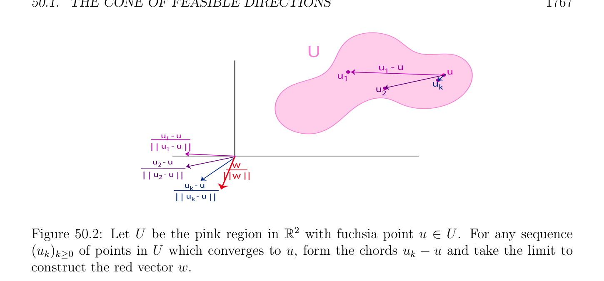
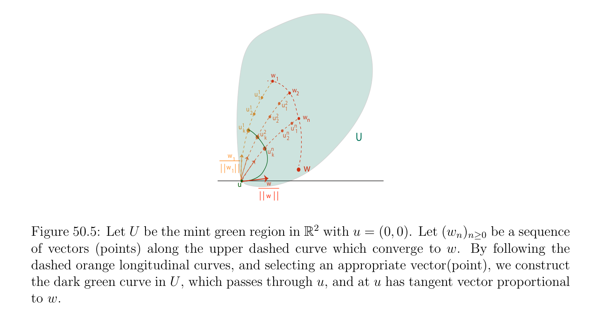

# Nón của Chấp nhận được (feasible) Các hướng

<!-- PAGE 1765 -->
Bài toán quy hoạch đơn giản hơn hơn gốc (primal) bài toán quy hoạch. Nếu $d^{*}$ là giá trị tối ưu (optimal value) của đối ngẫu (dual) bài toán quy hoạch và nếu $p^{*}$ là giá trị tối ưu (optimal value) của gốc (primal) bài toán quy hoạch, ta luôn luôn có
$$d^{*}\le p^{*},$$
Mà là đã biết như đối ngẫu yếu (weak duality). Dưới nhất định các điều kiện, $d^{*} = p^{*}$, nghĩa là, khoảng cách đối ngẫu (duality gap) là không, trong mà trường hợp ta nói rằng đối ngẫu mạnh (strong duality) nghiệm đúng. Cũng, dưới nhất định các điều kiện, nghiệm của đối ngẫu (dual) cho ta nghiệm của gốc (primal), và nếu gốc (primal) có nghiệm tối ưu (optimal solution), thì đối ngẫu (dual) có nghiệm tối ưu (optimal solution), nhưng beware rằng điều ngược lại là một cách tổng quát sai (xem Định lý 50.17). Ta cũng chỉ ra cách mà đến deal với đẳng thức các ràng buộc, và thảo luận sử dụng của liên hợp các hàm để tìm đối ngẫu (dual) hàm. Của ta coverage của Hàm Lagrange (Lagrangian) đối ngẫu là khá kỹ lưỡng, nhưng ta thực hiện không thảo luận nhiều hơn/thêm tổng quát các thứ tự chẳng hạn như nửa xác định thứ tự. Cho các phần tử này topics mà thuộc đến lồi tối ưu hóa, độc giả là referred đến Boyd và Vandenberghe $[29]$. Của ta cách tiếp cận trong chương này là rất nhiều inspired bởi Ciarlet $[41]$ bởi vì ta tìm nó một của nhiều hơn/thêm trực tiếp, và nó là tổng quát đủ đến accomodate Các không gian Hilbert. trường của tối ưu hóa phi tuyến (nonlinear optimization) và lồi tối ưu hóa là vast và có nhiều các cuốn sách trên subject. Trong số những phần tử đó ta recommend (trong alphabetic thứ tự) Bertsekas $[16, 17, 18]$, Bertsekas, Nedi´c, và Ozdaglar $[19]$, Boyd và Vandenberghe $[29]$, Luenberger $[120]$, và Luenberger và Ye $[121]$.

## 50.1 Nón của Chấp nhận được (feasible) Các hướng

Cho $V$ là không gian vectơ định chuẩn (normed vector space) và cho $U$ là khác rỗng tập con của $V$. Với mọi điểm $u \in U$, xét bất kỳ hội tụ dãy $(u_{k})_{k\ge0}$ của các vectơ $u_{k} \in U$ có $u$ như của chúng giới hạn, với $u_{k} \neq  u$ với mọi $k \ge 0$, và nhìn tại dãy của “unit chords,”
$$\frac{u_{k}u}{\|u_{k} -u\|} -.$$
Điều này dãy có thể oscillate forever, hoặc nó có thể có giới hạn, một số unit vectơ $w \in V$. Trong
$$b$$
Trường hợp thứ hai, tất cả khác không các vectơ $\lambda w$ với mọi $\lambda  > 0$, thuộc đến object được gọi là nón của
$$b$$
Chấp nhận được (feasible) các hướng tại $u$. Thứ nhất, ta cần để định nghĩa khái niệm của nón.

> **Định nghĩa 50.1.** Cho trước (thực) không gian vectơ (vector space) $V$, khác rỗng tập con $C \subseteq V$ là nón với đỉnh $0$ (cho ngắn, nón), nếu với mọi $v \in V$, nếu $v \in C$, thì $\lambda v \in C$ với mọi $\lambda  > 0 (\lambda  \in \mathbb{R})$. Với mọi $u \in V$, nón với đỉnh $u$ là bất kỳ khác rỗng tập con của tạo thành $u + C = {u + v$ | $v \in C}$, ở đâu $C$ là nón với đỉnh $0$; xem Hình 50.1. Nhận thấy rằng nón với đỉnh $0$ (hoặc $u)$ là không nhất thiết lồi, và rằng $0$ thực hiện không nhất thiết thuộc đến $C$ (resp. $u$ thực hiện không nhất thiết thuộc đến $u + C)$ (mặc dù trong trường hợp của nón của chấp nhận được (feasible) các hướng C(u) ta có $0 \in$ C(u)). điều kiện cho đang là nón chỉ khẳng định rằng nếu khác không vectơ $v$ thuộc đến $C$, thì mở tia ${\lambda v$ | $\lambda  > 0}$ (resp. afin mở tia $u + {\lambda v$ | $\lambda  > 0})$ cũng thuộc đến $C$.

<!-- PAGE 1766 -->
$$(0,0,1)$$
$$C$$
$$\overline{(0,0,0)}$$
$$V$$
$$(0.25, 0.5, 1.5)$$
$$u + C$$
$$(0.25, 0.5, 0.5) = u$$

**Hình 50.1:** Cho $C$ là nón được xác định bởi bold cam đường cong qua $(0, 0, 1)$ trong mặt phẳng $z = 1$. Thì $u+C$, ở đâu $u =$ (0.25, 0.5, 0.5), là afin translate của $C$ thông qua vectơ $u$.

> **Định nghĩa 50.2.** Cho $V$ là không gian vectơ định chuẩn (normed vector space) và cho $U$ là khác rỗng tập con của $V$. Với mọi điểm $u \in U$, nón C(u) của chấp nhận được (feasible) các hướng tại $u$ là hợp của ${0}$ và tập hợp tất cả khác không các vectơ $w \in V$ cho mà tồn tại một convergent dãy $(u_{k})_{k\ge0}$ của các vectơ sao cho
$(1) u_{k} \in U$ và $u_{k} \neq  u$ với mọi $k \ge 0$, và $lim_{k\mapsto \infty} u_{k} = u$.
$$(2) lim_{k\mapsto \infty} \frac{u_{k}u}{\|u_{k} -u\|} -= \frac{w}{\|w\|} , with w \neq  0.$$
Điều kiện $(2)$ có thể cũng được biểu diễn như sau: có một dãy $(\delta_{k} )_{k\ge0}$ của các vectơ $\delta_{k}  \in V$ sao cho
$$u_{k} = u + \|u_{k} -u\| \frac{w}{\|w\|} + \|u_{k} -u\|\delta_{k} ,klim\mapsto \infty \delta_{k}  = 0, w \neq  0.$$
Hình 50.2 minh họa cách xây dựng của $w$ trong C(u). Rõ ràng, nón C(u) của chấp nhận được (feasible) các hướng tại $u$ là nón với đỉnh $0$, và $u +$ C(u) là nón với đỉnh $u$. Hiển nhiên, nó sẽ là desirable đến có các điều kiện trên $U$ rằng suy ra rằng C(u) là nón lồi (convex cone). Như vậy các điều kiện sẽ là cho trước sau này. Nhận thấy rằng nón C(u) của chấp nhận được (feasible) các hướng tại $u$ chứa velocity các vectơ tại $u$ của tất cả các đường cong $\gamma$ trong $U$ qua $u$. Nếu $\gamma$: $(-1, 1) \to U$ là như vậy đường cong với $\gamma (0) = u$, và nếu $\gamma' (0) \neq  0$

<!-- PAGE 1767 -->
$$U$$
$$u- u$$
$$1u$$
$$u1$$
$$u$$
$$uk$$
$$2$$
$$u\overline{1} - u$$
$$\overline{u} 1\overline{- u}$$
$$u 2- u\overline{w}$$
$$\overline{u} 2\overline{- u}\overline{w}$$
$$u \overline{k}- u$$
$$\overline{u} k\overline{- u}$$
$$\mathbb{R}^{2}$$

**Hình 50.2:** Cho $U$ là hồng miền trong với fuchsia điểm $u \in U$. Với mọi dãy $(u_{k})_{k\ge0}$ của các điểm trong $U$ mà hội tụ đến $u$, tạo thành chords $u_{k}$ - $u$ và lấy giới hạn để xây dựng đỏ vectơ $w$. tồn tại, thì có một dãy $(u_{k})_{k\ge0}$ của các vectơ trong $U$ hội tụ đến $u$ như trong Định nghĩa 50.2, với $u_{k} = \gamma (t_{k})$ với một số dãy $(t_{k})_{k\ge0}$ của các số thực $t_{k} > 0$ sao cho $lim_{k\mapsto \infty} t_{k} = 0$, sao cho
$$u_{k} -u = t_{k}\gamma' (0) + t_{k}\epsilon_{k} ,lim\epsilon_{k}  = 0,$$
$$k\mapsto \infty$$
Và ta thu được
$$-$$
$$klim\mapsto \infty \frac{u_{k}u}{\|u_{k} -u\|} = \frac{\gamma' (0)}{\|\gamma' (0)\|} .$$
Cho illustration của điều này paragraph trong $\mathbb{R}^{2}$, xem Hình 50.3.

> **Ví dụ 50.1.** Trong $V =\mathbb{R}^{2}$, cho $\phi_{1}$ và $\phi_{2}$ là cho trước bởi
$$\phi_{1} (u_{1}, u_{2}) = -u_{1} -u_{2}$$
$$\phi_{2} (u_{1}, u_{2}) = u_{1}(u_{1}^{2} + u_{2}^{2}) -(u_{1}^{2} -u_{2}^{2}),$$
Và cho
$$\mathbb{R}^{2}$$
$$U = {(u_{1}, u_{2}) \in | \phi_{1} (u_{1}, u_{2}) \le 0, \phi_{2} (u_{1}, u_{2}) \le 0}.$$
Miền $U$ được hiển thị trong Hình 50.4 và là bị chặn bởi đường cong cho trước bởi phương trình $\phi_{1} (u_{1}, u_{2}) = 0$, nghĩa là, $-u_{1}$ - $u_{2} = 0$, đường thẳng của hệ số góc $-1$ qua gốc, và đường cong cho trước bởi phương trình $u_{1}(u_{1}^{2} + u_{2}^{2})$ - $(u_{1}^{2}$ - $u_{2}^{2}) = 0$, nodal bậc ba qua gốc. Ta thu được parametric định nghĩa của điều này đường cong bởi đặt $u_{2} = tu_{1}$, và ta tìm rằng
$$u_{1}(t) = \frac{u_{1}^{2}(t)u_{2}^{2}(t)}{u_{1}^{2}(t) + u_{2}^{2}(t)} - = \frac{1t^{2}}{1 + t^{2}} -,u_{2}(t) = \frac{t(1t^{2})}{1 + t^{2}} - .$$
Tiếp tuyến vectơ tại $t$ được cho bởi $(u_{1}'(t), u_{2}'(t))$ với
$$- - --$$
$$u_{1}'(t) = \frac{2t(1 + t^{2})(1t^{2})2t}{(1 + t^{2})^{2}} = \frac{4t}{(1 + t^{2})^{2}}$$

<!-- PAGE 1768 -->
$$U$$
$$u1$$
$$u2$$
$$uk$$
$$uu1$$
$$\overline{u} uk2$$
$$\gamma$$
$$\gamma$$
$$\overline{0}\overline{tk}\overline{t2}\overline{t1}$$
$$\overline{0}\overline{t} k\overline{t} 2\overline{t}\overline{1}$$
$$(i.)$$
$$\gamma ‘(0)$$
$$C(u)$$
$$\gamma ‘(0)$$
$$(ii.)$$
$$\mathbb{R}^{2}$$

**Hình 50.3:** Cho $U$ là tím miền trong và $u$ là designated điểm trên biên (boundary) của $U$. Hình $(i.)$ minh họa hai các đường cong qua $u$ và hai các dãy $(u_{k})_{k\ge0}$ hội tụ đến $u$. giới hạn của chords $u_{k}$ - $u$ tương ứng với tiếp tuyến các vectơ cho thích hợp đường cong. Hình (ii.) minh họa một nửa mặt phẳng C(u) của chấp nhận được (feasible) các hướng. và
$$- - -$$
$$- - -  -  -$$
$$u_{2}'(t) = \frac{(13t^{2})(1 + t^{2})(tt^{3})2t}{(1 + t^{2})^{2}} = \frac{12t^{2}3t^{4}2t^{2} + 2t^{4}}{(1 + t^{2})^{2}} = \frac{14t^{2}t^{4}}{(1 + t^{2})^{2}} .$$
Nodal bậc ba các đi qua qua gốc cho $t = \pm 1$, và cho $t = -1$ tiếp tuyến vectơ là $(1, -1)$, và cho $t = 1$ tiếp tuyến vectơ là $(-1, -1)$. nón của chấp nhận được (feasible) các hướng C(0) tại gốc được cho bởi
$$\mathbb{R}^{2}$$
$$C(0) = {(u_{1}, u_{2}) \in | u_{1} + u_{2} \ge 0, |u_{1}| \ge |u_{2}|}.$$
Điều này là không nón lồi (convex cone) vì nó chứa sector delineated bởi các đường thẳng $u_{2} = u_{1}$ và $u_{2} = -u_{1}$, nhưng cũng tia được hỗ trợ/giá (support) bởi vectơ $(-1, 1)$. hai then chốt các tính chất của nón của chấp nhận được (feasible) các hướng được hiển thị trong sau đây mệnh đề.

<!-- PAGE 1769 -->
$$(i.)$$
$$(ii.)$$

**Hình 50.4:** Hình $(i.)$ minh họa $U$ như shaded gray miền mà lies giữa đường thẳng $y = -x$ và nodal bậc ba. Hình (ii.) chỉ ra nón của chấp nhận được (feasible) các hướng, C(0), như hợp của turquoise tam giác nón và turquoise directional tia $(-1, 1)$.

> **Mệnh đề 50.1.** Cho $U$ là bất kỳ khác rỗng tập con của không gian vectơ định chuẩn (normed vector space) $V$.
$(1)$ Với mọi $u \in U$, nón C(u) của chấp nhận được (feasible) các hướng tại $u$ là đóng.
$(2)$ Cho $J$: $\Omega \to \mathbb{R}$ là hàm được định nghĩa trên mở tập con $\Omega$ chứa $U$. Nếu $J$ có cực tiểu địa phương (local minimum) đối với tập hợp $U$ tại điểm $u \in U$, và nếu $J_{u}'$ tồn tại tại $u$, thì
$$J_{u}'(v -u) \ge 0for all v \in u + C(u).$$

*Chứng minh.* $(1)$ Cho $(w_{n})_{n\ge0}$ là dãy của các vectơ $w_{n} \in$ C(u) hội tụ đến giới hạn $w \in V$. Ta có thể giả sử rằng $w \neq  0$, vì $0 \in$ C(u) theo Định nghĩa, và do đó ta có thể cũng giả sử rằng $w_{n} \neq  0$ với mọi $n \ge 0$. Theo Định nghĩa, với mọi $n \ge 0$, có một dãy $(u_{k}^{n})_{k\ge0}$ của các vectơ trong $V$ và một số $w_{n} \neq  0$ sao cho
$(1) u_{k}^{n} \in U$ và $u_{k}^{n}$ ̸ $= u$ với mọi $k \ge 0$, và $lim_{k\mapsto \infty} u_{k}^{n} = u$.
$(2)$ Có một dãy $(\delta_{k}^{n} )_{k\ge0}$ của các vectơ $\delta_{k}^{n}  \in V$ sao cho
$$u_{k}^{n} = u + \|u_{k}^{n} -u\| \frac{w_{n}}{\|w_{n}\|} + \|u_{k}^{n} -u\|\delta_{k}^{n} ,klim\mapsto \infty \delta_{k}^{n}  = 0, w_{n} \neq  0.$$
Cho $(\epsilon_{n} )_{n\ge0}$ là dãy của thực các số $\epsilon_{n}  > 0$ sao cho $lim_{n\mapsto \infty} \epsilon_{n}  = 0$ (ví dụ, $\epsilon_{n}  = 1/(n + 1))$. Do sự hội tụ của các dãy $(u_{k}^{n})$ và $(\delta_{k}^{n}$) với mọi cố định $n$,

<!-- PAGE 1770 -->
Ở đó tồn tại số nguyên k(n) sao cho
$$u_{k(n)}^{n} -u

$\le \epsilon_{n}$,

$\delta_{k(n)}^{n}$

$\le \epsilon_{n}$.$$ Consider the sequence $(u_{k(n)}^{n})_{n\ge0}$. Ta có
$$u_{k(n)}^{n} \in U, u_{k(n)}^{n} ̸= 0, for all n \ge 0,limu_{k(n)}^{n} = u,$$
$$n\mapsto \infty$$
Và ta có thể viết
$$u_{k(n)}^{n} = u +

$u_{k(n)}^{n} -u \frac{w}{\|w\|} +$

$u_{k(n)}^{n} -u \begin{pmatrix} w_{n}$ & $w \\ \delta_{k(n)}^{n} +$ & - $\\ \|w_{n}\|$ & $\|w\| \end{pmatrix} \begin{pmatrix}\end{pmatrix}$.$$ Since $lim_{k\mapsto \infty}(w_{n}/ \|w_{n}\|) = w/ \|w\|$, we conclude that $w \trong$ C(u). Xem Hình 50.5.
$$w$$
$$1$$
$$1w2$$
$$u$$
$$1$$
$$u2$$
$$u11$$
$$22w$$
$$u2n$$
$$u1un$$
$$ku2un1U$$
$$k2$$
$$un$$
$$wk$$
$$\overline{1}$$
$$\overline{w} w$$
$$1$$
$$\overline{u}\overline{w}$$
$$\overline{w}$$
$$\mathbb{R}^{2}$$

**Hình 50.5:** Cho $U$ là mint xanh lục miền trong với $u = (0, 0)$. Cho $(w_{n})_{n\ge0}$ là dãy của các vectơ (các điểm) dọc theo trên dashed đường cong mà hội tụ đến $w$. Bởi sau đây dashed cam longitudinal các đường cong, và chọn thích hợp vectơ(điểm), ta xây dựng dark xanh lục đường cong trong $U$, mà các đi qua qua $u$, và tại $u$ có tiếp tuyến vectơ tỷ lệ đến $w$.
$(2)$ Cho $w = v -u$ là bất kỳ khác không vectơ trong nón C(u), và cho $(u_{k})_{k\ge0}$ là dãy của các vectơ trong $U -{u}$ sao cho
$(1) lim_{k\mapsto \infty} u_{k} = u$.
$(2)$ Có một dãy $(\delta_{k} )_{k\ge0}$ của các vectơ $\delta_{k}  \in V$ sao cho
$$u_{k} -u = \|u_{k} -u\| \frac{w}{\|w\|} + \|u_{k} -u\|\delta_{k} ,klim\mapsto \infty \delta_{k}  = 0, w \neq  0,$$
$(3)$ J(u) $\le J(u_{k})$ với mọi $k \ge 0$.
