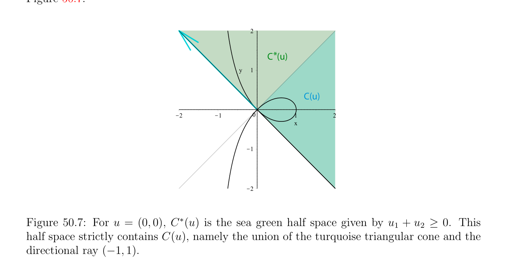
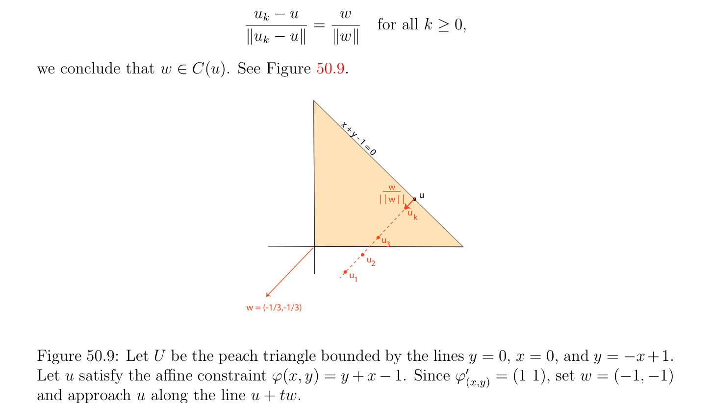

# Hoạt động Các ràng buộc và Qualified Các ràng buộc

<!-- PAGE 1771 -->
Vì $J$ là khả vi (differentiable) tại $u$, ta có
$$0 \le J(u_{k}) -J(u) = J_{u}'(u_{k} -u) + \|u_{k} -u\|\epsilon_{k} ,(*)$$
Với một số dãy $(\epsilon_{k} )_{k\ge0}$ sao cho $lim_{k\mapsto \infty} \epsilon_{k}  = 0$. Vì $J_{u}'$ là tuyến tính và liên tục, và vì
$$u_{k} -u = \|u_{k} -u\| \frac{w}{\|w\|} + \|u_{k} -u\|\delta_{k} ,klim\mapsto \infty \delta_{k}  = 0, w \neq  0,$$
(*) suy ra rằng
$$\| -\|$$
$$0 \le \frac{u_{k}u}{\|w\|} (J_{u}'(w) + \eta_{k} ),$$
Với
$$\eta_{k}  = \|w\|(J_{u}'(\delta_{k} ) + \epsilon_{k} ).$$
Vì $J_{u}'$ là liên tục, ta có $lim_{k\mapsto \infty} \eta_{k}  = 0$. Nhưng khi đó $J_{u}'(w) \ge 0$, vì nếu $J_{u}'(w) < 0$, thì cho $k$ lớn đủ biểu thức $J_{u}'(w) + \eta_{k}$ sẽ là âm, và vì $u_{k} \neq  u$, biểu thức $(\|u_{k}$ - $u\|/ \|w\|)(J_{u}'(w) + \eta_{k}$) sẽ cũng là âm, một mâu thuẫn. Từ bây giờ trên ta giả sử rằng $U$ được định nghĩa bởi tập hợp của các bất đẳng thức, nghĩa là
$$U = {x \in \Omega | \phi_{i} (x) \le 0, 1 \le i \le m},$$
Ở đâu các hàm $\phi_{i}$: $\Omega \to \mathbb{R}$ là liên tục (và thường khả vi (differentiable)). Như ta được giải thích trước đó, đẳng thức ràng buộc $\phi_{i} (x) = 0$ là treated như conjunction của hai các bất đẳng thức $\phi_{i} (x) \le 0$ và $-\phi_{i} (x) \le 0$. Sau này ta sẽ xem rằng khi các hàm $\phi_{i}$ là lồi, vì $-\phi_{i}$ là không nhất thiết lồi, nó là desirable đến treat đẳng thức các ràng buộc một cách tách, nhưng cho time đang là ta won’t.

## 50.2 Hoạt động Các ràng buộc và Qualified Các ràng buộc

Của ta tiếp theo mục tiêu là tìm đủ các điều kiện cho nón C(u) là lồi, với mọi $u \in U$. Cho điều này ta giả sử rằng các hàm $\phi_{i}$ là khả vi (differentiable) tại $u$. Hóa ra là các ràng buộc $\phi_{i}$ rằng matter là những phần tử đó cho mà $\phi_{i} (u) = 0$, cụ thể là các ràng buộc rằng là tight, hoặc như ta nói, hoạt động.

> **Định nghĩa 50.3.** Cho trước $m$ các hàm $\phi_{i}$: $\Omega \to \mathbb{R}$ được định nghĩa trên một số mở tập con $\Omega$ của một số không gian vectơ (vector space) $V$, cho $U$ là tập hợp được định nghĩa bởi
$$U = {x \in \Omega | \phi_{i} (x) \le 0, 1 \le i \le m}.$$
Với mọi $u \in U$, ràng buộc $\phi_{i}$ được nói là hoạt động tại $u$ nếu $\phi_{i} (u) = 0$, khác không hoạt động tại $u$ nếu $\phi_{i} (u) < 0$. Nếu ràng buộc $\phi_{i}$ là hoạt động tại $u$, điều này tương ứng với $u$ đang là trên piece của biên (boundary) của $U$ được xác định bởi một số của các phương trình $\phi_{i} (u) = 0$; xem Hình 50.6.

<!-- PAGE 1772 -->
$$1)(1,1)$$
$$1/2(x-$$
$$1 \le$$
$$y - )$$
$$2(x-1$$
$$w \ge$$
$$y - 1$$
$$y   =  x2$$
$$(i.)$$
$$y = x 2$$
$$/4$$
$$- 1$$
$$\le  x$$
$$- 1/2$$
$$y$$
$$(1/4, 1/2)w$$
$$(ii.)$$

**Hình 50.6:** Cho $U$ là light tím phẳng miền mà lies giữa các đường cong $y = x^{2}$ và $y^{2} = x$. Hình $(i.)$ minh họa biên (boundary) điểm $(1, 1)$ cho trước bởi các đẳng thức $y-x^{2} = 0$ và $y^{2}-x = 0$. afin translate của nón của chấp nhận được (feasible) các hướng, C(1, $1)$, được minh họa bởi hồng tam giác có các vế/cạnh là tiếp tuyến các đường thẳng đến biên (boundary) các đường cong. Hình (ii.) minh họa biên (boundary) điểm $(1/4, 1/2)$ cho trước bởi đẳng thức $y^{2}$ - $x = 0$. afin translate của $C(1/4, 1/2)$ là lilac một nửa không gian bị chặn bởi tiếp tuyến đường thẳng đến $y^{2} = x$ qua $(1/4, 1/2)$.

> **Định nghĩa 50.4.** Với mọi $u \in U$, với
$$U = {x \in \Omega | \phi_{i} (x) \le 0, 1 \le i \le m},$$
Ta định nghĩa I(u) như tập hợp của các chỉ số
$$I(u) = {i \in {1, \dots  , m} | \phi_{i} (u) = 0}$$
Ở đâu các ràng buộc là hoạt động. Ta định nghĩa tập hợp $C^{*}(u)$ như
$$C^{*}(u) = {v \in V | (\phi_{i}' )_{u}(v) \le 0, i \in I(u)}.$$
Vì mỗi $(\phi_{i}' )_{u}$ là dạng tuyến tính (linear form), tập con
$$C^{*}(u) = {v \in V | (\phi_{i}' )_{u}(v) \le 0, i \in I(u)}$$

<!-- PAGE 1773 -->
Là giao của một nửa các không gian chuyển qua gốc, do đó nó là tập lồi (convex set), và hiển nhiên nó là nón. Nếu I(u) $= \emptyset$, thì $C^{*}(u) = V$. đặc biệt các loại của $\mathcal{H}-polyhedra$ của tạo thành $C^{*}(u)$ cut ra bởi các siêu phẳng qua gốc được gọi là $\mathcal{H}-cones$. Nó có thể được được hiển thị rằng mọi $\mathcal{H}-cone$ là nón đa diện (polyhedral cone) (cũng được gọi là $a \mathcal{V}-cone)$, và ngược lại. chứng minh là không tầm thường; xem Gallier $[74]$ và Ziegler $[201]$. Ta sẽ chứng minh một cách ngắn rằng ta luôn luôn có inclusion
$$C(u) \subseteq C^{*}(u).$$
Tuy nhiên, inclusion có thể được chặt, như trong Ví dụ 50.1. Thật vậy cho $u = (0, 0)$ ta có I(0, $0) = {1, 2}$ và vì
$$(\phi_{1}' )_{(u1,u2)} = (-1 -1),(\phi_{2}' )_{(u1,u2)} = (3u_{1}^{2} + u_{2}^{2} -2u_{1} 2u_{1}u_{2} + 2u_{2}),$$
$$\mathbb{R}^{2}$$
Ta có $(\phi_{2}' )_{(0,0)} = (0 0)$, và do đó $C^{*}(0) = {(u_{1}, u_{2}) \in$ | $u_{1} + u_{2} \ge 0}$ như được minh họa trong Hình 50.7.
$$2$$
$$C  (u)*$$
$$y1$$
$$C(u)$$
$$\overline{K}\overline{2}\overline{K}\overline{1}\overline{0}\overline{1}\overline{2}$$
$$x$$
$$K1$$
$$K2$$

**Hình 50.7:** Cho $u = (0, 0), C^{*}(u)$ là sea xanh lục một nửa không gian cho trước bởi $u_{1} + u_{2} \ge 0$. Điều này một nửa không gian chặt chứa C(u), cụ thể là hợp của turquoise tam giác nón và directional tia $(-1, 1)$. các điều kiện được phát biểu trong sau đây định nghĩa là đủ các điều kiện rằng suy ra rằng C(u) $= C^{*}(u)$, như ta sẽ chứng minh tiếp theo.

> **Định nghĩa 50.5.** Với mọi $u \in U$, với
$$U = {x \in \Omega | \phi_{i} (x) \le 0, 1 \le i \le m},$$
Nếu các hàm $\phi_{i}$ là khả vi (differentiable) tại $u$ (thực ra, ta chỉ cần điều này cho $i \in$ I(u)), ta nói rằng các ràng buộc là qualified tại $u$ nếu sau đây các điều kiện đúng:

<!-- PAGE 1774 -->
() Hoặc các ràng buộc $\phi_{i}$ là afin với mọi $i \in$ I(u), hoặc
$(b)$ Tồn tại một khác không vectơ $w \in V$ sao cho sau đây các điều kiện đúng với mọi $i \in$ I(u):
$$(i) (\phi_{i}' )_{u}(w) \le 0.$$
$$(ii) If \phi_{i}  is not affine, then (\phi_{i}' )_{u}(w) < 0.$$
Điều kiện (b)(ii) suy ra rằng $u$ là không tới hạn/quan trọng điểm của $\phi_{i}$ với mọi $i \in$ I(u), do đó không có singularity tại $u$ trong không quỹ tích của $\phi_{i}$. Một cách trực quan, nếu các ràng buộc là qualified tại $u$ thì biên (boundary) của $U$ near $u$ behaves “một cách đẹp.” biên (boundary) các điểm được minh họa trong Hình 50.6 là qualified. Nhận thấy rằng
$$\mathbb{R}^{2}$$
$U = {x \in$ | $\phi_{1} (x, y) = y^{2}$ - $x \le 0, \phi_{2} (x, y) = x^{2}$ - $y \le 0}$. Cho $u = (1, 1)$, I(u) $= {1, 2}, (\phi_{1}' )_{(1,1)} = (-1 2), (\phi_{2}' )_{(1,1)} = (2$ - $1)$, và $w = (-1, -1)$ các đảm bảo rằng $(\phi_{1}' )_{(1,1)}$ và $(\phi_{1}' )_{(1,1)}$ thỏa mãn Điều kiện $(b)$ của Định nghĩa 50.5. Cho $u = (1/4, 1/2)$, I(u) $= {1}, (\phi_{1}' )_{(1,1)} = (-1 1)$, và $w = (1, 0)$ sẽ thỏa mãn Điều kiện $(b)$. Trong Ví dụ 50.1, ràng buộc $\phi_{2} (u_{1}, u_{2}) = 0$ là không qualified tại gốc bởi vì $(\phi_{2}' )_{(0,0)} = (0, 0)$; thực ra, gốc là self-intersection. Trong ví dụ ở dưới, gốc là cũng suy biến điểm, nhưng cho khác nhau lý do.
$$\mathbb{R}^{2}$$

> **Ví dụ 50.2.** Xét miền $U \subseteq$ được xác định bởi hai các đường cong cho trước bởi
$$\phi_{1} (u_{1}, u_{2}) = u_{2} -\max(0, u_{1}^{3})$$
$$\phi_{2} (u_{1}, u_{2}) = u_{1}^{4} -u_{2}.$$
$$We have I(0, 0) = {1, 2}, and since (\phi_{1} )_{(0,0)}'(w_{1}, w_{2}) = (0 1)_{w}^{w1} \begin{pmatrix} u_{2}^{2} \end{pmatrix} = w_{2} and (\phi_{2}' )_{(0,0)}(w_{1}, w_{2}) =$$
$$(0-1)_{w}^{w1} \begin{pmatrix} 2 \end{pmatrix} = -w_{2}, we have C^{*}(0) = {(u_{1}, u_{2}) \in \mathbb{R}^{2}|  = 0}, but the constraints are$$
Không qualified tại $(0, 0)$ vì nó là không thể đến có simultaneously $(\phi_{1}' )_{(0,0)}(w_{1}, w_{2}) < 0$ và
$$\mathbb{R}^{2}$$
$(\phi_{2}' )_{(0,0)}(w_{1}, w_{2}) < 0$, do đó thực ra C(0) $= {(u_{1}, u_{2}) \in$ | $u_{1} \ge 0, u_{2} = 0}$ là chặt được chứa trong $C^{*}(0)$; xem Hình 50.8.

> **Mệnh đề 50.2.** Cho $u$ là bất kỳ điểm của tập hợp
$$U = {x \in \Omega | \phi_{i} (x) \le 0, 1 \le i \le m},$$
Ở đâu $\Omega$ là mở tập con của không gian vectơ định chuẩn (normed vector space) $V$, và giả sử rằng các hàm $\phi_{i}$ là khả vi (differentiable) tại $u$ (thực ra, ta chỉ cần điều này cho $i \in$ I(u)). Thì sau đây các sự kiện đúng:
$(1)$ nón C(u) của chấp nhận được (feasible) các hướng tại $u$ được chứa trong nón lồi (convex cone) $C^{*}(u)$; nghĩa là,
$$C(u) \subseteq C^{*}(u) = {v \in V | (\phi_{i}' )_{u}(v) \le 0, i \in I(u)}.$$

<!-- PAGE 1775 -->
$$(i.)$$
$$\varphi (u  , u   )$$
$$112$$
$$\varphi  (u  , u   )$$
$$212$$
$$(ii.)$$
$$\varphi  (u  , u   )$$
$$\varphi (u  , u   )212$$
$$112$$

**Hình 50.8:** Các hình $(i.)$ và (ii.) minh họa tím moon shaped miền liên kết với

> **Ví dụ 50.2.** Hình $(i.)$ cũng minh họa C(0), nón của chấp nhận được (feasible) các hướng, trong khi Hình (ii.) minh họa chặt containment của C(0) trong $C^{*}(0)$.
$(2)$ Nếu các ràng buộc là qualified tại $u$ (và các hàm $\phi_{i}$ là liên tục tại $u$ với mọi $i \in /$ I(u) nếu ta chỉ giả sử $\phi_{i}$ khả vi (differentiable) tại $u$ với mọi $i \in$ I(u)), thì
$$C(u) = C^{*}(u).$$

*Chứng minh.* $(1)$ Với mọi $i \in$ I(u), vì $\phi_{i} (v) \le 0$ với mọi $v \in U$ và $\phi_{i} (u) = 0$, hàm $-\phi_{i}$ có cực tiểu địa phương (local minimum) tại $u$ đối với $U$, do đó theo Mệnh đề 50.1(2), ta có
$$(-\phi_{i}' )_{u}(v) \ge 0for all v \in C(u),$$
Mà là tương đương đến $(\phi_{i}' )_{u}(v) \le 0$ với mọi $v \in$ C(u) và với mọi $i \in$ I(u), nghĩa là, $u \in C^{*}(u)$. (2)() Thứ nhất, ta giả sử rằng $\phi_{i}$ là afin với mọi $i \in$ I(u). Nhắc lại rằng $\phi_{i}$ phải là cho trước bởi $\phi_{i} (v) = h_{i}(v) + c_{i}$ với mọi $v \in V$, ở đâu $h_{i}$ là dạng tuyến tính (linear form) và $c_{i} \in \mathbb{R}$. Vì đạo hàm của ánh xạ tuyến tính (linear map) tại bất kỳ điểm là chính nó,
$$(\phi_{i}' )_{u}(v) = h_{i}(v)for all v \in V .$$

<!-- PAGE 1776 -->
Chọn bất kỳ khác không $w \in C^{*}(u)$, mà có nghĩa là $(\phi_{i}' )_{u}(w) \le 0$ với mọi $i \in$ I(u). Với mọi dãy $(\epsilon_{k} )_{k\ge0}$ của các số thực $\epsilon_{k}  > 0$ sao cho $lim_{k\mapsto \infty} \epsilon_{k}  = 0$, cho $(u_{k})_{k\ge0}$ là dãy của các vectơ trong $V$ cho trước bởi
$$u_{k} = u + \epsilon_{k} w.$$
Ta có $u_{k} -u = \epsilon_{k} w \neq  0$ với mọi $k \ge 0$ và $lim_{k\mapsto \infty} u_{k} = u$. Hơn nữa, vì các hàm $\phi_{i}$ là liên tục với mọi $i \in /$ I, ta có
$$0 > \phi_{i} (u) = lim\phi_{i} (u_{k}),$$
$$k\mapsto \infty$$
Và vì $\phi_{i}$ là afin và $\phi_{i} (u) = 0$ với mọi $i \in$ I, ta có $\phi_{i} (u) = h_{i}(u) + c_{i} = 0$, do đó $\phi_{i} (u_{k}) = h_{i}(u_{k}) + c_{i} = h_{i}(u_{k})$ - $h_{i}(u) = h_{i}(u_{k}$ - $u) = (\phi_{i}' )_{u}(u_{k}$ - $u) = \epsilon_{k} (\phi_{i}' )_{u}(w) \le 0, (*_{0})$ mà suy ra rằng $u_{k} \in U$ với mọi $k$ lớn đủ. Vì
$$-$$
$$\frac{u_{k}u}{\|u_{k} -u\|} = \frac{w}{\|w\|} for all k \ge 0,$$
Ta kết luận rằng $w \in$ C(u). Xem Hình 50.9.
$$x + y - 1 = 0$$
$$w$$
$$\overline{w} u$$
$$u$$
$$k$$
$$u$$
$$\overline{3}$$
$$u2$$
$$u$$
$$1$$
$$w = (-1/3,-1/3)$$

**Hình 50.9:** Cho $U$ là peach tam giác bị chặn bởi các đường thẳng $y = 0, x = 0$, và $y = -x+1$. Cho $u$ thỏa mãn afin ràng buộc $\phi (x, y) = y + x -1$. Vì $\phi_{(x,y)}'  = (1 1)$, tập hợp $w = (-1, -1)$ và cách tiếp cận $u$ dọc theo đường thẳng $u +$ tw. (2)(b) Cho chúng ta bây giờ xét trường hợp ở đâu một số hàm $\phi_{i}$ là không afin với một số $i \in$ I(u). Cho $w \neq  0$ là một số vectơ trong $V$ sao cho Điều kiện $(b)$ của Định nghĩa 50.5 nghiệm đúng, cụ thể là: với mọi $i \in$ I(u), ta có
$(i) (\phi_{i}' )_{u}(w) \le 0$.
(ii) Nếu $\phi_{i}$ là không afin, thì $(\phi_{i}' )_{u}(w) < 0$.

<!-- PAGE 1777 -->
Chọn bất kỳ khác không vectơ $v \in C^{*}(u)$, mà có nghĩa là $(\phi_{i}' )_{u}(v) \le 0$ với mọi $i \in$ I(u), và cho $\delta  > 0$ là bất kỳ dương thực số sao cho $v + \delta w \neq  0$. Với mọi dãy $(\epsilon_{k} )_{k\ge0}$ của các số thực $\epsilon_{k}  > 0$ sao cho $lim_{k\mapsto \infty} \epsilon_{k}  = 0$, cho $(u_{k})_{k\ge0}$ là dãy của các vectơ trong $V$ cho trước bởi
$$u_{k} = u + \epsilon_{k} (v + \delta w).$$
Ta có $u_{k}$ - $u = \epsilon_{k} (v + \delta w) \neq  0$ với mọi $k \ge 0$ và $lim_{k\mapsto \infty} u_{k} = u$. Hơn nữa, vì các hàm $\phi_{i}$ là liên tục với mọi $i \in /$ I(u), ta có
$$0 > \phi_{i} (u) = lim\phi_{i} (u_{k})for all i \in /I(u).(*_{1})$$
$$k\mapsto \infty$$
Phương trình $(*_{0})$ của trước đó trường hợp chỉ ra rằng với mọi $i \in$ I(u) sao cho $\phi_{i}$ là afin, vì $(\phi_{i}' )_{u}(v) \le 0, (\phi_{i}' )_{u}(w) \le 0$, và $\epsilon_{k} , \delta  > 0$, ta có
$$\phi_{i} (u_{k}) = \epsilon_{k} ((\phi_{i}' )_{u}(v) + \delta (\phi_{i}' )_{u}(w)) \le 0for all i \in I(u) and \phi_{i}  affine.(*_{2})$$
Hơn nữa, vì $\phi_{i}$ là khả vi (differentiable) và $\phi_{i} (u) = 0$ với mọi $i \in$ I(u), nếu $\phi_{i}$ là không afin ta có
$$\phi_{i} (u_{k}) = \epsilon_{k} ((\phi_{i}' )_{u}(v) + \delta (\phi_{i}' )_{u}(w)) + \epsilon_{k}  \|u_{k} -u\|\eta_{k} (u_{k} -u)$$
Với $lim_{\|uk-u\|\mapsto0} \eta_{k} (u_{k}$ - $u) = 0$, do đó nếu ta viết $\alpha_{k}  = \|u_{k}$ - $u\|\eta_{k} (u_{k}$ - $u)$, ta có
$$\phi_{i} (u_{k}) = \epsilon_{k} ((\phi_{i}' )_{u}(v) + \delta (\phi_{i}' )_{u}(w) + \alpha_{k} )$$
Với $lim_{k\mapsto \infty} \alpha_{k}  = 0$, và vì $(\phi_{i}' )_{u}(v) \le 0$, ta thu được
$$\phi_{i} (u_{k}) \le \epsilon_{k} (\delta (\phi_{i}' )_{u}(w) + \alpha_{k} )for all i \in I(u) and \phi_{i}  not affine.(*_{3})$$
Các phương trình $(*_{1}), (*_{2}), (*_{3})$ chỉ ra rằng $u_{k} \in U$ cho $k$ một cách đủ lớn, ở đâu trong $(*_{3})$, vì $(\phi_{i}' )_{u}(w) < 0$ và $\delta  > 0$, chẵn/ngay cả nếu $\alpha_{k}  > 0$, khi $lim_{k\mapsto \infty} \alpha_{k}  = 0$, ta sẽ có $\delta (\phi_{i}' )_{u}(w)+\alpha_{k}  < 0$ cho $k$ lớn đủ, và do đó $\epsilon_{k} (\delta (\phi_{i}' )_{u}(w) + \alpha_{k}$) $< 0$ cho $k$ lớn đủ. Vì
$$\frac{u_{k}u}{\|u_{k} -u\|} -= \frac{v + \delta w}{\|v + \delta w\|}$$
Với mọi $k \ge 0$, ta kết luận rằng $v +\delta w \in$ C(u) cho $\delta  > 0$ nhỏ đủ. Nhưng bây giờ dãy $(v_{n})_{n\ge0}$ cho trước bởi
$$v_{n} = v + \epsilon_{n} w$$
Hội tụ đến $v$, và cho $n$ lớn đủ, $v_{n} \in$ C(u). Vì theo Mệnh đề 50.1(1), nón C(u) là đóng, ta kết luận rằng $v \in$ C(u). Xem Hình 50.10. Trong tất cả các trường hợp, ta được chứng minh rằng $C^{*}(u) \subseteq$ C(u), như đã khẳng định. Trong trường hợp của $m$ afin các ràng buộc $a_{i}x \le b_{i}$, với một số các dạng tuyến tính $a_{i}$ và một số $b_{i} \in \mathbb{R}$,
$$\mathbb{R}^{n} \mathbb{R}^{n}$$
Với mọi điểm $u \in$ sao cho $a_{i}u = b_{i}$ với mọi $i \in$ I(u), nón C(u) bao gồm của tất cả $v \in$ sao cho $a_{i}v \le 0$, do đó $u +$ C(u) bao gồm của tất cả các điểm $u + v$ sao cho
$$a_{i}(u + v) \le b_{i}for all i \in I(u),$$
Mà là nón cut ra bởi các siêu phẳng xác định một số mặt của đa diện được định nghĩa bởi $m$ các ràng buộc $a_{i}x \le b_{i}$. Ta là bây giờ ready để chứng minh một của hầu hết quan trọng các kết quả của tối ưu hóa phi tuyến (nonlinear optimization).
