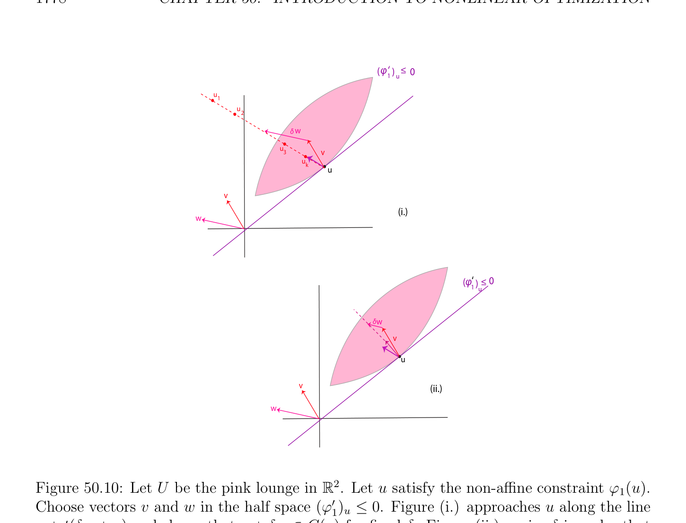

# Karush–Kuhn–Tucker Các điều kiện

<!-- PAGE 1778 -->
$$(\varphi ‘)\le 0$$
$$1u$$
$$u$$
$$1$$
$$u$$
$$2$$
$$\delta w$$
$$u3v$$
$$uk$$
$$u$$
$$v$$
$$(i.)$$
$$w$$
$$(\varphi ‘)\le 0$$
$$1u$$
$$\delta w$$
$$v$$
$$u$$
$$v(ii.)$$
$$w$$

**Hình 50.10:** Cho $U$ là hồng lounge trong $\mathbb{R}^{2}$. Cho $u$ thỏa mãn non-affine ràng buộc $\phi_{1} (u)$. Chọn các vectơ $v$ và $w$ trong một nửa không gian $(\phi_{1}' )_{u} \le 0$. Hình $(i.)$ các cách tiếp cận $u$ dọc theo đường thẳng $u + t(\delta w + v)$ và chỉ ra rằng $v + \delta w \in$ C(u) cho cố định $\delta$. Hình (ii.) varies $\delta$ trong thứ tự rằng tím các vectơ cách tiếp cận $v$ như $\delta  \to \infty$.

## 50.3 Karush–Kuhn–Tucker Các điều kiện

Nếu miền xác định $U$ được định nghĩa bởi bất đẳng thức các ràng buộc thỏa mãn nhẹ differentiability các điều kiện và nếu các ràng buộc tại $u$ là qualified, thì có một cần điều kiện cho hàm $J$ đến có cực tiểu địa phương (local minimum) tại $u \in U$ liên quan đến suy rộng/tổng quát hóa Các nhân tử Lagrange (Lagrange multipliers). chứng minh sử dụng phiên bản của Farkas bổ đề. Thực ra, cần điều kiện được phát biểu tiếp theo nghiệm đúng cho vô hạn chiều các không gian vectơ bởi vì ở đó phiên bản của Farkas bổ đề giữ cho thực Các không gian Hilbert, nhưng ta sẽ content chính chúng ta với phiên bản giữ cho hữu hạn dimensional các không gian vectơ định chuẩn. Cho nhiều hơn/thêm tổng quát phiên bản, xem Định lý 48.12 (hoặc Ciarlet $[41]$, Chương $9)$. Ta sẽ là bằng cách sử dụng sau đây phiên bản của Farkas bổ đề.

> **Mệnh đề 50.3.** (Farkas Bổ đề, Phiên bản I) Cho $A$ là thực $m\times n$ ma trận và cho $b \in \mathbb{R}^{m}$ là bất kỳ vectơ. hệ phương trình tuyến tính Ax $= b$ có không có nghiệm $x \ge 0$ khi và chỉ khi tồn tại một khác không

<!-- PAGE 1779 -->
Dạng tuyến tính (linear form) $y \in (\mathbb{R}^{m})^{*}$ sao cho yA $\ge 0_{n}^{\top}$ và yb $< 0$. Ta sẽ sử dụng phiên bản của Farkas bổ đề thu được bằng cách lấy contrapositive, cụ thể là: nếu yA $\ge 0_{n}^{\top}$ suy ra yb $\ge 0$ với mọi các dạng tuyến tính $y \in (\mathbb{R}^{m})^{*}$, thì hệ phương trình tuyến tính Ax $= b$ có một số nghiệm $x \ge 0$. Thực sự, nó là nhiều hơn/thêm thuận tiện để sử dụng phiên bản của Farkas bổ đề áp dụng đến Euclidean không gian vectơ (vector space) (với tích vô hướng (inner product) được ký hiệu $\langle$ -, $-\rangle$). Điều này phiên bản cũng áp dụng đến vô hạn dimensional thực Không gian Hilbert (Hilbert space); xem Định lý 48.12. Nhắc lại rằng trong Không gian Euclid (Euclidean space) $V$ tích vô hướng (inner product) cảm sinh đẳng cấu giữa $V$ và V', không gian của liên tục các dạng tuyến tính trên $V$. Trong trường hợp của chúng ta, ta cần đẳng cấu $\sharp$ từ V' đến $V$ được định nghĩa sao cho với mọi dạng tuyến tính (linear form) $\omega  \in$ V', vectơ $\omega^{\sharp} \in V$ là một cách duy nhất được định nghĩa bởi phương trình
$$\omega (v) = \langle v, \omega^{\sharp} \rangle for all v \in V .$$
$\mathbb{R}^{n}  \mathbb{R}^{n} \mathbb{R}^{n} \mathbb{R}^{n}$ Trong, đẳng cấu giữa và ($)^{*}$ tương đương với đến phép chuyển vị: nếu $y \in$ ($)^{*}$ là
$$\mathbb{R}^{n}$$
Dạng tuyến tính (linear form) và $v \in$ là vectơ, thì
$$yv = v^{\top}y^{\top}.$$
Phiên bản của Farkas–Minskowski bổ đề trong số hạng của tích vô hướng (inner product) là như sau.

> **Mệnh đề 50.4.** (Farkas–Minkowski) Cho $V$ là Không gian Euclid (Euclidean space) của hữu hạn số chiều với tích vô hướng (inner product) $\langle$ -, $-\rangle$ (tổng quát hơn, Không gian Hilbert (Hilbert space)). Với mọi hữu hạn họ $(a_{1}, \dots  , a_{m})$ của $m$ các vectơ $a_{i} \in V$ và bất kỳ vectơ $b \in V$, với mọi $v \in V$,
$$if \langle a_{i}, v\rangle \ge 0 for i = 1, \dots  , m implies that \langle b, v\rangle \ge 0,$$
Thì ở đó tồn tại $\lambda_{1} , \dots  , \lambda_{m}  \in \mathbb{R}$ sao cho
$$\lambda_{i}  \ge 0 for i = 1, \dots  , m, and b = \sum_{i=1}^{m}  \lambda_{i} a_{i},$$
Rằng là, $b$ thuộc đến nón đa diện (polyhedral cone) $cone(a_{1}, \dots  , a_{m})$. Mệnh đề 50.4 là đặc biệt trường hợp của Định lý 48.12 mà nghiệm đúng cho thực Các không gian Hilbert. Ta có thể bây giờ chứng minh sau đây định lý.

> **Định lý 50.5.** Cho $\phi_{i}$: $\Omega \to \mathbb{R}$ là $m$ các ràng buộc được định nghĩa trên một số mở tập con $\Omega$ của hữu hạn chiều Euclidean không gian vectơ (vector space) $V$ (tổng quát hơn, thực Không gian Hilbert (Hilbert space) $V$), cho $J$: $\Omega \to \mathbb{R}$ là một số hàm, và cho $U$ là cho trước bởi
$$U = {x \in \Omega | \phi_{i} (x) \le 0, 1 \le i \le m}.$$
Với mọi $u \in U$, cho
$$I(u) = {i \in {1, \dots  , m} | \phi_{i} (u) = 0},$$

<!-- PAGE 1780 -->
Và giả sử rằng các hàm $\phi_{i}$ là khả vi (differentiable) tại $u$ với mọi $i \in$ I(u) và liên tục tại $u$ với mọi $i \in /$ I(u). Nếu $J$ là khả vi (differentiable) tại $u$, có cực tiểu địa phương (local minimum) tại $u$ đối với $U$, và nếu các ràng buộc là qualified tại $u$, thì ở đó tồn tại một số các vô hướng $\lambda_{i} (u) \in \mathbb{R}$ với mọi $i \in$ I(u), sao cho
$$J_{u}' + \sum_{i\in I(u)}  \lambda_{i} (u)(\phi_{i}' )_{u} = 0,and\lambda_{i} (u) \ge 0 for all i \in I(u).$$
Ở trên các điều kiện được gọi là Karush–Kuhn–Tucker tính tối ưu các điều kiện. Tương đương, theo các gradien, ở trên các điều kiện được biểu diễn như
$$\nabla J_{u} + \sum_{i\in I(u)}  \lambda_{i} (u)\nabla (\phi_{i} )_{u} = 0,and\lambda_{i} (u) \ge 0 for all i \in I(u).$$

*Chứng minh.* Theo Mệnh đề 50.1(2), ta có
$$J_{u}'(w) \ge 0for all w \in C(u),(*_{1})$$
Và theo Mệnh đề 50.2(2), ta có C(u) $= C^{*}(u)$, ở đâu
$$C^{*}(u) = {v \in V | (\phi_{i}' )_{u}(v) \le 0, i \in I(u)},(*_{2})$$
Do đó $(*_{1})$ có thể được biểu diễn dưới dạng: với mọi $w \in V$,
$$if w \in C^{*}(u) then J_{u}'(w) \ge 0,$$
Hoặc
$$if -(\phi_{i}' )_{u}(w) \ge 0 for all i \in I(u), then J_{u}'(w) \ge 0.(*_{3})$$
Dưới đẳng cấu $\sharp$, vectơ $(J_{u}')^{\sharp}$ là gradien $\nabla J_{u}$, sao cho
$$J_{u}'(w) = \langle w, \nabla J_{u}\rangle ,(*_{4})$$
Và vectơ $((\phi_{i}' )_{u})^{\sharp}$ là gradien $\nabla (\phi_{i} )_{u}$, sao cho
$$(\phi_{i}' )_{u}(w) = \langle w, \nabla (\phi_{i} )_{u}\rangle .(*_{5})$$
Bằng cách sử dụng Các phương trình $(*_{4})$ và $(*_{5})$, Phương trình $(*_{3})$ có thể được viết dưới dạng: với mọi $w \in V$,
$$if \langle w, -\nabla (\phi_{i} )_{u}\rangle \ge 0 for all i \in I(u), then \langle w, \nabla J_{u}\rangle \ge 0.(*_{6})$$
Bởi Farkas–Minkowski mệnh đề (Mệnh đề 50.4), ở đó tồn tại một số sacalars $\lambda_{i} (u)$ với mọi $i \in$ I(u), sao cho $\lambda_{i} (u) \ge 0$ và
$$\nabla J_{u} = \sum_{i\in I(u)}  \lambda_{i} (u)(-\nabla (\phi_{i} )_{u}),$$
Rằng là
$$\nabla J_{u} + \sum_{i\in I(u)}  \lambda_{i} (u)\nabla (\phi_{i} )_{u} = 0,$$

<!-- PAGE 1781 -->
Và bằng cách sử dụng nghịch đảo của đẳng cấu $\sharp$ (mà là tuyến tính), ta thu được
$$J_{u}' + \sum_{i\in I(u)}  \lambda_{i} (u)(\phi_{i}' )_{u} = 0,$$
Như đã khẳng định. Vì các ràng buộc là các bất đẳng thức của tạo thành $\phi_{i} (x) \le 0$, có một cách của biểu diễn Karush–Kuhn–Tucker tính tối ưu các điều kiện, thường abbreviated như KKT các điều kiện, trong cách rằng thực hiện không refer một cách tường minh đến chỉ số tập hợp I(u):
$$J_{u}' + \sum_{i=1}^{m}  \lambda_{i} (u)(\phi_{i}' )_{u} = 0,(KKT_{1})$$
Và
$$\sum_{i=1}^{m}  \lambda_{i} (u)\phi_{i} (u) = 0,\lambda_{i} (u) \ge 0,i = 1, \dots  , m.(KKT_{2})$$
Thật vậy, nếu ta có chặt bất đẳng thức $\phi_{i} (u) < 0$ (ràng buộc $\phi_{i}$ là không hoạt động tại $u)$, vì tất cả các số hạng $\lambda_{i} (u)\phi_{i} (u)$ là nonpositive, ta phải có $\lambda_{i} (u) = 0$; nghĩa là, ta chỉ cần đến xét $\lambda_{i} (u)$ với mọi $i \in$ I(u). Vẫn chưa một cái khác cách đến biểu diễn các điều kiện trong $(KKT_{2})$ là
$$\lambda_{i} (u)\phi_{i} (u) = 0,\lambda_{i} (u) \ge 0,i = 1, \dots  , m.(KKT_{2}')$$
Nói cách khác, với mọi $i \in {1, \dots  , m}$, nếu $\phi_{i} (u) < 0$, thì $\lambda_{i} (u) = 0$; nghĩa là, $\bullet$ nếu ràng buộc $\phi_{i}$ là không hoạt động tại $u$, thì $\lambda_{i} (u) = 0$. Bởi contrapositive, nếu $\lambda_{i} (u) \neq  0$, thì $\phi_{i} (u) = 0$; nghĩa là, $\bullet$ nếu $\lambda_{i} (u) \neq  0$, thì ràng buộc $\phi_{i}$ là hoạt động tại $u$. các điều kiện trong $(KKT_{2}')$ là referred đến như độ bù lỏng (complementary slackness) các điều kiện. các vô hướng $\lambda_{i} (u)$ là thường được gọi là suy rộng/tổng quát hóa Các nhân tử Lagrange (Lagrange multipliers). Nếu $V = \mathbb{R}^{n}$, cần các điều kiện của Định lý 50.5 được biểu diễn như sau đây hệ của các phương trình và
$$\mathbb{R}^{n} \mathbb{R}_{+}^{m}$$
Các bất đẳng thức trong unknowns $(u_{1}, \dots  , u_{n}) \in$ và $(\lambda_{1} , \dots  , \lambda_{m}$) $\in$:
$$\frac{\partial J}{\partial x_{1}} (u) + \lambda_{1} \frac{\partial \phi_{1}}{\partial x_{1}} (u) + \cdots  + \lambda_{m} \frac{\partial \phi_{m}}{\partial x_{1}} (u) = 0$$
$$\vdots \vdots$$
$$\frac{\partial J}{\partial x_{n}} (u) + \lambda_{1} \frac{\partial \phi_{1}}{\partial x_{n}} (u) + \cdots  + \lambda_{m} \frac{\partial \phi_{m}}{\partial x_{n}} (u) = 0$$
$$\lambda_{1} \phi_{1} (u) + \cdots  + \lambda_{m} \phi_{m} (u) = 0$$
$$\phi_{1} (u) \le 0$$
$$\vdots \vdots$$
$$\phi_{m} (u) \le 0$$
$$\lambda_{1} , \dots  , \lambda_{m}  \ge 0.$$

<!-- PAGE 1782 -->

> **Ví dụ 50.3.** Cho $J, \phi_{1}$ và $\phi_{2}$ là các hàm được định nghĩa trên $\mathbb{R}$ bởi
$$J(x) = x$$
$$\phi_{1} (x) = -x$$
$$\phi_{2} (x) = x -1.$$
Trong trường hợp này
$$U = {x \in \mathbb{R} | -x \le 0, x -1 \le 0} = [0, 1].$$
Vì các ràng buộc là afin, chúng là automatically qualified với mọi $u \in [0, 1]$. hệ của các phương trình và các bất đẳng thức được hiển thị ở trên trở thành
$$1 -\lambda_{1}  + \lambda_{2}  = 0$$
$$-\lambda_{1} x + \lambda_{2} (x -1) = 0$$
$$-x \le 0$$
$$x -1 \le 0$$
$$\lambda_{1} , \lambda_{2}  \ge 0.$$
Thứ nhất đẳng thức suy ra rằng $\lambda_{1}  = 1 + \lambda_{2}$. thứ hai đẳng thức thì trở thành
$$-(1 + \lambda_{2} )x + \lambda_{2} (x -1) = 0,$$
Mà suy ra rằng $\lambda_{2}  = -x$. Vì $0 \le x \le 1$, hoặc tương đương $-1 \le -x \le 0$, và $\lambda_{2}  \ge 0$, ta kết luận rằng $\lambda_{2}  = 0$ và $\lambda_{1}  = 1$ là nghiệm liên kết với $x = 0$, cực tiểu của J(x) $= x$ trên $[0, 1]$. Nhận thấy rằng trường hợp $x = 1$ tương ứng với cực đại và không cực tiểu của J(x) $= x$ trên $[0, 1]$.
Nhận xét: Trừ khi các dạng tuyến tính $(\phi_{i}' )_{u}$ cho $i \in$ I(u) là độc lập tuyến tính (linearly independent), $\lambda_{i} (u)$ là một cách tổng quát không duy nhất. Cũng, nếu I(u) $= \emptyset$, thì KKT các điều kiện rút gọn đến $J_{u}' = 0$. Điều này là không đáng ngạc nhiên bởi vì trong điều này trường hợp $u$ thuộc đến tương đối phần trong (interior) của $U$. Nếu các ràng buộc là tất cả afin đẳng thức các ràng buộc, thì KKT các điều kiện là bit đơn giản hơn. Ta sẽ xét trường hợp này một cách ngắn. các điều kiện cho qualification của nonaffine các ràng buộc là khó (nếu không không thể) để sử dụng trong thực tế, bởi vì chúng phụ thuộc vào $u \in U$ và trên các đạo hàm $(\phi_{i}' )_{u}$. Do đó nó là desirable để tìm đơn giản hơn các điều kiện. May mắn thay, điều này là khả dĩ/có thể nếu nonaffine các hàm $\phi_{i}$ là lồi.

> **Định nghĩa 50.6.** Cho $U \subseteq \Omega \subseteq V$ là cho trước bởi
$$U = {x \in \Omega | \phi_{i} (x) \le 0, 1 \le i \le m},$$
Ở đâu $\Omega$ là mở tập con của Euclidean không gian vectơ (vector space) $V$. Nếu các hàm $\phi_{i}$: $\Omega \to \mathbb{R}$ là lồi, ta nói rằng các ràng buộc là qualified nếu sau đây các điều kiện đúng:

<!-- PAGE 1783 -->
() Hoặc các ràng buộc $\phi_{i}$ là afin với mọi $i = 1, \dots  , m$ và $U \neq  \emptyset$, hoặc
$(b)$ Tồn tại một vectơ $v \in \Omega$ sao cho sau đây các điều kiện đúng cho $i = 1, \dots  , m$:
$$(i) \phi_{i} (v) \le 0.$$
$$(ii) If \phi_{i}  is not affine, then \phi_{i} (v) < 0.$$
Ở trên qualification các điều kiện là đã biết như Slater’s các điều kiện. Điều kiện (b)(i) cũng suy ra rằng $U$ có khác rỗng tương đối phần trong (interior). Nếu $\Omega$ là lồi, thì $U$ là cũng lồi. Điều này là bởi vì với mọi $u, v \in \Omega$, nếu $u \in U$ và $v \in U$, nghĩa là $\phi_{i} (u) \le 0$ và $\phi_{i} (v) \le 0$ cho $i = 1, \dots  , m$, vì các hàm $\phi_{i}$ là lồi, với mọi $\theta  \in [0, 1]$ ta có $\phi_{i} ((1$ - $\theta )u + \theta v) \le (1$ - $\theta )\phi_{i} (u) + \theta \phi_{i} (v)$ vì $\phi_{i}$ là lồi
$$\le 0since 1 -\theta  \ge 0, \theta  \ge 0, \phi_{i} (u) \le 0, \phi_{i} (v) \le 0,$$
Và bất kỳ giao của các tập lồi là lồi.  Nó là quan trọng đến nhận thấy rằng nonaffine đẳng thức ràng buộc $\phi_{i} (u) = 0$ là không bao giờ qualified. Thật vậy, $\phi_{i} (u) = 0$ là tương đương đến $\phi_{i} (u) \le 0$ và $-\phi_{i} (u) \le 0$, do đó nếu các phần tử này các ràng buộc là qualified và nếu $\phi_{i}$ là không afin thì tồn tại một khác không vectơ $v \in \Omega$ sao cho cả hai $\phi_{i} (v) < 0$ và $-\phi_{i} (v) < 0$, mà là không thể. Cho điều này lý do, đẳng thức các ràng buộc là thường được giả sử là afin. sau đây định lý cho ta nhiều hơn/thêm flexible phiên bản của Định lý 50.5 cho các ràng buộc cho trước bởi các hàm lồi. Nếu ngoài ra, hàm $J$ là cũng lồi, thì KKT các điều kiện là cũng đủ điều kiện cho cực tiểu địa phương (local minimum).

> **Định lý 50.6.** Cho $\phi_{i}$: $\Omega \to \mathbb{R}$ là $m$ lồi các ràng buộc được định nghĩa trên một số mở lồi tập con $\Omega$ của hữu hạn chiều Euclidean không gian vectơ (vector space) $V$ (tổng quát hơn, thực Không gian Hilbert (Hilbert space) $V$), cho $J$: $\Omega \to \mathbb{R}$ là một số hàm, cho $U$ là cho trước bởi
$$U = {x \in \Omega | \phi_{i} (x) \le 0, 1 \le i \le m},$$
Và cho $u \in U$ là bất kỳ điểm sao cho các hàm $\phi_{i}$ và $J$ là khả vi (differentiable) tại $u$.
$(1)$ Nếu $J$ có cực tiểu địa phương (local minimum) tại $u$ đối với $U$, và nếu các ràng buộc là qualified, thì ở đó tồn tại một số các vô hướng $\lambda_{i} (u) \in \mathbb{R}$, sao cho KKT điều kiện đúng:
$$J_{u}' + \sum_{i=1}^{m}  \lambda_{i} (u)(\phi_{i}' )_{u} = 0$$
Và
$$\lambda_{i} (u)\phi_{i} (u) = 0,\lambda_{i} (u) \ge 0,i = 1, \dots  , m.$$

<!-- PAGE 1784 -->
Tương đương, theo các gradien, ở trên các điều kiện được biểu diễn như
$$\nabla J_{u} + \sum_{i=1}^{m}  \lambda_{i} (u)\nabla (\phi_{i} )_{u} = 0,$$
Và
$$\lambda_{i} (u)\phi_{i} (u) = 0,\lambda_{i} (u) \ge 0,i = 1, \dots  , m.$$
Hơn nữa, $m$ các điều kiện
$$\lambda_{i} (u)\phi_{i} (u) = 0,\lambda_{i} (u) \ge 0,i = 1, \dots  , m,$$
Là tương đương đến các điều kiện
$$\sum_{i=1}^{m}  \lambda_{i} (u)\phi_{i} (u) = 0and\lambda_{i} (u) \ge 0,i = 1, \dots  , m.$$
$(2)$ Ngược lại, nếu thu hẹp của $J$ đến $U$ là lồi và nếu ở đó tồn tại các vô hướng $(\lambda_{1} , \dots  , \lambda_{m}$) $\in \mathbb{R}_{+}^{m}$ sao cho KKT các điều kiện đúng, thì hàm $J$ có (toàn cục) cực tiểu tại $u$ đối với $U$.

*Chứng minh.* $(1)$ Nó suffices để chứng minh rằng nếu lồi các ràng buộc là qualified theo Định nghĩa 50.6, thì chúng là qualified theo Định nghĩa 50.5, vì trong trường hợp này ta có thể áp dụng Định lý 50.5. Nếu $v \in \Omega$ là vectơ sao cho Điều kiện $(b)$ của Định nghĩa 50.6 nghiệm đúng và nếu $v \neq  u$, với mọi $i \in$ I(u), vì $\phi_{i} (u) = 0$ và vì $\phi_{i}$ là lồi, theo Mệnh đề 40.11(1),
$$\phi_{i} (v) \ge \phi_{i} (u) + (\phi_{i}' )_{u}(v -u) = (\phi_{i}' )_{u}(v -u),$$
Do đó nếu ta cho $w = v$ - $u$ thì
$$(\phi_{i}' )_{u}(w) \le \phi_{i} (v),$$
Mà chỉ ra rằng nonaffine các ràng buộc $\phi_{i}$ cho $i \in$ I(u) là qualified theo Định nghĩa 50.5, bởi Điều kiện $(b)$ của Định nghĩa 50.6. Nếu $v = u$, thì các ràng buộc $\phi_{i}$ cho mà $\phi_{i} (u) = 0$ phải là afin (ngược lại, Điều kiện (b)(ii) của Định nghĩa 50.6 sẽ là sai), và trong trường hợp này ta có thể chọn $w = 0$.
$(2)$ Cho $v$ là bất kỳ tùy ý điểm trong lồi tập con $U$. Vì $\phi_{i} (v) \le 0$ và $\lambda_{i}  \ge 0$ cho
$$i = 1, \dots  , m, we have \sum_{i}  m=1 \lambda_{i} \phi_{i} (v) \le 0, and using the fact that$$
$$\sum_{i=1}^{m}  \lambda_{i} (u)\phi_{i} (u) = 0,\lambda_{i} (u) \ge 0,i = 1, \dots  , m,$$

<!-- PAGE 1785 -->
Ta có $\lambda_{i}  = 0$ nếu $i \in /$ I(u) và $\phi_{i} (u) = 0$ nếu $i \in$ I(u), do đó ta có
$$J(u) \le J(u) - \sum_{i=1}^{m}  \lambda_{i} \phi_{i} (v)$$
$$\le J(u) - \sum_{i\in I(u)}  \lambda_{i} (\phi_{i} (v) -\phi_{i} (u))\lambda_{i}  = 0 if i \in /I(u), \phi_{i} (u) = 0 if i \in I(u)$$
$$\le J(u) - \sum_{i\in I(u)}  \lambda_{i} (\phi_{i}' )_{u}(v -u)(by Proposition 40.11)(1)$$
$$\le J(u) + J_{u}'(v -u)(by the KKT conditions)$$
$$\le J(v)(by Proposition 40.11)(1),$$
Và điều này chỉ ra rằng $u$ là thật vậy (toàn cục) cực tiểu của $J$ trên $U$. Nó là quan trọng đến lưu ý rằng khi cả hai các ràng buộc, miền xác định của định nghĩa $\Omega$, và hàm mục tiêu (objective function) $J$ là lồi, nếu KKT các điều kiện đúng với một số $u \in U$ và một số $\lambda  \in \mathbb{R}_{+}^{m}$, thì Định lý 50.6 suy ra rằng $J$ có (toàn cục) cực tiểu tại $u$ đối với $U$, một cách độc lập của bất kỳ giả định trên qualification của các ràng buộc. ở trên định lý suggests giới thiệu hàm $L: \Omega \times \mathbb{R}_{+}^{m} \to \mathbb{R}$ cho trước bởi
$$L(v, \lambda ) = J(v) + \sum_{i=1}^{m}  \lambda_{i} \phi_{i} (v),$$
Với $\lambda  = (\lambda_{1} , \dots  , \lambda_{m}$). hàm $L$ được gọi là Hàm Lagrange (Lagrangian) của Cực tiểu hóa Bài toán $(P)$:
$$minimizeJ(v)$$
$$subject to \phi_{i} (v) \le 0,i = 1, \dots  , m.$$
KKT các điều kiện của Định lý 50.6 suy ra rằng với mọi $u \in U$, nếu vectơ $\lambda  = (\lambda_{1} , \dots  , \lambda_{m}$) là đã biết và nếu $u$ là cực tiểu của $J$ trên $U$, thì
$$\frac{\partial L}{\partial u} (u) = 0$$
$$J(u) = L(u, \lambda ).$$
Hàm Lagrange (Lagrangian) kỹ thuật “absorbs” các ràng buộc vào mới hàm mục tiêu (objective function) $L$ và rút gọn bài toán của việc tìm có ràng buộc cực tiểu của hàm $J$, đến bài toán của việc tìm không ràng buộc cực tiểu của hàm L(v, $\lambda$). Điều này là chính điểm của Hàm Lagrange (Lagrangian) đối ngẫu mà sẽ là treated trong mục tiếp theo. trường hợp rằng phát sinh thường trong thực tế là trường hợp ở đâu các ràng buộc $\phi_{i}$ là afin. Nếu do đó, $m$ các ràng buộc $a_{i}x \le b_{i}$ có thể được được biểu diễn trong ma trận tạo thành như Ax $\le b$, ở đâu $A$ là một ma trận cỡ $m \times  n$ có hàng thứ $i$ là vectơ hàng (row vector) $a_{i}$. KKT các điều kiện của Định lý 50.6 cho sau đây hệ quả.

<!-- PAGE 1786 -->

> **Mệnh đề 50.7.** Nếu $U$ được cho bởi
$$U = {x \in \Omega | Ax \le b},$$
$$\mathbb{R}^{n}$$
Ở đâu $\Omega$ là mở lồi tập con của và $A$ là một ma trận cỡ $m \times  n$, và nếu $J$ là khả vi (differentiable) tại $u$ và $J$ có cực tiểu địa phương (local minimum) tại $u$, thì tồn tại một vectơ $\lambda  \in \mathbb{R}^{m}$, sao cho
$$\nabla J_{u} + A^{\top}\lambda  = 0$$
$$\lambda_{i}  \ge 0 andif a_{i}u < b_{i}, then \lambda_{i}  = 0, i = 1, \dots  , m.$$
Nếu hàm $J$ là lồi, thì ở trên các điều kiện là cũng đủ cho $J$ đến có cực tiểu tại $u \in U$. Một cái khác trường hợp của interest là tổng quát hóa của cực tiểu hóa bài toán liên quan đến afin các ràng buộc của bài toán quy hoạch tuyến tính (linear program) trong tiêu chuẩn tạo thành, nghĩa là, đẳng thức các ràng buộc Ax $= b$ với $x \ge 0$, ở đâu $A$ là một ma trận cỡ $m \times  n$. Trong của ta formalism, điều này tương ứng với 2m $+ n$ các ràng buộc
$$a_{i}x -b_{i} \le 0,i = 1, \dots  , m$$
$$-a_{i}x + b_{i} \le 0,i = 1, \dots  , m$$
$$-x_{j} \le 0,i = 1, \dots  , n.$$
Trong ma trận tạo thành, chúng có thể được biểu diễn dưới dạng
$$\begin{pmatrix} A \\ -A \\ I_{n} \end{pmatrix} \begin{pmatrix} x_{1} \\ \vdots \\ x_{n} \end{pmatrix} \le \begin{pmatrix} b \\ -b \\ 0_{n} \end{pmatrix} .$$
$$-$$
Nếu ta giới thiệu suy rộng/tổng quát hóa Các nhân tử Lagrange (Lagrange multipliers) $\lambda_{i}^{+}$ và $\lambda_{i}^{-}$ cho $i = 1, \dots  , m$ và $\mu_{j}$ cho $j = 1, \dots  , n$, thì KKT các điều kiện là
$$\nabla J_{u} + \begin{pmatrix} A^{\top} & -A^{\top} & -I_{n} \end{pmatrix} \begin{pmatrix} \lambda^{+} \\ \lambda^{-} \\ \mu \end{pmatrix} = 0_{n},$$
Rằng là,
$$\nabla J_{u} + A^{\top}\lambda^{+} -A^{\top}\lambda^{-} -\mu  = 0,$$
Và $\lambda^{+} , \lambda^{-} , \mu  \ge 0$, và nếu $a_{i}u < b_{i}$, thì $\lambda_{i}^{+}  = 0$, nếu $-a_{i}u < -b_{i}$, thì $\lambda_{i}^{-}  = 0$, và nếu $-u_{j} < 0$, thì $\mu_{j}  = 0$. Nhưng các ràng buộc $a_{i}u = b_{i}$ đúng cho $i = 1, \dots  , m$, do đó điều này places không có thu hẹp trên $\lambda_{i}^{+}$ và $\lambda_{i}^{-}$, và nếu ta viết $\lambda_{i}  = \lambda_{i}^{+}$ - $\lambda_{i}^{-}$, thì ta có
$$\nabla J_{u} + A^{\top}\lambda  = \mu ,$$
Với $\mu_{j}  \ge 0$, và nếu $u_{j} > 0$ thì $\mu_{j}  = 0$, cho $j = 1, \dots  , n$. Do đó ta được chứng minh sau đây mệnh đề (mà là slight tổng quát hóa của Mệnh đề 8.7.2 trong Matousek và Gardner $[127])$.

<!-- PAGE 1787 -->

> **Mệnh đề 50.8.** Nếu $U$ được cho bởi
$$U = {x \in \Omega | Ax = b, x \ge 0},$$
$$\mathbb{R}^{n}$$
Ở đâu $\Omega$ là mở lồi tập con của và $A$ là một ma trận cỡ $m \times  n$, và nếu $J$ là khả vi (differentiable)
$$\mathbb{R}^{m} \mathbb{R}^{n}$$
Tại $u$ và $J$ có cực tiểu địa phương (local minimum) tại $u$, thì ở đó tồn tại hai các vectơ $\lambda  \in$ và $\mu  \in$, sao cho
$$\nabla J_{u} + A^{\top}\lambda  = \mu ,$$
Với $\mu_{j}  \ge 0$, và nếu $u_{j} > 0$ thì $\mu_{j}  = 0$, cho $j = 1, \dots  , n$. Tương đương, tồn tại một vectơ $\mathbb{R}^{m} \lambda  \in$ sao cho
$$($$
$$= 0if u_{j} > 0$$
$$(\nabla J_{u})_{j} + (A^{j})^{\top}\lambda$$
$$\ge 0if u_{j} = 0,$$
Ở đâu $A^{j}$ là cột thứ $j$ của $A$. Nếu hàm $J$ là lồi, thì ở trên các điều kiện là cũng đủ cho $J$ đến có cực tiểu tại $u \in U$. Vẫn chưa một cái khác đặc biệt trường hợp rằng phát sinh frequently trong thực tế là cực tiểu hóa bài toán liên quan đến afin đẳng thức các ràng buộc Ax $= b$, ở đâu $A$ là một ma trận cỡ $m \times  n$, với không có thu hẹp trên $x$. ôn tập/tổng quan chứng minh của Mệnh đề 50.8, ta thu được kết quả sau mệnh đề.

> **Mệnh đề 50.9.** Nếu $U$ được cho bởi
$$U = {x \in \Omega | Ax = b},$$
$$\mathbb{R}^{n}$$
Ở đâu $\Omega$ là mở lồi tập con của và $A$ là một ma trận cỡ $m \times  n$, và nếu $J$ là khả vi (differentiable)
$$\mathbb{R}^{m}$$
Tại $u$ và $J$ có cực tiểu địa phương (local minimum) tại $u$, thì tồn tại một vectơ $\lambda  \in$ sao cho
$$\nabla J_{u} + A^{\top}\lambda  = 0.$$
$$\mathbb{R}^{m}$$
Tương đương, tồn tại một vectơ $\lambda  \in$ sao cho
$$(\nabla J_{u})_{j} + (A^{j})^{\top}\lambda  = 0,$$
Ở đâu $A^{j}$ là cột thứ $j$ của $A$. Nếu hàm $J$ là lồi, thì ở trên các điều kiện là cũng đủ cho $J$ đến có cực tiểu tại $u \in U$. Nhận thấy rằng trong Mệnh đề 50.9, $\lambda_{i}$ là chỉ tiêu chuẩn Các nhân tử Lagrange (Lagrange multipliers), với không có thu hẹp của positivity. Do đó, Mệnh đề 50.9 là slight tổng quát hóa của Định lý 40.2 rằng đòi hỏi $A$ đến có hạng (rank) $m$, nhưng trong trường hợp của equational afin các ràng buộc, điều này giả định là unnecessary. Ở đây là ứng dụng của Mệnh đề 50.9 đến phần trong (interior) điểm phương pháp trong quy hoạch tuyến tính (linear programming).

<!-- PAGE 1788 -->

> **Ví dụ 50.4.** Trong quy hoạch tuyến tính (linear programming), phần trong (interior) điểm phương pháp bằng cách sử dụng trung tâm đường đi sử dụng
$$\mathbb{R}^{n}$$
Logarithmic barrier hàm đến giữ các nghiệm $x \in$ của phương trình Ax $= b$ away từ boundaries bởi forcing $x > 0$, mà có nghĩa là $x_{i} > 0$ với mọi $i$; xem Matousek và Gardner $[127]$ (Mục 7.2). Viết
$$\mathbb{R}_{++}^{n}\mathbb{R}^{n}$$
$$= {x \in | x_{i} > 0, i = 1, \dots  , n}.$$
Nhận thấy rằng $\mathbb{R}_{++}^{n}$ là mở và lồi. Với mọi $\mu  > 0$, ta định nghĩa hàm $f_{\mu}$ được định nghĩa trên $\mathbb{R}_{++}^{n}$ bởi
$$f_{\mu}(x) = c^{\top}x + \mu \sum_{i=1}^{n}  \ln x_{i},$$
Ở đâu $c \in \mathbb{R}^{n}$. Ta sẽ like để tìm cần các điều kiện cho $f_{\mu}$ đến có cực đại trên
$$U = {x \in \mathbb{R}_{++}^{n} | Ax = b},$$
Hoặc tương đương để giải sau đây bài toán:
$$maximizef_{\mu}(x)$$
$$subject to$$
$$Ax = b$$
$$x > 0.$$
Vì cực đại hóa $f_{\mu}$ là tương đương đến cực tiểu hóa $-f_{\mu}$, theo Mệnh đề 50.9, nếu $x$ là
$$\mathbb{R}^{m}$$
Tối ưu của ở trên bài toán thì tồn tại một $y \in$ sao cho
$$-\nabla f_{\mu}(x) + A^{\top}y = 0.$$
Vì
$$\nabla f_{\mu}(x) = \begin{pmatrix} c_{1} +_{x}^{\mu} \\ \ddots \\ c_{n} +_{xn}^{\mu} \end{pmatrix} ,$$
Ta thu được phương trình
$$c + \mu \begin{pmatrix} 1 \\ \overline{x}\vdots \\ 1 \end{pmatrix} = A^{\top}y.$$
$$\overline{x}\overline{n}$$
Để thu được nhiều hơn/thêm thuận tiện formulation, ta định nghĩa $s \in \mathbb{R}_{++}^{n}$ sao cho
$$s = \mu \begin{pmatrix} 1 \\ \overline{x}\vdots \\ 1 \end{pmatrix}$$
$$\overline{x}\overline{n}$$
