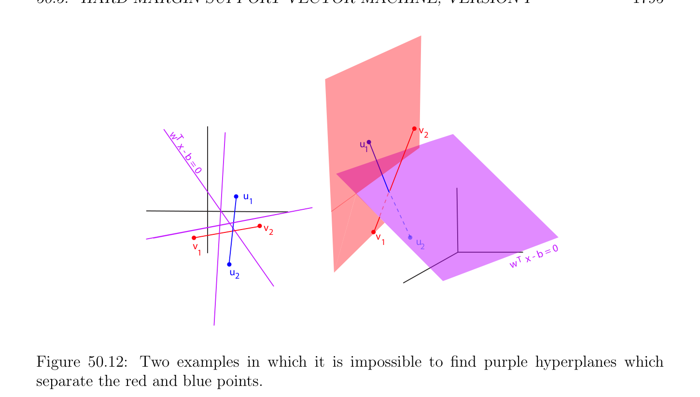
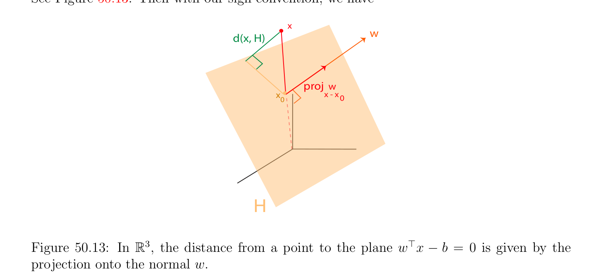

# Lề cứng (hard margin) Máy vectơ hỗ trợ (SVM); Phiên bản I

<!-- PAGE 1794 -->
$(4)$ Update. $u_{k+1} = u_{k} + \rho_{k} d_{nt,k}$. Newton’s phương pháp đòi hỏi rằng KKT-matrix là khả nghịch. Dưới một số nhẹ các giả định, Newton’s phương pháp (với chấp nhận được (feasible) bắt đầu) hội tụ; xem Boyd và Vandenberghe $[29]$ (Chương $10$, Mục 10.2.4). Ta bây giờ cho ví dụ minh họa Mệnh đề 50.7, Máy vectơ hỗ trợ (SVM) (abbreviated như SVM).

## 50.5 Lề cứng (hard margin) Máy vectơ hỗ trợ (SVM); Phiên bản I

Trong mục này ta mô tả sau đây phân loại bài toán, hoặc perhaps nhiều hơn/thêm accurately, separation bài toán (vào hai các lớp). Giả sử ta có hai khác rỗng rời nhau hữu hạn các tập hợp của
$$\mathbb{R}^{n}$$
$p$ xanh lam các điểm ${u_{i}}_{i=1}^{p}$ và $q$ đỏ các điểm ${v_{j}}_{j=1}^{q}$ trong (để đơn giản, bạn có thể giả sử rằng các phần tử này các điểm là trong mặt phẳng, nghĩa là, $n = 2)$. Của ta mục tiêu là để tìm siêu phẳng (hyperplane) $H$ của phương trình
$$\mathbb{R}^{n} \mathbb{R}$$
$w^{\top}x$ - $b = 0$ (ở đâu $w \in$ là khác không vectơ và $b \in$), sao cho tất cả xanh lam các điểm $u_{i}$ là trong một của hai mở các nửa không gian được xác định bởi $H$, và tất cả đỏ các điểm $v_{j}$ là trong khác mở nửa không gian (half-space) được xác định bởi $H$; xem Hình 50.11.
$$u$$
$$2$$
$$w   u$$
$$T3$$
$$xuu$$
$$-21$$
$$b$$
$$= 0$$
$$up$$
$$vu$$
$$p$$
$$2v$$
$$3u$$
$$u3$$
$$1$$
$$v$$
$$v2$$
$$vv1$$
$$13b = 0$$
$$v-$$
$$q\overline{w}\overline{T} x$$
$$v$$
$$4$$
$$v$$
$$q$$

**Hình 50.11:** Hai các ví dụ của SVM separation bài toán. trái hình là SVM trong $\mathbb{R}^{2}$, trong khi phải hình là SVM trong $\mathbb{R}^{3}$. Không mất tính tổng quát (without loss of generality), ta có thể giả sử rằng
$$w^{\top}u_{i} -b > 0for i = 1, \dots  , p$$
$$w^{\top}v_{j} -b < 0for j = 1, \dots  , q.$$
Của course, tách xanh lam và đỏ các điểm có thể là không thể, như ta xem trong Hình 50.12 cho bốn các điểm ở đâu đường thẳng các đoạn thẳng $(u_{1}, u_{2})$ và $(v_{1}, v_{2})$ giao nhau. Nếu siêu phẳng (hyperplane) tách hai các tập con của xanh lam và đỏ các điểm tồn tại, ta nói rằng chúng là một cách tuyến tính khả ly.

<!-- PAGE 1795 -->
$$v$$
$$w   T2$$
$$xu$$
$$-1$$
$$b$$
$$= 0$$
$$u$$
$$1$$
$$v$$
$$2v$$
$$v1u$$
$$2b = 0$$
$$1x -$$
$$\overline{w}\overline{T}$$
$$u$$
$$2$$

**Hình 50.12:** Hai các ví dụ trong mà nó là không thể để tìm tím các siêu phẳng mà tách đỏ và xanh lam các điểm.
Nhận xét: Viết $m = p + q$. độc giả nên là biết rằng trong máy học (learning) phân loại bài toán là thường được định nghĩa như sau. Ta assign $m$ so-called lớp labels $y_{k} = \pm 1$ đến dữ liệu các điểm trong như vậy cách rằng $y_{i} = +1$ với mỗi xanh lam điểm $u_{i}$, và $y_{p+j} = -1$ với mỗi đỏ điểm $v_{j}$, và ta ký hiệu $m$ các điểm bởi $x_{k}$, ở đâu $x_{k} = u_{k}$ cho $k = 1, \dots  , p$ và $x_{k} = v_{k-p}$ cho $k = p + 1, \dots  , p + q$. Thì phân loại các ràng buộc có thể được viết dưới dạng
$$y_{k}(w^{\top}x_{k} -b) > 0for k = 1, \dots  , m.$$
Tập hợp của các cặp ${(x_{1}, y_{1}), \dots  , (x_{m}, y_{m})}$ được gọi là một tập hợp của huấn luyện (training) dữ liệu (hoặc huấn luyện (training) tập hợp). Trong sequel, ta sẽ không sử dụng ở trên phương pháp, và ta sẽ stick đến của ta hai các tập con của $p$ xanh lam các điểm ${u_{i}}_{i=1}^{p}$ và $q$ đỏ các điểm ${v_{j}}_{j=1}^{q}$. Vì có một cách vô hạn nhiều các siêu phẳng tách hai các tập con (nếu thật vậy hai các tập con là một cách tuyến tính khả ly), ta sẽ like đến đến lên với “tốt” tiêu chuẩn cho chọn như vậy siêu phẳng (hyperplane). ý tưởng rằng đã là advocated bởi Vapnik (xem Vapnik $[188])$ là đến xét các khoảng cách $d(u_{i}, H)$ và $d(v_{j}, H)$ từ tất cả các điểm đến siêu phẳng (hyperplane) $H$, và đến chọn siêu phẳng (hyperplane) $H$ rằng các cực đại hóa nhỏ nhất của các phần tử này các khoảng cách. Trong máy học (learning) điều này chiến lược được gọi là việc tìm cực đại lề (margin) siêu phẳng (hyperplane), hoặc lề cứng (hard margin) máy vectơ hỗ trợ (SVM), mà một cách xác định sounds nhiều hơn/thêm impressive. Vì khoảng cách từ điểm $x$ đến siêu phẳng (hyperplane) $H$ của phương trình $w^{\top}x$ - $b = 0$ là
$$| -|$$
$$d(x, H) = \frac{w^{\top}xb}{\|w\|} ,$$

<!-- PAGE 1796 -->
$$\sqrt$$
(ở đâu $\|w\| = \overline{w}^{\top}\overline{w}$ là Euclidean chuẩn (norm) của $w)$, nó là thuận tiện đến temporarily giả sử rằng $\|w\| = 1$, sao cho
$$d(x, H) = |w^{\top}x -b|.$$
Xem Hình 50.13. Thì với của ta dấu quy ước, ta có
$$x$$
$$w$$
$$d(x, H)$$
$$proj^{w}$$
$$xx - x0$$
$$0$$
$$H$$

**Hình 50.13:** Trong $\mathbb{R}^{3}$, khoảng cách từ điểm đến mặt phẳng $w^{\top}x$ - $b = 0$ được cho bởi phép chiếu lên chuẩn tắc/bình thường $w$.
$$d(u_{i}, H) = w^{\top}u_{i} -bi = 1, \dots  , p$$
$$d(v_{j}, H) = -w^{\top}v_{j} + bj = 1, \dots  , q.$$
Nếu ta cho
$$\delta  = \min{d(u_{i}, H), d(v_{j}, H) | 1 \le i \le p, 1 \le j \le q},$$
Thì siêu phẳng (hyperplane) $H$ nên được chọn sao cho
$$w^{\top}u_{i} -b \ge \delta i = 1, \dots  , p$$
$$-w^{\top}v_{j} + b \ge \delta j = 1, \dots  , q,$$
Và sao cho $\delta  > 0$ là cực đại. khoảng cách $\delta$ được gọi là lề (margin) liên kết với siêu phẳng (hyperplane) $H$. Điều này là thật vậy một cách của formulating two-class separation bài toán như tối ưu hóa bài toán với tuyến tính hàm mục tiêu (objective function) $J(\delta , w, b) = \delta$, và afin và toàn phương các ràng buộc $(SVM_{h1})$:
$$maximize\delta$$
$$subject to$$
$$w^{\top}u_{i} -b \ge \delta i = 1, \dots  , p$$
$$-w^{\top}v_{j} + b \ge \delta j = 1, \dots  , q$$
$$\|w\|\le 1.$$

<!-- PAGE 1797 -->
Nhận thấy rằng Bài toán $(SVM_{h1})$ có nghiệm tối ưu (optimal solution) $\delta  > 0$ khi và chỉ khi hai các tập con là một cách tuyến tính khả ly. Ta được sử dụng ràng buộc $\|w\|\le 1$ thay vì $\|w\| = 1$ bởi vì former là qualified, trong khi đó latter là không. Nhưng nếu $(w, b, \delta$) là nghiệm tối ưu (optimal solution), thì $\|w\| = 1$, như được hiển thị trong sau đây mệnh đề.

> **Mệnh đề 50.12.** Nếu $(w, b, \delta$) là nghiệm tối ưu (optimal solution) của Bài toán $(SVM_{h1})$, do đó đặc biệt $\delta  > 0$, thì ta phải có $\|w\| = 1$.

*Chứng minh.* Thứ nhất, nếu $w = 0$, thì ta thu được hai các bất đẳng thức
$$-b \ge \delta ,b \ge \delta ,$$
Mà suy ra rằng $b \le -\delta$ và $b \ge \delta$ với một số dương $\delta$, mà là không thể. Nhưng khi đó, nếu $w \neq  0$ và $\|w\| < 1$, bằng cách chia cả hai vế của các bất đẳng thức bởi $\|w\| < 1$ ta sẽ thu được tốt hơn nghiệm $(w/ \|w\|, b/ \|w\|, \delta / \|w\|)$, vì $\|w\| < 1$ suy ra rằng $\delta / \|w\| > \delta$. Ta bây giờ chứng minh rằng nếu hai các tập con là một cách tuyến tính khả ly, thì Bài toán $(SVM_{h1})$ có duy nhất nghiệm tối ưu (optimal solution).

> **Định lý 50.13.** Nếu hai rời nhau các tập con của $p$ xanh lam các điểm ${u_{i}}_{i=1}^{p}$ và $q$ đỏ các điểm ${v_{j}}_{j=1}^{q}$ là một cách tuyến tính khả ly, thì Bài toán $(SVM_{h1})$ có duy nhất nghiệm tối ưu (optimal solution) bao gồm của siêu phẳng (hyperplane) của phương trình $w^{\top}x$ - $b = 0$ tách hai các tập con với cực đại lề (margin) $\delta$. Hơn nữa, nếu ta định nghĩa $c_{1}(w)$ và $c_{2}(w)$ bởi
$$c_{1}(w) = \min w^{\top}u_{i}$$
$$1\le i\le p$$
$$c_{2}(w) = \max w^{\top}v_{j},$$
$$1\le j\le q$$
Thì $w$ là duy nhất cực đại của hàm
$$\rho (w) = \frac{c_{1}(w)c_{2}(w)}{2} -$$
$$\mathbb{R}^{n}$$
Trên lồi tập con $U$ của cho trước bởi các bất đẳng thức
$$w^{\top}u_{i} -b \ge \delta i = 1, \dots  , p$$
$$-w^{\top}v_{j} + b \ge \delta j = 1, \dots  , q$$
$$\|w\|\le 1,$$
Và
$$b = \frac{c_{1}(w) + c_{2}(w)}{2} .$$

<!-- PAGE 1798 -->

*Chứng minh.* chứng minh của chúng ta được điều chỉnh từ Vapnik $[188]$ (Chương $10$, Định lý 10.1). Với mọi tách siêu phẳng (hyperplane) $H$, vì
$$d(u_{i}, H) = w^{\top}u_{i} -bi = 1, \dots  , p$$
$$d(v_{j}, H) = -w^{\top}v_{j} + bj = 1, \dots  , q,$$
Và vì nhỏ nhất khoảng cách đến $H$ là
$$\delta  = \min{d(u_{i}, H), d(v_{j}, H) | 1 \le i \le p, 1 \le j \le q}$$
$$= \min{w^{\top}u_{i} -b, -w^{\top}v_{j} + b | 1 \le i \le p, 1 \le j \le q}$$
$$= \min{\min{w^{\top}u_{i} -b | 1 \le i \le p}, \min{-w^{\top}v_{j} + b | 1 \le j \le q}}$$
$$= \min{\min{w^{\top}u_{i} | 1 \le i \le p} -b}, \min{-w^{\top}v_{j} | 1 \le j \le q} + b}$$
$$= \min{\min{w^{\top}u_{i} | 1 \le i \le p} -b}, -\max{w^{\top}v_{j} | 1 \le j \le q} + b}$$
$$= \min{c_{1}(w) -b, -c_{2}(w) + b},$$
Trong thứ tự cho $\delta$ là cực đại ta phải có
$$c_{1}(w) -b = -c_{2}(w) + b,$$
Mà cho ta
$$b = \frac{c_{1}(w) + c_{2}(w)}{2} .$$
Trong trường hợp này,
$$-$$
$$c_{1}(w) -b = \frac{c_{1}(w)c_{2}(w)}{2} = -c_{2}(w) + b,$$
Do đó cực đại lề (margin) $\delta$ là thật vậy thu được khi $\rho (w) = (c_{1}(w)$ - $c_{2}(w))/2$ là cực đại trên $U$. Ngược lại, nó là dễ để xem rằng bất kỳ siêu phẳng (hyperplane) của phương trình $w^{\top}x -b = 0$ liên kết với $w$ cực đại hóa $\rho$ trên $U$ và $b = (c_{1}(w) + c_{2}(w))/2$ là nghiệm tối ưu (optimal solution). Nó vẫn còn để chỉ ra rằng tối ưu tách siêu phẳng (hyperplane) tồn tại và là duy nhất. Vì unit hình cầu là compắc, $U$ (như đã định nghĩa trong Định lý 50.13) là compắc, và vì hàm $w \mapsto \rho (w)$ là liên tục, nó đạt được của nó cực đại với một số $w_{0}$ sao cho $\|w_{0}\|\le 1$. Thực sự, ta phải có $\|w_{0}\| = 1$, vì ngược lại, bởi lập luận được sử dụng trong Mệnh đề 50.12, $w_{0}/ \|w_{0}\|$ sẽ là chẵn/ngay cả tốt hơn nghiệm. Vì vậy, $w_{0}$ là trên biên (boundary) của $U$. Nhưng $\rho$ là hàm lõm (concave function) (như cận dưới đúng (infimum) của afin các hàm), do đó nếu nó đã có hai phân biệt các cực đại $w_{0}$ và $w_{0}'$ với $\|w_{0}\| = \|w_{0}'\| = 1$, các phần tử này sẽ là toàn cục các cực đại vì $U$ là cũng lồi, do đó ta sẽ có $\rho (w_{0}) = \rho (w_{0}')$ và thì $\rho$ sẽ cũng có cùng giá trị dọc theo đoạn thẳng $(w_{0}, w_{0}')$ và đặc biệt tại $(w_{0} + w_{0}')/2$, phần trong (interior) điểm của $U$, một mâu thuẫn. Ta có thể tiến hành với ở trên formulation $(SVM_{h1})$ nhưng có một cách đến reformulate bài toán sao cho các ràng buộc là tất cả afin, mà có thể được ưu tiên hơn vì chúng sẽ là automatically qualified.
