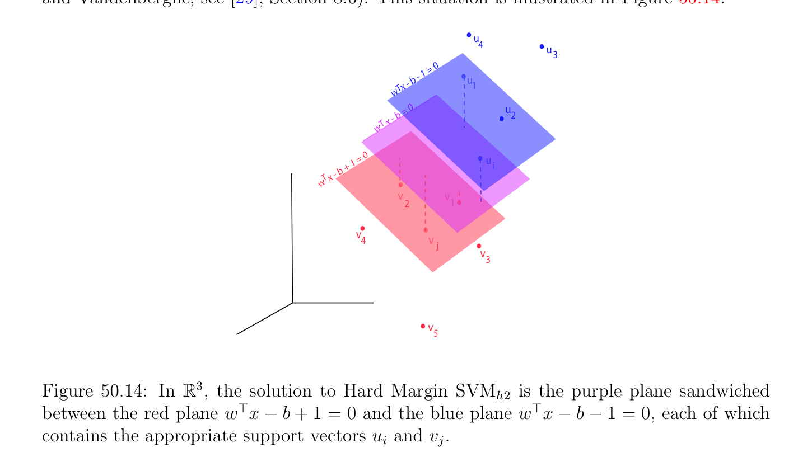
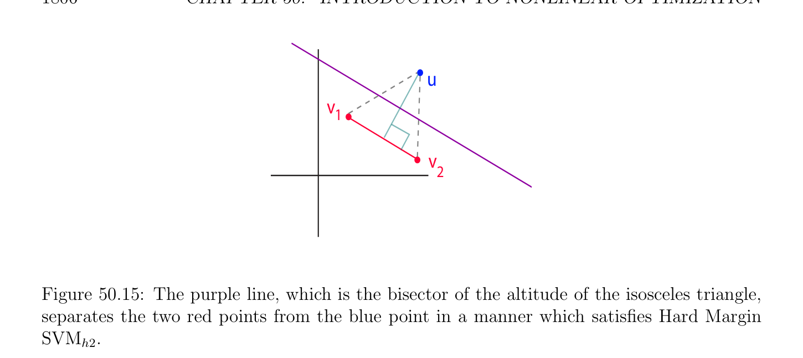

# Lề cứng (hard margin) Máy vectơ hỗ trợ (SVM); Phiên bản II

<!-- PAGE 1799 -->

## 50.6 Lề cứng (hard margin) Máy vectơ hỗ trợ (SVM); Phiên bản II

Vì $\delta  > 0$ (ngược lại dữ liệu sẽ không là khả ly vào hai rời nhau các tập hợp), ta có thể chia afin các ràng buộc bởi $\delta$ để thu được
$$w^{'\top}u_{i} -b'\ge 1i = 1, \dots  , p$$
$$-w^{'\top}v_{j} + b'\ge 1j = 1, \dots  , q,$$
Ngoại trừ rằng bây giờ, w' là không nhất thiết unit vectơ. để thu được các khoảng cách đến siêu phẳng (hyperplane) $H$, ta cần đến chia bởi $\|w'\|$ và thì ta có
$$-$$
$$\frac{w^{'\top}u_{i}b'}{\|w'\|} \ge \frac{1}{\|w'\|} i = 1, \dots  , p$$
$$-$$
$$\frac{w^{'\top}v_{j}+ b'}{\|w'\|} \ge \frac{1}{\|w'\|} j = 1, \dots  , q,$$
Mà có nghĩa là ngắn nhất khoảng cách từ dữ liệu các điểm đến siêu phẳng (hyperplane) là $1/ \|w'\|$. Vì vậy, ta muốn để cực đại hóa $1/ \|w'\|$, nghĩa là, để cực tiểu hóa $\|w'\|$, do đó ta thu được kết quả sau tối ưu hóa Bài toán $(SVM_{h2})$: Lề cứng (hard margin) SVM $(SVM_{h2})$:
$$minimize \frac{1}{2} \|w\|^{2}$$
$$subject to$$
$$w^{\top}u_{i} -b \ge 1i = 1, \dots  , p$$
$$-w^{\top}v_{j} + b \ge 1j = 1, \dots  , q.$$
Hàm mục tiêu (objective function) J(w) $= 1/2 \|w\|^{2}$ là lồi, do đó Mệnh đề 50.7 áp dụng và cho chúng ta cần và đủ điều kiện cho có cực tiểu theo KKT các điều kiện. Thứ nhất nhận thấy rằng tầm thường nghiệm $w = 0$ là không thể, bởi vì xanh lam các ràng buộc sẽ là
$$-b \ge 1,$$
Rằng là $b \le -1$, và đỏ các ràng buộc sẽ là
$$b \ge 1,$$
Nhưng các phần tử này là contradictory. Của ta mục tiêu là để tìm $w$ và $b$, và optionally, $\delta$. Ta tiến hành trong bốn các bước thứ nhất demonstrated trên sau đây ví dụ. Giả sử rằng $p = q = n = 2$, sao cho ta có hai xanh lam các điểm
$$u_{1}^{\top} = (u_{11}, u_{12})u_{2}^{\top} = (u_{21}, u_{22}),$$

<!-- PAGE 1800 -->
Hai đỏ các điểm
$$v_{1}^{\top} = (v_{11}, v_{12})v_{2}^{\top} = (v_{21}, v_{22}),$$
Và
$$w^{\top}= (w_{1}, w_{2}).$$
Bước $1$: Viết các ràng buộc trong ma trận tạo thành. Cho
$$C = \begin{pmatrix} -u_{11} & -u_{12} & 1 \\ -u_{21} & -u_{22} & 1 \\ v_{11} & v_{12} & -1 \\ v_{21} & v_{22} & 1 \end{pmatrix} d = \begin{pmatrix} -1 \\ -1 \\ -1 \\ 1 \end{pmatrix} .(M)$$
$$--$$
Các ràng buộc trở thành
$$C \begin{pmatrix} w \\ b \end{pmatrix} = \begin{pmatrix} -u_{11} & -u_{12} & 1 \\ -u_{21} & -u_{22} & 1 \\ v_{11} & v_{12} & -1 \\ v_{21} & v_{22} & 1 \end{pmatrix} \begin{pmatrix} w_{1} \\ w_{2} \\ b \end{pmatrix} \le \begin{pmatrix} -1 \\ -1 \\ -1 \\ 1 \end{pmatrix} .(C)$$
$$--$$
Bước $2$: Viết hàm mục tiêu (objective function) trong ma trận tạo thành.
$$J(w_{1}, w_{2}, b) = \frac{1}{2} \begin{pmatrix} 1 & 0 & 0 \\ 0 & 1 & 0 \\ 0 & 0 & 0 \end{pmatrix} \begin{pmatrix} w_{1} \\ w_{2} \\ b \end{pmatrix} .(O)$$
$$\begin{pmatrix} w_{1} & w_{2} & b \end{pmatrix}$$
Bước $3$: Áp dụng Mệnh đề 50.7 để giải cho $w$ theo $\lambda$ và $\mu$. Ta thu được
$$\begin{pmatrix} w_{1} \\ w_{2} \\ 0 \end{pmatrix} + \begin{pmatrix} -u_{11} & -u_{21} & v_{11} & v_{21} \\ -u_{12} & -u_{22} & v_{12} & v_{22} \\ 1 & 1 & 1 & 1 \end{pmatrix} \begin{pmatrix} \lambda_{1} \\ \lambda_{2} \\ \mu_{1} \\ \mu_{2} \end{pmatrix} = \begin{pmatrix} 0 \\ 0 \\ 0 \end{pmatrix} ,$$
$$--$$
I.e.
$$\nabla J_{(w,b)} + C^{\top} \begin{pmatrix} \lambda \\ \mu \end{pmatrix} = 0_{3},\lambda^{\top} = (\lambda_{1} , \lambda_{2} ), \mu^{\top} = (\mu_{1} , \mu_{2} ).$$
Thì
$$\begin{pmatrix} w_{1} \\ w_{2} \\ 0 \end{pmatrix} = \begin{pmatrix} u_{11} & u_{21} & -v_{11} & -v_{21} \\ u_{12} & u_{22} & -v_{12} & -v_{22} \\ 1 & 1 & 1 & 1 \end{pmatrix} \begin{pmatrix} \lambda_{1} \\ \lambda_{2} \\ \mu_{1} \\ \mu_{2} \end{pmatrix} ,$$
$$--$$
Mà suy ra
$$w = \begin{pmatrix} w_{1} \\ w_{2} \end{pmatrix} = \lambda_{1} \begin{pmatrix} u_{11} \\ u_{12} \end{pmatrix} + \lambda_{2} \begin{pmatrix} u_{21} \\ u_{22} \end{pmatrix} -\mu_{1} \begin{pmatrix} v_{11} \\ v_{12} \end{pmatrix} -\mu_{2} \begin{pmatrix} v_{21} \\ v_{22} \end{pmatrix} (*_{1})$$

<!-- PAGE 1801 -->
Đối với
$$\mu_{1}  + \mu_{2}  -\lambda_{1}  -\lambda_{2}  = 0.(*_{2})$$
$$Step 4: Rewrite the constraints at (C) using (*_{1}). In particular C \begin{pmatrix} w \\ b \end{pmatrix} \le d becomes$$
$$\begin{pmatrix} -u_{11} & -u_{12} & 1 \\ -u_{21} & -u_{22} & 1 \\ v_{11} & v_{12} & -1 \\ v_{21} & v_{22} & 1 \end{pmatrix} \begin{pmatrix} u_{11} & u_{21} & -v_{11} & -v_{21} & 0 \\ u_{12} & u_{22} & -v_{21} & -v_{22} & 0 \\ 0 & 0 & 0 & 0 & 1 \end{pmatrix} \begin{pmatrix} \lambda_{1} \\ \lambda_{2} \\ \mu_{1} \\ \mu_{2} \\ b \end{pmatrix} \le \begin{pmatrix} -1 \\ -1 \\ -1 \\ 1 \end{pmatrix} .$$
$$--$$
Rewriting trước đó phương trình trong “khối” format cho chúng ta
$$- \begin{pmatrix} -u_{11} & -u_{12} \\ -u_{21} & -u_{22} \\ v_{11} & v_{12} \\ v_{21} & v_{22} \end{pmatrix} \begin{pmatrix} -u_{11} & -u_{21} & v_{11} & v_{21} \\ -u_{12} & -u_{22} & v_{21} & v_{22} \end{pmatrix} \begin{pmatrix} \lambda_{1} \\ \lambda_{2} \\ \mu_{1} \\ \mu_{2} \end{pmatrix} + b \begin{pmatrix} 1 \\ 1 \\ -1 \\ 1 \end{pmatrix} + \begin{pmatrix} 1 \\ 1 \\ 1 \\ 1 \end{pmatrix} \le \begin{pmatrix} 0 \\ 0 \\ 0 \\ 0 \end{pmatrix} ,$$
$$-$$
Mà với định nghĩa
$$X = \begin{pmatrix} -u_{11} & -u_{21} & v_{11} & v_{21} \\ -u_{12} & -u_{22} & v_{21} & v_{22} \end{pmatrix}$$
Cho ta
$$-X^{\top}X \begin{pmatrix} \lambda \\ \mu \end{pmatrix} + b \begin{pmatrix} 1_{2} \\ -1_{2} \end{pmatrix} + 1_{4} \le 0_{4}.(*_{3})$$
Cho chúng ta bây giờ xét tổng quát trường hợp. Bước $1$: Viết các ràng buộc trong ma trận tạo thành. Thứ nhất ta viết lại các ràng buộc như
$$-u_{i}^{\top} w + b \le -1i = 1, \dots  , p$$
$$v_{j}^{\top} w -b \le -1j = 1, \dots  , q,$$
$$\mathbb{R}^{p+q}$$
Và ta thu được ma trận cỡ $(p + q) \times  (n + 1)$ $C$ và vectơ $d \in$ cho trước bởi
$$C = \begin{pmatrix} -u_{1}^{\top} & 1 \\ \vdots & \vdots \\ -u_{p}^{\top} & 1 \\ v_{1}^{\top} & -1 \\ \vdots & \vdots \\ v_{q}^{\top} & 1 \end{pmatrix} ,d = \begin{pmatrix} -1 \\ \vdots \\ -1 \end{pmatrix} ,$$
$$-$$
Do đó tập hợp của bất đẳng thức các ràng buộc là
$$C \begin{pmatrix} w \\ b \end{pmatrix} \le d.$$

<!-- PAGE 1802 -->
Bước $2$: hàm mục tiêu (objective function) trong ma trận tạo thành được cho bởi
$$J(w, b) = \frac{1}{2} \begin{pmatrix} w^{\top} & b \end{pmatrix} \begin{pmatrix} I_{n} & 0_{n} \\ 0_{n}^{\top} & 0 \end{pmatrix} \begin{pmatrix} w \\ b \end{pmatrix} .$$
Lưu ý rằng tương ứng ma trận là đối xứng nửa xác định dương (positive semidefinite), nhưng nó là không khả nghịch. Do đó, hàm $J$ là lồi nhưng không lồi chặt (strictly convex). Điều này sẽ gây ra một số định thức con (minor) trouble trong việc tìm đối ngẫu (dual) hàm của bài toán.
$$\mathbb{R}^{p} \mathbb{R}^{q}$$
Bước $3$: Nếu ta giới thiệu suy rộng/tổng quát hóa Các nhân tử Lagrange (Lagrange multipliers) $\lambda  \in$ và $\mu  \in$, theo Mệnh đề 50.7, thứ nhất KKT điều kiện là
$$\nabla J_{(w,b)} + C^{\top} \begin{pmatrix} \lambda \\ \mu \end{pmatrix} = 0_{n+1},$$
Với $\lambda  \ge 0, \mu  \ge 0$. Bởi kết quả của Ví dụ 39.8,
$$\nabla J_{(w,b)} = \begin{pmatrix} I_{n} & 0_{n} \\ 0_{n}^{\top} & 0 \end{pmatrix} \begin{pmatrix} w \\ b \end{pmatrix} = \begin{pmatrix} w \\ 0 \end{pmatrix} ,$$
Do đó ta thu được
$$\begin{pmatrix} w \\ 0 \end{pmatrix} = -C^{\top} \begin{pmatrix} \lambda \\ \mu \end{pmatrix} ,$$
Rằng là,
$$\begin{pmatrix} w \\ 0 \end{pmatrix} = \begin{pmatrix} u \\ \cdots & u_{p} & -v_{1} & \cdots & -v_{q} \\ -^{1}1 & \cdots & -1 & 1 & \cdots & 1 \end{pmatrix} \begin{pmatrix} \lambda \\ \mu \end{pmatrix} .$$
Hệ quả là,
$$w = \sum_{i=1}^{p}  \lambda_{i} u_{i} - \sum_{j=1}^{q}  \mu_{j} v_{j},(*_{1})$$
Và
$$\sum_{j=1}^{q}  \mu_{j}  - \sum_{i=1}^{p}  \lambda_{i}  = 0.(*_{2})$$
Bước $4$: Viết lại ràng buộc bằng cách sử dụng $(*_{1})$. Plugging ở trên biểu thức cho $w$ vào
$$constraints C \begin{pmatrix} w \\ b \end{pmatrix} \le d we get$$
$$\begin{pmatrix} -u_{1}^{\top} & 1 \\ \vdots & \vdots \\ -u_{p}^{\top} & 1 \\ v_{1}^{\top} & -1 \\ \vdots & \vdots \\ v_{q}^{\top} & 1 \end{pmatrix} \begin{pmatrix} u_{1} & \cdots & u_{p} & -v_{1} & \cdots & -v_{q} & 0_{n} \\ 0 & \cdots & 0 & 0 & \cdots & 0 & 1 \end{pmatrix} \begin{pmatrix} \lambda \\ \mu \\ b \end{pmatrix} \le \begin{pmatrix} -1 \\ \vdots \\ -1 \end{pmatrix} ,$$
$$-$$

<!-- PAGE 1803 -->
Do đó nếu cho $X$ là ma trận cỡ $n \times  (p + q)$ cho trước bởi
$$X = \begin{pmatrix} -u_{1} & \cdots & -u_{p} & v_{1} & \cdots & v_{q} \end{pmatrix} ,$$
Ta thu được
$$w = -X \begin{pmatrix} \lambda \\ \mu \end{pmatrix} ,(*_{1}')$$
Và ở trên các bất đẳng thức được viết trong ma trận tạo thành như
$$\begin{pmatrix} 1_{p} \\ X^{\top}-1_{q} \end{pmatrix} \begin{pmatrix} -X & 0_{n} \\ 0_{p+q}^{\top} & 1 \end{pmatrix} \begin{pmatrix} \lambda \\ \mu \\ b \end{pmatrix} \le -1_{p+q};$$
Rằng là,
$$-X^{\top}X \begin{pmatrix} \lambda \\ \mu \end{pmatrix} + b \begin{pmatrix} 1_{p} \\ -1_{q} \end{pmatrix} + 1_{p+q} \le 0_{p+q}.(*_{3})$$
Tương đương, thứ $i$ bất đẳng thức là
$$- \sum_{j=1}^{p}  u_{i}^{\top} u_{j}\lambda_{j}  + \sum_{k=1}^{q}  u_{i}^{\top} v_{k}\mu_{k}  + b + 1 \le 0i = 1, \dots  , p,$$
Và $(p +$ j)th bất đẳng thức là
$$\sum_{i=1}^{p}  v_{j}^{\top} u_{i}\lambda_{i}  - \sum_{k=1}^{q}  v_{j}^{\top} v_{k}\mu_{k}  -b + 1 \le 0j = 1, \dots  , q.$$
Ta cũng có $\lambda  \ge 0, \mu  \ge 0$. Hơn nữa, nếu thứ $i$ bất đẳng thức là không hoạt động, thì $\lambda_{i}  = 0$, và nếu $(p +$ j)th bất đẳng thức là không hoạt động, thì $\mu_{j}  = 0$. Vì các ràng buộc là afin và vì $J$ là lồi, nếu ta có thể tìm $\lambda  \ge 0, \mu  \ge 0$, và $b$ sao cho các bất đẳng thức trong $(*_{3})$ được thỏa mãn, và $\lambda_{i}  = 0$ và $\mu_{j}  = 0$ khi tương ứng ràng buộc là không hoạt động, thì theo Mệnh đề 50.7 ta có tối ưu nghiệm.
Nhận xét: thứ hai KKT điều kiện có thể được viết dưới dạng
$$\begin{pmatrix} \lambda^{\top} & \mu^{\top} \end{pmatrix} \begin{pmatrix} \lambda \\ -X^{\top}X & \mu \end{pmatrix} \begin{pmatrix} 1_{p} \\ + b & -1_{q} \end{pmatrix} \begin{pmatrix} + 1_{p+q} \end{pmatrix} = 0;$$
Rằng là,
$$- \begin{pmatrix} \lambda^{\top} & \mu^{\top} \\ p \end{pmatrix} X^{\top}X \begin{pmatrix} \lambda \\ \mu \\ q \end{pmatrix} + b \begin{pmatrix} \lambda^{\top} & \mu^{\top} \end{pmatrix} \begin{pmatrix} 1_{p} \\ -1_{q} \\ term \end{pmatrix} + \begin{pmatrix} \lambda^{\top} & \mu^{\top} \end{pmatrix} 1_{p+q} = 0.$$
$$Since (*_{2}) says that \sum_{i}  =1 \lambda_{i}  = \sum  j=1 \mu_{j} , the second  is zero, and by (*_{1}') we get$$
$$w^{\top}w = \begin{pmatrix} \lambda^{\top} & \mu^{\top} \end{pmatrix} X^{\top}X \begin{pmatrix} \lambda \\ \mu \end{pmatrix} = \sum_{i=1}^{p}  \lambda_{i}  + \sum_{j=1}^{q}  \mu_{j} .$$

<!-- PAGE 1804 -->
Do đó, ta thu được đơn giản biểu thức cho $\|w\|^{2}$ theo $\lambda$ và $\mu$. các vectơ $u_{i}$ và $v_{j}$ cho mà thứ $i$ bất đẳng thức là hoạt động và $(p +$ j)th bất đẳng thức là hoạt động được gọi là hỗ trợ/giá (support) các vectơ. Với mọi vectơ $u_{i}$ hoặc $v_{j}$ rằng là không hỗ trợ/giá (support) vectơ, tương ứng bất đẳng thức là không hoạt động, do đó $\lambda_{i}  = 0$ và $\mu_{j}  = 0$. Do đó ta xem rằng chỉ hỗ trợ/giá (support) các vectơ contribute đến nghiệm. Nếu ta có thể guess mà các vectơ $u_{i}$ và $v_{j}$ là hỗ trợ/giá (support) các vectơ, cụ thể là, những phần tử đó cho mà $\lambda_{i}  \neq  0$ và $\mu_{j}  \neq  0$, thì với mỗi hỗ trợ/giá (support) vectơ $u_{i}$ ta có phương trình
$$- \sum_{j=1}^{p}  u_{i}^{\top} u_{j}\lambda_{j}  + \sum_{k=1}^{q}  u_{i}^{\top} v_{k}\mu_{k}  + b + 1 = 0,$$
Và với mỗi hỗ trợ/giá (support) vectơ $v_{j}$ ta có phương trình
$$\sum_{i=1}^{p}  v_{j}^{\top} u_{i}\lambda_{i}  - \sum_{k=1}^{q}  v_{j}^{\top} v_{k}\mu_{k}  -b + 1 = 0,$$
Với $\lambda_{i}  = 0$ và $\mu_{j}  = 0$ với mọi non-support các vectơ, do đó cùng với Phương trình $(*_{2})$ ta có hệ phương trình tuyến tính với bằng nhau số của các phương trình và các biến, mà là giải được nếu của ta separation bài toán có nghiệm. Do đó, trong nguyên lý ta có thể tìm $\lambda , \mu$, và $b$ bởi việc giải hệ phương trình tuyến tính.
Nhận xét: Ta có thể thứ nhất giải cho $\lambda$ và $\mu$ (bởi eliminating $b)$, và bởi $(*_{1})$ và vì $w \neq  0$, có một least một số khác không $\lambda_{i0}$ và do đó một số khác không $\mu_{j0}$, do đó tương ứng các bất đẳng thức là các phương trình
$$- \sum_{j=1}^{p}  u_{i0}^{\top}u_{j}\lambda_{j}  + \sum_{k=1}^{q}  u_{i0}^{\top}v_{k}\mu_{k}  + b + 1 = 0$$
$$\sum_{i=1}^{p}  v_{j0}^{\top}u_{i}\lambda_{i}  - \sum_{k=1}^{q}  v_{j0}^{\top}v_{k}\mu_{k}  -b + 1 = 0,$$
Do đó $b$ là cho trước theo $\lambda$ và $\mu$ bởi
$$!$$
$$b = \frac{1}{2} (u_{i0}^{\top} + v_{j0}^{\top}) \sum_{i=1}^{p}  \lambda_{i} u_{i} - \sum_{j=1}^{p}  \mu_{j} v_{j}.$$
Bằng cách sử dụng đối ngẫu (dual) của Hàm Lagrange (Lagrangian), ta có thể giải cho $\lambda$ và $\mu$, nhưng typically $b$ là không được xác định, do đó ta sử dụng ở trên phương pháp để tìm $b$. ở trên nondeterministic quy trình trong mà ta guess mà các vectơ là hỗ trợ/giá (support) các vectơ là không thực tế. Ta sẽ xem sau này rằng thực tế phương pháp cho việc giải cho $\lambda$ và $\mu$ bao gồm trong cực đại hóa đối ngẫu (dual) của Hàm Lagrange (Lagrangian).

<!-- PAGE 1805 -->
Nếu $w$ là nghiệm tối ưu (optimal solution), thì $\delta  = 1/ \|w\|$ là ngắn nhất khoảng cách từ hỗ trợ/giá (support) các vectơ đến tách siêu phẳng (hyperplane) $H_{w,b}$ của phương trình $w^{\top}x$ - $b = 0$. Nếu ta xét hai các siêu phẳng $H_{w,b+1}$ và $H_{w,b-1}$ của các phương trình
$$w^{\top}x -b -1 = 0andw^{\top}x -b + 1 = 0,$$
Thì $H_{w,b+1}$ và $H_{w,b-1}$ là hai các siêu phẳng song song đến siêu phẳng (hyperplane) $H_{w,b}$ và khoảng cách giữa chúng là $2\delta$. Hơn nữa, $H_{w,b+1}$ chứa hỗ trợ/giá (support) các vectơ $u_{i}, H_{w,b-1}$ chứa hỗ trợ/giá (support) các vectơ $v_{j}$, và có không có dữ liệu các điểm $u_{i}$ hoặc $v_{j}$ trong mở miền giữa các phần tử này hai các siêu phẳng chứa tách siêu phẳng (hyperplane) $H_{w,b}$ (được gọi là “dải phẳng (slab)” bởi Boyd và Vandenberghe; xem $[29]$, Mục 8.6). tình huống này được minh họa trong Hình 50.14.
$$u$$
$$4u$$
$$3$$
$$= 0$$
$$- 1$$
$$- b u$$
$$w T x1$$
$$b = 0u$$
$$x -2$$
$$w  T$$
$$= 0u$$
$$x - b + 1i$$
$$wT$$
$$vv$$
$$21$$
$$vv$$
$$4j$$
$$v$$
$$3$$
$$v$$
$$5$$

**Hình 50.14:** Trong $\mathbb{R}^{3}$, nghiệm đến Lề cứng (hard margin) $SVM_{h2}$ là tím mặt phẳng sandwiched giữa đỏ mặt phẳng $w^{\top}x$ - $b + 1 = 0$ và xanh lam mặt phẳng $w^{\top}x$ - $b$ - $1 = 0$, mỗi của mà chứa thích hợp hỗ trợ/giá (support) các vectơ $u_{i}$ và $v_{j}$. Chẵn/ngay cả nếu $p = 1$ và $q = 2$, nghiệm là không hiển nhiên. Trong mặt phẳng, có bốn các khả năng:
$(1)$ Nếu $u_{1}$ là trên đoạn thẳng $(v_{1}, v_{2})$, không có nghiệm.
$(2)$ Nếu phép chiếu $h$ của $u_{1}$ lên đường thẳng được xác định bởi $v_{1}$ và $v_{2}$ là giữa $v_{1}$ và $v_{2}$, nghĩa là $h = (1$ - $\alpha )v_{1} + \alpha_{2} v_{2}$ với $0 \le \alpha  \le 1$, thì nó là đường thẳng song song đến $v_{2}$ - $v_{1}$ và equidistant đến $u$ và cả hai $v_{1}$ và $v_{2}$, như được minh họa trong Hình 50.15.
$(3)$ Nếu phép chiếu $h$ của $u_{1}$ lên đường thẳng được xác định bởi $v_{1}$ và $v_{2}$ là đến phải của $v_{2}$, nghĩa là $h = (1$ - $\alpha )v_{1} + \alpha_{2} v_{2}$ với $\alpha  > 1$, thì nó là đường phân giác của đường thẳng đoạn thẳng $(u_{1}, v_{2})$.
$(4)$ Nếu phép chiếu $h$ của $u_{1}$ lên đường thẳng được xác định bởi $v_{1}$ và $v_{2}$ là đến trái của $v_{1}$, nghĩa là $h = (1$ - $\alpha )v_{1} + \alpha_{2} v_{2}$ với $\alpha  < 0$, thì nó là đường phân giác của đường thẳng đoạn thẳng $(u_{1}, v_{1})$.

<!-- PAGE 1806 -->
$$u$$
$$v$$
$$1$$
$$v$$
$$2$$

**Hình 50.15:** tím đường thẳng, mà là đường phân giác của altitude của isosceles tam giác, tách hai đỏ các điểm từ xanh lam điểm trong cách thức mà thỏa mãn Lề cứng (hard margin) $SVM_{h2}$. Nếu $p = q = 1$, ta có thể tìm nghiệm một cách tường minh. Thì $(*_{2})$ cho ta
$$\lambda  = \mu ,$$
Và nếu ta guess rằng các ràng buộc là hoạt động, tương ứng đẳng thức các ràng buộc là
$$-u^{\top}u\lambda  + u^{\top}v\mu  + b + 1 = 0$$
$$u^{\top}v\lambda  -v^{\top}v\mu  -b + 1 = 0,$$
Do đó ta thu được
$$(-u^{\top}u + u^{\top}v)\lambda  + b + 1 = 0$$
$$(u^{\top}v -v^{\top}v)\lambda  -b + 1 = 0,$$
Cộng lên hai các phương trình ta tìm
$$(2u^{\top}v -u^{\top}u -v^{\top}v)\lambda  + 2 = 0,$$
Rằng là
$$\lambda  = \frac{2}{(u -v)^{\top}(u -v)} .$$
Bằng cách trừ phương trình thứ nhất từ thứ hai, ta tìm
$$(u^{\top}u -v^{\top}v)\lambda  -2b = 0,$$
Mà cho ta
$$- -$$
$$b = \lambda \frac{(u^{\top}uv^{\top}v)}{2} = \frac{u^{\top}uv^{\top}v}{(u -v)^{\top}(u -v)} .$$
