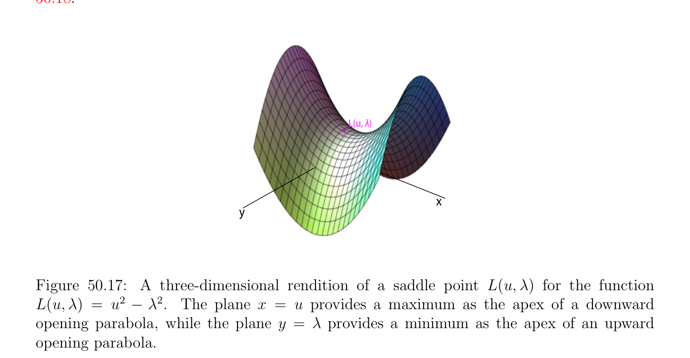
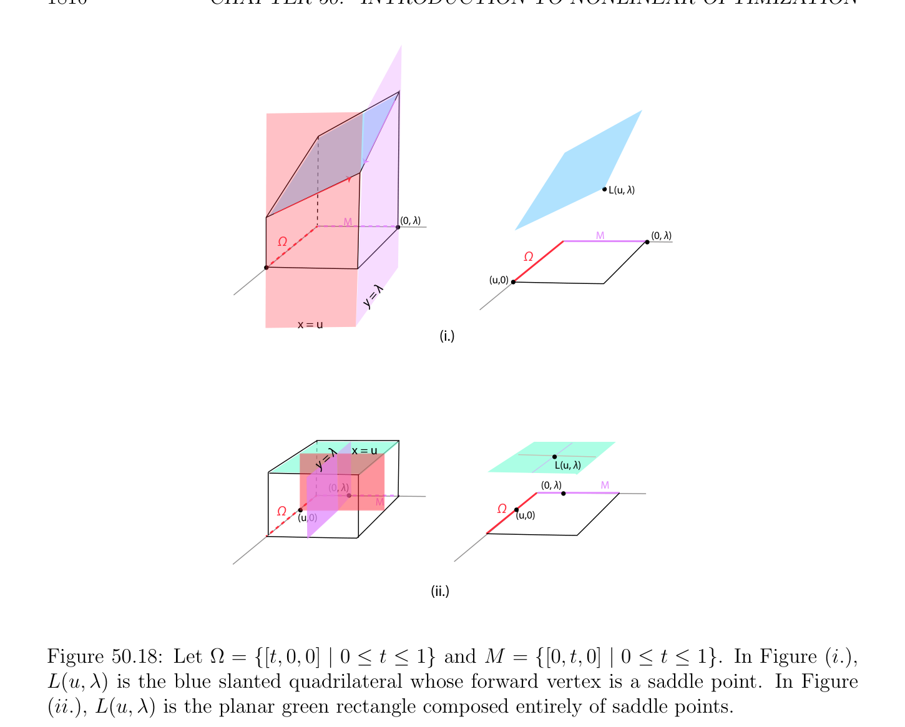

# Hàm Lagrange (Lagrangian) Đối ngẫu và Saddle Các điểm

<!-- PAGE 1807 -->
Thì bởi $(*_{1})$ ta thu được
$$w = \frac{2(uv)}{(u -v)^{\top}(u -v)} -.$$
Ta kiểm chứng dễ dàng rằng
$$2(u_{1} -v_{1})x_{1} + \cdots  + 2(u_{n} -v_{n})x_{n} = (u_{1}^{2} + \cdots  + u_{n}^{2}) -(v_{1}^{2} + \cdots  + v_{n}^{2})$$
Là phương trình của đường phân giác siêu phẳng (hyperplane) giữa $u$ và $v$; xem Hình 50.16.
$$u$$
$$p$$
$$v$$

**Hình 50.16:** $In\mathbb{R}^{3}$, nghiệm đến Lề cứng (hard margin) $SVM_{h2}$ cho các điểm $u$ và $v$ là tím vuông góc phẳng đường phân giác của $u$ - $v$. Trong mục tiếp theo ta sẽ derive đối ngẫu (dual) của tối ưu hóa bài toán được thảo luận trong mục này. Ta sẽ cũng xét nhiều hơn/thêm flexible nghiệm involvlng lề mềm (soft margin).

## 50.7 Hàm Lagrange (Lagrangian) Đối ngẫu và Saddle Các điểm

Trong mục này ta investigate các phương pháp để giải Cực tiểu hóa Bài toán $(P)$:
$$minimizeJ(v)$$
$$subject to \phi_{i} (v) \le 0,i = 1, \dots  , m.$$
Hóa ra là dưới nhất định các điều kiện ban đầu Bài toán $(P)$, được gọi là bài toán gốc (primal problem), có thể được được giải trong hai các giai đoạn với help một cái khác Bài toán $(D)$, được gọi là bài toán đối ngẫu (dual problem). Bài toán đối ngẫu (dual problem) $(D)$ là cực đại hóa bài toán liên quan đến hàm $G$, được gọi là Hàm Lagrange (Lagrangian)

<!-- PAGE 1808 -->
Đối ngẫu (dual), và nó là thu được bởi cực tiểu hóa Hàm Lagrange (Lagrangian) L(v, $\mu$) của Bài toán $(P)$ trên biến $v \in \mathbb{R}^{n}$, giữ $\mu$ cố định, ở đâu $L: \Omega \times \mathbb{R}_{+}^{m} \to \mathbb{R}$ được cho bởi
$$L(v, \mu ) = J(v) + \sum_{i=1}^{m}  \mu_{i} \phi_{i} (v),$$
Với $\mu  \in \mathbb{R}_{+}^{m}$. hai các bước của phương pháp là:
$(1)$ Tìm đối ngẫu (dual) hàm $\mu  \mapsto G(\mu$) explictly bởi việc giải cực tiểu hóa bài toán của việc tìm cực tiểu của L(v, $\mu$) đối với $v \in \Omega$, giữ $\mu$ cố định. Điều này là không ràng buộc cực tiểu hóa bài toán (với $v \in \Omega$). Nếu ta là lucky, duy nhất điểm cực tiểu hóa $u_{\mu}$ sao cho $G(\mu$) $= L(u_{\mu}, \mu$) có thể được tìm thấy. Ta sẽ address vấn đề của tính duy nhất sau này.
$(2)$ Giải cực đại hóa bài toán của việc tìm cực đại của hàm $\mu  \mapsto G(\mu$) trên tất cả $\mu  \in \mathbb{R}_{+}^{m}$. Điều này là basically không ràng buộc bài toán, ngoại trừ cho sự kiện rằng $\mu  \in \mathbb{R}_{+}^{m}$. Nếu Các bước $(1)$ và $(2)$ là successful, dưới một số phù hợp các điều kiện trên hàm $J$ và các ràng buộc $\phi_{i}$ (ví dụ, nếu chúng là lồi), với mọi nghiệm $\lambda  \in \mathbb{R}_{+}^{m}$ thu được trong Bước $(2)$, vectơ $u_{\lambda}$ thu được trong Bước $(1)$ là nghiệm tối ưu (optimal solution) của Bài toán $(P)$. Điều này được chứng minh trong Định lý 50.17. Trong thứ tự để chứng minh Định lý 50.17, mà là của ta chính kết quả, ta cần hai trung gian technical các kết quả của độc lập interest liên quan đến khái niệm của điểm yên ngựa (saddle point). địa phương các cực tiểu của hàm $J$: $\Omega \to \mathbb{R}$ trên miền xác định $U$ được định nghĩa bởi bất đẳng thức các ràng buộc là saddle các điểm của Hàm Lagrange (Lagrangian) L(v, $\mu$) liên kết với $J$ và các ràng buộc $\phi_{i}$. Thì, dưới một số nhẹ các giả thiết, tập hợp của các nghiệm của Cực tiểu hóa Bài toán $(P)$
$$minimizeJ(v)$$
$$subject to \phi_{i} (v) \le 0,i = 1, \dots  , m$$
Trùng với với tập hợp của thứ nhất các đối số/lập luận của saddle các điểm của Hàm Lagrange (Lagrangian)
$$L(v, \mu ) = J(v) + \sum_{i=1}^{m}  \mu_{i} \phi_{i} (v).$$
Điều này được chứng minh trong Định lý 50.15. để chứng minh Định lý 50.17, ta cũng cần Mệnh đề 50.14, cơ bản tính chất của saddle các điểm.

<!-- PAGE 1809 -->

> **Định nghĩa 50.7.** Cho $L: \Omega \times  M \to \mathbb{R}$ là hàm được định nghĩa trên tập hợp của tạo thành $\Omega \times  M$, ở đâu $\Omega$ và $M$ là mở các tập con của hai các không gian vectơ định chuẩn. điểm $(u, \lambda$) $\in \Omega \times  M$ là điểm yên ngựa (saddle point) của $L$ nếu $u$ là cực tiểu của hàm L(-, $\lambda$): $\Omega \to \mathbb{R}$ cho trước bởi $v \mapsto$ L(v, $\lambda$) với mọi $v \in \Omega$ và $\lambda$ cố định, và $\lambda$ là cực đại của hàm L(u, -): $M \to \mathbb{R}$ cho trước bởi $\mu  \mapsto$ L(u, $\mu$) với mọi $\mu  \in M$ và $u$ cố định; tương đương,
$$supL(u, \mu ) = L(u, \lambda ) = infL(v, \lambda ).$$
$$\mu \in Mv\in \Omega$$
Lưu ý rằng thứ tự của các đối số/lập luận $u$ và $\lambda$ là quan trọng. thứ hai tập hợp $M$ sẽ là tập hợp của suy rộng/tổng quát hóa các nhân tử, và điều này là tại sao ta sử dụng ký hiệu $M$. Typically, $M =\mathbb{R}_{+}^{m}$. điểm yên ngựa (saddle point) là thường depicted như mountain đi qua, mà các giải thích thuật ngữ; xem Hình 50.17. Tuy nhiên, điều này là bit misleading vì khác các tình huống là khả dĩ/có thể; xem Hình 50.18.
$$L(u, \lambda )$$
$$x$$
$$y$$

**Hình 50.17:** ba chiều rendition của điểm yên ngựa (saddle point) L(u, $\lambda$) cho hàm L(u, $\lambda$) $= u^{2}$ - $\lambda^{2}$. mặt phẳng $x = u$ cung cấp cực đại như đỉnh của downward mở parabol, trong khi mặt phẳng $y = \lambda$ cung cấp cực tiểu như đỉnh của upward mở parabol.

> **Mệnh đề 50.14.** Nếu $(u, \lambda$) là điểm yên ngựa (saddle point) của hàm $L: \Omega \times  M \to \mathbb{R}$, thì
$$supinfL(v, \mu ) = L(u, \lambda ) = infsupL(v, \mu ).$$
$$\mu \in Mv\in \Omega v\in \Omega \mu \in M$$

*Chứng minh.* Thứ nhất ta chứng minh rằng sau đây bất đẳng thức luôn luôn nghiệm đúng:
$$supinfL(v, \mu ) \le infsupL(v, \mu ).(*_{1})$$
$$\mu \in Mv\in \Omega v\in \Omega \mu \in M$$

<!-- PAGE 1810 -->
$$L(u, \lambda )$$
$$M(0, \lambda )$$
$$\Omega M(0, \lambda )$$
$$\Omega$$
$$(u,0)$$
$$\lambda$$
$$=$$
$$y$$
$$x = u$$
$$(i.)$$
$$\lambda x = u$$
$$y =$$
$$\overline{L(u,}\overline{\lambda}\overline{)}$$
$$(0, \lambda )(0, \lambda )M$$
$$\overline{M}\Omega$$
$$\Omega (u,0)$$
$$(u,0)$$
$$(ii.)$$

**Hình 50.18:** Cho $\Omega = {[t, 0, 0]$ | $0 \le t \le 1}$ và $M = {[0, t, 0]$ | $0 \le t \le 1}$. Trong Hình $(i.)$, L(u, $\lambda$) là xanh lam slanted quadrilateral có forward đỉnh là điểm yên ngựa (saddle point). Trong Hình (ii.), L(u, $\lambda$) là phẳng xanh lục rectangle composed hoàn toàn của saddle các điểm. Chọn bất kỳ $w \in \Omega$ và bất kỳ $\rho  \in M$. Theo định nghĩa của inf (lớn nhất thấp hơn cận) và sup (least trên cận), ta có
$$infL(v, \rho ) \le L(w, \rho ) \le supL(w, \mu ).$$
$$v\in \Omega \mu \in M$$
Các trường hợp ở đâu $inf_{v\in\Omega}$ L(v, $\rho$) $= -\infty$ hoặc ở đâu $sup_{\mu\in M}$ L(w, $\mu$) $= +\infty$ có thể phát sinh, nhưng điều này là không bài toán. Vì
$$infL(v, \rho ) \le supL(w, \mu )$$
$$v\in \Omega \mu \in M$$
Và vế phải là độc lập của $\rho$, nó là trên cận của vế trái với mọi $\rho$, do đó
$$supinfL(v, \mu ) \le supL(w, \mu ).$$
$$\mu \in Mv\in \Omega \mu \in M$$

<!-- PAGE 1811 -->
Vì vế trái là độc lập của $w$, nó là thấp hơn cận cho vế phải với mọi $w$, do đó ta thu được $(*_{1})$:
$$supinfL(v, \mu ) \le infsupL(v, \mu ).$$
$$\mu \in Mv\in \Omega v\in \Omega \mu \in M$$
Để thu được reverse bất đẳng thức, ta sử dụng sự kiện rằng $(u, \lambda$) là điểm yên ngựa (saddle point), do đó
$$infsupL(v, \mu ) \le supL(u, \mu ) = L(u, \lambda )$$
$$v\in \Omega \mu \in M\mu \in M$$
Và
$$L(u, \lambda ) = infL(v, \lambda ) \le supinfL(v, \mu ),$$
$$v\in \Omega \mu \in Mv\in \Omega$$
Và các phần tử này suy ra rằng
$$infsupL(v, \mu ) \le supinfL(v, \mu ),(*_{2})$$
$$v\in \Omega \mu \in M\mu \in Mv\in \Omega$$
Như mong muốn. Ta bây giờ trả về đến của ta chính Cực tiểu hóa Bài toán $(P)$:
$$minimizeJ(v)$$
$$subject to \phi_{i} (v) \le 0,i = 1, \dots  , m,$$
Ở đâu $J$: $\Omega \to \mathbb{R}$ và các ràng buộc $\phi_{i}$: $\Omega \to \mathbb{R}$ là một số các hàm được định nghĩa trên một số mở tập con $\Omega$ của một số hữu hạn chiều Euclidean không gian vectơ (vector space) $V$ (tổng quát hơn, thực Không gian Hilbert (Hilbert space) $V$).

> **Định nghĩa 50.8.** Hàm Lagrange (Lagrangian) của Cực tiểu hóa Bài toán $(P)$ được định nghĩa ở trên là hàm $L: \Omega \times \mathbb{R}_{+}^{m} \to \mathbb{R}$ cho trước bởi
$$L(v, \mu ) = J(v) + \sum_{i=1}^{m}  \mu_{i} \phi_{i} (v),$$
Với $\mu  = (\mu_{1} , \dots  , \mu_{m}$). các số $\mu_{i}$ được gọi là suy rộng/tổng quát hóa Các nhân tử Lagrange (Lagrange multipliers). sau đây định lý chỉ ra rằng dưới một số phù hợp các điều kiện, mọi nghiệm $u$ của Bài toán $(P)$ là thứ nhất lập luận của điểm yên ngựa (saddle point) $(u, \lambda$) của Hàm Lagrange (Lagrangian) $L$, và ngược lại, nếu $(u, \lambda$) là điểm yên ngựa (saddle point) của Hàm Lagrange (Lagrangian) $L$, thì $u$ là nghiệm của Bài toán $(P)$.

> **Định lý 50.15.** Xét Bài toán $(P)$ được định nghĩa ở trên ở đâu $J$: $\Omega \to \mathbb{R}$ và các ràng buộc $\phi_{i}$: $\Omega \to \mathbb{R}$ là một số các hàm được định nghĩa trên một số mở tập con $\Omega$ của một số hữu hạn chiều Euclidean không gian vectơ (vector space) $V$ (tổng quát hơn, thực Không gian Hilbert (Hilbert space) $V$). sau đây các sự kiện đúng.
$(1)$ Nếu $(u, \lambda$) $\in \Omega \times \mathbb{R}_{+}^{m}$ là điểm yên ngựa (saddle point) của Hàm Lagrange (Lagrangian) $L$ liên kết với Bài toán $(P)$, thì $u \in U, u$ là nghiệm của Bài toán $(P)$, và J(u) $=$ L(u, $\lambda$).

<!-- PAGE 1812 -->
$(2)$ Nếu $\Omega$ là lồi (mở), nếu các hàm $\phi_{i}  (1 \le i \le m)$ và $J$ là lồi và khả vi (differentiable) tại điểm $u \in U$, nếu các ràng buộc là qualified, và nếu $u \in U$ là cực tiểu của Bài toán $(P)$, thì tồn tại một vectơ $\lambda  \in \mathbb{R}_{+}^{m}$ sao cho cặp $(u, \lambda$) $\in \Omega \times \mathbb{R}_{+}^{m}$ là điểm yên ngựa (saddle point) của Hàm Lagrange (Lagrangian) $L$.

*Chứng minh.* $(1)$ Vì $(u, \lambda$) là điểm yên ngựa (saddle point) của $L$ ta có $sup_{\mu\in Rm}$ L(u, $\mu$) $=$ L(u, $\lambda$) mà suy ra
$$+$$
Rằng L(u, $\mu$) $\le$ L(u, $\lambda$) với mọi $\mu  \in \mathbb{R}_{+}^{m}$, mà có nghĩa là
$$J(u) + \sum_{i=1}^{m}  \mu_{i} \phi_{i} (u) \le J(u) + \sum_{i=1}^{m}  \lambda_{i} \phi_{i} (u),$$
Rằng là,
$$\sum_{i=1}^{m}  (\mu_{i}  -\lambda_{i} )\phi_{i} (u) \le 0for all \mu  \in \mathbb{R}_{+}^{m}.$$
Nếu ta cho mỗi $\mu_{i}$ là lớn đủ, thì $\mu_{i}$ - $\lambda_{i}  > 0$, và nếu ta đã có $\phi_{i} (u) > 0$, thì số hạng $(\mu_{i}$ - $\lambda_{i} )\phi_{i} (u)$ có thể được tạo arbitrarily lớn và dương, do đó ta kết luận rằng $\phi_{i} (u) \le 0$
$$for i = 1, \dots  , m, and consequently, u \in U. For \mu  = 0, we conclude that \sum_{i}  m \lambda_{i} \phi_{i} (u) \ge 0.$$
$$However, since \lambda_{i}  \ge 0 and \phi_{i} (u) \le 0, (since u \in U), we have \sum_{i}  m=1 \lambda_{i} \phi_{i} (u) \le^{=1} 0. Combining$$
Các phần tử này hai các bất đẳng thức chỉ ra rằng
$$\sum_{i=1}^{m}  \lambda_{i} \phi_{i} (u) = 0.(*_{1})$$
Điều này chỉ ra rằng J(u) $=$ L(u, $\lambda$). Vì bất đẳng thức L(u, $\lambda$) $\le$ L(v, $\lambda$) là
$$J(u) + \sum_{i=1}^{m}  \lambda_{i} \phi_{i} (u) \le J(v) + \sum_{i=1}^{m}  \lambda_{i} \phi_{i} (v),$$
Bởi $(*_{1})$ ta thu được
$$J(u) \le J(v) + \sum_{i=1}^{m}  \lambda_{i} \phi_{i} (v)for all v \in \Omega$$
$$\le J(v)for all v \in U (since \phi_{i} (v) \le 0 and \lambda_{i}  \ge 0),$$
Mà chỉ ra rằng $u$ là cực tiểu của $J$ trên $U$.
$(2)$ các giả thiết cần thiết để áp dụng Định lý 50.6(1) được thỏa mãn. Hệ quả là nếu $u \in U$ là nghiệm của Bài toán $(P)$, thì tồn tại một vectơ $\lambda  \in \mathbb{R}_{+}^{m}$ sao cho KKT các điều kiện đúng:
$$J'(u) + \sum_{i=1}^{m}  \lambda_{i} (\phi_{i}' )_{u} = 0and \sum_{i=1}^{m}  \lambda_{i} \phi_{i} (u) = 0.$$

<!-- PAGE 1813 -->
Phương trình thứ hai cho ta
$$L(u, \mu ) = J(u) + \sum_{i=1}^{m}  \mu_{i} \phi_{i} (u) \le J(u) = J(u) + \sum_{i=1}^{m}  \lambda_{i} \phi_{i} (u) = L(u, \lambda ),$$
Rằng là,
$$L(u, \mu ) \le L(u, \lambda )for all \mu  \in \mathbb{R}_{+}^{m}(*_{2})$$
$$(since \phi_{i} (u) \le 0 as u \in U), and since the function v \mapsto J(v) + \sum_{i}  \lambda_{i} \phi_{i} (v) = L(v, \lambda ) is$$
Lồi như tổng của các hàm lồi, theo Định lý 40.13(4), $first^{=1}$ phương trình là đủ điều kiện cho sự tồn tại của cực tiểu. Hệ quả là,
$$L(u, \lambda ) \le L(v, \lambda )for all v \in \Omega ,(*_{3})$$
Và $(*_{2})$ và $(*_{3})$ chỉ ra rằng $(u, \lambda$) là điểm yên ngựa (saddle point) của $L$. Đến recap những gì ta chỉ được chứng minh, dưới một số nhẹ các giả thiết, tập hợp của các nghiệm của Cực tiểu hóa Bài toán $(P)$
$$minimizeJ(v)$$
$$subject to \phi_{i} (v) \le 0,i = 1, \dots  , m$$
Trùng với với tập hợp của thứ nhất các đối số/lập luận của saddle các điểm của Hàm Lagrange (Lagrangian)
$$L(v, \mu ) = J(v) + \sum_{i=1}^{m}  \mu_{i} \phi_{i} (v),$$
Và với mọi tối ưu $u \in U$ của Bài toán $(P)$, ta có J(u) $=$ L(u, $\lambda$). Vì vậy, nếu ta knew một số cụ thể thứ hai lập luận $\lambda$ của các phần tử này saddle các điểm, thì có ràng buộc Bài toán $(P)$ sẽ được thay thế bởi không ràng buộc Bài toán $(P_{\lambda})$:
$$find u_{\lambda} \in \Omega such that$$
$$L(u_{\lambda}, \lambda ) = infL(v, \lambda ).$$
$$v\in \Omega$$
Cách mà thực hiện ta tìm như vậy phần tử $\lambda  \in \mathbb{R}_{+}^{m}$? Cho điều này, nhớ rằng cho điểm yên ngựa (saddle point) $(u_{\lambda}, \lambda$), theo Mệnh đề 50.14, ta có
$$L(u_{\lambda}, \lambda ) = infL(v, \lambda ) = supinfL(v, \mu ),$$
$$v\in \Omega \mu \in \mathbb{R} mv\in \Omega$$
$$+$$
Do đó ta là một cách tự nhiên đã dẫn đến đến giới thiệu hàm $G: \mathbb{R}_{+}^{m} \to \mathbb{R}$ cho trước bởi
$$G(\mu ) = infL(v, \mu )\mu  \in \mathbb{R}_{+}^{m},$$
$$v\in \Omega$$

<!-- PAGE 1814 -->
Và thì $\lambda$ sẽ là nghiệm của bài toán
$$find \lambda  \in \mathbb{R}_{+}^{m} such that$$
$$G(\lambda ) = supG(\mu ),$$
$$\mu \in \mathbb{R} m$$
$$+$$
Mà là tương đương đến Cực đại hóa Bài toán $(D)$:
$$maximizeG(\mu )$$
$$subject to \mu  \in \mathbb{R}_{+}^{m}.$$

> **Định nghĩa 50.9.** Cho trước Cực tiểu hóa Bài toán $(P)$
$$minimizeJ(v)$$
$$subject to \phi_{i} (v) \le 0,i = 1, \dots  , m,$$
Ở đâu $J$: $\Omega \to \mathbb{R}$ và các ràng buộc $\phi_{i}$: $\Omega \to \mathbb{R}$ là một số các hàm được định nghĩa trên một số mở tập con $\Omega$ của một số hữu hạn chiều Euclidean không gian vectơ (vector space) $V$ (tổng quát hơn, thực Không gian Hilbert (Hilbert space) $V$), hàm $G: \mathbb{R}_{+}^{m} \to \mathbb{R}$ cho trước bởi
$$G(\mu ) = infL(v, \mu )\mu  \in \mathbb{R}_{+}^{m},$$
$$v\in \Omega$$
Được gọi là Lagrange đối ngẫu (dual) hàm (hoặc đơn giản đối ngẫu (dual) hàm). Bài toán $(D)$
$$maximizeG(\mu )$$
$$subject to \mu  \in \mathbb{R}_{+}^{m}$$
Được gọi là Lagrange bài toán đối ngẫu (dual problem). Bài toán $(P)$ là thường được gọi là bài toán gốc (primal problem), và $(D)$ là bài toán đối ngẫu (dual problem). biến $\mu$ được gọi là đối ngẫu (dual) biến. biến $\mu  \in \mathbb{R}_{+}^{m}$ được nói là đối ngẫu (dual) chấp nhận được (feasible) nếu $G(\mu$) được định nghĩa (không $-\infty$). Nếu $\lambda  \in \mathbb{R}_{+}^{m}$ là cực đại của $G$, thì ta gọi nó đối ngẫu (dual) tối ưu hoặc tối ưu Nhân tử Lagrange (Lagrange multiplier). Vì
$$L(v, \mu ) = J(v) + \sum_{i=1}^{m}  \mu_{i} \phi_{i} (v),$$
Hàm $G(\mu$) $= inf_{v\in\Omega}$ L(v, $\mu$) là từng điểm cận dưới đúng (infimum) của một số afin các hàm của $\mu$, do đó nó là lõm, chẵn/ngay cả nếu $\phi_{i}$ là không lồi. Một của chính advantages của bài toán đối ngẫu (dual problem) trên bài toán gốc (primal problem) là rằng nó là lồi tối ưu hóa bài toán, vì ta muốn để cực đại hóa lõm hàm mục tiêu (objective function) $G$ (do đó cực tiểu hóa $-G$, hàm lồi (convex function)), và các ràng buộc $\mu  \ge 0$ là lồi. Trong số của thực tế các tình huống, đối ngẫu (dual) hàm $G$ có thể thật vậy được tính. là perfectly chặt chẽ, ta nên mention rằng đối ngẫu (dual) hàm $G$ là thực sự riêng hàm, bởi vì nó lấy giá trị $-\infty$ khi ánh xạ $v \mapsto$ L(v, $\mu$) là không bị chặn ở dưới.

<!-- PAGE 1815 -->

> **Ví dụ 50.5.** Xét Bài toán quy hoạch tuyến tính (linear program) $(P)$
$$minimizec^{\top}v$$
$$subject to Av \le b, v \ge 0,$$
Ở đâu $A$ là một ma trận cỡ $m\times n$. các ràng buộc $v \ge 0$ được viết lại như $-v_{i} \le 0$, do đó ta giới thiệu Các nhân tử Lagrange (Lagrange multipliers) $\mu  \in \mathbb{R}_{+}^{m}$ và $\nu  \in \mathbb{R}_{+}^{n}$, và ta có Hàm Lagrange (Lagrangian)
$$L(v, \mu , \nu ) = c^{\top}v + \mu^{\top} (Av -b) -\nu^{\top} v$$
$$= -b^{\top}\mu  + (c + A^{\top}\mu  -\nu )^{\top}v.$$
Để tìm $G(\mu , \nu$), ta cần để cực tiểu hóa ánh xạ afin (affine map) $v \mapsto (c + A^{\top}\mu$ - $\nu )^{\top}v$ - $b^{\top}\mu$, ở đâu $\mathbb{R}^{n} v \in$ là unrestricted. Vì $-b^{\top}\mu$ là hằng số, điều này là tương đương đến cực tiểu hóa tuyến tính hàm $v \mapsto (c + A^{\top}\mu$ - $\nu )^{\top}v$. Nhớ rằng contraints $v \ge 0$ ở đâu incorporated trong Hàm Lagrange (Lagrangian) L(v, $\mu , \nu$) như số hạng $-\nu^{\top} v$, nhưng khi ta cực tiểu hóa L(v, $\mu , \nu$), không có thu hẹp trên $v \in \mathbb{R}^{n}$. tuyến tính hàm $v \mapsto (c + A^{\top}\mu$ - $\nu )^{\top}v$ là không bị chặn ở dưới trừ khi $c + A^{\top}\mu$ - $\nu  = 0$. Điều này là bởi vì nếu vectơ $c + A^{\top}\mu$ - $\nu$ có một số khác không thành phần, nói $\alpha_{i}$, ta có thể chọn $v$ sao cho $v_{j} = 0$ với mọi j̸ $= i$ và cho $v_{i}$ tiến tới đến $+\infty$ nếu $\alpha_{i}  < 0$, hoặc cho $v_{i}$ tiến tới đến $-\infty$ nếu $\alpha_{i}  > 0$, sao cho $(c + A^{\top}\mu$ - $\nu )^{\top}v = \alpha_{i} v_{i}$ tiến tới đến $-\infty$. Suy ra rằng đối ngẫu (dual) hàm $G(\mu , \nu$) $= inf_{v\in Rn}$ L(v, $\mu , \nu$) là cho trước với mọi $\mu  \ge 0$ và $\nu  \ge 0$ bởi
$$($$
$$-b^{\top}\mu if A^{\top}\mu  -\nu  + c = 0,$$
$$G(\mu , \nu ) =$$
$$-\infty otherwise.$$
Miền xác định của $G$ là thực sự/đúng đắn tập con của $\mathbb{R}_{+}^{m} \times \mathbb{R}_{+}^{n}$. Một cái khác cách để thu được $G(\mu , \nu$) là đến nhận thấy rằng hàm $v \mapsto (c+A^{\top}\mu -\nu )^{\top}v -b^{\top}\mu$
$$\mathbb{R}^{n}$$
Là afin, do đó lồi, và vì là lồi và mở, theo Định lý 40.13(4), hàm này (cho $\mu , \nu$ cố định) có cực tiểu tại $v$ khi và chỉ khi
$$\nabla L(-, \mu , \nu )_{v} = c + A^{\top}\mu  -\nu  = 0,$$
Điều kiện độc lập của $v$. Nhưng nếu $c+A^{\top}\mu -\nu  = 0$, hàm $v \mapsto (c+A^{\top}\mu -\nu )^{\top}v-b^{\top}\mu$ là hằng số hàm với giá trị $-b^{\top}\mu$, do đó thật vậy $G(\mu , \nu$) được định nghĩa như ở trên. Nhận thấy rằng giá trị $G(\mu , \nu$) của hàm $G$, khi nó được định nghĩa, là độc lập của thứ hai lập luận $\nu$. Vì ta là interested trong cực đại hóa $G$, điều này suggests giới thiệu hàm $G$ của đơn lẻ lập luận $\mu$ cho trước bởi
$$b$$
$$G(\mu ) = -b^{\top}\mu ,$$
$$b$$
Mà được định nghĩa với mọi $\mu  \in \mathbb{R}_{+}^{m}$.
